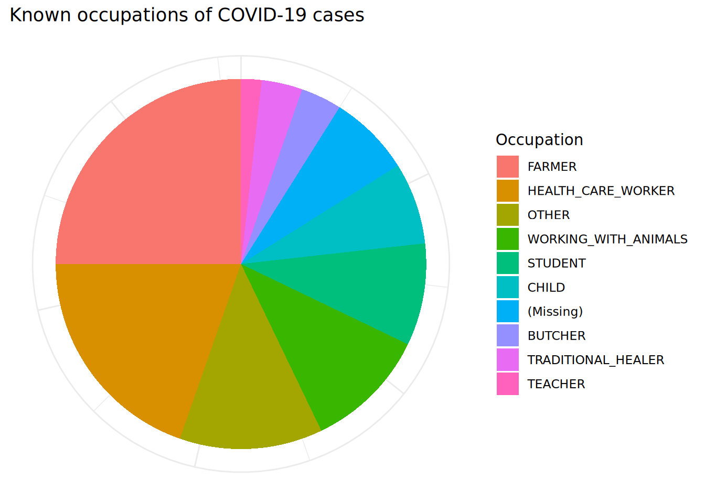
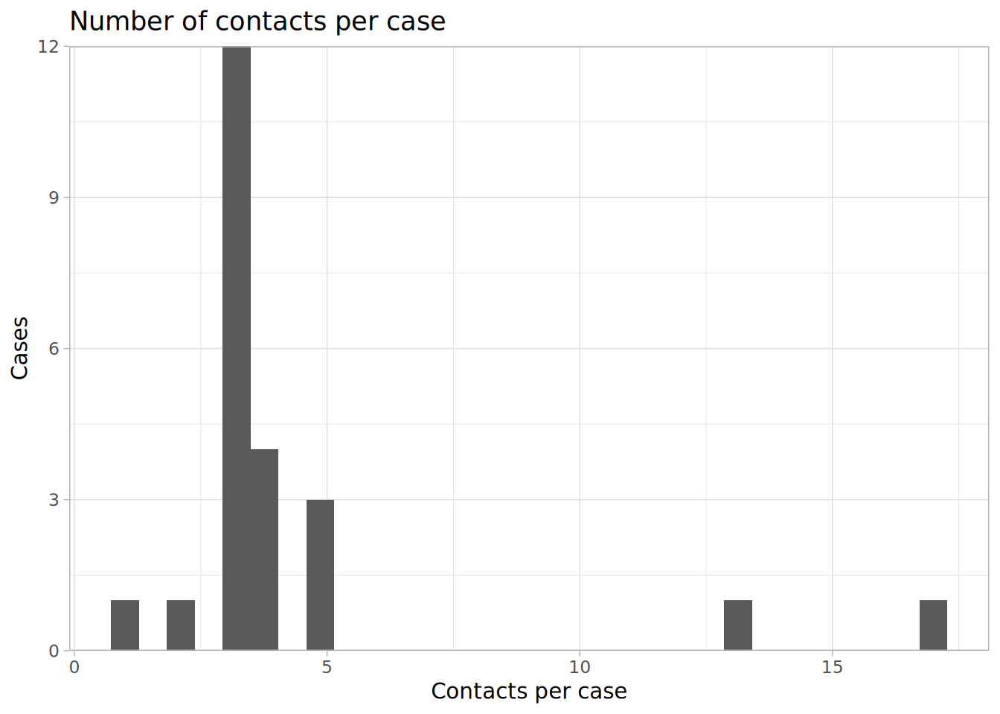
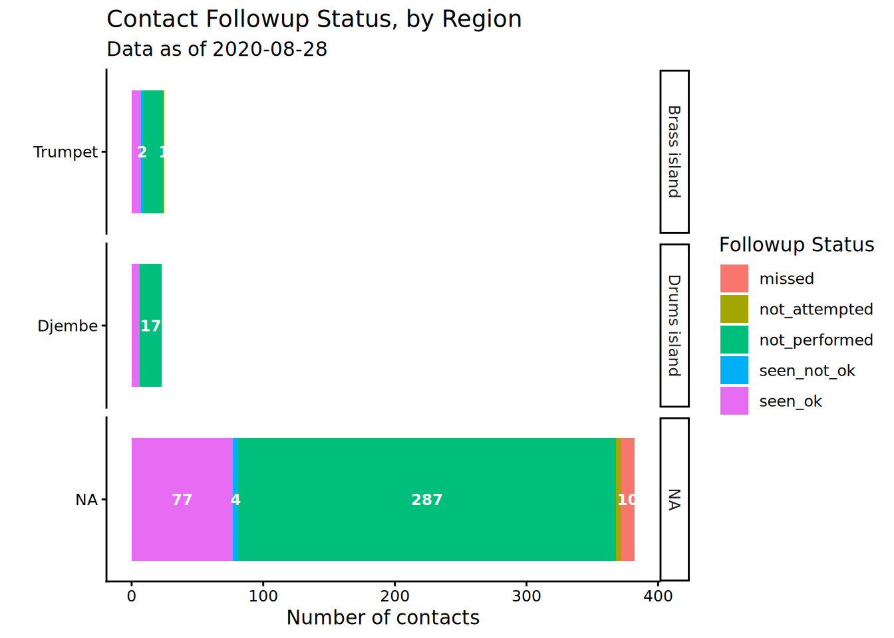

# 25  Contact tracing

This page demonstrates descriptive analysis of contact tracing data, addessing some key considerations and approaches unique to these kinds of data.

This page references many of the core R data management and visualisation competencies covered in other pages (e.g. data cleaning, pivoting, tables, time-series analyses), but we will highlight examples specific to contact tracing that have been useful for operational decision making. For example, this includes visualizing contact tracing follow-up data over time or across geographic areas, or producing clean Key Performance Indicator (KPI) tables for contact tracing supervisors.

For demonstration purposes we will use sample contact tracing data from the [Go.Data](https://www.who.int/tools/godata) platform. The principles covered here will apply for contact tracing data from other platforms - you may just need to undergo different data pre-processing steps depending on the structure of your data.

You can read more about the Go.Data project on the [Github Documentation site](https://worldhealthorganization.github.io/godata/) or [Community of Practice](https://community-godata.who.int/).

## 25.1 Preparation

### Load packages

This code chunk shows the loading of packages required for the analyses. In this handbook we emphasize `p_load()` from **pacman**, which installs the package if necessary *and* loads it for use. You can also load installed packages with `library()` from **base** R. See the page on [R basics](basics.llms.md) for more information on R packages.

``` r
pacman::p_load(
  rio,          # importing data  
  here,         # relative file pathways  
  janitor,      # data cleaning and tables
  lubridate,    # working with dates
  epikit,       # age_categories() function
  apyramid,     # age pyramids
  tidyverse,    # data manipulation and visualization
  RColorBrewer, # color palettes
  formattable,  # fancy tables
  kableExtra,   # table formatting
  appliedepidata # example datasets used in this handbook
)
```

### Import data

We will import sample datasets of contacts, and of their “follow-up”. These data have been retrieved and un-nested from the Go.Data API and stored as “.rds” files.

You can download all the example data for this handbook from the [Download handbook and data](download.llms.md) page.

If you want to download the example contact tracing data specific to this page, use the three download links below:

[Click to download the case investigation data (.rds file)](https://github.com/WorldHealthOrganization/godata/blob/master/analytics/r-reporting/data/cases_clean.rds?raw=true)

[Click to download the contact registration data (.rds file)](https://github.com/WorldHealthOrganization/godata/blob/master/analytics/r-reporting/data/contacts_clean.rds?raw=true)

[Click to download the contact follow-up data (.rds file)](https://github.com/WorldHealthOrganization/godata/blob/master/analytics/r-reporting/data/followups_clean.rds?raw=true)

In their original form in the downloadable files, the data reflect data as provided by the Go.Data API (learn about [APIs here](importing.llms.md#import_api)). For example purposes here, we will clean the data to make it easier to read on this page. If you are using a Go.Data instance, you can view complete instructions on how to retrieve your data [here](https://github.com/WorldHealthOrganization/godata/tree/master/analytics/r-reporting).

Below, the datasets are imported using the `import()` function from the **rio** package. See the page on [Import and export](importing.llms.md) for various ways to import data. We use `here()` to specify the file path - you should provide the file path specific to your computer. We then use `select()` to select only certain columns of the data, to simplify for purposes of demonstration.

#### Case data

These data are a table of the cases, and information about them.

``` r
cases <- appliedepidata::get_data(name = "cases_clean") %>%
  select(case_id, firstName, lastName, gender, age, age_class,
         occupation, classification, was_contact, hospitalization_typeid)
```

Here are the 56 cases:

#### Contacts data

These data are a table of all the contacts and information about them. Again, provide your own file path. After importing we perform a few preliminary data cleaning steps including:

- Set age_class as a factor and reverse the level order so that younger ages are first  
- Select only certain column, while re-naming a one of them  
- Artificially assign rows with missing admin level 2 to “Djembe”, to improve clarity of some example visualisations

``` r
contacts <- appliedepidata::get_data(name = "contacts_clean") %>%
  mutate(age_class = forcats::fct_rev(age_class)) %>% 
  select(contact_id, contact_status, firstName, lastName, gender, age,
         age_class, occupation, date_of_reporting, date_of_data_entry,
         date_of_last_exposure = date_of_last_contact,
         date_of_followup_start, date_of_followup_end, risk_level, was_case, admin_2_name) %>% 
  mutate(admin_2_name = replace_na(admin_2_name, "Djembe"))
```

Here are the 66 rows of the `contacts` dataset:

#### Follow-up data

These data are records of the “follow-up” interactions with the contacts. Each contact is supposed to have an encounter each day for 14 days after their exposure.

We import and perform a few cleaning steps. We select certain columns, and also convert a character column to all lowercase values.

``` r
followups <- appliedepidata::get_data(name = "followups_clean") %>%
  select(contact_id, followup_status, followup_number,
         date_of_followup, admin_2_name, admin_1_name) %>% 
  mutate(followup_status = str_to_lower(followup_status))
```

Here are the first 50 rows of the 437-row `followups` dataset (each row is a follow-up interaction, with outcome status in the `followup_status` column):

#### Relationships data

Here we import data showing the relationship between cases and contacts. We select certain column to show.

``` r
relationships <- appliedepidata::get_data(name = "relationships_clean") %>%
  select(source_visualid, source_gender, source_age, date_of_last_contact,
         date_of_data_entry, target_visualid, target_gender,
         target_age, exposure_type)
```

Below are the first 50 rows of the `relationships` dataset, which records all relationships between cases and contacts.

## 25.2 Descriptive analyses

You can use the techniques covered in other pages of this handbook to conduct descriptive analyses of your cases, contacts, and their relationships. Below are some examples.

### Demographics

As demonstrated in the page covering [Demographic pyramids](age_pyramid.llms.md), you can visualise the age and gender distribution (here we use the **apyramid** package).

#### Age and Gender of contacts

The pyramid below compares the age distribution of contacts, by gender. Note that contacts missing age are included in their own bar at the top. You can change this default behavior, but then consider listing the number missing in a caption.

``` r
apyramid::age_pyramid(
  data = contacts,                                   # use contacts dataset
  age_group = "age_class",                           # categorical age column
  split_by = "gender") +                             # gender for halfs of pyramid
  labs(
    fill = "Gender",                                 # title of legend
    title = "Age/Sex Pyramid of COVID-19 contacts")+ # title of the plot
  theme_minimal()                                    # simple background
```

[](contact_tracing_files/figure-html/unnamed-chunk-10-1.png)

With the Go.Data data structure, the `relationships` dataset contains the ages of both cases and contacts, so you could use that dataset and create an age pyramid showing the differences between these two groups of people. The `relationships` data frame will be mutated to transform the numberic age columns into categories (see the [Cleaning data and core functions](cleaning.llms.md) page). We also pivot the dataframe longer to facilitate easy plotting with **ggplot2** (see [Pivoting data](pivoting.llms.md)).

``` r
relation_age <- relationships %>% 
  select(source_age, target_age) %>% 
  transmute(                              # transmute is like mutate() but removes all other columns not mentioned
    source_age_class = epikit::age_categories(source_age, breakers = seq(0, 80, 5)),
    target_age_class = epikit::age_categories(target_age, breakers = seq(0, 80, 5)),
    ) %>% 
  pivot_longer(cols = contains("class"), names_to = "category", values_to = "age_class")  # pivot longer


relation_age
```

    # A tibble: 200 × 2
       category         age_class
       <chr>            <fct>    
     1 source_age_class 80+      
     2 target_age_class 15-19    
     3 source_age_class <NA>     
     4 target_age_class 50-54    
     5 source_age_class <NA>     
     6 target_age_class 20-24    
     7 source_age_class 30-34    
     8 target_age_class 45-49    
     9 source_age_class 40-44    
    10 target_age_class 30-34    
    # ℹ 190 more rows

Now we can plot this transformed dataset with `age_pyramid()` as before, but replacing `gender` with `category` (contact, or case).

``` r
apyramid::age_pyramid(
  data = drop_na(relation_age, age_class),                               # use modified relationship dataset
  age_group = "age_class",                           # categorical age column
  split_by = "category") +                           # by cases and contacts
  scale_fill_manual(
    values = c("orange", "purple"),                  # to specify colors AND labels
    labels = c("Case", "Contact"))+
  labs(
    fill = "Legend",                                           # title of legend
    title = "Age/Sex Pyramid of COVID-19 contacts and cases")+ # title of the plot
  theme_minimal()                                              # simple background
```

[](contact_tracing_files/figure-html/unnamed-chunk-12-1.png)

We can also view other characteristics such as occupational breakdown (e.g. in form of a pie chart).

``` r
# Clean dataset and get counts by occupation
occ_plot_data <- cases %>% 
  mutate(occupation = forcats::fct_na_value_to_level(occupation, level = "(Missing)"),  # make NA missing values a category
         occupation = forcats::fct_infreq(occupation)) %>%   # order factor levels in order of frequency
  count(occupation)                                          # get counts by occupation
  
# Make pie chart
ggplot(data = occ_plot_data, mapping = aes(x = "", y = n, fill = occupation))+
  geom_bar(width = 1, stat = "identity") +
  coord_polar("y", start = 0) +
  labs(
    fill = "Occupation",
    title = "Known occupations of COVID-19 cases")+
  theme_minimal() +                    
  theme(axis.line = element_blank(),
        axis.title = element_blank(),
        axis.text = element_blank())
```

[](contact_tracing_files/figure-html/unnamed-chunk-13-1.png)

### Contacts per case

The number of contacts per case can be an important metric to assess quality of contact enumeration and the compliance of the population toward public health response.

Depending on your data structure, this can be assessed with a dataset that contains all cases and contacts. In the Go.Data datasets, the links between cases (“sources”) and contacts (“targets”) is stored in the `relationships` dataset.

In this dataset, each row is a contact, and the source case is listed in the row. There are no contacts who have relationships with multiple cases, but if this exists you may need to account for those before plotting (and explore them too!).

We begin by counting the number of rows (contacts) per source case. This is saved as a data frame.

``` r
contacts_per_case <- relationships %>% 
  count(source_visualid)

contacts_per_case
```

       source_visualid  n
    1   CASE-2020-0001 13
    2   CASE-2020-0002  5
    3   CASE-2020-0003  2
    4   CASE-2020-0004  4
    5   CASE-2020-0005  5
    6   CASE-2020-0006  3
    7   CASE-2020-0008  3
    8   CASE-2020-0009  3
    9   CASE-2020-0010  3
    10  CASE-2020-0012  3
    11  CASE-2020-0013  5
    12  CASE-2020-0014  3
    13  CASE-2020-0016  3
    14  CASE-2020-0018  4
    15  CASE-2020-0022  3
    16  CASE-2020-0023  4
    17  CASE-2020-0030  3
    18  CASE-2020-0031  3
    19  CASE-2020-0034  4
    20  CASE-2020-0036  1
    21  CASE-2020-0037  3
    22  CASE-2020-0045  3
    23            <NA> 17

We use `geom_histogram()` to plot these data as a histogram.

``` r
ggplot(data = contacts_per_case)+        # begin with count data frame created above
  geom_histogram(mapping = aes(x = n))+  # print histogram of number of contacts per case
  scale_y_continuous(expand = c(0,0))+   # remove excess space below 0 on y-axis
  theme_light()+                         # simplify background
  labs(
    title = "Number of contacts per case",
    y = "Cases",
    x = "Contacts per case"
  )
```

[](contact_tracing_files/figure-html/unnamed-chunk-15-1.png)

## 25.3 Contact Follow Up

Contact tracing data often contain “follow-up” data, which record outcomes of daily symptom checks of persons in quarantine. Analysis of this data can inform response strategy, identify contacts at-risk of loss-to-follow-up or at-risk of developing disease.

### Data cleaning

These data can exist in a variety of formats. They may exist as a “wide” format Excel sheet with one row per contact, and one column per follow-up “day”. See [Pivoting data](pivoting.llms.md) for descriptions of “long” and “wide” data and how to pivot data wider or longer.

In our Go.Data example, these data are stored in the `followups` data frame, which is in a “long” format with one row per follow-up interaction. The first 50 rows look like this:

***CAUTION:*** Beware of duplicates when dealing with followup data; as there could be several erroneous followups on the same day for a given contact. Perhaps it seems to be an error but reflects reality - e.g. a contact tracer could submit a follow-up form early in the day when they could not reach the contact, and submit a second form when they were later reached. It will depend on the operational context for how you want to handle duplicates - just make sure to document your approach clearly.

Let’s *see* how many instances of “duplicate” rows we have:

``` r
followups %>% 
  count(contact_id, date_of_followup) %>%   # get unique contact_days
  filter(n > 1)                             # view records where count is more than 1  
```

      contact_id date_of_followup n
    1       <NA>       2020-09-03 2
    2       <NA>       2020-09-04 2
    3       <NA>       2020-09-05 2

In our example data, the only records that this applies to are ones missing an ID! We can remove those. But, for purposes of demonstration we will go show the steps for de-duplication so there is only one follow-up encoutner per person per day. See the page on [De-duplication](deduplication.llms.md) for more detail. We will assume that the most recent encounter record is the correct one. We also take the opportunity to clean the `followup_number` column (the “day” of follow-up which should range 1 - 14).

``` r
followups_clean <- followups %>%
  
  # De-duplicate
  group_by(contact_id, date_of_followup) %>%        # group rows per contact-day
  arrange(contact_id, desc(date_of_followup)) %>%   # arrange rows, per contact-day, by date of follow-up (most recent at top)
  slice_head() %>%                                  # keep only the first row per unique contact id  
  ungroup() %>% 
  
  # Other cleaning
  mutate(followup_number = replace(followup_number, followup_number > 14, NA)) %>% # clean erroneous data
  drop_na(contact_id)                               # remove rows with missing contact_id
```

For each follow-up encounter, we have a follow-up status (such as whether the encounter occurred and if so, did the contact have symptoms or not). To see all the values we can run a quick `tabyl()` (from **janitor**) or `table()` (from **base** R) (see [Descriptive tables](tables_descriptive.llms.md)) by `followup_status` to see the frequency of each of the outcomes.

In this dataset, “seen_not_ok” means “seen with symptoms”, and “seen_ok” means “seen without symptoms”.

``` r
followups_clean %>% 
  tabyl(followup_status)
```

     followup_status   n    percent
              missed  10 0.02325581
       not_attempted   5 0.01162791
       not_performed 319 0.74186047
         seen_not_ok   6 0.01395349
             seen_ok  90 0.20930233

### Plot over time

As the dates data are continuous, we will use a histogram to plot them with `date_of_followup` assigned to the x-axis. We can achieve a “stacked” histogram by specifying a `fill =` argument within `aes()`, which we assign to the column `followup_status`. Consequently, you can set the legend title using the `fill =` argument of `labs()`.

We can see that the contacts were identified in waves (presumably corresponding with epidemic waves of cases), and that follow-up completion did not seemingly improve over the course of the epidemic.

``` r
ggplot(data = followups_clean)+
  geom_histogram(mapping = aes(x = date_of_followup, fill = followup_status)) +
  scale_fill_discrete(drop = FALSE)+   # show all factor levels (followup_status) in the legend, even those not used
  theme_classic() +
  labs(
    x = "",
    y = "Number of contacts",
    title = "Daily Contact Followup Status",
    fill = "Followup Status",
    subtitle = str_glue("Data as of {max(followups$date_of_followup, na.rm=T)}"))   # dynamic subtitle
```

[](contact_tracing_files/figure-html/unnamed-chunk-20-1.png)

***CAUTION:*** If you are preparing many plots (e.g. for multiple jurisdictions) you will want the legends to appear identically even with varying levels of data completion or data composition. There may be plots for which not all follow-up statuses are present in the data, but you still want those categories to appear the legends. In ggplots (like above), you can specify the `drop = FALSE` argument of the `scale_fill_discrete()`. In tables, use `tabyl()` which shows counts for all factor levels, or if using `count()` from **dplyr** add the argument `.drop = FALSE` to include counts for all factor levels.

### Daily individual tracking

If your outbreak is small enough, you may want to look at each contact individually and see their status over the course of their follow-up. Fortunately, this `followups` dataset already contains a column with the day “number” of follow-up (1-14). If this does not exist in your data, you could create it by calculating the difference between the encounter date and the date follow-up was intended to begin for the contact.

A convenient visualisation mechanism (if the number of cases is not too large) can be a heat plot, made with `geom_tile()`. See more details in the [heat plot](heatmaps.llms.md) page.

``` r
ggplot(data = drop_na(followups_clean, followup_number))+
  geom_tile(mapping = aes(x = followup_number, y = contact_id, fill = followup_status),
            color = "grey")+       # grey gridlines
  scale_fill_manual( values = c("yellow", "grey", "orange", "darkred", "darkgreen"))+
  theme_minimal()+
  scale_x_continuous(breaks = seq(from = 1, to = 14, by = 1))
```

[](contact_tracing_files/figure-html/unnamed-chunk-21-1.png)

### Analyse by group

Perhaps these follow-up data are being viewed on a daily or weekly basis for operational decision-making. You may want more meaningful disaggregations by geographic area or by contact-tracing team. We can do this by adjusting the columns provided to `group_by()`.

``` r
plot_by_region <- followups_clean %>%                                        # begin with follow-up dataset
  count(admin_1_name, admin_2_name, followup_status) %>%   # get counts by unique region-status (creates column 'n' with counts)
  
  # begin ggplot()
  ggplot(                                         # begin ggplot
    mapping = aes(x = reorder(admin_2_name, n),     # reorder admin factor levels by the numeric values in column 'n'
                  y = n,                            # heights of bar from column 'n'
                  fill = followup_status,           # color stacked bars by their status
                  label = n))+                      # to pass to geom_label()              
  geom_col()+                                     # stacked bars, mapping inherited from above 
  geom_text(                                      # add text, mapping inherited from above
    size = 3,                                         
    position = position_stack(vjust = 0.5), 
    color = "white",           
    check_overlap = TRUE,
    fontface = "bold")+
  coord_flip()+
  labs(
    x = "",
    y = "Number of contacts",
    title = "Contact Followup Status, by Region",
    fill = "Followup Status",
    subtitle = str_glue("Data as of {max(followups_clean$date_of_followup, na.rm=T)}")) +
  theme_classic()+                                                                      # Simplify background
  facet_wrap(~admin_1_name, strip.position = "right", scales = "free_y", ncol = 1)      # introduce facets 

plot_by_region
```

[](contact_tracing_files/figure-html/unnamed-chunk-22-1.png)

## 25.4 KPI Tables

There are a number of different Key Performance Indicators (KPIs) that can be calculated and tracked at varying levels of disaggregations and across different time periods to monitor contact tracing performance. Once you have the calculations down and the basic table format; it is fairly easy to swap in and out different KPIs.

There are numerous sources of contact tracing KPIs, such as this one from [ResolveToSaveLives.org](https://contacttracingplaybook.resolvetosavelives.org/checklists/metrics). The majority of the work will be walking through your data structure and thinking through all of the inclusion/exclusion criteria. We show a few examples below; using Go.Data metadata structure:

| Category | Indicator | Go.Data Numerator | Go.Data Denominator |
|----|----|----|----|
| Process Indicator - Speed of Contact Tracing | % cases interviewed and isolated within 24h of case report | COUNT OF `case_id` WHERE (`date_of_reporting` - `date_of_data_entry`) \< 1 day AND (`isolation_startdate` - `date_of_data_entry`) \< 1 day | COUNT OF `case_id` |
| Process Indicator - Speed of Contact Tracing | % contacts notified and quarantined within 24h of elicitation | COUNT OF `contact_id` WHERE `followup_status` == “SEEN_NOT_OK” OR “SEEN_OK” AND `date_of_followup` - `date_of_reporting` \< 1 day | COUNT OF `contact_id` |
| Process Indicator - Completeness of Testing | % new symptomatic cases tested and interviewed within 3 days of onset of symptoms | COUNT OF `case_id` WHERE (`date_of_reporting` - `date_of_onset`) \< =3 days | COUNT OF `case_id` |
| Outcome Indicator - Overall | % new cases among existing contact list | COUNT OF `case_id` WHERE `was_contact` == “TRUE” | COUNT OF `case_id` |

Below we will walk through a sample exercise of creating a nice table visual to show contact follow-up across admin areas. At the end, we will make it fit for presentation with the **formattable** package (but you could use other packages like **flextable** - see [Tables for presentation](tables_presentation.llms.md)).

How you create a table like this will depend on the structure of your contact tracing data. Use the [Descriptive tables](tables_descriptive.llms.md) page to learn how to summarise data using **dplyr** functions.

We will create a table that will be dynamic and change as the data change. To make the results interesting, we will set a `report_date` to allow us to simulate running the table on a certain day (we pick 10th June 2020). The data are filtered to that date.

``` r
# Set "Report date" to simulate running the report with data "as of" this date
report_date <- as.Date("2020-06-10")

# Create follow-up data to reflect the report date.
table_data <- followups_clean %>% 
  filter(date_of_followup <= report_date)
```

Now, based on our data structure, we will do the following:

1.  Begin with the `followups` data and summarise it to contain, for each unique contact:  

- The date of latest record (no matter the status of the encounter)  
- The date of latest encounter where the contact was “seen”  
- The encounter status at that final “seen” encounter (e.g. with symptoms, without symptoms)  

2.  Join these data to the contacts data, which contains other information such as the overall contact status, date of last exposure to a case, etc. Also we will calculate metrics of interest for each contact such as days since last exposure  
3.  We group the enhanced contact data by geographic region (`admin_2_name`) and calculate summary statistics per region  
4.  Finally, we format the table nicely for presentation

First we summarise the follow-up data to get the information of interest:

``` r
followup_info <- table_data %>% 
  group_by(contact_id) %>% 
  summarise(
    date_last_record   = max(date_of_followup, na.rm=T),
    date_last_seen     = if (any(followup_status %in% c("seen_ok", "seen_not_ok"))) max(date_of_followup[followup_status %in% c("seen_ok", "seen_not_ok")], na.rm=T) else as.Date(NA),
    status_last_record = followup_status[which(date_of_followup == date_last_record)]) %>% 
  ungroup()
```

Here is how these data look:

Now we will add this information to the `contacts` dataset, and calculate some additional columns.

``` r
contacts_info <- followup_info %>% 
  right_join(contacts, by = "contact_id") %>% 
  mutate(
    database_date       = max(date_last_record, na.rm=T),
    days_since_seen     = database_date - date_last_seen,
    days_since_exposure = database_date - date_of_last_exposure
    )
```

Here is how these data look. Note `contacts` column to the right, and new calculated column at the far right.

Next we summarise the contacts data by region, to achieve a concise data frame of summary statistic columns.

``` r
contacts_table <- contacts_info %>% 
  
  group_by(`Admin 2` = admin_2_name) %>%
  
  summarise(
    `Registered contacts` = n(),
    `Active contacts`     = sum(contact_status == "UNDER_FOLLOW_UP", na.rm=T),
    `In first week`       = sum(days_since_exposure < 8, na.rm=T),
    `In second week`      = sum(days_since_exposure >= 8 & days_since_exposure < 15, na.rm=T),
    `Became case`         = sum(contact_status == "BECAME_CASE", na.rm=T),
    `Lost to follow up`   = sum(days_since_seen >= 3, na.rm=T),
    `Never seen`          = sum(is.na(date_last_seen)),
    `Followed up - signs` = sum(status_last_record == "Seen_not_ok" & date_last_record == database_date, na.rm=T),
    `Followed up - no signs` = sum(status_last_record == "Seen_ok" & date_last_record == database_date, na.rm=T),
    `Not Followed up`     = sum(
      (status_last_record == "NOT_ATTEMPTED" | status_last_record == "NOT_PERFORMED") &
        date_last_record == database_date, na.rm=T)) %>% 
    
  arrange(desc(`Registered contacts`))
```

And now we apply styling from the **formattable** and **knitr** packages, including a footnote that shows the “as of” date.

``` r
contacts_table %>%
  mutate(
    `Admin 2` = formatter("span", style = ~ formattable::style(
      color = ifelse(`Admin 2` == NA, "red", "grey"),
      font.weight = "bold",font.style = "italic"))(`Admin 2`),
    `Followed up - signs`= color_tile("white", "orange")(`Followed up - signs`),
    `Followed up - no signs`= color_tile("white", "#A0E2BD")(`Followed up - no signs`),
    `Became case`= color_tile("white", "grey")(`Became case`),
    `Lost to follow up`= color_tile("white", "grey")(`Lost to follow up`), 
    `Never seen`= color_tile("white", "red")(`Never seen`),
    `Active contacts` = color_tile("white", "#81A4CE")(`Active contacts`)
  ) %>%
  kable("html", escape = F, align =c("l","c","c","c","c","c","c","c","c","c","c")) %>%
  kable_styling("hover", full_width = FALSE) %>%
  add_header_above(c(" " = 3, 
                     "Of contacts currently under follow up" = 5,
                     "Status of last visit" = 3)) %>% 
  kableExtra::footnote(general = str_glue("Data are current to {format(report_date, '%b %d %Y')}"))
```

[TABLE]

## 25.5 Transmission Matrices

As discussed in the [Heat plots](heatmaps.llms.md) page, you can create a matrix of “who infected whom” using `geom_tile()`.

When new contacts are created, Go.Data stores this relationship information in the `relationships` API endpoint; and we can see the first 50 rows of this dataset below. This means that we can create a heat plot with relatively few steps given each contact is already joined to it’s source case.

As done above for the age pyramid comparing cases and contacts, we can select the few variables we need and create columns with categorical age groupings for both sources (cases) and targets (contacts).

``` r
heatmap_ages <- relationships %>% 
  select(source_age, target_age) %>% 
  mutate(                              # transmute is like mutate() but removes all other columns
    source_age_class = epikit::age_categories(source_age, breakers = seq(0, 80, 5)),
    target_age_class = epikit::age_categories(target_age, breakers = seq(0, 80, 5))) 
```

As described previously, we create cross-tabulation;

``` r
cross_tab <- table(
  source_cases = heatmap_ages$source_age_class,
  target_cases = heatmap_ages$target_age_class)

cross_tab
```

                target_cases
    source_cases 0-4 5-9 10-14 15-19 20-24 25-29 30-34 35-39 40-44 45-49 50-54
           0-4     0   0     0     0     0     0     0     0     0     1     0
           5-9     0   0     1     0     0     0     0     1     0     0     0
           10-14   0   0     0     0     0     0     0     0     0     0     0
           15-19   0   0     0     0     0     0     0     0     0     0     0
           20-24   1   1     0     1     2     0     2     1     0     0     0
           25-29   1   2     0     0     0     0     0     0     0     0     0
           30-34   0   0     0     0     0     0     0     0     1     1     0
           35-39   0   2     0     0     0     0     0     0     0     1     0
           40-44   0   0     0     0     1     0     2     1     0     3     1
           45-49   1   2     2     0     0     0     3     0     1     0     3
           50-54   1   2     1     2     0     0     1     0     0     3     4
           55-59   0   1     0     0     1     1     2     0     0     0     0
           60-64   0   0     0     0     0     0     0     0     0     0     0
           65-69   0   0     0     0     0     0     0     0     0     0     0
           70-74   0   0     0     0     0     0     0     0     0     0     0
           75-79   0   0     0     0     0     0     0     0     0     0     0
           80+     1   0     0     2     1     0     0     0     1     0     0
                target_cases
    source_cases 55-59 60-64 65-69 70-74 75-79 80+
           0-4       1     0     0     0     0   0
           5-9       1     0     0     0     0   0
           10-14     0     0     0     0     0   0
           15-19     0     0     0     0     0   0
           20-24     1     0     0     0     0   1
           25-29     0     0     0     0     0   0
           30-34     1     0     0     0     0   0
           35-39     0     0     0     0     0   0
           40-44     1     0     0     0     1   1
           45-49     2     1     0     0     0   1
           50-54     1     0     1     0     0   1
           55-59     0     0     0     0     0   0
           60-64     0     0     0     0     0   0
           65-69     0     0     0     0     0   0
           70-74     0     0     0     0     0   0
           75-79     0     0     0     0     0   0
           80+       0     0     0     0     0   0

convert into long format with proportions;

``` r
long_prop <- data.frame(prop.table(cross_tab))
```

and create a heat-map for age.

``` r
ggplot(data = long_prop)+       # use long data, with proportions as Freq
  geom_tile(                    # visualize it in tiles
    aes(
      x = target_cases,         # x-axis is case age
      y = source_cases,     # y-axis is infector age
      fill = Freq))+            # color of the tile is the Freq column in the data
  scale_fill_gradient(          # adjust the fill color of the tiles
    low = "blue",
    high = "orange")+
  theme(axis.text.x = element_text(angle = 90))+
  labs(                         # labels
    x = "Target case age",
    y = "Source case age",
    title = "Who infected whom",
    subtitle = "Frequency matrix of transmission events",
    fill = "Proportion of all\ntranmsission events"     # legend title
  )
```

[](contact_tracing_files/figure-html/unnamed-chunk-35-1.png)

## 25.6 Resources

https://github.com/WorldHealthOrganization/godata/tree/master/analytics/r-reporting

https://worldhealthorganization.github.io/godata/

https://community-godata.who.int/
