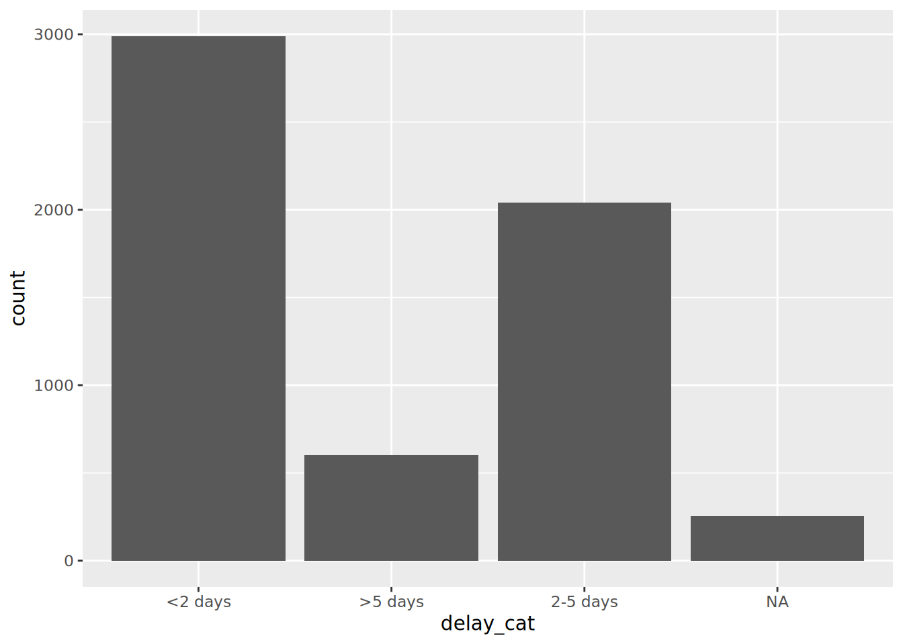
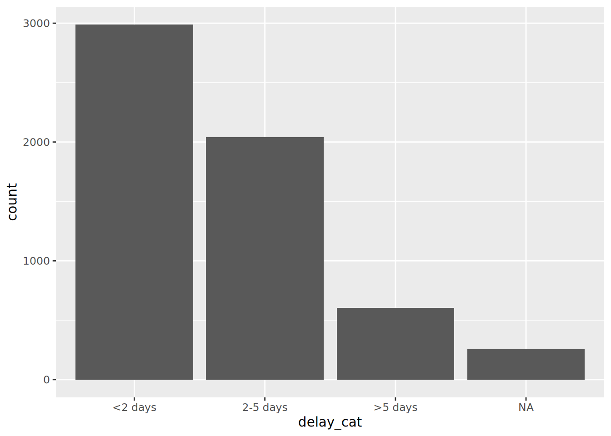
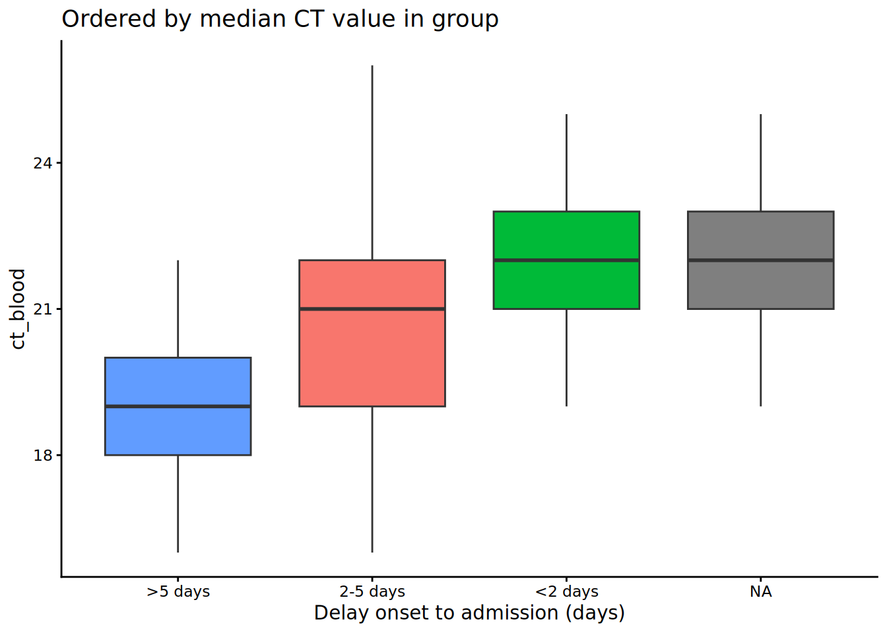
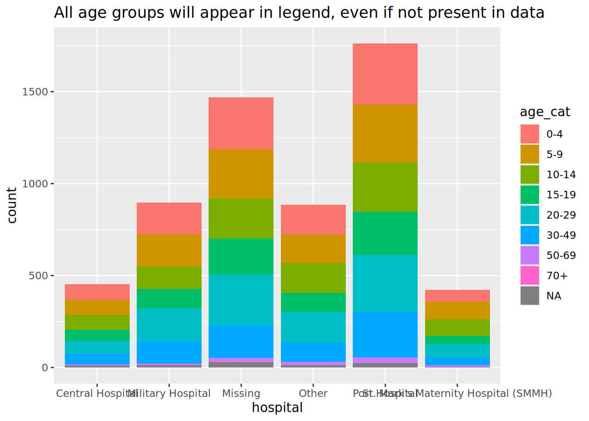

# 11  Factors

[](../../images/factors_1500x500.png)

In R, *factors* are a class of data that allow for ordered categories with a fixed set of acceptable values.

Typically, you would convert a column from character or numeric class to a factor if you want to set an intrinsic order to the values (“*levels*”) so they can be displayed non-alphabetically in plots and tables. Another common use of factors is to standardise the legends of plots so they do not fluctuate if certain values are temporarily absent from the data.

This page demonstrates use of functions from the package **forcats** (a short name for “**For** **cat**egorical variables”) and some **base** R functions. We also touch upon the use of **lubridate** and **aweek** for special factor cases related to epidemiological weeks.

A complete list of **forcats** functions can be found online [here](https://forcats.tidyverse.org/reference/index.html). Below we demonstrate some of the most common ones.

## 11.1 Preparation

### Load packages

This code chunk shows the loading of packages required for the analyses. In this handbook we emphasize `p_load()` from **pacman**, which installs the package if necessary *and* loads it for use. You can also load installed packages with `library()` from **base** R. See the page on [R basics](basics.llms.md) for more information on R packages.

``` r
pacman::p_load(
  rio,           # import/export
  here,          # filepaths
  lubridate,     # working with dates
  forcats,       # factors
  aweek,         # create epiweeks with automatic factor levels
  janitor,       # tables
  tidyverse,     # data mgmt and viz
  appliedepidata # example datasets used in this handbook
  )
```

### Import data

We import the dataset of cases from a simulated Ebola epidemic. Load it directly with `appliedepidata::get_data(name = "linelist_cleaned_rds")` (see the [Download handbook and data](download.llms.md) page for details).

``` r
# import your dataset
linelist <- appliedepidata::get_data(name = "linelist_cleaned_rds")
```

### New categorical variable

For demonstration in this page we will use a common scenario - the creation of a new categorical variable.

Note that if you convert a numeric column to class factor, you will not be able to calculate numeric statistics on it.

#### Create column

We use the existing column `days_onset_hosp` (days from symptom onset to hospital admission) and create a new column `delay_cat` by classifying each row into one of several categories. We do this with the **dplyr** function `case_when()`, which sequentially applies logical criteria (right-side) to each row and returns the corresponding left-side value for the new column `delay_cat`. Read more about `case_when()` in [Cleaning data and core functions](cleaning.llms.md).

``` r
linelist <- linelist %>% 
  mutate(delay_cat = case_when(
    # criteria                                   # new value if TRUE
    days_onset_hosp < 2                        ~ "<2 days",
    days_onset_hosp >= 2 & days_onset_hosp < 5 ~ "2-5 days",
    days_onset_hosp >= 5                       ~ ">5 days",
    is.na(days_onset_hosp)                     ~ NA_character_,
    TRUE                                       ~ "Check me"))  
```

#### Default value order

As created with `case_when()`, the new column `delay_cat` is a categorical column of class Character - *not* yet a factor. Thus, in a frequency table, we see that the unique values appear in a default alpha-numeric order - an order that does not make much intuitive sense:

``` r
table(linelist$delay_cat, useNA = "always")
```


     <2 days  >5 days 2-5 days     <NA> 
        2990      602     2040      256 

Likewise, if we make a bar plot, the values also appear in this order on the x-axis (see the [ggplot basics](ggplot_basics.llms.md) page for more on **ggplot2** - the most common visualization package in R).

``` r
ggplot(data = linelist)+
  geom_bar(mapping = aes(x = delay_cat))
```

[](factors_files/figure-html/unnamed-chunk-7-1.png)

## 11.2 Convert to factor

To convert a character or numeric column to class *factor*, you can use any function from the **forcats** package (many are detailed [below](#fct_adjust)). They will convert to class factor and then also perform or allow certain ordering of the levels - for example using `fct_relevel()` lets you manually specify the level order. The function `as_factor()` simply converts the class without any further capabilities.

The **base** R function `factor()` converts a column to factor and allows you to manually specify the order of the levels, as a character vector to its `levels =` argument.

Below we use `mutate()` and `fct_relevel()` to convert the column `delay_cat` from class character to class factor. The column `delay_cat` is created in the [Preparation](#fct_newcat) section above.

``` r
linelist <- linelist %>%
  mutate(delay_cat = fct_relevel(delay_cat))
```

*The unique “values” in this column are now considered “levels” of the factor.* The levels have an *order*, which can be printed with the **base** R function `levels()`, or alternatively viewed in a count table via `table()` from **base** R or `tabyl()` from **janitor**. By default, the order of the levels will be alpha-numeric, as before. Note that `NA` is not a factor level.

``` r
levels(linelist$delay_cat)
```

    [1] "<2 days"  ">5 days"  "2-5 days"

The function `fct_relevel()` has the additional utility of allowing you to manually specify the level order. Simply write the level values in order, in quotation marks, separated by commas, as shown below. Note that the spelling must exactly match the values. If you want to create levels that do not exist in the data, use [`fct_expand()` instead](#fct_add)).

``` r
linelist <- linelist %>%
  mutate(delay_cat = fct_relevel(delay_cat, "<2 days", "2-5 days", ">5 days"))
```

We can now see that the levels are ordered, as specified in the previous command, in a sensible order.

``` r
levels(linelist$delay_cat)
```

    [1] "<2 days"  "2-5 days" ">5 days" 

Now the plot order makes more intuitive sense as well.

``` r
ggplot(data = linelist)+
  geom_bar(mapping = aes(x = delay_cat))
```

[](factors_files/figure-html/unnamed-chunk-12-1.png)

## 11.3 Add or drop levels

### Add

If you need to add levels to a factor, you can do this with `fct_expand()`. Just write the column name followed by the new levels (separated by commas). By tabulating the values, we can see the new levels and the zero counts. You can use `table()` from **base** R, or `tabyl()` from **janitor**:

``` r
linelist %>% 
  mutate(delay_cat = fct_expand(delay_cat, "Not admitted to hospital", "Transfer to other jurisdiction")) %>% 
  tabyl(delay_cat)   # print table
```

                          delay_cat    n    percent valid_percent
                            <2 days 2990 0.50781250     0.5308949
                           2-5 days 2040 0.34646739     0.3622159
                            >5 days  602 0.10224185     0.1068892
           Not admitted to hospital    0 0.00000000     0.0000000
     Transfer to other jurisdiction    0 0.00000000     0.0000000
                               <NA>  256 0.04347826            NA

Note: there is a special **forcats** function to easily add missing values (`NA`) as a level. See the section on [Missing values](#fct_missing) below.

### Drop

If you use `fct_drop()`, the “unused” levels with zero counts will be dropped from the set of levels. The levels we added above (“Not admitted to a hospital”) exists as a level but no rows actually have those values. So they will be dropped by applying `fct_drop()` to our factor column:

``` r
linelist %>% 
  mutate(delay_cat = fct_drop(delay_cat)) %>% 
  tabyl(delay_cat)
```

     delay_cat    n    percent valid_percent
       <2 days 2990 0.50781250     0.5308949
      2-5 days 2040 0.34646739     0.3622159
       >5 days  602 0.10224185     0.1068892
          <NA>  256 0.04347826            NA

## 11.4 Adjust level order

The package **forcats** offers useful functions to easily adjust the order of a factor’s levels (after a column been defined as class factor):

These functions can be applied to a factor column in two contexts:

1.  To the column in the data frame, as usual, so the transformation is available for any subsequent use of the data  
2.  *Inside of a plot*, so that the change is applied only within the plot

### Manually

This function is used to manually order the factor levels. If used on a non-factor column, the column will first be converted to class factor.

Within the parentheses first provide the factor column name, then provide either:

- All the levels in the desired order (as a character vector `c()`), or  
- One level and it’s corrected placement using the `after =` argument

Here is an example of redefining the column `delay_cat` (which is already class Factor) and specifying all the desired order of levels.

``` r
# re-define level order
linelist <- linelist %>% 
  mutate(delay_cat = fct_relevel(delay_cat, c("<2 days", "2-5 days", ">5 days")))
```

If you only want to move one level, you can specify it to `fct_relevel()` alone and give a number to the `after =` argument to indicate where in the order it should be. For example, the command below shifts “\<2 days” to the second position:

``` r
# re-define level order
linelist %>% 
  mutate(delay_cat = fct_relevel(delay_cat, "<2 days", after = 1)) %>% 
  tabyl(delay_cat)
```

### Within a plot

The **forcats** commands can be used to set the level order in the data frame, or only within a plot. By using the command to “wrap around” the column name *within* the `ggplot()` plotting command, you can reverse/relevel/etc. the transformation will only apply within that plot.

Below, two plots are created with `ggplot()` (see the [ggplot basics](ggplot_basics.llms.md) page). In the first, the `delay_cat` column is mapped to the x-axis of the plot, with it’s default level order as in the data `linelist`. In the second example it is wrapped within `fct_relevel()` and the order is changed in the plot.

``` r
# Alpha-numeric default order - no adjustment within ggplot
ggplot(data = linelist)+
    geom_bar(mapping = aes(x = delay_cat))

# Factor level order adjusted within ggplot
ggplot(data = linelist)+
  geom_bar(mapping = aes(x = fct_relevel(delay_cat, c("<2 days", "2-5 days", ">5 days"))))
```

[](factors_files/figure-html/unnamed-chunk-18-1.png)

[](factors_files/figure-html/unnamed-chunk-18-2.png)

Note that default x-axis title is now quite complicated - you can overwrite this title with the **ggplot2** `labs()` argument.

### Reverse

It is rather common that you want to reverse the level order. Simply wrap the factor with `fct_rev()`.

Note that if you want to reverse *only* a plot legend but not the actual factor levels, you can do that with `guides()` (see [ggplot tips](ggplot_tips.llms.md)).

### By frequency

To order by frequency that the value appears in the data, use `fct_infreq()`. Any missing values (`NA`) will automatically be included at the end, unless they are converted to an explicit level (see [this section](#fct_missing)). You can reverse the order by further wrapping with `fct_rev()`.

This function can be used within a `ggplot()`, as shown below.

``` r
# ordered by frequency
ggplot(data = linelist, aes(x = fct_infreq(delay_cat)))+
  geom_bar()+
  labs(x = "Delay onset to admission (days)",
       title = "Ordered by frequency")

# reversed frequency
ggplot(data = linelist, aes(x = fct_rev(fct_infreq(delay_cat))))+
  geom_bar()+
  labs(x = "Delay onset to admission (days)",
       title = "Reverse of order by frequency")
```

[](factors_files/figure-html/unnamed-chunk-19-1.png)

[](factors_files/figure-html/unnamed-chunk-19-2.png)

### By appearance

Use `fct_inorder()` to set the level order to match the order of appearance in the data, starting from the first row. This can be useful if you first carefully `arrange()` the data in the data frame, and then use this to set the factor order.

### By summary statistic of another column

You can use `fct_reorder()` to order the levels of one column *by a summary statistic of another column*. Visually, this can result in pleasing plots where the bars/points ascend or descend steadily across the plot.

In the examples below, the x-axis is `delay_cat`, and the y-axis is numeric column `ct_blood` (cycle-threshold value). Box plots show the CT value distribution by `delay_cat` group. We want to order the box plots in ascending order by the group median CT value.

In the first example below, the default order alpha-numeric level order is used. You can see the box plot heights are jumbled and not in any particular order. In the second example, the `delay_cat` column (mapped to the x-axis) has been wrapped in `fct_reorder()`, the column `ct_blood` is given as the second argument, and “median” is given as the third argument (you could also use “max”, “mean”, “min”, etc). Thus, the order of the levels of `delay_cat` will now reflect ascending median CT values of each `delay_cat` group’s median CT value. This is reflected in the second plot - the box plots have been re-arranged to ascend. Note how `NA` (missing) will appear at the end, unless converted to an explicit level.

``` r
# boxplots ordered by original factor levels
ggplot(data = linelist)+
  geom_boxplot(
    aes(x = delay_cat,
        y = ct_blood, 
        fill = delay_cat))+
  labs(x = "Delay onset to admission (days)",
       title = "Ordered by original alpha-numeric levels")+
  theme_classic()+
  theme(legend.position = "none")


# boxplots ordered by median CT value
ggplot(data = linelist)+
  geom_boxplot(
    aes(x = fct_reorder(delay_cat, ct_blood, "median"),
        y = ct_blood,
        fill = delay_cat))+
  labs(x = "Delay onset to admission (days)",
       title = "Ordered by median CT value in group")+
  theme_classic()+
  theme(legend.position = "none")
```

[](factors_files/figure-html/unnamed-chunk-20-1.png)

[](factors_files/figure-html/unnamed-chunk-20-2.png)

Note in this example above there are no steps required prior to the `ggplot()` call - the grouping and calculations are all done internally to the ggplot command.

### By “end” value

Use `fct_reorder2()` for grouped line plots. It orders the levels (and therefore the *legend*) to align with the vertical ordering of the lines at the “end” of the plot. Technically speaking, it “orders by the y-values associated with the largest x values.”

For example, if you have lines showing case counts by hospital over time, you can apply `fct_reorder2()` to the `color =` argument within `aes()`, such that the vertical order of hospitals appearing in the legend aligns with the order of lines at the terminal end of the plot. Read more in the [online documentation](https://forcats.tidyverse.org/reference/fct_reorder.html).

``` r
epidemic_data <- linelist %>%         # begin with the linelist   
    filter(date_onset < as.Date("2014-09-21")) %>%    # cut-off date, for visual clarity
    count(                                            # get case counts per week and by hospital
      epiweek = lubridate::floor_date(date_onset, "week"),  
      hospital                                            
    ) 
  
ggplot(data = epidemic_data)+                       # start plot
  geom_line(                                        # make lines
    aes(
      x = epiweek,                                  # x-axis epiweek
      y = n,                                        # height is number of cases per week
      color = fct_reorder2(hospital, epiweek, n)))+ # data grouped and colored by hospital, with factor order by height at end of plot
  labs(title = "Factor levels (and legend display) by line height at end of plot",
       color = "Hospital")                          # change legend title
```

[](factors_files/figure-html/unnamed-chunk-21-1.png)

## 11.5 Missing values

If you have `NA` values in your factor column, you can easily convert them to a named level such as “Missing” with `fct_explicit_na()`. The `NA` values are converted to “(Missing)” at the end of the level order by default. You can adjust the level name with the argument `na_level =`.

Below, this opertation is performed on the column `delay_cat` and a table is printed with `tabyl()` with `NA` converted to “Missing delay”.

``` r
linelist %>% 
  mutate(delay_cat = fct_na_value_to_level(delay_cat, level = "Missing delay")) %>% 
  tabyl(delay_cat)
```

         delay_cat    n    percent
          2-5 days 2040 0.34646739
           <2 days 2990 0.50781250
           >5 days  602 0.10224185
     Missing delay  256 0.04347826

## 11.6 Combine levels

### Manually

You can adjust the level displays manually manually with `fct_recode()`. This is like the **dplyr** function `recode()` (see [Cleaning data and core functions](cleaning.llms.md)), but it allows the creation of new factor levels. If you use the simple `recode()` on a factor, new re-coded values will be rejected unless they have already been set as permissible levels.

This tool can also be used to “combine” levels, by assigning multiple levels the same re-coded value. Just be careful to not lose information! Consider doing these combining steps in a new column (not over-writing the existing column).

`fct_recode()` has a different syntax than `recode()`. `recode()` uses `OLD = NEW`, whereas `fct_recode()` uses `NEW = OLD`.

The current levels of `delay_cat` are:

``` r
levels(linelist$delay_cat)
```

    [1] "<2 days"  "2-5 days" ">5 days" 

The new levels are created using syntax `fct_recode(column, "new" = "old", "new" = "old", "new" = "old")` and printed:

``` r
linelist %>% 
  mutate(delay_cat = fct_recode(
    delay_cat,
    "Less than 2 days" = "<2 days",
    "2 to 5 days"      = "2-5 days",
    "More than 5 days" = ">5 days")) %>% 
  tabyl(delay_cat)
```

            delay_cat    n    percent valid_percent
     Less than 2 days 2990 0.50781250     0.5308949
          2 to 5 days 2040 0.34646739     0.3622159
     More than 5 days  602 0.10224185     0.1068892
                 <NA>  256 0.04347826            NA

Here they are manually combined with `fct_recode()`. Note there is no error raised at the creation of a new level “Less than 5 days”.

``` r
linelist %>% 
  mutate(delay_cat = fct_recode(
    delay_cat,
    "Less than 5 days" = "<2 days",
    "Less than 5 days" = "2-5 days",
    "More than 5 days" = ">5 days")) %>% 
  tabyl(delay_cat)
```

            delay_cat    n    percent valid_percent
     Less than 5 days 5030 0.85427989     0.8931108
     More than 5 days  602 0.10224185     0.1068892
                 <NA>  256 0.04347826            NA

### Reduce into “Other”

You can use `fct_other()` to manually assign factor levels to an “Other” level. Below, all levels in the column `hospital`, aside from “Port Hospital” and “Central Hospital”, are combined into “Other”. You can provide a vector to either `keep =`, or `drop =`. You can change the display of the “Other” level with `other_level =`.

``` r
linelist %>%    
  mutate(hospital = fct_other(                      # adjust levels
    hospital,
    keep = c("Port Hospital", "Central Hospital"),  # keep these separate
    other_level = "Other Hospital")) %>%            # All others as "Other Hospital"
  tabyl(hospital)                                   # print table
```

             hospital    n    percent
     Central Hospital  454 0.07710598
        Port Hospital 1762 0.29925272
       Other Hospital 3672 0.62364130

### Reduce by frequency

You can combine the least-frequent factor levels automatically using `fct_lump()`.

To “lump” together many low-frequency levels into an “Other” group, do one of the following:

- Set `n =` as the number of groups you want to keep. The n most-frequent levels will be kept, and all others will combine into “Other”.  
- Set `prop =` as the threshold frequency proportion for levels above which you want to keep. All other values will combine into “Other”.

You can change the display of the “Other” level with `other_level =`. Below, all but the two most-frequent hospitals are combined into “Other Hospital”.

``` r
linelist %>%    
  mutate(hospital = fct_lump(                      # adjust levels
    hospital,
    n = 2,                                          # keep top 2 levels
    other_level = "Other Hospital")) %>%            # all others as "Other Hospital"
  tabyl(hospital)                                   # print table
```

           hospital    n   percent
            Missing 1469 0.2494905
      Port Hospital 1762 0.2992527
     Other Hospital 2657 0.4512568

## 11.7 Show all levels

One benefit of using factors is to standardise the appearance of plot legends and tables, regardless of which values are actually present in a dataset.

If you are preparing many figures (e.g. for multiple jurisdictions) you will want the legends and tables to appear identically even with varying levels of data completion or data composition.

### In plots

In a `ggplot()` figure, simply add the argument `drop = FALSE` in the relevant `scale_xxxx()` function. All factor levels will be displayed, regardless of whether they are present in the data. If your factor column levels are displayed using `fill =`, then in scale_fill_discrete() you include `drop = FALSE`, as shown below. If your levels are displayed with `x =` (to the x-axis) `color =` or `size =` you would provide this to `scale_color_discrete()` or `scale_size_discrete()` accordingly.

This example is a stacked bar plot of age category, by hospital. Adding `scale_fill_discrete(drop = FALSE)` ensures that all age groups appear in the legend, even if not present in the data.

``` r
ggplot(data = linelist)+
  geom_bar(mapping = aes(x = hospital, fill = age_cat)) +
  scale_fill_discrete(drop = FALSE)+                        # show all age groups in the legend, even those not present
  labs(
    title = "All age groups will appear in legend, even if not present in data")
```

[](factors_files/figure-html/unnamed-chunk-29-1.png)

### In tables

Both the **base** R `table()` and `tabyl()` from **janitor** will show all factor levels (even unused levels).

If you use `count()` or `summarise()` from **dplyr** to make a table, add the argument `.drop = FALSE` to include counts for all factor levels even those unused.

Read more in the [Descriptive tables](tables_descriptive.llms.md) page, or at the [scale_discrete documentation](https://ggplot2.tidyverse.org/reference/scale_discrete.html), or the [count() documentation](https://dplyr.tidyverse.org/reference/count.html). You can see another example in the [Contact tracing](contact_tracing.llms.md) page.

## 11.8 Epiweeks

Please see the extensive discussion of how to create epidemiological weeks in the [Grouping data](grouping.llms.md) page.  
Please also see the [Working with dates](dates.llms.md) page for tips on how to create and format epidemiological weeks.

### Epiweeks in a plot

If your goal is to create epiweeks to display in a plot, you can do this simply with **lubridate**’s `floor_date()`, as explained in the [Grouping data](grouping.llms.md) page. The values returned will be of class Date with format YYYY-MM-DD. If you use this column in a plot, the dates will naturally order correctly, and you do not need to worry about levels or converting to class Factor. See the `ggplot()` histogram of onset dates below.

In this approach, you can adjust the *display* of the dates on an axis with `scale_x_date()`. See the page on [Epidemic curves](epicurves.llms.md) for more information. You can specify a “strptime” display format to the `date_labels =` argument of `scale_x_date()`. These formats use “%” placeholders and are covered in the [Working with dates](dates.llms.md) page. Use “%Y” to represent a 4-digit year, and either “%W” or “%U” to represent the week number (Monday or Sunday weeks respectively).

``` r
linelist %>% 
  mutate(epiweek_date = floor_date(date_onset, "week")) %>%  # create week column
  drop_na(epiweek_date) %>%                                  # remove rows without a date of onset
  ggplot()+                                                  # begin ggplot
  geom_histogram(mapping = aes(x = epiweek_date))+           # histogram of date of onset
  scale_x_date(date_labels = "%Y-W%W")                       # adjust disply of dates to be YYYY-WWw
```

[](factors_files/figure-html/unnamed-chunk-30-1.png)

### Epiweeks in the data

However, if your purpose in factoring is *not* to plot, you can approach this one of two ways:

1.  *For fine control over the display*, convert the **lubridate** epiweek column (YYYY-MM-DD) to the desired display format (YYYY-WWw) *within the data frame itself*, and then convert it to class Factor.

First, use `format()` from **base** R to convert the date display from YYYY-MM-DD to YYYY-Www display (see the [Working with dates](dates.llms.md) page). In this process the class will be converted to character. Then, convert from character to class Factor with `factor()`.

``` r
linelist <- linelist %>% 
  mutate(epiweek_date = floor_date(date_onset, "week"),       # create epiweeks (YYYY-MM-DD)
         epiweek_formatted = format(epiweek_date, "%Y-W%W"),  # Convert to display (YYYY-WWw)
         epiweek_formatted = factor(epiweek_formatted))       # Convert to factor

# Display levels
levels(linelist$epiweek_formatted)
```

     [1] "2014-W13" "2014-W14" "2014-W15" "2014-W16" "2014-W17" "2014-W18"
     [7] "2014-W19" "2014-W20" "2014-W21" "2014-W22" "2014-W23" "2014-W24"
    [13] "2014-W25" "2014-W26" "2014-W27" "2014-W28" "2014-W29" "2014-W30"
    [19] "2014-W31" "2014-W32" "2014-W33" "2014-W34" "2014-W35" "2014-W36"
    [25] "2014-W37" "2014-W38" "2014-W39" "2014-W40" "2014-W41" "2014-W42"
    [31] "2014-W43" "2014-W44" "2014-W45" "2014-W46" "2014-W47" "2014-W48"
    [37] "2014-W49" "2014-W50" "2014-W51" "2015-W00" "2015-W01" "2015-W02"
    [43] "2015-W03" "2015-W04" "2015-W05" "2015-W06" "2015-W07" "2015-W08"
    [49] "2015-W09" "2015-W10" "2015-W11" "2015-W12" "2015-W13" "2015-W14"
    [55] "2015-W15" "2015-W16"

***DANGER:*** If you place the weeks ahead of the years (“Www-YYYY”) (“%W-%Y”), the default alpha-numeric level ordering will be incorrect (e.g. 01-2015 will be before 35-2014). You could need to manually adjust the order, which would be a long painful process.

2.  *For fast default display*, use the **aweek** package and it’s function `date2week()`. You can set the `week_start =` day, and if you set `factor = TRUE` then the output column is an ordered factor. As a bonus, the factor includes levels for *all* possible weeks in the span - even if there are no cases that week.

``` r
df <- linelist %>% 
  mutate(epiweek = date2week(date_onset, week_start = "Monday", factor = TRUE))

levels(df$epiweek)
```

See the [Working with dates](dates.llms.md) page for more information about **aweek**. It also offers the reverse function `week2date()`.

## 11.9 Resources

R for Data Science page on [factors](https://r4ds.had.co.nz/factors.html)  
[aweek package vignette](https://cran.r-project.org/web/packages/aweek/vignettes/introduction.html)
