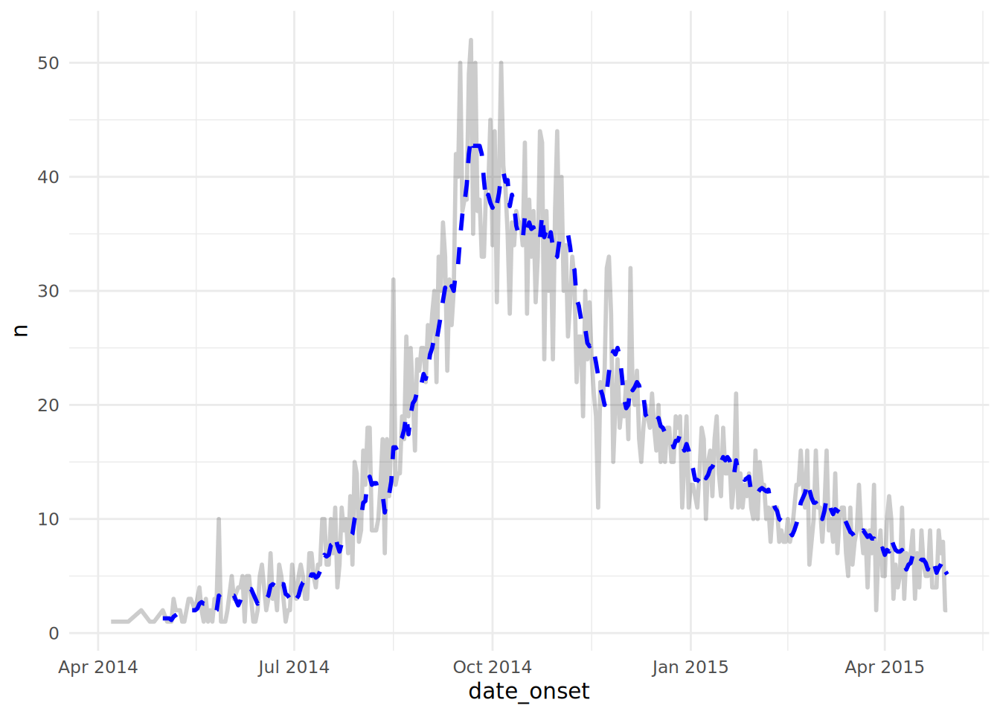

# 22  Moving averages

[](../../images/moving_avg_epicurve.png)

This page will cover two methods to calculate and visualize moving averages:

1.  Calculate with the **slider** package  
2.  Calculate *within* a `ggplot()` command with the **tidyquant** package

## 22.1 Preparation

### Load packages

This code chunk shows the loading of packages required for the analyses. In this handbook we emphasize `p_load()` from **pacman**, which installs the package if necessary *and* loads it for use. You can also load installed packages with `library()` from **base** R. See the page on [R basics](basics.llms.md) for more information on R packages.

``` r
pacman::p_load(
  tidyverse,      # for data management and viz
  slider,         # for calculating moving averages
  tidyquant,      # for calculating moving averages within ggplot
  appliedepidata # example datasets used in this handbook
)
```

### Import data

We import the dataset of cases from a simulated Ebola epidemic. Load it directly with `appliedepidata::get_data(name = "linelist_cleaned_rds")` (see the [Download handbook and data](download.llms.md) page for details).

``` r
# import the linelist
linelist <- appliedepidata::get_data(name = "linelist_cleaned_rds")
```

The first 50 rows of the linelist are displayed below.

## 22.2 Calculate with **slider**

**Use this approach to calculate a moving average in a data frame prior to plotting.**

The **slider** package provides several “sliding window” functions to compute rolling averages, cumulative sums, rolling regressions, etc. It treats a data frame as a vector of rows, allowing iteration row-wise over a data frame.

Here are some of the common functions:

- `slide_dbl()` - iterates through a *numeric* (hence “\_dbl”) column performing an operation using a sliding window
  - `slide_sum()` - rolling sum shortcut function for `slide_dbl()`  
  - `slide_mean()` - rolling average shortcut function for `slide_dbl()`
- `slide_index_dbl()` - applies the rolling window on a numeric column using a separate column to *index* the window progression (useful if rolling by date with some dates absent)
  - `slide_index_sum()` - rolling sum shortcut function with indexing  
  - `slide_index_mean()` - rolling mean shortcut function with indexing

The **slider** package has many other functions that are covered in the Resources section of this page. We briefly touch upon the most common.

**Core arguments**

- `.x`, the first argument by default, is the vector to iterate over and to apply the function to  
- `.i =` for the “index” versions of the **slider** functions - provide a column to “index” the roll on (see section [below](#roll_index))  
- `.f =`, the second argument by default, either:
  - A function, written without parentheses, like `mean`, or  
  - A formula, which will be converted into a function. For example `~ .x - mean(.x)` will return the result of the current value minus the mean of the window’s value
- For more details see this [reference material](https://davisvaughan.github.io/slider/reference/slide.html)

**Window size**

Specify the size of the window by using either `.before`, `.after`, or both arguments:

- `.before =` - Provide an integer  
- `.after =` - Provide an integer  
- `.complete =` - Set this to `TRUE` if you only want calculation performed on complete windows

For example, to achieve a 7-day window including the current value and the six previous, use `.before = 6`. To achieve a “centered” window provide the same number to both `.before =` and `.after =`.

By default, `.complete =` will be FALSE so if the full window of rows does not exist, the functions will use available rows to perform the calculation. Setting to TRUE restricts so calculations are only performed on complete windows.

**Expanding window**

To achieve *cumulative* operations, set the `.before =` argument to `Inf`. This will conduct the operation on the current value and all coming before.

### Rolling by date

The most likely use-case of a rolling calculation in applied epidemiology is to examine a metric *over time*. For example, a rolling measurement of case incidence, based on daily case counts.

If you have clean time series data with values for every date, you may be OK to use `slide_dbl()`, as demonstrated here in the [Time series and outbreak detection](time_series.llms.md) page.

However, in many applied epidemiology circumstances you may have dates absent from your data, where there are no events recorded. In these cases, it is best to use the “index” versions of the **slider** functions.

### Indexed data

Below, we show an example using `slide_index_dbl()` on the case linelist. Let us say that our objective is to calculate a rolling 7-day incidence - the sum of cases using a rolling 7-day window. If you are looking for an example of rolling average, see the section below on [grouped rolling](#roll_slider_group).

To begin, the dataset `daily_counts` is created to reflect the daily case counts from the `linelist`, as calculated with `count()` from **dplyr**.

``` r
# make dataset of daily counts
daily_counts <- linelist %>% 
  count(date_hospitalisation, name = "new_cases")
```

Here is the `daily_counts` data frame - there are `nrow(daily_counts)` rows, each day is represented by one row, but especially early in the epidemic *some days are not present (there were no cases admitted on those days)*.

It is crucial to recognize that a standard rolling function (like `slide_dbl()` would use a window of 7 *rows*, not 7 *days*. So, if there are any absent dates, some windows will actually extend more than 7 calendar days!

A “smart” rolling window can be achieved with `slide_index_dbl()`. The “index” means that the function uses a *separate column* as an “index” for the rolling window. The window is not simply based on the rows of the data frame.

If the index column is a date, you have the added ability to specify the window extent to `.before =` and/or `.after =` in units of **lubridate** `days()` or `months()`. If you do these things, the function will include absent days in the windows as if they were there (as `NA` values).

Let’s show a comparison. Below, we calculate rolling 7-day case incidence with regular and indexed windows.

``` r
rolling <- daily_counts %>% 
  mutate(                                # create new columns
    # Using slide_dbl()
    ###################
    reg_7day = slide_dbl(
      new_cases,                         # calculate on new_cases
      .f = ~sum(.x, na.rm = T),          # function is sum() with missing values removed
      .before = 6),                      # window is the ROW and 6 prior ROWS
    
    # Using slide_index_dbl()
    #########################
    indexed_7day = slide_index_dbl(
        new_cases,                       # calculate on new_cases
        .i = date_hospitalisation,       # indexed with date_onset 
        .f = ~sum(.x, na.rm = TRUE),     # function is sum() with missing values removed
        .before = days(6))               # window is the DAY and 6 prior DAYS
    )
```

Observe how in the regular column for the first 7 rows the count steadily increases *despite the rows not being within 7 days of each other*! The adjacent “indexed” column accounts for these absent calendar days, so its 7-day sums are much lower, at least in this period of the epidemic when the cases a farther between.

Now you can plot these data using `ggplot()`:

``` r
ggplot(data = rolling)+
  geom_line(mapping = aes(x = date_hospitalisation, y = indexed_7day), linewidth = 1)
```

[](moving_average_files/figure-html/unnamed-chunk-10-1.png)

### Rolling by group

If you group your data prior to using a **slider** function, the sliding windows will be applied by group. Be careful to arrange your rows in the desired order *by group*.

Each time a new group begins, the sliding window will re-start. Therefore, one nuance to be aware of is that if your data are grouped *and* you have set `.complete = TRUE`, you will have empty values at each transition between groups. As the function moved downward through the rows, every transition in the grouping column will re-start the accrual of the minimum window size to allow a calculation.

See handbook page on [Grouping data](grouping.llms.md) for details on grouping data.

Below, we count linelist cases by date *and* by hospital. Then we arrange the rows in ascending order, first ordering by hospital and then within that by date. Next we set `group_by()`. Then we can create our new rolling average.

``` r
grouped_roll <- linelist %>%

  count(hospital, date_hospitalisation, name = "new_cases") %>% 

  arrange(hospital, date_hospitalisation) %>%   # arrange rows by hospital and then by date
  
  group_by(hospital) %>%              # group by hospital 
    
  mutate(                             # rolling average  
    mean_7day_hosp = slide_index_dbl(
      .x = new_cases,                 # the count of cases per hospital-day
      .i = date_hospitalisation,      # index on date of admission
      .f = mean,                      # use mean()                   
      .before = days(6)               # use the day and the 6 days prior
      )
  )
```

Here is the new dataset:

We can now plot the moving averages, displaying the data by group by specifying `~ hospital` to `facet_wrap()` in `ggplot()`. For fun, we plot two geometries - a `geom_col()` showing the daily case counts and a `geom_line()` showing the 7-day moving average.

``` r
ggplot(data = grouped_roll)+
  geom_col(                       # plot daly case counts as grey bars
    mapping = aes(
      x = date_hospitalisation,
      y = new_cases),
    fill = "grey",
    width = 1)+
  geom_line(                      # plot rolling average as line colored by hospital
    mapping = aes(
      x = date_hospitalisation,
      y = mean_7day_hosp,
      color = hospital),
    linewidth = 1)+
  facet_wrap(~hospital, ncol = 2)+ # create mini-plots per hospital
  theme_classic()+                 # simplify background  
  theme(legend.position = "none")+ # remove legend
  labs(                            # add plot labels
    title = "7-day rolling average of daily case incidence",
    x = "Date of admission",
    y = "Case incidence")
```

[](moving_average_files/figure-html/unnamed-chunk-13-1.png)

***DANGER:*** If you get an error saying *“slide() was deprecated in tsibble 0.9.0 and is now defunct. Please use slider::slide() instead.”*, it means that the `slide()` function from the **tsibble** package is masking the `slide()` function from **slider** package. Fix this by specifying the package in the command, such as `slider::slide_dbl()`.

## 22.3 Calculate with **tidyquant** within `ggplot()`

The package **tidyquant** offers another approach to calculating moving averages - this time from *within* a `ggplot()` command itself.

Below the `linelist` data are counted by date of onset, and this is plotted as a faded line (`alpha` \< 1). Overlaid on top is a line created with `geom_ma()` from the package **tidyquant**, with a set window of 7 days (`n = 7`) with specified color and thickness.

By default `geom_ma()` uses a simple moving average (`ma_fun = "SMA"`), but other types can be specified, such as:

- “EMA” - exponential moving average (more weight to recent observations)  
- “WMA” - weighted moving average (`wts` are used to weight observations in the moving average)  
- Others can be found in the function documentation

``` r
linelist %>% 
  count(date_onset) %>%                 # count cases per day
  drop_na(date_onset) %>%               # remove cases missing onset date
  ggplot(aes(x = date_onset, y = n))+   # start ggplot
    geom_line(                          # plot raw values
      linewidth = 1,
      alpha = 0.2                       # semi-transparent line
      )+             
    tidyquant::geom_ma(                 # plot moving average
      n = 7,           
      linewidth = 1,
      color = "blue")+ 
  theme_minimal()                       # simple background
```

[](moving_average_files/figure-html/unnamed-chunk-14-1.png)

See this [vignette](https://cran.r-project.org/web/packages/tidyquant/vignettes/TQ04-charting-with-tidyquant.html) for more details on the options available within **tidyquant**.

## 22.4 Resources

See the helpful online [vignette for the **slider** package](https://cran.r-project.org/web/packages/slider/vignettes/slider.html)

The **slider** [github page](https://github.com/DavisVaughan/slider)

A **slider** [vignette](https://davisvaughan.github.io/slider/articles/slider.html)

[tidyquant vignette](https://cran.r-project.org/web/packages/tidyquant/vignettes/TQ04-charting-with-tidyquant.html)

If your use case requires that you “skip over” weekends and even holidays, you might like **almanac** package.
