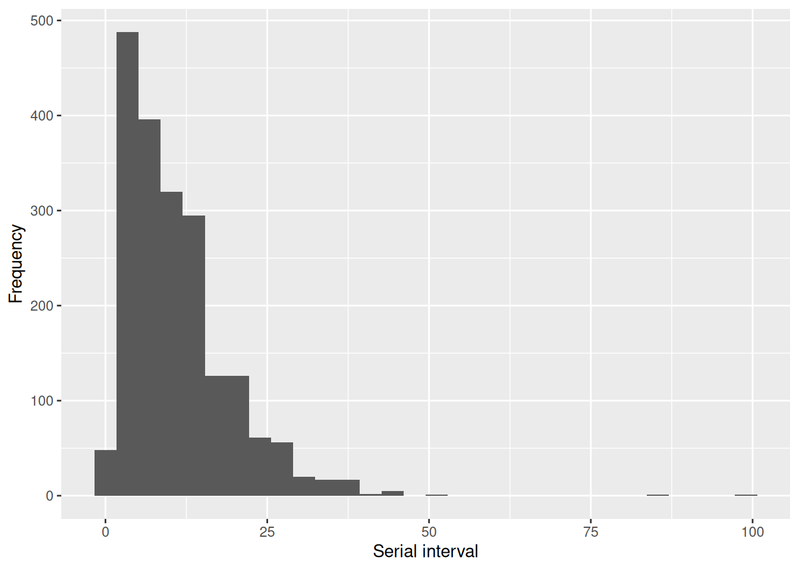

# 37  Transmission chains

## 37.1 Overview

The primary tool to handle, analyse and visualise transmission chains and contact tracing data is the package **epicontacts**, developed by the folks at RECON. Try out the interactive plot below by hovering over the nodes for more information, dragging them to move them and clicking on them to highlight downstream cases.

## 37.2 Preparation

### Load packages

First load the standard packages required for data import and manipulation. In this handbook we emphasize `p_load()` from **pacman**, which installs the package if necessary *and* loads it for use. You can also load packages with `library()` from **base** R. See the page on [R basics](basics.llms.md) for more information on R packages.

``` r
pacman::p_load(
   rio,          # File import
   here,         # File locator
   tidyverse,    # Data management + ggplot2 graphics
   remotes       # Package installation from github
)
```

You will require the development version of **epicontacts**, which can be installed from github using the `p_install_github()` function from **pacman**. You only need to run this command below once, not every time you use the package (thereafter, you can use `p_load()` as usual).

``` r
pacman::p_install_gh("reconhub/epicontacts@timeline")
```

### Import data

We import the dataset of cases from a simulated Ebola epidemic. If you want to download the data to follow step-by-step, see instructions in the [Download handbook and data](download.llms.md) page. The dataset is imported using the `import()` function from the **rio** package. See the page on [Import and export](importing.llms.md) for various ways to import data.

``` r
# import the linelist
linelist <- appliedepidata::get_data(name = "linelist_cleaned_rds")
```

The first 50 rows of the linelist are displayed below. Of particular interest are the columns `case_id`, `generation`, `infector`, and `source`.

### Creating an epicontacts object

We then need to create an **epicontacts** object, which requires two types of data:

- a linelist documenting cases where columns are variables and rows correspond to unique cases
- a list of edges defining links between cases on the basis of their unique IDs (these can be contacts, transmission events, etc.)

As we already have a linelist, we just need to create a list of edges between cases, more specifically between their IDs. We can extract transmission links from the linelist by linking the `infector` column with the `case_id` column. At this point we can also add “edge properties”, by which we mean any variable describing the link between the two cases, not the cases themselves. For illustration, we will add a `location` variable describing the location of the transmission event, and a duration variable describing the duration of the contact in days.

In the code below, the **dplyr** function `transmute` is similar to `mutate`, except it only keeps the columns we have specified within the function. The `drop_na` function will filter out any rows where the specified columns have an `NA` value; in this case, we only want to keep the rows where the infector is known.

``` r
## generate contacts
set.seed(1)
contacts <- linelist %>%
  transmute(
    infector = infector,
    case_id = case_id,
    location = sample(c("Community", "Nosocomial"), n(), TRUE),
    duration = sample.int(10, n(), TRUE)
  ) %>%
  drop_na(infector)
```

We can now create the **epicontacts** object using the `make_epicontacts` function. We need to specify which column in the linelist points to the unique case identifier, as well as which columns in the contacts point to the unique identifiers of the cases involved in each link. These links are directional in that infection is going *from* the infector *to* the case, so we need to specify the `from` and `to` arguments accordingly. We therefore also set the `directed` argument to `TRUE`, which will affect future operations.

``` r
## generate epicontacts object
epic <- make_epicontacts(
  linelist = linelist,
  contacts = contacts,
  id = "case_id",
  from = "infector",
  to = "case_id",
  directed = TRUE
)
```

Upon examining the **epicontacts** objects, we can see that the `case_id` column in the linelist has been renamed to `id` and the `case_id` and `infector` columns in the contacts have been renamed to `from` and `to`. This ensures consistency in subsequent handling, visualisation and analysis operations.

``` r
## view epicontacts object
epic
```


    /// Epidemiological Contacts //

      // class: epicontacts
      // 5,888 cases in linelist; 3,800 contacts; directed 

      // linelist

    # A tibble: 5,888 × 30
       id     generation date_infection date_onset date_hospitalisation date_outcome
       <chr>       <dbl> <date>         <date>     <date>               <date>      
     1 5fe599          4 2014-05-08     2014-05-13 2014-05-15           NA          
     2 8689b7          4 NA             2014-05-13 2014-05-14           2014-05-18  
     3 11f8ea          2 NA             2014-05-16 2014-05-18           2014-05-30  
     4 b8812a          3 2014-05-04     2014-05-18 2014-05-20           NA          
     5 893f25          3 2014-05-18     2014-05-21 2014-05-22           2014-05-29  
     6 be99c8          3 2014-05-03     2014-05-22 2014-05-23           2014-05-24  
     7 07e3e8          4 2014-05-22     2014-05-27 2014-05-29           2014-06-01  
     8 369449          4 2014-05-28     2014-06-02 2014-06-03           2014-06-07  
     9 f393b4          4 NA             2014-06-05 2014-06-06           2014-06-18  
    10 1389ca          4 NA             2014-06-05 2014-06-07           2014-06-09  
    # ℹ 5,878 more rows
    # ℹ 24 more variables: outcome <chr>, gender <chr>, age <dbl>, age_unit <chr>,
    #   age_years <dbl>, age_cat <fct>, age_cat5 <fct>, hospital <chr>, lon <dbl>,
    #   lat <dbl>, infector <chr>, source <chr>, wt_kg <dbl>, ht_cm <dbl>,
    #   ct_blood <dbl>, fever <chr>, chills <chr>, cough <chr>, aches <chr>,
    #   vomit <chr>, temp <dbl>, time_admission <chr>, bmi <dbl>,
    #   days_onset_hosp <dbl>

      // contacts

    # A tibble: 3,800 × 4
       from   to     location   duration
       <chr>  <chr>  <chr>         <int>
     1 f547d6 5fe599 Community         7
     2 f90f5f b8812a Community         5
     3 11f8ea 893f25 Nosocomial        6
     4 aec8ec be99c8 Community         7
     5 893f25 07e3e8 Community         7
     6 133ee7 369449 Community         3
     7 996f3a 2978ac Community         5
     8 133ee7 57a565 Community        10
     9 37a6f6 fc15ef Community         3
    10 9f6884 2eaa9a Community         8
    # ℹ 3,790 more rows

## 37.3 Handling

### Subsetting

The `subset()` method for `epicontacts` objects allows for, among other things, filtering of networks based on properties of the linelist (“node attributes”) and the contacts database (“edge attributes”). These values must be passed as named lists to the respective argument. For example, in the code below we are keeping only the male cases in the linelist that have an infection date between April and July 2014 (dates are specified as ranges), and transmission links that occured in the hospital.

``` r
sub_attributes <- subset(
  epic,
  node_attribute = list(
    gender = "m",
    date_infection = as.Date(c("2014-04-01", "2014-07-01"))
  ), 
  edge_attribute = list(location = "Nosocomial")
)
sub_attributes
```


    /// Epidemiological Contacts //

      // class: epicontacts
      // 69 cases in linelist; 1,941 contacts; directed 

      // linelist

    # A tibble: 69 × 30
       id     generation date_infection date_onset date_hospitalisation date_outcome
       <chr>       <dbl> <date>         <date>     <date>               <date>      
     1 5fe599          4 2014-05-08     2014-05-13 2014-05-15           NA          
     2 893f25          3 2014-05-18     2014-05-21 2014-05-22           2014-05-29  
     3 2978ac          4 2014-05-30     2014-06-06 2014-06-08           2014-06-15  
     4 57a565          4 2014-05-28     2014-06-13 2014-06-15           NA          
     5 fc15ef          6 2014-06-14     2014-06-16 2014-06-17           2014-07-09  
     6 99e8fa          7 2014-06-24     2014-06-28 2014-06-29           2014-07-09  
     7 f327be          6 2014-06-14     2014-07-12 2014-07-13           2014-07-14  
     8 90e5fe          5 2014-06-18     2014-07-13 2014-07-14           2014-07-16  
     9 a47529          5 2014-06-13     2014-07-17 2014-07-18           2014-07-26  
    10 da8ecb          5 2014-06-20     2014-07-18 2014-07-20           2014-08-01  
    # ℹ 59 more rows
    # ℹ 24 more variables: outcome <chr>, gender <chr>, age <dbl>, age_unit <chr>,
    #   age_years <dbl>, age_cat <fct>, age_cat5 <fct>, hospital <chr>, lon <dbl>,
    #   lat <dbl>, infector <chr>, source <chr>, wt_kg <dbl>, ht_cm <dbl>,
    #   ct_blood <dbl>, fever <chr>, chills <chr>, cough <chr>, aches <chr>,
    #   vomit <chr>, temp <dbl>, time_admission <chr>, bmi <dbl>,
    #   days_onset_hosp <dbl>

      // contacts

    # A tibble: 1,941 × 4
       from   to     location   duration
       <chr>  <chr>  <chr>         <int>
     1 11f8ea 893f25 Nosocomial        6
     2 a75c7f 7f5a01 Nosocomial        1
     3 a15e13 f327be Nosocomial        7
     4 beb26e 959170 Nosocomial       10
     5 567136 8ebf6e Nosocomial        4
     6 894024 e56412 Nosocomial        2
     7 a2086d a47529 Nosocomial        4
     8 d6584f f5c142 Nosocomial       10
     9 312ecf 3ad520 Nosocomial        1
    10 52ea64 062638 Nosocomial        5
    # ℹ 1,931 more rows

We can use the `thin` function to either filter the linelist to include cases that are found in the contacts by setting the argument `what = "linelist"`, or filter the contacts to include cases that are found in the linelist by setting the argument `what = "contacts"`. In the code below, we are further filtering the epicontacts object to keep only the transmission links involving the male cases infected between April and July which we had filtered for above. We can see that only 3 known transmission links fit that specification.

``` r
sub_attributes <- thin(sub_attributes, what = "contacts")
nrow(sub_attributes$contacts)
```

    [1] 3

In addition to subsetting by node and edge attributes, networks can be pruned to only include components that are connected to certain nodes. The `cluster_id` argument takes a vector of case IDs and returns the linelist of individuals that are linked, directly or indirectly, to those IDs. In the code below, we can see that a total of 13 linelist cases are involved in the clusters containing `2ae019` and `71577a`.

``` r
sub_id <- subset(epic, cluster_id = c("2ae019","71577a"))
nrow(sub_id$linelist)
```

    [1] 13

The `subset()` method for `epicontacts` objects also allows filtering by cluster size using the `cs`, `cs_min` and `cs_max` arguments. In the code below, we are keeping only the cases linked to clusters of 10 cases or larger, and can see that 271 linelist cases are involved in such clusters.

``` r
sub_cs <- subset(epic, cs_min = 10)
nrow(sub_cs$linelist)
```

    [1] 271

### Accessing IDs

The `get_id()` function retrieves information on case IDs in the dataset, and can be parameterized as follows:

- **linelist**: IDs in the line list data
- **contacts**: IDs in the contact dataset (“from” and “to” combined)
- **from**: IDs in the “from” column of contact datset
- **to** IDs in the “to” column of contact dataset
- **all**: IDs that appear anywhere in either dataset
- **common**: IDs that appear in both contacts dataset and line list

For example, what are the first ten IDs in the contacts dataset?

``` r
contacts_ids <- get_id(epic, "contacts")
head(contacts_ids, n = 10)
```

     [1] "f547d6" "f90f5f" "11f8ea" "aec8ec" "893f25" "133ee7" "996f3a" "37a6f6"
     [9] "9f6884" "4802b1"

How many IDs are found in both the linelist and the contacts?

``` r
length(get_id(epic, "common"))
```

    [1] 4352

## 37.4 Visualization

### Basic plotting

All visualisations of **epicontacts** objects are handled by the `plot` function. We will first filter the **epicontacts** object to include only the cases with onset dates in June 2014 using the `subset` function, and only include the contacts linked to those cases using the `thin` function.

``` r
## subset epicontacts object
sub <- epic %>%
  subset(
    node_attribute = list(date_onset = c(as.Date(c("2014-06-30", "2014-06-01"))))
  ) %>%
 thin("contacts")
```

We can then create the basic, interactive plot very simply as follows:

``` r
## plot epicontacts object
plot(
  sub,
  width = 700,
  height = 700
)
```

You can move the nodes around by dragging them, hover over them for more information and click on them to highlight connected cases.

There are a large number of arguments to further modify this plot. We will cover the main ones here, but check out the documentation via `?vis_epicontacts` (the function called when using `plot` on an **epicontacts** object) to get a full description of the function arguments.

#### Visualising node attributes

Node color, node shape and node size can be mapped to a given column in the linelist using the `node_color`, `node_shape` and `node_size` arguments. This is similar to the `aes` syntax you may recognise from **ggplot2**.

The specific colors, shapes and sizes of nodes can be specified as follows:

- **Colors** via the `col_pal` argument, either by providing a name list for manual specification of each color as done below, or by providing a color palette function such as `colorRampPalette(c("black", "red", "orange"))`, which would provide a gradient of colours between the ones specified.

- **Shapes** by passing a named list to the `shapes` argument, specifying one shape for each unique element in the linelist column specified by the `node_shape` argument. See `codeawesome` for available shapes.

- **Size** by passing a size range of the nodes to the `size_range` argument.

Here an example, where color represents the outcome, shape the gender and size the age:

``` r
plot(
  sub, 
  node_color = "outcome",
  node_shape = "gender",
  node_size = "age",
  col_pal = c(Death = "firebrick", Recover = "green"),
  shapes = c(f = "female", m = "male"),
  size_range = c(40, 60),
  height = 700,
  width = 700
)
```

#### Visualising edge attributes

Edge color, width and linetype can be mapped to a given column in the contacts dataframe using the `edge_color`, `edge_width` and `edge_linetype` arguments. The specific colors and widths of the edges can be specified as follows:

- **Colors** via the `edge_col_pal` argument, in the same manner used for `col_pal`.

- **Widths** by passing a size range of the nodes to the `width_range` argument.

Here an example:

``` r
plot(
  sub, 
  node_color = "outcome",
  node_shape = "gender",
  node_size = 'age',
  col_pal = c(Death = "firebrick", Recover = "green"),
  shapes = c(f = "female", m = "male"),
  size_range = c(40, 60),
  edge_color = 'location',
  edge_linetype = 'location',
  edge_width = 'duration',
  edge_col_pal = c(Community = "orange", Nosocomial = "purple"),
  width_range = c(1, 3),
  height = 700,
  width = 700
)
```

### Temporal axis

We can also visualise the network along a temporal axis by mapping the `x_axis` argument to a column in the linelist. In the example below, the x-axis represents the date of symptom onset. We have also specified the `arrow_size` argument to ensure the arrows are not too large, and set `label = FALSE` to make the figure less cluttered.

``` r
plot(
  sub,
  x_axis = "date_onset",
  node_color = "outcome",
  col_pal = c(Death = "firebrick", Recover = "green"),
  arrow_size = 0.5,
  node_size = 13,
  label = FALSE,
  height = 700,
  width = 700
)
```

There are a large number of additional arguments to futher specify how this network is visualised along a temporal axis, which you can check out via `?vis_temporal_interactive` (the function called when using `plot` on an **epicontacts** object with `x_axis` specified). We’ll go through some below.

#### Specifying transmission tree shape

There are two main shapes that the transmission tree can assume, specified using the `network_shape` argument. The first is a `branching` shape as shown above, where a straight edge connects any two nodes. This is the most intuitive representation, however can result in overlapping edges in a densely connected network. The second shape is `rectangle`, which produces a tree resembling a phylogeny. For example:

``` r
plot(
  sub,
  x_axis = "date_onset",
  network_shape = "rectangle",
  node_color = "outcome",
  col_pal = c(Death = "firebrick", Recover = "green"),
  arrow_size = 0.5,
  node_size = 13,
  label = FALSE,
  height = 700,
  width = 700
)
```

Each case node can be assigned a unique vertical position by toggling the `position_dodge` argument. The position of unconnected cases (i.e. with no reported contacts) is specified using the `unlinked_pos` argument.

``` r
plot(
  sub,
  x_axis = "date_onset",
  network_shape = "rectangle",
  node_color = "outcome",
  col_pal = c(Death = "firebrick", Recover = "green"),
  position_dodge = TRUE,
  unlinked_pos = "bottom",
  arrow_size = 0.5,
  node_size = 13,
  label = FALSE,
  height = 700,
  width = 700
)
```

The position of the parent node relative to the children nodes can be specified using the `parent_pos` argument. The default option is to place the parent node in the middle, however it can be placed at the bottom (`parent_pos = 'bottom'`) or at the top (`parent_pos = 'top'`).

``` r
plot(
  sub,
  x_axis = "date_onset",
  network_shape = "rectangle",
  node_color = "outcome",
  col_pal = c(Death = "firebrick", Recover = "green"),
  parent_pos = "top",
  arrow_size = 0.5,
  node_size = 13,
  label = FALSE,
  height = 700,
  width = 700
)
```

#### Saving plots and figures

You can save a plot as an interactive, self-contained html file with the `visSave` function from the **VisNetwork** package:

``` r
plot(
  sub,
  x_axis = "date_onset",
  network_shape = "rectangle",
  node_color = "outcome",
  col_pal = c(Death = "firebrick", Recover = "green"),
  parent_pos = "top",
  arrow_size = 0.5,
  node_size = 13,
  label = FALSE,
  height = 700,
  width = 700
) %>%
  visNetwork::visSave("network.html")
```

Saving these network outputs as an image is unfortunately less easy and requires you to save the file as an html and then take a screenshot of this file using the `webshot` package. In the code below, we are converting the html file saved above into a PNG:

``` r
webshot(url = "network.html", file = "network.png")
```

### Timelines

You can also case timelines to the network, which are represented on the x-axis of each case. This can be used to visualise case locations, for example, or time to outcome. To generate a timeline, we need to create a data.frame of at least three columns indicating the case ID, the start date of the “event” and the end of date of the “event”. You can also add any number of other columns which can then be mapped to node and edge properties of the timeline. In the code below, we generate a timeline going from the date of symptom onset to the date of outcome, and keep the outcome and hospital variables which we use to define the node shape and colour. Note that you can have more than one timeline row/event per case, for example if a case is transferred between multiple hospitals.

``` r
## generate timeline
timeline <- linelist %>%
  transmute(
    id = case_id,
    start = date_onset,
    end = date_outcome,
    outcome = outcome,
    hospital = hospital
  ) %>%
  filter(id %in% get_id(sub, "common"), !is.na(start), !is.na(end))
```

We then pass the timeline element to the `timeline` argument. We can map timeline attributes to timeline node colours, shapes and sizes in the same way defined in previous sections, except that we have *two* nodes: the start and end node of each timeline, which have seperate arguments. For example, `tl_start_node_color` defines which timeline column is mapped to the colour of the start node, while `tl_end_node_shape` defines which timeline column is mapped to the shape of the end node. We can also map colour, width, linetype and labels to the timeline *edge* via the `tl_edge_*` arguments.

See `?vis_temporal_interactive` (the function called when plotting an epicontacts object) for detailed documentation on the arguments. Each argument is annotated in the code below too:

``` r
## define shapes
shapes <- c(
  f = "female",
  m = "male",
  Death = "user-times",
  Recover = "heartbeat",
  "NA" = "question-circle"
)

## define colours
colours <- c(
  Death = "firebrick",
  Recover = "green",
  "NA" = "grey"
)

## make plot
plot(
  sub,
  ## max x coordinate to date of onset
  x_axis = "date_onset",
  ## use rectangular network shape
  network_shape = "rectangle",
  ## mape case node shapes to gender column
  node_shape = "gender",
  ## we don't want to map node colour to any columns - this is important as the
  ## default value is to map to node id, which will mess up the colour scheme
  node_color = NULL,
  ## set case node size to 30 (as this is not a character, node_size is not
  ## mapped to a column but instead interpreted as the actual node size)
  node_size = 30,
  ## set transmission link width to 4 (as this is not a character, edge_width is
  ## not mapped to a column but instead interpreted as the actual edge width)
  edge_width = 4,
  ## provide the timeline object
  timeline = timeline,
  ## map the shape of the end node to the outcome column in the timeline object
  tl_end_node_shape = "outcome",
  ## set the size of the end node to 15 (as this is not a character, this
  ## argument is not mapped to a column but instead interpreted as the actual
  ## node size)
  tl_end_node_size = 15,
  ## map the colour of the timeline edge to the hospital column
  tl_edge_color = "hospital",
  ## set the width of the timeline edge to 2 (as this is not a character, this
  ## argument is not mapped to a column but instead interpreted as the actual
  ## edge width)
  tl_edge_width = 2,
  ## map edge labels to the hospital variable
  tl_edge_label = "hospital",
  ## specify the shape for everyone node attribute (defined above)
  shapes = shapes,
  ## specify the colour palette (defined above)
  col_pal = colours,
  ## set the size of the arrow to 0.5
  arrow_size = 0.5,
  ## use two columns in the legend
  legend_ncol = 2,
  ## set font size
  font_size = 15,
  ## define formatting for dates
  date_labels = c("%d %b %Y"),
  ## don't plot the ID labels below nodes
  label = FALSE,
  ## specify height
  height = 1000,
  ## specify width
  width = 1200,
  ## ensure each case node has a unique y-coordinate - this is very important
  ## when using timelines, otherwise you will have overlapping timelines from
  ## different cases
  position_dodge = TRUE
)
```

## 37.5 Analysis

### Summarising

We can get an overview of some of the network properties using the `summary` function.

``` r
## summarise epicontacts object
summary(epic)
```


    /// Overview //
      // number of unique IDs in linelist: 5888
      // number of unique IDs in contacts: 5511
      // number of unique IDs in both: 4352
      // number of contacts: 3800
      // contacts with both cases in linelist: 56.868 %

    /// Degrees of the network //
      // in-degree summary:
       Min. 1st Qu.  Median    Mean 3rd Qu.    Max. 
     0.0000  0.0000  1.0000  0.5392  1.0000  1.0000 

      // out-degree summary:
       Min. 1st Qu.  Median    Mean 3rd Qu.    Max. 
     0.0000  0.0000  0.0000  0.5392  1.0000  6.0000 

      // in and out degree summary:
       Min. 1st Qu.  Median    Mean 3rd Qu.    Max. 
      0.000   1.000   1.000   1.078   1.000   7.000 

    /// Attributes //
      // attributes in linelist:
     generation date_infection date_onset date_hospitalisation date_outcome outcome gender age age_unit age_years age_cat age_cat5 hospital lon lat infector source wt_kg ht_cm ct_blood fever chills cough aches vomit temp time_admission bmi days_onset_hosp

      // attributes in contacts:
     location duration

For example, we can see that only 57% of contacts have both cases in the linelist; this means that the we do not have linelist data on a significant number of cases involved in these transmission chains.

### Pairwise characteristics

The `get_pairwise()` function allows processing of variable(s) in the line list according to each pair in the contact dataset. For the following example, date of onset of disease is extracted from the line list in order to compute the difference between disease date of onset for each pair. The value that is produced from this comparison represents the **serial interval (si)**.

``` r
si <- get_pairwise(epic, "date_onset")   
summary(si)
```

       Min. 1st Qu.  Median    Mean 3rd Qu.    Max.     NAs 
       0.00    5.00    9.00   11.01   15.00   99.00    1820 

``` r
tibble(si = si) %>%
  drop_na(si) %>%
  ggplot(aes(si)) +
  geom_histogram(bins = 30) +
  labs(
    x = "Serial interval",
    y = "Frequency"
  )
```

[](transmission_chains_files/figure-html/transmission_chains_pairwise-1.png)

The `get_pairwise()` will interpret the class of the column being used for comparison, and will adjust its method of comparing the values accordingly. For numbers and dates (like the **si** example above), the function will subtract the values. When applied to columns that are characters or categorical, `get_pairwise()` will paste values together. Because the function also allows for arbitrary processing (see “f” argument), these discrete combinations can be easily tabulated and analyzed.

``` r
head(get_pairwise(epic, "gender"), n = 10)
```

     [1] "f -> m" NA       "m -> m" NA       "m -> f" "f -> f" NA       "f -> m"
     [9] NA       "m -> f"

``` r
get_pairwise(epic, "gender", f = table)
```

               values.to
    values.from   f   m
              f 464 516
              m 510 468

``` r
fisher.test(get_pairwise(epic, "gender", f = table))
```


        Fisher's Exact Test for Count Data

    data:  get_pairwise(epic, "gender", f = table)
    p-value = 0.03758
    alternative hypothesis: true odds ratio is not equal to 1
    95 percent confidence interval:
     0.6882761 0.9892811
    sample estimates:
    odds ratio 
     0.8252575 

Here, we see a significant association between transmission links and gender.

### Identifying clusters

The `get_clusters()` function can be used for to identify connected components in an `epicontacts` object. First, we use it to retrieve a `data.frame` containing the cluster information:

``` r
clust <- get_clusters(epic, output = "data.frame")
table(clust$cluster_size)
```


       1    2    3    4    5    6    7    8    9   10   11   12   13   14 
    1536 1680 1182  784  545  342  308  208  171  100   99   24   26   42 

``` r
ggplot(clust, aes(cluster_size)) +
  geom_bar() +
  labs(
    x = "Cluster size",
    y = "Frequency"
  )
```

[](transmission_chains_files/figure-html/transmission_chains_cluster-1.png)

Let us look at the largest clusters. For this, we add cluster information to the `epicontacts` object and then subset it to keep only the largest clusters:

``` r
epic <- get_clusters(epic)
max_size <- max(epic$linelist$cluster_size)
plot(subset(epic, cs = max_size))
```

### Calculating degrees

The degree of a node corresponds to its number of edges or connections to other nodes. `get_degree()` provides an easy method for calculating this value for `epicontacts` networks. A high degree in this context indicates an individual who was in contact with many others. The `type` argument indicates that we want to count both the in-degree and out-degree, the `only_linelist` argument indicates that we only want to calculate the degree for cases in the linelist.

``` r
deg_both <- get_degree(epic, type = "both", only_linelist = TRUE)
```

Which individuals have the ten most contacts?

``` r
head(sort(deg_both, decreasing = TRUE), 10)
```

    916d0a 858426 6833d7 f093ea 11f8ea 3a4372 38fc71 c8c4d5 a127a7 02d8fd 
         7      6      6      6      5      5      5      5      5      5 

What is the mean number of contacts?

``` r
mean(deg_both)
```

    [1] 1.078473

## 37.6 Resources

The [epicontacts page](https://www.repidemicsconsortium.org/epicontacts/index.html) provides an overview of the package functions and includes some more in-depth vignettes.

The [github page](http://github.com/reconhub/epicontacts) can be used to raise issues and request features.
