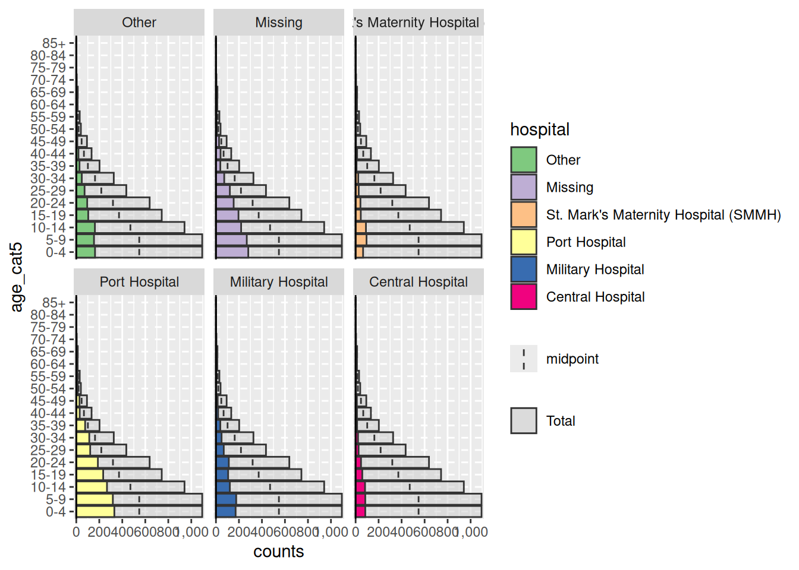
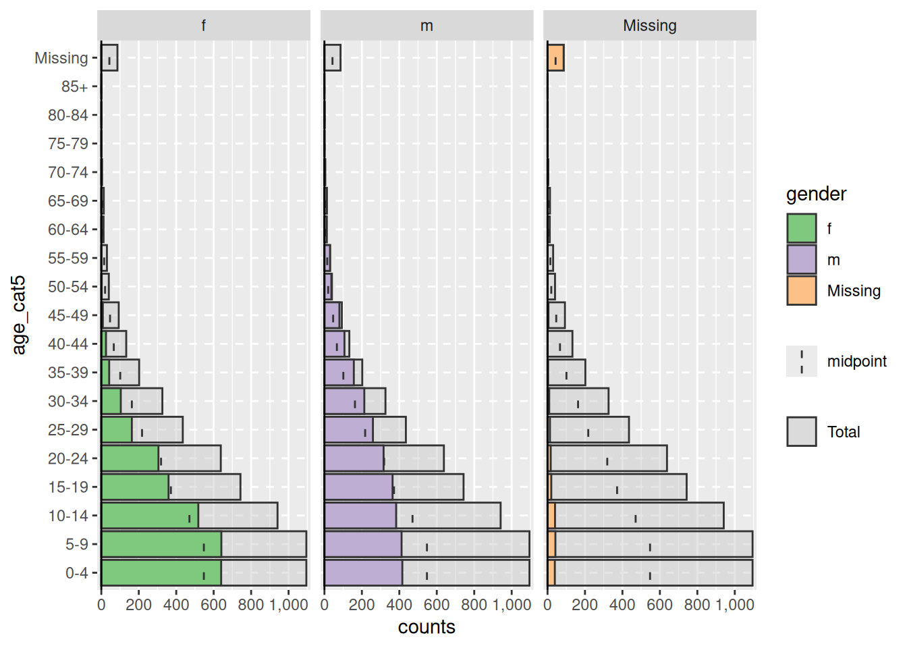
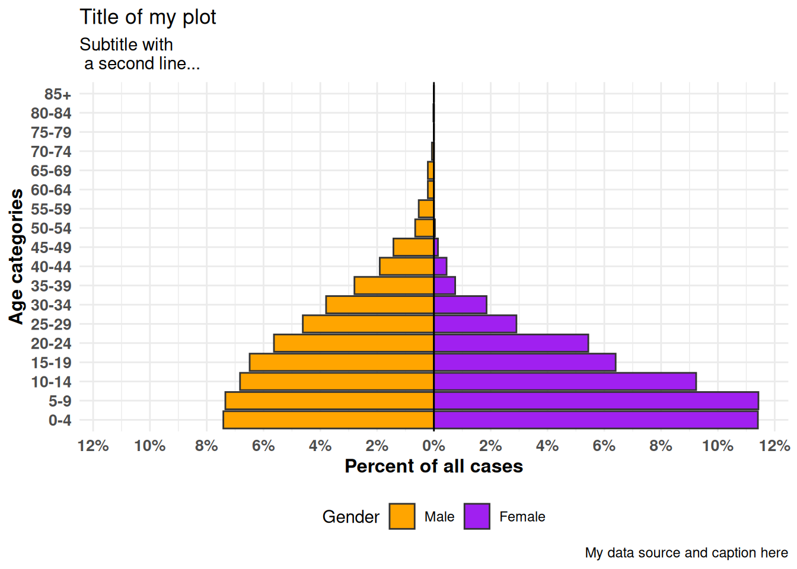
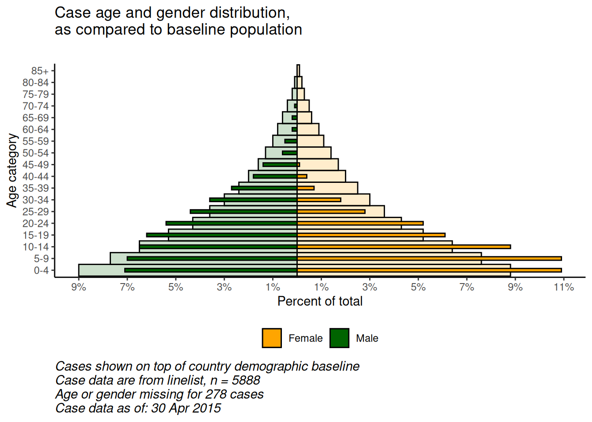
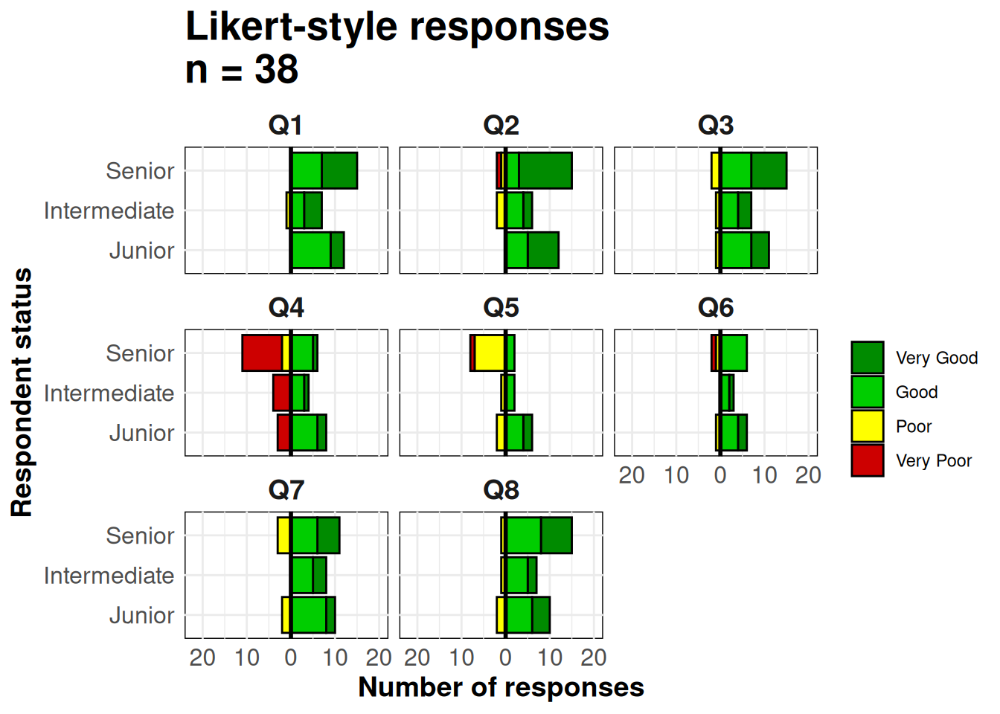

# 33  Pirámides de población y escalas de Likert

[](../../images/pop_pyramid_baseline.png)

[](../../images/likert.png)

Las pirámides demográficas son útiles para mostrar distribuciones de edad y género. Se puede utilizar un código similar para visualizar los resultados de las preguntas de las encuestas tipo Likert (por ejemplo, “Muy de acuerdo”, “De acuerdo”, “Neutral”, “En desacuerdo”, “Muy en desacuerdo”). En esta página cubrimos lo siguiente:

- Pirámides rápidas y sencillas con el paquete **apyramid**
- Más pirámides personalizables con `ggplot()`
- Visualización de datos demográficos “de referencia” en el fondo de la pirámide
- Utilización de gráficos de tipo pirámide para mostrar otros tipos de datos (por ejemplo, respuestas a preguntas de encuestas **tipo Likert**)

## 33.1 Preparación

### Cargar paquetes

Este trozo de código muestra la carga de los paquetes necesarios para los análisis. En este manual destacamos `p_load()` de **pacman**, que instala el paquete si es necesario *y* lo carga para su uso. También puedes cargar los paquetes instalados con `library()` de R **base**. Consulta la página sobre [fundamentos de R](basics.llms.md) para obtener más información sobre los paquetes de R.

``` r
pacman::p_load(rio,       # para importar datos
               here,      # para localizar archivos
               tidyverse, # to clean, handle, and plot the data (includes ggplot2 package)
               apyramid,  # un paquete dedicado a crear pirámides de edad
               janitor,   # tablas y limpieza de datos
               stringr,   # trabajar con cadenas para títulos, subtítulos, etc.
               appliedepidata) # datos de ejemplo utilizados en este manual
```

### Importar datos

Para empezar, importamos la lista de casos limpia de una epidemia de ébola simulada. Cárguelo directamente con `appliedepidata::get_data(name = "linelist_cleaned_rds")` (véase la página [Descargando el manual y los datos](download.llms.md) para más detalles).

``` r
# importar linelist de casos 
linelist <- appliedepidata::get_data(name = "linelist_cleaned_rds")
```

A continuación se muestran las primeras 50 filas del listado.

### Limpieza

Para hacer una pirámide demográfica tradicional de edad/género, primero hay que limpiar los datos de la siguiente manera:

- Debe limpiarse la columna `gender`.
- Dependiendo del método, la edad debe ser almacenada como un número o en una columna de *categoría de edad*.

Si se utilizan categorías de edad, los valores de las columnas deben corregirse ordenados, ya sea por defecto alfanumérico o intencionadamente al convertirlo en de tipo factor.

A continuación utilizamos `tabyl()` de **janitor** para inspeccionar las columnas `gender` y `age_cat5`.

``` r
linelist %>% 
  tabyl(age_cat5, gender)
```

     age_cat5   f   m NA_
          0-4 640 416  39
          5-9 641 412  42
        10-14 518 383  40
        15-19 359 364  20
        20-24 305 316  17
        25-29 163 259  13
        30-34 104 213   9
        35-39  42 157   3
        40-44  25 107   1
        45-49   8  80   5
        50-54   2  37   1
        55-59   0  30   0
        60-64   0  12   0
        65-69   0  12   1
        70-74   0   4   0
        75-79   0   0   1
        80-84   0   1   0
          85+   0   0   0
         <NA>   0   0  86

También realizamos un histograma rápido de la columna `age` para asegurarnos de que está limpia y correctamente clasificada:

``` r
hist(linelist$age)
```

[](age_pyramid_files/figure-html/unnamed-chunk-7-1.png)

## 33.2 paquete **apyramid**

El paquete **apyramid** es un producto del proyecto [R4Epis](https://r4epis.netlify.com/). Puedes leer más sobre este paquete [aquí](https://cran.r-project.org/web/packages/apyramid/vignettes/intro.html). Te permite hacer rápidamente una pirámide de edad. Para situaciones más matizadas consulta, más abajo, la sección sobre [el uso de ggplot()](#demo_pyr_gg). Puedes leer más sobre el paquete **apyramid** en su página de ayuda introduciendo `?age_pyramid` en la consola de R.

### Datos individualizados

Utilizando el conjunto de datos de `linelist` limpio, podemos crear una pirámide de edad con un simple comando `age_pyramid()`. En este comando:

- En el argumento `data =` se establece el dataframe `linelist`
- En el argumento `age_group =` (para el eje Y) se establece el nombre de la columna de edad categórica (entre comillas)
- En el argumento `split_by =` (para el eje x) se establece la columna `gender`

``` r
apyramid::age_pyramid(data = drop_na(linelist, age_cat5, gender),
                      age_group = "age_cat5",
                      split_by = "gender")
```

[](age_pyramid_files/figure-html/unnamed-chunk-8-1.png)

La pirámide puede mostrarse con el porcentaje de todos los casos en el eje x, en lugar de los recuentos, incluyendo `proportional = TRUE`.

``` r
apyramid::age_pyramid(data = drop_na(linelist, age_cat5, gender),
                      age_group = "age_cat5",
                      split_by = "gender",
                      proportional = TRUE)
```

[](age_pyramid_files/figure-html/unnamed-chunk-9-1.png)

Cuando se utiliza el paquete **agepyramid**, si la columna `split_by` es binaria (por ejemplo, male/female, o yes/no), el resultado aparecerá como una pirámide. Sin embargo, si hay más de dos valores en la columna `split_by` (sin incluir `NA`), la pirámide aparecerá como un gráfico de barras facetadas con barras grises en el “fondo” que indican el rango de los datos no facetados para ese grupo de edad. En este caso, los valores de `split_by` = aparecerán como etiquetas en la parte superior de cada panel de facetas. Por ejemplo, a continuación se muestra lo que ocurre si a `split_by` = se le asigna la columna `hospital`.

``` r
apyramid::age_pyramid(data = drop_na(linelist, age_cat5),
                      age_group = "age_cat5",
                      split_by = "hospital")  
```

[](age_pyramid_files/figure-html/unnamed-chunk-10-1.png)

#### Valores faltantes

Las filas que tienen valores faltantes `NA` en las columnas `split_by =` o `age_group =`, si se codifican como `NA`, no producirán el aspecto mostrado arriba. Por defecto, estas filas no se mostrarán. Sin embargo, puede especificar que aparezcan, en un gráfico de barras adyacente y como un grupo de edad separado en la parte superior, especificando `na.rm = FALSE`.

``` r
apyramid::age_pyramid(data = linelist,
                      age_group = "age_cat5",
                      split_by = "gender",
                      na.rm = FALSE)         # mostrar pacientes sin edad o sexo
```

[](age_pyramid_files/figure-html/unnamed-chunk-11-1.png)

#### Proporciones, colores y estética

Por defecto, las barras muestran los recuentos (no el %), se muestra una línea media discontinua para cada grupo y los colores son verde/morado. Cada uno de estos parámetros puede ajustarse, como se muestra a continuación:

También puede añadir comandos adicionales de `ggplot()` al gráfico utilizando la sintaxis estándar de `ggplot()` “+”, como temas estéticos y ajustes de etiquetas:

``` r
apyramid::age_pyramid(
  data = drop_na(linelist, age_cat5, gender),
  age_group = "age_cat5",
  split_by = "gender",
  proportional = TRUE,              # muestra porcentajes, no conteos
  show_midpoint = FALSE,            # elimina la línea del punto medio de la barra
  #pal = c("orange", "purple")     # puede especificar colores alternativos aquí (pero no etiquetas)
  )+                 
  
  # comandos adicionales de ggplot
  theme_minimal()+                               # simplifica el fondo
  scale_fill_manual(                             # especificar colores Y etiquetas
    values = c("orange", "purple"),              
    labels = c("m" = "Male", "f" = "Female"))+
  labs(y = "Percent of all cases",              # observa que los labs x e y se intercambian
       x = "Age categories",                          
       fill = "Gender", 
       caption = "My data source and caption here",
       title = "Title of my plot",
       subtitle = "Subtitle with \n a second line...")+
  theme(
    legend.position = "bottom",                          # leyenda en la parte inferior
    axis.text = element_text(size = 10, face = "bold"),  # fuentes/tamaños
    axis.title = element_text(size = 12, face = "bold"))
```

[](age_pyramid_files/figure-html/unnamed-chunk-12-1.png)

### Datos agregados

Los ejemplos anteriores suponen que sus datos están en formato de listado, con una fila por observación. Si los datos ya están agregados en recuentos por categoría de edad, puedes seguir utilizando el paquete **apyramid**, como se muestra a continuación.

Para la demostración, agregamos los datos del listado en recuentos por categoría de edad y género, en un formato “ancho”. Esto simulará como si sus datos estuvieran agregados desde el principios. Aprende más sobre [Agrupar datos](grouping.llms.md) y [Pivotar datos](pivoting.llms.md) en sus respectivas páginas.

``` r
demo_agg <- linelist %>% 
  count(age_cat5, gender, name = "cases") %>% 
  pivot_wider(
    id_cols = age_cat5,
    names_from = gender,
    values_from = cases) %>% 
  rename(`missing_gender` = `NA`)
```

…lo que hace que el conjunto de datos tenga el siguiente aspecto: con columnas para la categoría age, y recuentos de male, de female y de missing.

Para configurar estos datos para la pirámide de edad, pivotaremos los datos para que sean “largos” con la función `pivot_longer()` de **dplyr**. Esto se debe a que `ggplot()` generalmente prefiere datos “largos”, y **apyramid** está utilizando `ggplot()`.

``` r
# pivotar los datos agregados en formato largo
demo_agg_long <- demo_agg %>% 
  pivot_longer(
    col = c(f, m, missing_gender),            # columnas a alargar
    names_to = "gender",                # nombre para la nueva columna de categorías
    values_to = "counts") %>%           # nombre para la nueva columna de recuentos
  mutate(
    gender = na_if(gender, "missing_gender")) # convierte "missing_gender" en NA
```

A continuación, utiliza los argumentos `split_by =` y `count =` de `age_pyramid()` para especificar las respectivas columnas de los datos:

``` r
apyramid::age_pyramid(data = drop_na(demo_agg_long),
                      age_group = "age_cat5",# nombre de columna para la categoría de edad
                      split_by = "gender",   # nombre de columna para género
                      count = "counts",      # nombre de columna para el recuento de casos
                      show_midpoint = FALSE)
```

[](age_pyramid_files/figure-html/unnamed-chunk-17-1.png)

Observa en lo anterior, que el orden de los factores “m” y “f” es diferente (pirámide invertida). Para ajustar el orden debes redefinir el género en los datos agregados como un Factor y ordenar los niveles como se desee. Consulta la página [Factores](factors.llms.md).

## 33.3 `ggplot()`

El uso de `ggplot()` para construir tu pirámide de edad permite más flexibilidad, pero requiere más esfuerzo y comprensión de cómo funciona `ggplot()`. También es más fácil cometer errores accidentalmente.

Para usar `ggplot()` para hacer pirámides demográficas, se crean dos gráficos de barras (uno para cada género), se convierten los valores de un gráfico en negativo y, finalmente, se invierten los ejes x e y para mostrar los gráficos de barras verticalmente, con sus bases encontrándose en el centro del gráfico.

### Preparación

Este enfoque utiliza la columna *numérica* `age`, no la columna *categórica* de `age_cat5`. Así que comprobaremos que el tipo de esta columna es efectivamente numérica.

``` r
class(linelist$age)
```

    [1] "numeric"

Podrías utilizar la misma lógica que se indica a continuación para construir una pirámide a partir de datos categóricos utilizando `geom_col()` en lugar de `geom_histogram()`.

### Construcción del gráfico

En primer lugar, hay que entender que para hacer una pirámide de este tipo utilizando `ggplot()` el planteamiento es el siguiente:

- Dentro de `ggplot()`, crea **dos** histogramas utilizando la columna numérica de la edad. Crea uno para cada uno de los dos valores de agrupación (en este caso los géneros masculino y femenino). Para ello, los datos para cada histograma se especifican dentro de sus respectivos comandos `geom_histogram()`, con los respectivos filtros aplicados a `linelist`.

- Un gráfico tendrá valores de recuento positivos, mientras que el otro tendrá sus recuentos convertidos a valores negativos - esto crea la “pirámide” con el valor `0` en el centro del gráfico. Los valores negativos se crean utilizando un término especial de **ggplot2** `after_stat(count)` y multiplicando por -1.

- El comando `coord_flip()` cambia los ejes X e Y, lo que hace que los gráficos se vuelvan verticales y se cree la pirámide.

- Por último, hay que modificar las etiquetas de los valores del eje de recuento para que aparezcan como recuentos “positivos” en ambos lados de la pirámide (a pesar de que los valores subyacentes en un lado sean negativos).

A continuación se muestra una versión **sencilla** de esto, utilizando `geom_histogram()`:

``` r
  # comenzar ggplot
  ggplot(mapping = aes(x = age, fill = gender)) +
  
  # histograma de mujeres
  geom_histogram(data = linelist %>% filter(gender == "f"),
                 breaks = seq(0,85,5),
                 colour = "white") +
  
  # histograma de hombres (valores convertidos a negativo)
  geom_histogram(data = linelist %>% filter(gender == "m"),
                 breaks = seq(0,85,5),
                 mapping = aes(y = after_stat(count)*(-1)),
                 colour = "white") +
  
  # invertir los ejes X e Y
  coord_flip() +
  
  # ajustar la escala del eje de recuentos
  scale_y_continuous(limits = c(-600, 900),
                     breaks = seq(-600,900,100),
                     labels = abs(seq(-600, 900, 100)))
```

[](age_pyramid_files/figure-html/unnamed-chunk-19-1.png)

***PELIGRO:*** Si los **límites** de tu eje de recuentos son demasiado bajos, y una barra de recuentos los sobrepasa, la barra desaparecerá por completo o se acortará artificialmente. Ten cuidado con esto si analizas datos que se actualizan de forma rutinaria. Evítalo haciendo que los límites del eje de recuentos se ajusten automáticamente a los datos, como se indica a continuación.

Hay muchas cosas que puedes cambiar/añadir a esta sencilla versión, entre ellas:

- Ajustar automáticamente la escala del eje de recuentos a sus datos (evita los errores que se comentan en la advertencia que aparece a continuación)
- Especificar manualmente los colores y las etiquetas de las leyendas

**Convertir recuentos en porcentajes**

Para convertir los recuentos en porcentajes (del total), hazlo en los datos antes de representarlos. A continuación, obtenemos los recuentos de age-gender, entonces desagrupamos con `ungroup()`, y luego mutamos con `mutate()` para crear nuevas columnas de porcentajes. Si quieres porcentajes por género, omite el paso de desagrupación.

``` r
# crear conjunto de datos con proporciones del total
pyramid_data <- linelist %>%
  count(age_cat5,
        gender,
        name = "counts") %>% 
  ungroup() %>%                 # desagrupar para que los porcentajes no sean por grupo
  mutate(percent = round(100*(counts / sum(counts, na.rm=T)), digits = 1), 
         percent = case_when(
            gender == "f" ~ percent,
            gender == "m" ~ -percent,     # convierte hombres en valores negativos
            TRUE          ~ NA_real_))    # el valor NA también debe ser numérico
```

Es importante que guardemos los valores máximo y mínimo para saber cuáles deben ser los límites de la escala. Estos se utilizarán en el comando `ggplot()` a continuación.

``` r
max_per <- max(pyramid_data$percent, na.rm=T)
min_per <- min(pyramid_data$percent, na.rm=T)

max_per
```

    [1] 10.9

``` r
min_per
```

    [1] -7.1

Finalmente hacemos el `ggplot()` sobre los datos porcentuales. Especificamos `scale_y_continuous()` para extender las longitudes predefinidas en cada dirección (positiva y “negativa”). Usamos `floor()` y `ceiling()` para redondear los decimales en la dirección apropiada (abajo o arriba) para el lado del eje.

``` r
# comenzar ggplot
  ggplot()+  # por defecto el eje-x es la edad en años;

  # gráfico de datos de casos
  geom_col(data = drop_na(pyramid_data, percent),
           mapping = aes(
             x = age_cat5,
             y = percent,
             fill = gender),         
           colour = "white")+       # blanco alrededor de cada barra
  
  # invierte los ejes X e Y para hacer la pirámide vertical
  coord_flip()+
  

  # ajusta las escalas de los ejes
  # scale_x_continuous(breaks = seq(0,100,5), labels = seq(0,100,5)) +
  scale_y_continuous(
    limits = c(min_per, max_per),
    breaks = seq(from = floor(min_per),                # secuencia de valores, por 2s
                 to = ceiling(max_per),
                 by = 2),
    labels = paste0(abs(seq(from = floor(min_per),     # secuencia de valores absolutos, por 2s, con "%"
                            to = ceiling(max_per),
                            by = 2)),
                    "%"))+  

  # designar colores y etiquetas de leyenda manualmente
  scale_fill_manual(
    values = c("f" = "orange",
               "m" = "darkgreen"),
    labels = c("Female", "Male")) +
  
  # etiquetas de valores ( recordar que ahora X e Y están invertidas)
  labs(
    title = "Age and gender of cases",
    x = "Age group",
    y = "Percent of total",
    fill = NULL,
    caption = stringr::str_glue("Data are from linelist \nn = {nrow(linelist)} (age or sex missing for {sum(is.na(linelist$gender) | is.na(linelist$age_years))} cases) \nData as of: {format(Sys.Date(), '%d %b %Y')}")) +
  
  # mostrar temas
  theme(
    panel.grid.major = element_blank(),
    panel.grid.minor = element_blank(),
    panel.background = element_blank(),
    axis.line = element_line(colour = "black"),
    plot.title = element_text(hjust = 0.5), 
    plot.caption = element_text(hjust=0, size=11, face = "italic")
    )
```

[](age_pyramid_files/figure-html/unnamed-chunk-22-1.png)

### Comparación con una línea basal

Con la flexibilidad de `ggplot()`, se puede tener una segunda capa de barras en el fondo que represente la pirámide de población “verdadera” o “de referencia”. Esto puede proporcionar una buena visualización para comparar lo observado con una referencia.

Importa y visualiza los datos de población (véase la página [Descargando el manual y los datos](download.llms.md)):

``` r
# importa los datos demográficos de la población
pop <- appliedepidata::get_data(name = "country_demographics")
```

En primer lugar, algunos pasos de gestión de datos:

Aquí registramos el orden de las categorías de edad que queremos que aparezcan. Debido a algunas peculiaridades de la forma en que se implementa `ggplot()`, en este escenario específico es más fácil almacenar estos como un vector de caracteres y utilizarlos más tarde en la función de representación gráfica.

``` r
# registrar correctamente los niveles de las categorías de edad
age_levels <- c("0-4","5-9", "10-14", "15-19", "20-24",
                "25-29","30-34", "35-39", "40-44", "45-49",
                "50-54", "55-59", "60-64", "65-69", "70-74",
                "75-79", "80-84", "85+")
```

Combina los datos de la población y de los casos mediante la función `bind_rows()` de **dplyr**:

- En primer lugar, asegúrate que los nombres de las columnas, los valores de las categorías de edad y los valores del género son *exactamente los mismos*
- Haz que tengan la misma estructura de datos: columnas de categoría de edad, sexo, recuentos y porcentaje del total
- Agruparlas, una encima de la otra (`bind_rows()`)

``` r
# crear/transformar datos de población, con porcentaje del total
################################################################
pop_data <- pop %>% 
  pivot_longer(      # pivota largo las columnas de género
    cols = c(m, f),
    names_to = "gender",
    values_to = "counts") %>% 
  
  mutate(
    percent  = round(100*(counts / sum(counts, na.rm=T)),1),  # % of total
    percent  = case_when(                                                        
     gender == "f" ~ percent,
     gender == "m" ~ -percent,               # si es hombre, convierte el % en negativo
     TRUE          ~ NA_real_))
```

Revisar el conjunto de datos de la población modificada

Ahora implementa lo mismo para los casos de `linelist` Ligeramente diferente porque comienza con las filas de casos, no con los recuentos.

``` r
# crear datos de casos por edad/género, con porcentaje del total
################################################################
case_data <- linelist %>%
  count(age_cat5, gender, name = "counts") %>%   # recuentos por grupos de edad/género
  ungroup() %>% 
  mutate(
    percent = round(100*(counts / sum(counts, na.rm=T)),1),  # calcula el % del total por grupos de edad-género
    percent = case_when(                                     # convierte % en negativo si es hombre
      gender == "f" ~ percent,
      gender == "m" ~ -percent,
      TRUE          ~ NA_real_))
```

Revisa los datos de casos modificados

Ahora los dos dataframes están combinados, uno encima del otro (tienen los mismos nombres de columna). Podemos “nombrar” cada uno de los dataframes, y utilizar el argumento `.id =` para crear una nueva columna “data_source” que indicará de qué dataframe se originó cada fila. Podemos utilizar esta columna para filtrar en `ggplot()`.

``` r
# combina datos de casos y de población (mismos nombres de columna, valores de age_cat y valores de género)
pyramid_data <- bind_rows("cases" = case_data, "population" = pop_data, .id = "data_source")
```

Almacena los valores porcentuales máximo y mínimo, utilizados en la función de trazado para definir la extensión del gráfico (¡y no acortar ninguna barra!)

``` r
# Define la extensión del eje porcentual, utilizado para los límites del gráfico
max_per <- max(pyramid_data$percent, na.rm=T)
min_per <- min(pyramid_data$percent, na.rm=T)
```

Ahora el gráfico se hace con `ggplot()`:

- Un gráfico de barras de los datos de población (barras más anchas y transparentes)
- Un gráfico de barras de los datos del caso (barras pequeñas y más sólidas)

``` r
# comienza ggplot
##############
ggplot()+  # el eje-x por defecto es la edad en años;

  # gráfico de datos de población
  geom_col(
    data = pyramid_data %>% filter(data_source == "population"),
    mapping = aes(
      x = age_cat5,
      y = percent,
      fill = gender),
    colour = "black",                               # color negro alrededor de las barras
    alpha = 0.2,                                    # más transparente
    width = 1)+                                     # anchura completa
  
  # gráfico de datos de casos
  geom_col(
    data = pyramid_data %>% filter(data_source == "cases") %>% drop_na(percent), 
    mapping = aes(
      x = age_cat5,                               # categorías de edad como eje-X original
      y = percent,                                # % como eje-Y original
      fill = gender),                             # relleno de barras por género
    colour = "black",                               # color negro alrededor de las barras
    alpha = 1,                                      # no transparente 
    width = 0.3)+                                   # mitad anchura
  
  # invierte los ejes X e Y para hacer la pirámide vertical
  coord_flip()+
  
  # asegura manualmente que el eje de edad está ordenado correctamente
  scale_x_discrete(limits = age_levels)+     # definido en el trozo (chunk) anterior
  
  # establecer el eje de porcentajes
  scale_y_continuous(
    limits = c(min_per, max_per),                                          # min y max definidos arriba
    breaks = seq(floor(min_per), ceiling(max_per), by = 2),                # de min% a max% por 2  
    labels = paste0(                                                       # para las etiquetas, pegar juntas...  
              abs(seq(floor(min_per), ceiling(max_per), by = 2)), "%"))+                                                  

  # designar colores y etiquetas de leyenda manualmente
  scale_fill_manual(
    values = c("f" = "orange",         # asigna colores a los valores de los datos
               "m" = "darkgreen"),
    labels = c("f" = "Female",
               "m"= "Male"),      # cambia las etiquetas que aparecen en la leyenda, observa el orden
  ) +

  # etiquetas, títulos y pies de foto 
  labs(
    title = "Case age and gender distribution,\nas compared to baseline population",
    subtitle = "",
    x = "Age category",
    y = "Percent of total",
    fill = NULL,
    caption = stringr::str_glue("Cases shown on top of country demographic baseline\nCase data are from linelist, n = {nrow(linelist)}\nAge or gender missing for {sum(is.na(linelist$gender) | is.na(linelist$age_years))} cases\nCase data as of: {format(max(linelist$date_onset, na.rm=T), '%d %b %Y')}")) +
  
  # temas estéticos opcionales
  theme(
    legend.position = "bottom",                             # mueve la leyenda hacia abajo
    panel.grid.major = element_blank(),
    panel.grid.minor = element_blank(),
    panel.background = element_blank(),
    axis.line = element_line(colour = "black"),
    plot.title = element_text(hjust = 0), 
    plot.caption = element_text(hjust=0, size=11, face = "italic"))
```

[](age_pyramid_files/figure-html/unnamed-chunk-33-1.png)

## 33.4 Escalas de Likert

Las técnicas utilizadas para hacer una pirámide de población con `ggplot()` también se pueden utilizar para hacer gráficos de datos de encuestas en escala Likert.

Importa los datos (consulta la página [Descargando el manual y los datos](download.llms.md) si lo deseas).

``` r
# importa los datos de respuesta de la escala de likert
likert_data <- appliedepidata::get_data(name = "likert_data")
```

Empieza con datos que tengan este aspecto, con una clasificación categórica de cada encuestado (`status` y sus respuestas a 8 preguntas en una escala tipo Likert de 4 puntos (“Muy pobre”, “Pobre”, “Bueno”, “Muy bueno”).

En primer lugar, algunos pasos de gestión de datos:

- Pivotar los datos a lo largo
- Crear una nueva columna `direction` en función de si la respuesta fue generalmente “positiva” o “negativa”
- Establece el orden del nivel de factor para la columnas `status` y `Response`
- Almacena el valor de recuento máximo para que los límites del gráfico sean los adecuados

``` r
melted <- likert_data %>% 
  pivot_longer(
    cols = Q1:Q8,
    names_to = "Question",
    values_to = "Response") %>% 
  mutate(
    
    direction = case_when(
      Response %in% c("Poor","Very Poor")  ~ "Negative",
      Response %in% c("Good", "Very Good") ~ "Positive",
      TRUE                                 ~ "Unknown"),
    
    status = fct_relevel(status, "Junior", "Intermediate", "Senior"),
    
    # must reverse 'Very Poor' and 'Poor' for ordering to work
    Response = fct_relevel(Response, "Very Good", "Good", "Very Poor", "Poor")) 

# obtener el valor maximo para los limites de escala
melted_max <- melted %>% 
  count(status, Question) %>% # obtener recuentos
  pull(n) %>%                 # columna 'n'
  max(na.rm=T)                # obtener max
```

Ahora haz el gráfico. Como en las pirámides de edad anteriores, estamos creando dos gráficos de barras e invirtiendo los valores de uno de ellos a negativo.

Utilizamos `geom_bar()` porque nuestros datos son una fila por observación, no recuentos agregados. Utilizamos el término especial de **ggplot2** `after_stat(count)` en uno de los gráficos de barras para invertir los valores en negativo (\*-1), y establecemos `position = "stack"` para que los valores se apilen unos encima de otros.

``` r
# make plot
ggplot()+
     
  # gráfico de barras de las respuestas "negativas"
     geom_bar(
       data = melted %>% filter(direction == "Negative"),
       mapping = aes(
         x = status,
         y = after_stat(count)*(-1),    # recuentos invertidos a negativo
         fill = Response),
       color = "black",
       position = "stack")+
     
     # gráfico de barras de las respuestas "positivas"
     geom_bar(
       data = melted %>% filter(direction == "Positive"),
       mapping = aes(
         x = status,
         fill = Response),
       colour = "black",
       position = "stack")+
     
     # invierte los ejes X e Y
     coord_flip()+
  
     # Línea vertical negra en 0
     geom_hline(yintercept = 0, color = "black", linewidth=1)+
     
    # convertir etiquetas a todos los números positivos
    scale_y_continuous(
      
      # límites de la escala del eje-x
      limits = c(-ceiling(melted_max/10)*11,    # secuencia de neg a pos por 10, bordes redondeados hacia afuera al más cercano a 5
                 ceiling(melted_max/10)*10),   
      
      # valores de la escala del eje-x
      breaks = seq(from = -ceiling(melted_max/10)*10,
                   to = ceiling(melted_max/10)*10,
                   by = 10),
      
      # etiquetas de la escala del eje-x
      labels = abs(unique(c(seq(-ceiling(melted_max/10)*10, 0, 10),
                            seq(0, ceiling(melted_max/10)*10, 10))))) +
     
    # escalas de color asignadas manualmente 
    scale_fill_manual(
      values = c("Very Good"  = "green4", # asigna colores
                "Good"      = "green3",
                "Poor"      = "yellow",
                "Very Poor" = "red3"),
      breaks = c("Very Good", "Good", "Poor", "Very Poor"))+ # ordena la leyenda
     
    
     
    # Facetar todo el gráfico para que cada pregunta sea un subgráfico
    facet_wrap( ~ Question, ncol = 3)+
     
    # etiquetas, títulos, leyenda
    labs(
      title = str_glue("Likert-style responses\nn = {nrow(likert_data)}"),
      x = "Respondent status",
      y = "Number of responses",
      fill = "")+

     # ajustes de visualización 
     theme_minimal()+
     theme(axis.text = element_text(size = 12),
           axis.title = element_text(size = 14, face = "bold"),
           strip.text = element_text(size = 14, face = "bold"),  # Subtítulos de las facetas
           plot.title = element_text(size = 20, face = "bold"),
           panel.background = element_rect(fill = NA, color = "black")) # recuadro negro alrededor de cada faceta
```

[](age_pyramid_files/figure-html/unnamed-chunk-38-1.png)

## 33.5 Recursos

[documentación de apyramide](https://cran.r-project.org/web/packages/apyramid/vignettes/intro.html)
