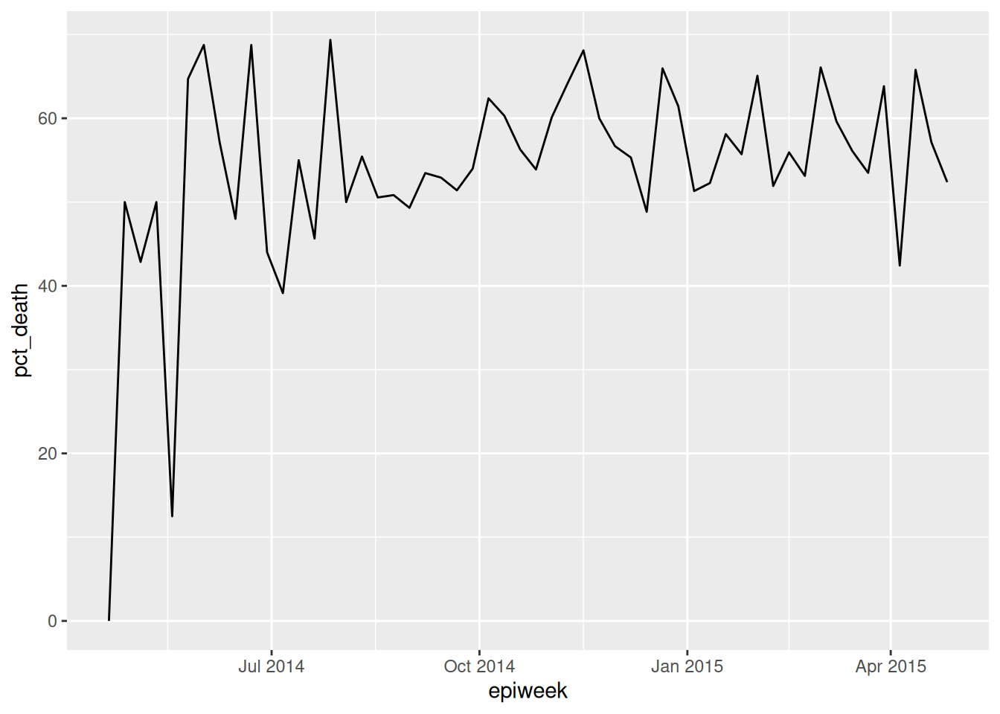
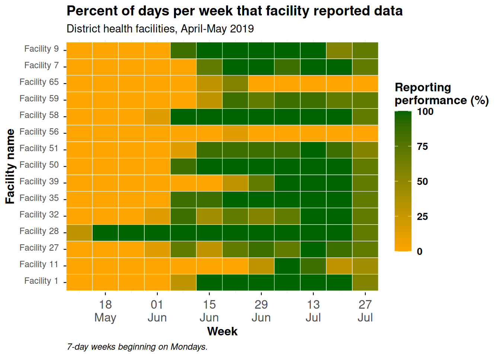

# 39  Gráficos interactivos

Últimamente es cada vez más común la necesidad de que la visualización de datos sea interactiva para el público. Por ello, es cada vez más habitual la realización de gráficos interactivos. Hay varias formas de realizarlos, pero las dos más comunes son empleando **plotly** y **shiny**.

En esta página nos centraremos en como convertir un gráfico `ggplot()` existente en un gráfico interactivo con **plotly**. Puedes leer más sobre **shiny** en la página [Dashboards con Shiny](shiny_basics.llms.md). Antes de comenzar, merece la pena mencionar que los gráficos interactivos sólo se pueden utilizar en documentos R markdown en formato HTML, no en documentos PDF o Word.

A continuación se muestra una curva epidémica que se ha transformado en interactiva utilizando la integración de **ggplot2** y **plotly** (pasa el cursor por encima del gráfico, amplía la imagen o clica en los elementos de la leyenda para comprobarlo).

## 39.1 Preparación

### Cargar paquetes

Este trozo de código muestra la carga de los paquetes necesarios para los análisis. En este manual destacamos `p_load()` de **pacman**, que instala el paquete si es necesario *y* lo carga para su uso. También puedes cargar los paquetes instalados con `library()` de R **base**. Consulta la página [Fundamentos de R](basics.llms.md) para obtener más información sobre los paquetes de R.

``` r
pacman::p_load(
  rio,       # importación/exportación
  here,      # rutas de archivos
  lubridate, # lubridate
  plotly,    # gráficos interactivos
  scales,    # porcentajes rápidos
  tidyverse, # gestión y visualización de datos
  appliedepidata # datos de ejemplo utilizados en este manual
  ) 
```

### Comienza con un `ggplot()`

En esta página asumimos que comienzas con un gráfico `ggplot()` que deseas convertir en interactivo. Construiremos varios de estos gráficos en esta página, utilizando la base de datos `linelist`, la cual es ampliamente utilizada en este manual.

### Importar datos

Para empezar, importamos la lista de casos limpia de una epidemia de ébola simulada. Cárguelo directamente con `appliedepidata::get_data(name = "linelist_cleaned_rds")` (véase la página [Descargando el manual y los datos](download.llms.md) para más detalles).

``` r
# Importar base de datos linelist 
linelist <- appliedepidata::get_data(name = "linelist_cleaned_rds")
```

A continuación se muestran las primeras 50 filas de la base de datos.

## 39.2 Trazar con `ggplotly()`

La función `ggplotly()` del paquete **plotly** facilita la conversión de un `ggplot()` para que sea interactivo. Simplemente guarda tu `ggplot()` y luego pásaselo a la función `ggplotly()`.

A continuación, trazamos una línea simple que representa la proporción de casos que murieron en una semana determinada.

Comenzamos creando unos datos resumidos de cada semana epidemiológica y el porcentaje de casos con resultado conocido que murieron.

``` r
weekly_deaths <- linelist %>%
  group_by(epiweek = floor_date(date_onset, "week")) %>%  # crear y agrupar los datos por la columna epiweek
  summarise(                                              # crear nuevo dataframe descriptivo 
    n_known_outcome = sum(!is.na(outcome), na.rm=T),      # número de casos por grupo con resultado conocido
    n_death  = sum(outcome == "Death", na.rm=T),          # número de casos por grupo que murieron
    pct_death = 100*(n_death / n_known_outcome)           # porcentaje de casos con resultado conocido que murieron
  )
```

Aquí están las primeras 50 filas de los datos `weekly_deaths`.

Luego creamos el gráfico con **ggplot2**, utilizando `geom_line()`.

``` r
deaths_plot <- ggplot(data = drop_na(weekly_deaths, epiweek, pct_death))+ # comenzar introduciendo los datos de  weekly deaths 
  geom_line(mapping = aes(x = epiweek, y = pct_death))  # hacer un gráfico de línea

deaths_plot   # imprimir
```

[](interactive_plots_files/figure-html/unnamed-chunk-7-1.png)

Podemos convertirlo en interactivo simplemente pasando este gráfico mediante un “pipe” a `ggplotly()`, como se muestra abajo. Pasa el cursor por encima de la línea para mostrar los valores x e y. Puedes ampliar el gráfico y arrastrarlo. También puedes ver los iconos en la parte superior derecha del gráfico. En orden, estos botones permiten:

- Descargar la vista actual como imagen PNG
- Acercarse con un cuadro de selección
- “Pan”, o moverse a través de la gráfica clicando y arrastrando la gráfica
- Acercar, alejar o volver al zoom por defecto
- Restablecer los ejes por defecto
- Activar/desactivar las “líneas en pico” que son líneas punteadas desde el punto interactivo que se extienden a los ejes x e y
- Ajustes sobre si los datos se muestran o no cuando no se está sobre la línea

``` r
deaths_plot %>% plotly::ggplotly()
```

Los datos agrupados también funcionan con `ggplotly()`. A continuación, realizaremos una curva epidemica semanal agrupada por resultado. Las barras apiladas son interactivas. Prueba a clicar en los diferentes elementos de la leyenda (aparecerán/desaparecerán).

``` r
# Hacer curva epidémica con el paquete incidence2
p <- incidence2::incidence(
  linelist,
  date_index = date_onset,
  interval = "weeks",
  groups = outcome) %>% plot(fill = outcome)
```

``` r
# Hacer interactivo
p %>% plotly::ggplotly()
```

## 39.3 Modificaciones

### Tamaño del archivo

Cuando se exportan imagenes en un HTML generado por R Markdown (¡como este libro!) es deseable que el gráfico tenga el menor tamaño de datos posible (sin repercusiones negativas en la mayoría de los casos). Para ello, sólo hay que realizar “pipe” desde el gráfico interactivo a `partial_bundle()`, de **plotly**.

``` r
p <- p %>% 
  plotly::ggplotly() %>%
  plotly::partial_bundle()
```

### Botones

Algunos de los botones de un plotly estándar son superfluos y pueden distraer, por lo que, si quieres, puedes eliminarlos. Puedes hacer esto simplemente canalizando la haz pipe hacia `config()` de **plotly** y especifican qué botones eliminar. En el siguiente ejemplo especificamos por adelantado los nombres de los botones a eliminar, y los especificamos en el argumento `modeBarButtonsToRemove =`. También establecemos `displaylogo = FALSE` para eliminar el logo de plotly.

``` r
## estos botones distraen y queremos eliminarlos
plotly_buttons_remove <- list('zoom2d','pan2d','lasso2d', 'select2d','zoomIn2d',
                              'zoomOut2d','autoScale2d','hoverClosestCartesian',
                              'toggleSpikelines','hoverCompareCartesian')

p <- p %>%            # redefinir el gráfico  interactivo sin estos botones
  plotly::config(displaylogo = FALSE, modeBarButtonsToRemove = plotly_buttons_remove)
```

## 39.4 Gráficos de calor

Puedes hacer que casi cualquier gráfico de `ggplot()` sea interactivo, incluidos los gráficos de calor. En la página sobre [gráficos de calor](heatmaps.llms.md) puede leer cómo hacer el siguiente gráfico, que muestra la proporción de días a la semana en que determinados centros comunicaron datos a su provincia.

Aquí está el código, aunque en este capítulo no describiremos en profundidad como realizarlo.

``` r
# importar datos
facility_count_data <- appliedepidata::get_data(name = "malaria_facility_count_data")

# datos agregados en semanas para el distrito de Spring
agg_weeks <- facility_count_data %>% 
  filter(District == "Spring",
         data_date < as.Date("2020-08-01")) %>% 
  mutate(week = aweek::date2week(
    data_date,
    start_date = "Monday",
    floor_day = TRUE,
    factor = TRUE)) %>% 
  group_by(location_name, week, .drop = F) %>%
  summarise(
    n_days          = 7,
    n_reports       = n(),
    malaria_tot     = sum(malaria_tot, na.rm = T),
    n_days_reported = length(unique(data_date)),
    p_days_reported = round(100*(n_days_reported / n_days))) %>% 
  ungroup(location_name, week) %>% 
  right_join(tidyr::expand(., week, location_name)) %>% 
  mutate(week = aweek::week2date(week))

# crear plot
metrics_plot <- ggplot(agg_weeks,
       aes(x = week,
           y = location_name,
           fill = p_days_reported))+
  geom_tile(colour="white")+
  scale_fill_gradient(low = "orange", high = "darkgreen", na.value = "grey80")+
  scale_x_date(expand = c(0,0),
               date_breaks = "2 weeks",
               date_labels = "%d\n%b")+
  theme_minimal()+ 
  theme(
    legend.title = element_text(size=12, face="bold"),
    legend.text  = element_text(size=10, face="bold"),
    legend.key.height = grid::unit(1,"cm"),
    legend.key.width  = grid::unit(0.6,"cm"),
    axis.text.x = element_text(size=12),
    axis.text.y = element_text(vjust=0.2),
    axis.ticks = element_line(linewidth=0.4),
    axis.title = element_text(size=12, face="bold"),
    plot.title = element_text(hjust=0,size=14,face="bold"),
    plot.caption = element_text(hjust = 0, face = "italic")
    )+
  labs(x = "Week",
       y = "Facility name",
       fill = "Reporting\nperformance (%)",
       title = "Percent of days per week that facility reported data",
       subtitle = "District health facilities, April-May 2019",
       caption = "7-day weeks beginning on Mondays.")

metrics_plot # imprimir
```

[](interactive_plots_files/figure-html/unnamed-chunk-11-1.png)

A continuación, lo convertimos en interactivo y lo modificamos para que los botones sean sencillos y disminuya el tamaño del archivo.

``` r
metrics_plot %>% 
  plotly::ggplotly() %>% 
  plotly::config(displaylogo = FALSE, modeBarButtonsToRemove = plotly_buttons_remove)
```

## 39.5 Recursos

Plotly no es sólo para R, también funciona bien con Python (y realmente con cualquier lenguaje de ciencia de datos, ya que está construido en JavaScript). Puedes leer más sobre él en el [sitio web de plotly](https://plotly.com/r/)
