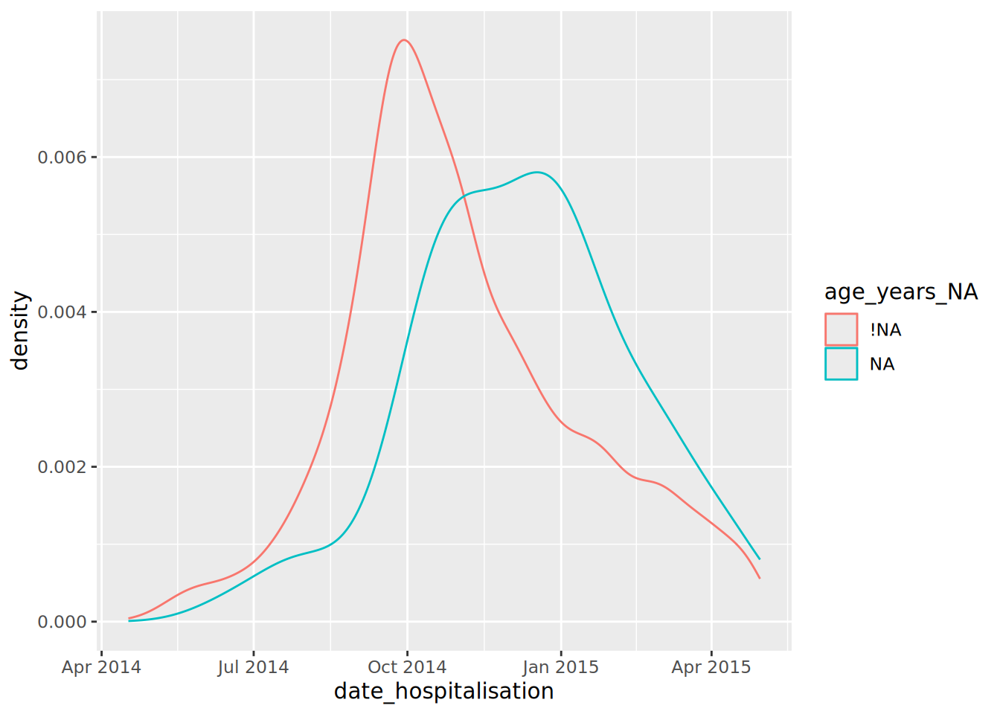
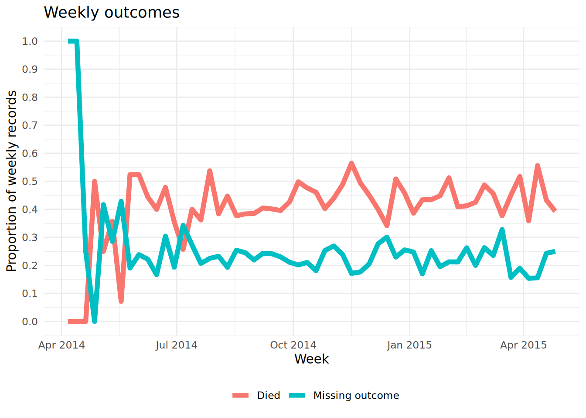

# 20  Valores faltantes

[](../../images/missingness.png)

[](../../images/missingness_overview.png)

En esta página se explica cómo:

1.  Evaluar la falta de información
2.  Filtrar las filas por valores faltantes
3.  Representar la falta de datos a lo largo del tiempo
4.  Manejar cómo se muestra `NA` en los gráficos
5.  Realizar la imputación de valores faltantes: MCAR, MAR, MNAR

## 20.1 Preparación

### Cargar paquetes

Este trozo de código muestra la carga de los paquetes necesarios para los análisis. En este manual destacamos `p_load()` de **pacman**, que instala el paquete si es necesario *y* lo carga para su uso. También puedes cargar los paquetes instalados con `library()` de de R **base** Consulta la página sobre [fundamentos de R](basics.llms.md) para obtener más información sobre los paquetes de R.

``` r
pacman::p_load(
  rio,           # importación/exportación
  tidyverse,     # gestión y visualización de datos
  naniar,        # evaluación y visualización de datos faltantes
  mice, # imputación de datos faltantes
  appliedepidata # datos de ejemplo utilizados en este manual
)
```

### Importar datos

Importamos los datos de casos de una epidemia de ébola simulada. Cárguelo directamente con `appliedepidata::get_data(name = "linelist_cleaned_rds")` (véase la página [Descargando el manual y los datos](download.llms.md) para más detalles).

``` r
# importar linelist
linelist <- appliedepidata::get_data(name = "linelist_cleaned_rds")
```

A continuación se muestran las primeras 50 filas de `linelist`.

### Convertir valores faltantes en la importación

Al importar los datos, ten en cuenta los valores que deben clasificarse como faltantes. Por ejemplo, 99, 999, “Missing”, celdas en blanco (““) o celdas con un espacio vacío (” “). Puedes convertirlos en `NA` (la versión de R de los valores faltantes) con el comando de importación de datos. Consulta la sección de [datos faltantes](importing.llms.md#import_missing) de la página de Importación para obtener más detalles, ya que la sintaxis exacta varía según el tipo de archivo.

## 20.2 Valores faltantes en R

A continuación, exploramos las formas en que se presenta y evalúa los datos faltantes en R, junto con algunos valores y funciones adyacentes.

### `NA`

En R, los valores faltantes se representan con un valor reservado (especial): `NA`. Ten en cuenta que se escribe *sin* comillas. “NA” es diferente y es sólo un valor de carácter normal (también una letra de los Beatles de la canción Hey Jude).

Tus datos pueden tener otras formas de representar la falta de información, como “99”, o “Missing”, o “Desconocido” - incluso puedes tener el valor de carácter vacío “” que parece “en blanco”, o un solo espacio ” “. Se consciente de ello y considera la posibilidad de [convertirlos en `NA` durante la importación](importing.llms.md#import_missing) o durante la limpieza de datos con `na_if()`.

En tu limpieza de datos, también puedes convertir en el otro sentido - cambiando todos los `NA` a “Missing” o similar con `replace_na()` o con `fct_explicit_na()` para los factores.

### Versiones de `NA`

La mayoría de las veces, `NA` representa un valor que falta y todo funciona bien. Sin embargo, en algunas circunstancias puedes encontrar la necesidad de *variaciones* de `NA` específicas para un tipo de objeto (carácter, numérico, etc.). Esto será poco frecuente, pero debes tenerlo en cuenta.

El escenario típico para esto es cuando se crea una nueva columna con la función **dplyr** `case_when()`. Como se describe en la página de [Limpieza de datos y funciones básicas](cleaning.llms.md#clean_case_when), esta función evalúa cada fila del dataframe, valora si las filas cumplen con los criterios lógicos especificados (lado derecho del código), y asigna el nuevo valor correcto (lado izquierdo del código). *Importante: todos los valores del lado derecho deben ser del mismo tipo*.

``` r
linelist <- linelist %>% 
  
  # Crear nueva columna "age_year " a partir de la columna "age"
  mutate(age_years = case_when(
    age_unit == "years"  ~ age,       # si la edad se da en años, asigna el valor original
    age_unit == "months" ~ age/12,    # si la edad se da en meses, se divide por 12
    is.na(age_unit)      ~ age,       # si falta age_unit, asume años
    TRUE                 ~ NA_real_)) # cualquier otra circunstancia, asigna valor faltante
```

Si deseas `NA` en el lado derecho, es posible que tengas que especificar una de las opciones especiales de `NA` que se indican a continuación. Si los otros valores del lado derecho son caracteres, considera usar “Missing” en su lugar o, de lo contrario, usa `NA_character_`. Si todos son numéricos, utiliza `NA_real_`. Si todos son fechas o lógicos, puedes utilizar `NA`.

- `NA` - utilizar para fechas o TRUE/FALSE lógico
- `NA_character_` - utilizar para caracteres
- `NA_real_` - uso para numérico

De nuevo, no es probable que te encuentres con estas variaciones *a menos que* estés utilizando `case_when()` para crear una nueva columna. Consulta la [documentación de R sobre NA](https://stat.ethz.ch/R-manual/R-devel/library/base/html/NA.html) para obtener más información.

### `NULL`

`NULL` es otro valor reservado en R. Es la representación lógica de una declaración que no es ni verdadera ni falsa. Es devuelto por expresiones o funciones cuyos valores son indefinidos. Generalmente no asignes NULL como valor, a menos que escribas funciones o si escribes una [aplicación **Shiny**](shiny_basics.llms.md) para devolver `NULL` en escenarios específicos.

La nulidad puedes evaluarse con `is.null()` y la conversión puedes hacerse con `as.null()`.

Véase esta [entrada del blog](https://www.r-bloggers.com/2010/04/r-na-vs-null/) sobre la diferencia entre `NULL` y `NA`.

### `NaN`

Los valores imposibles se representan con el valor especial `NaN`. Un ejemplo de esto es cuando se fuerza a R a dividir 0 entre 0. Puedes evaluar esto con `is.nan()`. También puedes encontrar funciones complementarias incluyendo `is.infinite()` y `is.finite()`.

### `Inf`

`Inf` representa un valor infinito, como cuando se divide un número por 0.

Como ejemplo de cómo podría afectar esto a tu trabajo: digamos que tienes un vector/columna z que contiene estos valores: `z <- c(1, 22, NA, Inf, NaN, 5)`

Si deseas utilizar `max()` en la columna para encontrar el valor más alto, puedes utilizar el `na.rm = TRUE` para eliminar el `NA` del cálculo, pero el `Inf` y el`NaN` permanecen y se devolverá `Inf`. Para resolver esto, puedes utilizar los corchetes `[ ]` y `is.finite()` para subconjuntar de manera que sólo se utilicen valores finitos para el cálculo: `max(z[is.finite(z)])`.

``` r
z <- c(1, 22, NA, Inf, NaN, 5)
max(z)                           # devuelve NA
max(z, na.rm=T)                  # devuelve Inf
max(z[is.finite(z)])             # devuelve 22
```

### Ejemplos

| Comando R | Resultado |
|----|----|
| `5 / 0` | `Inf` |
| `0 / 0` | `NaN` |
| `5 / NA` | `NA` |
| `5 / Inf |`0NA - 5`|`NAInf / 5`|`Infclass(NA)`| "logical"`class(NaN)`| "numeric"`class(Inf)`| "numeric"`class(NULL)\` | “NULL” |

“NAs introduced by coercion” es un mensaje de aviso común. Esto puede ocurrir si se intenta hacer una conversión ilegal como insertar un valor de carácter en un vector que de otra manera es numérico.

``` r
as.numeric(c("10", "20", "thirty", "40"))
```

    Warning: NAs introduced by coercion

    [1] 10 20 NA 40

`NULL` se ignora en un vector.

``` r
my_vector <- c(25, NA, 10, NULL)  # define el vector
my_vector                         # lo imprime
```

    [1] 25 NA 10

La varianza de un número da como resultado `NA`.

``` r
var(22)
```

    [1] NA

## 20.3 Funciones útiles

Las siguientes funciones de R **base** son muy útiles a la hora de evaluar o manejar los valores faltantes:

### `is.na()` y `!is.na()`

Utiliza `is.na()` para identificar los valores que faltan, o utiliza su opuesto (con `!` delante) para identificar los valores que no faltan. Ambos devuelven un valor lógico (`TRUE` o `FALSE`). Recuerda que puedes `sum()` el vector resultante para contar el número de `TRUE`, por ejemplo, `sum(is.na(linelist$date_outcome))`.

``` r
my_vector <- c(1, 4, 56, NA, 5, NA, 22)
is.na(my_vector)
```

    [1] FALSE FALSE FALSE  TRUE FALSE  TRUE FALSE

``` r
!is.na(my_vector)
```

    [1]  TRUE  TRUE  TRUE FALSE  TRUE FALSE  TRUE

``` r
sum(is.na(my_vector))
```

    [1] 2

### `na.omit()`

Esta función, si se aplica a un dataframe, eliminará *las* filas con valores faltantes. También es de R **base**. Si se aplica a un vector, eliminará los valores `NA` del vector al que se aplica. Por ejemplo:

``` r
na.omit(my_vector)
```

    [1]  1  4 56  5 22
    attr(,"na.action")
    [1] 4 6
    attr(,"class")
    [1] "omit"

### `drop_na()`

Esta es una función **tidyr** que es útil en un [proceso de limpieza de datos](cleaning.llms.md). Si se ejecuta con los paréntesis vacíos, elimina *las* filas con valores faltantes. Si se especifican los nombres de las columnas en los paréntesis, se eliminarán las filas con valores faltantes en esas columnas. También puedes utilizar la sintaxis “tidyselect” para especificar las columnas.

``` r
linelist %>% 
  drop_na(case_id, date_onset, age) # drops rows missing values for any of these columns
```

### `na.rm = TRUE`

Cuando se ejecuta una función matemática como `max()`, `min()`, `sum()` o `mean()`, si hay algún valor `NA` presente el valor devuelto será NA. Este comportamiento por defecto es intencionado, para que avise si falta algún dato.

Puedes evitarlo eliminando los valores faltantes del cálculo. Para ello, incluye el argumento `na.rm = TRUE` (“na.rm” significa “eliminar NA”).

``` r
my_vector <- c(1, 4, 56, NA, 5, NA, 22)

mean(my_vector)     
```

    [1] NA

``` r
mean(my_vector, na.rm = TRUE)
```

    [1] 17.6

## 20.4 Evaluar la ausencia de datos en un dataframe

Puedes utilizar el paquete **naniar** para evaluar y visualizar la falta de datos del dataframe `linelist`.

``` r
# instala y/o carga el paquete
pacman::p_load(naniar)
```

### Cuantificación de la ausencia de datos

Para encontrar el porcentaje de todos los valores que faltan utiliza `pct_miss()`. Utiliza `n_miss()` para obtener el número de valores faltantes.

``` r
# Porcentaje de TODOS los valores del dataframe que faltan
pct_miss(linelist)
```

    [1] 6.688745

Las dos funciones siguientes devuelven el porcentaje de filas con algún valor ausente, o que están totalmente completas, respectivamente. Recuerda que `NA` significa que falta, y que `""` o `" "` no se contarán como faltantes.

``` r
# Porcentaje de filas en las que falta algún valor
pct_miss_case(linelist)   # usa n_complete() para los recuentos
```

    [1] 69.12364

``` r
# Porcentaje de filas que están completas (no faltan valores) 
pct_complete_case(linelist) # usa n_complete() para los recuentos
```

    [1] 30.87636

### Visualización de faltantes

La función `gg_miss_var()` mostrará el número (o el %) de valores faltantes en cada columna. Algunos matices:

- Puedes añadir un nombre de columna (no entre comillas) al argumento `facet =` para ver el gráfico por grupos
- Por defecto, se muestran los recuentos en lugar de los porcentajes, cámbialo con `show_pct = TRUE`
- Puedes añadir etiquetas de eje y de título como para un `ggplot()` normal con `+ labs(...)`

``` r
gg_miss_var(linelist, show_pct = TRUE)
```

[](missing_data_files/figure-html/unnamed-chunk-18-1.png)

Aquí los datos están conectados con `%>%` en la función. El argumento `facet =` también se utiliza para dividir los datos.

``` r
linelist %>% 
  gg_miss_var(show_pct = TRUE, facet = outcome)
```

[](missing_data_files/figure-html/unnamed-chunk-19-1.png)

Puedes utilizar `vis_miss()` para visualizar el dataframe como un mapa de calor, mostrando si cada valor falta o no. También puedes `select()` determinadas columnas del dataframe y proporcionar sólo esas columnas a la función.

``` r
# Gráfico de valores faltantes en todo el dataframe
vis_miss(linelist)
```

[](missing_data_files/figure-html/unnamed-chunk-20-1.png)

### Explorar y visualizar las relaciones de datos faltantes

¿Cómo se visualiza algo que no existe? Por defecto, `ggplot()` elimina los puntos con valores faltantes de los gráficos.

**naniar** ofrece una solución mediante `geom_miss_point()`. Al crear un gráfico de dispersión de dos columnas, los registros con uno de los valores ausentes y el otro valor presente se muestran estableciendo los valores ausentes en un 10% más bajo que el valor más bajo de la columna, y coloreándolos de forma distinta.

En el gráfico de dispersión que aparece a continuación, los puntos rojos son registros en los que el valor de una columna está presente pero falta el valor de la otra columna. Esto permite ver la distribución de los valores que faltan en relación con los valores que no faltan.

``` r
ggplot(
  data = linelist,
  mapping = aes(x = age_years, y = temp)) +     
  geom_miss_point()
```

[](missing_data_files/figure-html/unnamed-chunk-21-1.png)

Para evaluar la ausencia en el dataframe *estratificado por otra columna*, puedes utilizar `gg_miss_fct()`, que devuelve un mapa de calor del porcentaje de ausencia en el dataframe *por una columna de factor/categoría (o fecha)*:

``` r
gg_miss_fct(linelist, age_cat5)
```

[](missing_data_files/figure-html/unnamed-chunk-22-1.png)

Esta función también se puede utilizar con una columna de fechas para ver cómo ha cambiado la falta de datos en el tiempo:

``` r
gg_miss_fct(drop_na(linelist, date_onset), date_onset)
```

[](missing_data_files/figure-html/unnamed-chunk-23-1.png)

### “Sombra” de las columnas

Otra forma de visualizar la ausencia de valores en una columna en función de los valores de una segunda columna es utilizar la “sombra” que puede crear **naniar**. `bind_shadow()` crea una columna binaria `NA`/no `NA` para cada columna existente, y vincula todas estas nuevas columnas al conjunto de datos original con el apéndice “\_NA”. Esto duplica el número de columnas - ver más abajo:

``` r
shadowed_linelist <- linelist %>% 
  bind_shadow()

names(shadowed_linelist)
```

     [1] "case_id"                 "generation"             
     [3] "date_infection"          "date_onset"             
     [5] "date_hospitalisation"    "date_outcome"           
     [7] "outcome"                 "gender"                 
     [9] "age"                     "age_unit"               
    [11] "age_years"               "age_cat"                
    [13] "age_cat5"                "hospital"               
    [15] "lon"                     "lat"                    
    [17] "infector"                "source"                 
    [19] "wt_kg"                   "ht_cm"                  
    [21] "ct_blood"                "fever"                  
    [23] "chills"                  "cough"                  
    [25] "aches"                   "vomit"                  
    [27] "temp"                    "time_admission"         
    [29] "bmi"                     "days_onset_hosp"        
    [31] "case_id_NA"              "generation_NA"          
    [33] "date_infection_NA"       "date_onset_NA"          
    [35] "date_hospitalisation_NA" "date_outcome_NA"        
    [37] "outcome_NA"              "gender_NA"              
    [39] "age_NA"                  "age_unit_NA"            
    [41] "age_years_NA"            "age_cat_NA"             
    [43] "age_cat5_NA"             "hospital_NA"            
    [45] "lon_NA"                  "lat_NA"                 
    [47] "infector_NA"             "source_NA"              
    [49] "wt_kg_NA"                "ht_cm_NA"               
    [51] "ct_blood_NA"             "fever_NA"               
    [53] "chills_NA"               "cough_NA"               
    [55] "aches_NA"                "vomit_NA"               
    [57] "temp_NA"                 "time_admission_NA"      
    [59] "bmi_NA"                  "days_onset_hosp_NA"     

Estas “sombras” de las columnas pueden utilizarse para trazar la proporción de valores que faltan, por cualquier otra columna.

Por ejemplo, el siguiente gráfico muestra la proporción de registros que carecen de `days_onset_hosp` (número de días desde el inicio de los síntomas hasta la hospitalización), según el valor de ese registro en `date_hospitalisation`. Esencialmente, se está trazando la densidad de la columna del eje x, pero estratificando los resultados (`color =` ) por una columna de sombra de interés. Este análisis funciona mejor si el eje-x es una columna numérica o de fecha.

``` r
ggplot(data = shadowed_linelist,          # dataframe con columnas sombreadas
  mapping = aes(x = date_hospitalisation, # columna numérica o de fecha
                colour = age_years_NA)) + # columna de sombra de interés
  geom_density()                          # representa las curvas de densidad
```

[](missing_data_files/figure-html/unnamed-chunk-25-1.png)

También puedes utilizar estas columnas “sombra” para estratificar un resumen estadístico, como se muestra a continuación:

``` r
linelist %>%
  bind_shadow() %>%                # crea la columna a mostrar
  group_by(date_outcome_NA) %>%    # columna sombreada para estratificar
  summarise(across(
    .cols = age_years,             # variable de interés para los cálculos
    .fns = list("mean" = ~mean(.x, na.rm = TRUE),     # estadísticas a calcular
                "sd" = ~sd(.x, na.rm = TRUE),
                "var" = ~var(.x, na.rm = TRUE),
                "min" = ~min(.x, na.rm = TRUE),
                "max" = ~max(.x, na.rm = TRUE))))                 # otros argumentos para los cálculos estadísticos
```

    # A tibble: 2 × 6
      date_outcome_NA age_years_mean age_years_sd age_years_var age_years_min
      <fct>                    <dbl>        <dbl>         <dbl>         <dbl>
    1 !NA                       16.0         12.6          158.             0
    2 NA                        16.2         12.9          167.             0
    # ℹ 1 more variable: age_years_max <dbl>

A continuación se muestra una forma alternativa de trazar la proporción de los valores de una columna que faltan a lo largo del tiempo. *No* implica **naniar**. Este ejemplo muestra el porcentaje de observaciones semanales que faltan).

1.  Agrega los datos en una unidad de tiempo útil (días, semanas, etc.), resumiendo la proporción de observaciones con `NA` (y cualquier otro valor de interés)
2.  Representa la proporción que falta como una línea usando `ggplot()`

A continuación, tomamos `linelist`, añadimos una nueva columna para la semana, agrupamos los datos por semana y luego calculamos el porcentaje de registros de esa semana en los que falta el valor. (Nota: si se desea el porcentaje de 7 días el cálculo sería ligeramente diferente).

``` r
outcome_missing <- linelist %>%
  mutate(week = lubridate::floor_date(date_onset, "week")) %>%   # crea una nueva columna semana
  group_by(week) %>%                                             # agrupa las filas por semana
  summarise(                                                     # resume cada semana
    n_obs = n(),                                                  # número de registros
    
    outcome_missing = sum(is.na(outcome) | outcome == ""),        # número de registros en los que falta el valor
    outcome_p_miss  = outcome_missing / n_obs,                    # proporción de registros en los que falta el valor
  
    outcome_dead    = sum(outcome == "Death", na.rm=T),           # número de registros como fallecidos
    outcome_p_dead  = outcome_dead / n_obs) %>%                   # proporción de registros como fallecidos
  
  tidyr::pivot_longer(-week, names_to = "statistic") %>%         # pivota a formato largo todas las columnas excepto semana, para ggplot
  filter(stringr::str_detect(statistic, "_p_"))                  # conserva sólo los valores de proporciones
```

Entonces, representamos la proporción que falta como una línea, por semana. Si no estás familiarizado con el paquete de gráficas **ggplot2**, consulta la página de [fundamentos de ggplot](ggplot_basics.llms.md).

``` r
ggplot(data = drop_na(outcome_missing, week))+
    geom_line(
      mapping = aes(x = week, y = value, group = statistic, color = statistic),
      linewidth = 2,
      stat = "identity")+
    labs(title = "Weekly outcomes",
         x = "Week",
         y = "Proportion of weekly records") + 
     scale_color_discrete(
       name = "",
       labels = c("Died", "Missing outcome"))+
    scale_y_continuous(breaks = c(seq(0,1,0.1)))+
  theme_minimal()+
  theme(legend.position = "bottom")
```

[](missing_data_files/figure-html/unnamed-chunk-28-1.png)

## 20.5 Uso de datos con valores faltantes

### Filtrar las filas con valores faltantes

Para eliminar rápidamente las filas con valores faltantes, utiliza la función **dplyr** `drop_na()`.

`linelist` original tiene `nrow(linelist)` filas. El número ajustado de filas se muestra a continuación:

``` r
linelist %>% 
  drop_na() %>%     # elimina las filas con CUALQUIER valor faltante
  nrow()
```

    [1] 1818

Puedes especificar que se eliminen las filas que faltan en determinadas columnas:

``` r
linelist %>% 
  drop_na(date_onset) %>% # elimina las filas en las que falta date_onset  
  nrow()
```

    [1] 5632

Puedes listar las columnas una tras otra, o utilizar [las funciones de ayuda “tidyselect”](cleaning.llms.md#clean_tidyselect):

``` r
linelist %>% 
  drop_na(contains("date")) %>% # elimina las filas a las que faltan valores en cualquier columna "fecha" 
  nrow()
```

    [1] 3029

### Manejo de `NA` en `ggplot()`

A menudo es conveniente informar del número de valores excluidos de un gráfico en un pie de foto. A continuación se muestra un ejemplo:

En `ggplot()`, puedes añadir `labs()` y dentro de él un `caption =`. En el pie, puedes usar `str_glue()` del paquete **stringr** para pegar los valores juntos en una frase de forma dinámica para que se ajusten a los datos. Un ejemplo es el siguiente:

- Observa el uso de `\n` para una nueva línea.
- Ten en cuenta que si varias columnas contribuyen a que los valores no se muestren (por ejemplo, la edad o el sexo si se reflejan en el gráfico), deberás filtrar también esas columnas para calcular correctamente el número no mostrado.

``` r
labs(
  title = "",
  y = "",
  x = "",
  caption  = stringr::str_glue(
  "n = {nrow(central_data)} from Central Hospital;
  {nrow(central_data %>% filter(is.na(date_onset)))} cases missing date of onset and not shown."))  
```

A veces, puede ser más fácil guardar la cadena como un objeto en comandos anteriores al comando `ggplot()`, y simplemente referenciar el objeto de cadena nombrado dentro de `str_glue()`.

### `NA` en los factores

Si tu columna de interés es un factor, utiliza `fct_explicit_na()` del paquete **forcats** para convertir los valores `NA` en un valor de carácter. Mira más detalles en la página de [Factores](factors.llms.md). Por defecto, el nuevo valor es “(Missing)” pero puede ajustarse mediante el argumento `na_level =`.

``` r
pacman::p_load(forcats)   # load package

linelist <- linelist %>% 
  mutate(gender = fct_na_value_to_level(gender, level = "Missing"))

levels(linelist$gender)
```

    [1] "f"       "m"       "Missing"

## 20.6 Imputación

A veces, al analizar los datos, será importante “rellenar los huecos” e imputar los datos que faltan Aunque siempre se puede analizar simplemente unos datos después de eliminar todos los valores que faltan, esto puede causar problemas de muchas maneras. He aquí dos ejemplos:

1.  Al eliminar todas las observaciones con valores faltantes o las variables con una gran cantidad de valores faltantes, podría reducir su potencia o la capacidad para realizar algunos tipos de análisis. Por ejemplo, como descubrimos antes, sólo una pequeña fracción de las observaciones de nuestro conjunto de datos de linelist no tiene valores faltantes en todas nuestras variables. Si elimináramos la mayor parte de nuestro conjunto de datos, perderíamos mucha información. Además, la mayoría de nuestras variables tienen una cierta cantidad de valores faltantes; para la mayoría de los análisis, probablemente no sea razonable eliminar todas las variables que tienen muchos valores faltantes.

2.  Dependiendo de la razón por la que faltan datos, el análisis de los datos que no faltan podría conducir a resultados sesgados o engañosos. Por ejemplo, como hemos sabido antes, nos faltan datos de algunos pacientes sobre si han tenido algunos síntomas importantes como fiebre o tos. Pero, como una posibilidad, tal vez esa información no se registró para las personas que obviamente no estaban muy enfermas. En ese caso, si elimináramos estas observaciones, estaríamos excluyendo a algunas de las personas más sanas de nuestro conjunto de datos, lo que podría sesgar los resultados.

Es importante pensar en la razón por la que pueden faltar datos, además de ver cuántos faltan. Esto puede ayudarte a decidir la importancia de imputar los datos que faltan, así como el método de imputación de los datos que faltan que pueda ser mejor en esa situación.

### Tipos de datos faltantes

A continuación se presentan tres tipos generales de datos faltantes:

1.  **Falta completamente al azar** (MCAR Missing Completely at Random). Esto significa que no existe ninguna relación entre la probabilidad de que falten datos y cualquiera de las otras variables de los datos. La probabilidad de que falte es la misma para todos los casos. Se trata de una situación poco frecuente. Pero, si tienes una fuerte razón para creer que tus datos son MCAR, analizar sólo los datos no ausentes sin imputar no sesgará los resultados (aunque puede perder algo de potencia). \[PENDIENTE: considerar la discusión de las pruebas estadísticas para MCAR\].

2.  **Falta al azar** (MAR Missing at Random). Este nombre es, en realidad, un poco engañoso, ya que MAR significa que los datos faltan de forma sistemática y predecible en función del resto de la información que se tiene. Por ejemplo, puede que todas las observaciones de nuestro conjunto de datos con un valor ausente de fiebre no se hayan registrado porque se asumió que todos los pacientes con escalofríos y dolores tenían fiebre, por lo que nunca se les tomó la temperatura. Si es cierto, podríamos predecir fácilmente que cada observación que falta con escalofríos y dolores también tiene fiebre y utilizar esta información para imputar nuestros datos que faltan. En la práctica, esto es más bien un espectro. Quizá si un paciente tiene escalofríos y dolores, es más probable que también tenga fiebre si no se le toma la temperatura, pero no siempre. Esto sigue siendo predecible aunque no sea perfectamente predecible. Este es un tipo común de valores faltantes

3.  **Desaparición no aleatoria** (MNAR Missing not at Random). A veces, también se denomina Falta no aleatoria (**NMAR**). Esto supone que la probabilidad de que falte un valor NO es sistemática ni predecible utilizando el resto de la información que tenemos, pero tampoco falta al azar. En esta situación, los datos faltan por razones desconocidas o por razones de las que no se tiene ninguna información. Por ejemplo, en nuestro conjunto de datos puede faltar información sobre la edad porque algunos pacientes muy mayores no saben o se niegan a decir su edad. En esta situación, los datos que faltan sobre la edad están relacionados con el propio valor (y, por tanto, no son aleatorios) y no son predecibles en función del resto de la información que tenemos. El MNAR es complejo y, a menudo, la mejor manera de afrontarlo es intentar recopilar más datos o información sobre el motivo por el que faltan los datos en lugar de intentar imputarlos.

En general, la imputación de datos MCAR suele ser bastante sencilla, mientras que la MNAR es muy difícil, si no imposible. Muchos de los métodos comunes de imputación de datos asumen MAR.

### Paquetes útiles

Algunos paquetes útiles para la imputación de valores faltantes son Mmisc, missForest (que utiliza bosques aleatorios para imputar los valores faltantes) y mice (Imputación multivariada por ecuaciones encadenadas). Para esta sección sólo utilizaremos el paquete mice, que implementa una variedad de técnicas. El mantenedor del paquete mice ha publicado un libro en línea sobre [la imputación Flexible de valores faltantes](https://stefvanbuuren.name/fimd/).

Este es el código para cargar el paquete **mice** :

``` r
pacman::p_load(mice)
```

### Imputación de la media

A veces, si estás haciendo un análisis simple o tienes una razón de peso para pensar que puede asumir MCAR, puedes simplemente establecer los valores numéricos que faltan a la media de esa variable. Tal vez podamos asumir que las mediciones de temperatura que faltan en nuestro conjunto de datos eran MCAR o eran simplemente valores normales. Aquí está el código para crear una nueva variable que reemplaza los valores de temperatura faltantes con el valor medio de la temperatura en nuestro conjunto de datos. Sin embargo, en muchas situaciones reemplazar los datos con la media puede conducir a un sesgo, así que ten cuidado.

``` r
linelist <- linelist %>%
  mutate(temp_replace_na_with_mean = replace_na(temp, mean(temp, na.rm = T)))
```

También puedes realizar un proceso similar para sustituir los datos categóricos por un valor específico. Para nuestro conjunto de datos, imagina que sabes que todas las observaciones con un valor faltante para tu resultado (que puede ser “Muerte” o “Recuperación”) son en realidad personas que han muerto (nota: esto no es realmente cierto para este conjunto de datos):

``` r
linelist <- linelist %>%
  mutate(outcome_replace_na_with_death = replace_na(outcome, "Death"))
```

### Imputación de la regresión

Un método algo más avanzado consiste en utilizar algún tipo de modelo estadístico para predecir cuál es el valor que falta y sustituirlo por el valor predicho. Este es un ejemplo de creación de valores predichos para todas las observaciones en las que falta la temperatura, pero no la edad ni la fiebre, mediante una simple regresión lineal que utiliza el estado de la fiebre y la edad en años como predictores. En la práctica, es conveniente utilizar un modelo mejor que este tipo de enfoque simple.

``` r
simple_temperature_model_fit <- lm(temp ~ fever + age_years, data = linelist)

# utilizando nuestro modelo simple de temperatura para predecir valores sólo para las observaciones en las que falta temp.
predictions_for_missing_temps <- predict(simple_temperature_model_fit,
                                        newdata = linelist %>% filter(is.na(temp))) 
```

O bien, utilizando el mismo enfoque de modelización a través del paquete **mice** para crear valores imputados para las observaciones de temperatura que faltan:

``` r
model_dataset <- linelist %>%
  select(temp, fever, age_years) %>% 
  mutate(fever = as.numeric(fever == "yes"))

temp_imputed <- mice(model_dataset,
                            method = "norm.predict",
                            seed = 1,
                            m = 1,
                            print = F)

temp_imputed_values <- temp_imputed$imp$temp
```

Este es el mismo tipo de enfoque de algunos métodos más avanzados, como el uso del paquete **missForest** para sustituir los datos que faltan por valores predichos. En ese caso, el modelo de predicción es un bosque aleatorio en lugar de una regresión lineal. También se pueden utilizar otros tipos de modelos para hacer esto. Sin embargo, aunque este enfoque funciona bien con MCAR, debes tener un poco de cuidado si crees que MAR o MNAR describen con más precisión tu situación. La calidad de tu imputación dependerá de lo bueno que sea tu modelo de predicción e incluso con un modelo muy bueno la variabilidad de los datos imputados puede estar subestimada.

### LOCF y BOCF

La última observación trasladada (LOCF) y la observación de referencia trasladada (BOCF) son métodos de imputación para datos de series temporales/longitudinales. La idea es tomar el valor observado anterior como reemplazo de los datos que faltan. Cuando faltan varios valores sucesivamente, el método busca el último valor observado.

La función `fill()` del paquete **tidyr** puede utilizarse para la imputación LOCF y BOCF (sin embargo, otros paquetes como **HMISC**, **zoo** y **data.table** también incluyen métodos para hacerlo). Para mostrar la sintaxis de `fill()`, crearemos un sencillo conjunto de datos de series temporales que contenga el número de casos de una enfermedad para cada trimestre de los años 2000 y 2001. Sin embargo, falta el valor del año para los trimestres posteriores al primero, por lo que tendremos que imputarlos. La unión `fill()` también se demuestra en la página [Pivotar datos](pivoting.llms.md).

``` r
#crear nuestro conjunto de datos sencillo
disease <- tibble::tribble(
  ~quarter, ~year, ~cases,
  "Q1",    2000,    66013,
  "Q2",      NA,    69182,
  "Q3",      NA,    53175,
  "Q4",      NA,    21001,
  "Q1",    2001,    46036,
  "Q2",      NA,    58842,
  "Q3",      NA,    44568,
  "Q4",      NA,    50197)

#imputar los valores del año que faltan:
disease %>% fill(year)
```

    # A tibble: 8 × 3
      quarter  year cases
      <chr>   <dbl> <dbl>
    1 Q1       2000 66013
    2 Q2       2000 69182
    3 Q3       2000 53175
    4 Q4       2000 21001
    5 Q1       2001 46036
    6 Q2       2001 58842
    7 Q3       2001 44568
    8 Q4       2001 50197

Nota: asegúrate de que tus datos están correctamente ordenados antes de utilizar la función `fill()`. `fill()` rellena por defecto “hacia abajo”, pero también puedes imputar valores en diferentes direcciones cambiando el parámetro `.direction`. Podemos hacer unos datos similares en el que el valor del año se registra sólo al final del año y falta para los trimestres anteriores:

``` r
#creando nuestro conjunto de datos ligeramente diferente
disease <- tibble::tribble(
  ~quarter, ~year, ~cases,
  "Q1",      NA,    66013,
  "Q2",      NA,    69182,
  "Q3",      NA,    53175,
  "Q4",    2000,    21001,
  "Q1",      NA,    46036,
  "Q2",      NA,    58842,
  "Q3",      NA,    44568,
  "Q4",    2001,    50197)

#imputando los valores del año que faltan en la dirección " up":
disease %>% fill(year, .direction = "up")
```

    # A tibble: 8 × 3
      quarter  year cases
      <chr>   <dbl> <dbl>
    1 Q1       2000 66013
    2 Q2       2000 69182
    3 Q3       2000 53175
    4 Q4       2000 21001
    5 Q1       2001 46036
    6 Q2       2001 58842
    7 Q3       2001 44568
    8 Q4       2001 50197

En este ejemplo, LOCF y BOCF son claramente lo correcto, pero en situaciones más complicadas puede ser más difícil decidir si estos métodos son apropiados. Por ejemplo, es posible que falten valores de laboratorio para un paciente del hospital después del primer día. A veces, esto puede significar que los valores de laboratorio no cambiaron… ¡pero también podría significar que el paciente se recuperó y sus valores serían muy diferentes después del primer día! Utiliza estos métodos con precaución.

### Imputación múltiple

El [libro en línea que mencionamos antes](https://stefvanbuuren.name/fimd/), escrito por el autor del paquete **mice** contiene una explicación detallada de la imputación múltiple y de los motivos por los que conviene utilizarla. Pero, aquí hay una explicación básica del método:

Cuando se realiza una imputación múltiple, se crean múltiples conjuntos de datos con los valores faltantes imputados a valores de datos plausibles (dependiendo de los datos de tu investigación, puedes querer crear más o menos de estos conjuntos de datos imputados, pero el paquete **mice** establece el número por defecto en 5). La diferencia es que, en lugar de un valor único y específico, cada valor imputado se extrae de una distribución estimada (por lo que incluye cierta aleatoriedad). Como resultado, cada uno de estos conjuntos de datos tendrá valores imputados ligeramente diferentes (sin embargo, los datos no ausentes serán los mismos en cada uno de estos conjuntos de datos imputados). Todavía se utiliza algún tipo de modelo predictivo para hacer la imputación en cada uno de estos nuevos conjuntos de datos (mice tiene muchas opciones para los métodos de predicción, incluyendo *Predictive Mean Matching*, *regresión logística* y *random forest*), pero el paquete mice puede encargarse de muchos de los detalles del modelado.

Entonces, una vez que hayas creado estos nuevos conjuntos de datos imputados, puedes aplicar cualquier modelo estadístico o análisis que estuviera planeando hacer para cada uno de estos nuevos conjuntos de datos imputados y juntar los resultados de estos modelos. Esto funciona muy bien para reducir el sesgo tanto en MCAR como en muchas configuraciones de MAR y a menudo resulta en estimaciones de error estándar más precisas.

He aquí un ejemplo de aplicación del proceso de Imputación Múltiple para predecir la temperatura en nuestro conjunto de datos de `linelist` utilizando una edad y un estado de fiebre (nuestro conjunto de datos modelo simplificado de arriba):

``` r
# imputando valores faltantes para todas las variables de nuestro model_dataset, y creando 10 nuevos conjuntos de datos imputados
multiple_imputation = mice(
  model_dataset,
  seed = 1,
  m = 10,
  print = FALSE) 

model_fit <- with(multiple_imputation, lm(temp ~ age_years + fever))

base::summary(mice::pool(model_fit))
```

             term     estimate    std.error    statistic        df   p.value
    1 (Intercept) 3.696900e+01 0.0154162569 2398.0527445 2176.7305 0.0000000
    2   age_years 4.481642e-04 0.0005023468    0.8921411 1438.8255 0.3724665
    3       fever 2.044250e+00 0.0153006140  133.6057671  953.2349 0.0000000

En este caso, utilizamos el método de imputación por defecto de mice, que es el de Coincidencia de Medias Predictivas. A continuación, utilizamos estos conjuntos de datos imputados para estimar por separado y luego agrupar los resultados de las regresiones lineales simples en cada uno de estos conjuntos de datos. Hay muchos detalles que hemos pasado por alto y muchas configuraciones que puedes ajustar durante el proceso de Imputación Múltiple mientras utilizas el paquete **mice**. Por ejemplo, no siempre tendrá datos numéricos y podría necesitar utilizar otros métodos de imputación (puedes seguir utilizando el paquete mice para muchos otros tipos de datos y métodos). Pero, para un análisis más robusto cuando los datos faltantes son una preocupación significativa, la Imputación Múltiple es una buena solución que no siempre es mucho más trabajo que hacer un análisis de caso completo.

## 20.7 Recursos

Viñeta sobre el [paquete naniar](https://cran.r-project.org/web/packages/naniar/vignettes/getting-started-w-naniar.html)

Galería de [visualizaciones de valores faltantes](https://cran.r-project.org/web/packages/naniar/vignettes/naniar-visualisation.html)

[Libro en línea](https://stefvanbuuren.name/fimd/) sobre imputación múltiple en R por el mantenedor del paquete **mice**
