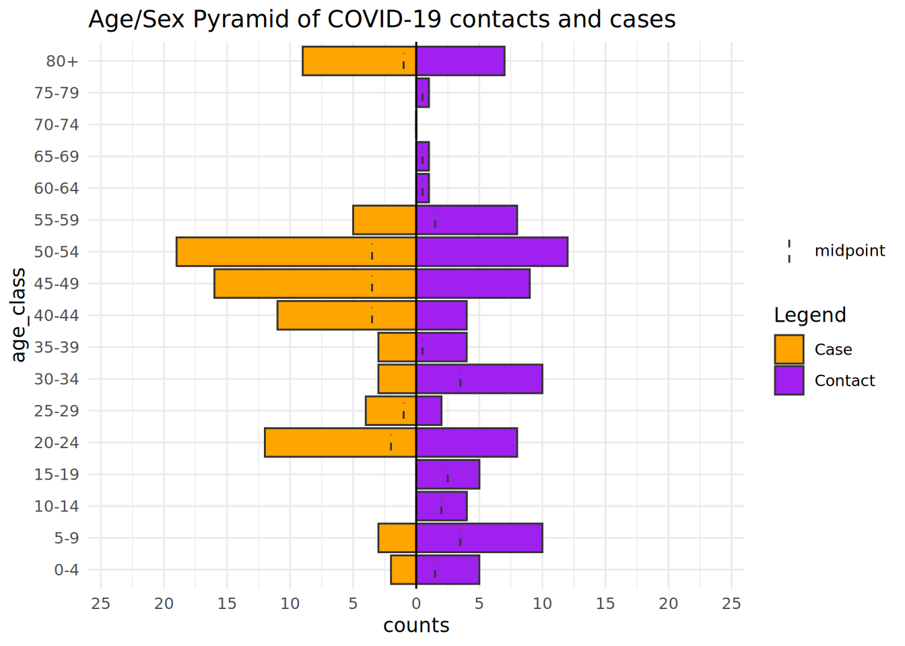
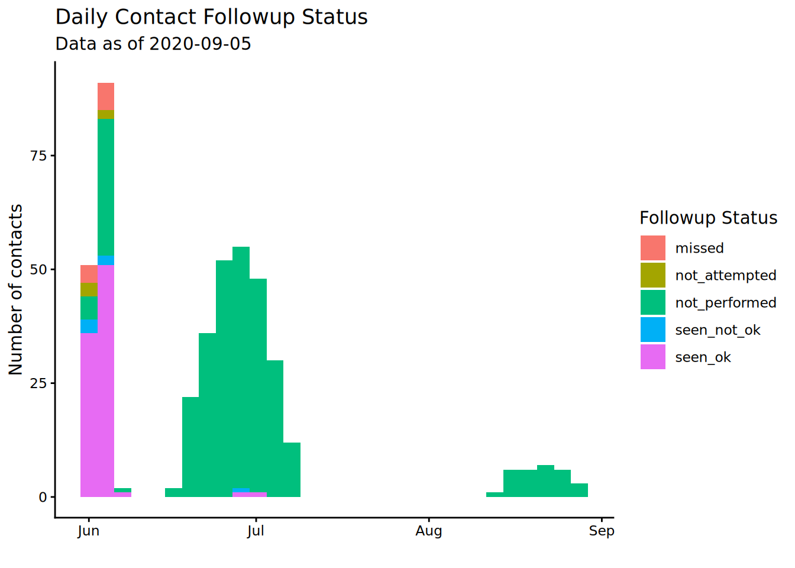
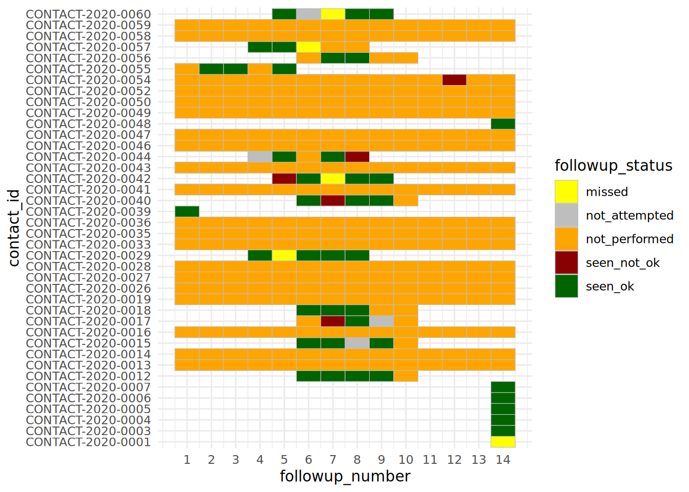
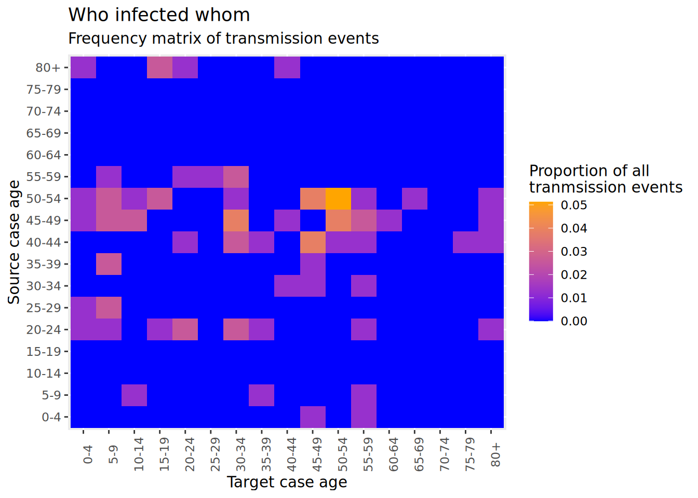

# 25  Suivi des contacts

Cette page présente une analyse descriptive de données de recherche de contacts, en ajoutant quelques considérations et approches clés uniques à ce type de données.

Cette page fait référence à un grand nombre des compétences de base en matière de gestion et de visualisation des données R abordées dans d’autres pages (par exemple, le nettoyage des données, le pivotement, les tableaux, les analyses de séries chronologiques), mais nous mettrons en évidence des exemples spécifiques au suivi des contacts qui ont été utiles pour la prise de décision opérationnelle. Il s’agit par exemple de la visualisation des données de suivi de la recherche de contacts dans le temps ou dans des zones géographiques, ou de la production de tableaux d’indicateurs de performance clés (KPI) propres pour les superviseurs de la recherche de contacts.

Pour la démonstration, nous utiliserons un échantillon de données de suivi des contacts provenant de la plateforme [Go.Data](https://www.who.int/tools/godata). Les principes abordés ici s’appliquent aux données de suivi des contacts provenant d’autres plates-formes. Il se peut que vous deviez simplement suivre différentes étapes de pré-traitement des données en fonction de la structure de vos données.

Vous pouvez en savoir plus sur le projet Go.Data sur le [site de documentation Github](https://worldhealthorganization.github.io/godata/) ou la [communauté de pratique](https://community-godata.who.int/).

## 25.1 Préparation

### Chargement de packages

Ce bout de code montre le chargement des packages nécessaires aux analyses. Dans ce manuel, nous mettons l’accent sur `p_load()` de **pacman**, qui installe le package si nécessaire *et* le charger pour l’utiliser. Vous pouvez aussi charger les packages installés avec `library()` de **base** R. Voir la page sur [bases de R](basics.llms.md) pour plus d’informations sur les packages R.

``` r
pacman::p_load(
  rio,          # importation de données 
  here,         # chemins d'accès relatifs aux fichiers 
  janitor,      # nettoyage des données et tableaux
  lubridate,    # travailler avec des dates
  epikit,       # fonction age_categories()
  apyramid,     # age pyramids
  tidyverse,    # manipulation et visualisation des données
  RColorBrewer, # colour palettes
  formattable,  # fancy tables
  kableExtra, # formatage des tableaux
  appliedepidata # jeux de données d'exemple utilisés dans ce manuel
)
```

### Importation de données

Nous allons importer des jeux de données exemple de contacts, et de leur”suivi”. Ces données ont été récupérées et non imbriquées à partir de l’API Go.Data et stockées dans des fichiers “.rds”.

Vous pouvez télécharger tous les exemples de données pour ce manuel à partir de la page [Télécharger le manuel et les données](download.llms.md).

Si vous souhaitez télécharger les exemples de données de suivi des contacts spécifiques à cette page, utilisez les trois liens de téléchargement ci-dessous :

[Cliquer pour télécharger données sur les investigations des cas (.rds file)](https://github.com/WorldHealthOrganization/godata/blob/master/analytics/r-reporting/data/cases_clean.rds?raw=true)

[Cliquer pour télécharger les données d’enregistrement de contacts (.rds file)](https://github.com/WorldHealthOrganization/godata/blob/master/analytics/r-reporting/data/contacts_clean.rds?raw=true)

[Cliquer pour télécharger les données de suivi des contacts (.rds file)](https://github.com/WorldHealthOrganization/godata/blob/master/analytics/r-reporting/data/followups_clean.rds?raw=true)

Dans leur forme originale dans les fichiers téléchargeables, les données reflètent les données fournies par l’API Go.Data (en savoir plus sur [APIs here](importing.llms.md#import_api)). À titre d’exemple, nous allons nettoyer les données pour les rendre plus faciles à lire sur cette page. Si vous utilisez une instance Go.Data, vous pouvez consulter les instructions complètes sur la façon de récupérer vos données [here](https://github.com/WorldHealthOrganization/godata/tree/master/analytics/r-reporting).

Ci-dessous, les jeux de données sont importés à l’aide de la fonction `import()` du package **rio**. Voir la page [Importation et exportation](importing.llms.md) pour les différentes manières d’importer des données. Nous utilisons `here()` pour spécifier le chemin du fichier - vous devez fournir le chemin du fichier spécifique à votre ordinateur. Nous utilisons ensuite `select()` pour sélectionner seulement certaines colonnes des données, afin de simplifier pour les besoins de la démonstration.

#### Données des cas

Ces données sont un tableau des cas, et des informations les concernant.

``` r
cases <- appliedepidata::get_data(name = "cases_clean") %>%
  select(case_id, firstName, lastName, gender, age, age_class,
         occupation, classification, was_contact, hospitalization_typeid)
```

Voici les `nrow(cases)` cas :

#### Données sur les contacts

Ces données sont un tableau de tous les contacts et des informations les concernant. Là encore, vous pouvez fournir votre propre chemin de fichier. Après l’importation, nous effectuons quelques étapes préliminaires de nettoyage des données, notamment :

- Définir age_class comme facteur et inverser l’ordre des niveaux pour que les plus jeunes soient les premiers.  
- Sélectionner seulement certaines colonnes, en renommant l’une d’entre elles.  
- Attribuer artificiellement les lignes dont le 2 niveau d’administration est manquant à “Djembe”, pour améliorer la clarté de certains exemples de visualisation.

``` r
contacts <- appliedepidata::get_data(name = "contacts_clean") %>%
  mutate(age_class = forcats::fct_rev(age_class)) %>% 
  select(contact_id, contact_status, firstName, lastName, gender, age,
         age_class, occupation, date_of_reporting, date_of_data_entry,
         date_of_last_exposure = date_of_last_contact,
         date_of_followup_start, date_of_followup_end, risk_level, was_case, admin_2_name) %>% 
  mutate(admin_2_name = replace_na(admin_2_name, "Djembe"))
```

Voici les `nrow(contacts)` lignes de le `contacts` dataframe:

#### Données de suivi

Ces données sont des enregistrements des interactions de “suivi” avec les contacts. Chaque contact est censé avoir une rencontre chaque jour pendant 14 jours après son exposition.

Nous importons et effectuons quelques étapes de nettoyage. Nous sélectionnons certaines colonnes, et convertissons également une colonne de caractères en toutes les valeurs minuscules.

``` r
followups <- appliedepidata::get_data(name = "followups_clean") %>%
  select(contact_id, followup_status, followup_number,
         date_of_followup, admin_2_name, admin_1_name) %>% 
  mutate(followup_status = str_to_lower(followup_status))
```

Voici les 50 premières lignes de la base de données `nrow(followups)`-row `followups` (chaque ligne est une interaction de suivi, avec le statut du suivi dans la colonne `followup_status`) :

#### Données de relations

Ici, nous importons des données montrant la relation entre les cas et les contacts. Nous sélectionnons certaines colonnes à afficher.

``` r
relationships <- appliedepidata::get_data(name = "relationships_clean") %>%
  select(source_visualid, source_gender, source_age, date_of_last_contact,
         date_of_data_entry, target_visualid, target_gender,
         target_age, exposure_type)
```

Vous trouverez ci-dessous les 50 premières lignes du jeu de données `relations`, qui enregistre toutes les relations entre les cas et les contacts.

## 25.2 Analyses descriptives

Vous pouvez utiliser les techniques abordées dans d’autres pages de ce manuel pour effectuer des analyses descriptives de vos cas, de vos contacts et de leurs relations. Vous trouverez ci-dessous quelques exemples

### Démographie

Comme le montre la page consacrée aux [Pyramides démographiques](age_pyramid.llms.md), vous pouvez visualiser la répartition par âge et par sexe (nous utilisons ici le package **apyramid**).

#### Age et sexe des contacts

La pyramide ci-dessous compare la répartition par âge des contacts, par sexe. Notez que les contacts dont l’âge est manquant sont inclus dans leur propre barre en haut. Vous pouvez modifier ce comportement par défaut, mais envisagez alors d’indiquer le nombre de contacts manquants dans une légende.

``` r
apyramid::age_pyramid(
  data = contacts,                                   # utiliser la base de données des contacts
  age_group = "age_class",                           # colonne d'âge catégorielle
  split_by = "gender") +                             # genre pour les moitiés de la pyramide
  labs(
    fill = "Gender",                                 # titre de la légende
    title = "Age/Sex Pyramid of COVID-19 contacts")+ # titre du graphique
  theme_minimal()                                    # un fond simple
```

[](contact_tracing_files/figure-html/unnamed-chunk-10-1.png)

Avec la structure de données Go.Data, le jeu de données `relations` contient les âges des cas et des contacts, vous pourriez donc utiliser ce jeu de données et créer une pyramide des âges montrant les différences entre ces deux groupes de personnes. Le tableau de données `relations` sera modifié pour transformer les colonnes d’âge numériques en catégories (voir la page [Nettoyage des données et fonctions de base](cleaning.llms.md)). Nous faisons également pivoter le tableau de données pour faciliter le traçage avec **ggplot2** (voir [Pivoter les données](pivoting.llms.md)).

``` r
relation_age <- relationships %>% 
  select(source_age, target_age) %>% 
  transmute(        # transmute est comme mutate() mais supprime toutes les autres colonnes non mentionnées
    source_age_class = epikit::age_categories(source_age, breakers = seq(0, 80, 5)),
    target_age_class = epikit::age_categories(target_age, breakers = seq(0, 80, 5)),
    ) %>% 
  pivot_longer(cols = contains("class"), names_to = "category", values_to = "age_class")  # pivotement plus long


relation_age
```

    # A tibble: 200 × 2
       category         age_class
       <chr>            <fct>    
     1 source_age_class 80+      
     2 target_age_class 15-19    
     3 source_age_class <NA>     
     4 target_age_class 50-54    
     5 source_age_class <NA>     
     6 target_age_class 20-24    
     7 source_age_class 30-34    
     8 target_age_class 45-49    
     9 source_age_class 40-44    
    10 target_age_class 30-34    
    # ℹ 190 more rows

Maintenant nous pouvons tracer cet ensemble de données transformées avec `age_pyramid()` comme avant, mais en remplaçant `gender` par `category` (contact, ou cas).

``` r
apyramid::age_pyramid(
  data = drop_na(relation_age, age_class),                               # utiliser un ensemble de données de relations modifiées
  age_group = "age_class",                           # colonne d'âge catégorielle
  split_by = "category") +                           # par cas et contacts
  scale_fill_manual(
    values = c("orange", "purple"),                  # pour spécifier les couleurs ET les étiquettes
    labels = c("Case", "Contact"))+
  labs(
    fill = "Legend",                                           # titre de la légende
    title = "Age/Sex Pyramid of COVID-19 contacts and cases")+ # title of the plot
  theme_minimal()                                              # fond simple
```

[](contact_tracing_files/figure-html/unnamed-chunk-12-1.png)

Nous pouvons également visualiser d’autres caractéristiques telles que la répartition par profession (par exemple, sous la forme d’un diagramme circulaire).

``` r
# Clean dataset and get counts by occupation
occ_plot_data <- cases %>% 
  mutate(occupation = forcats::fct_na_value_to_level(occupation, level = "(Missing)"),  # faire des valeurs manquantes NA une catégorie
         occupation = forcats::fct_infreq(occupation)) %>% # ordonner les niveaux de facteurs par ordre de fréquence
  count(occupation)                                          # obtenir des chiffres par profession
  
# Make pie chart
ggplot(data = occ_plot_data, mapping = aes(x = "", y = n, fill = occupation))+
  geom_bar(width = 1, stat = "identity") +
  coord_polar("y", start = 0) +
  labs(
    fill = "Occupation",
    title = "Known occupations of COVID-19 cases")+
  theme_minimal() +                    
  theme(axis.line = element_blank(),
        axis.title = element_blank(),
        axis.text = element_blank())
```

[](contact_tracing_files/figure-html/unnamed-chunk-13-1.png)

### Contacts par cas

Le nombre de contacts par cas peut être une unité de mesure importante pour évaluer la qualité du dénombrement des contacts et la conformité de la population à la réponse de santé publique.

En fonction de votre structure de données, cela peut être évalué avec un ensemble de données qui contient tous les cas et les contacts. Dans les ensembles de données de Go.Data, les liens entre les cas (“sources”) et les contacts (“cibles”) sont stockés dans le jeu de données `relationships`.

Dans cet ensemble de données, chaque ligne est un contact, et le cas source est listé dans la ligne. Aucun contact n’a de relations avec plusieurs affaires. multiples, mais si c’est le cas, vous devrez peut-être en tenir compte avant de faire le graphique (et de les explorer aussi !).

Nous commençons par compter le nombre de lignes (contacts) par cas source. Ceci est enregistré comme un tableau de données.

``` r
contacts_per_case <- relationships %>% 
  count(source_visualid)

contacts_per_case
```

       source_visualid  n
    1   CASE-2020-0001 13
    2   CASE-2020-0002  5
    3   CASE-2020-0003  2
    4   CASE-2020-0004  4
    5   CASE-2020-0005  5
    6   CASE-2020-0006  3
    7   CASE-2020-0008  3
    8   CASE-2020-0009  3
    9   CASE-2020-0010  3
    10  CASE-2020-0012  3
    11  CASE-2020-0013  5
    12  CASE-2020-0014  3
    13  CASE-2020-0016  3
    14  CASE-2020-0018  4
    15  CASE-2020-0022  3
    16  CASE-2020-0023  4
    17  CASE-2020-0030  3
    18  CASE-2020-0031  3
    19  CASE-2020-0034  4
    20  CASE-2020-0036  1
    21  CASE-2020-0037  3
    22  CASE-2020-0045  3
    23            <NA> 17

Nous utilisons `geom_histogram()` pour représenter ces données sous forme d’histogramme.

``` r
ggplot(data = contacts_per_case)+        # commencer avec le tableau de données créé ci-dessus
  geom_histogram(mapping = aes(x = n))+  # afficher l'histogramme du nombre de contacts par cas
  scale_y_continuous(expand = c(0,0))+   # supprimer l'espace excédentaire en dessous de 0 sur l'axe des ordonnées
  theme_light()+                         # simplifier le fond
  labs(
    title = "Number of contacts per case",
    y = "Cases",
    x = "Contacts per case"
  )
```

[](contact_tracing_files/figure-html/unnamed-chunk-15-1.png)

## 25.3 Suivi de contacts

Les données de recherche des contacts contiennent souvent des données de “suivi”, qui enregistrent les résultats des contrôles quotidiens des symptômes des personnes en quarantaine. L’analyse de ces données permet d’orienter la stratégie de réponse, d’identifier les contacts susceptibles d’être perdus pour le suivi ou de développer la maladie.

### Nettoyage de données

Ces données peuvent exister sous différents formats. Elles peuvent exister sous la forme d’une feuille Excel au format “large” avec une ligne par contact et une colonne par “jour” de suivi. Voir [Pivoter les données](pivoting.llms.md) pour obtenir des descriptions des données “longues” et données “larges” et comment faire pivoter des données plus larges ou plus longues.

Dans notre exemple Go.Data, ces données sont stockées dans le tableau `followups`, qui est dans un format “long” avec une ligne par interaction de suivi. Les 50 premières lignes ressemblent à ceci :

***ATTENTION:*** Méfiez-vous des doublons lorsque vous traitez des données de suivi, car il peut y avoir plusieurs suivis erronés le même jour pour un contact donné. Cela peut sembler être une erreur mais reflète la réalité - par exemple, un agent de recherche de contacts pourrait soumettre un formulaire de suivi en début de journée alors qu’il n’a pas pu joindre le contact, et soumettre un second formulaire lorsqu’il a été joint par la suite. La façon dont vous souhaitez traiter les doublons dépend du contexte opérationnel. - veillez simplement à documenter clairement votre approche.

Voyons combien d’instances de lignes “en double” nous avons :

``` r
followups %>% 
  count(contact_id, date_of_followup) %>%   # obtenir des jours de suivi uniques
  filter(n > 1)                             # afficher les enregistrements où le nombre est supérieur à 1 
```

      contact_id date_of_followup n
    1       <NA>       2020-09-03 2
    2       <NA>       2020-09-04 2
    3       <NA>       2020-09-05 2

Dans notre exemple de données, les seuls enregistrements auxquels cela s’applique sont ceux auxquels il manque un ID ! Nous pouvons les supprimer. Mais, pour les besoins de la démonstration, nous allons montrer les étapes de la déduplication afin qu’il n’y ait qu’un seul encoutrement de suivi par personne et par jour. Voir la page sur [déduplication](deduplication.llms.md) pour plus de détails. Nous supposerons que l’enregistrement de rencontre le plus récent est le bon. Nous profitons également de l’occasion pour nettoyer la colonne `followup_number` (le “jour” du suivi qui devrait qui devrait être compris entre 1 et 14).

``` r
followups_clean <- followups %>%
  
  # Enlever les doublons
  group_by(contact_id, date_of_followup) %>%        # grouper les lignes par jour de suivi
  arrange(contact_id, desc(date_of_followup)) %>%   # organiser les lignes, par jour de suivi, par date de suivi (le plus récent en haut)
  slice_head() %>%                                  # ne conserver que la première ligne par id contact
  ungroup() %>% 
  
  # Autres nettoyages
  mutate(followup_number = replace(followup_number, followup_number > 14, NA)) %>% # nettoyer des données erronées
  drop_na(contact_id)                               # supprimer les id_contact dont les données sont manquantes
```

Pour chaque rencontre de suivi, nous avons un statut de suivi (tel que si la rencontre a eu lieu et, le cas échéant, si le contact a eu des symptômes ou non). Pour voir toutes les valeurs, nous pouvons exécuter un rapide `tabyl()` (de **janitor**) ou `table()` (de **base** R) (voir [Tableaux descriptifs](tables_descriptive.llms.md)) par `followup_status` pour voir la fréquence de chacun des résultats.

Dans cet ensemble de données, “seen_not_ok” signifie “vu avec des symptômes”, et “seen_ok” signifie “vu sans symptômes”.

``` r
followups_clean %>% 
  tabyl(followup_status)
```

     followup_status   n    percent
              missed  10 0.02325581
       not_attempted   5 0.01162791
       not_performed 319 0.74186047
         seen_not_ok   6 0.01395349
             seen_ok  90 0.20930233

### Graphe dans le temps

Comme les données de dates sont continues, nous utiliserons un histogramme pour les représenter avec `date_of_followup` assigné à l’axe des abscisses. Nous pouvons obtenir un histogramme “empilé” en spécifiant un argument `fill =` dans `aes()`, que nous assignons à la colonne `followup_status`. Par conséquent, vous pouvez définir le titre de la légende en utilisant l’argument `fill =` de `labs()`.

On constate que les contacts ont été identifiés par vagues (correspondant vraisemblablement aux vagues épidémiques de cas), et que vl’achèvement du suivi ne semble pas s’être amélioré au cours de l’épidémie.

``` r
ggplot(data = followups_clean)+
  geom_histogram(mapping = aes(x = date_of_followup, fill = followup_status)) +
  scale_fill_discrete(drop = FALSE)+   # Afficher tous les niveaux de facteurs (followup_status) dans la légende, même ceux qui ne sont pas utilisés.
  theme_classic() +
  labs(
    x = "",
    y = "Number of contacts",
    title = "Daily Contact Followup Status",
    fill = "Followup Status",
    subtitle = str_glue("Data as of {max(followups$date_of_followup, na.rm=T)}"))   # sous-titres dynamiques
```

[](contact_tracing_files/figure-html/unnamed-chunk-20-1.png)

***ATTENTION:*** Si vous préparez de nombreux graphiques (par exemple pour plusieurs juridictions), vous voudrez que les légendes apparaissent de manière identique, même si les données sont plus ou moins complètes ou composées. Il peut y avoir des graphiques pour lesquels tous les statuts de suivi ne sont pas présents dans les données, mais vous voulez quand même que ces catégories apparaissent dans les légendes. Dans les ggplots (comme ci-dessus), vous pouvez spécifier l’argument `drop = FALSE` de la fonction `scale_fill_discrete()`. Dans les tableaux, utilisez `tabyl()` qui montre les comptes pour tous les niveaux de facteurs, ou si vous utilisez `count()` de **dplyr** ajoutez l’argument `.drop = FALSE` pour inclure les comptes pour tous les niveaux de facteurs.

### Suivi quotidien individuel

Si votre épidémie est suffisamment petite, vous voudrez peut-être voir chaque contact individuellement et voir son statut au cours de son suivi. Heureusement, cet tableau de données `followups` contient déjà une colonne avec le le “numéro” du jour du suivi (1-14). Si cette colonne n’existe pas dans vos données, vous pouvez la créer en calculant la différence entre la date de la rencontre et la date à laquelle le suivi devait commencer pour le contact.

Un mécanisme de visualisation pratique (si le nombre de cas n’est pas trop important) peut être une carte de chaleur (heat plot), réalisée avec `geom_tile()`. Voir plus de détails dans la page [heat plot](heatmaps.llms.md).

``` r
ggplot(data = drop_na(followups_clean, followup_number))+
  geom_tile(mapping = aes(x = followup_number, y = contact_id, fill = followup_status),
            color = "grey")+       # lignes grises
  scale_fill_manual( values = c("yellow", "grey", "orange", "darkred", "darkgreen"))+
  theme_minimal()+
  scale_x_continuous(breaks = seq(from = 1, to = 14, by = 1))
```

[](contact_tracing_files/figure-html/unnamed-chunk-21-1.png)

### Analyse par groupe

Ces données de suivi sont peut-être consultées journellement ou hebdomadairement pour la prise de décision opérationnelle. Vous souhaitez peut-être des désagrégations plus significatives par zone géographique ou par équipe de suivi des contacts. Nous pouvons le faire en ajustant les colonnes fournies à `group_by()`.

``` r
plot_by_region <- followups_clean %>%                                        # commencer par l'ensemble de données de suivi
  count(admin_1_name, admin_2_name, followup_status) %>%   # obtenir les chiffres par région-statut unique (crée la colonne 'n' avec les chiffres)
  
  # begin ggplot()
  ggplot(                                         # commencer le ggplot
    mapping = aes(x = reorder(admin_2_name, n),     # réorganiser les facteurs administratifs en fonction des valeurs numériques de la colonne 'n'.
                  y = n,                            # hauteur de la barre de la colonne 'n'.
                  fill = followup_status,           # colorer les barres empilées en fonction de leur statut
                  label = n))+                      # passer à geom_label()              
  geom_col()+                                     # barres empilées, cartographie obtenue au-dessus
  geom_text(                                      # ajouter du texte, cartographie obtenue à partir de la version précédente
    size = 3,                                         
    position = position_stack(vjust = 0.5), 
    color = "white",           
    check_overlap = TRUE,
    fontface = "bold")+
  coord_flip()+
  labs(
    x = "",
    y = "Number of contacts",
    title = "Contact Followup Status, by Region",
    fill = "Followup Status",
    subtitle = str_glue("Data as of {max(followups_clean$date_of_followup, na.rm=T)}")) +
  theme_classic()+                                                                      # Simplifier le fond
  facet_wrap(~admin_1_name, strip.position = "right", scales = "free_y", ncol = 1)      # introduire les facettes 

plot_by_region
```

[](contact_tracing_files/figure-html/unnamed-chunk-22-1.png)

## 25.4 Tableaux KPI

Il existe un certain nombre d’indicateurs clés de performance ( KPI) qui peuvent être calculés et suivis à différents niveaux de désagrégation et sur différentes périodes de temps afin de contrôler les performances de la recherche de contacts. Une fois que vous maîtrisez les calculs et le format de base du tableau, il est assez facile d’intervertir les différents KPI.

Il existe de nombreuses sources de KPI pour le suivi des contacts, comme celle de [ResolveToSaveLives.org](https://contacttracingplaybook.resolvetosavelives.org/checklists/metrics). La majeure partie du travail consistera à parcourir votre structure de données et à réfléchir à tous les critères d’inclusion/exclusion. Nous présentons quelques exemples ci-dessous, en utilisant la structure de métadonnées de Go.Data :

| Catégorie | Indicateur | Go.Data Numérateur | Go.Data D énominateur |
|----|----|----|----|
| Indicateur de processus -Rapidité du Suivi de contact | % cas interviewé et isololé dans les 24h du cas rapport | NOMBRE DE `case_id` OU (`da te_of_reporting` - `da te _of_data_entry`) \< 1 jour et (`is ol ation_startdate` - `da te _of_data_entry`) \< 1 jour | NOMBRE DE `case_id` |
| Indicateur de processus -Rapidité du Suivi de contact | % contacts notifié et mis en quarantaine dans 24h d’ élicitation | NOMBRE DE `contact_id` OÙ `followup_status` == “SEEN_NOT_OK” OR “SEEN_OK” ET `date_of_followup` - `da te_of_reporting` \< 1 jour | NOMBRE DE `c ontact_id` |
| Indicateur de processus - Complétude des tests | % nouveaux symptômes cas testés et interviewé dans les 3 jours de début de symptôme | NOMBRE DE `case_id` OÙ (`da te_of_reporting` - `date_of_onset`) \< =3 jours | NOMBRE DE `case_id` |
| Indicateur de résultat - Globale ment | % nouveaux cas parmi les contacts listés | NOMBRE DE `case_id` OÙ `was_contact` == “TRUE” | NOMBRE DE `case_id` |

Nous vous proposons ci-dessous un exemple de création d’un tableau visuel pour afficher le suivi des contacts dans les différentes zones d’administration. À la fin, nous le convertirons en tableau de présentation avec le package **formattable** (mais vous pouvez utiliser d’autres packages comme **flextable** - voir [Tableaux de présentation](tables_presentation.llms.md)).

La manière de créer un tel tableau dépend de la structure de vos données de suivi des contacts. Utilisez la page [Tableaux descriptifs](tables_descriptive.llms.md) pour apprendre à résumer les données à l’aide des fonctions **dplyr**.

Nous allons créer une table qui sera dynamique et changera au fur et à mesure que les données changeront. Pour rendre les résultats intéressants, nous allons définir une “date de rapport” pour nous permettre de simuler l’exécution du tableau à un certain jour (nous choisissons le 10 juin 2020). Les données sont filtrées à cette date.

``` r
# Définissez "Date du rapport" pour simuler l'exécution du rapport avec des données "à partir de" cette date.
report_date <- as.Date("2020-06-10")

# Créez des données de suivi pour refléter la date du rapport.
table_data <- followups_clean %>% 
  filter(date_of_followup <= report_date)
```

Maintenant, sur la base de notre structure de données, nous allons faire ce qui suit :

1.  Commencez par les données `followups` et résumez-les pour inclure, pour chaque contact unique :  

- La date du dernier enregistrement (quel que soit le statut du suivi).  
- La date de la dernière suivi où le contact a été “vu”  
- le statut du suivi lors de cette dernière suivi (par exemple, avec des symptômes, sans symptômes)  

2.  Joignez ces données aux données des contacts, qui contiennent d’autres informations telles que le statut général du contact, la date de la dernière exposition à un cas, etc. Nous allons également calculer des indicateurs intéressants pour chaque contact, comme le nombre de jours depuis la dernière exposition.  
3.  Nous regroupons les données de contact élargies par région géographique (`admin_2_name`) et calculons des statistiques sommaires par région  
4.  Enfin, nous mettons en forme le tableau pour qu’il soit bien présenté.

Tout d’abord, nous résumons les données de suivi pour obtenir les informations qui nous intéressent :

``` r
followup_info <- table_data %>% 
  group_by(contact_id) %>% 
  summarise(
    date_last_record   = max(date_of_followup, na.rm=T),
    date_last_seen     = if (any(followup_status %in% c("seen_ok", "seen_not_ok"))) max(date_of_followup[followup_status %in% c("seen_ok", "seen_not_ok")], na.rm=T) else as.Date(NA),
    status_last_record = followup_status[which(date_of_followup == date_last_record)]) %>% 
  ungroup()
```

Voici à quoi ressemblent ces données :

Maintenant, nous allons ajouter ces informations à l’ensemble de données `contacts`, et calculer quelques colonnes supplémentaires.

``` r
contacts_info <- followup_info %>% 
  right_join(contacts, by = "contact_id") %>% 
  mutate(
    database_date       = max(date_last_record, na.rm=T),
    days_since_seen     = database_date - date_last_seen,
    days_since_exposure = database_date - date_of_last_exposure
    )
```

Voici à quoi ressemblent ces données. Il faut noter la colonne `contacts` à droite, et la nouvelle colonne calculée à l’extrême droite.

Ensuite, nous résumons les données sur les contacts par région, afin d’obtenir un tableaux de synthèse des colonnes de statistiques.

``` r
contacts_table <- contacts_info %>% 
  
  group_by(`Admin 2` = admin_2_name) %>%
  
  summarise(
    `Registered contacts` = n(),
    `Active contacts`     = sum(contact_status == "UNDER_FOLLOW_UP", na.rm=T),
    `In first week`       = sum(days_since_exposure < 8, na.rm=T),
    `In second week`      = sum(days_since_exposure >= 8 & days_since_exposure < 15, na.rm=T),
    `Became case`         = sum(contact_status == "BECAME_CASE", na.rm=T),
    `Lost to follow up`   = sum(days_since_seen >= 3, na.rm=T),
    `Never seen`          = sum(is.na(date_last_seen)),
    `Followed up - signs` = sum(status_last_record == "Seen_not_ok" & date_last_record == database_date, na.rm=T),
    `Followed up - no signs` = sum(status_last_record == "Seen_ok" & date_last_record == database_date, na.rm=T),
    `Not Followed up`     = sum(
      (status_last_record == "NOT_ATTEMPTED" | status_last_record == "NOT_PERFORMED") &
        date_last_record == database_date, na.rm=T)) %>% 
    
  arrange(desc(`Registered contacts`))
```

Et maintenant, nous appliquons le style des paquets **formattable** et **knitr**. y compris une note de pied de page qui indique la date “en date du”.

``` r
contacts_table %>%
  mutate(
    `Admin 2` = formatter("span", style = ~ formattable::style(
      color = ifelse(`Admin 2` == NA, "red", "grey"),
      font.weight = "bold",font.style = "italic"))(`Admin 2`),
    `Followed up - signs`= color_tile("white", "orange")(`Followed up - signs`),
    `Followed up - no signs`= color_tile("white", "#A0E2BD")(`Followed up - no signs`),
    `Became case`= color_tile("white", "grey")(`Became case`),
    `Lost to follow up`= color_tile("white", "grey")(`Lost to follow up`), 
    `Never seen`= color_tile("white", "red")(`Never seen`),
    `Active contacts` = color_tile("white", "#81A4CE")(`Active contacts`)
  ) %>%
  kable("html", escape = F, align =c("l","c","c","c","c","c","c","c","c","c","c")) %>%
  kable_styling("hover", full_width = FALSE) %>%
  add_header_above(c(" " = 3, 
                     "Of contacts currently under follow up" = 5,
                     "Status of last visit" = 3)) %>% 
  kableExtra::footnote(general = str_glue("Data are current to {format(report_date, '%b %d %Y')}"))
```

[TABLE]

## 25.5 Matrices de transmission

Comme indiqué sur la page [Heat plots](heatmaps.llms.md), vous pouvez créer une matrice de “qui a infecté qui” en utilisant `geom_tile()`.

Lorsque de nouveaux contacts sont créés, Go.Data stocke ces informations de liens dans le lien `relationships` de l’API ; et nous pouvons voir les 50 premières lignes de cet ensemble de données ci-dessous. Cela signifie que nous pouvons créer un diagramme de chaleur avec relativement peu d’étapes étant donné que chaque contact est déjà joint à son cas source.

Comme nous l’avons fait ci-dessus pour la pyramide des âges comparant les cas et les contacts, nous pouvons sélectionner les quelques variables dont nous avons besoin et créer des colonnes avec des groupes d’âge catégoriques pour les sources (cas) et les cibles (contacts).

``` r
heatmap_ages <- relationships %>% 
  select(source_age, target_age) %>% 
  mutate(                              # transmute est comme mutate() mais supprime toutes les autres colonnes
    source_age_class = epikit::age_categories(source_age, breakers = seq(0, 80, 5)),
    target_age_class = epikit::age_categories(target_age, breakers = seq(0, 80, 5))) 
```

Comme décrit précédemment, nous créons des tableaux croisés ;

``` r
cross_tab <- table(
  source_cases = heatmap_ages$source_age_class,
  target_cases = heatmap_ages$target_age_class)

cross_tab
```

                target_cases
    source_cases 0-4 5-9 10-14 15-19 20-24 25-29 30-34 35-39 40-44 45-49 50-54
           0-4     0   0     0     0     0     0     0     0     0     1     0
           5-9     0   0     1     0     0     0     0     1     0     0     0
           10-14   0   0     0     0     0     0     0     0     0     0     0
           15-19   0   0     0     0     0     0     0     0     0     0     0
           20-24   1   1     0     1     2     0     2     1     0     0     0
           25-29   1   2     0     0     0     0     0     0     0     0     0
           30-34   0   0     0     0     0     0     0     0     1     1     0
           35-39   0   2     0     0     0     0     0     0     0     1     0
           40-44   0   0     0     0     1     0     2     1     0     3     1
           45-49   1   2     2     0     0     0     3     0     1     0     3
           50-54   1   2     1     2     0     0     1     0     0     3     4
           55-59   0   1     0     0     1     1     2     0     0     0     0
           60-64   0   0     0     0     0     0     0     0     0     0     0
           65-69   0   0     0     0     0     0     0     0     0     0     0
           70-74   0   0     0     0     0     0     0     0     0     0     0
           75-79   0   0     0     0     0     0     0     0     0     0     0
           80+     1   0     0     2     1     0     0     0     1     0     0
                target_cases
    source_cases 55-59 60-64 65-69 70-74 75-79 80+
           0-4       1     0     0     0     0   0
           5-9       1     0     0     0     0   0
           10-14     0     0     0     0     0   0
           15-19     0     0     0     0     0   0
           20-24     1     0     0     0     0   1
           25-29     0     0     0     0     0   0
           30-34     1     0     0     0     0   0
           35-39     0     0     0     0     0   0
           40-44     1     0     0     0     1   1
           45-49     2     1     0     0     0   1
           50-54     1     0     1     0     0   1
           55-59     0     0     0     0     0   0
           60-64     0     0     0     0     0   0
           65-69     0     0     0     0     0   0
           70-74     0     0     0     0     0   0
           75-79     0     0     0     0     0   0
           80+       0     0     0     0     0   0

convertir en format long avec des proportions ;

``` r
long_prop <- data.frame(prop.table(cross_tab))
```

et créer une carte de chaleur pour l’âge.

``` r
ggplot(data = long_prop)+       # utiliser des données longues, avec des proportions comme Freq
  geom_tile(                    # visualisez-le en tuiles
    aes(
      x = target_cases,         # l'axe des x est l'âge du cas
      y = source_cases,     # l'axe y est l'âge de l'infecteur
      fill = Freq))+            # La couleur de la tuile est la colonne Freq dans les données
  scale_fill_gradient(          # ajuster la couleur de remplissage des tuiles
    low = "blue",
    high = "orange")+
  theme(axis.text.x = element_text(angle = 90))+
  labs(                         # labels
    x = "Target case age",
    y = "Source case age",
    title = "Who infected whom",
    subtitle = "Frequency matrix of transmission events",
    fill = "Proportion of all\ntranmsission events"     # legend title
  )
```

[](contact_tracing_files/figure-html/unnamed-chunk-35-1.png)

## 25.6 Resources

<https://github.com/WorldHealthOrganization/godata/tree/master/analytics/r-reporting>

<https://worldhealthorganization.github.io/godata/>

<https://community-godata.who.int/>
