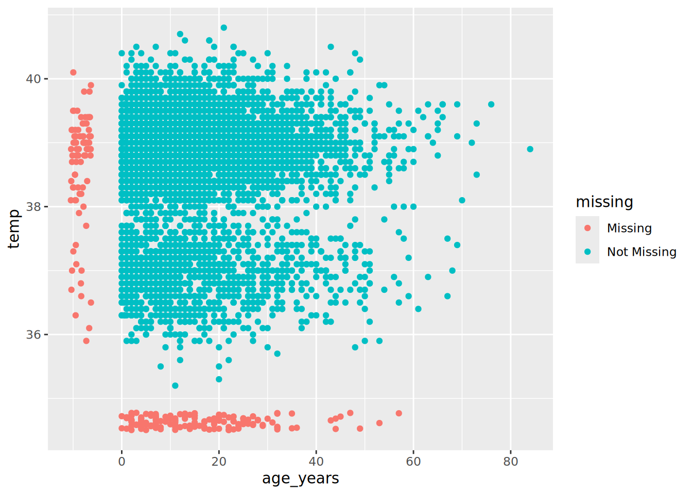
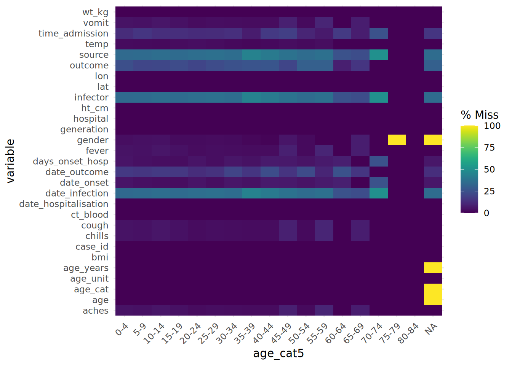
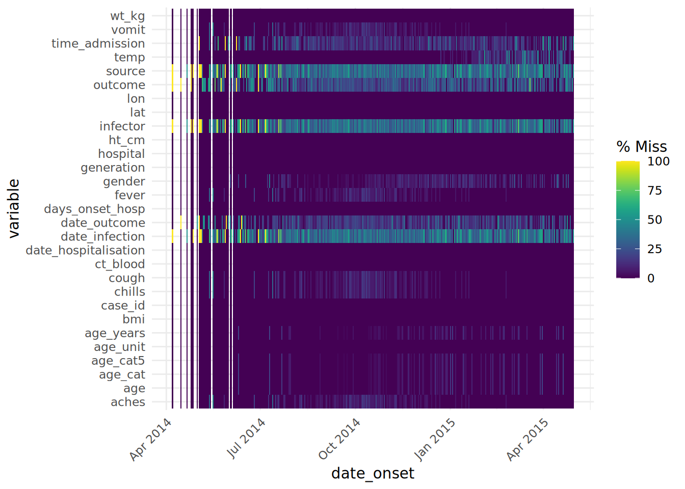

# 20  Données manquantes

[](../../images/missingness.png)

[](../../images/missingness_overview.png)

Dans ce chapitre nous allons :  
1) Évaluer l’ampleur des données manquantes  
2) Filtrer les lignes en contenant des données manquantes  
3) Visualiser les données manquantes au cours du temps  
4) Gérer comment les `NA` apparaissent dans les graphes  
5) Imputer des données manquantes : MMCA, MA, MOP

## 20.1 Étapes préliminaires

### Importation des paquets

Ces lignes de code chargent les paquets nécessaires aux analyses. Dans ce guide, nous mettons l’accent sur `p_load()` de **pacman**, qui installe le paquet si nécessaire *puis* l’importe pour l’utiliser. Vous pouvez également charger les paquets installés avec `library()` de **base** R. Voir la page sur [bases de R](basics.llms.md) pour plus d’informations sur les paquets R.

``` r
pacman::p_load(
  rio,           # import des fichiers
  tidyverse,     # gestion des données + graphiques (ggplot2)
  naniar,        # bilan des données manquantes
  mice, # imputation
  appliedepidata # jeux de données d'exemple utilisés dans ce manuel
)
```

### Importation des données

Nous importons un jeu de données de cas d’une épidémie d’ébola fictive. Chargez-les directement avec `appliedepidata::get_data(name = "linelist_cleaned_rds")` (voir la page [Télécharger le manuel et les données](download.llms.md) pour plus de détails).

``` r
# importer la linelist dans R
linelist <- appliedepidata::get_data(name = "linelist_cleaned_rds")
```

Les cinquantes premières lignes sont affichées ci-dessous :

### Conversion des données manquantes lors de l’import

Il faut être particulièrement attentif aux valeurs qui doivent être classifiées comme “manquantes” lors de l’import des données. Des données manquantes peuvent par exemple être indiquées par 99, 999, “Manquant”, un espace vide (” “) ou des cellules vides (”“). Vous pouvez les convertir en `NA` via la fonction d’importation des données.  
Pour plus de détails, consultez la page sur l’importation des [Données manquantes](#missing_data), car la syntaxe exacte varie selon le type de fichier.

## 20.2 Valeurs manquantes dans R

Nous explorons ci-dessous les façons dont les données manquantes sont représentées et évaluées dans R.

### `NA`

En R, les valeurs manquantes sont représentées par un mot réservé (spécial) : `NA`. Notez que ce mot est tapé *sans* guillemets, et ne doit pas être confondu avec une chaîne de caractères “NA” (également une parole des Beatles de la chanson *Hey Jude*).

Les données manquantes peuvent avoir été encodées de divers manières dans les données brutes, telles que “99”, “Manquant”, “Inconnu”, une valeur de caractère vide “” qui ressemble à un “blanc”, ou un espace simple ” “. Tenez-en compte et réfléchissez à l’opportunité de [les convertir en `NA` pendant l’importation](#missing_data) ou pendant le nettoyage des données avec `na_if()`.

A l’inverse, lors du nettoyage des données, il peut également être pertinent de convertir des `NA` en “Manquant” (ou autre) avec les fonctions `replace_na()` ou `fct_explicit_na()` dans le cas des facteurs.

### `NA` et ses dérivés

La plupart du temps, `NA` représente une valeur manquante et il n’y a pas besoin de se poser plus de questions que ça. Cependant, dans certaines circonstances, il peut y avoir besoin de *variations* de `NA` spécifiques à une classe d’objet (caractère, numérique, etc.). C’est rare, mais ça peut arriver.

Parmi ces cas rares, la création d’une nouvelle colonne avec la fonction **dplyr** `case_when()` est le plus commun. Comme décrit dans la page [Nettoyage des données et fonctions de base](cleaning.llms.md), cette fonction évalue chaque ligne du dataframe, détermine si les lignes répondent à des critères logiques spécifiés (partie droite du code), et attribue la nouvelle valeur correcte (partie gauche du code). *Important : toutes les valeurs du côté droit doivent être de la même classe*.

``` r
linelist <- linelist %>% 
  
  # Créer une nouvelle colonne "age_years" à partir de la colonne "age"
  mutate(age_years = case_when(
    age_unit == "years"  ~ age,    # si l'unité est années => garder la valeur originale
    age_unit == "months" ~ age/12, # l'unité est en mois, diviser par 12
    is.na(age_unit)      ~ age,    # si l'unité est manquante, supposer que l'age est en années
    TRUE                 ~ NA_real_)) # sinon, définir age comme valeur manquante
```

Afin que toutes les valeurs spécifiées du côté droit des équations aient le même type, il faut utiliser des dérivés de `NA` avec un type connu. Si les autres valeurs de droite sont des chaines de caractères, on peut utiliser `NA_character_` ou envisager d’utiliser “Manquant” à la place. Si les valeurs sont toutes numériques, utiliser `NA_real_`. S’il s’agit de dates ou de valeurs logiques, on peut conserver `NA`.

- `NA` - à utiliser pour les dates ou les booléens VRAI/FAUX  
- `NA_character_` - à utiliser pour les chaines de caractères  
- `NA_real_` - pour les valeurs numériques

Encore une fois, il est peu probable que vous rencontriez ces variations, hors utilisation de `case_when()` pour créer une nouvelle colonne. Consultez la [documentation R sur NA](https://stat.ethz.ch/R-manual/R-devel/library/base/html/NA.html) pour plus d’informations.

### `NULL`

`NULL` est un autre mot réservée en R. C’est la représentation logique d’une déclaration qui n’est ni vraie ni fausse. Elle est retournée par des expressions ou des fonctions dont les valeurs sont indéfinies. En général, n’assignez pas NULL comme valeur, à moins d’écrire des fonctions ou peut-être une [**shiny** app](shiny_basics.llms.md) pour retourner `NULL` dans des scénarios spécifiques.

La nullité peut être évaluée avec `is.null()` et la conversion peut être faite avec `as.null()`.

Voir cet [article de blog](https://www.r-bloggers.com/2010/04/r-na-vs-null/) sur la différence entre `NULL` et `NA`.

### `NaN`

Les valeurs *impossibles* sont représentées par le mot spécial `NaN`. Par exemple, R renvoi `NaN` si vous lui demandez de diviser 0 par 0. `NaN` peut être évalué avec `is.nan()`. Il existe également des fonctions complémentaires comme `is.infinite()` et `is.finite()`.

### `Inf`

`Inf` représente une valeur infinie, telle que l’on peut par exemple obtenir en divisant un nombre par zéro.

### Exemples

Pour comprendre comment ce type de valeurs peuvent affecter vos analyses, imaginons que vous avez un vecteur `z` qui contient ces valeurs : `z <- c(1, 22, NA, Inf, NaN, 5)`.

Si vous voulez utiliser la fonction `max()` sur la colonne pour trouver la valeur la plus élevée, vous pouvez utiliser le `na.rm = TRUE` pour omettre le `NA` du calcul. Mais cela n’enlèvera pas les `Inf` et `NaN`, ce qui fait que le résultat retourné sera `Inf`. Pour résoudre ce problème, vous pouvez utiliser les crochets `[ ]` et `is.finite()` pour effectuer un sous-ensemble de sorte que seules les valeurs finies soient utilisées pour le calcul : `max(z[is.finite(z)])`.

``` r
z <- c(1, 22, NA, Inf, NaN, 5)
max(z)                           # retourne NA
max(z, na.rm=T)                  # retourne Inf
max(z[is.finite(z)])             # retourne 22
```

| Instruction R | Sortie |
|----|----|
| `5 / 0` | `Inf` |
| `0 / 0` | `NaN` |
| `5 / NA` | `NA` |
| `5 / Inf |`0NA - 5`|`NAInf / 5`|`Infclass(NA)`| "logical"`class(NaN)`| "numeric"`class(Inf)`| "numeric"`class(NULL)\` | “NULL” |

Un message d’avertissement que vous rencontrerez certainement est “NAs introduits par coercition”. Cela peut se produire si vous tentez d’effectuer une conversion illégale, par exemple en insérant une chaîne caractères dans un vecteur qui contient des valeurs numériques.

``` r
as.numeric(c("10", "20", "thirty", "40"))
```

    Warning: NAs introduced by coercion

    [1] 10 20 NA 40

Note : `NULL` est ignoré dans un vecteur.

``` r
my_vector <- c(25, NA, 10, NULL)  # définit
my_vector                         # affiche
```

    [1] 25 NA 10

Note : tenter de calculer la variance sur une valeur unique retourne également un `NA`.

``` r
var(22)
```

    [1] NA

## 20.3 Fonctions utiles

Voici quelques fonctions utiles en **base** R pour détecter et gérer les valeurs manquantes.

### `is.na()` et `!is.na()`

`is.na()` permet d’identifier les valeurs manquantes. Pour identifier les valeurs non manquantes il suffit d’utiliser son opposé en ajoutant `!` devant l’instruction. Ces deux méthodes retournent une valeur logique (`TRUE` ou `FALSE`). Pour rappel, il est possible de sommer le vecteur résultant avec `sum()` pour compter le nombre de `TRUE`. Par exemple : `sum(is.na(linelist$date_outcome))`.

``` r
my_vector <- c(1, 4, 56, NA, 5, NA, 22)
is.na(my_vector)
```

    [1] FALSE FALSE FALSE  TRUE FALSE  TRUE FALSE

``` r
!is.na(my_vector)
```

    [1]  TRUE  TRUE  TRUE FALSE  TRUE FALSE  TRUE

``` r
sum(is.na(my_vector))
```

    [1] 2

### `na.omit()`

Appliquée à un dataframe, cette fonction de **base** R supprimera les lignes dont *au moins une* valeur est manquante. Appliquée à un vecteur, elle supprimera les valeurs `NA` de ce vecteur. Par exemple :

``` r
na.omit(my_vector)
```

    [1]  1  4 56  5 22
    attr(,"na.action")
    [1] 4 6
    attr(,"class")
    [1] "omit"

### `drop_na()`

Il s’agit d’une fonction de **tidyr** utile pour [nettoyer des données dans un pipeline](cleaning.llms.md). Si elle est exécutée sans argument, elle supprime également les lignes dont *au moins une* valeur est manquante. Mais si des noms de colonnes sont spécifiés comme arguments, seules les lignes avec des valeurs manquantes dans ces colonnes seront supprimées.

Note : on peut utiliser la syntaxe “tidyselect” pour spécifier les colonnes.

``` r
linelist %>% 
  drop_na(case_id, date_onset, age) # omet les lignes contenant des valeurs manquantes dans une de ces colonnes au moins
```

### `na.rm = TRUE`

Lorsque vous exécutez une fonction mathématique telle que `max()`, `min()`, `sum()` ou `mean()`, la valeur retournée est `NA` si des valeurs `NA` sont présentes dans les données. Ce comportement par défaut est intentionnel, afin que vous soyez alerté si l’une de vos données est manquante.

Vous pouvez éviter cela en supprimant les valeurs manquantes du calcul. Pour ce faire, incluez l’argument `na.rm = TRUE` (le “rm” étant une abréviation de “remove”).

``` r
my_vector <- c(1, 4, 56, NA, 5, NA, 22)

mean(my_vector)     
```

    [1] NA

``` r
mean(my_vector, na.rm = TRUE)
```

    [1] 17.6

## 20.4 Identifier les valeurs manquantes dans un dataframe

Le package **naniar** permet de détecter et de visualiser l’ampleur de la complétude des données (et donc de leur non-complétude) dans un tableau de données.

``` r
# installer et charger le paquet
pacman::p_load(naniar)
```

### Quantifier les données manquantes

La fonction `pct_miss()` permet de calculer le pourcentage de toutes les valeurs manquantes. La fonction `n_miss()` renvoi le nombre de valeurs manquantes.

``` r
# pourcentage de données manquantes sur TOUTES les valeurs du dataframe
pct_miss(linelist)
```

    [1] 6.688745

Les deux fonctions ci-dessous renvoient le pourcentage de lignes dont une valeur est manquante ou qui sont entièrement complètes.

Note : `NA` signifie manquant, mais que \``""` ou `""` ne sont pas considérées comme des valeurs manquantes.

``` r
# Pourcentage des lignes avec au moins une valeur manquante
pct_miss_case(linelist)   # utiliser n_miss() pour le nombre de lignes
```

    [1] 69.12364

``` r
# Pourcentage des lignes sans valeur manquante
pct_complete_case(linelist) # utiliser n_complete() pour le nombre
```

    [1] 30.87636

### Visualiser les données manquantes

La fonction `gg_miss_var()` renvoi le nombre (ou %) de valeurs manquantes dans chaque colonne. Quelques notes :

- Il est possible d’ajouter un nom de colonne (pas entre guillemets) à l’argument `facet =` pour voir le graphique par groupe.

- Les nombres sont affichés par défaut. Utilisez `show_pct = TRUE` pour voir les pourcentages, .

- Il est possible d’ajouter des étiquettes d’axe et de titre comme pour un `ggplot()` normal avec `+ labs(...)`.

``` r
gg_miss_var(linelist, show_pct = TRUE)
```

[](missing_data_files/figure-html/unnamed-chunk-18-1.png)

Ici, les données sont passées à la fonction à l’aide d’un pipe `%>%`. L’argument `facet =` est utilisé pour séparer les données par outcome.

``` r
linelist %>% 
  gg_miss_var(show_pct = TRUE, facet = outcome)
```

[](missing_data_files/figure-html/unnamed-chunk-19-1.png)

La fonction `vis_miss()` permet de visualiser le dataframe sous forme de carte thermique qui indique quelle valeur est manquante. Vous pouvez également `select()` certaines colonnes du cadre de données et ne fournir que ces colonnes à la fonction.

``` r
# Carte thermique de la complétude des données à l'échelle du dataframe
vis_miss(linelist)
```

[](missing_data_files/figure-html/unnamed-chunk-20-1.png)

### Explorer et visualiser les relations entre données manquantes

Comment visualiser quelque chose qui n’existe pas ??? Par défaut, `ggplot()` n’affiche pas les points avec des valeurs manquantes dans les graphiques.

Le package **naniar** propose une solution via la fonction `geom_miss_point()`. Lors de la création d’un nuage de points à partir de deux variables, les paires de valeurs dont l’une est manquante sont montrés en fixant les valeurs manquante à 10% plus bas que la valeur minimale de la colonne, et en les colorant différemment.

Dans le nuage de points ci-dessous, les points rouges sont des enregistrements où la valeur d’une des deux colonne est présente mais où l’autre est manquante. Cela permet de visualiser la distribution des valeurs manquantes par rapport à celle des valeurs non manquantes.

``` r
ggplot(
  data = linelist,
  mapping = aes(x = age_years, y = temp)) +     
  geom_miss_point()
```

[](missing_data_files/figure-html/unnamed-chunk-21-1.png)

Pour évaluer les données manquantes dans un dataframe en *stratifiant par une autre colonne*, on peut utiliser la fonction `gg_miss_fct()`, qui retourne une carte thermique du pourcentage de valeurs manquantes dans le dataframe *pour chaque catégorie d’une autre variable* :

``` r
gg_miss_fct(linelist, age_cat5)
```

[](missing_data_files/figure-html/unnamed-chunk-22-1.png)

Cette fonction peut aussi être utilisée sur une colonne contenant des dates pour voir comment la complétude des données change au cours du temps :

``` r
gg_miss_fct(drop_na(linelist, date_onset), date_onset)
```

[](missing_data_files/figure-html/unnamed-chunk-23-1.png)

### Colonnes “fantômes”

**naniar** donne la possibilité de créer un jeu de données “fantôme” (“shadow matrix” en Anglais) pour aller plus loin dans l’étude de la distribution des données manquantes. Essentiellement, pour chaque colonne existante la fonction `bind_shadow()` crée une nouvelle colonne binaire contenant soit `NA`, soit `!NA` (pour “non `NA`”), et lie toutes ces nouvelles colonnes au jeu de données original avec l’appendice “\_NA”. Cela double le nombre de colonnes du jeu de données :

``` r
shadowed_linelist <- linelist %>% 
  bind_shadow()

names(shadowed_linelist)
```

     [1] "case_id"                 "generation"             
     [3] "date_infection"          "date_onset"             
     [5] "date_hospitalisation"    "date_outcome"           
     [7] "outcome"                 "gender"                 
     [9] "age"                     "age_unit"               
    [11] "age_years"               "age_cat"                
    [13] "age_cat5"                "hospital"               
    [15] "lon"                     "lat"                    
    [17] "infector"                "source"                 
    [19] "wt_kg"                   "ht_cm"                  
    [21] "ct_blood"                "fever"                  
    [23] "chills"                  "cough"                  
    [25] "aches"                   "vomit"                  
    [27] "temp"                    "time_admission"         
    [29] "bmi"                     "days_onset_hosp"        
    [31] "case_id_NA"              "generation_NA"          
    [33] "date_infection_NA"       "date_onset_NA"          
    [35] "date_hospitalisation_NA" "date_outcome_NA"        
    [37] "outcome_NA"              "gender_NA"              
    [39] "age_NA"                  "age_unit_NA"            
    [41] "age_years_NA"            "age_cat_NA"             
    [43] "age_cat5_NA"             "hospital_NA"            
    [45] "lon_NA"                  "lat_NA"                 
    [47] "infector_NA"             "source_NA"              
    [49] "wt_kg_NA"                "ht_cm_NA"               
    [51] "ct_blood_NA"             "fever_NA"               
    [53] "chills_NA"               "cough_NA"               
    [55] "aches_NA"                "vomit_NA"               
    [57] "temp_NA"                 "time_admission_NA"      
    [59] "bmi_NA"                  "days_onset_hosp_NA"     

Ces colonnes “fantômes” peuvent être utilisées pour visualiser la proportion de valeurs manquantes dans une colonne en fonction d’une autre colonne.

Par exemple, le graphique ci-dessous montre la proportion de données manquantes dans la colonne `days_onset_hosp` (le nombre de jours entre l’apparition des symptômes et l’hospitalisation), en fonction de la `date_hospitalisation`. Ici on trace la densité de données manquantes et non manquantes (`color =`) en fonction de la date d’hospitalisation.

Ce type de visualisation fonctionne mieux si la variable tracée en sur l’axe des abscisses est numérique ou temporelle.

``` r
ggplot(data = shadowed_linelist,   # dataframe augmenté avec les colonnes fantômes
  mapping = aes(x = date_hospitalisation, # colonne numérique ou date
                colour = age_years_NA)) + # colonne fantôme d'intérêt
  geom_density()                          # trace les courbes de densité
```

[](missing_data_files/figure-html/unnamed-chunk-25-1.png)

Les colonnes fantômes peuvent aussi être utilisé comme stratification dans des statistiques descriptives :

``` r
linelist %>%
  bind_shadow() %>%                # création des colonnes fantômes
  group_by(date_outcome_NA) %>%    # groupe par la colonne fantôme de date_outcome
  summarise(across(
    .cols = age_years,             # variable d'intérêt à résumer
    .fns = list("mean" = ~mean(.x, na.rm = TRUE),     # statistiques
                "sd" = ~sd(.x, na.rm = TRUE),
                "var" = ~var(.x, na.rm = TRUE),
                "min" = ~min(.x, na.rm = TRUE),
                "max" = ~max(.x, na.rm = TRUE))))                 # autres arguments des fonctions statistiques
```

    # A tibble: 2 × 6
      date_outcome_NA age_years_mean age_years_sd age_years_var age_years_min
      <fct>                    <dbl>        <dbl>         <dbl>         <dbl>
    1 !NA                       16.0         12.6          158.             0
    2 NA                        16.2         12.9          167.             0
    # ℹ 1 more variable: age_years_max <dbl>

**naniar** n’est pas le seul outil pour représenter la proportion de valeurs manquantes dans une colonne en fonction du temps. On peut aussi manuellement :

1.  Agréger les données dans une unité de temps pertinente (jours, semaines, etc.), en résumant la proportion d’observations avec `NA` (et toute autre valeur d’intérêt).

2.  Tracez la proportion de données manquantes comme une ligne en utilisant `ggplot()`.

Dans l’exemple ci-dessous, nous ajoutons une nouvelle colonne pour la semaine à la linelist, regroupons les données par semaine, puis calculons le pourcentage des enregistrements de cette semaine où la valeur est manquante. (note : si vous voulez le % de 7 jours, le calcul sera légèrement différent).

``` r
outcome_missing <- linelist %>%
  mutate(week = lubridate::floor_date(date_onset, "week")) %>%   # crée colonne semaine
  group_by(week) %>%      # groupe les lignes par semaine
  summarise(              # pour chaque semaine, résumme : 
    n_obs = n(),          # nombre total d'observations
    
    outcome_missing = sum(is.na(outcome) | outcome == ""),  # nombre d'obs avec valeur manquante
    outcome_p_miss  = outcome_missing / n_obs,    # proportion d'obs avec valeur manquante
  
    outcome_dead    = sum(outcome == "Death", na.rm=T),     # nb de morts
    outcome_p_dead  = outcome_dead / n_obs) %>%             # prop morts
  
  tidyr::pivot_longer(-week, names_to = "statistic") %>%    # pivote toutes les colonnes sauf la semaine en format long
  filter(stringr::str_detect(statistic, "_p_"))   # garde uniquement les proportions
```

Ensuite, nous traçons la proportion de données manquantes par semaine, sous forme de ligne.  
Référez vous à la page [bases de ggplot](ggplot_basics.llms.md) si vous n’êtes pas familier avec le package **ggplot2**.

``` r
ggplot(data = drop_na(outcome_missing, week))+
    geom_line(
      mapping = aes(x = week, y = value, group = statistic, color = statistic),
      linewidth = 2,
      stat = "identity")+
    labs(title = "Weekly outcomes",
         x = "Week",
         y = "Proportion of weekly records") + 
     scale_color_discrete(
       name = "",
       labels = c("Died", "Missing outcome"))+
    scale_y_continuous(breaks = c(seq(0,1,0.1)))+
  theme_minimal()+
  theme(legend.position = "bottom")
```

[](missing_data_files/figure-html/unnamed-chunk-28-1.png)

## 20.5 Utiliser des données avec des valeurs manquantes

### Filtrer les lignes avec valeurs manquantes

La fonction `drop_na()` de **dplyr** permet de se débarrasser rapidement des lignes avec des valeurs manquantes.

La linelist originale contient `nrow(linelist)` lignes. La linelist sans lignes avec des valeurs manquantes contient moins de lignes :

``` r
linelist %>% 
  drop_na() %>%     # filtre les lignes sans aucune valeur manquante
  nrow()
```

    [1] 1818

On peut choisir de ne se débarrasser des lignes avec des valeurs manquantes que dans certaines colonnes :

``` r
linelist %>% 
  drop_na(date_onset) %>% # omet les lignes avec des valeurs manquantes dans date_onset
  nrow()
```

    [1] 5632

On peut passer plusieurs colonnes l’une après l’autre à la fonction, ou utiliser des [fonctions utilitaires de “tidyselect”](cleaning.llms.md#clean_tidyselect):

``` r
linelist %>% 
  drop_na(contains("date")) %>% # omet lignes avec NA dans n'importe quelle colonne dont le nom contient "date"
  nrow()
```

    [1] 3029

### Gérer les `NA` dans `ggplot()`

Il est souvent judicieux de signaler le nombre de valeurs exclues d’un graphique au lecteur du graphique.

Dans `ggplot()`, la fonction `labs()`a un argument `caption =` qui ajoute un texte de légende sous le graphique. On peut utiliser `str_glue()` du package **stringr** pour concaténer valeurs et chaînes de caractères ensemble dans une phrase qui s’ajuste automatiquement aux données (voir exemple ci-dessous).

``` r
labs(
  title = "",
  y = "",
  x = "",
  caption  = stringr::str_glue(
  "n = {nrow(central_data)} from Central Hospital;
  {nrow(central_data %>% filter(is.na(date_onset)))} cases missing date of onset and not shown."))  
```

Notes :  
\* l’utilisation de `\n` pour aller à la ligne.  
\* si plusieurs colonnes contribuent à ce que des valeurs ne soient pas affichées (par exemple, l’âge ou le sexe si ceux-ci sont reflétés dans le graphique), il faut également filtrer sur ces colonnes pour calculer correctement le nombre de valeurs non affichées. \* on peut sauvegarder la chaîne de caractères en tant qu’objet dans des commandes antérieures à la commande `ggplot()`, et simplement la référencer dans la `str_glue()`.

### `NA` dans les facteurs

Si votre colonne d’intérêt est un facteur, utilisez `fct_explicit_na()` du package **forcats** pour convertir les valeurs `NA` en une chaîne de caractères (plus de détails dans la page [Facteurs](factors.llms.md). Par défaut, la nouvelle valeur est “(Missing)” mais cela peut être ajusté via l’argument `na_level =`.

``` r
pacman::p_load(forcats)   # charge le package

linelist <- linelist %>% 
  mutate(gender = fct_na_value_to_level(gender, level = "Missing"))

levels(linelist$gender)
```

    [1] "f"       "m"       "Missing"

## 20.6 Imputation

Lors de certaines analyses de données, il est nécessaire de “combler les lacunes” et d’imputer les données manquantes. En effet, s’il est souvent possible d’analyser un jeu de données après en avoir supprimé toutes les valeurs manquantes, cela peut néanmoins poser des problèmes à plusieurs égards. Voici deux exemples :

1.  Supprimer toutes les observations avec des valeurs manquantes, ou les variables avec beaucoup de données manquantes peut réduire considérablement la puissance et la capacité à effectuer certains types d’analyse. Par exemple, nous avons vu que seule une faible fraction des lignes de notre linelist ne comporte *aucune* donnée manquante. Si nous supprimions toutes les lignes contenant au moins une donnée manquante, nous perdrions beaucoup d’informations ! De plus, la plupart de nos variables comportent une certaine quantité de données manquantes - pour la plupart des analyses, il n’est probablement pas raisonnable de *toutes* les éliminer.

2.  Selon la raison pour laquelle vos données sont manquantes, l’analyse des données non manquantes seules peut conduire à des biais et des résultats trompeurs. Par exemple, nous avons vu que de nombreux patients ont des données manquantes dans les colonnes concernant des symptômes importants, comme la fièvre ou la toux. Il est possible que cette information n’ait pas été enregistrée pour les personnes qui ne paraissaient pas sévèrement malades. Dans ce cas, si nous supprimions simplement ces observations, nous exclurions une partie des patients en meilleure santé de notre analyse, ce qui pourrait vraiment biaiser les résultats.

In ne suffit pas seulement d’estimer la quantité de données manquantes, il est également capital de réfléchir à la *raison pour laquelle les données peuvent manquer*. Cela va guider vos choix quant à l’importance de l’imputation des données manquantes, ainsi que de la méthode d’imputation la plus appropriée à votre situation.

### Types de données manquantes

Voici les trois grands types de données manquantes, qui correspondent à des mécanismes différents de non-réponse :

1.  **Données manquantes de manière complètement aléatoire** (MMCA) (on trouvera souvent l’acronyme anglais MCAR, pour “Missing Completely at Random”). Dans ce cas, il n’y a pas de relation entre la probabilité de manquer et les autres variables de vos données. **La probabilité d’être manquante est la même pour tous les cas**. C’est une situation rare. Néanmoins, si vous avez de bonnes raisons de penser que vos données sont MMCA, l’analyse des données non manquantes (sans imputation) ne faussera pas les résultats (malgré une possible perte de puissance).

2.  **Données manquantes aléatoirement** (MA, ou MAR en Anglais pour “Missing at Random”. Ce nom est en fait un peu trompeur car MA signifie que les données sont manquantes de manière systématique et prévisible en fonction d’autres variables mesurées. Par exemple, dans notre cas, les docteurs auraient pu considérer que les patients présentant des frissons et des courbatures ont nécessairement de la fièvre, et n’ont pas pris leur température. Cela aboutit à des observations manquantes dans la colonne fièvre, aisément prévisibles grâce aux colonnes frissons et courbatures. Si c’est vrai, nous pourrions facilement prédire que chaque observation manquante avec des frissons et des courbatures a également de la fièvre et utiliser cette information pour imputer nos données manquantes. Dans la pratique, c’est souvent plus compliqué: si un patient présente à la fois des frissons et des courbatures, il est probable qu’il ait également de la fièvre, mais pas toujours. Les données MA sont prévisibles, mais la prédiction n’est jamais parfaite. Il s’agit d’un type très courant de données manquantes

3.  **Données manquantes par omission prévisible** (MOP) aussi appelées **Données manquantes non aléatoirement** (MNAR ou NMAR en Anglais, pour “Missing not at Random” ou “Not Missing at Random”). Dans ce cas, la probabilité qu’une valeur soit manquante n’est *PAS* systématique ou prévisible à l’aide des autres informations dont nous disposons, mais elle n’est pas non plus manquante au hasard. Les données manquent pour des raisons inconnues, sur lesquelles vous n’avez aucune information. La valeur de la variable manquante est liée à la raison pour laquelle elle est manquante. Par exemple, dans nos données, l’age du patient peut manquer parce que certains patients très âgés ne savent pas ou refusent de dire quel âge ils ont. Dans cette situation, les données manquantes sur l’âge sont liées à la valeur elle-même, ne sont donc pas aléatoires ni prévisibles sur la base des autres informations dont nous disposons. Ce mécanisme de non-réponse est complexe et souvent, la meilleure façon d’y faire face est d’essayer de collecter plus de données ou d’informations sur la raison pour laquelle les données sont manquantes plutôt que de tenter de les imputer.

En général, imputer des données MMCA est relativement simple, mais imputer des données MOP est complexe, difficile et souvent impossible. La plupart des méthodes d’imputation les plus répandues font l’hypothèse que les données sont de type MA.

### Packages utiles

Voici un certain nombre de packages utiles pour l’imputation des données : **Mmisc**, **missForest** (qui utilise les forêts aléatoires pour imputer les données manquantes) et **mice** (Multivariate Imputation by Chained Equations). Dans cette section, nous nous focaliserons sur le paquet **mice**, qui met en œuvre diverses techniques. Le responsable du paquet **mice** a publié un [livre détaillé accessible en ligne gratuitement](https://stefvanbuuren.name/fimd/) sur l’imputation des données manquantes.

Voici le code pour charger le paquetage **mice** :

``` r
pacman::p_load(mice)
```

### Imputation par la moyenne

Parfois, dans le cas d’analyses simples ou s’il y a de bonnes raisons de penser que que les données sont de type MMCA, il est possible de simplement remplacer les valeurs manquantes d’une variable par la moyenne de cette variable. Par exemple, nous pourrions avoir de bonnes raisons de penser que les mesures de température manquantes dans nos données étaient MMCA ou normales. Voici le code permettant de créer une nouvelle variable qui remplace les valeurs de température manquantes par la valeur de température moyenne de notre ensemble de données.

Il faut rester prudent, car dans de nombreuses situations, le remplacement des données manquantes par la moyenne peut entraîner un biais.

``` r
linelist <- linelist %>%
  mutate(temp_replace_na_with_mean = replace_na(temp, mean(temp, na.rm = T)))
```

On peut procéder de la même manière pour remplacer des données catégoriques par une valeur spécifique. Dans nos données, imaginez que vous sachiez que toutes les observations pour lesquelles il manque une valeur de décharge (qui peut être “Décès” ou “Guéri”) sont en fait des personnes décédées (remarque : ce n’est pas réellement vrai pour cet ensemble de données).

``` r
linelist <- linelist %>%
  mutate(outcome_replace_na_with_death = replace_na(outcome, "Death"))
```

### Imputation par régression

Une méthode un peu plus avancée consiste à utiliser un modèle statistique pour prédire les valeurs manquantes et les remplacer. Par exemple, on pourrait imaginer utiliser une régression linéaire simple avec l’état de la fièvre et l’age pour prédire la température pour toutes les observations où celle-ci est manquante, mais où l’âge et la fièvre ne le sont pas. Dans la vie réelle, il vaut mieux utiliser des modèles plus avancés qu’une approche aussi simple.

``` r
simple_temperature_model_fit <- lm(temp ~ fever + age_years, data = linelist)

# Nous utilisons un modèle linéaire simple avec la température comme variable réponse pour prédire les valeurs de température manquantes
predictions_for_missing_temps <- predict(simple_temperature_model_fit,
                                        newdata = linelist %>% filter(is.na(temp))) 
```

On peut utiliser la même approche d’imputation par régression avec le package **mice** pour imputer les les observations de température manquantes :

``` r
model_dataset <- linelist %>%
  select(temp, fever, age_years) %>% 
  mutate(fever = as.numeric(fever == "yes"))

temp_imputed <- mice(model_dataset,
                            method = "norm.predict",
                            seed = 1,
                            m = 1,
                            print = F)

temp_imputed_values <- temp_imputed$imp$temp
```

Il est possible d’utiliser des modèles plus avancés que la régression linéaire simple pour prédire les valeurs manquantes à l’aide d’autres variables. Par exemple, le package **missForest** utilise les forêts aléatoires pour prédire les valeurs des données manquantes.

Quel que soit le modèle statistique utilisé pour modéliser les valeurs manquantes, il faut se rappeler que cette approche fonctionne bien avec des données MMCA, mais il faut être très prudent si vous pensez que vos données sont de type MA ou MOP.

La qualité de l’imputation dépend de la qualité du modèle de prédiction et même avec un très bon modèle, la variabilité de vos données imputées peut être sous-estimée.

### Report de la dernière observation et baseline

Lorsque l’on a des données longitudinales ou des séries temporelles, il est parfois pertinent d’utiliser des méthodes d’imputations basées sur le report de la dernière valeur connue (LOCF, pour “Last Observation Carried Forward”) ou le report de la valeur “baseline” (BOCF pour “Baseline Observation Carried Forward”). Concrètement, il s’agit d’utiliser une valeur observée dans le passé et de l’utiliser comme remplacement des données manquantes. Dans le cas de l’imputation LOCF, si plusieurs valeurs sont manquantes à la suite, il faut remonter à la dernière observation non manquante pour ce patient.

La fonction `fill()` du package **tidyr** peut être utilisée pour l’imputation LOCF et BOCF (mais d’autres packages tels que **HMISC**, **zoo**, et **data.table** peuvent aussi être utilisés). Pour illustrer la syntaxe de `fill()`, nous allons créer un simple ensemble de données de séries temporelles contenant le nombre de cas d’une maladie pour chaque trimestre des années 2000 et 2001. Cependant, la valeur de l’année pour les trimestres postérieurs à Q1 est manquante et nous devrons donc les imputer. La jonction `fill()` est également démontrée dans la page [Restructurer les données](pivoting.llms.md).

``` r
# Création d'un jeu de données
disease <- tibble::tribble(
  ~quarter, ~year, ~cases,
  "Q1",    2000,    66013,
  "Q2",      NA,    69182,
  "Q3",      NA,    53175,
  "Q4",      NA,    21001,
  "Q1",    2001,    46036,
  "Q2",      NA,    58842,
  "Q3",      NA,    44568,
  "Q4",      NA,    50197)

# Imputation ds données manquantes pour l'année (vers le bas par défaut)
disease %>% fill(year)
```

    # A tibble: 8 × 3
      quarter  year cases
      <chr>   <dbl> <dbl>
    1 Q1       2000 66013
    2 Q2       2000 69182
    3 Q3       2000 53175
    4 Q4       2000 21001
    5 Q1       2001 46036
    6 Q2       2001 58842
    7 Q3       2001 44568
    8 Q4       2001 50197

**Note** : il faut que les données soient correctement triées avant d’utiliser la fonction `fill()`! Par défaut, la fonction `fill()` remplit les données *vers le bas*, mais il est possible d’imputer des valeurs dans différentes directions à l’aide du paramètre `.direction`. Si nous créons un jeu de données similaire où la valeur de l’année est enregistrée uniquement à la fin de l’année et manquante pour les trimestres précédents :

``` r
# Création d'un jeu de données
disease <- tibble::tribble(
  ~quarter, ~year, ~cases,
  "Q1",      NA,    66013,
  "Q2",      NA,    69182,
  "Q3",      NA,    53175,
  "Q4",    2000,    21001,
  "Q1",      NA,    46036,
  "Q2",      NA,    58842,
  "Q3",      NA,    44568,
  "Q4",    2001,    50197)

# Imputation des données de l'année "vers le haut"
disease %>% fill(year, .direction = "up")
```

    # A tibble: 8 × 3
      quarter  year cases
      <chr>   <dbl> <dbl>
    1 Q1       2000 66013
    2 Q2       2000 69182
    3 Q3       2000 53175
    4 Q4       2000 21001
    5 Q1       2001 46036
    6 Q2       2001 58842
    7 Q3       2001 44568
    8 Q4       2001 50197

Dans cet exemple, l’imputation avec les méthodes LOCF et BOCF sont clairement les solutions les plus adaptée. Néanmoins, dans des situations plus complexes, il peut être difficile de décider si ces méthodes sont appropriées ou non. Par exemple, vous pouvez avoir des valeurs de laboratoire manquantes pour un patient hospitalisé après le premier jour. Cela pourrait signifier que les valeurs de laboratoire n’ont pas changé… ou que le patient s’est rétabli et donc que ses valeurs seraient très différentes après le premier jour ! Utilisez ces méthodes avec prudence.

### Imputation multiple

Nous n’avons pas la place ici de faire une explication détaillée de l’imputation multiple et de quand l’utiliser. Nous vous réferrons au [livre (en ligne et gratuit)](https://stefvanbuuren.name/fimd/) écrit par l’auteur du paquet **mice** et ne présentons ici qu’une explication de base de la méthode :

L’imputation multiple consiste à créer plusieurs jeux de données dans lesquels les valeurs manquantes sont imputées à des valeurs de données “plausibles”. Dans chacun des jeux de données, chaque valeur imputée est tirée aléatoirement dans une distribution estimée (les données non manquantes restent, elles, intouchées), ce qui crée des jeux de données légèrement différents les uns des autres. La distribution utilisée d’où sont tirée les valeurs imputées vient ici encore d’un modèle statistique prédictif (**mice** propose de nombreuses options pour les méthodes de prédiction, notamment *Predictive Mean Matching*, *Régression logistique* et *Forêt aléatoire*), mais **mice** prend en charge de nombreux détails de la modélisation. Ensuite, l’analyse que vous aviez planifiée est effectuée sur chacun des jeux de données, et les paramètres estimés par les modèles sont ensuite poolés et leur variance estimée.

Cette méthode fonctionne très bien pour réduire le biais dans les configurations MMCA et MA et permet souvent d’obtenir des estimations plus précises de l’erreur standard.

Note : en fonction des données, on peut créer plus ou moins de jeux de données avec les données imputées. Le package **mice** fixe le nombre par défaut à 5.

Voici un exemple d’application de l’imputation multiple pour prédire la température dans notre jeu de données de liste linéaire, en utilisant l’age et la présence/absence de fièvre :

``` r
# imputation des valurs manquantes pour notre jeu de données modèle, et création de 10 jeux de données imputés : 
multiple_imputation = mice(
  model_dataset,
  seed = 1,
  m = 10,
  print = FALSE) 

model_fit <- with(multiple_imputation, lm(temp ~ age_years + fever))

base::summary(mice::pool(model_fit))
```

             term     estimate    std.error    statistic       df   p.value
    1 (Intercept) 3.696830e+01 0.0154805445 2388.0487849 1809.790 0.0000000
    2   age_years 4.685704e-04 0.0004977814    0.9413175 2156.365 0.3466476
    3       fever 2.044543e+00 0.0152670400  133.9187569 1038.548 0.0000000

Ici, nous avons utilisé la méthode d’imputation par défaut de **mice**, à savoir “Predictive Mean Matching”. Nous avons ensuite utilisé ces jeux de données imputées pour estimer séparément, puis mettre en commun les résultats de régressions linéaires simples sur chacun de ces ensembles de données.

Il existe de nombreux détails que nous avons survolés et de nombreux paramètres que vous pouvez ajuster pendant le processus d’imputation multiple en utilisant le package **mice**. Par exemple, vous n’aurez pas toujours des données numériques et vous devrez peut-être utiliser d’autres méthodes d’imputation (**mice** permet d’imputer de nombreux types de données, avec de nombreuses méthodes). Mais, pour une analyse plus robuste lorsque les données manquantes constituent un problème important, l’imputation multiple est une bonne solution qui ne demande pas toujours beaucoup plus de travail que l’analyse complète des cas.

## 20.7 Resources

Vignette sur le [package **naniar**](https://cran.r-project.org/web/packages/naniar/vignettes/getting-started-w-naniar.html)

Galerie de [visualisation de données manquantes](https://cran.r-project.org/web/packages/naniar/vignettes/naniar-visualisation.html)

[Livre gratuit](https://stefvanbuuren.name/fimd/) sur l’imputation multiple par l’auteur et le gestionnaire du package **mice**
