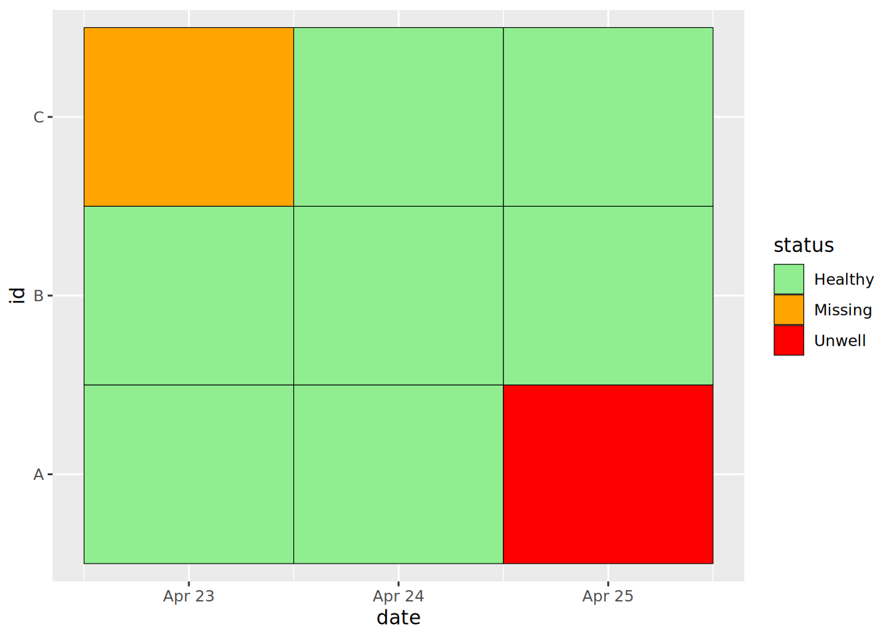

# 12  Restructurer les données

[](../../images/pivoting/pivoting_500x500.png)

Dans le contexte de la gestion des données, le *pivot des données* fait référence à l’un des deux processus suivants :

1.  La création de *tableaux croisés*, qui sont des tableaux de statistiques résumant les données d’un tableau plus étendu.

2.  La restructuration d’un tableau du format **long** au format **large**, ou vice versa.

Dans ce chapitre, nous allons nous focaliser sur le second processus. Résumer ses données dans des tableau est une étape cruciale de l’analyse des données et est traitée dans les chapitres sur [le regroupement des données](grouping.llms.md) et les [tableaux descriptifs](tables_descriptive.llms.md).

Ce chapitre traite des formats de données. Il est utile de connaître l’idée de “données bien rangées / ordonnées”, dans laquelle chaque variable a sa propre colonne, chaque observation a sa propre ligne et chaque valeur a sa propre cellule. Vous trouverez plus d’informations sur ce sujet [dans ce chapitre en ligne de R for Data Science](https://r4ds.had.co.nz/tidy-data.html)(en Anglais).

## 12.1 Étapes préliminaires

### Importation des paquets

Ces lignes de code chargent les paquets nécessaires aux analyses. Dans ce guide, nous mettons l’accent sur `p_load()` de **pacman**, qui installe le paquet si nécessaire *puis* l’importe pour l’utiliser. Vous pouvez également charger les paquets installés avec `library()` de **base** R. Voir la page sur [bases de R](basics.llms.md) pour plus d’informations sur les paquets R.

``` r
pacman::p_load(
  rio,          # import des fichiers
  here,         # gestion des chemins d'accès
  kableExtra,   # Build and manipulate complex tables
  tidyverse,    # gestion des données + graphiques (ggplot2)
  appliedepidata) # jeux de données d'exemple utilisés dans ce manuel
```

### Importation des données

### Cas de Malaria

Dans ce chapitre, nous utiliserons un jeu de données fictif de cas quotidiens de paludisme, par établissement et par groupe d’âge. Chargez-les directement avec `appliedepidata::get_data(name = "malaria_facility_count_data")` (voir la page [Télécharger le manuel et les données](download.llms.md) pour plus de détails).

``` r
# Importation des données
count_data <- appliedepidata::get_data(name = "malaria_facility_count_data")
```

Les premières cinquantes lignes sont affichées ci-dessous.

### Linelist des cas

A la fin de ce chapitre, nous utiliserons également une liste des cas d’une épidémie d’Ebola simulée. Chargez-les directement avec `appliedepidata::get_data(name = "linelist_cleaned_rds")` (voir la page [Télécharger le manuel et les données](download.llms.md) pour plus de détails).

``` r
# Importer la linelist
linelist <- appliedepidata::get_data(name = "linelist_cleaned_rds")
```

## 12.2 Transformation du format large vers long

[](../../images/pivoting/pivot_longer_new.png)

### Le format “large”

Les données sont souvent saisies et stockées dans un format “large” (ou “étendu”), où les caractéristiques ou les réponses d’un sujet/d’un item sont entrées dans une même ligne. Si cette structure de données peut être utile pour la présentation des données, elle n’est pas idéale pour certains types d’analyses.

Par exemple, dans le jeu de données `count_data` importé auparavant, chaque ligne représente un établissement à une date donnée. Les nombres de cas sont contenus dans les colonnes les plus à droites, dans un format “large” : l’information de chaque groupe d’âge pour un établissement à une date donnée est contenue sur une seule ligne.

Plus précisément, chaque ligne dans ce tableau contient le nombre de cas de paludisme dans l’un des 65 établissements à une date donnée, dans la période allant de `count_data$data_date %>% min()` à `count_data$data_date %>% max()`. Ces établissements sont situés dans une `Province` (Nord) et quatre `District`s (Spring, Bolo, Dingo, et Barnard). Le dataframe contient les totaux des cas de paludisme, globaux et pour chaque classe d’age (\<4 ans, 5-14 ans, et 15 ans et plus).

Les données sous format “large” comme celle-ci ne respectent pas les normes de “données rangées”, car les en-têtes de colonne ne représentent pas réellement des “variables”: ils contiennent les *valeurs* d’une hypothétique variable “groupe d’âge”.

Ce format est utile pour présenter les informations dans un tableau, ou pour saisir des données (dans Excel par exemple) à partir de formulaires de notification des cas. Cependant, au stade de l’analyse, ces données doivent généralement être restructurées et rangées en un format plus long. Le paquet de visualisations **ggplot2**, fonctionne également mieux lorsque les données sont dans un format “long”.

La visualisation du nombre *total* de cas de paludisme dans le temps ne pose aucun problème avec les données dans leur format actuel :

``` r
count_data %>% 
  drop_na(malaria_tot) %>% 
  ggplot() +
  geom_col(aes(x = data_date, y = malaria_tot), width = 1)
```

[](pivoting_files/figure-html/unnamed-chunk-10-1.png)

Cependant, les choses se compliquent si l’on veut visualiser les contributions relatives de chaque groupe d’âge au total des cas ? Nous devons alors nous assurer que la variable d’intérêt (le groupe d’âge) ait sa propre colonne dans le dataframe, colonne qui peut être passée à l’argument “mapping aesthetics” `aes()` de `{ggplot2}`.

### `pivot_longer()`

La fonction `pivot_longer()` de **tidyr** transforme un jeu de données au format “large” en un jeu de données “plus long”. **tidyr** fait partie du méta-paquet **tidyverse**.

Elle accepte une ou plusieurs colonnes à transformer (argument `cols =`), ce qui donne un contrôle fin sur les colonnes à restructurer. Par exemple, pour les données sur le paludisme, nous ne voulons faire pivoter que les colonnes contenant des nombre de cas.

Suite à ce processus, nous obtenons deux “nouvelles” colonnes: l’une contenant les catégories (anciennement sotckées dans les noms de colonnes), et l’autre avec les valeurs correspondantes (ici, le nombre de cas). Nous pouvons accepter les noms par défaut pour ces nouvelles colonnes, ou spécifier de nouveaux noms dans `names_to =` et `values_to =` respectivement.

Voyons comment utiliser `pivot_longer()`…

### Transformation simple

Nous utilisons la fonction `pivot_longer()` de **tidyr** pour convertir les données d’un format “large” à un format “long”. Plus précisément, il s’agit de convertir les quatre colonnes numériques contenant des nombre de cas de paludisme en deux nouvelles colonnes : une qui contient les *groupes d’âge* et une qui contient les *valeurs* correspondantes.

``` r
df_long <- count_data %>% 
  pivot_longer(
    cols = c(`malaria_rdt_0-4`, `malaria_rdt_5-14`, `malaria_rdt_15`, `malaria_tot`)
  )

df_long
```

Notons que le dataframe nouvellement crée (`df_long`) a plus de lignes (12 152 contre 3 038) : il est devenu *plus long*. Pour être précis, il est quatre fois plus long, car chaque ligne du tableau d’origine a donné quatre lignes dans \`df_long\`\`, une pour chacun des colonnes restructurées (\<4 ans, 5-14 ans, 15 ans et plus, et total).

Le nouveau tableau a également moins de colonnes (8 contre 10), car les données précédemment stockées dans quatre colonnes (celles qui commencent par le préfixe `malaria_`) sont maintenant stockées dans deux colonnes.

*Note :* puisque les noms de quatre colonnes transformées commencent tous par le préfixe `malaria_`, nous aurions pu sélectionner les colonnes à transformer en utilisant la fonction `starts_with()` pour obtenir le même résultat (voir la page sur [le nettoyage des données et les fonctions de base](cleaning.llms.md) pour plus de ces fonctions d’aide de type “tidyselect”).

``` r
# choisir les colonnes avec l'aide d'une fonction "tidyselect"
count_data %>% 
  pivot_longer(
    cols = starts_with("malaria_")
  )
```

    # A tibble: 12,152 × 8
       location_name data_date  submitted_date Province District newid name    value
       <chr>         <date>     <date>         <chr>    <chr>    <int> <chr>   <int>
     1 Facility 1    2020-08-11 2020-08-12     North    Spring       1 malari…    11
     2 Facility 1    2020-08-11 2020-08-12     North    Spring       1 malari…    12
     3 Facility 1    2020-08-11 2020-08-12     North    Spring       1 malari…    23
     4 Facility 1    2020-08-11 2020-08-12     North    Spring       1 malari…    46
     5 Facility 2    2020-08-11 2020-08-12     North    Bolo         2 malari…    11
     6 Facility 2    2020-08-11 2020-08-12     North    Bolo         2 malari…    10
     7 Facility 2    2020-08-11 2020-08-12     North    Bolo         2 malari…     5
     8 Facility 2    2020-08-11 2020-08-12     North    Bolo         2 malari…    26
     9 Facility 3    2020-08-11 2020-08-12     North    Dingo        3 malari…     8
    10 Facility 3    2020-08-11 2020-08-12     North    Dingo        3 malari…     5
    # ℹ 12,142 more rows

ou par position :

``` r
# Choisir les colonnes à partir de leur position dans le tableau
count_data %>% 
  pivot_longer(
    cols = 6:9
  )
```

ou dans le cas de colonnes consécutives, avec la première et la dernière colonne :

``` r
# Choisir les colonnes avec un "intervalle"
count_data %>% 
  pivot_longer(
    cols = `malaria_rdt_0-4`:malaria_tot
  )
```

Les deux nouvelles colonnes crées lors de la restructuration reçoivent les noms par défaut de `name` et `value`, mais nous pouvons remplacer ces valeurs par défaut par des noms qui décrivent mieux le contenu des colonnes en utilisant les arguments `names_to` et `values_to`. Par exemple, si nous voulons renommer les colonnes `age_group` et `counts` :

``` r
df_long <- 
  count_data %>% 
  pivot_longer(
    cols = starts_with("malaria_"),
    names_to = "age_group",
    values_to = "counts"
  )

df_long
```

    # A tibble: 12,152 × 8
       location_name data_date  submitted_date Province District newid age_group    
       <chr>         <date>     <date>         <chr>    <chr>    <int> <chr>        
     1 Facility 1    2020-08-11 2020-08-12     North    Spring       1 malaria_rdt_…
     2 Facility 1    2020-08-11 2020-08-12     North    Spring       1 malaria_rdt_…
     3 Facility 1    2020-08-11 2020-08-12     North    Spring       1 malaria_rdt_…
     4 Facility 1    2020-08-11 2020-08-12     North    Spring       1 malaria_tot  
     5 Facility 2    2020-08-11 2020-08-12     North    Bolo         2 malaria_rdt_…
     6 Facility 2    2020-08-11 2020-08-12     North    Bolo         2 malaria_rdt_…
     7 Facility 2    2020-08-11 2020-08-12     North    Bolo         2 malaria_rdt_…
     8 Facility 2    2020-08-11 2020-08-12     North    Bolo         2 malaria_tot  
     9 Facility 3    2020-08-11 2020-08-12     North    Dingo        3 malaria_rdt_…
    10 Facility 3    2020-08-11 2020-08-12     North    Dingo        3 malaria_rdt_…
    # ℹ 12,142 more rows
    # ℹ 1 more variable: counts <int>

Nous pouvons maintenant passer ce nouveau jeu de données à `{ggplot2}`, et placer la nouvelle colonne `count` dans l’axe des y et colorer les barres en fonction des valeurs de la colonne `age_group` grâce à l’argument `fill =`. Nous obtenons alors un diagramme en bâtons empilés des cas de paludisme par groupe d’âge :

``` r
df_long %>% 
  drop_na(counts) %>% 
  ggplot() +
  geom_col(
    mapping = aes(x = data_date, y = counts, fill = age_group),
    width = 1
  )
```

[](pivoting_files/figure-html/unnamed-chunk-16-1.png)

Examinez ce nouveau tracé et comparez-le avec le tracé que nous avons créé précédemment : *qu’est-ce qui cloche ?*

Nous fait une erreur classique du traitement des données de surveillance et inclus le nombre de cas totaux de la colonne `malaria_tot`. La conséquence est que chaque barre du graphique est deux fois plus élevée qu’elle ne devrait l’être.

Nous pouvons résoudre ce problème de plusieurs façons. Tout d’abord nous pouvons simplement filtrer les données avant de les passer à `ggplot()` :

``` r
df_long %>% 
  filter(age_group != "malaria_tot") %>% 
  drop_na(counts) %>% 
  ggplot() +
  geom_col(
    aes(x = data_date, y = counts, fill = age_group),
    width = 1
  )
```

[](pivoting_files/figure-html/unnamed-chunk-17-1.png)

Autrement, nous aurions pu exclure cette variable lors du `pivot_longer()`, la conservant comme une variable séparée dans le tableau :

``` r
count_data %>% 
  pivot_longer(
    cols = `malaria_rdt_0-4`:malaria_rdt_15,   # does not include the totals column
    names_to = "age_group",
    values_to = "counts"
  )
```

    # A tibble: 9,114 × 9
       location_name data_date  submitted_date Province District malaria_tot newid
       <chr>         <date>     <date>         <chr>    <chr>          <int> <int>
     1 Facility 1    2020-08-11 2020-08-12     North    Spring            46     1
     2 Facility 1    2020-08-11 2020-08-12     North    Spring            46     1
     3 Facility 1    2020-08-11 2020-08-12     North    Spring            46     1
     4 Facility 2    2020-08-11 2020-08-12     North    Bolo              26     2
     5 Facility 2    2020-08-11 2020-08-12     North    Bolo              26     2
     6 Facility 2    2020-08-11 2020-08-12     North    Bolo              26     2
     7 Facility 3    2020-08-11 2020-08-12     North    Dingo             18     3
     8 Facility 3    2020-08-11 2020-08-12     North    Dingo             18     3
     9 Facility 3    2020-08-11 2020-08-12     North    Dingo             18     3
    10 Facility 4    2020-08-11 2020-08-12     North    Bolo              49     4
    # ℹ 9,104 more rows
    # ℹ 2 more variables: age_group <chr>, counts <int>

Les valeurs sont alors répétées dans les lignes des groupes d’age.

### Transformer les données de plusieurs classes

L’exemple ci-dessus fonctionne bien dans les situations où toutes les colonnes que l’on veut faire *pivoter* sont de la même classe (chaîne de caractère, numérique, logique…).

Cependant, en tant qu’épidémiologiste de terrain, vous serez amené à travailler avec des données qui ont été préparées par des non-spécialistes, appliquant leur propre logique. Cela aboutit parfois à des jeux de données *non-standard*, voire totalement désorganisés. Comme Hadley Wickham l’a noté (en faisant référence à Tolstoï) dans son [article séminal](https://vita.had.co.nz/papers/tidy-data.pdf) sur les principes des **données rangées, organisées (tidy data)** :

> Comme les familles, les tableaux de données rangés et organisés se ressemblent tous, mais chaque fichier de données désorganisé / mal rangé l’est à sa manière.

Un problème particulièrement courant est la nécessité de restructurer des colonnes qui contiennent différentes types de données. Cette transformation aurait pour conséquence de stocker différents types de données dans une seule colonne, ce qui est déconseillé. Il y a plusieurs manière de gérer les problèmes associés à ce type de données mais la restructuration avec `pivot_longer()` est une étape importante.

Imaginons cette situation : une série d’observations a été effectuée à différents pas de temps pour chacun des trois éléments A, B et C. Il peut s’agir d’individus (par exemple, les contacts d’un cas d’Ebola sont suivis chaque jour pendant 21 jours) ou de postes de santé de villages éloignés qui sont contrôlés une fois par an pour s’assurer qu’ils sont toujours fonctionnels. Reprenons l’exemple de la recherche des contacts. Imaginons que les données soient stockées comme suit :

Le format de ces données est un peu plus compliqué que dans l’exemple précédent : chaque ligne stocke des informations sur un élément, et des paires de colonnes contiennent des séries d’observations à différentes dates. Le fichier s’allonge avec de nouvelles colonnes à droite au fur et à mesure des observations. Les classes de colonnes alternent entre dates et chaînes de caractères.

Pour la petite histoire, un des pires exemples de ce type de données qu’il m’ait été donné de rencontrer concernait des données de surveillance du choléra, dans lesquelles 8 nouvelles colonnes d’observations étaient ajoutées *chaque jour*, pendant **4 ans**. L’ouverture du fichier Excel sur mon ordinateur portable a pris plus de dix minutes…

Pour travailler avec ces données, nous devons les transformer en format “long” tout en gardant la séparation entre une colonne `date` et une colonne `character` (statut), pour chaque observation pour chaque élément. Ceci afin d’éviter de nous retrouver avec un mélange de types de variables dans une seule colonne, une situation que vous devrez chercher à éviter à tout prix dans votre gestion de données, en particulier avec des données ordonnées.

C’est malheureusement ce qui se produit si l’on effectue une transformation simple :

``` r
df %>% 
  pivot_longer(
    cols = -id,
    names_to = c("observation")
  )
```

    # A tibble: 18 × 3
       id    observation value     
       <chr> <chr>       <chr>     
     1 A     obs1_date   2021-04-23
     2 A     obs1_status Healthy   
     3 A     obs2_date   2021-04-24
     4 A     obs2_status Healthy   
     5 A     obs3_date   2021-04-25
     6 A     obs3_status Unwell    
     7 B     obs1_date   2021-04-23
     8 B     obs1_status Healthy   
     9 B     obs2_date   2021-04-24
    10 B     obs2_status Healthy   
    11 B     obs3_date   2021-04-25
    12 B     obs3_status Healthy   
    13 C     obs1_date   2021-04-23
    14 C     obs1_status Missing   
    15 C     obs2_date   2021-04-24
    16 C     obs2_status Healthy   
    17 C     obs3_date   2021-04-25
    18 C     obs3_status Healthy   

Ci-dessus, notre restructuration a fusionné *dates* et *caractères* en une seule colonne `value`. Face à deux colonnes de classes différentes, la fonction convertit par défaut la colonne entière en chaîne de caractères, et l’utilité des dates est perdue.

Pour éviter cette situation, nous pouvons tirer parti de la structure des noms de colonnes dans le tableau original, qui respectent le même format : le numéro de l’observation, un “\_” puis soit “statut” soit “date”.

Pour cela, il nous faut :

- fournir un vecteur de chaîne de caractères un peu spécial à l’argument `names_to =`. Dans ce vecteur, le second élément est `".value"`, ce terme spécial indiquant que les colonnes restructurées seront divisées sur la base d’un caractère dans le nom des colonnes.

- fournir le caractère utilisé comme séparateur à l’argument `names_sep =` . Dans le cas présent, il s’agit du tiret-bas “\_“.

Ainsi, le nommage et la division des nouvelles colonnes sont basés sur le “\_” dans les noms des variables existantes.

``` r
df_long <- 
  df %>% 
  pivot_longer(
    cols = -id,
    names_to = c("observation", ".value"),
    names_sep = "_"
  )

df_long
```

    # A tibble: 9 × 4
      id    observation date       status 
      <chr> <chr>       <chr>      <chr>  
    1 A     obs1        2021-04-23 Healthy
    2 A     obs2        2021-04-24 Healthy
    3 A     obs3        2021-04-25 Unwell 
    4 B     obs1        2021-04-23 Healthy
    5 B     obs2        2021-04-24 Healthy
    6 B     obs3        2021-04-25 Healthy
    7 C     obs1        2021-04-23 Missing
    8 C     obs2        2021-04-24 Healthy
    9 C     obs3        2021-04-25 Healthy

**Derniers détails** :

La colonne `date` est actuellement sous la forme d’une *chaîne de caractères* mais nous pouvons facilement la convertir en classe date en utilisant les fonctions `mutate()` et `as_date()` décrites dans la page [travailler avec des dates](dates.llms.md).

Nous pouvons aussi améliorer la colonne `observation` en supprimant le préfixe “obs” et en la convertissant en format `numeric`. Nous pouvons le faire avec `str_remove_all()` du paquet **stringr** (voir la page sur les [chaînes de caractères](characters_strings.llms.md)).

``` r
df_long <- 
  df_long %>% 
  mutate(
    date = date %>% lubridate::as_date(),
    observation = 
      observation %>% 
      str_remove_all("obs") %>% 
      as.numeric()
  )

df_long
```

    # A tibble: 9 × 4
      id    observation date       status 
      <chr>       <dbl> <date>     <chr>  
    1 A               1 2021-04-23 Healthy
    2 A               2 2021-04-24 Healthy
    3 A               3 2021-04-25 Unwell 
    4 B               1 2021-04-23 Healthy
    5 B               2 2021-04-24 Healthy
    6 B               3 2021-04-25 Healthy
    7 C               1 2021-04-23 Missing
    8 C               2 2021-04-24 Healthy
    9 C               3 2021-04-25 Healthy

Nous pouvons maintenant travailler avec les données dans ce format *allongé*. par exemple, en créant une carte de chaleur :

``` r
ggplot(data = df_long, mapping = aes(x = date, y = id, fill = status)) +
  geom_tile(colour = "black") +
  scale_fill_manual(
    values = 
      c("Healthy" = "lightgreen", 
        "Unwell" = "red", 
        "Missing" = "orange")
  )
```

[](pivoting_files/figure-html/unnamed-chunk-23-1.png)

## 12.3 Transformation du format long en large

[](../../images/pivoting/pivot_wider_new.png)

Il peut être utile de transformer un jeu de données d’un format “long” en un format plus large à l’aide de la fonction `pivot_wider()`.

Un cas d’utilisation typique est lorsque qu’il faut transformer les résultats d’une analyse dans un format plus digeste pour le lecteur, tel qu’un [tableau résumé](tables_presentation.llms.md). En général, il s’agit de transformer un dataframe dans lequel les informations relatives à un sujet sont réparties sur plusieurs lignes en un format dans lequel ces informations sont stockées sur une seule ligne.

### Données utilisées

Pour cette section nous utiliserons la liste des cas (voir la section [Etapes préliminaires](#pivot_prep)), qui contient une ligne par cas.

Voici les 50 premières lignes :

Imaginons que nous voulions voir les nombres d’individus dans les différentes classes d’age, par genre :

``` r
df_wide <- 
  linelist %>% 
  count(age_cat, gender)

df_wide
```

       age_cat gender   n
    1      0-4      f 640
    2      0-4      m 416
    3      0-4   <NA>  39
    4      5-9      f 641
    5      5-9      m 412
    6      5-9   <NA>  42
    7    10-14      f 518
    8    10-14      m 383
    9    10-14   <NA>  40
    10   15-19      f 359
    11   15-19      m 364
    12   15-19   <NA>  20
    13   20-29      f 468
    14   20-29      m 575
    15   20-29   <NA>  30
    16   30-49      f 179
    17   30-49      m 557
    18   30-49   <NA>  18
    19   50-69      f   2
    20   50-69      m  91
    21   50-69   <NA>   2
    22     70+      m   5
    23     70+   <NA>   1
    24    <NA>   <NA>  86

Cette commande renvoi un dataframe en format long, qui est très adapté à la création de graphiques avec **ggplot2**, mais moins idéal pour un tableau résumé dans un rapport :

``` r
ggplot(df_wide) +
  geom_col(aes(x = age_cat, y = n, fill = gender))
```

[](pivoting_files/figure-html/unnamed-chunk-27-1.png)

Nous pouvons utiliser la fonction `pivot_wider()` pour restructurer les données dans un format plus lisible par un lecteur humain.

### `pivot_wider()`

L’argument `names_from` spécifie la colonne *depuis laquelle* générer les nouveaux *noms* de colonne, tandis que l’argument `values_from` spécifie la colonne *depuis laquelle* prendre les *valeurs* pour remplir les cellules. L’argument `id_cols =` est facultatif, mais peut servir à fournir un vecteur de noms de colonnes qui ne doivent pas être pivotées, et qui serviront d’identifiant pour chaque ligne.

``` r
table_wide <- 
  df_wide %>% 
  pivot_wider(
    id_cols = age_cat,
    names_from = gender,
    values_from = n
  )

table_wide
```

    # A tibble: 9 × 4
      age_cat     f     m  `NA`
      <fct>   <int> <int> <int>
    1 0-4       640   416    39
    2 5-9       641   412    42
    3 10-14     518   383    40
    4 15-19     359   364    20
    5 20-29     468   575    30
    6 30-49     179   557    18
    7 50-69       2    91     2
    8 70+        NA     5     1
    9 <NA>       NA    NA    86

Ce tableau est beaucoup plus facile à lire, et est une base pour créer des tableaux résumés dans des rapports et articles. Nous pouvons améliorer son apparence à l’aide de paquets tels que **flextable** et **knitr** (voir la page [Tableaux pour la présentation](tables_presentation.llms.md).

``` r
table_wide %>% 
  janitor::adorn_totals(c("row", "col")) %>% # adds row and column totals
  knitr::kable() %>% 
  kableExtra::row_spec(row = 10, bold = TRUE) %>% 
  kableExtra::column_spec(column = 5, bold = TRUE) 
```

| age_cat |    f |    m |  NA | Total |
|:--------|-----:|-----:|----:|------:|
| 0-4     |  640 |  416 |  39 |  1095 |
| 5-9     |  641 |  412 |  42 |  1095 |
| 10-14   |  518 |  383 |  40 |   941 |
| 15-19   |  359 |  364 |  20 |   743 |
| 20-29   |  468 |  575 |  30 |  1073 |
| 30-49   |  179 |  557 |  18 |   754 |
| 50-69   |    2 |   91 |   2 |    95 |
| 70+     |   NA |    5 |   1 |     6 |
| NA      |   NA |   NA |  86 |    86 |
| Total   | 2807 | 2803 | 278 |  5888 |

------------------------------------------------------------------------

## 12.4 Remplissage des colonnes

Parfois, après un `pivot`, ou plus fréquemment après un `bind`, nous nous retrouvons avec des vides dans certaines cellules que nous aimerions remplir.

### Données

Par exemple, prenons deux jeux de données qui contiennent tout deux des observations pour le numéro de mesure, le nom de l’établissement et le nombre de cas à ce moment-là. En plus de cela, le deuxième jeu de données a également une variable `Year`.

``` r
df1 <- 
  tibble::tribble(
       ~Measurement, ~Facility, ~Cases,
                  1,  "Hosp 1",     66,
                  2,  "Hosp 1",     26,
                  3,  "Hosp 1",      8,
                  1,  "Hosp 2",     71,
                  2,  "Hosp 2",     62,
                  3,  "Hosp 2",     70,
                  1,  "Hosp 3",     47,
                  2,  "Hosp 3",     70,
                  3,  "Hosp 3",     38,
       )

df1 
```

    # A tibble: 9 × 3
      Measurement Facility Cases
            <dbl> <chr>    <dbl>
    1           1 Hosp 1      66
    2           2 Hosp 1      26
    3           3 Hosp 1       8
    4           1 Hosp 2      71
    5           2 Hosp 2      62
    6           3 Hosp 2      70
    7           1 Hosp 3      47
    8           2 Hosp 3      70
    9           3 Hosp 3      38

``` r
df2 <- 
  tibble::tribble(
    ~Year, ~Measurement, ~Facility, ~Cases,
     2000,            1,  "Hosp 4",     82,
     2001,            2,  "Hosp 4",     87,
     2002,            3,  "Hosp 4",     46
  )

df2
```

    # A tibble: 3 × 4
       Year Measurement Facility Cases
      <dbl>       <dbl> <chr>    <dbl>
    1  2000           1 Hosp 4      82
    2  2001           2 Hosp 4      87
    3  2002           3 Hosp 4      46

Lorsque nous effectuons une liaison avec `bind_rows()` pour joindre les deux ensembles de données ensemble, la variable `Year` est remplie avec de `NA` pour les lignes où il n’y avait pas d’information préalable (c’est-à-dire le premier ensemble de données) :

``` r
df_combined <- 
  bind_rows(df1, df2) %>% 
  arrange(Measurement, Facility)

df_combined
```

    # A tibble: 12 × 4
       Measurement Facility Cases  Year
             <dbl> <chr>    <dbl> <dbl>
     1           1 Hosp 1      66    NA
     2           1 Hosp 2      71    NA
     3           1 Hosp 3      47    NA
     4           1 Hosp 4      82  2000
     5           2 Hosp 1      26    NA
     6           2 Hosp 2      62    NA
     7           2 Hosp 3      70    NA
     8           2 Hosp 4      87  2001
     9           3 Hosp 1       8    NA
    10           3 Hosp 2      70    NA
    11           3 Hosp 3      38    NA
    12           3 Hosp 4      46  2002

### `fill()`

Dans ce cas, `Year` est une variable utile à inclure si nous souhaitons explorer les tendances temporelle. Nous pouvons utiliser `fill()` pour *remplir* les cellules vides, en spécifiant la colonne à remplir et la direction (dans ce cas **up**) :

``` r
df_combined %>% 
  fill(Year, .direction = "up")
```

    # A tibble: 12 × 4
       Measurement Facility Cases  Year
             <dbl> <chr>    <dbl> <dbl>
     1           1 Hosp 1      66  2000
     2           1 Hosp 2      71  2000
     3           1 Hosp 3      47  2000
     4           1 Hosp 4      82  2000
     5           2 Hosp 1      26  2001
     6           2 Hosp 2      62  2001
     7           2 Hosp 3      70  2001
     8           2 Hosp 4      87  2001
     9           3 Hosp 1       8  2002
    10           3 Hosp 2      70  2002
    11           3 Hosp 3      38  2002
    12           3 Hosp 4      46  2002

Alternativement, nous pouvons réordonner les données pour remplir vers le bas :

``` r
df_combined <- 
  df_combined %>% 
  arrange(Measurement, desc(Facility))

df_combined
```

    # A tibble: 12 × 4
       Measurement Facility Cases  Year
             <dbl> <chr>    <dbl> <dbl>
     1           1 Hosp 4      82  2000
     2           1 Hosp 3      47    NA
     3           1 Hosp 2      71    NA
     4           1 Hosp 1      66    NA
     5           2 Hosp 4      87  2001
     6           2 Hosp 3      70    NA
     7           2 Hosp 2      62    NA
     8           2 Hosp 1      26    NA
     9           3 Hosp 4      46  2002
    10           3 Hosp 3      38    NA
    11           3 Hosp 2      70    NA
    12           3 Hosp 1       8    NA

``` r
df_combined <- 
  df_combined %>% 
  fill(Year, .direction = "down")

df_combined
```

    # A tibble: 12 × 4
       Measurement Facility Cases  Year
             <dbl> <chr>    <dbl> <dbl>
     1           1 Hosp 4      82  2000
     2           1 Hosp 3      47  2000
     3           1 Hosp 2      71  2000
     4           1 Hosp 1      66  2000
     5           2 Hosp 4      87  2001
     6           2 Hosp 3      70  2001
     7           2 Hosp 2      62  2001
     8           2 Hosp 1      26  2001
     9           3 Hosp 4      46  2002
    10           3 Hosp 3      38  2002
    11           3 Hosp 2      70  2002
    12           3 Hosp 1       8  2002

Nous avons à présent un jeu de données facilement visualisable à l’aide de **ggplot2** :

``` r
ggplot(df_combined) +
  aes(Year, Cases, fill = Facility) +
  geom_col()
```

[](pivoting_files/figure-html/unnamed-chunk-34-1.png)

Mais ce jeu de données est peu lisible si présenté tel quel dans un rapport. Nous pouvons appliquer `pivot_wider()` pour le transformer en un format plus large :

``` r
df_combined %>% 
  pivot_wider(
    id_cols = c(Measurement, Facility),
    names_from = "Year",
    values_from = "Cases"
  ) %>% 
  arrange(Facility) %>% 
  janitor::adorn_totals(c("row", "col")) %>% 
  knitr::kable() %>% 
  kableExtra::row_spec(row = 5, bold = TRUE) %>% 
  kableExtra::column_spec(column = 5, bold = TRUE) 
```

| Measurement | Facility | 2000 | 2001 | 2002 | Total |
|:------------|:---------|-----:|-----:|-----:|------:|
| 1           | Hosp 1   |   66 |   NA |   NA |    66 |
| 2           | Hosp 1   |   NA |   26 |   NA |    26 |
| 3           | Hosp 1   |   NA |   NA |    8 |     8 |
| 1           | Hosp 2   |   71 |   NA |   NA |    71 |
| 2           | Hosp 2   |   NA |   62 |   NA |    62 |
| 3           | Hosp 2   |   NA |   NA |   70 |    70 |
| 1           | Hosp 3   |   47 |   NA |   NA |    47 |
| 2           | Hosp 3   |   NA |   70 |   NA |    70 |
| 3           | Hosp 3   |   NA |   NA |   38 |    38 |
| 1           | Hosp 4   |   82 |   NA |   NA |    82 |
| 2           | Hosp 4   |   NA |   87 |   NA |    87 |
| 3           | Hosp 4   |   NA |   NA |   46 |    46 |
| Total       | \-       |  266 |  245 |  162 |   673 |

Note : dans ce cas, nous avons dû spécifier de n’inclure que les trois variables `Facility`, `Year`, et `Cases` car la variable supplémentaire `Measurement` interférait avec la création de la table :

``` r
df_combined %>% 
  pivot_wider(
    names_from = "Year",
    values_from = "Cases"
  ) %>% 
  knitr::kable()
```

| Measurement | Facility | 2000 | 2001 | 2002 |
|------------:|:---------|-----:|-----:|-----:|
|           1 | Hosp 4   |   82 |   NA |   NA |
|           1 | Hosp 3   |   47 |   NA |   NA |
|           1 | Hosp 2   |   71 |   NA |   NA |
|           1 | Hosp 1   |   66 |   NA |   NA |
|           2 | Hosp 4   |   NA |   87 |   NA |
|           2 | Hosp 3   |   NA |   70 |   NA |
|           2 | Hosp 2   |   NA |   62 |   NA |
|           2 | Hosp 1   |   NA |   26 |   NA |
|           3 | Hosp 4   |   NA |   NA |   46 |
|           3 | Hosp 3   |   NA |   NA |   38 |
|           3 | Hosp 2   |   NA |   NA |   70 |
|           3 | Hosp 1   |   NA |   NA |    8 |

## 12.5 Resources

Voici un [tutoriel utilel](https://datacarpentry.org/r-socialsci/03-dplyr-tidyr/index.html)
