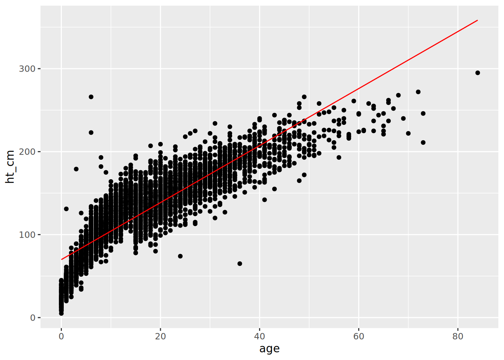

# 19  Régression univariée et multivariable

Cette page montre comment utiliser des fonctions de régression **base** de R telles que `glm()` et le package **gtsummary** pour examiner les relations entre les variables (par exemple, les rapports de cotes, les rapports de risque et les ratios de risque). Il utilise également des fonctions comme `tidy()` du package **broom** pour nettoyer les sorties de régression.

1.  Univarié : tableaux deux par deux
2.  Stratifié : estimations mantel-haenszel  
3.  Multivariable : sélection des variables, sélection du modèle, tableau final
4.  Forest graphe

Pour la régression des risques proportionnels de Cox, voir la page [Analyse d’enquête](survival_analysis.llms.md).

***NOTE:*** Nous utilisons le terme *multivariable* pour faire référence à une régression avec plusieurs variables explicatives. En effet, un modèle *multivarié* serait une régression avec plusieurs résultats - voir ceci [éditorial](https://www.ncbi.nlm.nih.gov/pmc/articles/PMC3518362/) pour plus de detail

## 19.1 Preparation

### Chargement des packages

Ce bout de code montre le chargement des packages nécessaires aux analyses. Dans ce manuel, nous mettons l’accent sur `p_load()` du package **pacman**, qui installe le package si nécessaire *et* le charge pour l’utiliser. Vous pouvez également charger les packages installés avec `library()` de **base** R. Voir la page sur [R basics](basics.llms.md) pour plus d’informations sur les packages de R.

``` r
pacman::p_load(
  rio, # Importation du fichier
  here, # Localisation de fichiers
  tidyverse, # gestion des données + graphiques ggplot2, 
  stringr, # manipuler des chaînes de texte 
  purrr, # boucle sur les objets d'une manière ordonnée
  gtsummary, # statistiques et tests sommaires 
  broom, # met de l'ordre dans les résultats des régressions
  lmtest, # tests du rapport de vraisemblance
  parameters, # alternative pour mettre de l'ordre dans les résultats des régressions
  see, # alternative pour visualiser les parcelles forestières
  appliedepidata # jeux de données d'exemple utilisés dans ce manuel
  )
```

### Importation de données

Nous importons le jeu de données des cas d’une épidémie d’Ebola simulée. Chargez-les directement avec `appliedepidata::get_data(name = "linelist_cleaned_rds")` (voir la page [Télécharger le manuel et les données](download.llms.md) pour plus de détails).

``` r
# importer la liste de lignes
linelist <- appliedepidata::get_data(name = "linelist_cleaned_rds")
```

Les 50 premières lignes de linelist sont affichées ci-dessous.

### Nettoyer les données

#### Stocker les variables explicatives

Nous stockons les noms des colonnes explicatives sous la forme d’un vecteur de caractères. Il sera référencé plus tard.

``` r
## definir les variables d'interet 
explanatory_vars <- c("gender", "fever", "chills", "cough", "aches", "vomit")
```

#### Convertir en 1 et 0 {.non numéroté}

Ci-dessous, nous convertissons les colonnes explicatives de “yes”/“no”, “m”/“f”, et “dead”/“alive” en **1 / 0**, pour se conformer avec les attentes des modèles de régression logistique. Pour faire cela efficacement, nous avons utilisé `across()` de **dplyr** pour transformer plusieurs colonnes en une seule fois. La fonction que nous appliquons à chaque colonne est `case_when()` (également **dplyr**) qui applique une logique pour convertir les valeurs spécifiées en 1 et 0. Voir les sections sur `across()` et `case_when()` dans la page [Nettoyage de données et fonctions essentielles](cleaning.llms.md)).

Note : le “.” ci-dessous représente la colonne qui est traitée par `across()` à ce moment-là.

``` r
## convertir les  variables dichotomique   en  0/1 
linelist <- linelist %>%  
  mutate(across(                                      
    .cols = all_of(c(explanatory_vars, "outcome")),  ## pour chaque colonne listée et "résultat"
    .fns = ~case_when(                              
      . %in% c("m", "yes", "Death")   ~ 1,           ## recoder male, yes et death en 1
      . %in% c("f", "no",  "Recover") ~ 0,           ## female, no and recover to 0
      TRUE                            ~ NA_real_)    ## otherwise set to missing
    )
  )
```

#### Supprimer les lignes avec des valeurs manquantes

Pour supprimer les lignes avec des valeurs manquantes, vous pouvez utiliser la fonction **tidyr** `drop_na()`. Cependant, nous ne voulons l’utiliser que pour les lignes qui ont des valeurs manquantes dans les colonnes qui nous intéressent.

La première chose que nous devons faire est de nous assurer que notre vecteur `explanatory_vars` inclut la colonne `age` (`age` aurait produit une erreur dans l’opération précédente `case_when()`, qui ne concernait que les variables dichotomiques). Ensuite, nous envoyons la liste de lignes à `drop_na()` pour enlever toutes les lignes avec des valeurs manquantes dans la colonne `outcome` ou dans l’une des colonnes `explanatory_vars`.

Avant d’exécuter le code, le nombre de lignes dans la `linelist` est `nrow(linelist)`.

``` r
## ajout de la catégorie d'âge aux variables explicatives 
explanatory_vars <- c(explanatory_vars, "age_cat")

## supprimer les lignes avec des informations manquantes pour les variables d'intérêt 
linelist <- linelist %>% 
  drop_na(any_of(c("outcome", explanatory_vars)))
```

le nombre de lignes restant dans `linelist` est de `nrow(linelist)`.

## 19.2 Univarié

Tout comme dans la page sur les [Tableaux descriptifs](tables_descriptive.llms.md), votre cas d’utilisation déterminera le package R que vous utiliserez. Nous vous présentons deux options pour effectuer une analyse univariée :

- Utiliser les fonctions disponibles dans **base** R pour afficher rapidement les résultats sur la console. Utilisez le package **broom** pour mettre de l’ordre dans les résultats.  
- Utilisez le package **gtsummary** pour modéliser et obtenir des résultats prêts à être publiés.

### **base** R

#### Régression linéaire

La fonction **base** R `lm()` effectue une régression linéaire, évaluant la relation entre une réponse numérique et des variables explicatives qui sont supposées avoir une relation linéaire.

Fournissez l’équation sous forme de formule, avec les noms des colonnes de réponse et d’explication séparés par un tilde `~`. Spécifiez également l’ensemble de données à `data =`. Définissez les résultats du modèle comme un objet R, à utiliser ultérieurement.

``` r
lm_results <- lm(ht_cm ~ age, data = linelist)
```

Vous pouvez ensuite exécuter `summary()` sur les résultats du modèle pour voir les coefficients (Estimations), la valeur P, les résidus, et d’autres mesures.

``` r
summary(lm_results)
```


    Call:
    lm(formula = ht_cm ~ age, data = linelist)

    Residuals:
         Min       1Q   Median       3Q      Max 
    -128.579  -15.854    1.177   15.887  175.483 

    Coefficients:
                Estimate Std. Error t value Pr(>|t|)    
    (Intercept)  69.9051     0.5979   116.9   <2e-16 ***
    age           3.4354     0.0293   117.2   <2e-16 ***
    ---
    Signif. codes:  0 '***' 0.001 '**' 0.01 '*' 0.05 '.' 0.1 ' ' 1

    Residual standard error: 23.75 on 4165 degrees of freedom
    Multiple R-squared:  0.7675,    Adjusted R-squared:  0.7674 
    F-statistic: 1.375e+04 on 1 and 4165 DF,  p-value: < 2.2e-16

Vous pouvez également utiliser la fonction `tidy()` du package **broom** pour afficher les résultats dans un tableau. les résultats dans un tableau. Les résultats nous indiquent que pour chaque année de plus dans l’âge d’un individu, la taille augmente de de 3,5 cm, ce qui est statistiquement significatif.

``` r
tidy(lm_results)
```

    # A tibble: 2 × 5
      term        estimate std.error statistic p.value
      <chr>          <dbl>     <dbl>     <dbl>   <dbl>
    1 (Intercept)    69.9     0.598       117.       0
    2 age             3.44    0.0293      117.       0

Vous pouvez également utiliser cette régression pour l’ajouter à un **ggplot**. d’abord prendre les points des données observées et la colonne predite à partir de la ligne ajustée dans un dataframe en utilisant la fonction `augment()` de **broom**.

``` r
## rassembler les points de régression et les données observées dans un seul ensemble de données
points <- augment(lm_results)

## creer un graphique  avec age comme   axe  des abscisses
ggplot(points, aes(x = age)) + 
  ## ajouter point pour l'ordonné
  geom_point(aes(y = ht_cm)) + 
  ## ajouter de la droite de régression linéaire
  geom_line(aes(y = .fitted), colour = "red")
```

[](regression_files/figure-html/lin_reg_res_plot-1.png)

Il est également possible d’ajouter une droite de régression linéaire simple dans **ggplot** en utilisant la fonction `geom_smooth()`.

``` r
## ajoute ta donnée dans le graphe
 ggplot(linelist, aes(x = age, y = ht_cm)) + 
  ## montrer les points
  geom_point() + 
  ## ajouter une regression linéaire
  geom_smooth(method = "lm", formula = y ~ x, se = FALSE)
```

[](regression_files/figure-html/geom_smooth-1.png)

Consultez la section Ressources à la fin de ce chapitre pour obtenir des didacticiels plus détaillés.

#### Régression logistique

La fonction `glm()` du package **stats** (faisant partie de **base** R) est utilisée pour ajuster les modèles linéaires généralisés (GLM).

`glm()` peut être utilisée pour la régression logistique univariée et multivariée (par exemple pour obtenir des Odds Ratios). Voici les parties principales :

``` r
# arguments for glm()
glm(formula, family, data, weights, subset, ...)
```

- `formula =` Le modèle est fourni à `glm()` sous forme d’équation, avec le résultat à gauche et les variables explicatives à droite d’un tilde `~`.  
- `family =` Ceci détermine le type de modèle à exécuter. Pour la régression logistique, utilisez `family = "binomial"`, pour le poisson utilisez `family = "poisson"`. D’autres exemples sont dans le tableau ci-dessous.  
- `data =` Spécifiez votre dataframe

Si nécessaire, vous pouvez également spécifier la fonction de lien via la syntaxe `family = familytype(link = "linkfunction"))`. Vous pouvez en savoir plus dans la documentation sur les autres familles et les arguments optionnels tels que `weights =` et `subset =` (`?glm`).

| Famille              | Fonction de liaison par défaut               |
|----------------------|----------------------------------------------|
| `"binomial"`         | `(link = "logit")`                           |
| `"gaussian"`         | `(link = "identity")`                        |
| `"Gamma"`            | `(link = "inverse")`                         |
| `"inverse.gaussian"` | `(link = "1/mu^2")`                          |
| `"poisson"`          | `(link = "log")`                             |
| `"quasi"`            | `(link = "identity", variance = "constant")` |
| `"quasibinomial"`    | `(link = "logit")`                           |
| `"quasipoisson"`     | `(link = "log")`                             |

Lorsque vous exécutez `glm()`, il est plus courant de sauvegarder les résultats comme un objet R nommé. Vous pouvez ensuite afficher les résultats sur votre console en utilisant `summary()` comme indiqué ci-dessous, ou effectuer d’autres opérations sur les résultats (par exemple, exponentiation).

Si vous avez besoin d’exécuter une régression binomiale négative, vous pouvez utiliser le package **MASS** ; le `glm.nb()` utilise la même syntaxe que `glm()`. Pour une présentation des différentes régressions, consultez la [UCLA stats page](https://stats.idre.ucla.edu/other/dae/).

#### Univarié `glm()`

Dans cet exemple, nous évaluons la relation entre différentes catégories d’âge et le résultat du décès (codé 1 dans la section Préparation). Nous présentons ci-dessous un modèle univarié de `outcome` par `age_cat`. Nous enregistrons la sortie du modèle sous le nom de `model` et nous l’affichons ensuite avec `summary()` sur la console. Notez que les estimations fournies sont les *log odds* et que le niveau de base est le premier niveau du facteur `age_cat` (“0-4”).

``` r
model <- glm(outcome ~ age_cat, family = "binomial", data = linelist)
summary(model)
```


    Call:
    glm(formula = outcome ~ age_cat, family = "binomial", data = linelist)

    Coefficients:
                  Estimate Std. Error z value Pr(>|z|)   
    (Intercept)   0.233738   0.072805   3.210  0.00133 **
    age_cat5-9   -0.062898   0.101733  -0.618  0.53640   
    age_cat10-14  0.138204   0.107186   1.289  0.19726   
    age_cat15-19 -0.005565   0.113343  -0.049  0.96084   
    age_cat20-29  0.027511   0.102133   0.269  0.78765   
    age_cat30-49  0.063764   0.113771   0.560  0.57517   
    age_cat50-69 -0.387889   0.259240  -1.496  0.13459   
    age_cat70+   -0.639203   0.915770  -0.698  0.48518   
    ---
    Signif. codes:  0 '***' 0.001 '**' 0.01 '*' 0.05 '.' 0.1 ' ' 1

    (Dispersion parameter for binomial family taken to be 1)

        Null deviance: 5712.4  on 4166  degrees of freedom
    Residual deviance: 5705.1  on 4159  degrees of freedom
    AIC: 5721.1

    Number of Fisher Scoring iterations: 4

Pour modifier le niveau de base d’une variable donnée, assurez-vous que la colonne est de classe facteur et déplacez le niveau désiré à la première position avec `fct_relevel()` (voir la page sur [Factors](factors.llms.md)). Par exemple, ci-dessous, nous prenons la colonne `age_cat` et définissons “20-29” comme niveau de base avant de passer le dataframe modifié dans `glm()`.

``` r
linelist %>% 
  mutate(age_cat = fct_relevel(age_cat, "20-29", after = 0)) %>% 
  glm(formula = outcome ~ age_cat, family = "binomial") %>% 
  summary()
```


    Call:
    glm(formula = outcome ~ age_cat, family = "binomial", data = .)

    Coefficients:
                 Estimate Std. Error z value Pr(>|z|)    
    (Intercept)   0.26125    0.07163   3.647 0.000265 ***
    age_cat0-4   -0.02751    0.10213  -0.269 0.787652    
    age_cat5-9   -0.09041    0.10090  -0.896 0.370220    
    age_cat10-14  0.11069    0.10639   1.040 0.298133    
    age_cat15-19 -0.03308    0.11259  -0.294 0.768934    
    age_cat30-49  0.03625    0.11302   0.321 0.748390    
    age_cat50-69 -0.41540    0.25891  -1.604 0.108625    
    age_cat70+   -0.66671    0.91568  -0.728 0.466546    
    ---
    Signif. codes:  0 '***' 0.001 '**' 0.01 '*' 0.05 '.' 0.1 ' ' 1

    (Dispersion parameter for binomial family taken to be 1)

        Null deviance: 5712.4  on 4166  degrees of freedom
    Residual deviance: 5705.1  on 4159  degrees of freedom
    AIC: 5721.1

    Number of Fisher Scoring iterations: 4

#### Affichage des résultats

Pour la plupart des utilisations, plusieurs modifications doivent être apportées aux sorties ci-dessus. La fonction `tidy()` du package **broom** est pratique pour rendre les résultats du modèle lisibles et comprehensibles.

Nous montrons ici comment combiner les sorties du modèle avec une table de comptage.

1.  Obtenez les estimations du logarithm de l’odd ratio *exponentiées* et les intervalles de confiance en passant le modèle à `tidy()` et en définissant `exponentiate = TRUE` et `conf.int = TRUE`.

``` r
model <- glm(outcome ~ age_cat, family = "binomial", data = linelist) %>% 
  tidy(exponentiate = TRUE, conf.int = TRUE) %>%        # exponentiée et  généré IC
  mutate(across(where(is.numeric), ~ round(.x, digits = 2)))  # arrondir tous les colonnes numeriques
```

Voici la sortie du tibble `model` :

2.  Combinez les résultats de ces modèles avec un tableau de comptage. Ci-dessous, nous créons un tableau de comptage croisé avec la fonction `tabyl()` de **janitor**, comme indiqué dans la page [Tableaux descriptifs](tables_descriptive.llms.md).

``` r
counts_table <- linelist %>% 
  janitor::tabyl(age_cat, outcome)
```

Voici à quoi ressemble ce dataframe `counts_table` :

Maintenant, nous pouvons lier les résultats de `counts_table` et de `model` ensemble horizontalement avec `bind_cols()` (**dplyr**). Rappelez-vous qu’avec `bind_cols()` les lignes des deux dataframes doivent être parfaitement alignées. Dans ce code, comme nous effectuons des liaisons dans une chaîne de commandes, nous utilisons `.` pour représenter l’objet `counts_table` lorsque nous le lions à `model`. Pour terminer le processus, nous utilisons `select()` pour choisir les colonnes souhaitées et leur ordre, et enfin nous appliquons la fonction **base** R `round()` sur toutes les colonnes numériques pour spécifier 2 décimales.

``` r
combined <- counts_table %>%           # debutons avec un tableau de comptage
  bind_cols(., model) %>%              # combiner avec les sorties de la regression
  select(term, 2:3, estimate,          # selectionner and arranger les cols
         conf.low, conf.high, p.value) %>% 
  mutate(across(where(is.numeric), ~ round(.x, digits = 2))) ## arrondir à deux chiffres apres la virgule
```

Voici à quoi ressemble le dataframe combiné, affiché joliment comme une image avec une fonction de **flextable**. La section [Tableau pour la presentationn](tables_presentation.llms.md) explique comment personnaliser de tels tableaux avec **flextable**, ou vous pouvez utiliser de nombreux autres packages tels que **knitr** ou **GT**.

``` r
combined <- combined %>% 
  flextable::qflextable()
```

#### Mettre en Boucle plusieurs modèles univariés

Nous présentons ci-dessous une méthode utilisant `glm()` et `tidy()` pour une approche plus simple, voir la section sur **gtsummary**.

Pour exécuter les modèles sur plusieurs variables d’explicative afin de produire des odds ratios univariés (c’est-à-dire sans contrôle des autres variables), vous pouvez utiliser l’approche ci-dessous. Elle utilise `str_c()` de **stringr** pour créer des formules univariées (voir [Caractères et chaînes de caractères](characters_strings.llms.md)), exécute la régression `glm()` sur chaque formule, passe chaque sortie `glm()` à `tidy()` et enfin rassemble toutes les sorties du modèle avec `bind_rows()` de **tidyr**. Cette approche utilise `map()` du packages **purrr** pour itérer - voir la page sur \[Iteration, loops, and lists\] pour plus d’informations sur cet outil.

1.  Créez un vecteur de noms de colonnes des variables explicatives. Nous l’avons déjà en tant que `explanatory_vars` dans la section Préparation de cette page.

2.  Utilisez `str_c()` pour créer plusieurs formules de chaîne, avec `outcome` à gauche, et un nom de colonne de `explanatory_vars` à droite. Le point `.` remplace le nom de la colonne dans `explanatory_vars`.

``` r
explanatory_vars %>% str_c("outcome ~ ", .)
```

    [1] "outcome ~ gender"  "outcome ~ fever"   "outcome ~ chills" 
    [4] "outcome ~ cough"   "outcome ~ aches"   "outcome ~ vomit"  
    [7] "outcome ~ age_cat"

3.  Passez ces formules de chaîne à `map()` et définissez `~glm()` comme la fonction à appliquer à chaque entrée. Dans `glm()`, définissez la formule de régression comme `as.formula(.x)` où `.x` sera remplacé par la formule de chaîne définie dans l’étape précédente. `map()` bouclera sur chacune des formules en format chaîne de caractères, en effectuant des régressions pour chacune d’entre elles.

4.  Les résultats de cette première `map()` sont passés à une seconde commande `map()`, qui applique `tidy()` aux résultats de la régression.

5.  Finalement, la sortie de la seconde commande `map()` (une liste de dataframe triés) est condensée avec `bind_rows()`, qui donne un dataframe avec tous les résultats univariés.

``` r
models <- explanatory_vars %>%       # commencer avec les variables d'interets
  str_c("outcome ~ ", .) %>%         # combiner chaque variable dans une formule ("outcome ~ variable of interest")
  
  # itérer à travers chaque formule univariée
  map(                               
    .f = ~glm(                       # passer les formules une par une à glm()
      formula = as.formula(.x),      # dans glm(), la formule de la chaîne de caractère est .x
      family = "binomial",           # spécifier le type de glm (logistique)
      data = linelist)) %>%          # jeu de données
  
  # mettre en ordre chacun des résultats de la régression glm ci-dessus
  map(
    .f = ~tidy(
      .x, 
      exponentiate = TRUE,           # exponentiation 
      conf.int = TRUE)) %>%          # retourne les intervalles de confiance
  
  # réduire la liste des résultats de la régression en un seul dataframe
  bind_rows() %>% 
  
  # arrondir tous les colonnes numeriques
  mutate(across(where(is.numeric), ~ round(.x, digits = 2)))
```

Cette fois, l’objet final `models` est plus long car il représente maintenant les résultats combinés de plusieurs régressions univariées. Cliquez pour voir toutes les lignes de `model`.

Comme précédemment, nous pouvons créer une table des effectifs à partir de la `linelist` pour chaque variable explicative, la lier à `models`, et faire une belle table. Nous commençons par les variables, et nous les parcourons avec `map()`. Nous itérons à travers une fonction définie par l’utilisateur qui implique la création d’une table d’effectifs avec les fonctions **dplyr**. Ensuite, les résultats sont combinés et liés aux résultats du modèle `models`.

``` r
## pour chaque variable explicative
univ_tab_base <- explanatory_vars %>% 
  map(.f = 
    ~{linelist %>%                ## debuter avec  linelist
        group_by(outcome) %>%     ## grouper le jeu de donnée par outcome
        count(.data[[.x]]) %>%    ## produire des comptages pour la variable d'intérêt
        pivot_wider(              ## étendre à un format large (comme dans un tableau croisé)
          names_from = outcome,
          values_from = n) %>% 
        drop_na(all_of(.x)) %>%         ## éliminer les lignes avec des valeurs manquantes
        rename("variable" = all_of(.x)) %>%      ## changer la colonne de la variable d'intérêt en "variable".
        mutate(variable = as.character(variable))} ## convertir en caractères, sinon les variables non-dichotomiques (catégorielles) apparaissent comme des facteurs et ne peuvent pas être fusionnées.
      ) %>% 
  
  ## Réduire la liste des sorties de comptage à un seul dataframe
  bind_rows() %>% 
  
  ## fusionner avec les sorties de la régression 
  bind_cols(., models) %>% 
  
  ## ne garder que les colonnes intéressées 
  select(term, 2:3, estimate, conf.low, conf.high, p.value) %>% 
  
  ## arrondir les décimales
  mutate(across(where(is.numeric), ~ round(.x, digits = 2)))
```

Voici à quoi ressemble le dataframe. Voir la page sur les [Tableau pour la presentationn](tables_presentation.llms.md) pour des idées sur la façon de convertir ce tableau en une jolie sortie HTML (par exemple avec **flextable**).

### **gtsummary** package

Nous présentons ci-dessous l’utilisation de `tbl_uvregression()` du package **gtsummary**. Tout comme dans la page sur les [Tableaux descriptifs](tables_descriptive.llms.md), les fonctions **gtsummary** font un bon travail pour exécuter des statistiques *et* produire des résultats à usage professionnel. Cette fonction produit un tableau des résultats d’une régression univariée.

Nous ne sélectionnons que les colonnes nécessaires de la `linelist` (les variables explicatives et la variable de résultat) et les introduisons dans `tbl_uvregression()`. Nous allons exécuter une régression univariée sur chacune des colonnes que nous avons définies comme `explanatory_vars` dans la section Préparation des données (sexe, fièvre, frissons, toux, courbatures, vomissements, et age_cat).

Dans la fonction elle-même, nous fournissons la `method =` comme `glm` (sans guillemets), la colonne `y =` outcome (`outcome`), nous spécifions à `method.args =` que nous voulons exécuter une régression logistique via `family = binomial`, et nous lui disons d’exponentiser les résultats.

La sortie est en HTML et contient les comptes

``` r
univ_tab <- linelist %>% 
  dplyr::select(all_of(explanatory_vars), outcome) %>% ## selectionner variables d'interet

  tbl_uvregression(                         ## produire un tableau univarié
    method = glm,                           ## définir la régression que l'on veut exécuter (modèle linéaire généralisé)
    y = outcome,                            ## définir la variable de résultat
    method.args = list(family = binomial),  ## définir le type de glm que l'on veut exécuter (logistique)
    exponentiate = TRUE                     ## exponentiez pour produire des odds ratios (plutôt que des odds logarithmiques)
  )

## visualiser le tableau des résultats univariés 
univ_tab
```

[TABLE]

Vous pouvez apporter de nombreuses modifications à ce tableau, par exemple en ajustant les étiquettes de texte, en mettant en gras les lignes en fonction de leur valeur p, etc. Voir les didacticiels [ici](http://www.danieldsjoberg.com/gtsummary/articles/tbl_regression.html) et ailleurs en ligne.

## 19.3 Stratifié

L’analyse stratifiée est actuellement en cours de développement pour **gtsummary**, cette page sera mise à jour en temps voulu.

## 19.4 Multivariable

Pour l’analyse multivariable, nous présentons à nouveau deux approches :

- `glm()` et `tidy()`.  
- package **gtsummary**.

La methodologie est similaire pour chacune d’entre elles et seule la dernière étape, celle de l’élaboration d’un tableau final, est différente.

### Conduite multivariable

Ici, nous utilisons `glm()` mais ajoutons plus de variables au côté droit de l’équation, séparées par des symboles plus (`+`).

Pour exécuter le modèle avec toutes nos variables explicatives, nous devrions exécuter :

``` r
mv_reg <- glm(outcome ~ gender + fever + chills + cough + aches + vomit + age_cat, family = "binomial", data = linelist)

summary(mv_reg)
```


    Call:
    glm(formula = outcome ~ gender + fever + chills + cough + aches + 
        vomit + age_cat, family = "binomial", data = linelist)

    Coefficients:
                  Estimate Std. Error z value Pr(>|z|)
    (Intercept)   0.069054   0.131726   0.524    0.600
    gender        0.002448   0.065133   0.038    0.970
    fever         0.004309   0.080522   0.054    0.957
    chills        0.034112   0.078924   0.432    0.666
    cough         0.138584   0.089909   1.541    0.123
    aches        -0.070705   0.104078  -0.679    0.497
    vomit         0.086098   0.062618   1.375    0.169
    age_cat5-9   -0.063562   0.101851  -0.624    0.533
    age_cat10-14  0.136372   0.107275   1.271    0.204
    age_cat15-19 -0.011074   0.113640  -0.097    0.922
    age_cat20-29  0.026552   0.102780   0.258    0.796
    age_cat30-49  0.059569   0.116402   0.512    0.609
    age_cat50-69 -0.388964   0.262384  -1.482    0.138
    age_cat70+   -0.647443   0.917375  -0.706    0.480

    (Dispersion parameter for binomial family taken to be 1)

        Null deviance: 5712.4  on 4166  degrees of freedom
    Residual deviance: 5700.2  on 4153  degrees of freedom
    AIC: 5728.2

    Number of Fisher Scoring iterations: 4

Si vous voulez inclure deux variables et une interaction entre elles, vous pouvez les séparer avec un astérisque `*` au lieu d’un `+`. Séparez-les par un deux-points `:` si vous ne spécifiez que l’interaction. Par exemple :

``` r
glm(outcome ~ gender + age_cat * fever, family = "binomial", data = linelist)
```

*Optionnellement*, vous pouvez utiliser ce code pour exploiter le vecteur prédéfini des noms de colonnes et recréer la commande ci-dessus en utilisant `str_c()`. Cela peut être utile si les noms de vos variables explicatives changent, ou si vous ne voulez pas les taper à nouveau.

``` r
## effectuer une régression avec toutes les variables d'intérêt 
mv_reg <- explanatory_vars %>%  ## commencer par un vecteur de noms de colonnes explicatives
  str_c(collapse = "+") %>%     ## combiner tous les noms des variables d'intérêt séparés par un plus
  str_c("outcome ~ ", .) %>%    ## combiner les noms des variables d'intérêt avec le résultat dans le style d'une formule
  glm(family = "binomial",      ## définir le type de glm comme logistique,
      data = linelist)          ## définir votre jeu de données
```

#### Construire le modèle

Vous pouvez construire votre modèle étape par étape, en enregistrant plusieurs modèles qui incluent certaines variables explicatives. Vous pouvez comparer ces modèles avec des tests de rapport de vraisemblance en utilisant `lrtest()` du package **lmtest**, comme ci-dessous :

***NOTE:*** L’utilisation de **base** `anova(model1, model2, test = "Chisq)` produit les mêmes résultats

``` r
model1 <- glm(outcome ~ age_cat, family = "binomial", data = linelist)
model2 <- glm(outcome ~ age_cat + gender, family = "binomial", data = linelist)

lmtest::lrtest(model1, model2)
```

    Likelihood ratio test

    Model 1: outcome ~ age_cat
    Model 2: outcome ~ age_cat + gender
      #Df  LogLik Df Chisq Pr(>Chisq)
    1   8 -2852.6                    
    2   9 -2852.6  1 2e-04     0.9883

Une autre option consiste à prendre l’objet modèle et à appliquer la fonction `step()` du package **stats**. Spécifiez la direction de sélection des variables que vous souhaitez utiliser lors de la construction du modèle.

``` r
## choisir un modèle en utilisant la sélection avant basée sur l'AIC
## vous pouvez aussi faire "backward" ou "both" en ajustant la direction.
final_mv_reg <- mv_reg %>%
  step(direction = "forward", trace = FALSE)
```

Vous pouvez également désactiver la notation scientifique dans votre session R, pour plus de clarté :

``` r
options(scipen=999)
```

Comme décrit dans la section sur l’analyse univariée, nous passons la sortie du modèle à `tidy()` pour exponentialiser les probabilités logarithmiques et les IC. Enfin, nous arrondissons toutes les colonnes numériques à deux décimales. Faites défiler pour voir toutes les lignes.

``` r
mv_tab_base <- final_mv_reg %>% 
  broom::tidy(exponentiate = TRUE, conf.int = TRUE) %>%  ## obtenir un tidy  dataframe d'estimations 
  mutate(across(where(is.numeric), ~ round(.x, digits = 2)))          ## arrondir
```

Voici à quoi ressemble le dataframe obtenu :

### Combiner univarié et multivariable

#### Combinez avec **gtsummary**

Le package **gtsummary** fournit la fonction `tbl_regression()`, qui prendra . les sorties d’une régression (`glm()` dans ce cas) et produira un joli tableau de synthèse. tableau récapitulatif.

``` r
## montrer le tableau des résultats de la régression finale 
mv_tab <- tbl_regression(final_mv_reg, exponentiate = TRUE)
```

Voyons le tableau :

``` r
mv_tab
```

[TABLE]

Vous pouvez également combiner plusieurs tableaux de sortie différents produits par **gtsummary** avec la fonction `tbl_merge()`. Nous combinons maintenant les résultats multivariables avec les résultats *univariés* de **gtsummary** que nous avons créés [ci-dessus](#reg_gt_uni):

``` r
## combiner avec les résultats univariés 
tbl_merge(
  tbls = list(univ_tab, mv_tab),                          # combiner
  tab_spanner = c("**Univariate**", "**Multivariable**")) # definier les entetes des colonnes
```

[TABLE]

#### Combiner avec **dplyr**

Une autre façon de combiner les sorties univariées et multivariées de `glm()`/`tidy()` est d’utiliser les fonctions de jonction **dplyr**.

- fusionner les résultats univariés de tout à l’heure (`univ_tab_base`, qui contient les comptages) avec les résultats multivariables triés `mv_tab_base`.  
- Utilisez `select()` pour ne garder que les colonnes que nous voulons, spécifier leur ordre, et les renommer.  
- Utilisez `round()` avec deux décimales sur toutes les colonnes qui sont classe Double

``` r
## combiner des tableaux univariés et multivariés 
left_join(univ_tab_base, mv_tab_base, by = "term") %>% 
  ##choisir les colonnes et les renommer
  select( # nouveau nom = ancien nom
    "characteristic" = term, 
    "recovered"      = "0", 
    "dead"           = "1", 
    "univ_or"        = estimate.x, 
    "univ_ci_low"    = conf.low.x, 
    "univ_ci_high"   = conf.high.x,
    "univ_pval"      = p.value.x, 
    "mv_or"          = estimate.y, 
    "mvv_ci_low"     = conf.low.y, 
    "mv_ci_high"     = conf.high.y,
    "mv_pval"        = p.value.y 
  ) %>% 
  mutate(across(where(is.double), ~ round(.x, 2)))   
```

    # A tibble: 20 × 11
       characteristic recovered  dead univ_or univ_ci_low univ_ci_high univ_pval
       <chr>              <dbl> <dbl>   <dbl>       <dbl>        <dbl>     <dbl>
     1 (Intercept)          909  1168    1.28        1.18         1.4       0   
     2 gender               916  1174    1           0.88         1.13      0.97
     3 (Intercept)          340   436    1.28        1.11         1.48      0   
     4 fever               1485  1906    1           0.85         1.17      0.99
     5 (Intercept)         1472  1877    1.28        1.19         1.37      0   
     6 chills               353   465    1.03        0.89         1.21      0.68
     7 (Intercept)          272   309    1.14        0.97         1.34      0.13
     8 cough               1553  2033    1.15        0.97         1.37      0.11
     9 (Intercept)         1636  2114    1.29        1.21         1.38      0   
    10 aches                189   228    0.93        0.76         1.14      0.51
    11 (Intercept)          931  1144    1.23        1.13         1.34      0   
    12 vomit                894  1198    1.09        0.96         1.23      0.17
    13 (Intercept)          338   427    1.26        1.1          1.46      0   
    14 age_cat5-9           365   433    0.94        0.77         1.15      0.54
    15 age_cat10-14         273   396    1.15        0.93         1.42      0.2 
    16 age_cat15-19         238   299    0.99        0.8          1.24      0.96
    17 age_cat20-29         345   448    1.03        0.84         1.26      0.79
    18 age_cat30-49         228   307    1.07        0.85         1.33      0.58
    19 age_cat50-69          35    30    0.68        0.41         1.13      0.13
    20 age_cat70+             3     2    0.53        0.07         3.2       0.49
    # ℹ 4 more variables: mv_or <dbl>, mvv_ci_low <dbl>, mv_ci_high <dbl>,
    #   mv_pval <dbl>

## 19.5 Forest plot

Cette section montre comment produire un graphique avec les résultats de votre régression. Il y a deux options, vous pouvez construire un graphique vous-même en utilisant **ggplot2** ou utiliser un méta-package appelé **easystats** (un package qui inclut plusieurs packages). méta-package appelé **easystats** (un package qui inclut plusieurs packages).

Consultez la page sur [Les bases de ggplot](ggplot_basics.llms.md) si vous n’êtes pas familier avec le package de traçage **ggplot2**.

### **ggplot2** package

Vous pouvez construire un graphique forest avec `ggplot()` en traçant les éléments des résultats de la régression multivariable. Ajoutez les couches des tracés en utilisant ces “geoms” :

- estimations avec `geom_point()`  
- intervalles de confiance avec “geom_errorbar()\`”.  
- une ligne verticale à OR = 1 avec `geom_vline()`.

Avant de tracer un graphique, vous pouvez utiliser `fct_relevel()` du package **forcats** pour définir l’ordre des variables/niveaux sur l’axe des ordonnées. `ggplot()` peut les afficher dans l’ordre alpha-numérique, ce qui ne fonctionnerait pas bien pour ces valeurs de catégories d’âge (“30” apparaîtrait avant “5”). Voir la page sur les [facteurs](factors.llms.md) pour plus de détails.

``` r
## enlever le terme intercept dans le resultats multivariables
mv_tab_base %>% 
  
  #definir l'odre d'apparition des niveaux  le long de l'axe y 
  mutate(term = fct_relevel(
    term,
    "vomit", "gender", "fever", "cough", "chills", "aches",
    "age_cat5-9", "age_cat10-14", "age_cat15-19", "age_cat20-29",
    "age_cat30-49", "age_cat50-69", "age_cat70+")) %>%
  
  # supprimer la ligne denommé "intercept" dans le graphique
  filter(term != "(Intercept)") %>% 
  
  ## concevoir un graphe avec la variable sur l'axe des y et l'estimation (OR) sur l'axe des x
  ggplot(aes(x = estimate, y = term)) +
  
  ## montrer  estimate  comme un point
  geom_point() + 
  
  ## ajouter une barre d'erreur pour les intervalles de confiance
  geom_errorbar(aes(xmin = conf.low, xmax = conf.high)) + 
  
  ## montrer où OR = 1 est pour référence comme une ligne pointillée
  geom_vline(xintercept = 1, linetype = "dashed")
```

[](regression_files/figure-html/ggplot_forest-1.png)

### Packages **easystats**

Une alternative, si vous ne voulez pas le bon niveau de contrôle que **ggplot2** fournit, est d’utiliser une combinaison des packages **easystats**.

La fonction `model_parameters()` du package **parameters** fait l’équivalent de la fonction du package **broom**. de la fonction `tidy()` du package **broom**. Le package **see** accepte alors ces sorties et crée un graphique forest par défaut sous la forme d’un objet `ggplot()`.

``` r
pacman::p_load(easystats)

## supprimer le terme interception de vos résultats multivariables
final_mv_reg %>% 
  model_parameters(exponentiate = TRUE) %>% 
  plot()
```

[](regression_files/figure-html/easystats_forest-1.png)

## 19.6 Ressources

Le contenu de cette page a été alimenté par ces ressources et vignettes en ligne :

[Linear regression in R](https://www.datacamp.com/community/tutorials/linear-regression-R)

[gtsummary](http://www.danieldsjoberg.com/gtsummary/articles/tbl_regression.html)

[UCLA stats page](https://stats.idre.ucla.edu/other/dae/)

[sthda stepwise regression](http://www.sthda.com/english/articles/36-classification-methods-essentials/150-stepwise-logistic-regression-essentials-in-r/)
