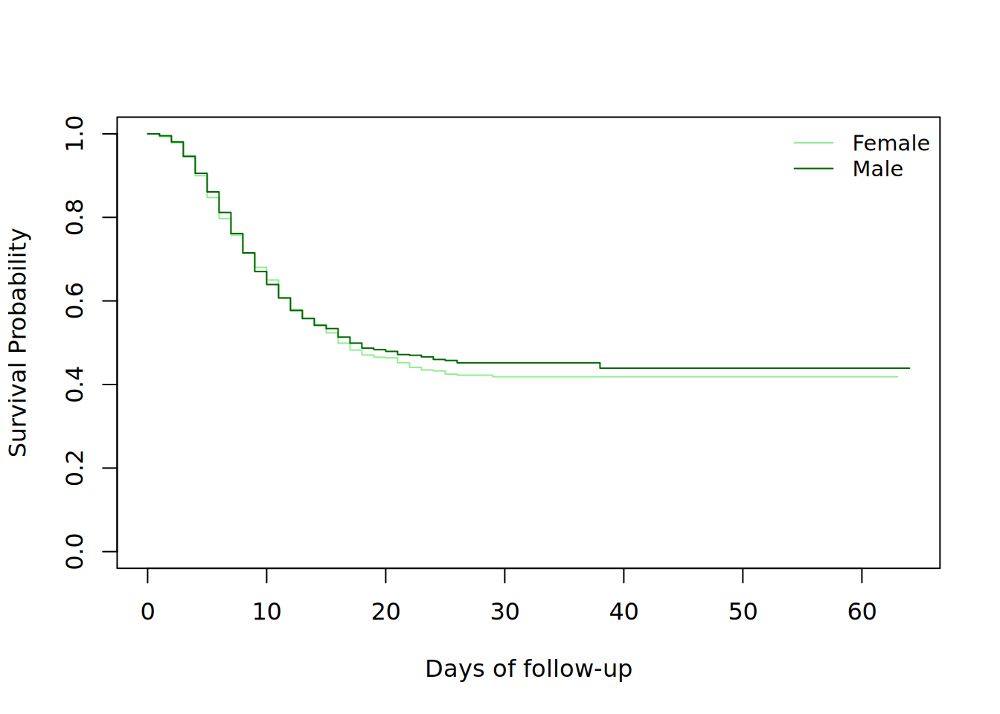
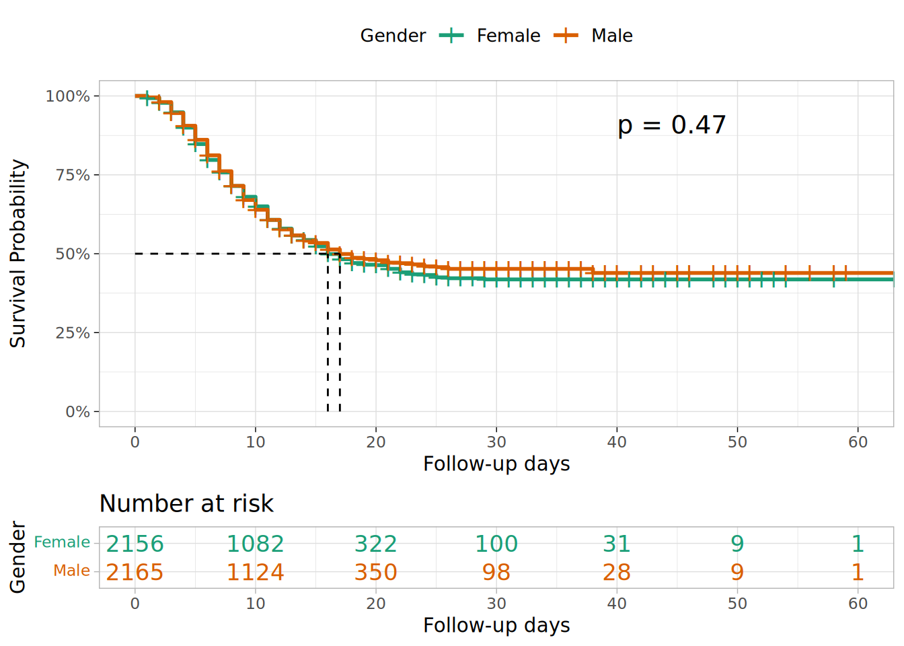
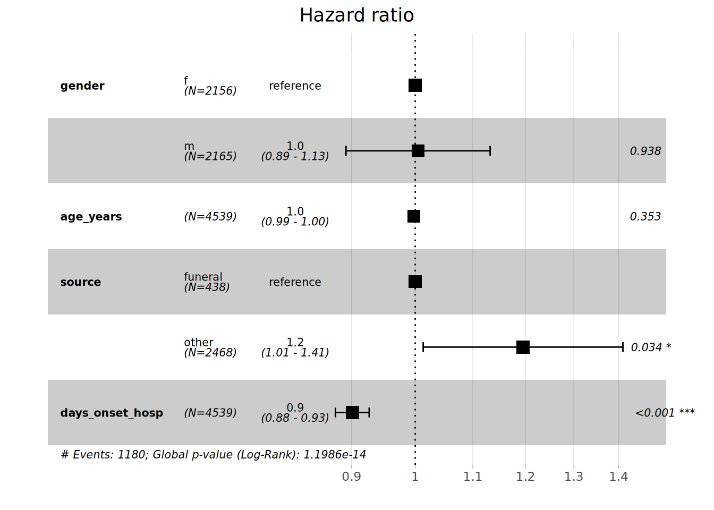

# 27  Analyse de survie

[](../../images/survival_analysis.png)

## 27.1 Aperçu

*L’analyse de survie* s’attache à décrire pour un individu ou un groupe d’individus donné, un point d’événement défini appelé ***l’échec*** (apparition d’une maladie, guérison d’une maladie, décès, rechute après réponse à un traitement…) qui survient après une période de temps appelée ***le temps d’échec*** (ou ***le temps de suivi*** dans les études de cohorte/population) pendant laquelle les individus sont observés. Pour déterminer le temps d’échec, il est alors nécessaire de définir un temps d’origine (qui peut être la date d’inclusion, la date du diagnostic…).

La cible d’inférence de l’analyse de survie est alors le temps entre une origine et un événement. Dans la recherche médicale actuelle, elle est largement utilisée dans les études cliniques pour évaluer l’effet d’un traitement par exemple, ou en épidémiologie du cancer pour évaluer une grande variété de mesures de survie au cancer.

Elle s’exprime généralement par la ***probabilité de survie*** qui est la probabilité que l’événement d’intérêt ne se soit pas produit avant une durée t.

***Censure*** : La censure se produit lorsqu’à la fin du suivi, certains des individus n’ont pas eu l’événement d’intérêt, et donc leur temps réel jusqu’à l’événement est inconnu. Nous nous concentrerons principalement sur la censure à droite ici, mais pour plus de détails sur la censure et l’analyse de survie en général, vous pouvez consulter les références.

## 27.2 Préparation

### Chargement des paquets

Pour effectuer des analyses de survie dans R, un des paquets les plus utilisés est le paquet **survival**. Nous l’installons d’abord et le chargeons ensuite, ainsi que les autres paquets qui seront utilisés dans cette section :

Dans ce manuel, nous mettons l’accent sur `p_load()` de **pacman**, qui installe le paquet si nécessaire *et* le charge pour l’utiliser. Vous pouvez aussi charger les paquets installés avec `library()` de **base** R. Voir la page sur \[R basics\] pour plus d’informations sur les paquets R.

Cette page explore les analyses de survie en utilisant la linelist utilisée dans la plupart des pages précédentes et sur laquelle nous appliquons quelques changements pour avoir des données de survie correctes.

### Importation du jeu de données

Nous importons le jeu de données des cas d’une épidémie d’Ebola simulée. Chargez-les directement avec `appliedepidata::get_data(name = "linelist_cleaned_rds")` (voir la page [Télécharger le manuel et les données](download.llms.md) pour plus de détails).

``` r
# importation de linelist
linelist_case_data <- appliedepidata::get_data(name = "linelist_cleaned_rds")
```

### Gestion et transformation des données

En bref, les données de survie peuvent être décrites comme ayant les trois caractéristiques suivantes :

1.  la variable dépendante ou réponse est le temps d’attente jusqu’à l’occurrence d’un événement bien défini,
2.  les observations sont censurées, en ce sens que pour certaines unités, l’événement d’intérêt ne s’est pas produit au moment où les données sont analysées, et
3.  il existe des prédicteurs ou des variables explicatives dont nous souhaitons évaluer ou contrôler l’effet sur le temps d’attente.

Ainsi, nous allons créer les différentes variables nécessaires pour respecter cette structure et effectuer l’analyse de survie.

Nous définissons

- un nouveau cadre de données `linelist_surv` pour cette analyse  
- notre événement d’intérêt comme étant le “décès” (donc notre probabilité de survie sera la probabilité d’être en vie après un certain temps après le moment d’origine),
- le temps de suivi (`futime`) comme le temps entre le moment de l’apparition et le moment du résultat *en jours*,
- les patients censurés comme ceux qui se sont rétablis ou pour lesquels le résultat final n’est pas connu, c’est-à-dire que l’événement “décès” n’a pas été observé (`event=0`).

***CAUTION:*** Puisque dans une étude de cohorte réelle, l’information sur le moment de l’origine et la fin du suivi est connue étant donné que les individus sont observés, nous éliminerons les observations où la date d’apparition ou la date de l’issue est inconnue. De même, les cas où la date d’apparition est postérieure à la date de l’issue seront supprimés car ils sont considérés comme erronés.

***TIP:*** Étant donné que le filtrage sur une date supérieure à (\>) ou inférieure à (\<) peut supprimer les lignes avec des valeurs manquantes, l’application du filtre sur les mauvaises dates supprimera également les lignes avec des dates manquantes.

Nous utilisons ensuite `case_when()` pour créer une colonne `age_cat_small` dans laquelle il n’y a que 3 catégories d’âge.

``` r
#Créer une nouvelle donnée appelée linelist_surv à partir de la donnée linelist_case_data.

linelist_surv <-  linelist_case_data %>% 
     
  dplyr::filter(
       # supprimez les observations dont la date d'apparition ou la date d'issue est erronée ou manquante.
       date_outcome > date_onset) %>% 
  
  dplyr::mutate(
       # créer la var événement qui vaut 1 si le patient est décédé et 0 s'il a été censuré à droite
       event = ifelse(is.na(outcome) | outcome == "Recover", 0, 1), 
    
       # créer la var sur le temps de suivi en jours
       futime = as.double(date_outcome - date_onset), 
    
       # créer une nouvelle variable de catégorie d'âge avec seulement 3 niveaux de strates
       age_cat_small = dplyr::case_when( 
            age_years < 5  ~ "0-4",
            age_years >= 5 & age_years < 20 ~ "5-19",
            age_years >= 20   ~ "20+"),
       
       # l'étape précédente a créé la var age_cat_small en tant que caractère.
       # maintenant le convertir en facteur et spécifier les niveaux.
       # Notez que les valeurs NA restent des NA et ne sont pas mises dans un niveau "inconnu" par exemple,
       # puisque dans les prochaines analyses, elles devront être supprimées.
       age_cat_small = fct_relevel(age_cat_small, "0-4", "5-19", "20+")
       )
```

***TIP:*** Nous pouvons vérifier les nouvelles colonnes que nous avons créées en faisant un résumé sur le `futime` et un tableau croisé entre `event` et `outcome` à partir duquel il a été créé. Outre cette vérification, c’est une bonne habitude de communiquer la durée médiane de suivi lors de l’interprétation des résultats de l’analyse de survie.

``` r
summary(linelist_surv$futime)
```

       Min. 1st Qu.  Median    Mean 3rd Qu.    Max. 
       1.00    6.00   10.00   11.98   16.00   64.00 

``` r
# croiser les tableaux de la nouvelle var événement et de la var résultat à partir de laquelle elle a été créée.
# pour s'assurer que le code a fait ce qu'il était censé faire.
linelist_surv %>% 
  tabyl(outcome, event)
```

     outcome    0    1
       Death    0 1952
     Recover 1547    0
        <NA> 1040    0

Maintenant, nous croisons la nouvelle var age_cat_small et l’ancienne col age_cat pour nous assurer que les affectations sont correctes.

``` r
linelist_surv %>% 
  tabyl(age_cat_small, age_cat)
```

     age_cat_small 0-4 5-9 10-14 15-19 20-29 30-49 50-69 70+ NA_
               0-4 834   0     0     0     0     0     0   0   0
              5-19   0 852   717   575     0     0     0   0   0
               20+   0   0     0     0   862   554    69   5   0
              <NA>   0   0     0     0     0     0     0   0  71

Maintenant, nous examinons les 10 premières observations des données `linelist_surv` en regardant des variables spécifiques (y compris celles nouvellement créées).

``` r
linelist_surv %>% 
  select(case_id, age_cat_small, date_onset, date_outcome, outcome, event, futime) %>% 
  head(10)
```

       case_id age_cat_small date_onset date_outcome outcome event futime
    1   8689b7           0-4 2014-05-13   2014-05-18 Recover     0      5
    2   11f8ea           20+ 2014-05-16   2014-05-30 Recover     0     14
    3   893f25           0-4 2014-05-21   2014-05-29 Recover     0      8
    4   be99c8          5-19 2014-05-22   2014-05-24 Recover     0      2
    5   07e3e8          5-19 2014-05-27   2014-06-01 Recover     0      5
    6   369449           0-4 2014-06-02   2014-06-07   Death     1      5
    7   f393b4           20+ 2014-06-05   2014-06-18 Recover     0     13
    8   1389ca           20+ 2014-06-05   2014-06-09   Death     1      4
    9   2978ac          5-19 2014-06-06   2014-06-15   Death     1      9
    10  fc15ef          5-19 2014-06-16   2014-07-09 Recover     0     23

Nous pouvons aussi croiser les colonnes `age_cat_small` et `gender` pour avoir plus de détails sur la distribution de cette nouvelle colonne par sexe. Nous utilisons `tabyl()` et les fonctions *adorn* de **janitor** comme décrit dans la page \[Descriptive tables\].

``` r
linelist_surv %>% 
  tabyl(gender, age_cat_small, show_na = F) %>% 
  adorn_totals(where = "both") %>% 
  adorn_percentages() %>% 
  adorn_pct_formatting() %>% 
  adorn_ns(position = "front")
```

     gender         0-4          5-19           20+          Total
          f 482 (22.4%) 1,184 (54.9%)   490 (22.7%) 2,156 (100.0%)
          m 325 (15.0%)   880 (40.6%)   960 (44.3%) 2,165 (100.0%)
      Total 807 (18.7%) 2,064 (47.8%) 1,450 (33.6%) 4,321 (100.0%)

## 27.3 Bases de l’analyse de survie

### Construction d’un objet de type surv

Nous allons d’abord utiliser `Surv()` de **survival** pour construire un objet de type survie à partir des colonnes de temps de suivi et d’événement.

Le résultat d’une telle étape est de produire un objet de type *Surv* qui condense les informations de temps et si l’événement d’intérêt (le décès) a été observé. Cet objet sera finalement utilisé dans le côté droit des formules de modèle suivantes (voir [documentation](https://cran.r-project.org/web/packages/survival/vignettes/survival.pdf)).

``` r
# Utilisez la syntaxe Suv() pour les données censurées à droite
survobj <- Surv(time = linelist_surv$futime,
                event = linelist_surv$event)
```

Pour revoir, voici les 10 premières lignes des données `linelist_surv`, en ne visualisant que certaines colonnes importantes.

``` r
linelist_surv %>% 
  select(case_id, date_onset, date_outcome, futime, outcome, event) %>% 
  head(10)
```

       case_id date_onset date_outcome futime outcome event
    1   8689b7 2014-05-13   2014-05-18      5 Recover     0
    2   11f8ea 2014-05-16   2014-05-30     14 Recover     0
    3   893f25 2014-05-21   2014-05-29      8 Recover     0
    4   be99c8 2014-05-22   2014-05-24      2 Recover     0
    5   07e3e8 2014-05-27   2014-06-01      5 Recover     0
    6   369449 2014-06-02   2014-06-07      5   Death     1
    7   f393b4 2014-06-05   2014-06-18     13 Recover     0
    8   1389ca 2014-06-05   2014-06-09      4   Death     1
    9   2978ac 2014-06-06   2014-06-15      9   Death     1
    10  fc15ef 2014-06-16   2014-07-09     23 Recover     0

Et voici les 10 premiers éléments de `survobj`. Il s’imprime essentiellement comme un vecteur de temps de suivi, avec “+” pour représenter si une observation a été censurée à droite. Voyez comment les chiffres s’alignent au-dessus et en dessous.

``` r
#imprimez les 50 premiers éléments du vecteur pour voir comment il se présente
head(survobj, 10)
```

     [1]  5+ 14+  8+  2+  5+  5  13+  4   9  23+

### Exécution des analyses initiales

Nous commençons ensuite notre analyse en utilisant la fonction `survfit()` pour produire un objet *survfit*, qui s’adapte aux calculs par défaut pour les estimations ***Kaplan Meier*** (KM) de la courbe de survie globale (marginale), qui sont en fait une fonction échelon avec des sauts aux moments des événements observés. L’objet final *survfit* contient une ou plusieurs courbes de survie et est créé en utilisant l’objet *Surv* comme variable de réponse dans la formule du modèle.

***NOTE:*** L’estimation de Kaplan-Meier est une estimation non paramétrique du maximum de vraisemblance (MLE) de la fonction de survie. (voir les ressources pour plus d’informations).

Le résumé de cet objet *survfit* donnera ce que l’on appelle une *table de survie*. Pour chaque pas de temps du suivi (`time`) où un événement s’est produit (par ordre croissant) :

- le nombre de personnes qui étaient à risque de développer l’événement (les personnes qui n’ont pas encore eu l’événement et qui n’ont pas été censurées : `n.risk`)  
- ceux qui ont développé l’événement (`n.event`)  
- et à partir de ce qui précède : la probabilité de *ne pas* développer l’événement (probabilité de ne pas mourir, ou de survivre au-delà de ce moment spécifique).  
- enfin, l’erreur standard et l’intervalle de confiance pour cette probabilité sont dérivés et affichés.

Nous ajustons les estimations KM en utilisant la formule où l’objet “survobj” précédemment survécu est la variable de réponse. “~ 1” précise que nous exécutons le modèle pour la survie globale.

``` r
# ajuster les estimations KM en utilisant une formule où l'objet Surv "survobj" est la variable de réponse.
# "~ 1" signifie que nous exécutons le modèle pour la survie globale.  
linelistsurv_fit <-  survival::survfit(survobj ~ 1)

#imprimez son résumé pour plus de détails
summary(linelistsurv_fit)
```

    Call: survfit(formula = survobj ~ 1)

     time n.risk n.event survival std.err lower 95% CI upper 95% CI
        1   4539      30    0.993 0.00120        0.991        0.996
        2   4500      69    0.978 0.00217        0.974        0.982
        3   4394     149    0.945 0.00340        0.938        0.952
        4   4176     194    0.901 0.00447        0.892        0.910
        5   3899     214    0.852 0.00535        0.841        0.862
        6   3592     210    0.802 0.00604        0.790        0.814
        7   3223     179    0.757 0.00656        0.745        0.770
        8   2899     167    0.714 0.00700        0.700        0.728
        9   2593     145    0.674 0.00735        0.660        0.688
       10   2311     109    0.642 0.00761        0.627        0.657
       11   2081     119    0.605 0.00788        0.590        0.621
       12   1843      89    0.576 0.00809        0.560        0.592
       13   1608      55    0.556 0.00823        0.540        0.573
       14   1448      43    0.540 0.00837        0.524        0.556
       15   1296      31    0.527 0.00848        0.511        0.544
       16   1152      48    0.505 0.00870        0.488        0.522
       17   1002      29    0.490 0.00886        0.473        0.508
       18    898      21    0.479 0.00900        0.462        0.497
       19    798       7    0.475 0.00906        0.457        0.493
       20    705       4    0.472 0.00911        0.454        0.490
       21    626      13    0.462 0.00932        0.444        0.481
       22    546       8    0.455 0.00948        0.437        0.474
       23    481       5    0.451 0.00962        0.432        0.470
       24    436       4    0.447 0.00975        0.428        0.466
       25    378       4    0.442 0.00993        0.423        0.462
       26    336       3    0.438 0.01010        0.419        0.458
       27    297       1    0.436 0.01017        0.417        0.457
       29    235       1    0.435 0.01030        0.415        0.455
       38     73       1    0.429 0.01175        0.406        0.452

En utilisant `summary()`, nous pouvons ajouter l’option `times` et spécifier certains moments auxquels nous voulons voir les informations de survie.

``` r
#imprime son résumé à des moments précis
summary(linelistsurv_fit, times = c(5,10,20,30,60))
```

    Call: survfit(formula = survobj ~ 1)

     time n.risk n.event survival std.err lower 95% CI upper 95% CI
        5   3899     656    0.852 0.00535        0.841        0.862
       10   2311     810    0.642 0.00761        0.627        0.657
       20    705     446    0.472 0.00911        0.454        0.490
       30    210      39    0.435 0.01030        0.415        0.455
       60      2       1    0.429 0.01175        0.406        0.452

Nous pouvons également utiliser la fonction `print()`. L’argument `print.rmean = TRUE` permet d’obtenir le temps de survie moyen et son erreur standard (se).

***NOTE:*** La durée moyenne de survie restreinte (RMST) est une mesure de survie spécifique de plus en plus utilisée dans l’analyse de survie des cancers et qui est souvent définie comme l’aire sous la courbe de survie, étant donné que nous observons les patients jusqu’au temps restreint T (plus de détails dans la section Ressources).

``` r
# Imprimez l'objet linelistsurv_fit avec le temps de survie moyen et son se. 
print(linelistsurv_fit, print.rmean = TRUE)
```

    Call: survfit(formula = survobj ~ 1)

            n events rmean* se(rmean) median 0.95LCL 0.95UCL
    [1,] 4539   1952   33.1     0.539     17      16      18
        * restricted mean with upper limit =  64 

***TIP:*** Nous pouvons créer *l’objet surv* directement dans la fonction `survfit()` et économiser une ligne de code. Cela ressemblera alors à : `linelistsurv_quick <- survfit(Surv(futime, event) ~ 1, data=linelist_surv)`.

### Risque cumulé

Outre la fonction `summary()`, nous pouvons également utiliser la fonction `str()` qui donne plus de détails sur la structure de l’objet `survfit()`. Il s’agit d’une liste de 16 éléments.

Parmi ces éléments, il y en a un important : `cumhaz`, qui est un vecteur numérique. Il pourrait être tracé pour permettre de montrer le ***danger cumulatif***, le ***danger*** étant le ***taux instantané d’occurrence de l’événement*** (voir références).

``` r
str(linelistsurv_fit)
```

    List of 17
     $ n        : int 4539
     $ time     : num [1:59] 1 2 3 4 5 6 7 8 9 10 ...
     $ n.risk   : num [1:59] 4539 4500 4394 4176 3899 ...
     $ n.event  : num [1:59] 30 69 149 194 214 210 179 167 145 109 ...
     $ n.censor : num [1:59] 9 37 69 83 93 159 145 139 137 121 ...
     $ surv     : num [1:59] 0.993 0.978 0.945 0.901 0.852 ...
     $ std.err  : num [1:59] 0.00121 0.00222 0.00359 0.00496 0.00628 ...
     $ cumhaz   : num [1:59] 0.00661 0.02194 0.05585 0.10231 0.15719 ...
     $ std.chaz : num [1:59] 0.00121 0.00221 0.00355 0.00487 0.00615 ...
     $ type     : chr "right"
     $ logse    : logi TRUE
     $ conf.int : num 0.95
     $ conf.type: chr "log"
     $ lower    : num [1:59] 0.991 0.974 0.938 0.892 0.841 ...
     $ upper    : num [1:59] 0.996 0.982 0.952 0.91 0.862 ...
     $ t0       : num 0
     $ call     : language survfit(formula = survobj ~ 1)
     - attr(*, "class")= chr "survfit"

### Tracer les courbes de Kaplan-Meir

Une fois les estimations KM ajustées, nous pouvons visualiser la probabilité d’être en vie à un moment donné en utilisant la fonction de base `plot()` qui dessine la “courbe de Kaplan-Meier”. En d’autres termes, la courbe ci-dessous est une illustration classique de l’expérience de survie dans l’ensemble du groupe de patients.

Nous pouvons rapidement vérifier le temps de suivi min et max sur la courbe.

Une manière simple d’interpréter est de dire qu’au temps zéro, tous les participants sont encore en vie et que la probabilité de survie est alors de 100%. Cette probabilité diminue au fil du temps, à mesure que les patients meurent. La proportion de participants survivant après 60 jours de suivi est d’environ 40 %.

``` r
plot(linelistsurv_fit, 
     xlab = "Days of follow-up", # étiquette de l'axe des x
     ylab="Survival Probability",   # y-axis label
     main= "Overall survival curve" # figure title
     )
```

[](survival_analysis_files/figure-html/unnamed-chunk-13-1.png)

L’intervalle de confiance des estimations de survie KM est également tracé par défaut et peut être écarté en ajoutant l’option `conf.int = FALSE` à la commande `plot()`.

Puisque l’événement d’intérêt est la “mort”, dessiner une courbe décrivant les compléments des proportions de survie conduira à dessiner les proportions de mortalité cumulées. Ceci peut être fait avec `lines()`, qui ajoute des informations à un graphique existant.

``` r
# tracé original
plot(
  linelistsurv_fit,
  xlab = "Days of follow-up",       
  ylab = "Survival Probability",       
  mark.time = TRUE, # marque les événements sur la courbe : un "+" est imprimé à chaque événement
  conf.int = FALSE, # ne pas tracer l'intervalle de confiance
  main = "Overall survival curve and cumulative mortality"
  )

# Dessinez une courbe supplémentaire au tracé précédent
lines(
  linelistsurv_fit,
  lty = 3, # utiliser un type de ligne différent pour plus de clarté
  fun = "event", # dessine les événements cumulés au lieu de la survie 
  mark.time = FALSE,
  conf.int = FALSE
  )

# Ajoutez une légende au graphique
legend(
  "topright", # position de la légende
  legend = c("Survival", "Cum. Mortality"), # texte de la légende 
  lty = c(1, 3), # types de lignes à utiliser dans la légende
  cex = .85, # paramètres qui définissent la taille du texte de la légende
  bty = "n"                                 # no box type to be drawn for the legend
  )
```

[](survival_analysis_files/figure-html/unnamed-chunk-14-1.png)

## 27.4 Comparaison des courbes de survie

Pour comparer la survie au sein de différents groupes de nos participants ou patients observés, nous pourrions avoir besoin de regarder d’abord leurs courbes de survie respectives, puis d’effectuer des tests pour évaluer la différence entre les groupes indépendants. Cette comparaison peut concerner des groupes basés sur le sexe, l’âge, le traitement, la comorbidité…

### Test du log rank

Le test du log rank est un test populaire qui compare l’ensemble de l’expérience de survie entre deux ou plusieurs groupes *indépendants* et peut être considéré comme un test permettant de savoir si les courbes de survie sont identiques (se chevauchent) ou non (hypothèse nulle d’aucune différence de survie entre les groupes). La fonction `survdiff()` du **paquet survie** permet d’exécuter le test log-rank lorsque l’on spécifie `rho = 0` (ce qui est le cas par défaut). Le résultat du test donne une statistique de chi-deux ainsi qu’une valeur p puisque la statistique de log-rang est approximativement distribuée comme une statistique de test de chi-deux.

Nous essayons d’abord de comparer les courbes de survie par groupe de sexe. Pour cela, nous essayons d’abord de les visualiser (vérifier si les deux courbes de survie se chevauchent). Un nouvel objet *survfit* sera créé avec une formule légèrement différente. Ensuite, l’objet *survdiff* sera créé.

En fournissant `~ gender` comme partie droite de la formule, nous ne traçons plus la survie globale mais plutôt par sexe.

``` r
# créez le nouvel objet survfit basé sur le sexe
linelistsurv_fit_sex <-  survfit(Surv(futime, event) ~ gender, data = linelist_surv)
```

Maintenant, nous pouvons tracer les courbes de survie par sexe. Jetez un oeil à l’*ordre* des niveaux de strates dans la colonne sexe avant de définir vos couleurs et votre légende.

``` r
# définissez les couleurs
col_sex <- c("lightgreen", "darkgreen")

# Créez le graphique
plot(
  linelistsurv_fit_sex,
  col = col_sex,
  xlab = "Days of follow-up",
  ylab = "Survival Probability")

# ajouter une légende
legend(
  "topright",
  legend = c("Female","Male"),
  col = col_sex,
  lty = 1,
  cex = .9,
  bty = "n")
```

[](survival_analysis_files/figure-html/unnamed-chunk-15-1.png)

Et maintenant nous pouvons calculer le test de la différence entre les courbes de survie en utilisant \`survdiff()\`\`

``` r
#Test de la différence entre les courbes de survie
survival::survdiff(
  Surv(futime, event) ~ gender, 
  data = linelist_surv
  )
```

    Call:
    survival::survdiff(formula = Surv(futime, event) ~ gender, data = linelist_surv)

    n=4321, 218 observations deleted due to missingness.

                N Observed Expected (O-E)^2/E (O-E)^2/V
    gender=f 2156      924      909     0.255     0.524
    gender=m 2165      929      944     0.245     0.524

     Chisq= 0.5  on 1 degrees of freedom, p= 0.5 

Nous constatons que la courbe de survie des femmes et celle des hommes se chevauchent et que le test log-rank ne met pas en évidence de différence de survie entre les femmes et les hommes.

Certains autres packages R permettent d’illustrer les courbes de survie de différents groupes et de tester la différence en une seule fois. En utilisant la fonction `ggsurvplot()` du paquet **survminer**, nous pouvons également inclure dans notre courbe les tableaux de risque imprimés pour chaque groupe, ainsi que la p-value du test log-rank.

***CAUTION:*** Les fonctions **survminer** exigent que vous spécifiiez l’objet de survie *et* que vous spécifiiez à nouveau les données utilisées pour ajuster l’objet de survie. N’oubliez pas de le faire pour éviter les messages d’erreur non spécifiques.

``` r
survminer::ggsurvplot(
    linelistsurv_fit_sex, 
    data = linelist_surv, # spécifiez à nouveau les données utilisées pour ajuster linelistsurv_fit_sex 
    conf.int = FALSE, # ne pas montrer l'intervalle de confiance des estimations KM
    surv.scale = "percent", # présente les probabilités sur l'axe des ordonnées en %.
    break.time.by = 10, # présente l'axe du temps avec un incrément de 10 jours
    xlab = "Follow-up days",
    ylab = "Survival Probability",
    pval = T, # imprimer la valeur p du test de Log-rank 
    pval.coord = c(40,.91), # imprimer la valeur p à ces coordonnées de tracé
    risk.table = T, # imprime le tableau des risques en bas de page 
    tables.col = "strata",         # colour the risk table numbers by group
    legend.title = "Gender", # légende des caractéristiques
    legend.labs = c("Female","Male"),
    font.legend = 10, 
    palette = "Dark2", # spécifier la palette de couleurs 
    surv.median.line = "hv", # dessine des lignes horizontales et verticales sur les médianes de survie
    ggtheme = theme_light() # simplifie le fond du graphique
)
```

[](survival_analysis_files/figure-html/unnamed-chunk-17-1.png)

Nous pouvons également vouloir tester les différences de survie en fonction de la source d’infection (source de contamination).

Dans ce cas, le test Log rank donne suffisamment de preuves d’une différence dans les probabilités de survie à `alpha= 0.005`. Les probabilités de survie des patients qui ont été infectés lors de funérailles sont plus élevées que les probabilités de survie des patients qui ont été infectés dans d’autres lieux, ce qui suggère un bénéfice de survie.

``` r
linelistsurv_fit_source <-  survfit(
  Surv(futime, event) ~ source,
  data = linelist_surv
  )

# plot
ggsurvplot( 
  linelistsurv_fit_source,
  data = linelist_surv,
  linetype = "strata", # types de lignes
  conf.int = T,
  surv.scale = "percent",  
  break.time.by = 10, 
  xlab = "Follow-up days",
  ylab= "Survival Probability",
  pval = T,
  pval.coord = c(40,.91),
  risk.table = T,
  tables.col = "strata",
  legend.title = "Source of \ninfection",
  legend.labs = c("Funeral", "Other"),
  font.legend = 10,
  palette = c("#E7B800","#3E606F"),
  surv.median.line = "hv", 
  ggtheme = theme_light()
)
```

[](survival_analysis_files/figure-html/unnamed-chunk-18-1.png)

## 27.5 Analyse de régression de Cox

La régression des risques proportionnels de Cox est l’une des techniques de régression les plus populaires pour l’analyse de survie. D’autres modèles peuvent également être utilisés puisque le modèle de Cox requiert des *hypothèses importantes* qui doivent être vérifiées pour une utilisation appropriée, comme l’hypothèse des risques proportionnels : voir les références.

Dans un modèle de régression à risques proportionnels de Cox, la mesure de l’effet est le ***taux de risque*** (HR), qui est le risque d’échec (ou le risque de décès dans notre exemple), étant donné que le participant a survécu jusqu’à un moment spécifique. Habituellement, nous sommes intéressés par la comparaison de groupes *indépendants* en ce qui concerne leurs risques, et nous utilisons un rapport de risque, qui est analogue à un rapport de cotes dans le cadre d’une analyse de régression logistique multiple. La fonction `cox.ph()` du paquet **survival** est utilisée pour ajuster le modèle. La fonction `cox.zph()` du paquet **survival** peut être utilisée pour tester l’hypothèse de risques proportionnels pour un ajustement du modèle de régression de Cox.

***NOTE:*** Une probabilité doit être comprise entre 0 et 1. Cependant, le hasard représente le nombre attendu d’événements par unité de temps.

- Si le rapport de risque d’un prédicteur est proche de 1, alors ce prédicteur n’affecte pas la survie,
- si le HR est inférieur à 1, alors le prédicteur est protecteur (c’est-à-dire associé à une meilleure survie),
- et si le HR est supérieur à 1, alors le prédicteur est associé à un risque accru (ou à une diminution de la survie).

### Ajustement d’un modèle de Cox

Nous pouvons d’abord ajuster un modèle pour évaluer l’effet de l’âge et du sexe sur la survie. En imprimant simplement le modèle, nous avons les informations sur :

- les coefficients de régression estimés `coef` qui quantifient l’association entre les prédicteurs et le résultat,
- leur exponentielle (pour faciliter l’interprétation, `exp(coef)`) qui produit le *rapport de risque*,
- leur erreur standard `se(coef)`,
- le z-score : combien d’erreurs standard le coefficient estimé est-il éloigné de 0,
- et la valeur p : la probabilité que le coefficient estimé puisse être 0.

La fonction `summary()` appliquée à l’objet modèle de cox donne plus d’informations, comme l’intervalle de confiance du HR estimé et les différents résultats du test.

L’effet de la première covariable `gender` est présenté dans la première ligne. `genderm` (masculin) est imprimé, ce qui implique que le premier niveau de strate (“f”), c’est-à-dire le groupe féminin, est le groupe de référence pour le sexe. Ainsi, l’interprétation du paramètre de test est celle des hommes par rapport aux femmes. La valeur p indique qu’il n’y a pas suffisamment de preuves d’un effet du sexe sur le risque attendu ou d’une association entre le sexe et la mortalité toutes causes confondues.

Le même manque de preuves est noté concernant le groupe d’âge.

``` r
#ajustement du modèle de cox
linelistsurv_cox_sexage <-  survival::coxph(
              Surv(futime, event) ~ gender + age_cat_small, 
              data = linelist_surv
              )


#imprimer le modèle ajusté
linelistsurv_cox_sexage
```

    Call:
    survival::coxph(formula = Surv(futime, event) ~ gender + age_cat_small, 
        data = linelist_surv)

                          coef exp(coef) se(coef)      z     p
    genderm           -0.03149   0.96900  0.04767 -0.661 0.509
    age_cat_small5-19  0.09400   1.09856  0.06454  1.456 0.145
    age_cat_small20+   0.05032   1.05161  0.06953  0.724 0.469

    Likelihood ratio test=2.8  on 3 df, p=0.4243
    n= 4321, number of events= 1853 
       (218 observations deleted due to missingness)

``` r
#sommaire du modèle
summary(linelistsurv_cox_sexage)
```

    Call:
    survival::coxph(formula = Surv(futime, event) ~ gender + age_cat_small, 
        data = linelist_surv)

      n= 4321, number of events= 1853 
       (218 observations deleted due to missingness)

                          coef exp(coef) se(coef)      z Pr(>|z|)
    genderm           -0.03149   0.96900  0.04767 -0.661    0.509
    age_cat_small5-19  0.09400   1.09856  0.06454  1.456    0.145
    age_cat_small20+   0.05032   1.05161  0.06953  0.724    0.469

                      exp(coef) exp(-coef) lower .95 upper .95
    genderm               0.969     1.0320    0.8826     1.064
    age_cat_small5-19     1.099     0.9103    0.9680     1.247
    age_cat_small20+      1.052     0.9509    0.9176     1.205

    Concordance= 0.514  (se = 0.007 )
    Likelihood ratio test= 2.8  on 3 df,   p=0.4
    Wald test            = 2.78  on 3 df,   p=0.4
    Score (logrank) test = 2.78  on 3 df,   p=0.4

Il était intéressant d’exécuter le modèle et de regarder les résultats, mais un premier coup d’oeil pour vérifier si les hypothèses de risques proportionnels sont respectées pourrait aider à gagner du temps.

``` r
test_ph_sexage <- survival::cox.zph(linelistsurv_cox_sexage)
test_ph_sexage
```

                  chisq df    p
    gender        0.454  1 0.50
    age_cat_small 0.838  2 0.66
    GLOBAL        1.399  3 0.71

***NOTE:*** Un deuxième argument appelé *méthode* peut être spécifié lors du calcul du modèle de cox, qui détermine comment les ex aequo sont traités. Le *défaut* est “efron”, et les autres options sont “breslow” et “exact”.

Dans un autre modèle, nous ajoutons d’autres facteurs de risque tels que la source de l’infection et le nombre de jours entre la date d’apparition et l’admission. Cette fois, nous vérifions d’abord l’hypothèse des risques proportionnels avant de poursuivre.

Dans ce modèle, nous avons inclus un prédicteur continu (`days_onset_hosp`). Dans ce cas, nous interprétons les estimations des paramètres comme l’augmentation du logarithme attendu du risque relatif pour chaque augmentation d’une unité du prédicteur, les autres prédicteurs restant constants. Nous vérifions d’abord l’hypothèse de risques proportionnels.

``` r
#fit le modèle
linelistsurv_cox <-  coxph(
                        Surv(futime, event) ~ gender + age_years+ source + days_onset_hosp,
                        data = linelist_surv
                        )


#Tester le modèle de risque proportionnel
linelistsurv_ph_test <- cox.zph(linelistsurv_cox)
linelistsurv_ph_test
```

                       chisq df       p
    gender           0.45062  1    0.50
    age_years        0.00199  1    0.96
    source           1.79622  1    0.18
    days_onset_hosp 31.66167  1 1.8e-08
    GLOBAL          34.08502  4 7.2e-07

La vérification graphique de cette hypothèse peut être effectuée avec la fonction `ggcoxzph()` du paquet **survminer**.

``` r
survminer::ggcoxzph(linelistsurv_ph_test)
```

[](survival_analysis_files/figure-html/unnamed-chunk-19-1.png)

Les résultats du modèle indiquent qu’il existe une association négative entre la durée entre le début de la maladie et l’admission et la mortalité toutes causes confondues. Le risque attendu est 0,9 fois plus faible chez une personne qui est admise un jour plus tard qu’une autre, le sexe restant constant. Ou, de manière plus directe, une augmentation d’une unité de la durée entre le début de la maladie et l’admission est associée à une diminution de 10,7 % (`coef *100`) du risque de décès.

Les résultats montrent également une association positive entre la source d’infection et la mortalité toutes causes confondues. C’est-à-dire qu’il y a un risque accru de décès (1,21x) pour les patients qui ont eu une source d’infection autre que les funérailles.

``` r
#imprimez le résumé du modèle
summary(linelistsurv_cox)
```

    Call:
    coxph(formula = Surv(futime, event) ~ gender + age_years + source + 
        days_onset_hosp, data = linelist_surv)

      n= 2772, number of events= 1180 
       (1767 observations deleted due to missingness)

                         coef exp(coef)  se(coef)      z Pr(>|z|)    
    genderm          0.004710  1.004721  0.060827  0.077   0.9383    
    age_years       -0.002249  0.997753  0.002421 -0.929   0.3528    
    sourceother      0.178393  1.195295  0.084291  2.116   0.0343 *  
    days_onset_hosp -0.104063  0.901169  0.014245 -7.305 2.77e-13 ***
    ---
    Signif. codes:  0 '***' 0.001 '**' 0.01 '*' 0.05 '.' 0.1 ' ' 1

                    exp(coef) exp(-coef) lower .95 upper .95
    genderm            1.0047     0.9953    0.8918    1.1319
    age_years          0.9978     1.0023    0.9930    1.0025
    sourceother        1.1953     0.8366    1.0133    1.4100
    days_onset_hosp    0.9012     1.1097    0.8764    0.9267

    Concordance= 0.566  (se = 0.009 )
    Likelihood ratio test= 71.31  on 4 df,   p=1e-14
    Wald test            = 59.22  on 4 df,   p=4e-12
    Score (logrank) test = 59.54  on 4 df,   p=4e-12

Nous pouvons vérifier cette relation avec une table :

``` r
linelist_case_data %>% 
  tabyl(days_onset_hosp, outcome) %>% 
  adorn_percentages() %>%  
  adorn_pct_formatting()
```

     days_onset_hosp Death Recover   NA_
                   0 44.3%   31.4% 24.3%
                   1 46.6%   32.2% 21.2%
                   2 43.0%   32.8% 24.2%
                   3 45.0%   32.3% 22.7%
                   4 41.5%   38.3% 20.2%
                   5 40.0%   36.2% 23.8%
                   6 32.2%   48.7% 19.1%
                   7 31.8%   38.6% 29.5%
                   8 29.8%   38.6% 31.6%
                   9 30.3%   51.5% 18.2%
                  10 16.7%   58.3% 25.0%
                  11 36.4%   45.5% 18.2%
                  12 18.8%   62.5% 18.8%
                  13 10.0%   60.0% 30.0%
                  14 10.0%   50.0% 40.0%
                  15 28.6%   42.9% 28.6%
                  16 20.0%   80.0%  0.0%
                  17  0.0%  100.0%  0.0%
                  18  0.0%  100.0%  0.0%
                  22  0.0%  100.0%  0.0%
                  NA 52.7%   31.2% 16.0%

Nous devrions examiner et étudier pourquoi cette association existe dans les données. Une explication possible serait que les patients qui vivent assez longtemps pour être admis plus tard avaient une maladie moins grave au départ. Une autre explication peut-être plus probable est que, puisque nous avons utilisé un faux ensemble de données simulées, ce schéma ne reflète pas la réalité !

### Forest plots

Nous pouvons ensuite visualiser les résultats du modèle de cox en utilisant les parcelles forestières pratiques avec la fonction `ggforest()` du paquet **survminer**.

``` r
ggforest(linelistsurv_cox, data = linelist_surv)
```

[](survival_analysis_files/figure-html/forestp-1.png)

## 27.6 Covariables dépendantes du temps dans les modèles de survie

Certaines des sections suivantes ont été adaptées avec la permission d’une excellente [introduction à l’analyse de survie dans R](https://www.emilyzabor.com/tutorials/survival_analysis_in_r_tutorial.html) par [le Dr Emily Zabor](https://www.emilyzabor.com/).

Dans la dernière section, nous avons abordé l’utilisation de la régression de Cox pour examiner les associations entre les covariables d’intérêt et les résultats de survie, mais ces analyses reposent sur la mesure de la covariable au départ, c’est-à-dire avant le début du suivi de l’événement.

Que se passe-t-il si vous vous intéressez à une covariable qui est mesurée **après** le début du suivi ? Ou, que se passe-t-il si vous avez une covariable qui peut changer dans le temps ?

Par exemple, vous travaillez peut-être avec des données cliniques où vous avez répété les mesures des valeurs de laboratoire de l’hôpital qui peuvent changer dans le temps. C’est un exemple de **Covariable Dépendante du Temps**. Pour résoudre ce problème, vous avez besoin d’une configuration spéciale, mais heureusement, le modèle cox est très flexible et ce type de données peut également être modélisé avec les outils du paquet **survival**.

### Configuration des covariables dépendantes du temps

L’analyse des covariables dépendantes du temps dans R nécessite la configuration d’un ensemble de données spécial. Si cela vous intéresse, consultez l’article plus détaillé de l’auteur du paquet **survival** [Utilisation de covariables dépendantes du temps et de coefficients dépendants du temps dans le modèle de Cox](https://cran.r-project.org/web/packages/survival/vignettes/timedep.pdf).

Pour cela, nous allons utiliser un nouvel ensemble de données du package `SemiCompRisks` nommé `BMT`, qui comprend des données sur 137 patients ayant subi une greffe de moelle osseuse. Les variables sur lesquelles nous allons nous concentrer sont :

- `T1` - temps (en jours) jusqu’au décès ou au dernier suivi.  
- `delta1` - indicateur de décès ; 1-Dead, 0-Alive  
- `TA` - temps (en jours) jusqu’à la maladie aiguë du greffon contre l’hôte.  
- `deltaA` - indicateur de la maladie aiguë du greffon contre l’hôte ;
  - 1 - Développement d’une réaction aiguë du greffon contre l’hôte.  
  - 0 - N’a jamais développé de maladie aiguë du greffon contre l’hôte.

Nous allons charger cet ensemble de données à partir du paquet **survival** en utilisant la commande **base** R `data()`, qui peut être utilisée pour charger des données qui sont déjà incluses dans un paquet R qui est chargé. Le cadre de données `BMT` apparaîtra dans votre environnement R.

``` r
data(BMT, package = "SemiCompRisks")
```

#### Ajouter l’identifiant unique du patient

Il n’y a pas de colonne d’identifiant unique dans les données `BMT`, ce qui est nécessaire pour créer le type de jeu de données que nous voulons. Nous utilisons donc la fonction `rowid_to_column()` du paquet **tidyverse** **tibble** pour créer une nouvelle colonne d’identification appelée `my_id` (ajoute une colonne au début du cadre de données avec des identifiants de ligne séquentiels, en commençant par 1). Nous nommons le cadre de données `bmt`.

``` r
bmt <- rowid_to_column(BMT, "my_id")
```

L’ensemble de données ressemble maintenant à ceci :

#### Développer les lignes de patients

Ensuite, nous allons utiliser la fonction `tmerge()` avec les fonctions d’aide `event()` et `tdc()` pour créer le jeu de données restructuré. Notre but est de restructurer l’ensemble de données pour créer une ligne séparée pour chaque patient pour chaque intervalle de temps où ils ont une valeur différente pour `deltaA`. Dans ce cas, chaque patient peut avoir au maximum deux lignes selon qu’il a développé ou non une maladie aiguë du greffon contre l’hôte pendant la période de collecte des données. Nous appellerons notre nouvel indicateur de développement de la maladie aiguë du greffon contre l’hôte `agvhd`.

- `tmerge()` crée un long jeu de données avec plusieurs intervalles de temps pour les différentes valeurs de covariables pour chaque patient.
- `event()` crée le nouvel indicateur d’événement pour aller avec les intervalles de temps nouvellement créés.
- `tdc()` crée la colonne de covariable dépendante du temps, `agvhd`, pour aller avec les intervalles de temps nouvellement créés.

``` r
td_dat <- 
  tmerge(
    data1 = bmt %>% select(my_id, T1, delta1), 
    data2 = bmt %>% select(my_id, T1, delta1, TA, deltaA), 
    id = my_id, 
    death = event(T1, delta1),
    agvhd = tdc(TA)
    )
```

Pour voir ce que cela donne, examinons les données des 5 premiers patients individuels.

Les variables d’intérêt dans les données originales ressemblaient à ceci :

``` r
bmt %>% 
  select(my_id, T1, delta1, TA, deltaA) %>% 
  filter(my_id %in% seq(1, 5))
```

      my_id   T1 delta1   TA deltaA
    1     1 2081      0   67      1
    2     2 1602      0 1602      0
    3     3 1496      0 1496      0
    4     4 1462      0   70      1
    5     5 1433      0 1433      0

Le nouvel ensemble de données pour ces mêmes patients ressemble à ceci :

``` r
td_dat %>% 
  filter(my_id %in% seq(1, 5))
```

      my_id   T1 delta1 tstart tstop death agvhd
    1     1 2081      0      0    67     0     0
    2     1 2081      0     67  2081     0     1
    3     2 1602      0      0  1602     0     0
    4     3 1496      0      0  1496     0     0
    5     4 1462      0      0    70     0     0
    6     4 1462      0     70  1462     0     1
    7     5 1433      0      0  1433     0     0

Maintenant, certains de nos patients ont deux lignes dans l’ensemble de données correspondant aux intervalles où ils ont une valeur différente de notre nouvelle variable, `agvhd`. Par exemple, le patient 1 a maintenant deux lignes avec une valeur `agvhd` de zéro du temps 0 au temps 67, et une valeur de 1 du temps 67 au temps 2081.

### Régression de Cox avec covariables dépendantes du temps

Maintenant que nous avons remodelé nos données et ajouté la nouvelle variable `aghvd` dépendante du temps, ajustons un simple modèle de régression de Cox à variable unique. Nous pouvons utiliser la même fonction `coxph()` que précédemment, nous devons juste changer notre fonction `Surv()` pour spécifier à la fois le temps de début et de fin pour chaque intervalle en utilisant les arguments `time1 =` et `time2 =`.

``` r
bmt_td_model = coxph(
  Surv(time = tstart, time2 = tstop, event = death) ~ agvhd, 
  data = td_dat
  )

summary(bmt_td_model)
```

    Call:
    coxph(formula = Surv(time = tstart, time2 = tstop, event = death) ~ 
        agvhd, data = td_dat)

      n= 163, number of events= 80 

            coef exp(coef) se(coef)    z Pr(>|z|)
    agvhd 0.3351    1.3980   0.2815 1.19    0.234

          exp(coef) exp(-coef) lower .95 upper .95
    agvhd     1.398     0.7153    0.8052     2.427

    Concordance= 0.535  (se = 0.024 )
    Likelihood ratio test= 1.33  on 1 df,   p=0.2
    Wald test            = 1.42  on 1 df,   p=0.2
    Score (logrank) test = 1.43  on 1 df,   p=0.2

Encore une fois, nous allons visualiser les résultats de notre modèle cox en utilisant la fonction `ggforest()` du paquet **survminer** :

``` r
ggforest(bmt_td_model, data = td_dat)
```

[](survival_analysis_files/figure-html/unnamed-chunk-28-1.png)

Comme vous pouvez le constater à partir du diagramme forestier, de l’intervalle de confiance et de la valeur p, il ne semble pas y avoir de forte association entre le décès et la maladie aiguë du greffon contre l’hôte dans le contexte de notre modèle simple.

## 27.7 Ressources

[Analyse de survie partie I : concepts de base et premières analyses](https://www.ncbi.nlm.nih.gov/pmc/articles/PMC2394262/)

[Analyse de survie en R](https://www.emilyzabor.com/tutorials/survival_analysis_in_r_tutorial.html)

[Analyse de survie dans la recherche sur les maladies infectieuses : décrire les événements dans le temps](https://www.ncbi.nlm.nih.gov/pmc/articles/PMC2954271/)

[Chapitre sur les modèles de survie avancés Princeton](https://data.princeton.edu/wws509/notes/c7.pdf)

[Utilisation de covariables et de coefficients dépendant du temps dans le modèle de Cox](https://cran.r-project.org/web/packages/survival/vignettes/timedep.pdf)

[Aide-mémoire pour l’analyse de survie R](https://publicifsv.sund.ku.dk/~ts/survival/survival-cheat.pdf)

[Feuille de calcul Survminer](https://paulvanderlaken.files.wordpress.com/2017/08/survminer_cheatsheet.pdf)

[Article sur les différentes mesures de survie pour les données des registres du cancer avec le code R fourni comme matériel supplémentaire](https://www.ncbi.nlm.nih.gov/pmc/articles/PMC6322561/)
