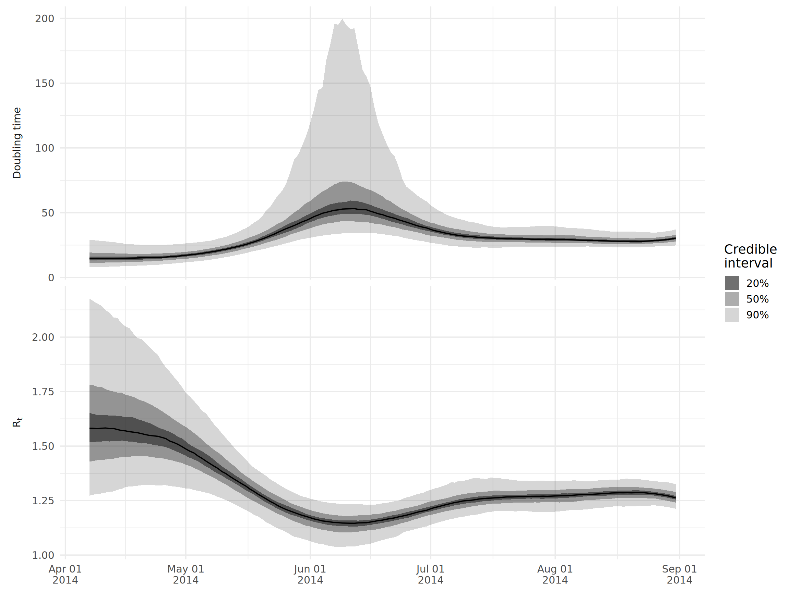
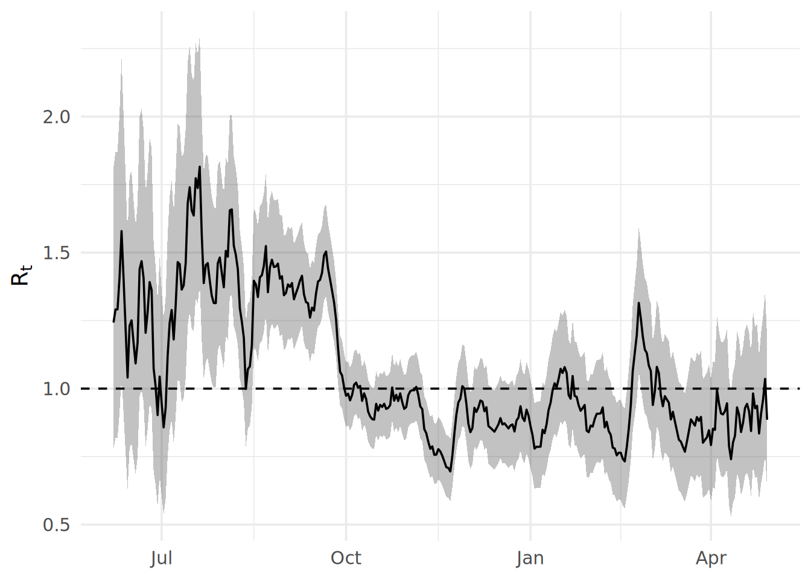
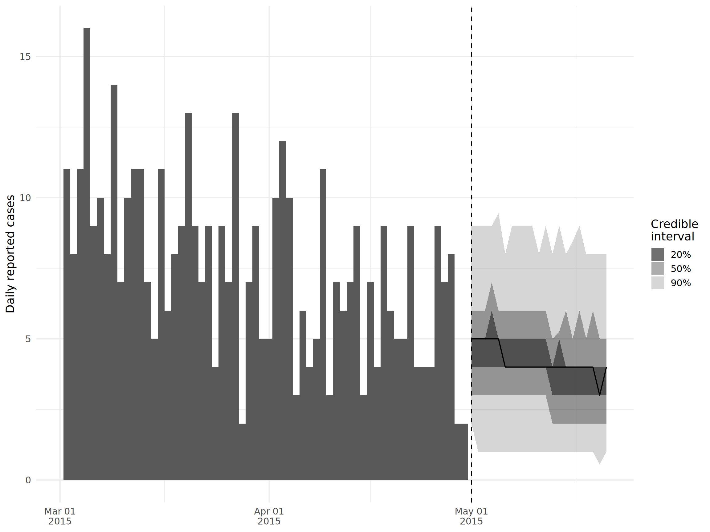
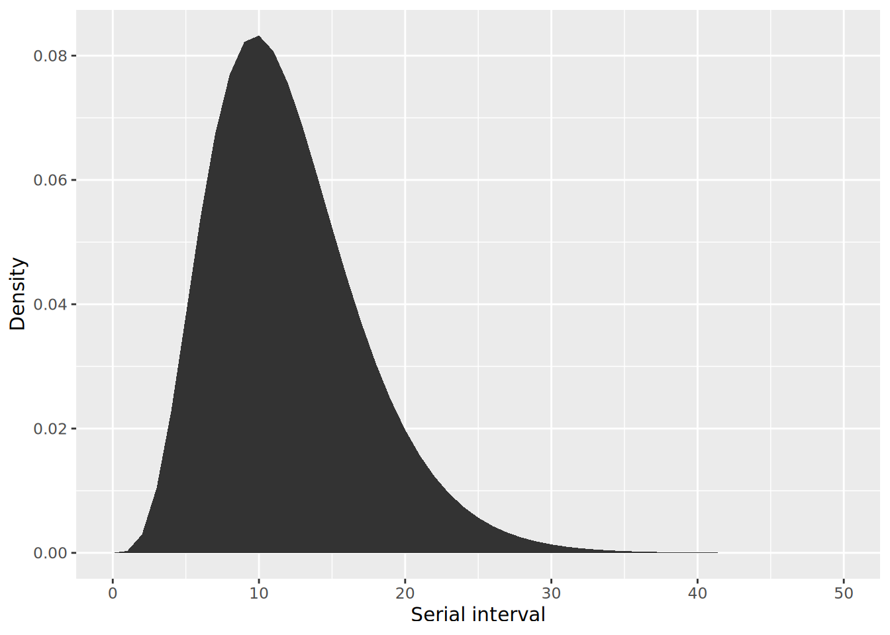
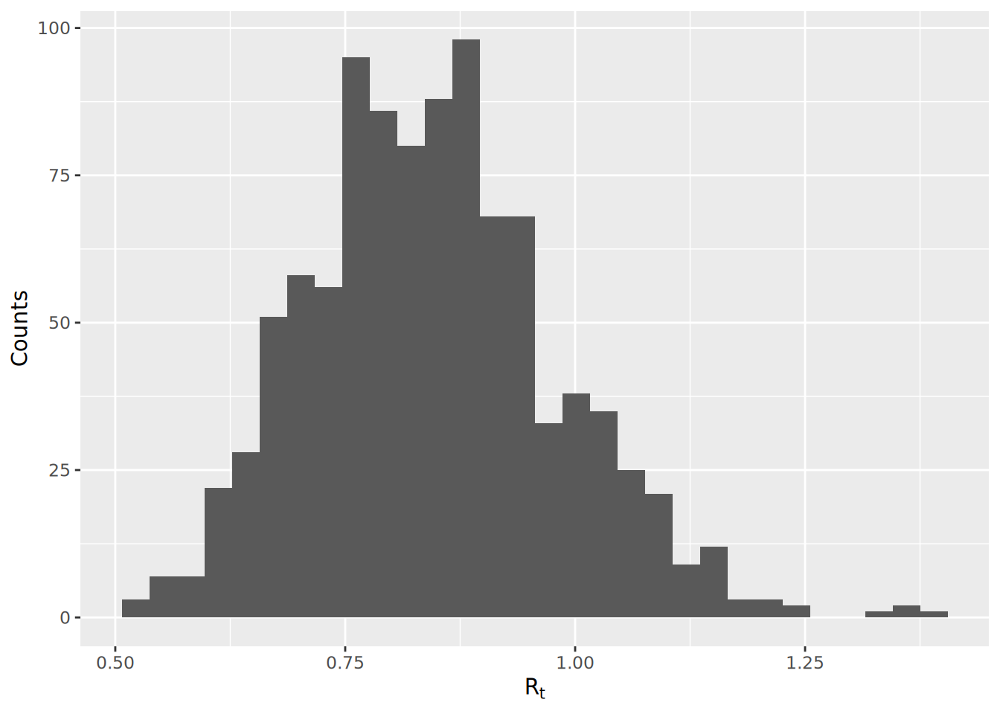
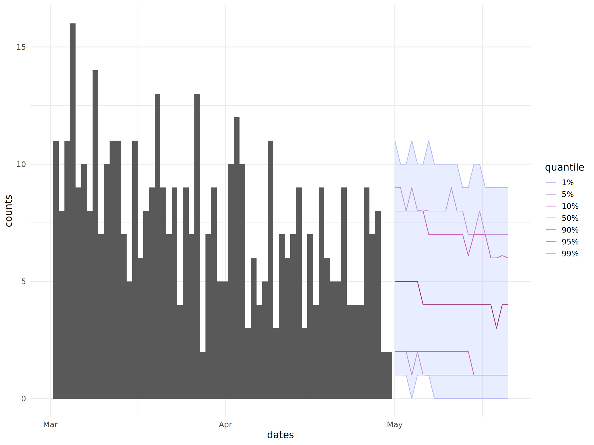

# 24  エピデミックモデリング

## 24.1 概要

流行のモデリングのためのツールが増加してきており、最小の労力でかなり複雑な分析を行うことができるようになっています。このセクションでは、これらのツールをどのように使用するかについての概要を説明します：

- 実効再生産数（effective reproduction number）R_(t) や倍化時間（doubling time）などに関連する統計量を推定する
- 将来のインシデンスの短期的な予測（プロジェクション）を実施する

ここではこれらの基礎となっている方法論や統計学的な手法の概要を説明する意図は*ありません*ので、関連論文へのリンクについては Resources tab を参照してください。ここで説明するツールを使用する前に、手法を理解しておくことで、正確に結果を解釈できるようになります。

以下はこのセクションで作成するアウトプットの１つの例です。

[](epidemic_models_files/figure-html/unnamed-chunk-1-1.png)

## 24.2 準備

R_(t) の推定には **EpiNow** パッケージと **EpiEstim** パッケージという2つの異なる手法を使用し、症例（ケース）の発生数の予測には **projections** パッケージを用います。以下のコードチャンクは、（本章の）分析に必要なパッケージのローディングを示しています。

以下のコードを実行すると、分析に必要なパッケージが読み込まれます。このハンドブックでは、パッケージを読み込むために、pacman パッケージの p_load() を主に使用しています。p_load() は、必要に応じてパッケージをインストールし、現在の R セッションで使用するためにパッケージを読み込む関数です。また、すでにインストールされたパッケージは、R の基本パッケージである base （以下、base R）の library() を使用して読み込むこともできます。R のパッケージに関する詳細は [R の基礎](basics.llms.md) の章をご覧ください。

``` r
pacman::p_load(
   rio,          # ファイルをインポート
   here,         # ファイルロケーター
   tidyverse,    # データマネジメント + ggplot2 のグラフィックス
   epicontacts,  # トランスミッションネットワークの分析
   EpiNow2,      # Rt 推定
   EpiEstim,     # Rt 推定
   projections,  # 発生数のプロジェクション
   incidence2,   # 発生データの取り扱い
   incidence,    # プロジェクションのための incidence オブジェクト
   epitrix,      # 便利な epi の機能
   distcrete     # 離散的な遅れの分布
)
```

エボラ出血熱の流行をシミュレートしたデータセットをインポートします。お手元の環境でこの章の内容を実行したい方は、 [クリック](https://github.com/appliedepi/epirhandbook/raw/main/data/case_linelists/linelist_cleaned.rds)して「前処理された」ラインリスト（linelist）データをダウンロードしてください\>（.rds 形式で取得できます）。データは *rio* パッケージの import() を利用してインポートしましょう（*rio* パッケージは、.xlsx、.csv、.rds など様々な種類のファイルを取り扱うことができます。詳細は、[インポートとエクスポート](importing.llms.md) の章をご覧ください）。

``` r
# クリーンなラインリストの取り込み
linelist <- import("linelist_cleaned.rds")
```

## 24.3 R_(t) の推定

### EpiNow2 vs. EpiEstim

再生産数 R は、疾病の感染性を示す指標であり、感染者 1 人あたりの二次感染者数の期待値として定義されます。感受性保持者しかいないような集団では、この値は基本再生産数 R₀ を意味します。しかし、集団内の感受性保持者はアウトブレイクやパンデミックの期間中に変化し、また様々な対策が講じられるため、感染性の指標として最も一般的に使用されるのは実効再生産数です（ある時刻 *t* における感染者1人あたりの二次感染者数の期待値）。

**EpiNow2** パッケージは最も洗練された R_(t) 推定のためのフレームワークを提供しています。ほかに一般的に使用されている **EpiEstim** パッケージと比較して、2つの重要な利点があります：

- 報告の遅れを考慮しているので、直近のデータが不完全の場合であっても R_(t) を推定することができます。

- 報告日ではなく、*感染日*に基づいて R_(t) を推定するので、遅れを生じずすぐに R_(t) の変化として介入の効果が反映されま。

しかし、2つの重要なデメリットもあります：

- 世代時間の分布（一次感染者から二次感染者までの遅れの分布）、潜伏期間の分布（感染から症状発現までの遅れの分布）、およびデータに関連するその他の遅れの分布（例えば、報告の日付がある場合、症状発現から報告までの遅れの分布）に関する知識が必要です。これにより、より正確な R_(t) を推定できますが、**EpiEstim** パッケージは発症間隔発症間隔（一次感染者の症状発現から二次感染者の症状発現までの遅れの分布）のみを必要とし、これのみが唯一利用可能な分布である場合があります。
- **EpiNow2** パッケージは **EpiEstim** パッケージに比べて著しく遅く、約100～1000倍の差があるといわれています！例えば、このセクションで利用するサンプルアウトブレイクにおける R_(t) 推定には、約4時間かかります（これは高い精度を確保するために多数の反復処理を行ったためであり、必要に応じて短縮することも可能ですが、アルゴリズムが一般的に遅いという点は変わりません）。定期的に R_(t) の推定値を更新している場合は、この方法は現実的ではないかもしれません。

そのため、どのパッケージを選ぶかは、利用できるデータや時間、計算資源によります。

### EpiNow2

#### 遅れの分布の推定

**EpiNow2** パッケージの実行に必要な遅れの分布は、手持ちのデータによって異なります。基本的には、感染日から R_(t) 推定に使用したいイベント日までの遅れを記述できるものである必要があります。もし発症日を使っている場合、これは単に潜伏期間の分布となります。報告日を使用している場合は、感染から報告までの遅れの分布が必要です。この分布はなかなか直接知ることができないため、**EpiNow2** パッケージでは複数の遅れの分布をつなぎ合わせることができます。この場合、感染から症状発現までの遅れ（例えば潜伏期間、これは既知であることが多いです）と、症状発現から報告までの遅れ（これは自分でデータから推定できる場合が多いです）です。

例のラインリストではすべての症例について発症日がわかっているので、データ（例えば症状の発現日など）を感染日に結びつけるためには、潜伏期間の分布が必要になります。この分布は、データから推定するか、既存文献から値を引用することができます。

エボラ出血熱の潜伏期間を平均9.1日、標準偏差7.3日、最大値を30日とする文献からの推定値（[引用論文](https://www.nejm.org/doi/full/10.1056/nejmoa1411100)）は、以下のように規定されます：

``` r
incubation_period_lit <- LogNormal(
  mean = 9.1,
  sd = 7.3,
  max = 30
)
```

`LogNormal()` は、平均と標準偏差を日数の自然スケールで受け取り、対数スケールへの変換は関数自身が行います。`max` パラメータは、分布を 30 日で打ち切ります。

今回のｂ分析ではその代わりに、`bootstrapped_dist_fit()` を用いて、ラインリストから潜伏期間の分布を推定しました。

``` r
## 潜伏期間の推定
incubation_period <- bootstrapped_dist_fit(
  linelist$date_onset - linelist$date_infection,
  dist = "lognormal",
  max_value = 100,
  bootstraps = 1
)
```

もう一つ必要な分布は、世代時間です。感染時刻**と**感染伝播のリンクに関するデータがあるので、感染者と被感染者のペアの感染時刻の遅れを計算することで、ラインリストからこの分布を推定することができます。これには **epicontacts** パッケージにある便利な `get_pairwise()` を使います。この関数を使うと、感染ペア間のラインリスト上の2組の特性の違いを計算することができます。epicontacts オブジェクトを作成します（詳しくは [感染連鎖の図式化](transmission_chains.llms.md) の章を参照してください）：

``` r
## コンタクトの作成
contacts <- linelist %>%
  transmute(
    from = infector,
    to = case_id
  ) %>%
  drop_na()

## epicontacts オブジェクトの作成
epic <- make_epicontacts(
  linelist = linelist,
  contacts = contacts, 
  directed = TRUE
)
```

次に、`get_pairwise` で計算した感染ペア間の感染時刻の差をガンマ分布にあてはめました：

``` r
## ガンマ分布に従う世代時間の推定
generation_time <- bootstrapped_dist_fit(
  get_pairwise(epic, "date_infection"),
  dist = "gamma",
  max_value = 20,
  bootstraps = 1
)
```

#### **EpiNow2** パッケージの実行

あとはラインリストから日々のインシデンスを計算するだけですが、**dplyr** パッケージの `group_by()` と `n()` で簡単にできます。**EpiNow2** パッケージでは、列名が `date` と `confirm` でなければならないことに注意してください。**EpiNow2** パッケージは、日付の欠損があるとエラーで停止するため、発症日のないケースを除きます。日付の間に抜けがあると、**EpiNow2** 1.9.0 はこのデータでエラーで停止しました。そのため、`fill_missing()` でケースのない日をカウント 0 で追加します。

``` r
## 発症日からインシデンスを得る
cases <- linelist %>%
  filter(!is.na(date_onset)) %>%
  group_by(date = date_onset) %>%
  summarise(confirm = n()) %>%
  ## ケースのない日を、カウント 0 で追加
  fill_missing(missing_dates = "zero")
```

そして、`epinow()` を使って R_(t) を推定することができます。入力に関して、いくつかの注意点を挙げます：

- `generation_time` 引数には、`gt_opts()` 内で世代時間の分布を与えます。
- `delays` の引数には、任意の数の「連鎖した」遅れの分布を与えることができます。`delay_opts()` 内で `incubation_period` オブジェクトに `+` で足すだけです。
- `forecast_opts()` 内の `horizon` は、将来のインシデンスを何日分予測するかを示します。
- `stan` の因数に追加のオプションを渡して、推定を実行する期間を指定します。`samples` 数と `chains` 数を増やすと、不確実性の特徴をよく表したより正確な推定値が得られますが、実行には時間がかかります。

``` r
## epinow を走らせる
epinow_res <- epinow(
  data = cases,
  generation_time = gt_opts(generation_time),
  delays = delay_opts(incubation_period),
  forecast = forecast_opts(horizon = 21),
  stan = stan_opts(samples = 750, chains = 4)
)
```

#### アウトプットの分析

このページでは当てはめ（フィット）を実行しません。以下の結果は、**appliedepidata** パッケージに保存された当てはめ結果から得たものです。この当てはめは、**EpiNow2** パッケージの以前のバージョンで行われました。上記のコードは、**EpiNow2** 1.9 で同様の当てはめを行う方法です。

**EpiNow2** 1.9 による当てはめ結果では、`plot()` がサマリーの図を描き、`summary()` がサマリーテーブルを返します。保存された当てはめ結果に対しては、これらの関数はエラーで停止します。そのため、保存された当てはめ結果のテーブルを読み込み、**ggplot2** パッケージでプロットします：

``` r
## 保存された推定値と、当てはめに使ったケース数をロード
estimates <- appliedepidata::get_data(name = "epidemic_models_summarised_estimates")
observations <- appliedepidata::get_data(name = "epidemic_models_reported_cases")

## サマリーフィギュアのプロット
ggplot(
  data = filter(estimates, variable %in% c("R", "reported_cases")),
  aes(x = date)
) +
  ## 観測されたケース数（報告ケースのパネルのみ）
  geom_col(
    data = mutate(observations, variable = "reported_cases"),
    aes(y = confirm),
    fill = "grey70",
    width = 1
  ) +
  ## 90% 信用区間と中央値（推定値の種類ごとに色分け）
  geom_ribbon(aes(ymin = lower_90, ymax = upper_90, fill = type), alpha = 0.3) +
  geom_line(aes(y = median, colour = type)) +
  ## label_parsedを使用して、添え字ラベルを許可する
  facet_wrap(
    ~ variable,
    ncol = 1,
    scales = "free_y",
    labeller = as_labeller(c("R" = "R[t]", "reported_cases" = "Reported~cases"), label_parsed),
    strip.position = 'left'
  ) +
  labs(x = NULL, y = NULL, colour = NULL, fill = NULL) +
  theme_minimal(base_size = 14) +
  theme(
    strip.background = element_blank(),
    strip.placement = 'outside',
    legend.position = 'bottom'
  )
```

[](epidemic_models_files/figure-html/unnamed-chunk-4-1.png)

また、様々なサマリー統計量を見ることもできます：

``` r
## 保存された当てはめ結果のサマリーテーブル
summary_table <- appliedepidata::get_data(name = "epidemic_models_summary")
summary_table[, c("measure", "estimate")]
```

                                    measure                  estimate
    1 New confirmed cases by infection date                4 (2 -- 6)
    2        Expected change in daily cases                    Unsure
    3            Effective reproduction no.        0.88 (0.73 -- 1.1)
    4                        Rate of growth -0.012 (-0.028 -- 0.0052)
    5          Doubling/halving time (days)          -60 (130 -- -25)

さらなる分析やカスタムプロットのために、**EpiNow2** 1.9 による当てはめ結果では `summary(epinow_res, type = "parameters")` で要約された毎日の推定値にアクセスすることができます。これをデフォルトの `data.table` から、**dplyr** パッケージで使いやすいように `tibble` に変換します。以下のテーブルは、保存された当てはめ結果の同じ推定値を示しています。

``` r
## サマリーを抽出して、tibble に変換
estimates <- as_tibble(summary(epinow_res, type = "parameters"))
estimates
```

例として、倍化時間と R_(t) をプロットしてみましょう。極端に高い倍化時間をプロットしないように、R_(t) が1を大きく上回っている流行の最初の数か月だけを見ています。

`log(2)/growth_rate` という計算式を用いて、推定された成長率（growth rate）から倍化時間を算出しています。

``` r
## 中央値プロットのために横型のデータフレームを作ります
df_wide <- estimates %>%
  filter(
    variable %in% c("growth_rate", "R"),
    date < as.Date("2014-09-01")
  ) %>%
  ## 成長率を倍化時間に変換
  mutate(
    across(
      c(median, lower_90:upper_90),
      ~ case_when(
        variable == "growth_rate" ~ log(2)/.x,
        TRUE ~ .x
      )
    ),
    ## 変形を反映した変数名の変更
    variable = replace(variable, variable == "growth_rate", "doubling_time")
  )

## 分位値プロットのために縦長のデータフレームを作る
df_long <- df_wide %>%
  ## ここでは、マッチした分位値を利用します（例：lower_90 から upper_90）
  pivot_longer(
    lower_90:upper_90,
    names_to = c(".value", "quantile"),
    names_pattern = "(.+)_(.+)"
  )

## プロットする
ggplot() +
  geom_ribbon(
    data = df_long,
    aes(x = date, ymin = lower, ymax = upper, alpha = quantile),
    color = NA
  ) +
  geom_line(
    data = df_wide,
    aes(x = date, y = median)
  ) +
  ## label_parsedを使用して、添え字ラベルを許可する
  facet_wrap(
    ~ variable,
    ncol = 1,
    scales = "free_y",
    labeller = as_labeller(c(R = "R[t]", doubling_time = "Doubling~time"), label_parsed),
    strip.position = 'left'
  ) +
  ## 分位値の透明度を手動で定義する
  scale_alpha_manual(
    values = c(`20` = 0.7, `50` = 0.4, `90` = 0.2),
    labels = function(x) paste0(x, "%")
  ) +
  labs(
    x = NULL,
    y = NULL,
    alpha = "Credible\ninterval"
  ) +
  scale_x_date(
    date_breaks = "1 month",
    date_labels = "%b %d\n%Y"
  ) +
  theme_minimal(base_size = 14) +
  theme(
    strip.background = element_blank(),
    strip.placement = 'outside'
  )
```

[](epidemic_models_files/figure-html/epidemic_models_plot_epinow_cusotom-1.png)

### EpiEstim

**EpiEstim** パッケージを走らせるために、日々のインシデンスのデータを提供し、発症間隔（一次症例と二次症例の症状発現までの遅れの分布）を指定する必要があります。

インシデンスデータは、ベクトル、データフレーム、またはオリジナルの **incidence** パッケージから得られた `incidence` オブジェクトとして、**EpiEstim** パッケージに提供できます。輸入感染例とローカルで感染した例を区別することもできます：詳細は `?estimate_R` のドキュメントを参照してください。

ここでは **incidence2** パッケージを使って、インプットを作成します。**incidence2** パッケージの例については [流行曲線（エピカーブ）](epicurves.llms.md) の章を参照してください。**incidence2** パッケージには `estimate_R()` が期待するインプットとは完全に一致しないアップデートがあったため、いくつかの小さな追加手順が必要となります。incidence オブジェクトは日付とそれぞれのケースカウントをもつ tibble で構成されています。**tidyr** パッケージの `complete()` を使用して、すべての日付が含まれていることを確認し（症例がない日も含む）、後のステップで `estimate_R()` で期待されるものと一致するように列を `rename()` します。

``` r
## 発症日からインシデンスを得る
cases <- incidence2::incidence(linelist, date_index = "date_onset") %>% # 日ごとにケースカウントを得る
  tidyr::complete(date_index = seq.Date(                              # すべての日付が表示されていることを確認
    from = min(date_index, na.rm = T),
    to = max(date_index, na.rm=T),
    by = "day"),
    fill = list(count = 0)) %>%                                       # NA カウントを0に変換する
  rename(I = count,                                                   # estimate_R()で期待されるな目に変更
         dates = date_index)
```

このパッケージにはは発症間隔を指定するためのいくつかのオプションがあり、その詳細はドキュメントの `?estimate_R` に記載されています。ここではそのうちの2つを取り上げます。

#### 文献から引用した発症間隔の推定値の使用

オプションの `method = "parametric_si"` を使用すると、 `make_config()` で作成した `config` オブジェクトに発症間隔の平均値と標準偏差を手動で指定することができます。ここでは、[この論文](https://bmcmedicine.biomedcentral.com/articles/10.1186/s12916-014-0196-0)で定義されている平均値12.0、標準偏差5.2を使用しています。

デフォルトでは、`estimate_R()` はデータの 2 日目から始まる 1 週間のスライディングウィンドウを使います。**EpiEstim** パッケージは、非常に少ないケースから推定した R_(t) は信頼できないと警告します。デフォルトの設定では、1 つの時間枠に少なくとも 11 ケースが必要です。このアウトブレイクの最初の数週間は、それより少ないケースしかありません。そこで、ケース数が 11 以上の最初の 7 日間の時間枠から週単位の時間枠を始め、以下の 2 つの推定の両方でこの時間枠を使います：

``` r
## 日ごとのケース数（1 日 1 行）
daily_cases <- cases$I

## 各日から始まる 7 日間の時間枠のケース数
window_cases <- sapply(
  seq_len(length(daily_cases) - 6),
  function(t) sum(daily_cases[t:(t + 6)])
)

## ケース数が 11 以上の最初の時間枠から始まる、1 週間のスライディングウィンドウ
weekly_start <- max(2, which(window_cases >= 11)[1]):(length(daily_cases) - 6)
weekly_end <- weekly_start + 6

## config の作成
config_lit <- make_config(
  mean_si = 12.0,
  std_si = 5.2,
  t_start = weekly_start,
  t_end = weekly_end
)
```

そして、`estimate_R()` で R_(t) の推定をすることができます：

``` r
cases <- cases %>% 
     filter(!is.na(dates))


#create a dataframe for the function estimate_R()
cases_incidence <- data.frame(dates = seq.Date(from = min(cases$dates),
                               to = max(cases$dates), 
                               by = 1))

cases_incidence <- left_join(cases_incidence, cases, by = "dates") %>% 
     select(dates, I) %>% 
     mutate(I = ifelse(is.na(I), 0, I))

epiestim_res_lit <- estimate_R(
  incid = cases_incidence,
  method = "parametric_si",
  config = config_lit
)
```

あとは R_(t) の推定値をプロットします。**EpiEstim** パッケージの `plot()` は **ggplot2** パッケージの非推奨（deprecation）警告を出すため、**ggplot2** で推定値をプロットする短い関数を書きます。この関数は、各推定値の日付をその時間枠（ウィンドウ）の最終日とします：

``` r
## R の平均推定値とその 95% 信用区間をプロットする
plot_rt <- function(res) {
  res$R %>%
    ## 推定値のない時間枠（ウィンドウ）を除く
    filter(!is.na(`Mean(R)`)) %>%
    ## 各推定値の日付を、その時間枠（ウィンドウ）の最終日とする
    mutate(date = res$dates[t_end]) %>%
    ggplot(aes(x = date)) +
    geom_ribbon(aes(ymin = `Quantile.0.025(R)`, ymax = `Quantile.0.975(R)`), alpha = 0.3) +
    geom_line(aes(y = `Mean(R)`)) +
    geom_hline(yintercept = 1, linetype = 2) +
    labs(x = NULL, y = expression(R[t])) +
    theme_minimal(base_size = 14)
}

plot_rt(epiestim_res_lit)
```

[](epidemic_models_files/figure-html/epidemic_models_epiestim_lit_plot-1.png)

#### データから推定した発症間隔の推定値の使用

症状の発症日と感染伝播のリンクデータがあるので、感染者と被感染者のペアの発症日の遅れを計算することで、ラインリストから発症間隔を推定することもできます。**EpiNow2** パッケージのセクションで行ったように、**epicontacts** パッケージの `get_pairwise()` を使います。この関数は感染ペア間のラインリスト上の2組の特性の違いを計算することができます。まず epicontacts オブジェクトを作成します（詳細は [感染連鎖の図式化](transmission_chains.llms.md) の章を参照）：

``` r
## コンタクトの作成
contacts <- linelist %>%
  transmute(
    from = infector,
    to = case_id
  ) %>%
  drop_na()

## epicontacts オブジェクトの作成
epic <- make_epicontacts(
  linelist = linelist,
  contacts = contacts, 
  directed = TRUE
)
```

次に、`get_pairwise()` を用いて感染ペア間の発症日の差をガンマ分布に当てはめます。*離散化された*分布が必要とされるため、このフィッティング手順には **epitrix** パッケージの便利な `fit_disc_gamma()` を使用します。

``` r
## ガンマ分布に従う発症間隔の推定（発症日のないペアを除く）
serial_interval <- fit_disc_gamma(na.omit(get_pairwise(epic, "date_onset")))
```

その後に、`config` オブジェクトに情報を与え、 **EpiEstim** を再実行して結果を描画しましょう。

``` r
## config の作成
config_emp <- make_config(
  mean_si = serial_interval$mu,
  std_si = serial_interval$sd,
  t_start = weekly_start,
  t_end = weekly_end
)

## epiestim を走らせる
epiestim_res_emp <- estimate_R(
  incid = cases_incidence,
  method = "parametric_si",
  config = config_emp
)

## アウトプットをプロットする
plot_rt(epiestim_res_emp)
```

[](epidemic_models_files/figure-html/epidemic_models_epiestim_emp-1.png)

#### 推定時間枠（ウィンドウ）の設定

時間枠（ウィンドウ）の開始は自分で選ぶこともできます。たとえば、以下に示すように、2014 年 6 月 1 日以降についてのみ R_(t) を推定できます。残念ながら、**EpiEstim** パッケージはこれらの推定時間を指定するのに非常に面倒な方法しか提供しておらず、そのためには各時間ウィンドウの開始日と終了日を参照する整数のベクトルを提供しなければなりません。

``` r
## 6月1日から始まる日付のベクトルを定義する
start_dates <- seq.Date(
  as.Date("2014-06-01"),
  max(cases$dates) - 7,
  by = 1
) %>%
  ## 数字型に変換するために開始日を引く
  `-`(min(cases$dates)) %>%
  ## convert to integer
  as.integer() %>%
  ## インシデンスデータの 1 日目が最初の日付なので、1 を足す
  `+`(1L)

## 1週間の平滑化ウィンドウに6日分を追加する
end_dates <- start_dates + 6
  
## config を作成する
config_partial <- make_config(
  mean_si = 12.0,
  std_si = 5.2,
  t_start = start_dates,
  t_end = end_dates
)
```

ここで、**EpiEstim** を再び実行してみると、推定値は6月からしか出ないことがわかります：

``` r
## epiestim を走らせる
epiestim_res_partial <- estimate_R(
  incid = cases_incidence,
  method = "parametric_si",
  config = config_partial
)

## アウトプットをプロットする
plot_rt(epiestim_res_partial)
```

[](epidemic_models_files/figure-html/epidemic_models_epiestim_config_late_run-1.png)

#### アウトプットの分析

主なアウトプットは `$R` でアクセスできます。R_(t) のプロットと R_(t) とその日に報告された症例数で与えられた「伝播能力」の指標を作成します（これは次世代の感染者数の期待値として表されます）。

``` r
## 中央値のために横型のデータフレームを作成します
df_wide <- epiestim_res_lit$R %>%
  rename_all(clean_labels) %>%
  rename(
    lower_95_r = quantile_0_025_r,
    lower_90_r = quantile_0_05_r,
    lower_50_r = quantile_0_25_r,
    upper_50_r = quantile_0_75_r,
    upper_90_r = quantile_0_95_r,
    upper_95_r = quantile_0_975_r,
    ) %>%
  ## 推定値のない時間枠（ウィンドウ）を除く
  filter(!is.na(mean_r)) %>%
  mutate(
    ## t_startからt_endまでの日付の中央値を抽出する
    dates = epiestim_res_emp$dates[round(map2_dbl(t_start, t_end, median))],
    var = "R[t]"
  ) %>%
  ## 日々の発生データを統合する
  left_join(cases, "dates") %>%
  ## すべてのr推定値のリスクを計算する
  mutate(
    across(
      lower_95_r:upper_95_r,
      ~ .x*I,
      .names = "{str_replace(.col, '_r', '_risk')}"
    )
  ) %>%
  ## r推定値とリスク推定値を分離する
  pivot_longer(
    contains("median"),
    names_to = c(".value", "variable"),
    names_pattern = "(.+)_(.+)"
  ) %>%
  ## 因子（ファクタ）のレベルを割り当てる
  mutate(variable = factor(variable, c("risk", "r")))

## クォンタイル（分位値）から縦型のデータフレームを作成する
df_long <- df_wide %>%
  select(-variable, -median) %>%
  ## r/riskの推定値と分位値を分離する
  pivot_longer(
    contains(c("lower", "upper")),
    names_to = c(".value", "quantile", "variable"),
    names_pattern = "(.+)_(.+)_(.+)"
  ) %>%
  mutate(variable = factor(variable, c("risk", "r")))

## プロットを作成する
ggplot() +
  geom_ribbon(
    data = df_long,
    aes(x = dates, ymin = lower, ymax = upper, alpha = quantile),
    color = NA
  ) +
  geom_line(
    data = df_wide,
    aes(x = dates, y = median),
    alpha = 0.2
  ) +
  ## label_parsed を使用して、添え字ラベルをつける
  facet_wrap(
    ~ variable,
    ncol = 1,
    scales = "free_y",
    labeller = as_labeller(c(r = "R[t]", risk = "Transmission~potential"), label_parsed),
    strip.position = 'left'
  ) +
  ## 分位値の透明度を手動で定義する
  scale_alpha_manual(
    values = c(`50` = 0.7, `90` = 0.4, `95` = 0.2),
    labels = function(x) paste0(x, "%")
  ) +
  labs(
    x = NULL,
    y = NULL,
    alpha = "Credible\ninterval"
  ) +
  scale_x_date(
    date_breaks = "1 month",
    date_labels = "%b %d\n%Y"
  ) +
  theme_minimal(base_size = 14) +
  theme(
    strip.background = element_blank(),
    strip.placement = 'outside'
  )
```

[](epidemic_models_files/figure-html/epidemic_models_epiestim_plot_full-1.png)

## 24.4 インシデンス（発生数）の予測（プロジェクション）

### EpiNow2

R_(t) の推定に加えて、**EpiNow2** パッケージは R_(t) のプロジェクションや症例数のプロジェクションもサポートします。必要なのは、`epinow()` の呼び出しで `forecast` 引数に `forecast_opts(horizon = 21)` を与えることだけです。`horizon` は、何日先までプロジェクションしたいかを示します。このセクションでは、保存された当てはめ結果のプロジェクションをプロットします。

``` r
## プロットの一番小さい日付を設定する
min_date <- as.Date("2015-03-01")

## 保存された当てはめ結果の推定値のサマリーをロード
estimates <- as_tibble(appliedepidata::get_data(name = "epidemic_models_summarised_estimates"))

## 保存された当てはめ結果が使ったケース数をロード
observations <- as_tibble(appliedepidata::get_data(name = "epidemic_models_reported_cases")) %>%
  filter(date > min_date)

## 症例数の予測値を抽出する
df_wide <- estimates %>%
  filter(
    variable == "reported_cases",
    type == "forecast",
    date > min_date
  )

## 分位値プロットのためにさらに横型のフォーマットに変換する
df_long <- df_wide %>%
  ## ここで、分位値を一致させる（たとえば lower_90 から upper_90）
  pivot_longer(
    lower_90:upper_90,
    names_to = c(".value", "quantile"),
    names_pattern = "(.+)_(.+)"
  )

## プロットする
ggplot() +
  geom_col(
    data = observations,
    aes(x = date, y = confirm),
    width = 1
  ) +
  geom_ribbon(
    data = df_long,
    aes(x = date, ymin = lower, ymax = upper, alpha = quantile),
    color = NA
  ) +
  geom_line(
    data = df_wide,
    aes(x = date, y = median)
  ) +
  geom_vline(xintercept = min(df_long$date), linetype = 2) +
  ## 分位値の透明度を手動で定義する
  scale_alpha_manual(
    values = c(`20` = 0.7, `50` = 0.4, `90` = 0.2),
    labels = function(x) paste0(x, "%")
  ) +
  labs(
    x = NULL,
    y = "Daily reported cases",
    alpha = "Credible\ninterval"
  ) +
  scale_x_date(
    date_breaks = "1 month",
    date_labels = "%b %d\n%Y"
  ) +
  theme_minimal(base_size = 14)
```

[](epidemic_models_files/figure-html/epidemic_models_episoon-1.png)

### 予測（プロジェクション）

RECON が開発した **projections** パッケージでは、実効再生産数 R_(t) と発症間隔の知識だけで非常に簡単に短期的なインシデンスの予測を行うことができます。ここでは、文献から得られた発症間隔の推定値を使用する方法と、ラインリストから得られた独自の推定値を使用する方法について説明します。

#### 文献での発症間隔の推定値を利用

**projections** パッケージには、**distcrete** パッケージに含まれる `distcrete` クラスの離散化された発症間隔の分布が必要です。ここでは、[この論文](https://bmcmedicine.biomedcentral.com/articles/10.1186/s12916-014-0196-0) で定義された平均12.0、標準偏差5.2のガンマ分布を使用します。これらの値をガンマ分布に必要な shape（形状）および scale（尺度）パラメータに変換するために、**epitrix** パッケージの `gamma_mucv2shapescale()` を使用します。

``` r
## 変動係数から形状と尺度パラメータを得ることができます
##（例：平均値に対する標準偏差の比）
shapescale <- epitrix::gamma_mucv2shapescale(mu = 12.0, cv = 5.2/12)

## distcrete オブジェクトを作成する
serial_interval_lit <- distcrete::distcrete(
  name = "gamma",
  interval = 1,
  shape = shapescale$shape,
  scale = shapescale$scale
)
```

ここでは、発症間隔が正しいことを確認するために簡単なチェックを行います。先ほど定義したガンマ分布の確率密度に `$d` でアクセスしますが、これは `dgamma` を呼び出した時と同じです。

``` r
## 発症間隔が正しいことを確認する
ggplot(
  data = tibble(x = 0:50, y = serial_interval_lit$d(0:50)),
  aes(x = x, y = y)
) +
  geom_area() +
  labs(x = "Serial interval", y = "Density")
```

[](epidemic_models_files/figure-html/epidemic_models_projections_distcrete_plot-1.png)

#### データによる発症間隔の推定値を利用

我々は症状の発症日と感染リンク（transmission links）のデータがあるので、感染者と被感染者のペアの発症日の遅れを計算することで、ラインリストから発症間隔を推定することもできます。**EpiNow2** のセクションで行ったように、**epicontacts** パッケージの `get_pairwise()` を用います。この関数によって、感染ペア（transmission pairs）間のラインリスト上の2組の特性の違いを計算することができます。まず epicontacts オブジェクトを作成します（[感染連鎖の図式化](transmission_chains.llms.md) の章を参照）：

``` r
## コンタクトの作成
contacts <- linelist %>%
  transmute(
    from = infector,
    to = case_id
  ) %>%
  drop_na()

## epicontacts オブジェクトの作成
epic <- make_epicontacts(
  linelist = linelist,
  contacts = contacts, 
  directed = TRUE
)
```

次に、`get_pairwise()` を用いて、計算した感染ペアの発症日の差をガンマ分布にあてはめます。*離散化された*分布が必要なため、この適合（fitting）手順には **epitrix** パッケージの便利な `fit_disc_gamma()` を使います。

``` r
## ガンマ分布に従う発症間隔の推定（発症日のないペアを除く）
serial_interval <- fit_disc_gamma(na.omit(get_pairwise(epic, "date_onset")))

## 推定値
serial_interval[c("mu", "sd")]
```

    $mu
    [1] 11.51047

    $sd
    [1] 7.696056

#### 発生数（インシデンス）の予測（プロジェクション）

将来のインシデンスをプロジェクションするためには、過去の発生数を `incidence` オブジェクトの形で値供することに加えて、妥当な R_(t) 値のサンプルを与える必要があります。前のセクション（R_(t)推定）で **EpiEstim** によって作成され、`epiestim_res_emp` オブジェクトに格納された R_(t) の推定値を使用して、インシデンスの予測値を作成します。以下のコードでは、アウトブレイクの最後の時間ウィンドウの R_(t) の平均値と標準偏差の推定値を抜き出し（ベクトルの最後の要素にアクセスするために `tail()` を使用）、`rgamma()`を使用してガンマ関数から10000の値をシミュレーションします。また、事前予測に使用したいR_(t) 値の独自のベクトルを提供することもできます。

``` r
## 発症日から incidence オブジェクトを作成（発症日のないケースを除く）
inc <- incidence::incidence(na.omit(linelist$date_onset))

## 最新の推定値から妥当な r 値を抽出する
mean_r <- tail(epiestim_res_emp$R$`Mean(R)`, 1)
sd_r <- tail(epiestim_res_emp$R$`Std(R)`, 1)
shapescale <- gamma_mucv2shapescale(mu = mean_r, cv = sd_r/mean_r)
plausible_r <- rgamma(1000, shape = shapescale$shape, scale = shapescale$scale)

## 分布をチェック
ggplot(data = tibble(r = plausible_r), aes(x = r)) +
  geom_histogram(bins = 30) +
  labs(x = expression(R[t]), y = "Counts")
```

[](epidemic_models_files/figure-html/epidemic_models_projection_setup-1.png)

そして、`project()` を使って、実際の予測を行います。`n_days` 引数で何日間プロジェクションするかを指定し、`n_sim` 引数でシミュレーション回数を指定します。

``` r
## プロジェクションの作成
proj <- project(
  x = inc,
  R = plausible_r,
  si = serial_interval$distribution,
  n_days = 21,
  n_sim = 1000
)
```

そして、インシデンスを **ggplot2** パッケージでプロットし、`add_projections()` でプロジェクションを追加します。**incidence** パッケージの `plot()` は **ggplot2** パッケージの非推奨（deprecation）警告を出すため、使用しません。各括弧演算子（\[\]）を使用すると、`incidence`オブジェクトを簡単に分けることができ、最近のケースのみを表示することができます。

``` r
## インシデンスをプロットする
incidence_plot <- ggplot() +
  geom_col(
    data = as.data.frame(inc[inc$dates > as.Date("2015-03-01")]),
    aes(x = dates, y = counts),
    width = 1
  ) +
  theme_minimal(base_size = 14)

## プロジェクションを追加する
add_projections(incidence_plot, proj)
```

[](epidemic_models_files/figure-html/epidemic_models_plot_projection-1.png)

また、アウトプットをデータフレームに変換することで、日々の症例数の生（raw）の推定値を簡単に取り出すことができます。

``` r
## 生データをデータフレームに変換する
proj_df <- as.data.frame(proj)
proj_df
```

## 24.5 資料

- **EpiEstim** に実装されている方法論を説明した論文は[ここです](https://www.sciencedirect.com/science/article/pii/S1755436519300350)。
- **EpiNow2** に実装されている方法論を説明した論文は[ここです](https://wellcomeopenresearch.org/articles/5-112/v1)。
- R_(t) を推定するための様々な方法論と実用上の配慮すべき点を説明した論文は[ここです](https://journals.plos.org/ploscompbiol/article?id=10.1371/journal.pcbi.1008409)。
