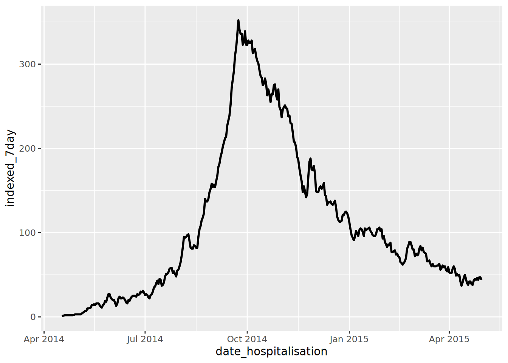

# 22  移動平均

[](../../images/moving_avg_epicurve.png)

この章では、移動平均を計算し、可視化する方法として、以下の２つを説明します:

1.  **slider** パッケージを利用した計算
2.  `ggplot()` 内のコマンドとして、**tidyquant** パッケージを利用した計算

## 22.1 準備

### パッケージをロードする

以下のコードを実行すると、分析に必要なパッケージが読み込まれます。このハンドブックでは、パッケージを読み込むために、pacman パッケージの p_load() を主に使用しています。p_load() は、必要に応じてパッケージをインストールし、現在の R セッションで使用するためにパッケージを読み込む関数です。また、すでにインストールされたパッケージは、R の基本パッケージである base （以下、base R）の library() を使用して読み込むこともできます。R のパッケージに関する詳細は [R basics](basics.llms.md) の章をご覧ください。

``` r
pacman::p_load(
  tidyverse,      # データマネージメントと可視化のため
  slider,         # 移動平均の計算のため
  tidyquant, # ggplot内の移動平均の計算のため
  appliedepidata # 本ハンドブックで使用するサンプルデータ
)
```

### データのインポート

エボラ出血熱の流行をシミュレートしたデータセットをインポートします。`appliedepidata::get_data(name = "linelist_cleaned_rds")` で直接読み込めます（詳細は[ハンドブックとデータのダウンロード](download.llms.md)のページを参照）。

``` r
# ラインリストのインポート
linelist <- appliedepidata::get_data(name = "linelist_cleaned_rds")
```

ラインリストの最初の50行を以下に表示します。

## 22.2 **slider を利用した計算**

**プロットする前にデータフレームを使って移動平均を計算するには、この方法を使用します。**

**slider** パッケージには rolling averages（移動平均）や累積和、rolling regressions（窓をずらしながら繰り返し回帰する手法）などを計算するために、いくつかの “sliding window” 関数を提供します。これはデータフレームを行（row）のベクトルとして扱い、データフレーム上の行ごとの反復計算が可能になります。

ここで、いくつかの代表的な関数を提示します：

- `slide_dbl()` - sliding window を用いた*数字型*（つまり、“\_dbl”）の列を介して行う演算処理

  - `slide_sum()` - `slide_dbl()`の rolling sum のショートカット関数
  - `slide_mean()` - `slide_dbl()`の rolling average のショートカット関数

- `slide_index_dbl()` - windows（小範囲） の進行をインデックス化するための別の列を使用し、数字型の列に rolling window を適用する（一部の日付が存在しないデータセットで、日付による rolling をする場合に便利）

  - `slide_index_sum()` - インデックスありの rolling sum のショートカット関数
  - `slide_index_mean()` - インデックスありの rolling mean のショートカット関数

**slider** パッケージはほかにも様々な関数があり、この章の Resources セクションで紹介しています。ここでは、最も一般的な機能について簡単に説明します。

**実引数**

- `.x`, デフォルトでは第1引数となります。反復処理を行い、関数を適用するベクトルを指定します。

- `.i =` **slider** 機能の “index” バージョンのために、“index” をロールするための列を用意します（[以下のセクションを参照](#roll_index)）

- `.f =`, デフォルトでは2番目の引数となり、以下のどちらかを指定します：

  - 括弧なしで書かれた関数（例えば `mean` など）
  - 関数に変換される数式。例えば、`~ .x - mean(.x)` の場合は、現在の値からウィンドウの平均値を引いた結果を返します

- さらなる詳細はこの [reference material](https://davisvaughan.github.io/slider/reference/slide.html) を参照してください。

**Window size（小範囲の大きさ）**

`.before`、`.after` のいずれか、または両方の引数を使用して、window sizeを指定してください：

- `.before =` - 整数を指定
- `.after =` - 整数を指定
- `.complete =` - 完全なwindowに対してのみの計算を行いたい場合は `TRUE` に設定してください

例えば、現在の値とその前の6日間の値を含む7日間のウィンドウを表示するためには、`.before = 6` というように使います。現在の値を中央に置いたウィンドウにするためには、`.before =` と `.after =` の両方に同じ値を指定します。

デフォルトでは、`.complete =` は FALSE となっており、完全な行のウィンドウが存在しない場合、関数は利用可能な行を使用して計算を行います。TRUE に設定すると、完全なウィンドウでのみ計算が実施されるように制限することになります。

**Window の拡張**

累積演算を行うためには、`.before =` 引数を `Inf` に設定します。これにより、現在の値とそれより前の全ての値に対して計算が行われます。

### 日付による rolling

応用疫学での rolling 計算の最も一般的な使用例は、ある指標を*時系列*でみることでしょう。例えば、毎日の症例数をもとにした発生数（incidence）の測定などです。

全ての日付に値がある時系列のデータがある場合、[Time series and outbreak detection](time_series.llms.md) の章で紹介されているように、`slide_dbl()` を使用してもよいでしょう。

しかし、応用疫学分野では、イベントが記録されていない日付が欠損していることがあります。このような場合には、**slider** パッケージの関数の “index” バージョンを使用するのがベストです。

### インデックス化されたデータ

以下では、感染者のラインリストに `slide_index_dbl()` を使った例を示します。ここでは、移動7日間発生数（7日間の window を使用したケースの合計）を計算することを目的とします。もし移動平均の例を探しているのであれば、[grouped rolling](#roll_slider_group) のセクションを参照してください。

まず、`daily_counts` というデータセットを作成し、**dplyr** パッケージの `count()` から計算された `linelist` の毎日の症例数を反映させましょう。

``` r
# デーリーカウントのデータセットを作成
daily_counts <- linelist %>% 
  count(date_hospitalisation, name = "new_cases")
```

ここに、`daily_counts` のデータフレームがあります - `nrow(daily_counts)` 行があり、各日は1行で表されていますが、*特に流行の初期には存在しない日もあります（その日に入院した症例はいませんでした）*。

`slide_dbl()` のような標準的な rolling 関数は、7*日間*ではなく7*行*のウィンドウを使用するという認識を持つことが重要です。そのため、データに入っていない日付がある場合、いくつかのウィンドウは実際には7日間よりも長くなります！

`slide_index_dbl()` を使うと、「スマート」な rolling window を実現することができます。“index” とは、この関数が rolling window の “index” として*別の列*を使うことを意味します。window は単にデータフレームの行に基づいているわけではないのです。

インデックス列が日付の場合、ウィンドウの範囲を `.before =` や `.after =` にして、**lubridate** パッケージの `days()` や `months()` の単位で指定することができます。このようにすると、関数のおかげでウィンドウに存在しない欠損日（`NA` 値として）も含まれることになります。

それでは、比較をしてみましょう。以下では、通常の7日間の rolling した発生数とインデックス window を利用した7日間の rolling した発生数を計算します。

``` r
rolling <- daily_counts %>% 
  mutate(                                # 新しい列を作る
    # slide_dbl() を使う
    ###################
    reg_7day = slide_dbl(
      new_cases,                         # 新しいケースを計算する
      .f = ~sum(.x, na.rm = T),          # 欠損値が除外された sum() 関数
      .before = 6),                      # ウィンドウは当行と6つ前の行
    
    # slide_index_dbl() を使う
    #########################
    indexed_7day = slide_index_dbl(
        new_cases,                       # 新しいケースを計算する
        .i = date_hospitalisation,       # インデックス化された date_onset 
        .f = ~sum(.x, na.rm = TRUE),     # 欠損値が除外された sum()
        .before = days(6))               # ウィンドウは当日と6つ前の日
    )
```

最初の7行の通常列では、*それぞれの行が7日以内ではないにもかかわらず*、カウントが増加していることを確認してください！隣接する「インデックス化」された列では、データがない日にちが考慮されているため、少なくともケースの差が大きい流行のこの時期においては、7日間の合計値はかなり低くなっています。

では、`ggplot()` を用いて、これらのデータをプロットしてみましょう。

``` r
ggplot(data = rolling)+
  geom_line(mapping = aes(x = date_hospitalisation, y = indexed_7day), linewidth = 1)
```

[](moving_average_files/figure-html/unnamed-chunk-10-1.png)

### グループ別の rolling

**slider** 関数を使う前にデータをグループ化した場合、sliding window はグループごとに適用されます。*by group* で必要な順序で行をアレンジするように注意してください。

Sliding window は新しいグループが始まるたびに再スタートします。したがって、注意しなくてはならないのは、データがグループ化されていて、`.complete = TRUE` を設定している場合、グループ間の移動のたびに空の値が発生するということです。関数が行を下方に移動すると、グループ化された列を移動するたびに計算を可能にする最小のウィンドウサイズが生じ、再スタートします。

データのグループ化に関する詳細は、[データのグループ化](grouping.llms.md) の章を参照してください。

以下では、病院別かつ日付別にラインリストの症例をカウントしています。次に、行を昇順に並べます。まず病院別に並べ、その中で日付別に並べます。続いて、`group_by()` を設定します。そして、新しい移動平均を作ることができます。

``` r
grouped_roll <- linelist %>%

  count(hospital, date_hospitalisation, name = "new_cases") %>% 

  arrange(hospital, date_hospitalisation) %>%   # 病院別、続いて日付別に行を並べる
  
  group_by(hospital) %>%              # 病院でグループ化
    
  mutate(                             # 移動平均  
    mean_7day_hosp = slide_index_dbl(
      .x = new_cases,                 # ケース/病院-日のカウント
      .i = date_hospitalisation,      # 入院日のインデックス
      .f = mean,                      # mean() を使う                  
      .before = days(6)               # 当日と6日前までの使用
      )
  )
```

こちらが、新しいデータセットです：

`ggplot()` の `facet_wrap()` に `~ hospital` と指定することで、データをグループ別（ここでは病院別）に表示し、移動平均をプロットすることができます。楽しいのでここでは、毎日の症例数を示す `geom_col()` と、7日間の移動平均を示す `geom_line()` という2つの幾何学図形をプロットしてみます。

``` r
ggplot(data = grouped_roll)+
  geom_col(                       # 日ごとのケースカウントを灰色のバーで表示
    mapping = aes(
      x = date_hospitalisation,
      y = new_cases),
    fill = "grey",
    width = 1)+
  geom_line(                      # 病院ごとに色分けして移動平均を表示
    mapping = aes(
      x = date_hospitalisation,
      y = mean_7day_hosp,
      color = hospital),
    linewidth = 1)+
  facet_wrap(~hospital, ncol = 2)+ # 病院ごとにミニプロットを作成
  theme_classic()+                 # 背景をシンプルに 
  theme(legend.position = "none")+ # 凡例を非表示にする
  labs(                            # プロットのラベルを追加する
    title = "7-day rolling average of daily case incidence",
    x = "Date of admission",
    y = "Case incidence")
```

[](moving_average_files/figure-html/unnamed-chunk-13-1.png)

***警告：*** *“slide() was deprecated in tsibble 0.9.0 and is now defunct. Please use slider::slide() instead.”* というエラーが出た場合、**tsibble** パッケージの `slide()` が **slider** パッケージの `slide()` をマスクしていることを意味します。 `slider::slide_dbl()` のように、コマンドパッケージを指定して修正してください。

## 22.3 `ggplot()` 内の **tidyquant** パッケージによる計算

**tidyquant** パッケージは、移動平均を異なるアプローチで計算します - 今回は `ggplot()` のコマンド内の例です。

`linelist` では、データは発症日別にカウントされ、色あせた線としてプロットされています（`alpha` \< 1）。上に重ねているのは、 **tidyquant** パッケージの `geom_ma()` で作成された選で、7日間（`n = 7`）のウィンドウが設定され、色と太さが指定されています。

`geom_ma()` はデフォルトでは、単純移動平均（`ma_fun = "SMA"`）を使用しますが、以下のようなほかのタイプを指定することもできます：

- “EMA” - 指数移動平均（最近の観測値に重きを置く）  
- “WMA” - 加重移動平均（`wts` は移動平均における観測値の重みづけに使用される）
- その他の機能については、関数の説明を参照してください

``` r
linelist %>% 
  count(date_onset) %>%                 # 日ごとのケースをカウントする
  drop_na(date_onset) %>%               # 発症日がないケースを除外する
  ggplot(aes(x = date_onset, y = n))+   # ggplot を始める
    geom_line(                          # そのままの数値をプロットする
      linewidth = 1,
      alpha = 0.2                       # 半透明の線
      )+             
    tidyquant::geom_ma(                 # plot moving average
      n = 7,           
      linewidth = 1,
      color = "blue")+ 
  theme_minimal()                       # シンプルな背景
```

[](moving_average_files/figure-html/unnamed-chunk-14-1.png)

**tidyquant** パッケージで利用できるオプションの更なる詳細については、[ビニエット（vignette）](https://cran.r-project.org/web/packages/tidyquant/vignettes/TQ04-charting-with-tidyquant.html) を参照してください。

## 22.4 参考資料 { ｝

[**slider** パッケージの参考になるオンライン vignette はこちらをご覧ください](https://cran.r-project.org/web/packages/slider/vignettes/slider.html)

**slider** パッケージの[github](https://github.com/DavisVaughan/slider)ページ

**slider** パッケージの [vignette](https://davisvaughan.github.io/slider/articles/slider.html)

[tidyquant vignette](https://cran.r-project.org/web/packages/tidyquant/vignettes/TQ04-charting-with-tidyquant.html)

週末や祝日を「スキップ」する必要がある場合は、**almanac** パッケージがおすすめです。
