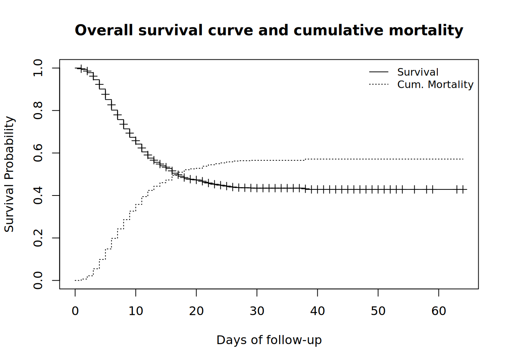

# 27  生存時間解析

[](../../images/survival_analysis.png)

## 27.1 概要

*生存時間解析*（survival analysis）は、個々人において観測される***イベント時間***（コホート研究や集団ベースの研究では***追跡期間***）と呼ばれる期間の後に発生する***イベント***（疾病の発生、疾病からの治癒、死亡、治療に反応した後の再発など）を個人または集団について記述する事に着目した方法です。イベント時間を決定するためには、起点 (組入日や診断日などを用いることができます) の時間を定義する必要があります。

つまり、生存時間解析の推測対象は、起点とイベントの間の時間となります。 近年の医学研究では、例えば治療効果を評価する臨床研究や、多種多様ながんの生存指標を評価する疫学研究などにおいて生存時間解析がよく用いられています。

通常、その記述結果は***生存確率***を通じて提示されます。また、生存確率とは、興味のあるイベントが期間 \\t\\ を経過した時点で発生していない確率です。

***打切り***: ある個人が追跡終了時点までに興味のあるイベントを発生せず、その人の正しいイベント時間が不明な場合に打切りが発生します。この章では右側打切りに重点を置いています。打切りの詳細と一般の生存時間解析については、文献を参照してください。

## 27.2 準備

### パッケージの読み込み

R において生存時間解析を行うために最もよく用いられるパッケージの1つは **survival** パッケージです。まず最初に、survival パッケージとこの節で用いる他のパッケージをインストールした後に、これらのパッケージの読込みを行います。

このハンドブックでは、パッケージを読み込むために、pacman パッケージの p_load() を主に使用しています。p_load() は、必要に応じてパッケージをインストールし、現在の R セッションで使用するためにパッケージを読み込む関数です。また、すでにインストールされたパッケージは、R の基本パッケージである base （以下、base R）の library() を使用して読み込むこともできます。R のパッケージに関する詳細は [R の基礎](basics.llms.md) の章をご覧ください。

この章では、前のほとんどの章でも用いられているラインリストを用いて生存時間解析を行います。また、正しい生存時間データを得るために、ラインリストにいくつかの変更を加えていきます。

### データセットのインポート

エボラ出血熱の流行をシミュレートしたデータセットをインポートします。`appliedepidata::get_data(name = "linelist_cleaned_rds")` で直接読み込めます（詳細は[ハンドブックとデータのダウンロード](download.llms.md)のページを参照）。

``` r
# ラインリストのインポート
linelist_case_data <- appliedepidata::get_data(name = "linelist_cleaned_rds")
```

### データマネジメントと変換

簡潔に言うと、生存時間データは以下の3つの特徴を持っているといえます：

1.  従属変数または反応変数は矛盾なく定義されたイベントの発生までの時間で、
2.  観測値は打切りを受け、データが解析される時点で興味のあるイベントが発生していないことがいくつかの観測単位で認められ、
3.  イベント発生時間に対する影響を評価またはコントロールしたい予測変数や説明変数があります。

そのため、上記の構造に沿うための変数を作成してから生存時間分析を実行していきます。

以下のものを定義します：

- この解析に必要な新しいデータフレーム `linelist_surv`
- 興味のあるイベントをここでは「死亡」とします（すると、生存確率は起点の時間からある特定の時間が経過したあとで生存している確率となります）
- 追跡時間（`futime`）を、発症時間からアウトカムの時間までの*日数*とします
- 回復した人か、または最終的なアウトカムが観測されなかった人、つまり「イベント」が観測されなかった人（`event=0`）を打切りとします。

***注意：*** 実際のコホート研究では、起点と追跡終了の時間の情報は観測された個々人で既知であるため、発症日やアウトカムの日付が不明な観測値は削除します。また、発症日がアウトカムの日付よりも遅い場合は誤りであると考えられるため、これも削除します。

***ヒント：*** 日付データに対して超過（\>）または未満（\<）のフィルタリングを行うと欠測値を持つ行も一緒に削除できるため、日付の誤りに対するフィルタリングによって欠測したデータを一緒に削除することができます。

次に、`case_when()` を用いて3つだけ水準を持つ `age_cat_small` 列を作成します。

``` r
# linelist_case_data から新しいデータ linelist_surv を作成

linelist_surv <-  linelist_case_data %>% 
     
  dplyr::filter(
          # 誤りまたは発症日かアウトカムの日付に欠測がある観測値を削除
       date_outcome > date_onset) %>% 
  
  dplyr::mutate(
          # 死亡した人を1とし右側打切りの人を0としたイベント変数を作成
       event = ifelse(is.na(outcome) | outcome == "Recover", 0, 1), 
    
          # 追跡時間（日）の変数を作成
       futime = as.double(date_outcome - date_onset), 
    
          # 3つだけ水準を持つ新しい年齢カテゴリ変数を作成
       age_cat_small = dplyr::case_when( 
            age_years < 5  ~ "0-4",
            age_years >= 5 & age_years < 20 ~ "5-19",
            age_years >= 20   ~ "20+"),
       
          # 上のステップでは age_cat_small が character 型で作成されるため
          # factor 型に変換し、水準を指定します
          # 値が NA のものは NA のままになり、例えば水準 "unkown" などには置換されません
          # そのため、次の解析ではこれらを削除する必要があるので注意してください
       age_cat_small = fct_relevel(age_cat_small, "0-4", "5-19", "20+")
       )
```

***ヒント：*** `futime` の要約（`summary()`）と、`event` とその作成元である `outcome` のクロス集計を行うことで、作成した新しい列を検証することができます。この検証の他にも、生存時間解析の結果を解釈する時には、この集計に加えて追跡期間中央値を示すことは良い習慣です。

``` r
summary(linelist_surv$futime)
```

       Min. 1st Qu.  Median    Mean 3rd Qu.    Max. 
       1.00    6.00   10.00   11.98   16.00   64.00 

``` r
# 作成された新しいイベント変数とアウトカム変数のクロス集計
# 意図した通りにコードが動いているかどうかを確認する
linelist_surv %>% 
  tabyl(outcome, event)
```

     outcome    0    1
       Death    0 1952
     Recover 1547    0
        <NA> 1040    0

ここで、正しく分類できているかどうかを確認するために、新しい変数 `age_cat_small` と古い変数 `age_cat` のクロス集計を行います

``` r
linelist_surv %>% 
  tabyl(age_cat_small, age_cat)
```

     age_cat_small 0-4 5-9 10-14 15-19 20-29 30-49 50-69 70+ NA_
               0-4 834   0     0     0     0     0     0   0   0
              5-19   0 852   717   575     0     0     0   0   0
               20+   0   0     0     0   862   554    69   5   0
              <NA>   0   0     0     0     0     0     0   0  71

次に、`linelist_surv` データのいくつかの変数（新しく作成された変数も含む）について、最初の10人分の観測値を確認します。

``` r
linelist_surv %>% 
  select(case_id, age_cat_small, date_onset, date_outcome, outcome, event, futime) %>% 
  head(10)
```

       case_id age_cat_small date_onset date_outcome outcome event futime
    1   8689b7           0-4 2014-05-13   2014-05-18 Recover     0      5
    2   11f8ea           20+ 2014-05-16   2014-05-30 Recover     0     14
    3   893f25           0-4 2014-05-21   2014-05-29 Recover     0      8
    4   be99c8          5-19 2014-05-22   2014-05-24 Recover     0      2
    5   07e3e8          5-19 2014-05-27   2014-06-01 Recover     0      5
    6   369449           0-4 2014-06-02   2014-06-07   Death     1      5
    7   f393b4           20+ 2014-06-05   2014-06-18 Recover     0     13
    8   1389ca           20+ 2014-06-05   2014-06-09   Death     1      4
    9   2978ac          5-19 2014-06-06   2014-06-15   Death     1      9
    10  fc15ef          5-19 2014-06-16   2014-07-09 Recover     0     23

新しい年齢分類の性別ごとのより詳細な分布を得るために、列 `age_cat_small` と `gender` のクロス集計も行うことができます。ここでは、[記述統計表の作り方](tables_descriptive.llms.md)の章で説明した **janitor** パッケージの `tabyl()` と *adorn* 関数を使用します。

``` r
linelist_surv %>% 
  tabyl(gender, age_cat_small, show_na = F) %>% 
  adorn_totals(where = "both") %>% 
  adorn_percentages() %>% 
  adorn_pct_formatting() %>% 
  adorn_ns(position = "front")
```

     gender         0-4          5-19           20+          Total
          f 482 (22.4%) 1,184 (54.9%)   490 (22.7%) 2,156 (100.0%)
          m 325 (15.0%)   880 (40.6%)   960 (44.3%) 2,165 (100.0%)
      Total 807 (18.7%) 2,064 (47.8%) 1,450 (33.6%) 4,321 (100.0%)

## 27.3 生存時間解析の基本

### Surv 型オブジェクトの作成

はじめに、**survival** パッケージの `Surv()` を用いて、追跡時間とイベントの変数から生存時間解析のオブジェクトを作成します。

このステップを実行すると、時間の情報と興味のあるイベント（死亡）が観測されたかどうかの情報が集約された *Surv* 型のオブジェクトが作成されます。このオブジェクトは最終的に後で出てくるモデル式の右辺で用いられます（詳細については[マニュアル](https://cran.r-project.org/web/packages/survival/vignettes/survival.pdf）を確認してください)。

``` r
# 右側打切りデータに Surv() 構文を使用
survobj <- Surv(time = linelist_surv$futime,
                event = linelist_surv$event)
```

ここで、確認のため `linelist_surv` データのいくつかの重要な変数について最初の10行を表示します。

``` r
linelist_surv %>% 
  select(case_id, date_onset, date_outcome, futime, outcome, event) %>% 
  head(10)
```

       case_id date_onset date_outcome futime outcome event
    1   8689b7 2014-05-13   2014-05-18      5 Recover     0
    2   11f8ea 2014-05-16   2014-05-30     14 Recover     0
    3   893f25 2014-05-21   2014-05-29      8 Recover     0
    4   be99c8 2014-05-22   2014-05-24      2 Recover     0
    5   07e3e8 2014-05-27   2014-06-01      5 Recover     0
    6   369449 2014-06-02   2014-06-07      5   Death     1
    7   f393b4 2014-06-05   2014-06-18     13 Recover     0
    8   1389ca 2014-06-05   2014-06-09      4   Death     1
    9   2978ac 2014-06-06   2014-06-15      9   Death     1
    10  fc15ef 2014-06-16   2014-07-09     23 Recover     0

さらに、`survobj` の最初の10要素を表示します。基本的には追跡時間のベクトルが表示され、右側打切りの観測値の場合は “+” も表示されます。各値が上の出力と下の出力でどのようになっているか確認してください。

``` r
# このベクトルの最初の10要素を表示し、どのようになっているかを確認
head(survobj, 10)
```

     [1]  5+ 14+  8+  2+  5+  5  13+  4   9  23+

### 最初の解析の実行

まず、`survfit()` を用いて *survfit オブジェクト* を作成し、解析を始めます。`survfit()` は、全体（周辺）生存曲線の ***Kaplan Meier***（KM）推定値を得るための標準の解析を行います。KM 推定値はイベントの観測時点でジャンプする階段関数となっています。最終的な *survfit オブジェクト* は1つかまたはそれ以上の生存曲線を含んでおり、モデルを指定する formula 構文の反応変数として *Surv* オブジェクトを用いることで作成されます。

***注釈：*** Kaplan-Meier 推定量は生存関数のノンパラメトリック最尤推定量（maximum likelihood estimate; MLE）です（詳細についてはその他の情報を確認してください）。

この *survfit オブジェクト* は*生命表*（life table）と呼ばれるものに要約されます。追跡時間（`time`）のイベントが発生した各時間区間について（昇順で）：

- イベント発生のリスクに晒された（イベントも打切りも経験していない人の）人数（`n.risk`）
- イベントが発生した人数（`n.event`）
- 上記から求めたイベントを発生して*いない*確率（死亡していない確率、または特定の時間まで生存する確率）
- 最後に、その確率の標準誤差と信頼区間が求められ表示されます

以下では、上で作成した Surv 型のオブジェクト “survobj” を反応変数とした formula を用いて KM 推定値を求めます。“~ 1” は全体の生存に対するモデルを実行することを意味します。

``` r
# Surv 型オブジェクト "survobj" を反応変数としたモデル式を用いて KM 推定値を求めます
# "~ 1" は全体の生存に対するモデルを実行することを意味します
linelistsurv_fit <-  survival::survfit(survobj ~ 1)

# 詳細をみるための要約を表示
summary(linelistsurv_fit)
```

    Call: survfit(formula = survobj ~ 1)

     time n.risk n.event survival std.err lower 95% CI upper 95% CI
        1   4539      30    0.993 0.00120        0.991        0.996
        2   4500      69    0.978 0.00217        0.974        0.982
        3   4394     149    0.945 0.00340        0.938        0.952
        4   4176     194    0.901 0.00447        0.892        0.910
        5   3899     214    0.852 0.00535        0.841        0.862
        6   3592     210    0.802 0.00604        0.790        0.814
        7   3223     179    0.757 0.00656        0.745        0.770
        8   2899     167    0.714 0.00700        0.700        0.728
        9   2593     145    0.674 0.00735        0.660        0.688
       10   2311     109    0.642 0.00761        0.627        0.657
       11   2081     119    0.605 0.00788        0.590        0.621
       12   1843      89    0.576 0.00809        0.560        0.592
       13   1608      55    0.556 0.00823        0.540        0.573
       14   1448      43    0.540 0.00837        0.524        0.556
       15   1296      31    0.527 0.00848        0.511        0.544
       16   1152      48    0.505 0.00870        0.488        0.522
       17   1002      29    0.490 0.00886        0.473        0.508
       18    898      21    0.479 0.00900        0.462        0.497
       19    798       7    0.475 0.00906        0.457        0.493
       20    705       4    0.472 0.00911        0.454        0.490
       21    626      13    0.462 0.00932        0.444        0.481
       22    546       8    0.455 0.00948        0.437        0.474
       23    481       5    0.451 0.00962        0.432        0.470
       24    436       4    0.447 0.00975        0.428        0.466
       25    378       4    0.442 0.00993        0.423        0.462
       26    336       3    0.438 0.01010        0.419        0.458
       27    297       1    0.436 0.01017        0.417        0.457
       29    235       1    0.435 0.01030        0.415        0.455
       38     73       1    0.429 0.01175        0.406        0.452

`summary()` を用いる際には `times` オプションを追加することができ、求めたい特定の時点における生存確率などの情報を確認することができます。

``` r
# 特定の時点における要約を表示
summary(linelistsurv_fit, times = c(5,10,20,30,60))
```

    Call: survfit(formula = survobj ~ 1)

     time n.risk n.event survival std.err lower 95% CI upper 95% CI
        5   3899     656    0.852 0.00535        0.841        0.862
       10   2311     810    0.642 0.00761        0.627        0.657
       20    705     446    0.472 0.00911        0.454        0.490
       30    210      39    0.435 0.01030        0.415        0.455
       60      2       1    0.429 0.01175        0.406        0.452

また、`print()` を用いることもできます。引数に `print.rmean = TRUE` を指定すると、平均生存時間と標準誤差を表示することができます。

***注釈：*** 制限付き平均生存時間（restricted mean survival time; RMST）は生存の要約指標の 1 つであり、がんの生存時間解析で使われるようになってきています。RMST は、しばしば制限時間 \\T\\ までに観測された人に対して求めた生存曲線の曲線下面積として定義されます（詳細についてはその他の情報の節を確認してください）。

``` r
# linelistsurv_fit オブジェクトを平均生存時間とその標準誤差とともに表示します
print(linelistsurv_fit, print.rmean = TRUE)
```

    Call: survfit(formula = survobj ~ 1)

            n events rmean* se(rmean) median 0.95LCL 0.95UCL
    [1,] 4539   1952   33.1     0.539     17      16      18
        * restricted mean with upper limit =  64 

***ヒント：*** *Surv オブジェクト* を `survfit()` の中に直接書くこともでき、コードを1行節約することができます。その場合、次のように書きます：`linelistsurv_quick <- survfit(Surv(futime, event) ~ 1, data = linelist_surv)`。

### 累積ハザード

`summary()` 以外にも、`str()` を用いて `survfit()` オブジェクトの構造についての詳細を確認できます。`survfit()` オブジェクトは16個の要素を持つリストになっています。

これらの要素の中には重要な要素（`cumhaz` という実数型のベクトル）があります。これは***累積ハザード***の図示に用いることができます。***ハザード***は***瞬間イベント発生率***です（文献を確認してください）。

``` r
str(linelistsurv_fit)
```

    List of 17
     $ n        : int 4539
     $ time     : num [1:59] 1 2 3 4 5 6 7 8 9 10 ...
     $ n.risk   : num [1:59] 4539 4500 4394 4176 3899 ...
     $ n.event  : num [1:59] 30 69 149 194 214 210 179 167 145 109 ...
     $ n.censor : num [1:59] 9 37 69 83 93 159 145 139 137 121 ...
     $ surv     : num [1:59] 0.993 0.978 0.945 0.901 0.852 ...
     $ std.err  : num [1:59] 0.00121 0.00222 0.00359 0.00496 0.00628 ...
     $ cumhaz   : num [1:59] 0.00661 0.02194 0.05585 0.10231 0.15719 ...
     $ std.chaz : num [1:59] 0.00121 0.00221 0.00355 0.00487 0.00615 ...
     $ type     : chr "right"
     $ logse    : logi TRUE
     $ conf.int : num 0.95
     $ conf.type: chr "log"
     $ lower    : num [1:59] 0.991 0.974 0.938 0.892 0.841 ...
     $ upper    : num [1:59] 0.996 0.982 0.952 0.91 0.862 ...
     $ t0       : num 0
     $ call     : language survfit(formula = survobj ~ 1)
     - attr(*, "class")= chr "survfit"

### Kaplan–Meier 曲線の作成

KM 推定値が計算されていれば、「Kaplan-Meier 曲線」を描画できる基本の `plot()` を用いて、時間を通じた生存確率を視覚化できます。言い換えると、以下の曲線は集団全体における生存状況を標準的な図で表したものです。

この曲線から、追跡時間の最小値と最大値を容易に確認できます。

簡単な解釈を説明すると、時点0においては全ての人が生存しており生存確率は100%です。この確率は死亡が発生するにつれて時間とともに減少していきます。追跡時間が60日が経過した後の生存割合は約40%です。

``` r
plot(linelistsurv_fit, 
     xlab = "Days of follow-up",     # x 軸のラベル
     ylab="Survival Probability",   # y-axis label
     main= "Overall survival curve" # figure title
     )
```

[](survival_analysis_files/figure-html/unnamed-chunk-13-1.png)

KM 推定値の信頼区間もデフォルトで描画されますが、`plot()` コマンドの `conf.int = FALSE` オプションを追加することで信頼区間を非表示にできます。

興味のあるイベントは「死亡」であるため、1から生存割合を引いたものの曲線を描くと累積発生率の図が得られます。これは `lines()` で描くことができ、元々あるプロットに情報が追加されます。

``` r
# オリジナルのプロット
plot(
  linelistsurv_fit,
  xlab = "Days of follow-up",       
  ylab = "Survival Probability",       
  mark.time = TRUE,              # mark events on the curve: a "+" is printed at every event
  conf.int = FALSE,              # do not plot the confidence interval
  main = "Overall survival curve and cumulative mortality"
  )

# 元のプロットに追加の曲線を描画
lines(
  linelistsurv_fit,
  lty = 3,             # use different line type for clarity
  fun = "event",       # draw the cumulative events instead of the survival 
  mark.time = FALSE,
  conf.int = FALSE
  )

# プロットに凡例を追加
legend(
  "topright",                               # position of legend
  legend = c("Survival", "Cum. Mortality"), # legend text 
  lty = c(1, 3),                            # line types to use in the legend
  cex = .85,                                # parametes that defines size of legend text
  bty = "n"                                 # no box type to be drawn for the legend
  )
```

[](survival_analysis_files/figure-html/unnamed-chunk-14-1.png)

## 27.4 生存曲線の比較

観測された参加者または患者における異なる群の生存を比較するためには、最初にそれぞれの生存曲線を確認し、独立した群間の差を評価する仮説検定を行う必要があるかもしれません。この比較は、性別、年齢、治療法、合併症などに基づいたグループに関するものになるかもしれません。

### ログランク検定

ログランク検定（log-rank test）は、2つまたはそれ以上の*独立*した群における生存状況を比較する主要な仮説検定で、生存曲線が同一（重なっている）かそうでないかの仮説検定と考えることができます（帰無仮説として群間の生存確率に差がないことを仮定しています）。**survival パッケージ**の `survdiff()` は、オプションで `rho = 0` を指定した場合（デフォルトの設定がこれになっています）にログランク検定を実行できます。ログランク統計量はカイ二乗検定統計量と同様に漸近的にカイ二乗分布に従うため、この仮説検定の結果としてカイ二乗統計量と p 値が出力されます。

まずは性別ごとの生存曲線を比較してみましょう。そのため、最初に視覚化を行ってみます（2つの生存曲線が重なるかどうかを確認します）。新しい *survfit オブジェクト* は少し異なる formula を用いて作成されます。そして、*survdiff オブジェクト* が作成されます。

モデル式を記述している formula の右辺に `~ gender` を指定することで、全体の生存ではなく性別ごとのプロットを作成できます。

``` r
# 性別に基づいて新しい survfit オブジェクトを作成
linelistsurv_fit_sex <-  survfit(Surv(futime, event) ~ gender, data = linelist_surv)
```

新しいオブジェクトを作成すると、性別ごとの生存曲線を作成できます。色や凡例を決める前に、性別の列の水準の順番を見てみましょう。

``` r
# 色を設定
col_sex <- c("lightgreen", "darkgreen")

# プロットを作成
plot(
  linelistsurv_fit_sex,
  col = col_sex,
  xlab = "Days of follow-up",
  ylab = "Survival Probability")

# 凡例の追加
legend(
  "topright",
  legend = c("Female","Male"),
  col = col_sex,
  lty = 1,
  cex = .9,
  bty = "n")
```

[](survival_analysis_files/figure-html/unnamed-chunk-15-1.png)

そして、`survdiff()` を用いて生存曲線の群間差の仮説検定を行うことができます。

``` r
# 生存曲線の差の仮説検定を実行
survival::survdiff(
  Surv(futime, event) ~ gender, 
  data = linelist_surv
  )
```

    Call:
    survival::survdiff(formula = Surv(futime, event) ~ gender, data = linelist_surv)

    n=4321, 218 observations deleted due to missingness.

                N Observed Expected (O-E)^2/E (O-E)^2/V
    gender=f 2156      924      909     0.255     0.524
    gender=m 2165      929      944     0.245     0.524

     Chisq= 0.5  on 1 degrees of freedom, p= 0.5 

女性と男性の生存曲線が重なっているのが分かり、ログランク検定の結果も生存状況の性差を示唆していませんでした。

他の R パッケージでも生存曲線の群間差の図示と群間差の仮説検定を同時に行うことができます。**survminer** パッケージの `ggsurvplot()` を用いると、各群の生存曲線とリスク集合の表とログランク検定の p 値を表示することができます。

***注意：*** **survminer** パッケージの関数では survfit オブジェクト *に加えて* そのオブジェクトを作成するのに用いたデータを再度指定する必要があります。エラーメッセージが表示されてしまうので、忘れずに指定してください。

``` r
survminer::ggsurvplot(
    linelistsurv_fit_sex, 
    data = linelist_surv,          # again specify the data used to fit linelistsurv_fit_sex 
    conf.int = FALSE,              # do not show confidence interval of KM estimates
    surv.scale = "percent",        # present probabilities in the y axis in %
    break.time.by = 10,            # present the time axis with an increment of 10 days
    xlab = "Follow-up days",
    ylab = "Survival Probability",
    pval = T,                      # print p-value of Log-rank test 
    pval.coord = c(40,.91),        # print p-value at these plot coordinates
    risk.table = T,                # print the risk table at bottom 
    tables.col = "strata",         # colour the risk table numbers by group
    legend.title = "Gender",       # legend characteristics
    legend.labs = c("Female","Male"),
    font.legend = 10, 
    palette = "Dark2",             # specify color palette 
    surv.median.line = "hv",       # draw horizontal and vertical lines to the median survivals
    ggtheme = theme_light()        # simplify plot background
)
```

[](survival_analysis_files/figure-html/unnamed-chunk-17-1.png)

また、感染源（汚染源）による生存の違いを検証したい場合があるかもしれません。

このケースについては、`alpha = 0.005` でのログランク検定により十分な生存確率の差があると考えることにします。葬儀により感染した患者の生存確率は他の場所で感染した患者の生存確率よりも高く、生存に対するベネフィットがあるのかもしれません。

``` r
linelistsurv_fit_source <-  survfit(
  Surv(futime, event) ~ source,
  data = linelist_surv
  )

# プロット
ggsurvplot( 
  linelistsurv_fit_source,
  data = linelist_surv,
  linetype = "strata",   # line types
  conf.int = T,
  surv.scale = "percent",  
  break.time.by = 10, 
  xlab = "Follow-up days",
  ylab= "Survival Probability",
  pval = T,
  pval.coord = c(40,.91),
  risk.table = T,
  tables.col = "strata",
  legend.title = "Source of \ninfection",
  legend.labs = c("Funeral", "Other"),
  font.legend = 10,
  palette = c("#E7B800","#3E606F"),
  surv.median.line = "hv", 
  ggtheme = theme_light()
)
```

[](survival_analysis_files/figure-html/unnamed-chunk-18-1.png)

## 27.5 Cox 回帰分析

Cox の比例ハザードモデル（Cox proportional hazards model / Cox regression model）は生存時間解析の最も一般的な回帰モデルの一つです。Cox 回帰モデルは、比例ハザード性の仮定などの適切に用いるために検証を必要とする *重要な仮定* をおくため、他のモデルを用いることもできます。詳細は文献を確認してください。

Cox の比例ハザードモデルにおける効果の尺度は ***ハザード率***（hazard rate）で、これは特定の時点までイベントが発生しなかった人のイベント発生リスク（この章の例では、死亡のリスク）になっています。通常、*独立*な群におけるハザードの比較に興味があるためハザード比（hazard ratio; HR）を用います。ハザード比は多重ロジスティック回帰分析におけるオッズ比に相当する指標です。**survival** パッケージの `coxph()` は、Cox 回帰モデルの当てはめに用いられます。**survival** パッケージの `cox.zph()` は、当てはめたモデルについて比例ハザード性の仮定に対する仮説検定に用いることができます。

**注釈：** 確率は0から1の間の値をとります。一方で、ハザードは単位時間当たりのイベント発生数の期待値を表しています。

- ある説明変数に対するハザード比が1に近ければ、その説明変数は生存に影響を与えていません
- ハザード比が1より小さければ、その説明変数は保護的です（すなわち、生存の改善に関連があります）
- ハザード比が1より大きければ、その説明変数はリスクの上昇（生存の悪化）に関連があります。

### Cox 回帰モデルの当てはめ

まずは、年齢と性別が生存に与える影響を評価するために、モデルの当てはめを行います。モデルの当てはめ結果を表示するだけで、以下の情報が得られます：

- 回帰係数の推定値 `coef`、この値は説明変数とアウトカムの間の関連を定量化したものです
- これらの値を解釈のために指数変換した `exp(coef)`、これは*ハザード比*になっています
- これらの値の標準誤差 `se(coef)`
- z スコア：回帰係数の推定値が 0 から何標準誤差離れているか
- p 値：回帰係数の推定値が 0 でありうる確率

Cox 回帰モデルのオブジェクトに `summary()` を適用すると、ハザード比の推定値の信頼区間や別の仮説検定の結果などのより詳細な情報が得られます。

最初の共変量 `gender` の効果は最初の行に表示されています。ここには `genderm`（男性）と表示されており、最初の水準（“f”）、つまり女性が性別の参照水準となっていることが分かります。そのため、パラメータは女性に対する男性の結果として解釈します。また、p 値から、性別によるハザードの期待値に対する影響または性別と全死亡率の間に関連があるとは言えないです。

同様に、年齢群についても差があるとは言えないです。

``` r
# Cox 回帰モデルの当てはめ
linelistsurv_cox_sexage <-  survival::coxph(
              Surv(futime, event) ~ gender + age_cat_small, 
              data = linelist_surv
              )


# モデルの当てはめ結果の表示
linelistsurv_cox_sexage
```

    Call:
    survival::coxph(formula = Surv(futime, event) ~ gender + age_cat_small, 
        data = linelist_surv)

                          coef exp(coef) se(coef)      z     p
    genderm           -0.03149   0.96900  0.04767 -0.661 0.509
    age_cat_small5-19  0.09400   1.09856  0.06454  1.456 0.145
    age_cat_small20+   0.05032   1.05161  0.06953  0.724 0.469

    Likelihood ratio test=2.8  on 3 df, p=0.4243
    n= 4321, number of events= 1853 
       (218 observations deleted due to missingness)

``` r
# モデルの要約
summary(linelistsurv_cox_sexage)
```

    Call:
    survival::coxph(formula = Surv(futime, event) ~ gender + age_cat_small, 
        data = linelist_surv)

      n= 4321, number of events= 1853 
       (218 observations deleted due to missingness)

                          coef exp(coef) se(coef)      z Pr(>|z|)
    genderm           -0.03149   0.96900  0.04767 -0.661    0.509
    age_cat_small5-19  0.09400   1.09856  0.06454  1.456    0.145
    age_cat_small20+   0.05032   1.05161  0.06953  0.724    0.469

                      exp(coef) exp(-coef) lower .95 upper .95
    genderm               0.969     1.0320    0.8826     1.064
    age_cat_small5-19     1.099     0.9103    0.9680     1.247
    age_cat_small20+      1.052     0.9509    0.9176     1.205

    Concordance= 0.514  (se = 0.007 )
    Likelihood ratio test= 2.8  on 3 df,   p=0.4
    Wald test            = 2.78  on 3 df,   p=0.4
    Score (logrank) test = 2.78  on 3 df,   p=0.4

モデルの当てはめを行い結果を見るのは面白いですが、最初に比例ハザード性の仮定が成り立つかどうかを検討しておくと、時間の節約になります。

``` r
test_ph_sexage <- survival::cox.zph(linelistsurv_cox_sexage)
test_ph_sexage
```

                  chisq df    p
    gender        0.454  1 0.50
    age_cat_small 0.838  2 0.66
    GLOBAL        1.399  3 0.71

**注釈：** Cox モデルの当てはめでは2つ目の引数 *method* を指定でき、タイの取り扱い方法を変更することができます。*デフォルト*は “efron” で、他にも “breslow” や “exact” が指定できます。

他のモデルとして感染源や発症から入院までの日数をリスク因子として追加します。今回は、まず比例ハザード性の仮定の評価を先に行ってみます。

このモデルには連続値の説明変数（`days_onset_hosp`）が含まれています。このような場合、パラメータ推定値の解釈は、説明変数が1単位増加したときに増加する対数相対ハザードの期待値、となります。まずは、比例ハザード性の仮定の評価を行います。

``` r
# モデルの当てはめ
linelistsurv_cox <-  coxph(
                        Surv(futime, event) ~ gender + age_years+ source + days_onset_hosp,
                        data = linelist_surv
                        )


# 比例ハザード性の仮説検定
linelistsurv_ph_test <- cox.zph(linelistsurv_cox)
linelistsurv_ph_test
```

                       chisq df       p
    gender           0.45062  1    0.50
    age_years        0.00199  1    0.96
    source           1.79622  1    0.18
    days_onset_hosp 31.66167  1 1.8e-08
    GLOBAL          34.08502  4 7.2e-07

また、**survminer** パッケージの `ggcoxzph()` を用いて、この仮定に対する視覚的な評価を行うことができます。

``` r
survminer::ggcoxzph(linelistsurv_ph_test)
```

[](survival_analysis_files/figure-html/unnamed-chunk-19-1.png)

モデルの当てはめ結果から、発症から入院までの日数と全死亡率の間に負の関連があることが示唆されます。ハザードの期待値は、性別などを固定したもとで、発症から入院までの日数が1日遅くなると0.9倍となっていました。もっと直接的に説明すると、発症から入院までの日数が1日伸びると、死亡のリスクが10.7%（`coef *100`）減少する、となります。

また、モデルの結果は感染源と全死亡率の間の正の関連も示していました。これについては、他の感染による患者は葬儀で感染した患者と比べて死亡リスクが高い（1.21倍）という結果でした。

``` r
# モデルの要約を表示
summary(linelistsurv_cox)
```

    Call:
    coxph(formula = Surv(futime, event) ~ gender + age_years + source + 
        days_onset_hosp, data = linelist_surv)

      n= 2772, number of events= 1180 
       (1767 observations deleted due to missingness)

                         coef exp(coef)  se(coef)      z Pr(>|z|)    
    genderm          0.004710  1.004721  0.060827  0.077   0.9383    
    age_years       -0.002249  0.997753  0.002421 -0.929   0.3528    
    sourceother      0.178393  1.195295  0.084291  2.116   0.0343 *  
    days_onset_hosp -0.104063  0.901169  0.014245 -7.305 2.77e-13 ***
    ---
    Signif. codes:  0 '***' 0.001 '**' 0.01 '*' 0.05 '.' 0.1 ' ' 1

                    exp(coef) exp(-coef) lower .95 upper .95
    genderm            1.0047     0.9953    0.8918    1.1319
    age_years          0.9978     1.0023    0.9930    1.0025
    sourceother        1.1953     0.8366    1.0133    1.4100
    days_onset_hosp    0.9012     1.1097    0.8764    0.9267

    Concordance= 0.566  (se = 0.009 )
    Likelihood ratio test= 71.31  on 4 df,   p=1e-14
    Wald test            = 59.22  on 4 df,   p=4e-12
    Score (logrank) test = 59.54  on 4 df,   p=4e-12

この関係を表にして確認することもできます：

``` r
linelist_case_data %>% 
  tabyl(days_onset_hosp, outcome) %>% 
  adorn_percentages() %>%  
  adorn_pct_formatting()
```

     days_onset_hosp Death Recover   NA_
                   0 44.3%   31.4% 24.3%
                   1 46.6%   32.2% 21.2%
                   2 43.0%   32.8% 24.2%
                   3 45.0%   32.3% 22.7%
                   4 41.5%   38.3% 20.2%
                   5 40.0%   36.2% 23.8%
                   6 32.2%   48.7% 19.1%
                   7 31.8%   38.6% 29.5%
                   8 29.8%   38.6% 31.6%
                   9 30.3%   51.5% 18.2%
                  10 16.7%   58.3% 25.0%
                  11 36.4%   45.5% 18.2%
                  12 18.8%   62.5% 18.8%
                  13 10.0%   60.0% 30.0%
                  14 10.0%   50.0% 40.0%
                  15 28.6%   42.9% 28.6%
                  16 20.0%   80.0%  0.0%
                  17  0.0%  100.0%  0.0%
                  18  0.0%  100.0%  0.0%
                  22  0.0%  100.0%  0.0%
                  NA 52.7%   31.2% 16.0%

このデータにおいて、なぜこの様な関連が見られたのかについて考え、検討する必要があります。入院まで時間がかかっていても生き延びていた患者はもともと重症度が低かった可能性があるという説明が可能です。また、別の説明も考えられ、シミュレーションによる疑似データセットを使用したため、このパターンが現実を反映していないのかもしれません。

### フォレストプロット

Cox 回帰モデルの結果について、**survminer** パッケージの `ggforest()` を用いて、フォレストプロットによる可視化を行うことができます。

``` r
ggforest(linelistsurv_cox, data = linelist_surv)
```

[](survival_analysis_files/figure-html/forestp-1.png)

## 27.6 生存時間モデルにおける時間依存性共変量

以下の節の一部は、[Dr. Emily Zabor](https://www.emilyzabor.com/) の許可を得て [Survival analysis in R](https://www.emilyzabor.com/tutorials/survival_analysis_in_r_tutorial.html) の素晴らしい解説から引用しています。

前の節では、Cox 回帰モデルを用いて興味のある共変量と生存アウトカムの間の関連を評価する方法を説明しました。しかし、これらの解析では、共変量がベースライン時点、つまりイベントの追跡が始まる前に測定されていること想定していました。

興味のある共変量が追跡を開始した**後で**測定されているとどうなるでしょうか？もしくは、時間で変化する共変量がある場合はどうなるでしょう？

例えば、臨床検査値を繰り返し測定した臨床データを扱っている場合、その値は時間の経過とともに変化する可能性があります。これは **時間依存性共変量（Time Dependent Covariate）** の一例です。時間依存性共変量を扱うためには特別な準備が必要です。しかし、幸運なことに Cox 回帰モデルはとても柔軟であり、また、**survival** パッケージと一連のツールを用いてこのタイプのデータをモデル化することができます。

### 時間依存性共変量の設定

R において時間依存性共変量の解析を行うためには特別なデータセットを準備する必要があります。興味があれば **survival** パッケージの著者による、より詳細な説明（[Using Time Dependent Covariates and Time Dependent Coefficients in the Cox Model](https://cran.r-project.org/web/packages/survival/vignettes/timedep.pdf）) を確認してください。

ここでは、`SemiCompRisks` パッケージの `BMT` という新しいデータセットを使用します。このデータは137名の骨髄移植患者のデータです。この節で扱う変数は以下の通りです：

- `T1` - 死亡時間または最終追跡時間 (日)
- `delta1` - 死亡の指示変数；1-死亡、0-生存  
- `TA` - 急性移植片対宿主病発生までの時間 (日)
- `deltaA` - 急性移植片対宿主病の指示変数；
- 1 - 急性移植片対宿主病の発生あり
- 0 - 急性移植片対宿主病の発生なし

**base** の R コマンド `data()` を用いて、**SemiCompRisks** パッケージからこのデータセットを読み込みます。このコマンドは R パッケージに含まれているデータを読み込むことができます。以下を実行すると、`BMT` というデータフレームが R 上に読み込まれます。

``` r
data(BMT, package = "SemiCompRisks")
```

#### 患者固有の ID の追加

`BMT` データには患者固有の ID がありませんが、時間依存性共変量の解析には固有の ID 変数が必要です。そのため、**tidyverse** の **tibble** パッケージの `rowid_to_column()` を用いて `my_id` という新しい ID の列を作成します（データフレームの最初に1から始まる連番の ID の列を追加します）。そして、このデータフレームの名前は `bmt` としました。

``` r
bmt <- rowid_to_column(BMT, "my_id")
```

このデータセットは以下のようになります：

#### 患者の行の展開

次に、時間依存性共変量のために再構成したデータセットを作成するために、補助関数 `event()` および `tdc()` とともに `tmerge()` を使用していきます。目標は、各患者のデータが異なる値の `deltaA` を持つ時間区間になるように分割し、データセットを再構成することです。このデータの場合、各患者は急性移植片対宿主病を発症したか否かに応じて、最大で2行のデータを持つことができます。以下では、急性移植片対宿主病を発症したかどうかの新しい指示変数を `agvhd` と呼ぶことにします。

- `tmerge()` は各患者の異なる共変量の値に応じて複数の時間区間の縦長の long 型データセットを作成します
- `event()` は新しく作成された時間区間に対応する新しいイベントの指示変数を作成します
- `tdc()` は新しく作成された時間区間に対応する新しい時間依存性共変量の列（`agvhd`）を作成します

``` r
td_dat <- 
  tmerge(
    data1 = bmt %>% select(my_id, T1, delta1), 
    data2 = bmt %>% select(my_id, T1, delta1, TA, deltaA), 
    id = my_id, 
    death = event(T1, delta1),
    agvhd = tdc(TA)
    )
```

上記のコードで何が行われるのか、最初の5人の患者のデータを見てみましょう。

元のデータにおける各変数の値は以下のようになっていました：

``` r
bmt %>% 
  select(my_id, T1, delta1, TA, deltaA) %>% 
  filter(my_id %in% seq(1, 5))
```

      my_id   T1 delta1   TA deltaA
    1     1 2081      0   67      1
    2     2 1602      0 1602      0
    3     3 1496      0 1496      0
    4     4 1462      0   70      1
    5     5 1433      0 1433      0

新しいデータセットにおける同じ患者のデータは以下のようになります：

``` r
td_dat %>% 
  filter(my_id %in% seq(1, 5))
```

      my_id   T1 delta1 tstart tstop death agvhd
    1     1 2081      0      0    67     0     0
    2     1 2081      0     67  2081     0     1
    3     2 1602      0      0  1602     0     0
    4     3 1496      0      0  1496     0     0
    5     4 1462      0      0    70     0     0
    6     4 1462      0     70  1462     0     1
    7     5 1433      0      0  1433     0     0

このデータでは、一部の患者は2つの行を持っており、各行が新しい変数 `agvhd` に異なる値を持つ2つの区間に対応するようになっています。例えば、患者1は `agvhd` の値が0の時間0から67の区間と、`agvhd` の値が1の時間67から2081の区間の2つの行を持っています。

### 時間依存性共変量を持つ Cox 回帰モデル

データを再構成し、新しく時間依存性共変量の変数 `aghvd` が追加されたので、単純な1つの時間依存性共変量を持つ Cox 回帰モデルを当てはめてみましょう。前の節で用いたものと同じ `coxph()` を用いることができますが、`Surv()` で各区間の開始時間と終了時間を指定する必要があります。これは引数 `time1 =` と `time2 =` で指定します。

``` r
bmt_td_model = coxph(
  Surv(time = tstart, time2 = tstop, event = death) ~ agvhd, 
  data = td_dat
  )

summary(bmt_td_model)
```

    Call:
    coxph(formula = Surv(time = tstart, time2 = tstop, event = death) ~ 
        agvhd, data = td_dat)

      n= 163, number of events= 80 

            coef exp(coef) se(coef)    z Pr(>|z|)
    agvhd 0.3351    1.3980   0.2815 1.19    0.234

          exp(coef) exp(-coef) lower .95 upper .95
    agvhd     1.398     0.7153    0.8052     2.427

    Concordance= 0.535  (se = 0.024 )
    Likelihood ratio test= 1.33  on 1 df,   p=0.2
    Wald test            = 1.42  on 1 df,   p=0.2
    Score (logrank) test = 1.43  on 1 df,   p=0.2

また、**survminer** パッケージの `ggforest()` を用いて Cox 回帰モデルの結果を可視化してみます：

``` r
ggforest(bmt_td_model, data = td_dat)
```

[](survival_analysis_files/figure-html/unnamed-chunk-28-1.png)

フォレストプロット、信頼区間、および p 値から分かるように、この単純なモデルにおいては死亡と急性移植片対宿主病の間に強い関連があるとは言えませんでした。

## 27.7 参考資料

[Survival Analysis Part I: Basic concepts and first analyses](https://www.ncbi.nlm.nih.gov/pmc/articles/PMC2394262/)

[Survival Analysis in R](https://www.emilyzabor.com/tutorials/survival_analysis_in_r_tutorial.html)

[Survival analysis in infectious disease research: Describing events in time](https://www.ncbi.nlm.nih.gov/pmc/articles/PMC2954271/)

[Chapter on advanced survival models Princeton](https://data.princeton.edu/wws509/notes/c7.pdf)

[Using Time Dependent Covariates and Time Dependent Coefficients in the Cox Model](https://cran.r-project.org/web/packages/survival/vignettes/timedep.pdf)

[Survival analysis cheatsheet R](https://publicifsv.sund.ku.dk/~ts/survival/survival-cheat.pdf)

[Survminer cheatsheet](https://paulvanderlaken.files.wordpress.com/2017/08/survminer_cheatsheet.pdf)

[Paper on different survival measures for cancer registry data with Rcode provided as supplementary materials](https://www.ncbi.nlm.nih.gov/pmc/articles/PMC6322561/)
