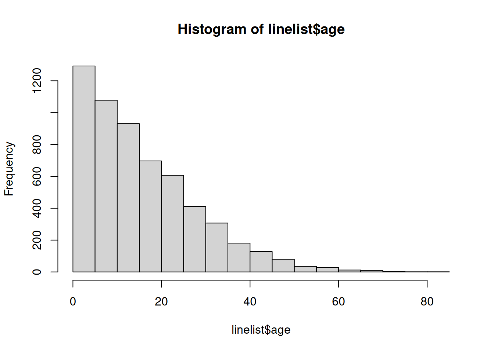
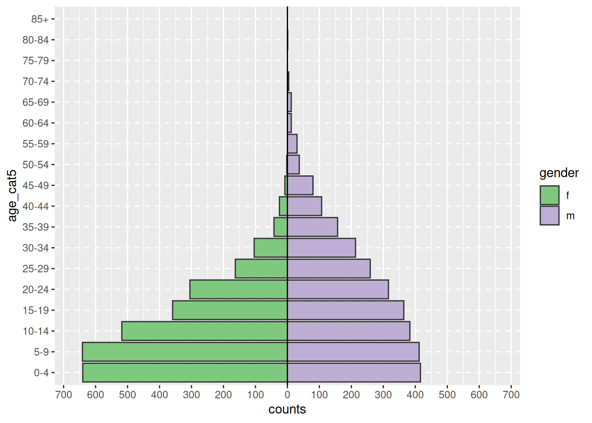

# 33  Pirâmides demográficas e escalas Likert

[](../../images/pop_pyramid_baseline.png)

[](../../images/likert.png)

As pirâmides demográficas são úteis para mostrar as distribuições de idade e sexo. Um código semelhante pode ser usado para visualizar os resultados de perguntas de pesquisa do tipo Likert (por exemplo “Concordo plenamente”, “Concordo”, “Neutro”, “Discordo”, “Discordo totalmente”). Nesta página, cobrimos o seguinte:

- Pirâmides rápidas e fáceis usando o pacote **apyramid**  
- Pirâmides mais personalizáveis usando `ggplot()`  
- Exibindo linhas de base demográficas no fundo da pirâmide  
- Usando gráficos em estilo de pirâmide para mostrar outros tipos de dados (por exemplo, respostas a perguntas de pesquisa **estilo Likert**)

## 33.1 Preparação

### Carregar pacotes

Este pedaço de código mostra o carregamento de pacotes necessários para as análises. Neste manual, enfatizamos `p_load()` de **pacman**, que instala o pacote se necessário *e* o carrega para uso. Você também pode carregar pacotes instalados com `library()` de R **base**. Veja a página em [Introdução ao R](basics.llms.md) para mais informações sobre pacotes R.

``` r
pacman::p_load(rio, # para importar dados
               here, # para localizar arquivos
               tidyverse, # para limpar, manipular e plotar os dados (inclui o pacote ggplot2)
               apyramid, # um pacote dedicado à criação de pirâmides de idades
               janitor, # tabelas e dados de limpeza
               stringr, # trabalhando com strings para títulos, legendas, etc.
               appliedepidata) # dados de exemplo utilizados neste manual
```

### Importar dados

Para começar, importamos a lista (*linelist*) limpa de casos de uma simulação de epidemia de Ebola. Carregue diretamente com `appliedepidata::get_data(name = "linelist_cleaned_rds")` (consulte a página [Baixar manual e dados](download.llms.md) para mais detalhes).

``` r
# import case linelist 
linelist <- appliedepidata::get_data(name = "linelist_cleaned_rds")
```

As primeiras 50 linhas da linelist são exibidas abaixo.

### Limpeza

Para fazer uma pirâmide demográfica tradicional de idade / sexo, os dados devem primeiro ser limpos das seguintes maneiras:

- A coluna de gênero deve ser limpa.  
- Dependendo do seu método, a idade deve ser armazenada como um número ou em uma coluna de *categoria de idade*.

Se estiver usando categorias de idade, os valores da coluna devem ser corrigidos em ordem, seja alfanumérico padrão ou definido intencionalmente pela conversão para o fator de classe.

Abaixo, usamos `tabyl()` de **janitor** para inspecionar as colunas `gender` e `age_cat5`.

``` r
linelist %>% 
  tabyl(age_cat5, gender)
```

     age_cat5   f   m NA_
          0-4 640 416  39
          5-9 641 412  42
        10-14 518 383  40
        15-19 359 364  20
        20-24 305 316  17
        25-29 163 259  13
        30-34 104 213   9
        35-39  42 157   3
        40-44  25 107   1
        45-49   8  80   5
        50-54   2  37   1
        55-59   0  30   0
        60-64   0  12   0
        65-69   0  12   1
        70-74   0   4   0
        75-79   0   0   1
        80-84   0   1   0
          85+   0   0   0
         <NA>   0   0  86

Também executamos um histograma rápido na coluna `age` para garantir que esteja limpo e classificado corretamente:

``` r
hist(linelist$age)
```

[](age_pyramid_files/figure-html/unnamed-chunk-7-1.png)

## 33.2 Pacote **apyramid**

O pacote **apyramid** é um produto do projeto [R4Epis](https://r4epis.netlify.com/). Você pode ler mais sobre este pacote [aqui](https://cran.r-project.org/web/packages/apyramid/vignettes/intro.html). Ele permite que você crie rapidamente uma pirâmide de idades. Para situações mais sutis, veja a seção abaixo [usando `ggplot()`](#demo_pyr_gg). Você pode ler mais sobre o pacote **apyramid** em sua página de Ajuda inserindo `?age_pyramid` em seu console R.

### Dados linelist

Usando o conjunto de dados `linelist` limpo, podemos criar uma pirâmide de idade com um simples comando `age_pyramid()`. Neste comando:

- O argumento `data =` é definido como o quadro de dados (*data frame*) `linelist`  
- O argumento `age_group =` (para o eixo y) é definido como o nome da coluna categórica de idade (entre aspas)  
- O argumento `split_by =` (para o eixo x) é definido para a coluna de gênero

``` r
apyramid::age_pyramid(data = drop_na(linelist, age_cat5, gender),
                      age_group = "age_cat5",
                      split_by = "gender")
```

[](age_pyramid_files/figure-html/unnamed-chunk-8-1.png)

A pirâmide pode ser exibida com a porcentagem de todos os casos no eixo x, em vez de contagens, incluindo `proportional = TRUE`.

``` r
apyramid::age_pyramid(data = drop_na(linelist, age_cat5, gender),
                      age_group = "age_cat5",
                      split_by = "gender",
                      proportional = TRUE)
```

[](age_pyramid_files/figure-html/unnamed-chunk-9-1.png)

Ao usar o pacote **agepyramid**, se a coluna `split_by` for binária (por exemplo, masculino / feminino ou sim / não), o resultado aparecerá como uma pirâmide. No entanto, se houver mais de dois valores na coluna `split_by` (não incluindo `NA`), a pirâmide aparecerá como um gráfico de barra facetada com barras cinza no “fundo” indicando o intervalo dos dados não facetados para aquele grupo de idade. Nesse caso, os valores de `split_by =` aparecerão como rótulos na parte superior de cada painel de faceta. Por exemplo, abaixo está o que ocorre se `split_by =` é atribuído à coluna `hospital`.

``` r
apyramid::age_pyramid(data = drop_na(linelist, age_cat5),
                      age_group = "age_cat5",
                      split_by = "hospital")  
```

[](age_pyramid_files/figure-html/unnamed-chunk-10-1.png)

#### Valores faltantes

As linhas que têm valores faltantes `NA` nas colunas `split_by =` ou `age_group =`, se codificadas como `NA`, não irão acionar o facetamento mostrado acima. Por padrão, essas linhas não serão mostradas. No entanto, você pode especificar que eles apareçam em um gráfico de barras adjacente e como uma faixa etária separada no topo, especificando `na.rm = FALSE`.

``` r
apyramid::age_pyramid(data = linelist,
                      age_group = "age_cat5",
                      split_by = "gender",
                      na.rm = FALSE) # mostra pacientes sem idade ou sexo
```

[](age_pyramid_files/figure-html/unnamed-chunk-11-1.png)

#### Proporções, cores e estética

Por padrão, as barras exibem contagens (não %), uma linha intermediária tracejada para cada grupo é mostrada e as cores são verde / roxo. Cada um desses parâmetros pode ser ajustado, conforme mostrado abaixo:

Você também pode adicionar comandos `ggplot()` adicionais ao gráfico usando a sintaxe `ggplot()` “+” padrão, como temas estéticos e ajustes de rótulo:

``` r
apyramid::age_pyramid(
  data = drop_na(linelist, age_cat5, gender),
  age_group = "age_cat5",
  split_by = "gender",
  proportional = TRUE, # mostra as porcentagens, não contagens
  show_midpoint = FALSE,            # remove bar mid-point line
  #pal = c("laranja", "roxo") # pode especificar cores alternativas aqui (mas não rótulos)# comandos ggplot adicionais
  )+                 
  
  # additional ggplot commands
  theme_minimal()+                               # simplfy background
  scale_fill_manual(# especificar cores E rótulos
    values = c("orange", "purple"),              
    labels = c("m" = "Male", "f" = "Female"))+
  labs(y = "Percent of all cases",              # note x and y labs are switched
       x = "Age categories",                          
       fill = "Gender", 
       caption = "My data source and caption here",
       title = "Title of my plot",
       subtitle = "Subtitle with \n a second line...")+
  theme(
    legend.position = "bottom", # legenda para a parte de baixo
    axis.text = element_text(size = 10, face = "bold"),  # fonts/sizes
    axis.title = element_text(size = 12, face = "bold"))
```

[](age_pyramid_files/figure-html/unnamed-chunk-12-1.png)

### Dados agregados

Os exemplos acima assumem que seus dados estão em um formato de linelist, com cada linha correspondendo a uma observação. Se seus dados já estão agregados em contagens por categoria de idade, você ainda pode usar o pacote **apyramid**, conforme mostrado abaixo.

Para demonstração, agregamos os dados da linelist em contagens por categoria de idade e sexo, em um formato “amplo” ou “wide”. Isso simulará como se seus dados estivessem em contagens para começar. Saiba mais sobre [agrupamento de dados](grouping.llms.md) e [pivoteamento de dados](pivoting.llms.md) em suas respectivas páginas.

``` r
demo_agg <- linelist %>% 
  count(age_cat5, gender, name = "cases") %>% 
  pivot_wider(
    id_cols = age_cat5,
    names_from = gender,
    values_from = cases) %>% 
  rename(`missing_gender` = `NA`)
```

… o que faz com que o conjunto de dados tenha a seguinte aparência: com colunas para categoria de idade e contagens masculinas, contagens femininas e contagens ausentes.

Para configurar esses dados para a pirâmide de idade, vamos organizar os dados no formato “longo” com a função `pivot_longer()` de **dplyr**. Isso ocorre porque `ggplot()` geralmente prefere dados “longos”, e **apyramid** está usando `ggplot()`.

``` r
# pivot os dados agregados em formato longo
demo_agg_long <- demo_agg %>% 
  pivot_longer(
    col = c(f, m, missing_gender), # cols para alongar
    names_to = "gender", # nome para a nova coluna de categorias
    values_to = "counts") %>%           # name for new col of counts
  mutate(
    gender = na_if(gender, "missing_gender")) # converte "missing_gender" em NA
```

Em seguida, use os argumentos `split_by =` e `count =` de `age_pyramid()` para especificar as respectivas colunas nos dados:

``` r
apyramid::age_pyramid(data = drop_na(demo_agg_long),
                      age_group = "age_cat5",# nome de coluna para a categoria de idade
                      split_by = "gender",   # nome de coluna para gênero
                      count = "counts", # nome da coluna para contagens de casos
                      show_midpoint = FALSE)
```

[](age_pyramid_files/figure-html/unnamed-chunk-17-1.png)

Observe acima, que a ordem dos fatores de “m” e “f” é diferente (pirâmide invertida). Para ajustar a ordem, você deve redefinir o gênero nos dados agregados como um fator e ordenar os níveis conforme desejado. Veja a página [Fatores](factors.llms.md).

## 33.3 `ggplot()`

Usar `ggplot()` para construir sua pirâmide de idade permite mais flexibilidade, mas requer mais esforço e compreensão de como `ggplot()` funciona. Também é mais fácil cometer erros acidentalmente.

Para usar `ggplot()` para fazer pirâmides demográficas, você cria dois gráficos de barra (um para cada gênero), converte os valores em um gráfico para negativo e, finalmente, vira os eixos x e y para exibir os gráficos de barra verticalmente, suas bases encontro no meio da trama.

### Preparação

Essa abordagem usa a coluna *numérica* idade, não a coluna *categórica* de `age_cat5`. Portanto, vamos verificar se a classe desta coluna é realmente numérica.

``` r
class(linelist$age)
```

    [1] "numeric"

Você poderia usar a mesma lógica abaixo para construir uma pirâmide de dados categóricos usando `geom_col()` ao invés de `geom_histogram()`.

### Construindo o gráfico

Primeiro, entenda que para fazer essa pirâmide usando `ggplot()` a abordagem é a seguinte:

- Dentro de `ggplot()`, crie **dois** histogramas usando a coluna numérica de idade. Crie um para cada um dos dois valores de agrupamento (neste caso, gêneros masculino e feminino). Para fazer isso, os dados de cada histograma são especificados em seus respectivos comandos `geom_histogram()`, com os respectivos filtros aplicados à `linelist`.

- Um gráfico terá valores de contagem positivos, enquanto o outro terá suas contagens convertidas em valores negativos - isso cria a “pirâmide” com o valor `0` no meio do gráfico. Os valores negativos são criados usando um termo especial do **ggplot2** `after_stat(count)` e multiplicando por -1.

- O comando `coord_flip()` muda os eixos X e Y, resultando na viragem dos gráficos na vertical e na criação da pirâmide.

- Por último, os rótulos de valor do eixo de contagem devem ser alterados para que apareçam como contagens “positivas” em ambos os lados da pirâmide (apesar dos valores subjacentes em um lado serem negativos).

Uma versão **simples** disso, usando `geom_histogram()`, está abaixo:

``` r
  # começar ggplot
  ggplot(mapping = aes(x = age, fill = gender)) +
  
  # histograma feminino
  geom_histogram(data = linelist %>% filter(gender == "f"),
                 breaks = seq(0,85,5),
                 colour = "white") +
  
  # histograma masculino (valores convertidos em negativos)
  geom_histogram(data = linelist %>% filter(gender == "m"),
                 breaks = seq(0,85,5),
                 mapping = aes(y = after_stat(count)*(-1)),
                 colour = "white") +
  
  # inverta os eixos X e Y
  coord_flip() +
  
  # ajustar a escala do eixo de contagem
  scale_y_continuous(limits = c(-600, 900),
                     breaks = seq(-600,900,100),
                     labels = abs(seq(-600, 900, 100)))
```

[](age_pyramid_files/figure-html/unnamed-chunk-19-1.png)

\*\*\_ PERIGO: \_\*\* Se os **limites** do seu eixo de contagem forem definidos muito baixos e uma barra de contagem ultrapassá-los, a barra desaparecerá totalmente ou será reduzida artificialmente ! Observe isso ao analisar dados que são atualizados rotineiramente. Evite isso fazendo com que os limites do eixo de contagem se ajustem automaticamente aos seus dados, conforme abaixo.

Há muitas coisas que você pode alterar / adicionar a esta versão simples, incluindo:

- Ajuste automático da escala do eixo de contagem aos seus dados (evite os erros discutidos no aviso abaixo)  
- Especifique manualmente as cores e rótulos de legenda

**Converta contagens em porcentagens**

Para converter contagens em porcentagens (do total), faça isso em seus dados antes de plotar. Abaixo, temos as contagens de idade e gênero, então `ungroup()`, e então `mutate()` para criar novas colunas de porcentagem. Se você quiser porcentagens por gênero, pule a etapa de desagrupamento.

``` r
# cria conjunto de dados com proporção do total
pyramid_data <- linelist %>%
  count(age_cat5,
        gender,
        name = "counts") %>% 
  ungroup() %>%                 # ungroup so percents are not by group
  mutate(percent = round(100*(counts / sum(counts, na.rm=T)), digits = 1), 
         percent = case_when(
            gender == "f" ~ percent,
            gender == "m" ~ -percent, # converter masculino em negativo
            TRUE          ~ NA_real_))    # NA val must by numeric as well
```

É importante ressaltar que salvamos os valores máximos e mínimos para que saibamos quais devem ser os limites da escala. Eles serão usados no comando `ggplot()` abaixo.

``` r
max_per <- max(pyramid_data$percent, na.rm=T)
min_per <- min(pyramid_data$percent, na.rm=T)

max_per
```

    [1] 10.9

``` r
min_per
```

    [1] -7.1

Finalmente, fazemos o `ggplot()` nos dados de porcentagem. Especificamos `scale_y_continuous()` para estender os comprimentos predefinidos em cada direção (positivo e “negativo”). Usamos `floor()` e `ceiling()` para arredondar decimais na direção apropriada (para baixo ou para cima) para o lado do eixo.

``` r
# começar ggplot
  ggplot()+  # default x-axis is age in years;

  # gráfico de dados de caso
  geom_col(data = drop_na(pyramid_data, percent),
           mapping = aes(
             x = age_cat5,
             y = percent,
             fill = gender),         
           colour = "white")+       # white around each bar
  
  # vire os eixos X e Y para tornar a pirâmide vertical
  coord_flip()+
  

  # ajusta as escalas dos eixos
  # scale_x_continuous(breaks = seq(0,100,5), labels = seq(0,100,5)) +
  scale_y_continuous(
    limits = c(min_per, max_per),
    breaks = seq(from = floor(min_per),                # sequence of values, by 2s
                 to = ceiling(max_per),
                 by = 2),
    labels = paste0(abs(seq(from = floor(min_per), # sequência de valores absolutos, por 2s, com "%"
                            to = ceiling(max_per),
                            by = 2)),
                    "%"))+  

  # designar cores e rótulos de legenda manualmente
  scale_fill_manual(
    values = c("f" = "orange",
               "m" = "darkgreen"),
    labels = c("Female", "Male")) +
  
  # valores de rótulo (lembre-se de X e Y invertidos agora)
  labs(
    title = "Age and gender of cases",
    x = "Age group",
    y = "Percent of total",
    fill = NULL,
    caption = stringr::str_glue("Data are from linelist \nn = {nrow(linelist)} (age or sex missing for {sum(is.na(linelist$gender) | is.na(linelist$age_years))} cases) \nData as of: {format(Sys.Date(), '%d %b %Y')}")) +
  
  # temas de exibição
  theme(
    panel.grid.major = element_blank(),
    panel.grid.minor = element_blank(),
    panel.background = element_blank(),
    axis.line = element_line(colour = "black"),
    plot.title = element_text(hjust = 0.5), 
    plot.caption = element_text(hjust=0, size=11, face = "italic")
    )
```

[](age_pyramid_files/figure-html/unnamed-chunk-22-1.png)

### Compare com a linha de base

Com a flexibilidade de `ggplot()`, você pode ter uma segunda camada de barras no fundo que representam a pirâmide populacional “verdadeira” ou “linha de base”. Isso pode fornecer uma boa visualização para comparar o observado com a linha de base.

Importe e visualize os dados populacionais (consulte a página [Baixar manual e dados](download.llms.md)):

``` r
# importar os dados demográficos da população
pop <- appliedepidata::get_data(name = "country_demographics")
```

Primeiro, algumas etapas de gerenciamento de dados:

Aqui gravamos a ordem das categorias de idade que queremos que apareçam. Devido a algumas peculiaridades na forma como o `ggplot()` é implementado, neste cenário específico é mais fácil armazená-los como um vetor de caracteres e usá-los posteriormente na função de gráfico.

``` r
# registrar níveis corretos de gatos com idade
age_levels <- c("0-4","5-9", "10-14", "15-19", "20-24",
                "25-29","30-34", "35-39", "40-44", "45-49",
                "50-54", "55-59", "60-64", "65-69", "70-74",
                "75-79", "80-84", "85+")
```

Combine a população e os dados do caso por meio da função **dplyr** `bind_rows()`:

- Primeiro, certifique-se de que eles tenham os *mesmos* nomes de coluna, valores de categorias de idade e valores de gênero  
- Faça com que tenham a mesma estrutura de dados: colunas de categoria de idade, sexo, contagens e porcentagem do total  
- Una-os, um em cima do outro (`bind_rows()`)

``` r
# criar / transformar dados populacionais, com porcentagem do total
########################################################
pop_data <- pop %>% 
  pivot_longer(        # colunas de gênero pivot mais longas
    cols = c(m, f),
    names_to = "gender",
    values_to = "counts") %>% 
  
  mutate(
    percent  = round(100*(counts / sum(counts, na.rm=T)),1),  # % do total
    percent  = case_when(                                                        
     gender == "f" ~ percent,
     gender == "m" ~ -percent, # se masculino, converter% para negativo
     TRUE          ~ NA_real_))
```

Revise o conjunto de dados de população alterado

Agora implemente o mesmo para a linelist do caso. Um pouco diferente porque começa com linhas de caso, não conta.

``` r
# criar dados de caso por idade / sexo, com porcentagem do total
#######################################################
case_data <- linelist %>%
  count(age_cat5, gender, name = "counts") %>%  # counts by age-gender groups
  ungroup() %>% 
  mutate(
    percent = round(100*(counts / sum(counts, na.rm=T)),1), # calcular % do total para grupos de idade e gênero
    percent = case_when(       # convert % to negative se masculino
      gender == "f" ~ percent,
      gender == "m" ~ -percent,
      TRUE          ~ NA_real_))
```

Revise o conjunto de dados de caso alterado

Agora os dois data frames estão combinados, um em cima do outro (eles têm os mesmos nomes de coluna). Podemos “nomear” cada frame de dados e usar o argumento `.id =` para criar uma nova coluna “data_source” que indicará de qual frame de dados cada linha se originou. Podemos usar esta coluna para filtrar no `ggplot()`.

``` r
# combinar dados de caso e população (mesmos nomes de coluna, valores age_cat e valores de gênero)
pyramid_data <- bind_rows("cases" = case_data, "population" = pop_data, .id = "data_source")
```

Armazene os valores percentuais máximos e mínimos, usados na função de plotagem para definir a extensão da plotagem (e não encurte nenhuma barra!)

``` r
# Defina a extensão do eixo percentual, usado para os limites do gráfico
max_per <- max(pyramid_data$percent, na.rm=T)
min_per <- min(pyramid_data$percent, na.rm=T)
```

Agora o gráfico é feito com `ggplot()`:

- Um gráfico de barras de dados populacionais (barras mais largas e transparentes)
- Um gráfico de barras de dados do caso (barras pequenas e mais sólidas)

``` r
# começar ggplot
##############
ggplot()+  # default x-axis is age in years;

  # gráfico de dados populacionais
  geom_col(
    data = pyramid_data %>% filter(data_source == "population"),
    mapping = aes(
      x = age_cat5,
      y = percent,
      fill = gender),
    colour = "black",                               # black color around bars
    alpha = 0.2, # mais transparente
    width = 1)+                                     # full width
  
  # gráfico de dados de caso
  geom_col(
    data = pyramid_data %>% filter(data_source == "cases") %>% drop_na(percent), 
    mapping = aes(
      x = age_cat5, # categorias de idade como eixo X original
      y = percent, #% como eixo Y original
      fill = gender), # preencher de barras por gênero
    colour = "black",                               # black color around bars
    alpha = 1, # não transparente 
    width = 0.3)+                                   # half width
  
  # vire os eixos X e Y para tornar a pirâmide vertical
  coord_flip()+
  
  # garantir de forma manual que o eixo da idade está ordenado corretamente
  scale_x_discrete(limits = age_levels)+     # defined in chunk above
  
  # definir eixo percentual 
  scale_y_continuous(
    limits = c(min_per, max_per), # min e max definidos acima
    breaks = seq(floor(min_per), ceiling(max_per), by = 2), # de min% a max% por 2 
    labels = paste0(# para os rótulos, cole ... 
              abs(seq(floor(min_per), ceiling(max_per), by = 2)), "%"))+                                                  

  # designar cores e rótulos de legenda manualmente
  scale_fill_manual(
    values = c("f" = "orange", # atribuir cores aos valores nos dados
               "m" = "darkgreen"),
    labels = c("f" = "Female",
               "m"= "Male"),      # change labels that appear in legend, note order
  ) +

  # rótulos de plotagem, títulos, legenda    
  labs(
    title = "Case age and gender distribution,\nas compared to baseline population",
    subtitle = "",
    x = "Age category",
    y = "Percent of total",
    fill = NULL,
    caption = stringr::str_glue("Cases shown on top of country demographic baseline\nCase data are from linelist, n = {nrow(linelist)}\nAge or gender missing for {sum(is.na(linelist$gender) | is.na(linelist$age_years))} cases\nCase data as of: {format(max(linelist$date_onset, na.rm=T), '%d %b %Y')}")) +
  
  # temas estéticos opcionais
  theme(
    legend.position = "bottom", # mover legenda para baixo
    panel.grid.major = element_blank(),
    panel.grid.minor = element_blank(),
    panel.background = element_blank(),
    axis.line = element_line(colour = "black"),
    plot.title = element_text(hjust = 0), 
    plot.caption = element_text(hjust=0, size=11, face = "italic"))
```

[](age_pyramid_files/figure-html/unnamed-chunk-33-1.png)

## 33.4 Escala de Likert

As técnicas usadas para fazer uma pirâmide populacional com `ggplot()` também podem ser usadas para fazer gráficos de dados de pesquisa em escala Likert.

Importe os dados (consulte a página [Baixar manual e dados](download.llms.md) se desejar).

``` r
# importar os dados de resposta da pesquisa likert
likert_data <- appliedepidata::get_data(name = "likert_data")
```

Comece com dados parecidos com estes, com uma classificação categórica de cada entrevistado (`status`) e suas respostas a 8 perguntas em uma escala do tipo Likert de 4 pontos (“Muito ruim”, “Ruim”, “Bom”, “Muito bom”).

Primeiro, algumas etapas de gerenciamento de dados:

- Dinamizar os dados por mais tempo  
- Crie uma nova coluna `direction` dependendo se a resposta foi geralmente “positiva” ou “negativa”  
- Defina a ordem do nível de fator para a coluna `status` e a coluna `Response`  
- Armazene o valor de contagem máxima para que os limites do gráfico sejam apropriados

``` r
melted <- likert_data %>% 
  pivot_longer(
    cols = Q1:Q8,
    names_to = "Question",
    values_to = "Response") %>% 
  mutate(
    
    direction = case_when(
      Response %in% c("Poor","Very Poor")  ~ "Negative",
      Response %in% c("Good", "Very Good") ~ "Positive",
      TRUE                                 ~ "Unknown"),
    
    status = fct_relevel(status, "Junior", "Intermediate", "Senior"),
    
    # deve reverter 'Muito ruim' e 'Ruim' para que o pedido funcione
    Response = fct_relevel(Response, "Very Good", "Good", "Very Poor", "Poor")) 

# obter o maior valor para os limites de escala
melted_max <- melted %>% 
  count(status, Question) %>% # get counts
  pull(n) %>%                 # column 'n'
  max(na.rm=T)                # get max
```

Agora faça o gráfico. Como nas pirâmides de idades acima, estamos criando dois gráficos de barra e invertendo os valores de um deles para negativo.

Usamos `geom_bar()` porque nossos dados são uma linha por observação, não contagens agregadas. Usamos o termo especial **ggplot2** `after_stat(count)` em um dos gráficos de barra para inverter os valores negativos (\* -1) e definimos `position = "stack"` para que os valores sejam empilhados no topo de cada um.

``` r
# make plot
ggplot()+
     
  # gráfico de barras das respostas "negativas" 
     geom_bar(
       data = melted %>% filter(direction == "Negative"),
       mapping = aes(
         x = status,
         y = after_stat(count)*(-1), # contagens invertidas para negativas
         fill = Response),
       color = "black",
       position = "stack")+
     
     # gráfico de barras das "respostas positivas
     geom_bar(
       data = melted %>% filter(direction == "Positive"),
       mapping = aes(
         x = status,
         fill = Response),
       colour = "black",
       position = "stack")+
     
     # inverta os eixos X e Y
     coord_flip()+
  
     # Linha vertical preta em 0
     geom_hline(yintercept = 0, color = "black", linewidth=1)+
     
    # converter rótulos em todos os números positivos
    scale_y_continuous(
      
      # limites da escala do eixo x
      limits = c(-ceiling(melted_max/10)*11, # seq de neg para pos por 10, arestas arredondadas para fora para o próximo 5
                 ceiling(melted_max/10)*10),   
      
      # valores da escala do eixo x
      breaks = seq(from = -ceiling(melted_max/10)*10,
                   to = ceiling(melted_max/10)*10,
                   by = 10),
      
      # rótulos da escala do eixo x
      labels = abs(unique(c(seq(-ceiling(melted_max/10)*10, 0, 10),
                            seq(0, ceiling(melted_max/10)*10, 10))))) +
     
    # escalas de cores atribuídas manualmente 
    scale_fill_manual(
      values = c("Very Good"  = "green4", # assigns colors
                "Good"      = "green3",
                "Poor"      = "yellow",
                "Very Poor" = "red3"),
      breaks = c("Very Good", "Good", "Poor", "Very Poor"))+ # orders the legend
     
    
     
    # faceta todo o gráfico para que cada questão seja um sub-gráfico
    facet_wrap( ~ Question, ncol = 3)+
     
    # rótulos, títulos, legenda
    labs(
      title = str_glue("Likert-style responses\nn = {nrow(likert_data)}"),
      x = "Respondent status",
      y = "Number of responses",
      fill = "")+

     # ajustes de exibição 
     theme_minimal()+
     theme(axis.text = element_text(size = 12),
           axis.title = element_text(size = 14, face = "bold"),
           strip.text = element_text(size = 14, face = "bold"),  # facet sub-titles
           plot.title = element_text(size = 20, face = "bold"),
           panel.background = element_rect(fill = NA, color = "black")) # caixa preta ao redor de cada faceta
```

[](age_pyramid_files/figure-html/unnamed-chunk-38-1.png)

## 33.5 Recursos

[Documentação do pacote apyramid](https://cran.r-project.org/web/packages/apyramid/vignettes/intro.html)
