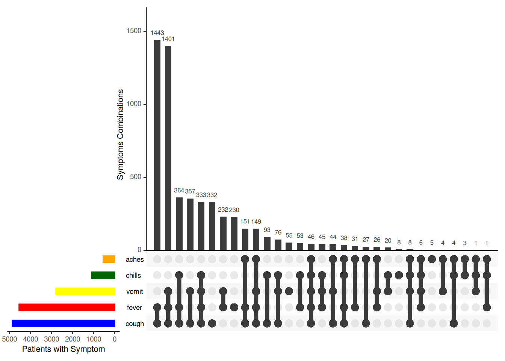

# 36  Análise de Combinações

[](combination_analysis_files/figure-html/combination_header-1.png)

Essa análise gera um gráfico de frequência de diferentes **combinações** de valores e respostas. Nesse exemplo, geramos o gráfico da frequência casos exibiram várias combinações de sintomas.

Esse tipo de análise também é chamada de:

- **“Análise de respostas múltiplas”** (*“Multiple response analysis”*)
- **“Análise de Conjuntos”** (*“Sets analysis”*)  
- **“Análise de Combinações”** (*“Combinations analysis”*)

No gráfico de exemplo acima são mostrados cinco sintomas. Abaixo de cada barra vertical há uma linha e pontos indicando a combinação de sintomas refletidos pela barra de cima.

O primeiro método que mostraremos utiliza o pacote **ggupset**, e o segundo utiliza o pacote **UpSetR**.

## 36.1 Preparação

### Carregue os pacotes R

O código abaixo realiza o carregamento dos pacotes necessários para a análise dos dados. Neste manual, enfatizamos o uso da função `p_load()`, do **pacman**, que instala os pacotes, caso não estejam instalados, *e* os carrega no R para utilização. Também é possível carregar pacotes instalados utilizando a função `library()`, do R **base**. Para mais informações sobre os pacotes do R, veja a página [Introdução ao R](basics.llms.md).

``` r
pacman::p_load(
  tidyverse,     # manupulação de dados e visualização
  UpSetR,        # pacote especial para gráficos de combinção 
  ggupset,       # pacote especial para gráficos de combinção 
  appliedepidata) # dados de exemplo utilizados neste manual
```

### Importe os dados

Para iniciar, importaremos a linelist dos casos de uma epidemia simulada do Ebola. Carregue diretamente com `appliedepidata::get_data(name = "linelist_cleaned_rds")` (consulte a página [Baixar manual e dados](download.llms.md) para mais detalhes).

``` r
# importe a linelit de casos 
linelist_sym <- appliedepidata::get_data(name = "linelist_cleaned_rds")
```

Essa linelist inclui cinco variáveis do tipo “sim/não” (“sim/no”) a respeito dos sintomas relatados. Nós vamos precisar transformar essas variáveis um pouco para poder utilizar o pacote **ggupset** para fazer nosso gráfico. Confira os dados (role para a direita para ver as variáveis dos sintomas).

### Reformate os valores

Para estarmos alinhados com o formato esperado pelo pacote **ggupset** vamos converter os “sim” e “não” para o real nome do sintoma utilizando a função `case_when()` do pacote **dplyr**. Caso seja “não”, definiremos o valor como vazio, então os valores serão `NA` ou o nome do sintoma.

``` r
# criar uma coluna com todos os sintomas separados por ponto-vírgula 
linelist_sym_1 <- linelist_sym %>% 

  # convert the "yes" and "no" values into the symptom name itself
  # if old value is "yes", new value is "fever", otherwise set to missing (NA)
mutate(fever = ifelse(fever == "yes", "fever", NA), 
       chills = ifelse(chills == "yes", "chills", NA),
       cough = ifelse(cough == "yes", "cough", NA),
       aches = ifelse(aches == "yes", "aches", NA),
       vomit = ifelse(vomit == "yes", "vomit", NA))
```

Agora nós geramos duas colunas finais:

1.  Concatenando (unindo) todos os sintomas do paciente (uma coluna de caracteres)  
2.  Convertendo a coluna acima para a classe *list*, para que ela possa ser passada ao pacote **ggupset** para fazer o gráfico.

Veja a página de [Caracteres e strings](characters_strings.llms.md) para aprender mais sobre a função `unite()` do pacote **stringr**

``` r
linelist_sym_1 <- linelist_sym_1 %>% 
  unite(col = "all_symptoms",
        c(fever, chills, cough, aches, vomit), 
        sep = "; ",
        remove = TRUE,
        na.rm = TRUE) %>% 
  mutate(
    # faz uma cópia de da coluna all_symptoms, mas na classe lista (que é requisito do ggupset() no próximo passo)
    all_symptoms_list = as.list(strsplit(all_symptoms, "; "))
    )
```

Veja a nova tabela. Note as duas colunas na extremidade da direta - os valores combinados, e a lista

## 36.2 **ggupset**

Carregue o pacote

``` r
pacman::p_load(ggupset)
```

Crie o gráfico. Vamos começar com um `ggplot()` e a função `geom_bar()`, mas depois vamos adicionar a função `scale_x_upset()` do pacote **ggupset**.

``` r
# manter as 10 combinações mais frequentes, as que n_intersections = 10 mostra
top_combinations <- linelist_sym_1 %>% 
  count(all_symptoms, sort = TRUE) %>% 
  slice_head(n = 10) %>% 
  pull(all_symptoms)

ggplot(
  data = filter(linelist_sym_1, all_symptoms %in% top_combinations),
  mapping = aes(x = all_symptoms_list)) +
geom_bar() +
scale_x_upset(
  reverse = FALSE,
  n_intersections = 10,
  sets = c("fever", "chills", "cough", "aches", "vomit"))+
labs(
  title = "Signs & symptoms",
  subtitle = "10 most frequent combinations of signs and symptoms",
  caption = "Caption here.",
  x = "Symptom combination",
  y = "Frequency in dataset")
```

[](combination_analysis_files/figure-html/combination_ggupset-1.png)

Mais informações sobre **ggupset** podem ser vistas [online](https://rdrr.io/cran/ggupset/man/scale_x_upset.html) ou offline na documentação do pacote na aba de Ajuda do seu RStudio após digitar `?ggupset` no console.

## 36.3 `UpSetR`

O pacote **UpSetR** permite mais personalizações do gráfico, mas pode ser mais difícil de executar.

**Carregue o pacote**

``` r
pacman::p_load(UpSetR)
```

**Limpando os dados**

Precisamos converter os valores dos sintomas da `linelist` para 1 / 0.

``` r
linelist_sym_2 <- linelist_sym %>% 
  # converte os valores de "sim" e "não" nos nomes dos sintomas
     mutate(fever = ifelse(fever == "yes", 1, 0), 
            chills = ifelse(chills == "yes", 1, 0),
            cough = ifelse(cough == "yes", 1, 0),
            aches = ifelse(aches == "yes", 1, 0),
            vomit = ifelse(vomit == "yes", 1, 0))
```

Se você tiver interesse em um comando mais eficiente, pode aproveitar a função `+()`, que converte para 1s e 0s a partir de uma declaração lógica. Este comando utiliza a função `across()` para alterar múltiplas colunas de uma só vez (leia mais em [Limpeza de dados e funções essenciais](cleaning.llms.md#clean_across)).

``` r
# Efficiently convert "yes" to 1 and 0
linelist_sym_2 <- linelist_sym %>% 
  
  # convert the "yes" and "no" values into 1s and 0s
  mutate(across(c(fever, chills, cough, aches, vomit), .fns = ~+(.x == "yes")))
```

Agora vamos fazer o gráfico utilizando a função `upset()` - utilizando apenas as colunas de sintomas. Você deve definir quais “conjuntos” serão comparados (passe os nomes das colunas de sintomas). Ou então, utilize `nsets =` e `order.by = "freq"` para mostrar apenas as maiores X combinações.

``` r
# Make the plot
linelist_sym_2 %>% 
  drop_na(fever, chills, cough, aches, vomit) %>% 
  UpSetR::upset(
       sets = c("fever", "chills", "cough", "aches", "vomit"),
       order.by = "freq",
       sets.bar.color = c("blue", "red", "yellow", "darkgreen", "orange"), # optional colors
       empty.intersections = "on",
  # nsets = 3,
       number.angles = 0,
       point.size = 3.5,
       line.size = 2, 
       mainbar.y.label = "Symptoms Combinations",
       sets.x.label = "Patients with Symptom")
```

[](combination_analysis_files/figure-html/combination_upsetr-1.png)

## 36.4 Recursos

[Página do github do UpSetR](https://github.com/hms-dbmi/UpSetR)

[Uma versão em Shiny App - você pode fazer upload de seus próprios dados](https://gehlenborglab.shinyapps.io/upsetr/)

[\*documentação - difícil de interpretar](https://cran.r-project.org/web/packages/UpSetR/UpSetR.pdf)
