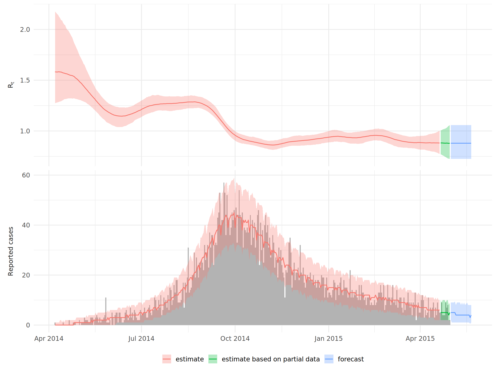
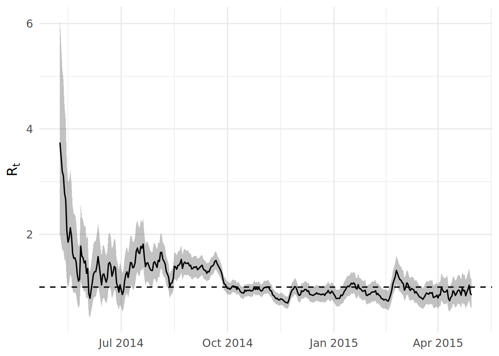
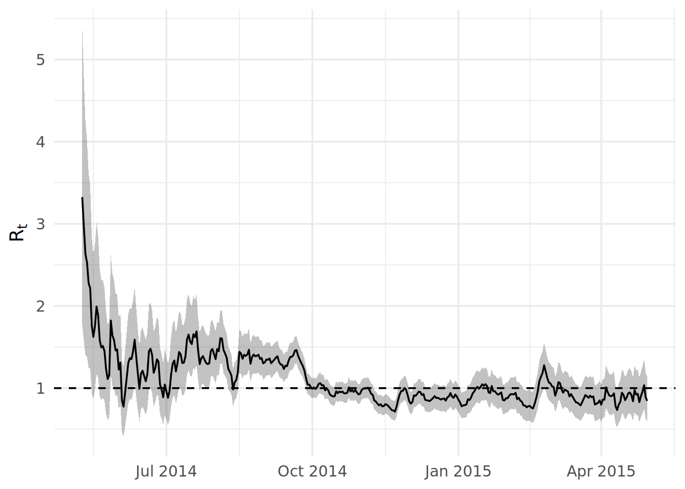
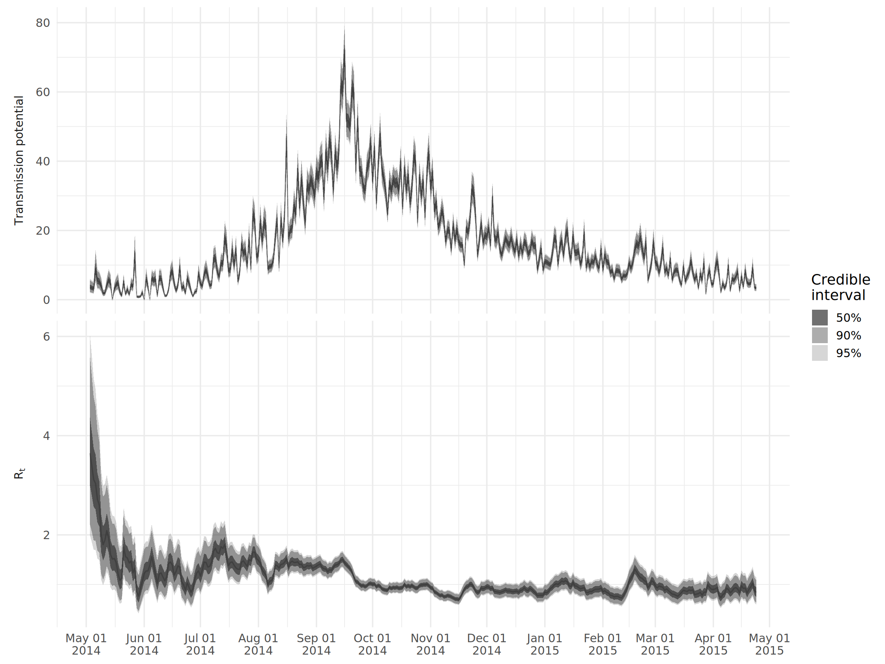
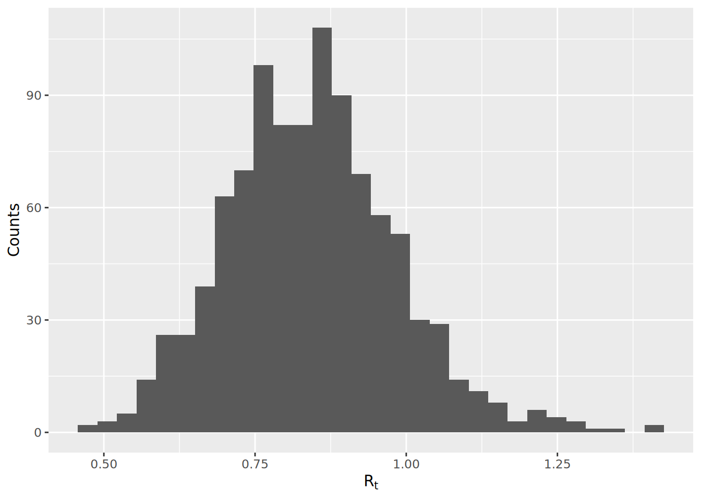
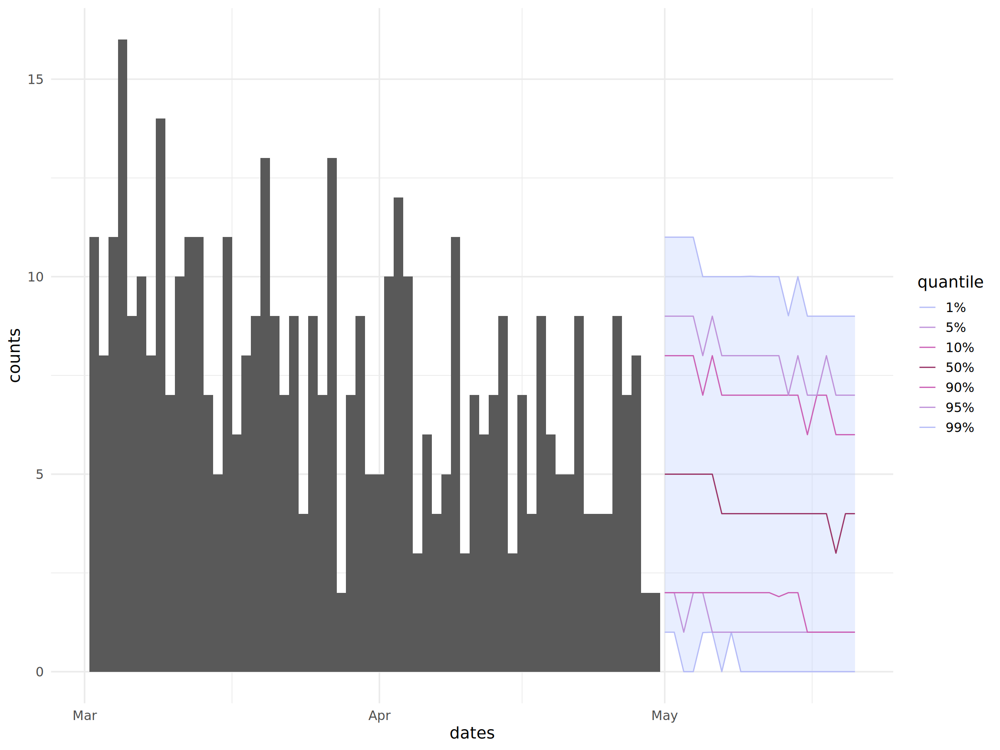

# 24  Modelagem de epidemias

## 24.1 Visão geral do tópico

Existe um conjunto crescente de ferramentas para modelagem em epidemiologia que nos permite desenvolver análises complexas com esforço mínimo. Este capítulo apresenta uma síntese sobre como usar essas ferramentas para:

- estimar o número efetivo de reprodução R_(t) e estatísticas relacionadas como tempo de duplicação

- produzir projeções de curto prazo da incidência futura

Tenha em mente que esta página *não* é uma revisão das metodologias e métodos estatísticos empregados por estas ferramentas. Para tanto, utilize os links disponíveis no subtópico Recursos extras para encontrar artigos detalhando essas metodologias. Antes de utilizar as ferramentas a seguir, garanta que você compreenda os métodos subjacentes empregados; isto garantirá que você possa interpretar adequadamente os resultados.

Abaixo está um exemplo de uma das análises que construíremos neste capítulo.

[](epidemic_models_files/figure-html/unnamed-chunk-1-1.png)

## 24.2 Preparação

Iremos utilizar dois métodos e pacotes diferentes para estimar o R_(t), chamados de **EpiNow** e **EpiEstim**, assim como o pacote **projections** para fazer previsões da incidência de casos.

Este pedaço de código mostra o carregamento dos pacotes necessários para as análises. Neste manual, enfatizamos o uso de `p_load()`, do pacote **pacman**, que instala o pacote, caso necessário, *e* o inicia para uso. Você também pode carregar pacotes instalados com `library()`, do R **base**. Veja a página sobre [Introdução ao R](basics.llms.md) para mais informações sobre pacotes no R.

``` r
pacman::p_load(
   rio,          # Importar arquivos
   here,         # Localizar arquivos
   tidyverse,    # Gerenciamento dos dados + gráficos ggplot2
   epicontacts,  # Analisar as redes de transmissão
   EpiNow2,      # Estimar Rt
   EpiEstim,     # Estimar Rt
   projections,  # Projeções da incidência
   incidence2,   # Trabalhando com dados de incidência
   incidence,    # Objetos incidence para as projeções
   epitrix,      # Funções uteis de epi
   distcrete     # Distribuições discretas .;
)
```

Nesta seção, iremos utilizar a linelist dos casos limpa para todas as análises. Se você quiser acomapnhar, [clique para baixar a linelist “limpa”](https://github.com/appliedepi/epirhandbook_eng/raw/master/data/case_linelists/linelist_cleaned.rds) (como arquivo .rds). Veja a página [Download do manual e dados](download.llms.md) para baixar todos os dados utilizados como exemplo neste manual.

``` r
# importe a linelist limpa
linelist <- import("linelist_cleaned.rds")
```

## 24.3 Estimando o R_(t)

### EpiNow2 vs. EpiEstim

O número de reprodução R é uma medida da capacidade de transmissão de uma doença e é definido como a quantidade esperada de casos secundários para cada caso infectado. Em uma população totalmente susceptível, este valor representa o número básico de reprodução R₀. Entretanto, conforme o número de indivíduos susceptíveis em uma população muda no decorrer de um surto ou pandemia, e conforme várias medidas de resposta e controle são implementadas, a medida mais comumente utilizada de transmissibilidade é o número efetivo de reprodução R_(t); este é definido como a quantidade de casos secundários por cada caso infectado em um determinando ponto no tempo *t*.

O pacote **EpiNow2** fornece a estrutura mais sofisticada para estimar o R_(t). Ele tem duas vantagens chave sobre o outro pacote comumente utilizado, **EpiEstim**:

- Ele leva em consideração as demoras nas notificações ao estimar o R_(t), mesmo quando dados recentes são incompletos.
- Ele estima o R_(t) a partir das *datas de infecção*, em vez das datas de início das notificações, o que significa que o efeito de uma intervenção irá imediatamente refletir em mudanças no R_(t), em vez de demorar para alterar.

Entretanto, ele também possuí duas desvantagens chave:

- Ele necessita de conhecimento da distribuição do tempo de geração (ex.: distribuição dos intervalos de infecção entre casos primários e secundários), distribuição do tempo de incubação (ex.: distribuição dos intervalos entre a infecção e o início dos sintomas) e qualquer outra distribuição de intervalos relevante para os seus dados (ex.: se você tiver datas de notificação, você precisa da distribuição dos intervalos entre início dos sintomas e notificação dos casos). Enquanto isto irá permitir estimativas mais acuradas do R_(t), **EpiEstim** apenas requer a distribuição seriada dos intervalos (ex.: a distribuição de intervalos entre o início dos sintomas de casos primários e secundários), que pode ser a única distribuição disponível para você.
- **EpiNow2** é significamente mais devagar do que **EpiEstim**, por fatores entre 100-1000 mais lento! Por exemplo, estimar o R_(t) para a amostra do surto trabalhada nesta seção levou por volta de quatro horas (esta estimativa rodou por um elevado número de iterações para garantir elevada acurácia, e provavelmente poderia ser reduzida caso necessário. Entretanto, o ponto é que este algoritmo é mais devagar, no geral). Logo, este pacote pode ser inviável caso você esteja atualizando regularmente suas estimativas do R_(t).

Qual pacote você irá escolher irá depender dos seus dados, tempo e recursos computacionais disponíveis.

### EpiNow2

#### Estimando a distribuição dos intervalos

As distribuições dos intervalos necessárias para utilizar o **EpiNow2** variam de acordo com os seus dados. Essencialmente, você precisar ser capaz de descrever o intervalo entre a data de infecção e a data do evento que você quer utilizar para estimar o R_(t). Caso você esteha utilizando as datas de início dos sintomas, isto seria simplesmente a distribuição do período de incubação. Se você estiver utilizando as datas de notificação, você utiliza o intervalo entre infecção à notificação. Como é improvável que esta distribuição seja conhecida diretamente, **EpiNow2** permite conectar múltiplas distribuições de intervalo; neste caso, os intervalos entre a infecção e o aparecimento dos sintomas (ex.: o período de incubação, que provavelmente é conhecido) e entre o início dos sintomas e a notificação (que você pode frequentemente estimar a partir dos seus dados).

Como temos as datas de início dos sintomas para todos os nossos casos em nossa linelist de exemplo, nós apenas precisamos da distribuição do período de incubação para conectar os nossos dados (ex.: datas de início dos sintomas) para a data de infecção. Nós podemos ou estimar esta distribuição a partir dos dados, ou utilizar valores da literatura.

Uma estimativa do período de incubação da Ebola encontrada na literatura (obtida [deste artigo](https://www.nejm.org/doi/full/10.1056/nejmoa1411100)) possuí uma média de 9.1, desvio padrão de 7.3, e o valor máximo de 30. Isto pode ser especificado no R como mostrado a seguir:

``` r
incubation_period_lit <- LogNormal(
  mean = 9.1,
  sd = 7.3,
  max = 30
)
```

`LogNormal()` recebe a média e o desvio padrão em dias, na escala natural, e converte-os ela mesma para a escala log. O parâmetro `max` corta a distribuição em 30 dias.

Nesta análise, nós estimamos a distribuição do período de incubação a partir da própria linelist utilizando a função `bootstrapped_dist_fit`, que irá ajustar uma distribuição log-normal para os intervalos observados entre a infecção e o aparecimento dos sintomas na linelist.

``` r
## estime o período de incubação
incubation_period <- bootstrapped_dist_fit(
  linelist$date_onset - linelist$date_infection,
  dist = "lognormal",
  max_value = 100,
  bootstraps = 1
)
```

A outra distribuição que precisamos é o tempo de geração. Como temos dados sober os tempos de infecção **and** os links de transmissão, nós podemos estimar esta distribuição a partir da linelist ao calcular o intervalo entre o tempo de infecção de pares infectores-infectados. Para fazer isto, nós utilizamos a função `get_pairwise` do pacote **epicontacts**, que nos permite calcular diferenças entre os pares a partir das propriedades da linelist sobre os pares de transmissão. Nós primeiro criamos um objeto epicontact (veja a página [Cadeias de transmissão](transmission_chains.llms.md) para mais detalhes):

``` r
## gere o objeto contatos
contacts <- linelist %>%
  transmute(
    from = infector,
    to = case_id
  ) %>%
  drop_na()

## gere o objeto epicontact
epic <- make_epicontacts(
  linelist = linelist,
  contacts = contacts, 
  directed = TRUE
)
```

Então, ajustamos a diferença no tempo de incubação entre os pares da transmissão, calculado com `get_pairwise`, em uma distribuição gamma:

``` r
## estime o tempo de geração gamma
generation_time <- bootstrapped_dist_fit(
  get_pairwise(epic, "date_infection"),
  dist = "gamma",
  max_value = 20,
  bootstraps = 1
)
```

#### Executando o **EpiNow2**

Agora nós só precisamos calcular a incidência diária a partir da linelist, que podemos fazer facilmente com as funções `group_by()` e `n()`, do **dplyr**. Note que o **EpiNow2** requer que os nomes das colunas sejam `date` e `confirm`. O **EpiNow2** também para com um erro quando falta uma data, então removemos os casos sem data de início dos sintomas. Com lacunas entre as datas, o **EpiNow2** 1.9.0 parou com um erro nestes dados. Por isso `fill_missing()` adiciona os dias sem casos, com contagem 0.

``` r
## obtenha a incidência a partir da data de início dos sintomas
cases <- linelist %>%
  filter(!is.na(date_onset)) %>%
  group_by(date = date_onset) %>%
  summarise(confirm = n()) %>%
  ## adicionar os dias sem casos, com contagem 0
  fill_missing(missing_dates = "zero")
```

Podemos, então, estimar o R_(t) utilizando a função `epinow`. Algumas notas sobre os dados usados:

- O argumento `generation_time` recebe a distribuição do tempo de geração dentro da função `gt_opts`.
- Nós podemos fornecer qualquer quantidade de distribuições de intervalos ‘encadeados’ para o argumento `delays`; simplesmente iríamos somá-los ao objeto `incubation_period` com `+` dentro da função `delay_opts`.
- `horizon` dentro da função `forecast_opts` indica em quantos dias queremos estimar a incidência futura.
- Nós adicionamos outras opções no argumento `stan` para especificar por quanto tempo queremos executar a inferência. Aumentar o `samples` e `chains` irá te dar uma estimativa mais precisa que melhor caracteriza a incerteza, entretanto irá demorar mais para ser calculada.

``` r
## execute o epinow
epinow_res <- epinow(
  data = cases,
  generation_time = gt_opts(generation_time),
  delays = delay_opts(incubation_period),
  forecast = forecast_opts(horizon = 21),
  stan = stan_opts(samples = 750, chains = 4)
)
```

#### Analisando o resultado da análise

Esta página não executa o ajuste. Os resultados abaixo vêm de um ajuste armazenado no pacote **appliedepidata**. Uma versão anterior do **EpiNow2** fez esse ajuste. O código acima é a forma de fazer um ajuste assim com o **EpiNow2** 1.9.

Em um ajuste do **EpiNow2** 1.9, a função `plot()` cria uma figura resumo, e a função `summary()` dá uma tabela resumo. Estas funções param com um erro no ajuste armazenado. Por isso carregamos as tabelas do ajuste armazenado e criamos o gráfico com o **ggplot2**:

``` r
## carregar as estimativas armazenadas e as contagens de casos usadas no ajuste
estimates <- appliedepidata::get_data(name = "epidemic_models_summarised_estimates")
observations <- appliedepidata::get_data(name = "epidemic_models_reported_cases")

## faça uma figura do sumário da análise
ggplot(
  data = filter(estimates, variable %in% c("R", "reported_cases")),
  aes(x = date)
) +
  ## contagens de casos observados, apenas no painel de casos notificados
  geom_col(
    data = mutate(observations, variable = "reported_cases"),
    aes(y = confirm),
    fill = "grey70",
    width = 1
  ) +
  ## intervalo de credibilidade de 90% e mediana, coloridos por tipo de estimativa
  geom_ribbon(aes(ymin = lower_90, ymax = upper_90, fill = type), alpha = 0.3) +
  geom_line(aes(y = median, colour = type)) +
  ## utilize label_parsed para conseguir subscrever o rótulo
  facet_wrap(
    ~ variable,
    ncol = 1,
    scales = "free_y",
    labeller = as_labeller(c("R" = "R[t]", "reported_cases" = "Reported~cases"), label_parsed),
    strip.position = 'left'
  ) +
  labs(x = NULL, y = NULL, colour = NULL, fill = NULL) +
  theme_minimal(base_size = 14) +
  theme(
    strip.background = element_blank(),
    strip.placement = 'outside',
    legend.position = 'bottom'
  )
```

[](epidemic_models_files/figure-html/unnamed-chunk-4-1.png)

Nós também podemos olher diferentes resumos estatísticos:

``` r
## tabela resumo do ajuste armazenado
summary_table <- appliedepidata::get_data(name = "epidemic_models_summary")
summary_table[, c("measure", "estimate")]
```

                                    measure                  estimate
    1 New confirmed cases by infection date                4 (2 -- 6)
    2        Expected change in daily cases                    Unsure
    3            Effective reproduction no.        0.88 (0.73 -- 1.1)
    4                        Rate of growth -0.012 (-0.028 -- 0.0052)
    5          Doubling/halving time (days)          -60 (130 -- -25)

Para mais análise e customização do gráfico, você pode acessar as estimativas diárias resumidas de um ajuste do **EpiNow2** 1.9 através de `summary(epinow_res, type = "parameters")`. Nós iremos converter isto do padrão `data.table` para um `tibble`, facilitando o uso com **dplyr**. A tabela abaixo mostra as mesmas estimativas do ajuste armazenado.

``` r
## extraia o resumo e converta para formato tibble
estimates <- as_tibble(summary(epinow_res, type = "parameters"))
estimates
```

Como um exemplo, vamos criar um gráfico do tempo de duplicação e do R_(t). Nós iremos apenas olhar os primeiros meses do surto, quando o R_(t) está bem acima de um, para evitar traçar tempos de duplicação extremamente elevados.

Nós utilizamos a fórmula `log(2)/growth_rate` para calcular o tempo de duplicação a partir da taxa de crescimento estimada.

``` r
## crie amplas df para um gráfico mediano
df_wide <- estimates %>%
  filter(
    variable %in% c("growth_rate", "R"),
    date < as.Date("2014-09-01")
  ) %>%
  ## converta as taxas de crescimento para o tempo de duplicação
  mutate(
    across(
      c(median, lower_90:upper_90),
      ~ case_when(
        variable == "growth_rate" ~ log(2)/.x,
        TRUE ~ .x
      )
    ),
    ## renomeie a variável para refletir na transformação de taxa de crescimento para tempo de duplicação
    variable = replace(variable, variable == "growth_rate", "doubling_time")
  )

## crie um data frame longo para criar gráfico de quantis
df_long <- df_wide %>%
  ## aqui nós combinamos quantis correspondentes (ex.: lower_90 para upper_90)
  pivot_longer(
    lower_90:upper_90,
    names_to = c(".value", "quantile"),
    names_pattern = "(.+)_(.+)"
  )

## crie um gráfico
ggplot() +
  geom_ribbon(
    data = df_long,
    aes(x = date, ymin = lower, ymax = upper, alpha = quantile),
    color = NA
  ) +
  geom_line(
    data = df_wide,
    aes(x = date, y = median)
  ) +
  ## utilize label_parsed para conseguir subscrever o rótulo
  facet_wrap(
    ~ variable,
    ncol = 1,
    scales = "free_y",
    labeller = as_labeller(c(R = "R[t]", doubling_time = "Doubling~time"), label_parsed),
    strip.position = 'left'
  ) +
  ## defina manualmente a transparência do quantil
  scale_alpha_manual(
    values = c(`20` = 0.7, `50` = 0.4, `90` = 0.2),
    labels = function(x) paste0(x, "%")
  ) +
  labs(
    x = NULL,
    y = NULL,
    alpha = "Credible\ninterval"
  ) +
  scale_x_date(
    date_breaks = "1 month",
    date_labels = "%b %d\n%Y"
  ) +
  theme_minimal(base_size = 14) +
  theme(
    strip.background = element_blank(),
    strip.placement = 'outside'
  )
```

[](epidemic_models_files/figure-html/epidemic_models_plot_epinow_cusotom-1.png)

### EpiEstim

Para executar **EpiEstim**, nós precisamos fornecer dados de incidência diária, e especificar o intervalo seriado (i.e.: a distribuição dos intervalos entre o início dos sintomas dos casos primários e secundários).

Dados de incidência podem ser fornecidos para o **EpiEstim** como um vetor, um quadro de dados, ou um objeto `incidence` do pacote original **incidence**. Você consegue até distinguir entre importados e infecções adquiridas localmente; veja a documentação em `?estimate_R` para mais detalhes.

Nós iremos criar a entrada de dados usando **incidence2**. Veja a página sobre [Curvas epidêmicas](epicurves.llms.md) para mais exemplos com o pacote **incidence2**. Já que existem updates no pacote **incidence2** que não fornecem a entrada necessária do `estimate_R()`, existem algumas pequenas etapas adicionais necessárias. O objeto incidence consiste de uma tabela tibble com as datas e as respectivas contagens. Nós usamos `complete()`, do pacote **tidyr**, para garantir que todas as datas sejam incluídas (até as datas sem casos), e então `rename()` as colunas para gerarem o que é esperado pela função `estimate_R()` em uma etapa posterior.

``` r
## obtenha a incidência a partir da data de início dos sintomas
cases <- incidence2::incidence(linelist, date_index = "date_onset") %>% # obtenha a quantidade de casos por dia
  tidyr::complete(date_index = seq.Date(                              # garanta que todas as datas estão presentes
    from = min(date_index, na.rm = T),
    to = max(date_index, na.rm=T),
    by = "day"),
    fill = list(count = 0)) %>%                                       # converta contagens NA para 0
  rename(I = count,                                                   # renomeie para os nomes utilizados no estimate_R()
         dates = date_index)
```

O pacote fornece diferentes opções para especificar os intervalos seriados, os detalhes são fornecidos na documentação em `?estimate_R`. Nós iremos cobrir duas das opções aqui.

#### Utilizando estimativas de intervalos seriados da literatura

Ao usar a opção `method = "parametric_si"`, podemos especificar manualmente a média e desvio padrão do intervalo seriado em um objeto `config` criado usando a função `make_config`. Nós usamos uma média e um desvio padrão de 12.0 e 5.2, respectivamente, definidos neste [artigo](https://bmcmedicine.biomedcentral.com/articles/10.1186/s12916-014-0196-0).

Por padrão, `estimate_R()` usa janelas semanais móveis a partir do segundo dia dos dados. O **EpiEstim** avisa que um R_(t) estimado a partir de muito poucos casos não é confiável: com as suas configurações padrão, ele precisa de pelo menos 11 casos em uma janela. As primeiras semanas deste surto têm menos. Por isso começamos as janelas semanais na primeira janela de 7 dias com pelo menos 11 casos, e usamos estas janelas para as duas estimativas abaixo:

``` r
## contagens diárias de casos, uma linha por dia
daily_cases <- cases$I

## número de casos na janela de 7 dias que começa em cada dia
window_cases <- sapply(
  seq_len(length(daily_cases) - 6),
  function(t) sum(daily_cases[t:(t + 6)])
)

## janelas semanais deslizantes a partir da primeira janela com pelo menos 11 casos
weekly_start <- max(2, which(window_cases >= 11)[1]):(length(daily_cases) - 6)
weekly_end <- weekly_start + 6

## crie o config
config_lit <- make_config(
  mean_si = 12.0,
  std_si = 5.2,
  t_start = weekly_start,
  t_end = weekly_end
)
```

Então, nós podemos estimar o R_(t) com a função `estimate_R`:

``` r
cases <- cases %>% 
     filter(!is.na(dates))


#create a dataframe for the function estimate_R()
cases_incidence <- data.frame(dates = seq.Date(from = min(cases$dates),
                               to = max(cases$dates), 
                               by = 1))

cases_incidence <- left_join(cases_incidence, cases, by = "dates") %>% 
     select(dates, I) %>% 
     mutate(I = ifelse(is.na(I), 0, I))

epiestim_res_lit <- estimate_R(
  incid = cases_incidence,
  method = "parametric_si",
  config = config_lit
)
```

e criar um gráfico das estimativas de R_(t). A função `plot()` do **EpiEstim** gera um aviso de descontinuação do **ggplot2**, então escrevemos uma função curta que cria o gráfico das estimativas com o **ggplot2**. Ela data cada estimativa pelo fim da sua janela de tempo:

``` r
## plotar a estimativa média de R e o seu intervalo de credibilidade de 95%
plot_rt <- function(res) {
  res$R %>%
    ## remover as janelas de tempo sem estimativa
    filter(!is.na(`Mean(R)`)) %>%
    ## datar cada estimativa pelo fim da sua janela de tempo
    mutate(date = res$dates[t_end]) %>%
    ggplot(aes(x = date)) +
    geom_ribbon(aes(ymin = `Quantile.0.025(R)`, ymax = `Quantile.0.975(R)`), alpha = 0.3) +
    geom_line(aes(y = `Mean(R)`)) +
    geom_hline(yintercept = 1, linetype = 2) +
    labs(x = NULL, y = expression(R[t])) +
    theme_minimal(base_size = 14)
}

plot_rt(epiestim_res_lit)
```

[](epidemic_models_files/figure-html/epidemic_models_epiestim_lit_plot-1.png)

#### Utilizando estimativas de intervalos seriados dos dados

Conforme obtemos dados sobre as datas de início dos sintomas *and* e links de transmissão, nós podemos também estimar o intervalo seriado a partir da linelist ao calcular o intervalo entre as datas de início dos sintomas dos pares infectante-infectado.Como fizemos na seção do **EpiNow2**, nós iremos agora utilizar a função `get_pairwise`, do pacote **epicontacts**, que nos permite calcular as diferenças entre os pares de transmissão nas características na linelsit. Primeiro, criamos um objeto epicontact (veja a página [Cadeias de transmissão](transmission_chains.llms.md) para mais detalhes):

``` r
## gere os contatos
contacts <- linelist %>%
  transmute(
    from = infector,
    to = case_id
  ) %>%
  drop_na()

## gere um objeto epicontact
epic <- make_epicontacts(
  linelist = linelist,
  contacts = contacts, 
  directed = TRUE
)
```

Então ajustamos a diferença entre as datas de início dos sintomas dos pares de transmissão, calculado usando `get_pairwise`, para uma distribuição gamma. Utilizamos a função `fit_disc_gamma`, do pacote **epitrix**, para fazer este procedimento de ajuste, uma vez que precisamos de uma distribuição *discreta*.

``` r
## estimar o intervalo serial gama, sem os pares que não têm data de início dos sintomas
serial_interval <- fit_disc_gamma(na.omit(get_pairwise(epic, "date_onset")))
```

Então aplicamos esta informação no objeto `config`, executamos o **EpiEstim** novamente, e criamos um gráfico dos resultados:

``` r
## crie o config
config_emp <- make_config(
  mean_si = serial_interval$mu,
  std_si = serial_interval$sd,
  t_start = weekly_start,
  t_end = weekly_end
)

## execute o epiestim
epiestim_res_emp <- estimate_R(
  incid = cases_incidence,
  method = "parametric_si",
  config = config_emp
)

## crie um gráfico dos resultados
plot_rt(epiestim_res_emp)
```

[](epidemic_models_files/figure-html/epidemic_models_epiestim_emp-1.png)

#### Especificando as janelas de estimação do tempo

Você também pode escolher o início das janelas, por exemplo para estimar o R_(t) apenas a partir de 1 de junho de 2014, como mostrado abaixo. Infelizmente, o **EpiEstim** apenas fornece um método bem desajeitado de especificar estes tempos de estimativas, em que você precisa fornecer um vetor de **números inteiros** referentes as datas de início e fim para cada intervalo de tempo.

``` r
## defina um vetor de datas iniciando em 1o de junho
start_dates <- seq.Date(
  as.Date("2014-06-01"),
  max(cases$dates) - 7,
  by = 1
) %>%
  ## substraia a data de início para converto para numérico
  `-`(min(cases$dates)) %>%
  ## converta para número inteiro
  as.integer() %>%
  ## somar 1, porque o dia 1 dos dados de incidência é a sua primeira data
  `+`(1L)

## adicione seis dias para um intervalo móvel de uma semana
end_dates <- start_dates + 6
  
## crie o config
config_partial <- make_config(
  mean_si = 12.0,
  std_si = 5.2,
  t_start = start_dates,
  t_end = end_dates
)
```

Agora re-executamos o **EpiEstim**, e podemos ver as estimativas apenas a partir de junho:

``` r
## rode o epiestim
epiestim_res_partial <- estimate_R(
  incid = cases_incidence,
  method = "parametric_si",
  config = config_partial
)

## crie um gráfico dos resultados
plot_rt(epiestim_res_partial)
```

[](epidemic_models_files/figure-html/epidemic_models_epiestim_config_late_run-1.png)

#### Analisando os resultados

Os principais resultados podem ser acessados através de `$R`. Como um exemplo, nós iremos criar um gráfico do R_(t) e uma medida de “potencial de transmissão”, dada pelo produto de R_(t) e o número de casos notificados naquele dia; isto representa o número esperado de casos na próxima geração da infecção.

``` r
## crie um quadro de dados amplo para a mediana
df_wide <- epiestim_res_lit$R %>%
  rename_all(clean_labels) %>%
  rename(
    lower_95_r = quantile_0_025_r,
    lower_90_r = quantile_0_05_r,
    lower_50_r = quantile_0_25_r,
    upper_50_r = quantile_0_75_r,
    upper_90_r = quantile_0_95_r,
    upper_95_r = quantile_0_975_r,
    ) %>%
  ## remover as janelas de tempo sem estimativa
  filter(!is.na(mean_r)) %>%
  mutate(
    ## extraia a data média de t_start e t_end
    dates = epiestim_res_emp$dates[round(map2_dbl(t_start, t_end, median))],
    var = "R[t]"
  ) %>%
  ## una com os dados de incidência diária
  left_join(cases, "dates") %>%
  ## calcule o risco através de todas as estimativas de r
  mutate(
    across(
      lower_95_r:upper_95_r,
      ~ .x*I,
      .names = "{str_replace(.col, '_r', '_risk')}"
    )
  ) %>%
  ## separe as estimativas de r e as estimativas de risco
  pivot_longer(
    contains("median"),
    names_to = c(".value", "variable"),
    names_pattern = "(.+)_(.+)"
  ) %>%
  ## atribua os níveis do fator
  mutate(variable = factor(variable, c("risk", "r")))

## crie um data frame longo a partir dos quantis
df_long <- df_wide %>%
  select(-variable, -median) %>%
  ## separe o r/estimativas de risco e níveis de quantis
  pivot_longer(
    contains(c("lower", "upper")),
    names_to = c(".value", "quantile", "variable"),
    names_pattern = "(.+)_(.+)_(.+)"
  ) %>%
  mutate(variable = factor(variable, c("risk", "r")))

## crie o gráfico
ggplot() +
  geom_ribbon(
    data = df_long,
    aes(x = dates, ymin = lower, ymax = upper, alpha = quantile),
    color = NA
  ) +
  geom_line(
    data = df_wide,
    aes(x = dates, y = median),
    alpha = 0.2
  ) +
  ## use label_parsed para permitir rótulos subescritos
  facet_wrap(
    ~ variable,
    ncol = 1,
    scales = "free_y",
    labeller = as_labeller(c(r = "R[t]", risk = "Transmission~potential"), label_parsed),
    strip.position = 'left'
  ) +
  ## defina manualmente a transparência do quantil
  scale_alpha_manual(
    values = c(`50` = 0.7, `90` = 0.4, `95` = 0.2),
    labels = function(x) paste0(x, "%")
  ) +
  labs(
    x = NULL,
    y = NULL,
    alpha = "Credible\ninterval"
  ) +
  scale_x_date(
    date_breaks = "1 month",
    date_labels = "%b %d\n%Y"
  ) +
  theme_minimal(base_size = 14) +
  theme(
    strip.background = element_blank(),
    strip.placement = 'outside'
  )
```

[](epidemic_models_files/figure-html/epidemic_models_epiestim_plot_full-1.png)

## 24.4 Projeções da incidência

### EpiNow2

Além de estimar o R_(t), **EpiNow2** também é capaz de prever o R_(t) e projetar o número de casos. Tudo o que você precisa fazer é dar `forecast_opts(horizon = 21)` ao argumento `forecast` ao usar a função `epinow`. `horizon` é o número de dias que você quer projetar no futuro. Veja a seção do **EpiNow2** em “Estimando o R_(t)” para detalhes sobre como configurar e executar o **EpiNow2**. Nesta seção, nós iremos apenas fazer o gráfico da previsão do ajuste armazenado.

``` r
## defina a data mínima do gráfico
min_date <- as.Date("2015-03-01")

## carregar as estimativas resumidas do ajuste armazenado
estimates <- as_tibble(appliedepidata::get_data(name = "epidemic_models_summarised_estimates"))

## carregar as contagens de casos usadas pelo ajuste armazenado
observations <- as_tibble(appliedepidata::get_data(name = "epidemic_models_reported_cases")) %>%
  filter(date > min_date)

## extraia as estimativas previstas do número de caso
df_wide <- estimates %>%
  filter(
    variable == "reported_cases",
    type == "forecast",
    date > min_date
  )

## converta para o formato longo para criar o gráfico de quantil
df_long <- df_wide %>%
  ## aqui combinamos os quantis correspondentes (ex.: lower_90 to upper_90)
  pivot_longer(
    lower_90:upper_90,
    names_to = c(".value", "quantile"),
    names_pattern = "(.+)_(.+)"
  )

## crie o gráfico
ggplot() +
  geom_col(
    data = observations,
    aes(x = date, y = confirm),
    width = 1
  ) +
  geom_ribbon(
    data = df_long,
    aes(x = date, ymin = lower, ymax = upper, alpha = quantile),
    color = NA
  ) +
  geom_line(
    data = df_wide,
    aes(x = date, y = median)
  ) +
  geom_vline(xintercept = min(df_long$date), linetype = 2) +
  ## defina manualmente a transparência do quantil
  scale_alpha_manual(
    values = c(`20` = 0.7, `50` = 0.4, `90` = 0.2),
    labels = function(x) paste0(x, "%")
  ) +
  labs(
    x = NULL,
    y = "Daily reported cases",
    alpha = "Credible\ninterval"
  ) +
  scale_x_date(
    date_breaks = "1 month",
    date_labels = "%b %d\n%Y"
  ) +
  theme_minimal(base_size = 14)
```

[](epidemic_models_files/figure-html/epidemic_models_episoon-1.png)

### Pacote projections

O pacote **projections**, desenvolvido pela RECON, torna bem fácil o ato de prever incidências no curto prazo, requerindo apenas conhecimento do número efetivo de reprodução R_(t), e o intervalo seriado. Aqui, nós iremos abordar como usar estimativas seriadas de intervalo da literatura e como usar nossas próprias estimativas baseadas na linelist.

#### Utilizando estimativas de intervalo seriado da literatura

O pacote **projections** precise de uma distribuição seriada discreta de intervalos da classe `distcrete`, do pacote **distcrete**. Nós iremos utilizar uma distribuição gamma com uma média de 12.0 e desvio padrão de 5.2 definido neste [artigo](https://bmcmedicine.biomedcentral.com/articles/10.1186/s12916-014-0196-0). Para converter estes valores para os parâmetros de formato e escala requiridos para a distribuição gamma, iremos utilizar a função `gamma_mucv2shapescale` do pacote **epitrix**.

``` r
## obtenha os parâmetros de formato e escala da média mu e o coeficiente de
## variação (ex.: a razão do desvio padrão para a média)
shapescale <- epitrix::gamma_mucv2shapescale(mu = 12.0, cv = 5.2/12)

## crie um objeto do tipo *distcrete*
serial_interval_lit <- distcrete::distcrete(
  name = "gamma",
  interval = 1,
  shape = shapescale$shape,
  scale = shapescale$scale
)
```

Aqui está uma checagem rápida para garantir que o intervalo seriado está correto. Nós acessamos a densidade da distribuição gamma que acabamos de definir com `$d`, que é equivalente a chamar `dgamma`:

``` r
## cheque para garantir que o intervalo seriado está correto
ggplot(
  data = tibble(x = 0:50, y = serial_interval_lit$d(0:50)),
  aes(x = x, y = y)
) +
  geom_area() +
  labs(x = "Serial interval", y = "Density")
```

[](epidemic_models_files/figure-html/epidemic_models_projections_distcrete_plot-1.png)

#### Utilizando estivamitvas de intervalo seriadas a partir dos dados

Como temos dados com as datas de início dos sintomas *e* links de transmissão, nós podemos também estimar o intervalo seriado a partir da linelist ao calcular o intervalo entre as datas de início dos sintomas dos pares infectante-infectado. Como fizemos na seção do **EpiNow2**, nós iremos utilizar a função `get_pairwise` do pacote **epicontacts**, que nos permite calcular diferenças em pares das propriedades da linelist nos pares de transmissão. Primeiro, criamos um objeto epicontact (veja a página [Cadeias de transmissão](transmission_chains.llms.md) para mais detalhes):

``` r
## crie os contacts
contacts <- linelist %>%
  transmute(
    from = infector,
    to = case_id
  ) %>%
  drop_na()

## crie o objeto epicontacts
epic <- make_epicontacts(
  linelist = linelist,
  contacts = contacts, 
  directed = TRUE
)
```

Então ajustamos a diferença no início de sintomas entre os pares de transmissão, calculando usando `get_pairwise`, para uma distriuição gamma. Nós usamos a função `fit_disc_gamma`, do pacote **epitrix**, para realizar este procedimento de ajuste, uma vez que precisamos de uma distribuição *discreta*.

``` r
## estimar o intervalo serial gama, sem os pares que não têm data de início dos sintomas
serial_interval <- fit_disc_gamma(na.omit(get_pairwise(epic, "date_onset")))

## inspecione a estimativa
serial_interval[c("mu", "sd")]
```

    $mu
    [1] 11.51047

    $sd
    [1] 7.696056

#### Projeções da incidência

Para prever a incidência futura, nós ainda precisamos fornecer a incidência histórica na forma de um objeto `incidence`, assim como uma amostra de valores plausíveis de R_(t). Nós iremos gerar estes valores utilizando as estimativas de R_(t) geradas pelo **EpiEstim** na seção anterior (na subseção “Estimando R_(t)”) e salvo no objeto `epiestim_res_emp`. No código abaixo, nós extraímos a média e as estimativas de desvio padrão do R_(t) para a última janela de tempo do surto (usando a função `tail` para acessar o último elemento em um vetor), e simulamos 1000 valores de uma distribuição gamma utilizando `rgamma`. Você também pode fornecer seu própria vetor de valores R_(t) que você quer usar para projeções futuras.

``` r
## criar o objeto incidence a partir das datas de início dos sintomas, sem os casos que não têm data de início
inc <- incidence::incidence(na.omit(linelist$date_onset))

## extraia valores plausíveis de r para maior parte das estimativas recentes
mean_r <- tail(epiestim_res_emp$R$`Mean(R)`, 1)
sd_r <- tail(epiestim_res_emp$R$`Std(R)`, 1)
shapescale <- gamma_mucv2shapescale(mu = mean_r, cv = sd_r/mean_r)
plausible_r <- rgamma(1000, shape = shapescale$shape, scale = shapescale$scale)

## cheque a distribuição
ggplot(data = tibble(r = plausible_r), aes(x = r)) +
  geom_histogram(bins = 30) +
  labs(x = expression(R[t]), y = "Counts")
```

[](epidemic_models_files/figure-html/epidemic_models_projection_setup-1.png)

Nós então usamos a função `project()` para criar a previsão atual. Nós especificamos quantos dias queremos prever através dos argumentos `n_days`, e especificamos o número de simulações usando o argumento `n_sim`.

``` r
## crie a projeção
proj <- project(
  x = inc,
  R = plausible_r,
  si = serial_interval$distribution,
  n_days = 21,
  n_sim = 1000
)
```

Nós podemos, então, criar um gráfico da incidência com o **ggplot2** e adicionar as projeções com a função `add_projections()`. A função `plot()` do **incidence** gera um aviso de descontinuação do **ggplot2**, então não a usamos. Nós podemos facilmente criar subconjuntos do objeto `incidence` para apenas mostrar os casos mais recentes ao utilizar o operador de colchetes retos.

``` r
## plotar a incidência
incidence_plot <- ggplot() +
  geom_col(
    data = as.data.frame(inc[inc$dates > as.Date("2015-03-01")]),
    aes(x = dates, y = counts),
    width = 1
  ) +
  theme_minimal(base_size = 14)

## adicionar as projeções
add_projections(incidence_plot, proj)
```

[](epidemic_models_files/figure-html/epidemic_models_plot_projection-1.png)

Você pode também facilmente extrair as novas estimativas brutas do número diário de casos ao converter o resultado da análise para um quadro de dados.

``` r
## converta para um quadro de dados os dados brutos
proj_df <- as.data.frame(proj)
proj_df
```

## 24.5 Recursos extras

- [Aqui está o artigo](https://www.sciencedirect.com/science/article/pii/S1755436519300350) descrevendo a metodologia empregada no **EpiEstim**.
- [Aqui está o artigo](https://wellcomeopenresearch.org/articles/5-112/v1) descrevendo a metodologia implementada no **EpiNow2**.
- [Aqui está um artigo](https://journals.plos.org/ploscompbiol/article?id=10.1371/journal.pcbi.1008409) descrevendo diferentes considerações dos metodológicas e práticas para estimar o R_(t).
