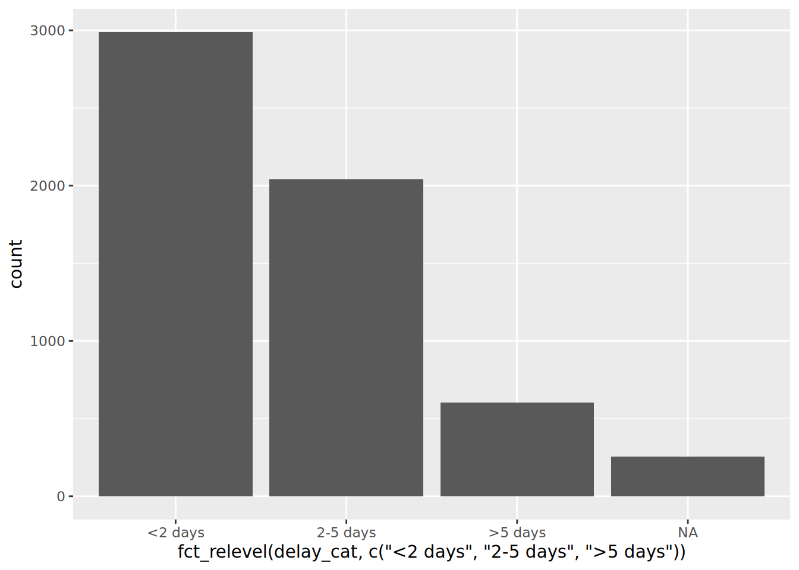
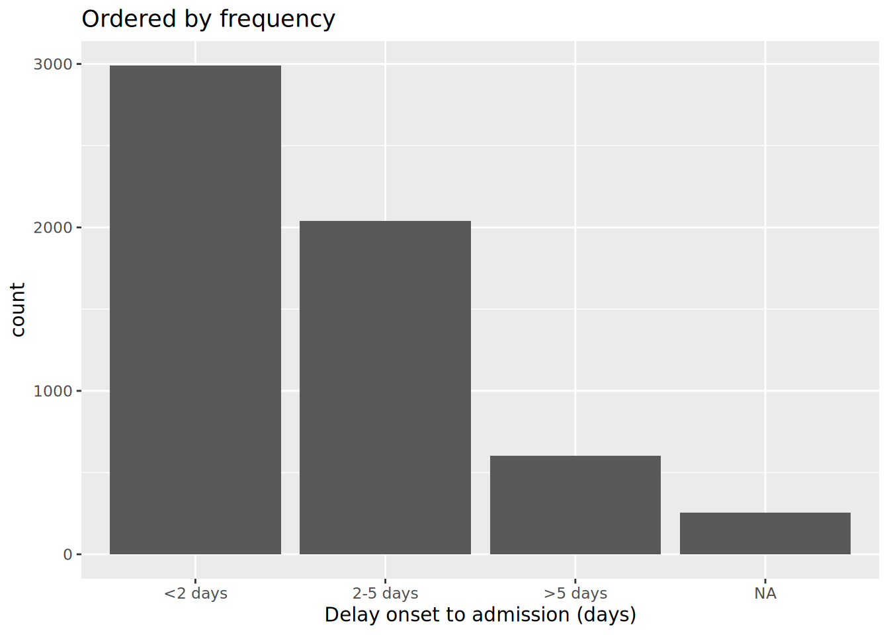
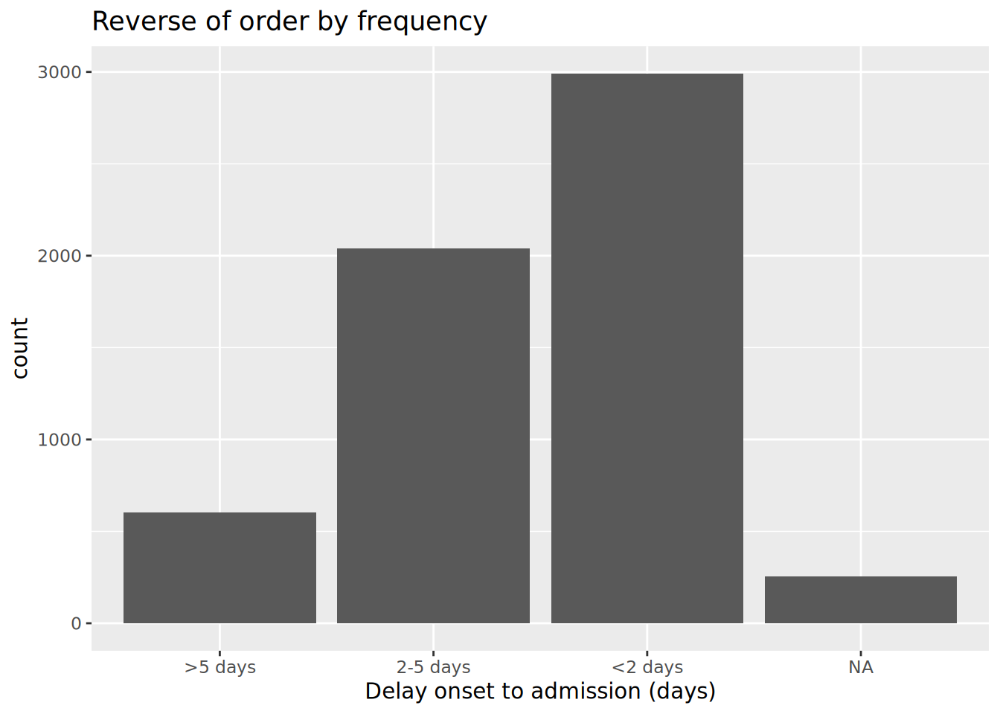
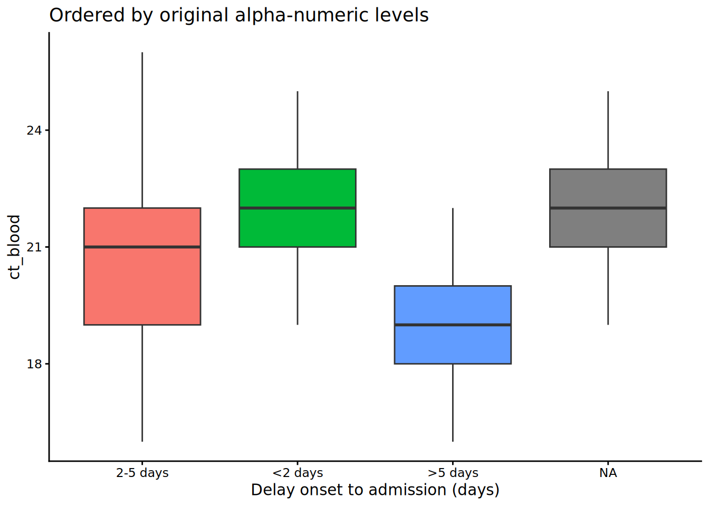

# 11  Fatores

[](../../images/factors_1500x500.png)

No R, os *fatores* são uma classe de dados que permitem categorias ordenadas com um conjunto fixo de valores possíveis.

Normalmente, você converteria uma coluna de caractere ou classe numérica em um fator se quiser definir uma ordem intrínseca para os valores (“níveis”) para que eles possam ser exibidos de forma não alfabética em gráficos e tabelas. Outro uso comum de fatores é padronizar as legendas dos gráficos para que não flutuem se certos valores estiverem temporariamente ausentes dos dados.

Esta página demonstra o uso de funções do pacote **forcats** (um nome curto para “**For** **cat**egorical variables” - “para variáveis categóricas”) e algumas funções do R **base**. Também abordamos o uso de **lubridate** e **aweek** para casos de fatores especiais relacionados a semanas epidemiológicas (epiweeks).

Uma lista completa das funções do **forcats** pode ser encontrada online [aqui](https://forcats.tidyverse.org/reference/index.html). Abaixo, demonstramos alguns dos mais comuns.

## 11.1 Preparação

### Carregar pacotes

Este trecho de código mostra o carregamento de pacotes necessários para as análises. Neste manual, enfatizamos o `p_load()` do **pacman**, o qual instala o pacote se necessário *e* o carrega para uso. Você também pode carregar pacotes instalados com `library()` do R **base**. Veja a pagina em [Introdução ao R](basics.llms.md) para mais informações sobre pacotes R.

``` r
pacman::p_load(
  rio,           # importar/exportar
  here,          # diretório
  lubridate,     # trabalhando com datas
  forcats,       # fatores
  aweek,         # criar epiweeks com níveis de fatores automático
  janitor,       # tabelas
  tidyverse, # dados mgmt e viz
  appliedepidata # dados de exemplo utilizados neste manual
  )
```

### Importe os dados

Importamos o conjunto de dados de casos de uma simulação de epidemia de Ebola. Carregue diretamente com `appliedepidata::get_data(name = "linelist_cleaned_rds")` (consulte a página [Baixar manual e dados](download.llms.md) para mais detalhes).

``` r
# importar seu conjunto de dados
linelist <- appliedepidata::get_data(name = "linelist_cleaned_rds")
```

### Nova variável categórica

Para demonstração nesta página, usaremos um cenário comum - a criação de uma nova variável categórica.

Observe que se você converter uma coluna numérica em fator, não será capaz de calcular estatísticas numéricas sobre ela.

#### Criar coluna

Usamos a coluna existente `days_onset_hosp` (dias desde o início dos sintomas até a admissão hospitalar) e criamos uma nova coluna `delay_cat` classificando cada linha em uma das várias categorias. Nós fazemos isso com a função do **dplyr** `case_when()`, que aplica critérios lógicos sequencialmente (lado direito) a cada linha e retorna o valor do lado esquerdo correspondente para a nova coluna `delay_cat`. Leia mais sobre `case_when()` em [Limpeza de dados e principais funções](cleaning.llms.md).

``` r
linelist <- linelist %>% 
  mutate(delay_cat = case_when(
    # critério                                  # novo valor se TRUE
    days_onset_hosp < 2                        ~ "<2 days",
    days_onset_hosp >= 2 & days_onset_hosp < 5 ~ "2-5 days",
    days_onset_hosp >= 5                       ~ ">5 days",
    is.na(days_onset_hosp)                     ~ NA_character_,
    TRUE                                       ~ "Check me"))  
```

#### Padrão da ordem dos valores

Conforme criado com `case_when()`, a nova coluna `delay_cat` é uma coluna categórica da classe Caractere - *ainda não* é um fator. Assim, em uma tabela de frequência, vemos que os valores exclusivos aparecem por padrão em uma ordem alfanumérica - uma ordem que não faz muito sentido intuitivo:

``` r
table(linelist$delay_cat, useNA = "always")
```


     <2 days  >5 days 2-5 days     <NA> 
        2990      602     2040      256 

Da mesma forma, se fizermos um gráfico de barra, os valores também aparecem nesta ordem no eixo x (consulte a página [O básico o ggplot](ggplot_basics.llms.md) para mais informações sobre o **ggplot2** - o pacote de visualização mais comum no R).

``` r
ggplot(data = linelist)+
  geom_bar(mapping = aes(x = delay_cat))
```

[](factors_files/figure-html/unnamed-chunk-7-1.png)

## 11.2 Converter para fator

Para converter um caractere ou coluna numérica para classe *fator*, você pode usar qualquer função do pacote **forcats** (muitos são detalhados [abaixo](#fct_adjust)). Eles serão convertidos para fator e, em seguida, também realizarão ou permitirão certa ordenação dos níveis - por exemplo, usar `fct_relevel()` permite que você especifique manualmente a ordem dos níveis. A função `as_factor()` simplesmente converte a classe sem quaisquer recursos adicionais.

A função do R **base** `factor()` converte uma coluna em fator e permite que você especifique manualmente a ordem dos níveis, como um vetor de caracteres para seu argumento `levels =`.

Abaixo usamos `mutate()` e `fct_relevel()` para converter a coluna `delay_cat` de classe caractere para classe fator. A coluna `delay_cat` é criada na seção [Preparação](#fct_newcat) acima.

``` r
linelist <- linelist %>%
  mutate(delay_cat = fct_relevel(delay_cat))
```

*Os “valores” únicos nesta coluna são agora considerados “níveis” do fator.* Os níveis têm uma *ordem*, que pode ser exibida com a função do R **base** `levels()`, ou, alternativamente, visualizada em uma tabela de contagem via `table()` do R **base** ou `tabyl()` do **janitor**. Por padrão, a ordem dos níveis será alfanumérica, como antes. Observe que `NA` não é um nível de fator.

``` r
levels(linelist$delay_cat)
```

    [1] "<2 days"  ">5 days"  "2-5 days"

A função `fct_relevel()` tem a utilidade adicional de permitir que você especifique manualmente a ordem dos níveis. Basta escrever os valores dos níveis em ordem, entre aspas, separados por vírgulas, conforme mostrado abaixo. Observe que a grafia deve corresponder exatamente aos valores. Se você quiser criar níveis que não existem nos dados, use [`fct_expand()` ao invés](#fct_add)).

``` r
linelist <- linelist %>%
  mutate(delay_cat = fct_relevel(delay_cat, "<2 days", "2-5 days", ">5 days"))
```

Agora podemos ver que os níveis estão ordenados, conforme especificado no comando anterior, em uma ordem sensata.

``` r
levels(linelist$delay_cat)
```

    [1] "<2 days"  "2-5 days" ">5 days" 

Agora, a ordem do gráfico também faz um sentido mais intuitivo.

``` r
ggplot(data = linelist)+
  geom_bar(mapping = aes(x = delay_cat))
```

[](factors_files/figure-html/unnamed-chunk-12-1.png)

## 11.3 Adicionar ou remover níveis

### Adicionar

Se você precisar adicionar níveis a um fator, você pode fazer isso com `fct_expand()`. Basta escrever o nome da coluna seguido pelos novos níveis (separados por vírgulas). Tabulando os valores, podemos ver os novos níveis e as contagens zero. Você pode usar `table()` do R **base**, ou `tabyl()` do **janitor**:

``` r
linelist %>% 
  mutate(delay_cat = fct_expand(delay_cat, "Not admitted to hospital", "Transfer to other jurisdiction")) %>% 
  tabyl(delay_cat)   # print table
```

                          delay_cat    n    percent valid_percent
                            <2 days 2990 0.50781250     0.5308949
                           2-5 days 2040 0.34646739     0.3622159
                            >5 days  602 0.10224185     0.1068892
           Not admitted to hospital    0 0.00000000     0.0000000
     Transfer to other jurisdiction    0 0.00000000     0.0000000
                               <NA>  256 0.04347826            NA

Nota: há uma função especial no **forcats** para adicionar facilmente valores ausentes (`NA`) como um nível. Consulte a seção abaixo sobre [Valores ausentes](#fct_missing).

### Remover

Se você usar `fct_drop()`, os níveis “não usados” com contagem zero serão retirados do conjunto de níveis. Os níveis que adicionamos acima (“Not admitted to a hospital” - Não admitido em um hospital) existem como um nível, mas nenhuma linha realmente possui esses valores. Portanto, eles serão eliminados aplicando `fct_drop()` na nossa coluna de fator:

``` r
linelist %>% 
  mutate(delay_cat = fct_drop(delay_cat)) %>% 
  tabyl(delay_cat)
```

     delay_cat    n    percent valid_percent
       <2 days 2990 0.50781250     0.5308949
      2-5 days 2040 0.34646739     0.3622159
       >5 days  602 0.10224185     0.1068892
          <NA>  256 0.04347826            NA

## 11.4 Ajuste a ordem dos níveis

O pacote **forcats** oferece funções úteis para ajustar facilmente a ordem dos níveis de um fator (após uma coluna ser definida como classe fator):

Essas funções podem ser aplicadas a uma coluna de fator em dois contextos:

1.  Para a coluna no data frame, como de costume, para que a transformação esteja disponível para qualquer uso subsequente dos dados  
2.  *Dentro de um gráfico,* de modo que a alteração seja aplicada apenas dentro do gráfico

### Manualmente

Esta função é usada para ordenar manualmente os níveis dos fatores. Se usada em uma coluna sem fator, a coluna será primeiro convertida para classe fator.

Entre parênteses, primeiro forneça o nome da coluna do fator e, em seguida, forneça:

- Todos os níveis na ordem desejada (como um vetor de caracteres `c()`), ou  
- Um nível e seu posicionamento corrigido usando o argumento `after =`

Aqui está um exemplo de redefinição da coluna `delay_cat` (que já é da classe Factor) e especificando toda a ordem de níveis desejada.

``` r
# redefine a ordem dos níveis dos fatores
linelist <- linelist %>% 
  mutate(delay_cat = fct_relevel(delay_cat, c("<2 days", "2-5 days", ">5 days")))
```

Se você quiser mover apenas um nível, você pode especificá-lo sozinha para `fct_relevel()` e dar um número ao argumento `after =` para indicar onde na ordem ele deveria estar. Por exemplo, o comando abaixo muda “\<2 dias” para a segunda posição:

``` r
# redefinir a ordem dos níveis
linelist %>% 
  mutate(delay_cat = fct_relevel(delay_cat, "<2 days", after = 1)) %>% 
  tabyl(delay_cat)
```

### Dentro de um gráfico

Os comandos do **forcats** podem ser usados para definir a ordem dos níveis no data frame ou apenas dentro de um gráfico. Usando o comando para “envolver” o nome da coluna *dentro* do comando de plotagem `ggplot()` você pode reverter / reordenar / etc, assim, a transformação só se aplicará a esse gráfico.

Abaixo, dois gráficos são criados com `ggplot()` (consulte a página [O básico o ggplot](ggplot_basics.llms.md)). No primeiro, a coluna `delay_cat` é mapeada para o eixo x do gráfico, com sua ordem de nível padrão como nos dados da `linelist`. No segundo exemplo, ele é inserido em `fct_relevel()` e a ordem é alterada no gráfico.

``` r
# Ordem alfanumérica padrão - sem ajuste no ggplot
ggplot(data = linelist)+
    geom_bar(mapping = aes(x = delay_cat))

# Ordem dos níveis dos fatores ajustada dentro do ggplot
ggplot(data = linelist)+
  geom_bar(mapping = aes(x = fct_relevel(delay_cat, c("<2 days", "2-5 days", ">5 days"))))
```

[](factors_files/figure-html/unnamed-chunk-18-1.png)

[](factors_files/figure-html/unnamed-chunk-18-2.png)

Observe que o título padrão do eixo x agora é bastante complicado - você pode reescrever este título com o argumento `labs()` do **ggplot2**.

### Inverter

É bastante comum que você queira inverter a ordem dos níveis. Simplesmente envolva o fator com `fct_rev()`.

Observe que se você deseja reverter *apenas* uma legenda do gráfico, mas não os níveis reais dos fatores, pode fazer isso com `guides()` (consulte [Dicas para o ggplot](ggplot_tips.llms.md)).

### Por frequência

Para ordenar pela frequência com que o valor aparece nos dados, use `fct_infreq()`. Quaisquer valores ausentes (`NA`) serão incluídos automaticamente no final, a menos que sejam convertidos para um nível explícito (veja [essa seção](#fct_missing)). Você pode inverter a ordem envolvendo em seguida com `fct_rev()`.

Esta função pode ser usada em um `ggplot()`, conforme mostrado abaixo.

``` r
# ordenando por frequência
ggplot(data = linelist, aes(x = fct_infreq(delay_cat)))+
  geom_bar()+
  labs(x = "Delay onset to admission (days)",
       title = "Ordered by frequency")

# inverter frequência
ggplot(data = linelist, aes(x = fct_rev(fct_infreq(delay_cat))))+
  geom_bar()+
  labs(x = "Delay onset to admission (days)",
       title = "Reverse of order by frequency")
```

[](factors_files/figure-html/unnamed-chunk-19-1.png)

[](factors_files/figure-html/unnamed-chunk-19-2.png)

### Pela aparência

Use `fct_inorder()` para definir a ordem dos níveis para corresponder à ordem de aparecimento nos dados, começando da primeira linha. Isso pode ser útil se você primeiro organizar os dados cuidadosamente por meio do `arrange()` no data frame e, em seguida, usar isso para definir a ordem dos fatores.

### Pela estatística de resumo de outra coluna

Você pode usar `fct_reorder()` para ordenar os níveis de uma coluna *por uma estatística de resumo de outra coluna*. Visualmente, isso pode resultar em gráficos agradáveis, onde as barras / pontos sobem ou descem de forma constante no gráfico.

Nos exemplos abaixo, o eixo x é `delay_cat`, e o eixo y é a coluna numérica `ct_blood` (valor do limite do ciclo). Os gráficos de caixa mostram a distribuição do valor CT por grupo `delay_cat`. Queremos ordenar os gráficos de caixa em ordem crescente pelo valor de CT mediano do grupo.

No primeiro exemplo abaixo, a ordem padrão de nível alfanumérico é usada. Você pode ver que as alturas do box plot estão confusas e não em uma ordem específica. No segundo exemplo, a coluna `delay_cat` (mapeada para o eixo x) foi agrupada em `fct_reorder()`, a coluna `ct_blood` é fornecida como o segundo argumento e “median” (mediana) é fornecido como o terceiro argumento (você também pode usar “max”, “mean”, “min”, etc). Portanto, a ordem dos níveis de `delay_cat` agora refletirá os valores medianos de CT crescentes de cada valor de CT mediano dos grupos presentes em `delay_cat`. Isso se reflete no segundo gráfico - os gráficos de caixa foram reorganizados para ascender. Observe como `NA` (ausente) aparecerá no final, a menos que seja convertido para um nível explícito.

``` r
# boxplots ordenados para os níveis originais dos fatores
ggplot(data = linelist)+
  geom_boxplot(
    aes(x = delay_cat,
        y = ct_blood, 
        fill = delay_cat))+
  labs(x = "Delay onset to admission (days)",
       title = "Ordered by original alpha-numeric levels")+
  theme_classic()+
  theme(legend.position = "none")


# boxplots ordenados pelo valor médio de CT
ggplot(data = linelist)+
  geom_boxplot(
    aes(x = fct_reorder(delay_cat, ct_blood, "median"),
        y = ct_blood,
        fill = delay_cat))+
  labs(x = "Delay onset to admission (days)",
       title = "Ordered by median CT value in group")+
  theme_classic()+
  theme(legend.position = "none")
```

[](factors_files/figure-html/unnamed-chunk-20-1.png)

[](factors_files/figure-html/unnamed-chunk-20-2.png)

Observe que neste exemplo acima não há etapas necessárias antes da função `ggplot()` - o agrupamento e os cálculos são todos feitos dentro do comando do ggplot.

### Por valor “final”

Use `fct_reorder2()` para gráficos de linha agrupados. Ele ordena os níveis (e, portanto, a *legenda*) para alinhar com a ordem vertical das linhas no “final” do gráfico. Tecnicamente falando, ele “ordena pelos valores y associados aos maiores valores x”.

Por exemplo, se você tiver linhas mostrando contagens de casos por hospital ao longo do tempo, você pode aplicar `fct_reorder2()` ao argumento `color =` dentro do `aes()`, de modo que a ordem vertical dos hospitais que aparecem na legenda se alinhe com a ordem das linhas no extremidade final do gráfico. Leia mais na [documentação online](https://forcats.tidyverse.org/reference/fct_reorder.html).

``` r
epidemic_data <- linelist %>%         # comece com a linelist   
    filter(date_onset < as.Date("2014-09-21")) %>%    # limite a data para clareza visual
    count(                                            # obter a contagem dos casos por semana e por hospital
      epiweek = lubridate::floor_date(date_onset, "week"),  
      hospital                                            
    ) 
  
ggplot(data = epidemic_data)+                       # inicie o gráfico
  geom_line(                                        # faça as linhas 
    aes(
      x = epiweek,                                  # eixo-x epiweek
      y = n,                                        # altura é o número de casos por semana
      color = fct_reorder2(hospital, epiweek, n)))+ # dados agrupados e coloridos por hospital, com fator de ordem por altura no final do gráfico
  labs(title = "Factor levels (and legend display) by line height at end of plot",
       color = "Hospital")                          # change legend title
```

[](factors_files/figure-html/unnamed-chunk-21-1.png)

## 11.5 Valores ausentes

Se você tiver valores `NA` em sua coluna de fatores, poderá convertê-los facilmente em um nível nomeado, como “Missing” (ausentes) com `fct_explicit_na()`. Por padrão, os valores `NA` são convertidos para “(Missing)” no final da ordenação dos nível. Você pode ajustar o nome do nível com o argumento `na_level =`.

A seguir, esta operação é realizada na `delay_cat` e uma tabela é exibida com `tabyl()` contendo `NA` convertido para “Missing delay”.

``` r
linelist %>% 
  mutate(delay_cat = fct_na_value_to_level(delay_cat, level = "Missing delay")) %>% 
  tabyl(delay_cat)
```

         delay_cat    n    percent
          2-5 days 2040 0.34646739
           <2 days 2990 0.50781250
           >5 days  602 0.10224185
     Missing delay  256 0.04347826

## 11.6 Combine os níveis

### Manualmente

Você pode ajustar a exibibição dos níveis manualmente com `fct_recode()`. Essa função é similar a função `recode()` do **dplyr** (veja [Limpeza de dados e principais funções](cleaning.llms.md)), mas permite a criação de novos níveis de fator. Se você usar simplesmente o `recode()` em um fator, novos valores recodificados serão rejeitados, a menos que já tenham sido definidos como níveis permitidos.

Essa ferramenta também pode ser usada para “combinar” níveis, atribuindo vários níveis ao mesmo valor recodificado. Só tome cuidado para não perder informações! Considere fazer essas etapas de combinação em uma nova coluna (não sobrescrever a coluna existente).

`fct_recode()` tem uma sintaxe diferente de `recode()`. `recode()` usa `OLD = NEW`, enquanto `fct_recode()` usa `NEW = OLD`.

Os níveis atuais de `delay_cat` são:

``` r
levels(linelist$delay_cat)
```

    [1] "<2 days"  "2-5 days" ">5 days" 

Os novos níveis são criados usando a sintaxe `fct_recode(column, "new" = "old", "new" = "old", "new" = "old")` e exibidos:

``` r
linelist %>% 
  mutate(delay_cat = fct_recode(
    delay_cat,
    "Less than 2 days" = "<2 days",
    "2 to 5 days"      = "2-5 days",
    "More than 5 days" = ">5 days")) %>% 
  tabyl(delay_cat)
```

            delay_cat    n    percent valid_percent
     Less than 2 days 2990 0.50781250     0.5308949
          2 to 5 days 2040 0.34646739     0.3622159
     More than 5 days  602 0.10224185     0.1068892
                 <NA>  256 0.04347826            NA

Aqui, eles são combinados manualmente com `fct_recode()`. Observe que nenhum erro foi gerado na criação de um novo nível “Less than 5 days” (Menos de 5 dias) .

``` r
linelist %>% 
  mutate(delay_cat = fct_recode(
    delay_cat,
    "Less than 5 days" = "<2 days",
    "Less than 5 days" = "2-5 days",
    "More than 5 days" = ">5 days")) %>% 
  tabyl(delay_cat)
```

            delay_cat    n    percent valid_percent
     Less than 5 days 5030 0.85427989     0.8931108
     More than 5 days  602 0.10224185     0.1068892
                 <NA>  256 0.04347826            NA

### Reduzir para “Outro”

Você pode usar `fct_other()` para atribuir manualmente níveis de fator a um nível chamado “Outros”. Abaixo, todos os níveis da coluna `hospital`, exceto “Port Hospital” e “Central Hospital”, são combinados em “Other”. Você pode fornecer um vetor para `keep =`, ou `drop =`. Você pode alterar a exibição do nível “Outro” com `other_level =`.

``` r
linelist %>%    
  mutate(hospital = fct_other(                      # ajustar níveis
    hospital,
    keep = c("Port Hospital", "Central Hospital"),  # manter esses separados
    other_level = "Other Hospital")) %>%            # Todos os outros como "Other Hospital"
  tabyl(hospital)                                   # exiba a tabela
```

             hospital    n    percent
     Central Hospital  454 0.07710598
        Port Hospital 1762 0.29925272
       Other Hospital 3672 0.62364130

### Reduzir por frequência

Você pode combinar os níveis do fator menos frequentes automaticamente usando `fct_lump()`.

Para “agrupar” muitos níveis de baixa frequência em um grupo “Outro”, siga um destes procedimentos:

- Defina `n =` como o número de grupos que deseja manter. Os n níveis mais frequentes serão mantidos e todos os outros serão combinados em “Outros”.  
- Defina `prop =` como a proporção de frequência limite para os níveis acima dos quais você deseja manter. Todos os outros valores serão combinados em “Outro”.

Você pode alterar a exibição do nível “Outro” com `other_level =`. Abaixo, todos, exceto os dois hospitais mais frequentes, são combinados em “Other Hospital” (Outro hospital).

``` r
linelist %>%    
  mutate(hospital = fct_lump(                      # ajuste os níveis
    hospital,
    n = 2,                                          # mantenha os 2 níveis superiores
    other_level = "Other Hospital")) %>%            # todos os outros como "Other Hospital"
  tabyl(hospital)                                   # exiba a tabela
```

           hospital    n   percent
            Missing 1469 0.2494905
      Port Hospital 1762 0.2992527
     Other Hospital 2657 0.4512568

## 11.7 Mostrar todos os níveis

Um benefício de usar fatores é padronizar a aparência das legendas e tabelas do gráfico, independentemente de quais valores estão realmente presentes em um conjunto de dados.

Se você estiver preparando muitas figuras (por exemplo, para várias jurisdições), você desejará que as legendas e tabelas apareçam de forma idêntica, mesmo com variação nos níveis de conclusão ou composição de dados.

### Em gráficos

Em uma figura `ggplot()`, simplesmente adicione o argumento `drop = FALSE` na função de escala relevante `scale_xxxx()`. Todos os níveis de fator serão exibidos, independentemente de estarem presentes nos dados. Se seus níveis de coluna de fator são exibidos usando `fill =`, então em scale_fill_discrete() você inclui `drop = FALSE`, conforme mostrado abaixo. Se seus níveis são exibidos com `x =` (para o eixo x), `color =` ou `size =`, você deve fornecer isso para a função `scale_color_discrete()` ou para `scale_size_discrete()`, respectivamente.

Este exemplo é um gráfico de barras empilhadas das categorias por idade e por hospital. Adicionar `scale_fill_discrete(drop = FALSE)` garante que todas as faixas etárias apareçam na legenda, mesmo se não estiverem presentes nos dados.

``` r
ggplot(data = linelist)+
  geom_bar(mapping = aes(x = hospital, fill = age_cat)) +
  scale_fill_discrete(drop = FALSE)+                        # mostra todos os grupos de idade na legenda, mesmo aqueles não presentes
  labs(
    title = "All age groups will appear in legend, even if not present in data")
```

[](factors_files/figure-html/unnamed-chunk-29-1.png)

### Em tabelas

Ambas as funções `table()` do R **base** e `tabyl()` do **janitor** mostrarão todos os níveis de fator (mesmo os níveis não utilizados).

Se você usar `count()` ou `summarise()` do **dplyr** para fazer uma tabela, adicione o argumento `.drop = FALSE` para incluir contagens para todos os níveis do fator, mesmo aqueles não usados.

Leia mais na página [Tabelas descritivas](tables_descriptive.llms.md), ou no [documento do scale_discrete](https://ggplot2.tidyverse.org/reference/scale_discrete.html), ou na [documentação do count()](https://dplyr.tidyverse.org/reference/count.html). Você pode ver outro exemplo na página [Rastreamento de contatos](contact_tracing.llms.md).

## 11.8 Epiweeks (semanas epidemiológicas)

Consulte a ampla discussão sobre como criar semanas epidemiológicas na página [Agrupamento de dados](grouping.llms.md).

Consulte também a página [Trabalhando com datas](dates.llms.md) para obter dicas sobre como criar e formatar semanas epidemiológicas.

### Epiweeks em um gráfico

Se seu objetivo é criar epiweeks para exibir em um gráfico, você pode fazer isso simplesmente com o pacote **lubridate** e função `floor_date()`, conforme explicado na página [Agrupamento de dados](grouping.llms.md). Os valores retornados serão da classe Data com formato AAAA-MM-DD. Se você usar esta coluna em um gráfico, as datas irão naturalmente ordenar corretamente, e você não precisa se preocupar com os níveis ou com a conversão para a classe Fator. Veja o histograma `ggplot()` das datas de início abaixo.

Nesta abordagem, você pode ajustar a *exibição* das datas em um eixo com `scale_x_date()`. Consulte a página em [Curvas epidêmicas](epicurves.llms.md) para obter mais informações. Você pode especificar um formato de exibição “strptime” para o argumento `date_labels =` da função `scale_x_date()`. Esses formatos usam marcadores “%” e são abordados na página [Trabalhando com datas](dates.llms.md). Use “% Y” para representar um ano de 4 dígitos e “% W” ou “% U” para representar o número da semana (semanas de segunda ou domingo, respectivamente).

``` r
linelist %>% 
  mutate(epiweek_date = floor_date(date_onset, "week")) %>%  # criando uma coluna de semanas
  drop_na(epiweek_date) %>%                                  # remover linhas sem data de início
  ggplot()+                                                  # iniciando o ggplot
  geom_histogram(mapping = aes(x = epiweek_date))+           # histograma da data de início
  scale_x_date(date_labels = "%Y-W%W")                       # ajustar a exibição das datas para YYYY-WWw
```

[](factors_files/figure-html/unnamed-chunk-30-1.png)

### Epiweeks nos dados

No entanto, se o seu objetivo na transformação para fator *não é* gerar um gráfico, você pode abordar isso de duas maneiras:

1.  *Para um controle preciso sobre a exibição*, converta no **lubridate** a coluna epiweek (YYYY-MM-DD) para o formato de exibição desejado (YYYY-WWw) *dentro do próprio data frame* e, em seguida, converta-o para a classe Fator.

Primeiro, use `format()` do R **base** para converter a exibição de data de YYYY-MM-DD para YYYY-Www (consulte a página [Trabalhando com datas](dates.llms.md)). Neste processo, a classe será convertida em caractere. Em seguida, converta de caractere para classe Fator com `factor()`.

``` r
linelist <- linelist %>% 
  mutate(epiweek_date = floor_date(date_onset, "week"),       # cria semanas epidemiológicas - epiweeks (YYYY-MM-DD)
         epiweek_formatted = format(epiweek_date, "%Y-W%W"),  # Converter para mostrar (YYYY-WWW)
         epiweek_formatted = factor(epiweek_formatted))       # Converter para fator

# Mostrar níveis
levels(linelist$epiweek_formatted)
```

     [1] "2014-W13" "2014-W14" "2014-W15" "2014-W16" "2014-W17" "2014-W18"
     [7] "2014-W19" "2014-W20" "2014-W21" "2014-W22" "2014-W23" "2014-W24"
    [13] "2014-W25" "2014-W26" "2014-W27" "2014-W28" "2014-W29" "2014-W30"
    [19] "2014-W31" "2014-W32" "2014-W33" "2014-W34" "2014-W35" "2014-W36"
    [25] "2014-W37" "2014-W38" "2014-W39" "2014-W40" "2014-W41" "2014-W42"
    [31] "2014-W43" "2014-W44" "2014-W45" "2014-W46" "2014-W47" "2014-W48"
    [37] "2014-W49" "2014-W50" "2014-W51" "2015-W00" "2015-W01" "2015-W02"
    [43] "2015-W03" "2015-W04" "2015-W05" "2015-W06" "2015-W07" "2015-W08"
    [49] "2015-W09" "2015-W10" "2015-W11" "2015-W12" "2015-W13" "2015-W14"
    [55] "2015-W15" "2015-W16"

***PERIGO:*** Se você colocar as semanas à frente dos anos (“Www-YYYY”) (“% W-% Y”), a ordem de nível alfanumérico padrão estará incorreta (por exemplo, 01-2015 estará antes de 35-2014) . Pode ser necessário ajustar manualmente a ordem, o que seria um processo longo e doloroso.

2.  *Para uma exibição padrão rápida*, use o pacote **aweek** e sua função `date2week()`. Você pode definir o dia do início da semana por `week_start =` e, se definir `factor = TRUE` a coluna de saída é um fator ordenado. Como bônus, o fator inclui níveis para *todas* as semanas possíveis no intervalo - mesmo se não houver casos naquela semana.

``` r
df <- linelist %>% 
  mutate(epiweek = date2week(date_onset, week_start = "Monday", factor = TRUE))

levels(df$epiweek)
```

Veja a página [Trabalhando com datas](dates.llms.md) para mais informações sobre **aweek**. O pacote também oferece a função reversa `week2date()`.

## 11.9 Recursos

R para a página de Ciência de Dados em [factors](https://r4ds.had.co.nz/factors.html)  
[vinheta do pacote aweek](https://cran.r-project.org/web/packages/aweek/vignettes/introduction.html)
