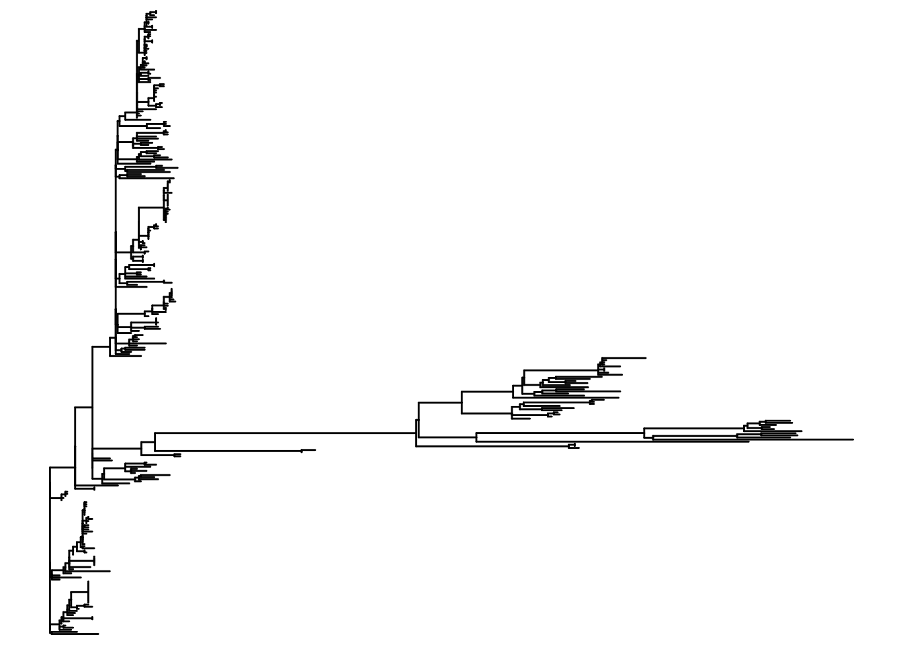
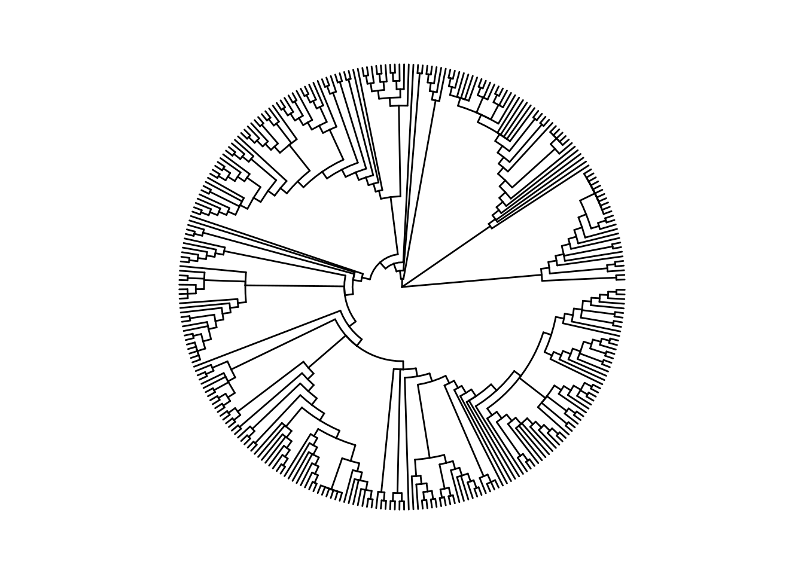
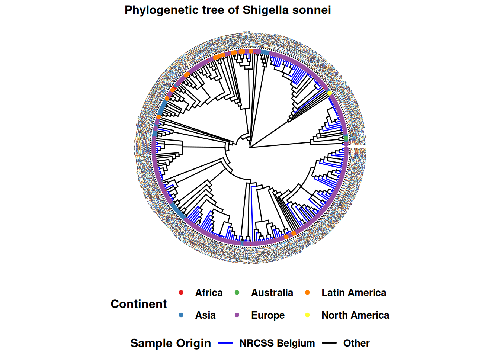
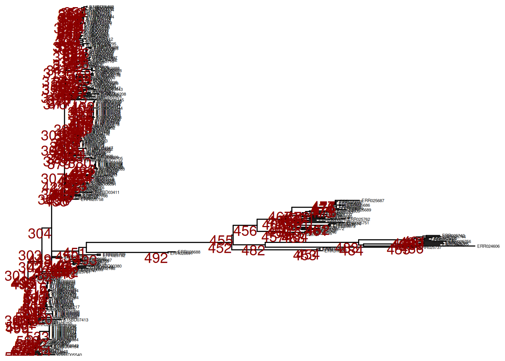
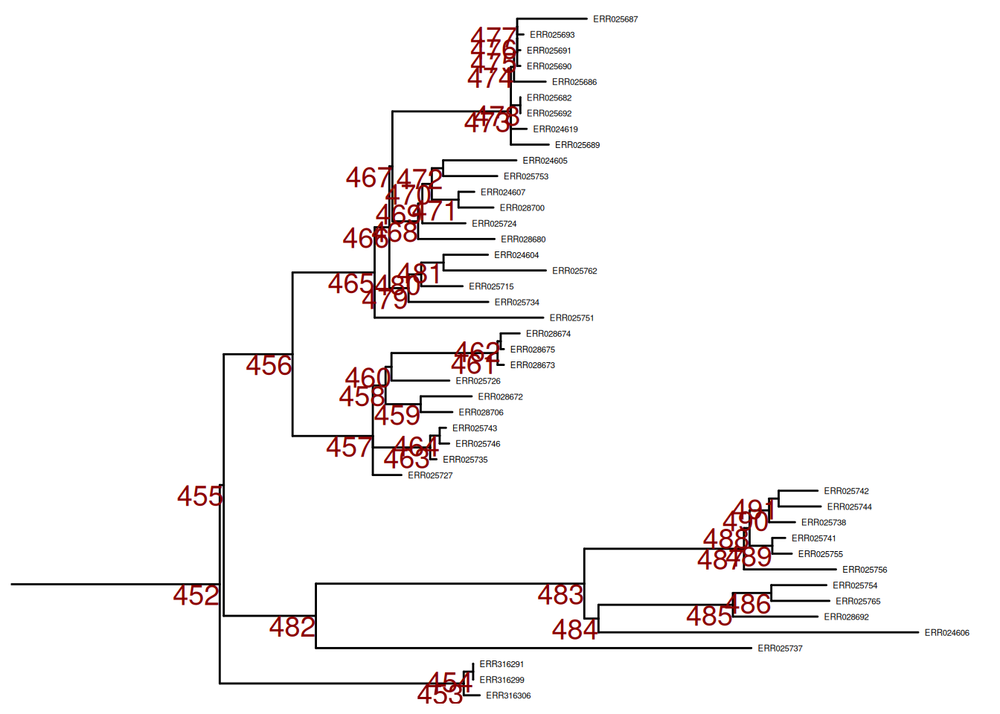
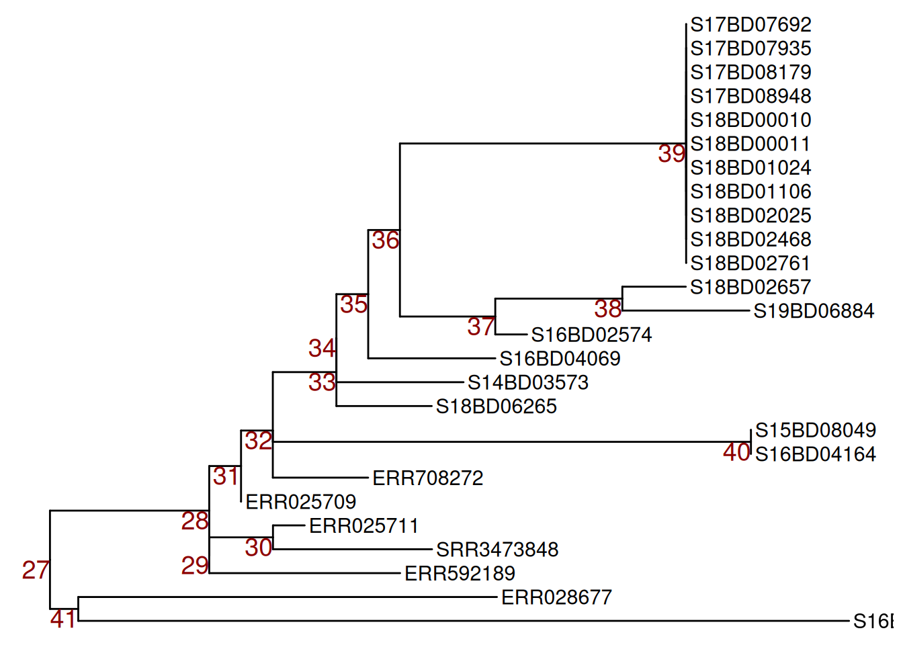
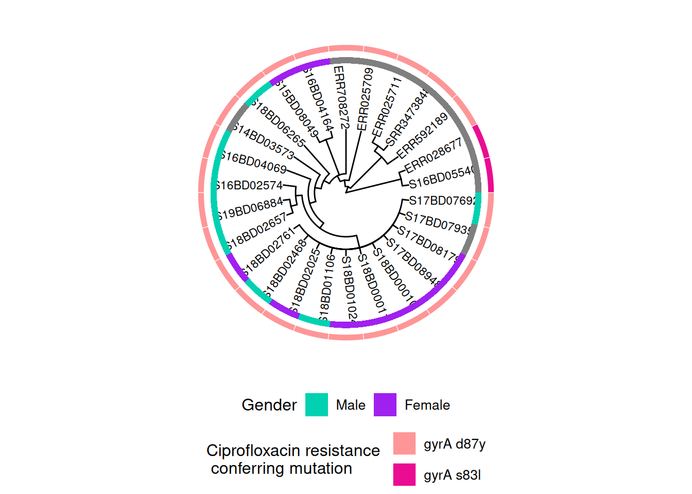
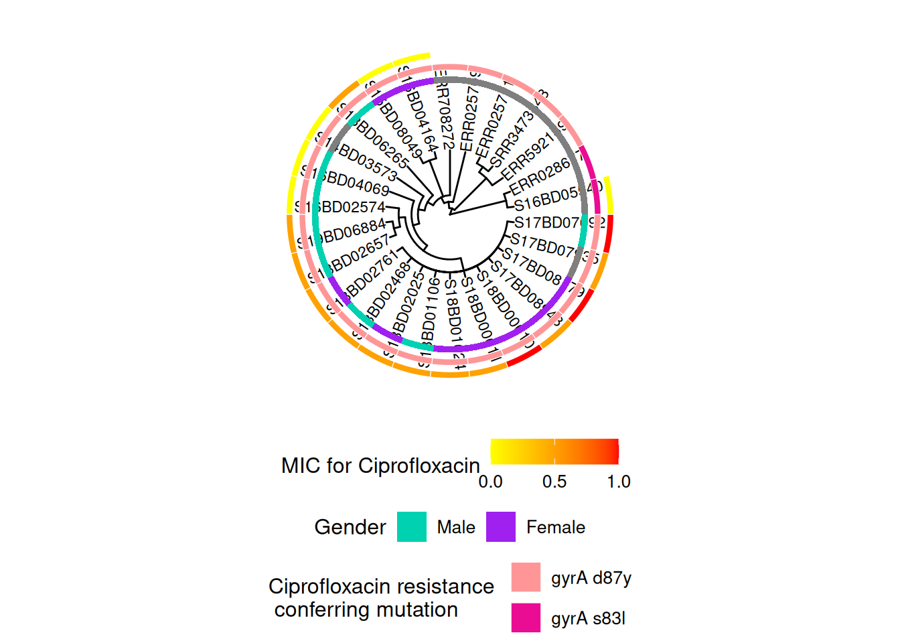
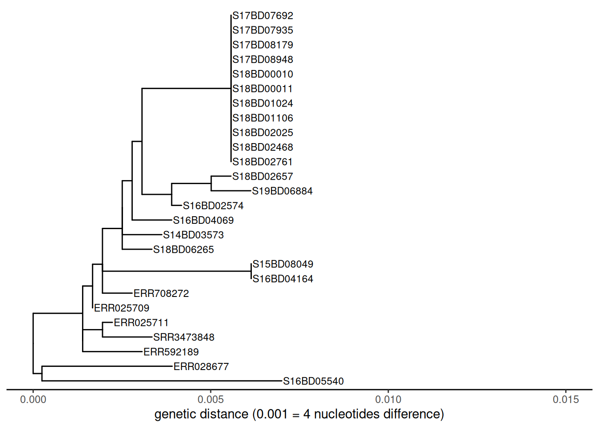
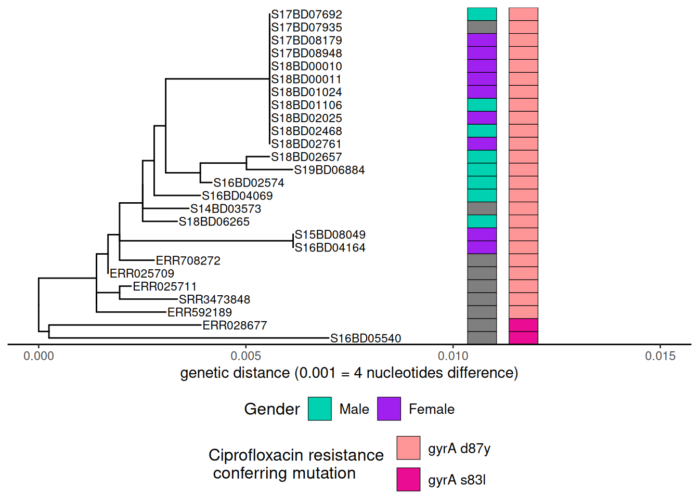

# 38  Árvores filogenéticas

## 38.1 Visão Geral

**Árvores filogenéticas** são utilizados para visualizar e descrever a relação e evolução dos organismos com base no sequenciamento de seu código genético.

Elas podem ser construídos a partir de seqüências genéticas usando métodos baseados na distância (como o método de união de vizinhos) ou métodos baseados em caracteres (como o método de máxima verossimilhança e o método Baysiano de Monte Carlo via Cadeias de Markov ). O sequenciamento de próxima geração (NGS) tornou-se mais acessível e está se tornando mais amplamente utilizado na saúde pública para descrever patógenos causadores de doenças infecciosas. Os dispositivos portáteis de seqüenciamento diminuem o tempo de retorno e mantêm promessas de disponibilizar dados para o apoio à investigação de surtos em tempo real. Os dados da NGS podem ser usados para identificar a origem ou fonte de uma variante de surto e sua propagação, bem como determinar a presença de genes de resistência antimicrobiana. Para visualizar a relação genética entre as amostras, é construída uma árvore filogenética.

Nesta página aprenderemos como utilizar o pacote **ggtree**, que permite a visualização combinada de árvores filogenéticas com dados adicionais de amostras sob a forma de um *data frame*. Isto nos permitirá observar padrões e melhorar a compreensão da dinâmica do surto.

[](phylogenetic_trees_files/figure-html/phylogenetic_trees_overview_graph-1.png)

## 38.2 Preparação

### Carregar pacotes

Este trecho de código mostra o carregamento dos pacotes necessárias. Neste manual, enfatizamos `p_load()` de **pacman**, que instala o pacote se necessário *e* o carrega para utilização. Você também pode carregar os pacotes instalados com `library()` do R **base**. Veja a página em [Introdução ao R](basics.llms.md) para mais informações sobre os pacotes R.

``` r
pacman::p_load(
  rio,             # importar/exportar
  here,            # caminhos relativos dos arquivos
  tidyverse,       # manipulações e visualizações gerais de dados
  ape,             # para importar e exportar dados de árvores filogenéticas
  ggtree,          # para visualizar dados de árvores filogenéticas 
  treeio,          # para visualizar dados de árvores filogenéticas 
  ggnewscale,      # adicionar camadas de esquema de cores 
  appliedepidata) # dados de exemplo utilizados neste manual
```

### Importar dados

Os dados para esta página podem ser baixados com as instruções na página [Baixar manual e dados](download.llms.md).

Há vários formatos diferentes nos quais uma árvore filogenética pode ser armazenada (por exemplo, Newick, NEXUS, Phylip). Um muito comum é o formato de arquivo Newick (.nwk), que é o padrão para representar árvores em formato legível por computador. Isto significa que uma árvore inteira pode ser expressa em formato de string como “((t2:0.04,t1:0.34):0.89,(t5:0.37,(t4:0.03,t3:0.67):0.9):0.59);”, listando todos os nós e ápices e a relação (comprimento do ramo) entre si.

Nota: É importante entender que o arquivo de árvore filogenética em si não contém dados de sequenciamento, mas é meramente o resultado das distâncias genéticas entre as seqüências. Portanto, não podemos extrair dados de seqüenciamento de um arquivo de árvore.

Primeiro, utilizamos a função `read.tree()` do pacote **ape** para importar um arquivo de árvore filogenética Newick em formato .txt, e armazená-lo em uma lista de objetos da classe “phylo”. Se necessário, utilize a função `here()` do pacote **here** para especificar o caminho relativo do arquivo.

Nota: Neste caso, a árvore newick é salva como um arquivo .txt para facilitar o manuseio e o download do Github.

``` r
tree <- appliedepidata::get_data(name = "Shigella_tree")
```

Inspecionamos nosso objeto árvore e vemos que ele contém 299 ápices/pontas (ou amostras) e 236 nós.

``` r
tree
```


    Phylogenetic tree with 299 tips and 236 internal nodes.

    Tip labels:
      SRR5006072, SRR4192106, S18BD07865, S18BD00489, S17BD08906, S17BD05939, ...
    Node labels:
      17, 29, 100, 67, 100, 100, ...

    Rooted; includes branch length(s).

Segundo, importamos uma tabela armazenada como um arquivo .csv com informações adicionais para cada amostra sequenciada, como sexo, país de origem e atributos de resistência antimicrobiana, utilizando a função `import()` do pacote **rio**:

``` r
sample_data <- appliedepidata::get_data(name = "sample_data_Shigella_tree")
```

Abaixo estão as primeiras 50 linhas de observação dos dados:

### Limpar e inspecionar

Nós limpamos e inspecionamos nossos dados: A fim de atribuir os dados da amostra correta à árvore filogenética, os valores na coluna `Sample_ID` no data frame `sample_data` precisam corresponder aos valores `tip.labels` do arquivo `tree`:

Verificamos a formatação das `tip.labels` no arquivo `tree` observando as primeiras 6 entradas utilizando com `head()` do R **base**.

``` r
head(tree$tip.label) 
```

    [1] "SRR5006072" "SRR4192106" "S18BD07865" "S18BD00489" "S17BD08906"
    [6] "S17BD05939"

Também nos certificamos de que a primeira coluna em nosso data frame `sample_data` seja “Sample_ID”. Olhamos os nomes das colunas de nosso data frame utilizando `colnames()` dm R **base**.

``` r
colnames(sample_data)   
```

     [1] "Sample_ID"                  "serotype"                  
     [3] "Country"                    "Continent"                 
     [5] "Travel_history"             "Year"                      
     [7] "Belgium"                    "Source"                    
     [9] "Gender"                     "gyrA_mutations"            
    [11] "macrolide_resistance_genes" "MIC_AZM"                   
    [13] "MIC_CIP"                   

Olhamos para os `Sample_IDs` no data frame para ter certeza de que a formatação é a mesma do que na `tip.label` (por exemplo, todas as letras são maiúsculas, sem sublinhados extras \`\_’ entre letras e números, etc.)

``` r
head(sample_data$Sample_ID) # novamente inspecionamos os primeiros 6 usando head()
```

    [1] "S17BD05944" "S15BD07413" "S18BD07247" "S19BD07384" "S18BD07338"
    [6] "S18BD02657"

Também podemos comparar se todas as amostras estão presentes no arquivo “tree” e vice-versa, gerando um vetor lógico de VERDADEIRO ou FALSO onde elas coincidem ou não. Estas não são impressas aqui, por simplicidade.

``` r
sample_data$Sample_ID %in% tree$tip.label

tree$tip.label %in% sample_data$Sample_ID
```

Podemos usar estes vetores para mostrar qualquer identificação de amostra que não esteja na árvore (não há nenhuma).

``` r
sample_data$Sample_ID[!tree$tip.label %in% sample_data$Sample_ID]
```

    character(0)

Após a inspeção, podemos ver que o formato do `Sample_ID` no data frame corresponde ao formato dos nomes das amostras nas `tip.labels`. Estas não precisam ser classificadas na mesma ordem para serem combinadas.

Estamos prontos para ir!

## 38.3 Visualização simples da árvore

### Diferente layouts para a árvore

**ggtree**\* oferece muitos formatos de layout diferentes e alguns podem ser mais adequados para seu propósito específico do que outros. Abaixo estão algumas demonstrações. Para outras opções, veja este [livro online](http://yulab-smu.top/treedata-book/chapter4.html).

Aqui estão alguns exemplos de layouts de árvores:

``` r
ggtree(tree)                                            # árvore linear simples
ggtree(tree,  branch.length = "none")                   # árvore linear simples com todas as pontas alinhadas
ggtree(tree, layout="circular")                         # árvore circular simples
ggtree(tree, layout="circular", branch.length = "none") # árvore circular simples com todas as pontas alinhadas
```

[](phylogenetic_trees_files/figure-html/phylogenetic_trees_example_formats-1.png)

[](phylogenetic_trees_files/figure-html/phylogenetic_trees_example_formats-2.png)

[](phylogenetic_trees_files/figure-html/phylogenetic_trees_example_formats-3.png)

[](phylogenetic_trees_files/figure-html/phylogenetic_trees_example_formats-4.png)

### Árvore simples com dados de amostras

O operador **%\<+%**\* é utilizado para conectar o data frame `sample_data` ao arquivo `tree`. A anotação mais fácil de sua árvore é a adição dos nomes das amostras nas pontas, assim como a coloração dos pontos da ponta e, se desejado, dos ramos:

Aqui está um exemplo de uma árvore circular:

``` r
ggtree(tree, layout = "circular", branch.length = 'none') %<+% sample_data + # %<+% unifica o datarframe com os dados de amostras à arvore
  aes(color = Belgium)+                       # colore os ramos de acordo com a variável no seu dataframe c
  scale_color_manual(
    name = "Sample Origin",                      # nome do seu esquema de cotes (irá aparecer assim na legenda) 
    breaks = c("Yes", "No"),                     # as diferentes opções na sua variável
    labels = c("NRCSS Belgium", "Other"),        # como você quer que as diferentes opções sejam nomeadas na sua legenda, permite formatação 
    values = c("blue", "black"),                  # a cor que você atribuir à variável
    na.value = "black") +                        # color NA values in black as well
  new_scale_color()+                             # permite adicionar um novo esquema de cores para uma nova variável
    geom_tippoint(
      mapping = aes(color = Continent),          # cor das pontas por continente. Você pode mudar o formato adicionando "shape = "
      size = 1.5)+                               # define o tamanho do ponto na ponta 
  scale_color_brewer(
    name = "Continent",                    # nome do seu esquema de cotes (irá aparecer assim na legenda) 
    palette = "Set1",                      #  escolhemos uma paleta de cores do pacote Brewer 
    na.value = "grey") +                    # for the NA values we choose the color grey
  geom_tiplab(                             # adiciona o nome da amostra para a ponta do ramo 
    color = 'black',                       # (adiciona quantas linhas de texto desejar, mas talvez precise ajustar o valor de partida para coloca-los proximos uns aos outros. 
    offset = 1,
    size = 1,
    geom = "text",
    align = TRUE)+    
  ggtitle("Phylogenetic tree of Shigella sonnei")+       # title of your graph
  theme(
    axis.title.x = element_blank(), # remove título de eixo x
    axis.title.y = element_blank(), # remove título de eixo y
    legend.title = element_text(    # define o tamanho da fonte e formata a o título da legenda
      face = "bold",
      size = 12),   
    legend.text=element_text(       # define o tamanho da fonte e formata o texto da legenda
      face = "bold",
      size = 10),  
    plot.title = element_text(      # define o tamanho da fonte e formata o título do gráfico
      size = 12,
      face = "bold"),  
    legend.position = "bottom",     # define a posição da legenda
    legend.box = "vertical",        # define o posicionamento da legenda
    legend.margin = margin())   
```

[](phylogenetic_trees_files/figure-html/phylogenetic_trees_adding_sampledata-1.png)

Você pode exportar seu gráfico de árvore com `ggsave()` como qualquer outro objeto ggplot’. Escrito desta forma, `ggsave()` salva a última imagem produzida para o caminho do arquivo que você especificar. Lembre-se de que você pode utilizar `here()` e caminhos de arquivo relativos para salvar facilmente em subpastas, etc.

``` r
ggsave("example_tree_circular_1.png", width = 12, height = 14)
```

## 38.4 Manipulação da árvore

Às vezes você pode ter uma árvore filogenética muito grande e só está interessado em uma parte da árvore. Por exemplo, se você produziu uma árvore incluindo amostras históricas ou internacionais para obter uma grande visão geral de onde seu conjunto de dados pode se encaixar no quadro geral. Mas então, para olhar mais de perto seus dados, você quer inspecionar apenas aquela parte da árvore maior.

Como o arquivo filogenético da árvore é apenas a saída da análise sequencial de dados, não podemos manipular a ordem dos nós e ramos no próprio arquivo. Estes já foram determinados em análises anteriores a partir dos dados brutos do NGS. No entanto, somos capazes de fazer zoom em partes, esconder partes e até mesmo subdividir parte da árvore.

### Aumentar o zoom

Se você não quiser “cortar” sua árvore, mas apenas inspecionar parte dela mais de perto, você pode ampliar para ver uma parte específica.

Primeiro, plotamos a árvore inteira em formato linear e adicionamos etiquetas numéricas a cada nó da árvore.

``` r
p <- ggtree(tree,) %<+% sample_data +
  geom_tiplab(size = 1.5) + # adicionamos rótulos às pontas de todos os ramos como nome da amostra no arquivo 
  geom_text2(
    mapping = aes(subset = !isTip,
                  label = node),
    size = 5,
    color = "darkred",
    hjust = 1,
    vjust = 1)                            # adiciona rótulos em todos os nós

p  # printa
```

[](phylogenetic_trees_files/figure-html/phylogenetic_trees_zoom_in-1.png)

Para aumentar o zoom para um ramo em particular (à direita), utilize `viewClade()` no objeto ggtree `p` e forneça o número do nó para obter uma visão mais detalhada:

``` r
viewClade(p, node = 452)
```

[](phylogenetic_trees_files/figure-html/phylogenetic_trees_zoom_in_452-1.png)

### Colapsando ramos

No entanto, podemos querer ignorar este ramo e podemos colapsa-lo naquele mesmo nó (nó nº 452) utilizando `collapse()`. Esta árvore é definida como `p_collapsed`.

``` r
p_collapsed <- collapse(p, node = 452)
p_collapsed
```

[](phylogenetic_trees_files/figure-html/phylogenetic_trees_collapse_452-1.png)

Para maior clareza, quando imprimimos `p_collapsed`, adicionamos um `geom_point2()` (um diamante azul) no nó do ramo colapsado.

``` r
p_collapsed + 
geom_point2(aes(subset = (node == 452)),  # adicionamos um símbolo ao nó colapsado 
            size = 5,                     # define o tamanho do símbolo  
            shape = 23,                   # define a forma do símbolo  
            fill = "steelblue")           # define a cor do símbolo 
```

[](phylogenetic_trees_files/figure-html/unnamed-chunk-12-1.png)

### Subdividindo uma árvore

Se quisermos fazer uma mudança mais permanente e criar uma árvore nova e reduzida para trabalhar com ela, podemos separar parte dela com `tree_subset()`. Então você pode salvá-la como novo arquivo newick tree ou arquivo .txt.

Primeiro, inspecionamos os nós de árvore e os rótulos das pontas a fim de decidir como subdividi-la.

``` r
ggtree(
  tree,
  branch.length = 'none',
  layout = 'circular') %<+% sample_data +               # adicionamos os dados das amostras usando o operdor  %<+% 
  geom_tiplab(size = 1)+                                # rotula as pontas dos ramos com o nome da amostra 
  geom_text2(
    mapping = aes(subset = !isTip, label = node),
    size = 3,
    color = "darkred") +                                # rotula todos os nós na árvore 
 theme(
   legend.position = "none",                            # remove a legenda completamente
   axis.title.x = element_blank(),
   axis.title.y = element_blank(),
   plot.title = element_text(size = 12, face="bold"))
```

[](phylogenetic_trees_files/figure-html/phylogenetic_trees_subsetting-1.png)

Agora, digamos que decidimos dividir a árvore no nó 528 (manter apenas as pontas dentro deste ramo após o nó 528) e a salvamos como um novo objeto `sub_tree1`:

``` r
sub_tree1 <- tree_subset(
  tree,
  node = 528)                                            # subdividimos a árvore no nó 528 
```

Vamos dar uma olhada na árvore do subconjunto 1 (subset tree 1):

``` r
ggtree(sub_tree1) +
  geom_tiplab(size = 3) +
  ggtitle("Subset tree 1")
```

[](phylogenetic_trees_files/figure-html/unnamed-chunk-14-1.png)

Você também pode dividir com base em uma amostra específica, especificando quantos nós “para trás” você deseja incluir. Vamos subdividir a mesma parte da árvore com base em uma amostra, neste caso S17BD07692, retrocedendo 9 nós e a salvamos como um novo objeto `sub_tree2`:

``` r
sub_tree2 <- tree_subset(
  tree,
  "S17BD07692",
  levels_back = 9) #  levels_back define quantos nós você quer retroceder da ponta da amostra  
```

Vamos dar uma olhada na árvore do subconjunto 2:

``` r
ggtree(sub_tree2) +
  geom_tiplab(size =3)  +
  ggtitle("Subset tree 2")
```

[](phylogenetic_trees_files/figure-html/unnamed-chunk-16-1.png)

Você também pode salvar sua nova árvore como um tipo Newick ou mesmo um arquivo de texto utilizando a função `write.tree()` do pacote **ape**:

``` r
# salvar no formato .nwk 
ape::write.tree(sub_tree2, file='data/phylo/Shigella_subtree_2.nwk')

# salvar no formato .txt 
ape::write.tree(sub_tree2, file='data/phylo/Shigella_subtree_2.txt')
```

### Rotacionando nós em uma árvore

Como mencionado anteriormente, não podemos mudar a ordem das pontas ou nós na árvore, pois isto se baseia em sua relação genética e não está sujeito a manipulação visual. Mas podemos girar ramos em torno dos nós se isso facilitar nossa visualização.

Primeiro, traçamos nossa nova árvore “sub_tree2” com etiquetas de nós para escolher o nó que queremos manipular e armazená-lo como um objeto do tipo gráfico ggtree `p`.

``` r
p <- ggtree(sub_tree2) +  
  geom_tiplab(size = 4) +
  geom_text2(aes(subset=!isTip, label=node), # rotula todos os nós em uma árvore
             size = 5,
             color = "darkred", 
             hjust = 1, 
             vjust = 1) 
p
```

[](phylogenetic_trees_files/figure-html/phylogenetic_trees_rotating_1-1.png)

Podemos então manipular os nós aplicando **ggtree::rotate()** ou **ggtree::flip()**: Nota: para ilustrar quais nós estamos manipulando, aplicamos primeiro a função **geom_hilight()** de **ggtree** para destacar as amostras nos nós em que estamos interessados e armazenar esse objeto ggtree em um novo objeto `p1`.

``` r
p1 <- p + geom_hilight(  # destaca o nó 39 em azul, "extend =" nos permite definir a cor do bloco 
  node = 39,
  fill = "steelblue",
  extend = 0.0017) +  
geom_hilight(            # destaca o nó 37 em amarelo 
  node = 37,
  fill = "yellow",
  extend = 0.0017) +               
ggtitle("Original tree")


p1 # printa
```

[](phylogenetic_trees_files/figure-html/phylogenetic_trees_rotating_2-1.png)

Agora podemos girar o nó 37 no objeto `p1` para que as amostras no nó 38 se movam para o topo. Armazenamos a árvore rotacionada em um novo objeto `p2`.

``` r
p2 <- ggtree::rotate(p1, 37) + 
      ggtitle("Rotated Node 37")


p2   # printa
```

[](phylogenetic_trees_files/figure-html/unnamed-chunk-17-1.png)

Ou podemos usar a função `flip()` para rotacuonar o nó 36 do objeto `p1` e mudar o nó 37 para o topo e o nó 39 para o fundo. Armazenamos a árvore invertida em um novo objeto `p3`.

``` r
p3 <-  flip(p1, 39, 37) +
      ggtitle("Rotated Node 36")


p3   # printa
```

[](phylogenetic_trees_files/figure-html/unnamed-chunk-18-1.png)

### Examplo de sub-árvore com informações das amostras

Digamos que estamos investigando o conjunto de casos com expansão clonal que ocorreram em 2017 e 2018 no nó 39 de nossa sub-árvore. Acrescentamos o ano de isolamento da linhagem, bem como o histórico de viagem e a cor por país para ver a origem de outras linhagens intimamente relacionadas:

``` r
ggtree(sub_tree2) %<+% sample_data +     # Usamos o operador %<+% para juntar com sample_data
  geom_tiplab(                          # rotula as pontas dos ramos com  os nomes das amotras 
    size = 2.5,
    offset = 0.001,
    align = TRUE) + 
  theme_tree2()+
  xlim(0, 0.015)+                       # configura os limite do eixo x 
  geom_tippoint(aes(color=Country),     # colore a ponta de acordo com o continente  
                size = 1.5)+ 
  scale_color_brewer(
    name = "Country", 
    palette = "Set1", 
    na.value = "grey")+
  geom_tiplab(                          #  adiciona o ano de isolamento como um rótulo de texto nas pontas a
    aes(label = Year),
    color = 'blue',
    offset = 0.0045,
    size = 3,
    linetype = "blank" ,
    geom = "text",
    align = TRUE)+ 
  geom_tiplab(                          # adiciona histórico de viagem nas pontas em vermelho 
    aes(label = Travel_history),
    color = 'red',
    offset = 0.006,
    size = 3,
    linetype = "blank",
    geom = "text",
    align = TRUE)+ 
  ggtitle("Phylogenetic tree of Belgian S. sonnei strains with travel history")+  # add plot title
  xlab("genetic distance (0.001 = 4 nucleotides difference)")+                    # add a label to the x-axis 
  theme(
    axis.title.x = element_text(size = 10),
    axis.title.y = element_blank(),
    legend.title = element_text(face = "bold", size = 12),
    legend.text = element_text(face = "bold", size = 10),
    plot.title = element_text(size = 12, face = "bold"))
```

[](phylogenetic_trees_files/figure-html/phylogenetic_trees_inspect_subset_example-1.png)

Nossa observação aponta para um evento de importação de cepas da Ásia, que então circularam na Bélgica ao longo dos anos e parecem ter causado nosso último surto.

## Árvores mais complexas: adição de heatmaps de dados de amostra

Podemos acrescentar informações mais complexas, como a presença categórica de genes de resistência antimicrobiana e valores numéricos para resistência realmente medida a antimicrobianos na forma de um mapa térmico usando a função **ggtree::gheatmap()**.

Primeiro precisamos traçar nossa árvore (esta pode ser linear ou circular) e armazená-la em um novo objeto de traçado ggtree `p`: Utilizaremos a sub-árvore da parte 3).

``` r
p <- ggtree(sub_tree2, branch.length='none', layout='circular') %<+% sample_data +
  geom_tiplab(size =3) + 
 theme(
   legend.position = "none",
    axis.title.x = element_blank(),
    axis.title.y = element_blank(),
    plot.title = element_text(
      size = 12,
      face = "bold",
      hjust = 0.5,
      vjust = -15))
p
```

[](phylogenetic_trees_files/figure-html/phylogenetic_trees_sampledata_heatmap-1.png)

Em segundo lugar, preparamos nossos dados. Para visualizar as diferentes variáveis com novos esquemas de cores, nós subdividimos nosso dataframe para a variável desejada. É importante adicionar o `Sample_ID` como nomes das linhas, caso contrário, ele não pode fazer a correspondência dos dados com a árvore `tip.labels`:

Em nosso exemplo, queremos analisar o gênero e as mutações que poderiam conferir resistência à Ciprofloxacina, um importante antibiótico de primeira linha utilizado para tratar as infecções por Shigella.

Criamos um dataframe para gênero:

``` r
gender <- data.frame("gender" = sample_data[,c("Gender")])
rownames(gender) <- sample_data$Sample_ID
```

Criamos um dataframe para mutações no gene gyrA, que confere resistência à Ciprofloxacina:

``` r
cipR <- data.frame("cipR" = sample_data[,c("gyrA_mutations")])
rownames(cipR) <- sample_data$Sample_ID
```

Criamos um dataframe para a concentração inibitória mínima medida (MIC) de Ciprofloxacina do laboratório:

``` r
MIC_Cip <- data.frame("mic_cip" = sample_data[,c("MIC_CIP")])
rownames(MIC_Cip) <- sample_data$Sample_ID
```

Criamos um primeiro gráfico adicionando um heatmap binário para gênero à árvore filogenética e armazenando-o em um novo objeto do tipo gráfico ggtree `h1`:

``` r
h1 <-  gheatmap(p, gender,                                 # adicionamos uma camada "heatmap" de gênero ao gráfico
                offset = 10,                               # "offset" muda o heatmap para a direita,
                width = 0.10,                              # "width" define ta largura da coluna do heatmap,
                color = NULL,                              # "color"  define a borda da coluna do  heatmap 
         colnames = FALSE) +                               # esconde a coluna de nomes do heatmap
  scale_fill_manual(name = "Gender",                       # define o esquema de cores e a legenda do gênero 
                    values = c("#00d1b1", "purple"),
                    breaks = c("Male", "Female"),
                    labels = c("Male", "Female")) +
   theme(legend.position = "bottom",
        legend.title = element_text(size = 12),
        legend.text = element_text(size = 10),
        legend.box = "vertical", legend.margin = margin())
```

    Scale for y is already present.
    Adding another scale for y, which will replace the existing scale.
    Scale for fill is already present.
    Adding another scale for fill, which will replace the existing scale.

``` r
h1
```

[](phylogenetic_trees_files/figure-html/phylogenetic_trees_sampledata_heatmap_gender-1.png)

Depois adicionamos informações sobre mutações no gene gyrA, que conferem resistência ao Ciprofloxacina:

Nota: A presença de mutações cromossômicas pontuais nos dados do WGS foi previamente determinada usando a ferramenta PointFinder desenvolvida por Zankari et al. (ver referência na seção de referências adicionais)

Primeiro, atribuímos um novo esquema de cores ao nosso objeto do tipo gráfico existente em`h1` e o armazenamos em um objeto agora `h2`. Isto nos permite definir e mudar as cores para nossa segunda variável no heatmap.

``` r
h2 <- h1 + new_scale_fill() 
```

Depois adicionamos a segunda camada do heatmap ao `h2` e armazenamos os gráficos combinados em um novo objeto `h3`:

``` r
h3 <- gheatmap(h2, cipR,  # adiciona uma segunda linha de heatmap descrevendo a mutação de resistência da Ciprofloxacina
               offset = 12, 
               width = 0.10, 
               colnames = FALSE) +
  scale_fill_manual(name = "Ciprofloxacin resistance \n conferring mutation",
                    values = c("#fe9698","#ea0c92"),
                    breaks = c( "gyrA D87Y", "gyrA S83L"),
                    labels = c( "gyrA d87y", "gyrA s83l")) +
   theme(legend.position = "bottom",
        legend.title = element_text(size = 12),
        legend.text = element_text(size = 10),
        legend.box = "vertical", legend.margin = margin())+
  guides(fill = guide_legend(nrow = 2,byrow = TRUE))
```

    Scale for y is already present.
    Adding another scale for y, which will replace the existing scale.
    Scale for fill is already present.
    Adding another scale for fill, which will replace the existing scale.

``` r
h3
```

[](phylogenetic_trees_files/figure-html/phylogenetic_trees_sampledata_heatmap_cip_genes-1.png)

Repetimos o processo acima, primeiro adicionando uma nova camada de escala de cor ao nosso objeto existente `h3`, e depois adicionando os dados contínuos sobre a concentração inibitória mínima (MIC) de Ciprofloxacina para cada estirpe ao objeto resultante `h4` para produzir o objeto final `h5`:

``` r
# Primeiro adicionamos o novo esquema de cores
h4 <- h3 + new_scale_fill()

# e então combinamos os dois em um novo gráfico:
h5 <- gheatmap(h4, MIC_Cip,  
               offset = 14, 
               width = 0.10,
                colnames = FALSE)+
  scale_fill_continuous(name = "MIC for Ciprofloxacin",  # here we define a gradient color scheme for the continuous variable of MIC
                      low = "yellow", high = "red",
                      breaks = c(0, 0.50, 1.00),
                      na.value = "white") +
   guides(fill = guide_colourbar(barwidth = 5, barheight = 1))+
   theme(legend.position = "bottom",
        legend.title = element_text(size = 12),
        legend.text = element_text(size = 10),
        legend.box = "vertical", legend.margin = margin())
```

    Scale for y is already present.
    Adding another scale for y, which will replace the existing scale.
    Scale for fill is already present.
    Adding another scale for fill, which will replace the existing scale.

``` r
h5
```

[](phylogenetic_trees_files/figure-html/phylogenetic_trees_sampledata_heatmap_cip_MIC-1.png)

Podemos fazer o mesmo exercício para uma árvore linear:

``` r
p <- ggtree(sub_tree2) %<+% sample_data +
  geom_tiplab(size = 3) + # rotupa as pontas
  theme_tree2()+
  xlab("genetic distance (0.001 = 4 nucleotides difference)")+
  xlim(0, 0.015)+
 theme(legend.position = "none",
      axis.title.y = element_blank(),
      plot.title = element_text(size = 12, 
                                face = "bold",
                                hjust = 0.5,
                                vjust = -15))
p
```

[](phylogenetic_trees_files/figure-html/phylogenetic_trees_sampledata_heatmap_linear_1-1.png)

Primeiro, adicionamos o gênero:

``` r
h1 <-  gheatmap(p, gender, 
                offset = 0.003,
                width = 0.1, 
                color="black", 
         colnames = FALSE)+
  scale_fill_manual(name = "Gender",
                    values = c("#00d1b1", "purple"),
                    breaks = c("Male", "Female"),
                    labels = c("Male", "Female"))+
   theme(legend.position = "bottom",
        legend.title = element_text(size = 12),
        legend.text = element_text(size = 10),
        legend.box = "vertical", legend.margin = margin())
```

    Scale for y is already present.
    Adding another scale for y, which will replace the existing scale.
    Scale for fill is already present.
    Adding another scale for fill, which will replace the existing scale.

``` r
h1
```

[](phylogenetic_trees_files/figure-html/phylogenetic_trees_sampledata_heatmap_linear_2-1.png)

Depois adicionamos as mutações de resistência Ciprofloxacina depois de adicionar outra camada de esquema de cores:

``` r
h2 <- h1 + new_scale_fill()
h3 <- gheatmap(h2, cipR,   
               offset = 0.004, 
               width = 0.1,
               color = "black",
                colnames = FALSE)+
  scale_fill_manual(name = "Ciprofloxacin resistance \n conferring mutation",
                    values = c("#fe9698","#ea0c92"),
                    breaks = c( "gyrA D87Y", "gyrA S83L"),
                    labels = c( "gyrA d87y", "gyrA s83l"))+
   theme(legend.position = "bottom",
        legend.title = element_text(size = 12),
        legend.text = element_text(size = 10),
        legend.box = "vertical", legend.margin = margin())+
  guides(fill = guide_legend(nrow = 2,byrow = TRUE))
```

    Scale for y is already present.
    Adding another scale for y, which will replace the existing scale.
    Scale for fill is already present.
    Adding another scale for fill, which will replace the existing scale.

``` r
 h3
```

[](phylogenetic_trees_files/figure-html/phylogenetic_trees_sampledata_heatmap_linear_3-1.png)

Em seguida, adicionamos a concentração inibitória mínima determinada pelo laboratório (MIC):

``` r
h4 <- h3 + new_scale_fill()
h5 <- gheatmap(h4, MIC_Cip, 
               offset = 0.005,  
               width = 0.1,
               color = "black", 
                colnames = FALSE)+
  scale_fill_continuous(name = "MIC for Ciprofloxacin",
                      low = "yellow", high = "red",
                      breaks = c(0,0.50,1.00),
                      na.value = "white")+
   guides(fill = guide_colourbar(barwidth = 5, barheight = 1))+
   theme(legend.position = "bottom",
        legend.title = element_text(size = 10),
        legend.text = element_text(size = 8),
        legend.box = "horizontal", legend.margin = margin())+
  guides(shape = guide_legend(override.aes = list(size = 2)))
```

    Scale for y is already present.
    Adding another scale for y, which will replace the existing scale.
    Scale for fill is already present.
    Adding another scale for fill, which will replace the existing scale.

``` r
h5
```

[](phylogenetic_trees_files/figure-html/phylogenetic_trees_sampledata_heatmap_linear_4-1.png)

## 38.5 Resources

http://hydrodictyon.eeb.uconn.edu/eebedia/index.php/Ggtree# Clade_Colors https://bioconductor.riken.jp/packages/3.2/bioc/vignettes/ggtree/inst/doc/treeManipulation.html https://guangchuangyu.github.io/ggtree-book/chapter-ggtree.html https://bioconductor.riken.jp/packages/3.8/bioc/vignettes/ggtree/inst/doc/treeManipulation.html

Ea Zankari, Rosa Allesøe, Katrine G Joensen, Lina M Cavaco, Ole Lund, Frank M Aarestrup, PointFinder: a novel web tool for WGS-based detection of antimicrobial resistance associated with chromosomal point mutations in bacterial pathogens, Journal of Antimicrobial Chemotherapy, Volume 72, Issue 10, October 2017, Pages 2764–2768, https://doi.org/10.1093/jac/dkx217
