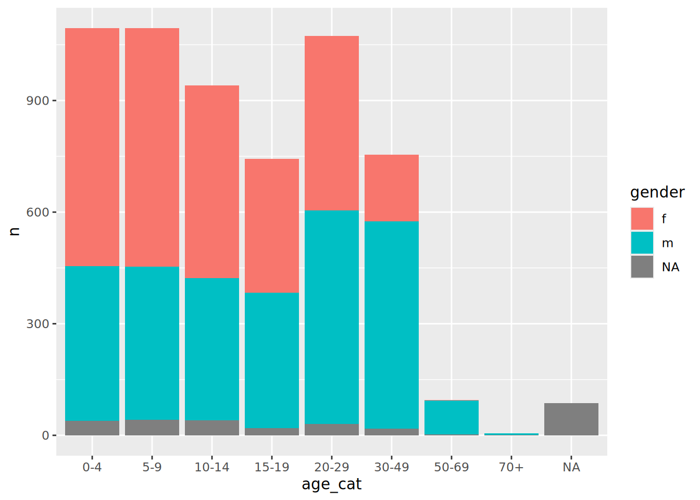
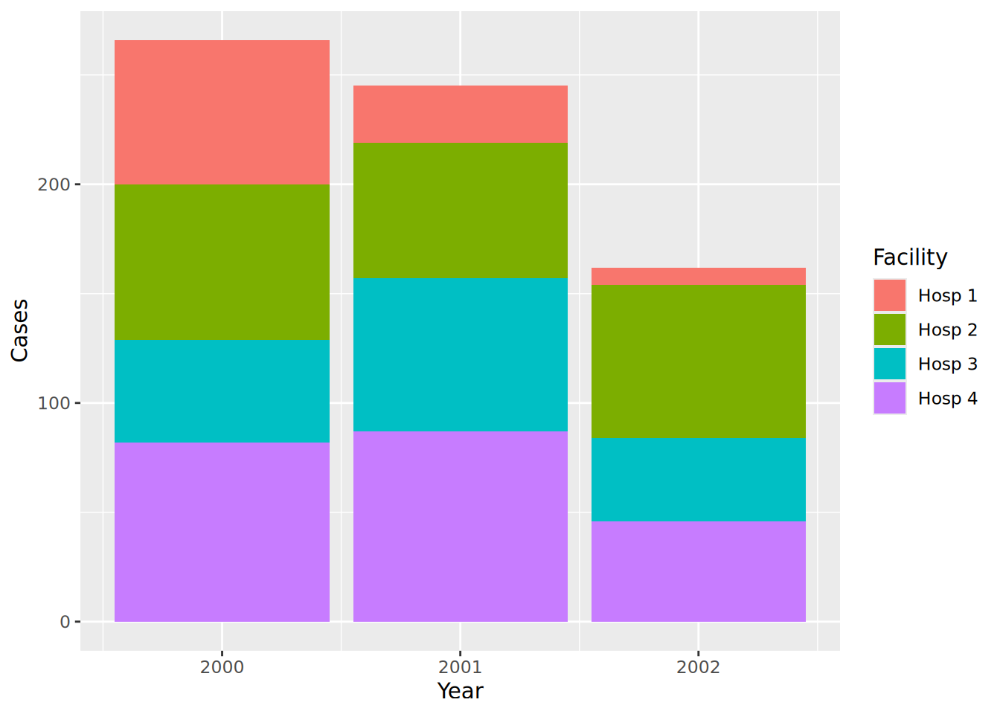

# 12  Pivoteando dados

[](../../images/pivoting/pivoting_500x500.png)

Ao lidar com dados, *pivotar* (pivoting) pode ser entendido como um dos dois processos abaixo:

1.  A criação de *tabelas dinâmicas* (pivot tables), que são tabelas com estatísticas que resumem os dados de um tabela maior.
2.  A conversão de uma tabela do formato **longo** (long) para o formato **largo** (wide), ou vice-versa.

**Nessa página, iremos nos focar na segunda definição**. A primeira é um passo crucial em análise de dados que está coberto em outras partes do livro, nos capítulos de [Agrupamento de Dados](grouping.llms.md) e [Tabelas Descritivas](tables_descriptive.llms.md).

Essa página discute os formatos dos dados. É importante estar atento à ideia de “dados tidy” (tidy data), na qual cada varíavel tem sua própria coluna, cada observação tem sua própria linha e cada valor tem sua própria célula. Você pode ler mais sobre esse tópico online [em seu capítulo do livro R para Ciência de Dados (em inglês)](https://r4ds.had.co.nz/tidy-data.html).

## 12.1 Preparação

### Carregue os pacotes R

O código abaixo realiza o carregamento dos pacotes necessários para a análise dos dados. Neste manual, enfatizamos o uso da função `p_load()`, do **pacman**, que instala os pacotes, caso não estejam instalados, *e* os carrega no R para utilização. Também é possível carregar pacotes instalados utilizando a função `library()`, do R **base**. Para mais informações sobre os pacotes do R, veja a página [Introdução ao R](basics.llms.md).

``` r
pacman::p_load(
  rio,          # File import
  here,         # File locator
  kableExtra,   # Build and manipulate complex tables
  tidyverse,    # data management + ggplot2 graphics
  appliedepidata) # example datasets used in this handbook
```

### Importe os dados

### Dados de Malária

Nesta página, iremos utilizar um banco fictício de casos diários de malária, divididos por local e grupos de idade. Carregue diretamente com `appliedepidata::get_data(name = "malaria_facility_count_data")` (consulte a página [Baixar manual e dados](download.llms.md) para mais detalhes).

``` r
# Import data
count_data <- appliedepidata::get_data(name = "malaria_facility_count_data")
```

As primeras 50 linhas são mostradas abaixo.

### Casos da Linelist

Nas seções finais dessa página também iremos utilizar dados de uma epidemia simulada de Ebola. Carregue diretamente com `appliedepidata::get_data(name = "linelist_cleaned_rds")` (consulte a página [Baixar manual e dados](download.llms.md) para mais detalhes).

``` r
# import your dataset
linelist <- appliedepidata::get_data(name = "linelist_cleaned_rds")
```

## 12.2 Largo-para-longo

[](../../images/pivoting/pivot_longer_new.png)

### Formato “Largo” (wide)

Os dados são normalmente inseridos e armazenados no formato “largo” (*wide*) - em que as características ou respostas dos sujeitos são acondicionadas em apenas uma linha. Embora possa ser útil para apresentação, esse formato não é ideal para alguns tipos de análises.

Vamos pegar como exemplo o banco `count_data` importado na seção de Preparação acima. Você pode ver que cada linha representa um “dia-local” (*facility-day*). As contagens propriamente ditas dos casos (colunas mais à direita) estão armazenadas em um formato “largo”, de forma que as informações para todos os grupos de idade em cada “dia-local” estão armazenadas em apenas uma linha.

Cada observação nesse banco refere-se às contagens dos casos de malária em um dos 65 locais, em uma referida data, que vai desde `count_data$data_date %>% min()` até `count_data$data_date %>% max()`. Esse locais estão divididos em uma Província - `Province` (North) e quatro Distritos - `District` (Spring, Bolo, Dingo, e Barnard). O banco disponibiliza as contagens gerais de malária, bem como contagens específicas por idade em cada um dos três grupos de idade - \<4 anos, 5-14 anos, e 15 anos ou mais.

Dados em formato “largo” (*wide*) como esse não aderem aos padrões de dados “tidy”, pois os cabeçalhos das colunas não representam, de fato, “variáveis” - eles representam *valores* de uma varíavel hipotética “grupo de idade” (*age group*).

Esse formato pode ser útil para apresentar informações em uma tabela, ou para inserção de dados provenientes de formulários (no Excel, por exemplo). No entanto, na fase de análise, os dados devem ser transformados para um formato mais “longo”, alinhado com os padrões de dados “tidy”. O pacote de gráficos **ggplot2**, inclusive, funciona melhor quando os dados estão no formato “longo”.

No formato atual, não há dificuldade alguma em visualizar o *total* de casos versus tempo:

``` r
count_data %>% 
  drop_na(malaria_tot) %>% 
  ggplot() +
  geom_col(aes(x = data_date, y = malaria_tot), width = 1)
```

[](pivoting_files/figure-html/unnamed-chunk-10-1.png)

No entanto, e se quiséssemos mostrar as contribuições relativas de cada grupo de idade a esse total? Neste caso, precisaríamos nos assegurar de que as varíaveis de interesse (grupos de idade - *age group*) aparecessem no banco em apenas uma coluna que possa ser passada ao `{ggplot2}` através do argumento `aes()`.

### `pivot_longer()`

A função `pivot_longer()` do **tidyr** torna os dados mais “longos” (“longer”). O pacote **tidyr** faz parte dos pacotes da família **tidyverse**.

Essa função recebe como argumento um intervalo de colunas que serão transformadas (especificado no argumento `cols =`). Assim, ela pode operar em apenas um parte do banco. Isso é útil para os dados de malária, pois queremos pivotar apenas as colunas com a contagem dos casos.

Executando esse processo, você vai obter duas “novas” colunas - uma com as categorias (que antes eram os nomes das colunas), e uma outra com os valores correspondentes (os números de casos). Você pode aceitar os nomes padrão para essas novas colunas ou você pode especificar seus próprios nomes através dos argumentos `names_to =` e `values_to =` respectivamente.

vamos ver `pivot_longer()` em ação…

### Pivot padrão

Queremos usar a função `pivot_longer()` do **tidyr** para converter os dados do formato “largo” (wide) para o formato “longo” (long). Especificamente, converter as quatro colunas numéricas com as contagens dos casos de malária em duas novas colunas: uma com os grupos de idade (*age groups*) e uma com os *valores* correspondentes.

``` r
df_long <- count_data %>% 
  pivot_longer(
    cols = c(`malaria_rdt_0-4`, `malaria_rdt_5-14`, `malaria_rdt_15`, `malaria_tot`)
  )

df_long
```

perceba que o data frame recém criado (`df_long`) possui mais linhas (12,152 vs 3,038); ele tornou-se mais longo - *longer*. De fato, ele está precisamente quatro vezes mais longo, pois cada linha do banco original agora representa quatro linhas em df_long, uma para cada contagem das observações (\<4 anos, 5-14 anos, 15 anos+ e total).

Além de mais longo, o novo banco também tem menos colunas (8 vs 10), uma vez que os dados que estavam armazenados nas quatro colunas (aquelas que começavam com o prefixo `malaria_`) passaram a ser armazenados em apenas duas.

Uma vez que os nomes de todas essas quatro colunas começam com o prefixo `malaria_`, poderíamos ter utilizado uma função muito útil para fazer “tidyselect” - com `starts_with()` poderíamos chegar no mesmo resultado (veja a página [Limpeza de dados e principais funções](cleaning.llms.md) para conhecer mais dessas funções de auxílio).

``` r
# provide column with a tidyselect helper function
count_data %>% 
  pivot_longer(
    cols = starts_with("malaria_")
  )
```

    # A tibble: 12,152 × 8
       location_name data_date  submitted_date Province District newid name    value
       <chr>         <date>     <date>         <chr>    <chr>    <int> <chr>   <int>
     1 Facility 1    2020-08-11 2020-08-12     North    Spring       1 malari…    11
     2 Facility 1    2020-08-11 2020-08-12     North    Spring       1 malari…    12
     3 Facility 1    2020-08-11 2020-08-12     North    Spring       1 malari…    23
     4 Facility 1    2020-08-11 2020-08-12     North    Spring       1 malari…    46
     5 Facility 2    2020-08-11 2020-08-12     North    Bolo         2 malari…    11
     6 Facility 2    2020-08-11 2020-08-12     North    Bolo         2 malari…    10
     7 Facility 2    2020-08-11 2020-08-12     North    Bolo         2 malari…     5
     8 Facility 2    2020-08-11 2020-08-12     North    Bolo         2 malari…    26
     9 Facility 3    2020-08-11 2020-08-12     North    Dingo        3 malari…     8
    10 Facility 3    2020-08-11 2020-08-12     North    Dingo        3 malari…     5
    # ℹ 12,142 more rows

ou por posição:

``` r
# provide columns by position
count_data %>% 
  pivot_longer(
    cols = 6:9
  )
```

ou por intervalo nomeado:

``` r
# provide range of consecutive columns
count_data %>% 
  pivot_longer(
    cols = `malaria_rdt_0-4`:malaria_tot
  )
```

As novas colunas recebem os nomes padrão de `name` e `value`, mas podemos sobrescrever esses padrões para fornecer nomes mais semânticos, que vão ajudar a lembrar o que representam, utilizando os argumentos `names_to` e `values_to`. Vamos utilizar os nomes `age_group` e `counts`:

``` r
df_long <- 
  count_data %>% 
  pivot_longer(
    cols = starts_with("malaria_"),
    names_to = "age_group",
    values_to = "counts"
  )

df_long
```

    # A tibble: 12,152 × 8
       location_name data_date  submitted_date Province District newid age_group    
       <chr>         <date>     <date>         <chr>    <chr>    <int> <chr>        
     1 Facility 1    2020-08-11 2020-08-12     North    Spring       1 malaria_rdt_…
     2 Facility 1    2020-08-11 2020-08-12     North    Spring       1 malaria_rdt_…
     3 Facility 1    2020-08-11 2020-08-12     North    Spring       1 malaria_rdt_…
     4 Facility 1    2020-08-11 2020-08-12     North    Spring       1 malaria_tot  
     5 Facility 2    2020-08-11 2020-08-12     North    Bolo         2 malaria_rdt_…
     6 Facility 2    2020-08-11 2020-08-12     North    Bolo         2 malaria_rdt_…
     7 Facility 2    2020-08-11 2020-08-12     North    Bolo         2 malaria_rdt_…
     8 Facility 2    2020-08-11 2020-08-12     North    Bolo         2 malaria_tot  
     9 Facility 3    2020-08-11 2020-08-12     North    Dingo        3 malaria_rdt_…
    10 Facility 3    2020-08-11 2020-08-12     North    Dingo        3 malaria_rdt_…
    # ℹ 12,142 more rows
    # ℹ 1 more variable: counts <int>

Agora podemos passar essa nova base para o `{ggplot2}`, e mapear a nova coluna `count` para o eixo y e a nova coluna `age_group` para o argumento `fill =` (a cor de preenchimento da barra). Isso vai mostrar as contagens em um gráfico de barras empilhadas, por grupo de idade:

``` r
df_long %>% 
  drop_na(counts) %>% 
  ggplot() +
  geom_col(
    mapping = aes(x = data_date, y = counts, fill = age_group),
    width = 1
  )
```

[](pivoting_files/figure-html/unnamed-chunk-16-1.png)

Veja esse novo gráfico, e compare com o gráfico criado anteriormento - *o que deu errado?*

Encontramos um problema comum ao manipular dados de vigilância - acabamos incluindo também o número total de casos da coluna `malaria_tot`, o que fez com que a altura de cada barra no gráfico fosse o dobro do que deveria.

Podemos lidar com isso de algumas formas. Podemos simplesmente filtrar esses totais da base antes de passá-la para o `ggplot()`:

``` r
df_long %>% 
  filter(age_group != "malaria_tot") %>% 
  drop_na(counts) %>% 
  ggplot() +
  geom_col(
    aes(x = data_date, y = counts, fill = age_group),
    width = 1
  )
```

[](pivoting_files/figure-html/unnamed-chunk-17-1.png)

Ou então, poderíamos ter excluído essa variável quando rodamos `pivot_longer()`, mantendo-na assim como uma variável separada na base de dados. Veja como os valores dela se “expandem” para preencher as novas linhas.

``` r
count_data %>% 
  pivot_longer(
    cols = `malaria_rdt_0-4`:malaria_rdt_15,   # does not include the totals column
    names_to = "age_group",
    values_to = "counts"
  )
```

    # A tibble: 9,114 × 9
       location_name data_date  submitted_date Province District malaria_tot newid
       <chr>         <date>     <date>         <chr>    <chr>          <int> <int>
     1 Facility 1    2020-08-11 2020-08-12     North    Spring            46     1
     2 Facility 1    2020-08-11 2020-08-12     North    Spring            46     1
     3 Facility 1    2020-08-11 2020-08-12     North    Spring            46     1
     4 Facility 2    2020-08-11 2020-08-12     North    Bolo              26     2
     5 Facility 2    2020-08-11 2020-08-12     North    Bolo              26     2
     6 Facility 2    2020-08-11 2020-08-12     North    Bolo              26     2
     7 Facility 3    2020-08-11 2020-08-12     North    Dingo             18     3
     8 Facility 3    2020-08-11 2020-08-12     North    Dingo             18     3
     9 Facility 3    2020-08-11 2020-08-12     North    Dingo             18     3
    10 Facility 4    2020-08-11 2020-08-12     North    Bolo              49     4
    # ℹ 9,104 more rows
    # ℹ 2 more variables: age_group <chr>, counts <int>

### Pivoteando dados de múltiplas classes

O exemplo acima funciona bem em situações em que todas as colunas que você quer pivotar para o formato “longo” são da mesma classe (caracter, numérico, lógico, etc…)

Porém, haverá muitos casos em que, como epidemiologista de campo, você estará trabalhando com dados que foram preparados por não-especialistas e que seguem suas próprias lógicas não padronizadas - como Hadley Wickham citou (em referência a Tolstoy) em seu [artigo seminal](https://vita.had.co.nz/papers/tidy-data.pdf) sobre os princípios de **Tidy Data**: *“Like families, tidy datasets are all alike but every messy dataset is messy in its own way.”* (Como famílias, bases de dados tidy são todas parecidas mas todas as bases bagunçadas são bagunçadas à sua maneira.)

Um problema particularmente comum que você vai encontrar será a necessidade de pivotar colunas que possuem diferentes classes de dados. Essa pivotagem vai resultar no armazenamento desses diferentes tipos em uma única coluna, o que não é uma situação ideal. Existem várias abordagens possíveis para separar a bagunça que isso gera, mas existe um passo importante que você pode dar utilizando `pivot_longer()` para evitar cair nessa situação.

Vamos analisar a situação em que há uma série de observações em diferentes intervalos de tempo para cada um dos itens A, B e C. Exemplos desses itens podem ser indivíduos (ex: contatos de caso de Ebola sendo monitorados por 21 dias) ou postos de saúde de vilarejos remotos sendo monitorados uma vez por ano para assegurar que ainda funcionam. Vamos utilizar o exemplo do contato com o caso de Ebola. Imagine os dados armazenados da seguinte forma:

Como pode ser observado, os dados são um pouco complicados. Cada linha armazena informação sobre um item, mas com a série temporal avançando mais e mais para a direita à medida que o tempo passa. Além disso, a classe das colunas alternam entre valores de data e caracteres.

Um exemplo particularmente ruim encontrado por este autor envolvia dados de vigilância do cólera, no qual 8 novas colunas de observação eram adicionadas à base *por dia* ao longo de **4 anos**. Só para abrir o arquivo de Excel em que esses dados estavam levava mais de 10 minutos no meu laptop!

Para trabalhar com esses dados, precisamos transformar o data frame para o formato longo, mas mantendo a separação entre as colunas no formato `date` e `character` (status), para cada observação e cada item. Se não o fizermos, podemos acabar com uma mistura de tipos de variáveis na mesma coluna (um “sacrilégio” quando se trata de gerenciamento de dados e dados “tidy”):

``` r
df %>% 
  pivot_longer(
    cols = -id,
    names_to = c("observation")
  )
```

    # A tibble: 18 × 3
       id    observation value     
       <chr> <chr>       <chr>     
     1 A     obs1_date   2021-04-23
     2 A     obs1_status Healthy   
     3 A     obs2_date   2021-04-24
     4 A     obs2_status Healthy   
     5 A     obs3_date   2021-04-25
     6 A     obs3_status Unwell    
     7 B     obs1_date   2021-04-23
     8 B     obs1_status Healthy   
     9 B     obs2_date   2021-04-24
    10 B     obs2_status Healthy   
    11 B     obs3_date   2021-04-25
    12 B     obs3_status Healthy   
    13 C     obs1_date   2021-04-23
    14 C     obs1_status Missing   
    15 C     obs2_date   2021-04-24
    16 C     obs2_status Healthy   
    17 C     obs3_date   2021-04-25
    18 C     obs3_status Healthy   

Acima, nosso pivot mesclou *datas* e *caracteres* em apenas uma coluna `value`. R reagirá convertendo a coluna inteira para a classe de caracteres e assim, a utilidade das datas será perdida.

Para evitar essa situação, podemos aproveitar a sintaxe da estrutura original do nome das colunas. Existe uma estrutura comum nos nomes, com o número da observação, um underline e depois a palavra “status” ou “date”. Podemos utilizar essa sintaxe para manter esses dois tipos de dados em colunas separadas após o pivot.

Fazemos isso através de:

- Fornecimento de um vetor de caracteres para o argumento `names_to =`, com o segundo item sendo (`".value"` ). Esse termo especial indica que as colunas pivotadas vão ser divididas baseadas em um caracter presente em seus nomes…  
- Você também precisa fornecer o caracter “separador” para o argumento `names_sep =`. Nesse caso, é o underline “\_“.

Assim, o nome e a separação das novas colunas são baseados nos termos “em volta” do underline nos nomes das variáveis existentes.

``` r
df_long <- 
  df %>% 
  pivot_longer(
    cols = -id,
    names_to = c("observation", ".value"),
    names_sep = "_"
  )

df_long
```

    # A tibble: 9 × 4
      id    observation date       status 
      <chr> <chr>       <chr>      <chr>  
    1 A     obs1        2021-04-23 Healthy
    2 A     obs2        2021-04-24 Healthy
    3 A     obs3        2021-04-25 Unwell 
    4 B     obs1        2021-04-23 Healthy
    5 B     obs2        2021-04-24 Healthy
    6 B     obs3        2021-04-25 Healthy
    7 C     obs1        2021-04-23 Missing
    8 C     obs2        2021-04-24 Healthy
    9 C     obs3        2021-04-25 Healthy

**Toques finais**:

Note que a coluna `date` está atualmente com a classe *caractere* - nós podemos convertê-la facilmente em sua classe apropriada utilizando as funções `mutate()` e `as_date()` descritas na página [Trabalhando com datas](dates.llms.md).

Também podemos converter a coluna `observation` para o formato `numeric` removendo o prefixo “obs” e convertendo para numérico. Podemos fazer isso com a função `str_remove_all()` do pacote **stringr** (veja a página [Caracteres and strings](characters_strings.llms.md)).

``` r
df_long <- 
  df_long %>% 
  mutate(
    date = date %>% lubridate::as_date(),
    observation = 
      observation %>% 
      str_remove_all("obs") %>% 
      as.numeric()
  )

df_long
```

    # A tibble: 9 × 4
      id    observation date       status 
      <chr>       <dbl> <date>     <chr>  
    1 A               1 2021-04-23 Healthy
    2 A               2 2021-04-24 Healthy
    3 A               3 2021-04-25 Unwell 
    4 B               1 2021-04-23 Healthy
    5 B               2 2021-04-24 Healthy
    6 B               3 2021-04-25 Healthy
    7 C               1 2021-04-23 Missing
    8 C               2 2021-04-24 Healthy
    9 C               3 2021-04-25 Healthy

E agora, podemos começar a trabalhar com os dados nesse formato. Ex: criando um de mapa de calor descritivo:

``` r
ggplot(data = df_long, mapping = aes(x = date, y = id, fill = status)) +
  geom_tile(colour = "black") +
  scale_fill_manual(
    values = 
      c("Healthy" = "lightgreen", 
        "Unwell" = "red", 
        "Missing" = "orange")
  )
```

[](pivoting_files/figure-html/unnamed-chunk-23-1.png)

## 12.3 Longo-para-largo

[](../../images/pivoting/pivot_wider_new.png)

Em algumas instâncias, pode ser necessário converter uma base para o formato mais largo (wide) utilizando a função `pivot_wider()`.

Um caso de uso típico é quando queremos transformar o resultado de uma análise em um formato mais “palatável” ao leitor (tal como em [Tabelas para apresentação](tables_presentation.llms.md)). Normalmente, isso envolve transformar uma base em que a informação para um sujeito está espalhada em múltiplas linhas em um formato em que aquela informação esteja armazenada em apenas uma.

### Dados

Para essa seção da página, vamos utilizar o caso da linelist (veja a seção de [Preparação](#pivot_prep)), que contém uma linha por caso.

Aqui estão as primeiras 50 linhas:

Suponha que a gente queira saber a contagem dos indivíduos nos diferentes grupos de idade, por gênero:

``` r
df_wide <- 
  linelist %>% 
  count(age_cat, gender)

df_wide
```

       age_cat gender   n
    1      0-4      f 640
    2      0-4      m 416
    3      0-4   <NA>  39
    4      5-9      f 641
    5      5-9      m 412
    6      5-9   <NA>  42
    7    10-14      f 518
    8    10-14      m 383
    9    10-14   <NA>  40
    10   15-19      f 359
    11   15-19      m 364
    12   15-19   <NA>  20
    13   20-29      f 468
    14   20-29      m 575
    15   20-29   <NA>  30
    16   30-49      f 179
    17   30-49      m 557
    18   30-49   <NA>  18
    19   50-69      f   2
    20   50-69      m  91
    21   50-69   <NA>   2
    22     70+      m   5
    23     70+   <NA>   1
    24    <NA>   <NA>  86

Isso vai produzir uma base longa que é ótima para fazer visualizações no **ggplot2**, mas não é ideal para apresentar em uma tabela:

``` r
ggplot(df_wide) +
  geom_col(aes(x = age_cat, y = n, fill = gender))
```

[](pivoting_files/figure-html/unnamed-chunk-27-1.png)

### Pivot wider

Desta forma, podemos utilizar `pivot_wider()` para transformar os dados em um formato melhor para inclusão nas tabelas de nossos relatórios.

O argumento `names_from` especifica a coluna *a partir da qual* serão gerados os nomes da nova coluna *names*, enquanto o argumento `values_from` especifica a coluna *a partir da qual* serão retirados os valores da coluna *values* que vão popular as células. O argumento `id_cols =` é opcional, mas pode ser utilizado passando um vetor de nomes de colunas que não deverão ser pivotadas, e assim irá identificar cada linha.

``` r
table_wide <- 
  df_wide %>% 
  pivot_wider(
    id_cols = age_cat,
    names_from = gender,
    values_from = n
  )

table_wide
```

    # A tibble: 9 × 4
      age_cat     f     m  `NA`
      <fct>   <int> <int> <int>
    1 0-4       640   416    39
    2 5-9       641   412    42
    3 10-14     518   383    40
    4 15-19     359   364    20
    5 20-29     468   575    30
    6 30-49     179   557    18
    7 50-69       2    91     2
    8 70+        NA     5     1
    9 <NA>       NA    NA    86

Essa tabela é muito mais legível e assim, melhor para utilização em relatórios. Você pode convertê-la em tabelas elegantes e bonitas utilizando vários pacotes, incluindo **flextable** e **knitr**. Esse processo é elaborado na página [Tabelas para apresentação](tables_presentation.llms.md).

``` r
table_wide %>% 
  janitor::adorn_totals(c("row", "col")) %>% # adds row and column totals
  knitr::kable() %>% 
  kableExtra::row_spec(row = 10, bold = TRUE) %>% 
  kableExtra::column_spec(column = 5, bold = TRUE) 
```

| age_cat |    f |    m |  NA | Total |
|:--------|-----:|-----:|----:|------:|
| 0-4     |  640 |  416 |  39 |  1095 |
| 5-9     |  641 |  412 |  42 |  1095 |
| 10-14   |  518 |  383 |  40 |   941 |
| 15-19   |  359 |  364 |  20 |   743 |
| 20-29   |  468 |  575 |  30 |  1073 |
| 30-49   |  179 |  557 |  18 |   754 |
| 50-69   |    2 |   91 |   2 |    95 |
| 70+     |   NA |    5 |   1 |     6 |
| NA      |   NA |   NA |  86 |    86 |
| Total   | 2807 | 2803 | 278 |  5888 |

------------------------------------------------------------------------

## 12.4 Preenchimento

Em algumas situações após um `pivot`, e mais frequentemente após um `bind`, acabamos ficando com algumas células vazias que gostaríamos de preencher.

### Dados

Por exemplo, pegue duas bases, cada uma com observações para o número da medição, o nome do local e a contagem de casos naquele momento. No entanto, a segunda base também possui a variável `Year`.

``` r
df1 <- 
  tibble::tribble(
       ~Measurement, ~Facility, ~Cases,
                  1,  "Hosp 1",     66,
                  2,  "Hosp 1",     26,
                  3,  "Hosp 1",      8,
                  1,  "Hosp 2",     71,
                  2,  "Hosp 2",     62,
                  3,  "Hosp 2",     70,
                  1,  "Hosp 3",     47,
                  2,  "Hosp 3",     70,
                  3,  "Hosp 3",     38,
       )

df1 
```

    # A tibble: 9 × 3
      Measurement Facility Cases
            <dbl> <chr>    <dbl>
    1           1 Hosp 1      66
    2           2 Hosp 1      26
    3           3 Hosp 1       8
    4           1 Hosp 2      71
    5           2 Hosp 2      62
    6           3 Hosp 2      70
    7           1 Hosp 3      47
    8           2 Hosp 3      70
    9           3 Hosp 3      38

``` r
df2 <- 
  tibble::tribble(
    ~Year, ~Measurement, ~Facility, ~Cases,
     2000,            1,  "Hosp 4",     82,
     2001,            2,  "Hosp 4",     87,
     2002,            3,  "Hosp 4",     46
  )

df2
```

    # A tibble: 3 × 4
       Year Measurement Facility Cases
      <dbl>       <dbl> <chr>    <dbl>
    1  2000           1 Hosp 4      82
    2  2001           2 Hosp 4      87
    3  2002           3 Hosp 4      46

Quando fazemos um `bind_rows()` para mesclar as bases, a variável `Year` será preenchida com `NA` para aquelas linhas em que não existia nenhuma informação prévia (ex: na primeira base):

``` r
df_combined <- 
  bind_rows(df1, df2) %>% 
  arrange(Measurement, Facility)

df_combined
```

    # A tibble: 12 × 4
       Measurement Facility Cases  Year
             <dbl> <chr>    <dbl> <dbl>
     1           1 Hosp 1      66    NA
     2           1 Hosp 2      71    NA
     3           1 Hosp 3      47    NA
     4           1 Hosp 4      82  2000
     5           2 Hosp 1      26    NA
     6           2 Hosp 2      62    NA
     7           2 Hosp 3      70    NA
     8           2 Hosp 4      87  2001
     9           3 Hosp 1       8    NA
    10           3 Hosp 2      70    NA
    11           3 Hosp 3      38    NA
    12           3 Hosp 4      46  2002

### `fill()`

Nesse caso, `Year` é uma variável útil para ser incluída, particularmente se quisermos explorar as tendências ao longo do tempo. Por isso, utilizamos `fill()` para *preencher* as células vazias, especificando a coluna a ser preenchida e a direção (nesse caso, **acima**):

``` r
df_combined %>% 
  fill(Year, .direction = "up")
```

    # A tibble: 12 × 4
       Measurement Facility Cases  Year
             <dbl> <chr>    <dbl> <dbl>
     1           1 Hosp 1      66  2000
     2           1 Hosp 2      71  2000
     3           1 Hosp 3      47  2000
     4           1 Hosp 4      82  2000
     5           2 Hosp 1      26  2001
     6           2 Hosp 2      62  2001
     7           2 Hosp 3      70  2001
     8           2 Hosp 4      87  2001
     9           3 Hosp 1       8  2002
    10           3 Hosp 2      70  2002
    11           3 Hosp 3      38  2002
    12           3 Hosp 4      46  2002

Ou então, podemos rearranjar os dados para que possamos preencher na direção descendente:

``` r
df_combined <- 
  df_combined %>% 
  arrange(Measurement, desc(Facility))

df_combined
```

    # A tibble: 12 × 4
       Measurement Facility Cases  Year
             <dbl> <chr>    <dbl> <dbl>
     1           1 Hosp 4      82  2000
     2           1 Hosp 3      47    NA
     3           1 Hosp 2      71    NA
     4           1 Hosp 1      66    NA
     5           2 Hosp 4      87  2001
     6           2 Hosp 3      70    NA
     7           2 Hosp 2      62    NA
     8           2 Hosp 1      26    NA
     9           3 Hosp 4      46  2002
    10           3 Hosp 3      38    NA
    11           3 Hosp 2      70    NA
    12           3 Hosp 1       8    NA

``` r
df_combined <- 
  df_combined %>% 
  fill(Year, .direction = "down")

df_combined
```

    # A tibble: 12 × 4
       Measurement Facility Cases  Year
             <dbl> <chr>    <dbl> <dbl>
     1           1 Hosp 4      82  2000
     2           1 Hosp 3      47  2000
     3           1 Hosp 2      71  2000
     4           1 Hosp 1      66  2000
     5           2 Hosp 4      87  2001
     6           2 Hosp 3      70  2001
     7           2 Hosp 2      62  2001
     8           2 Hosp 1      26  2001
     9           3 Hosp 4      46  2002
    10           3 Hosp 3      38  2002
    11           3 Hosp 2      70  2002
    12           3 Hosp 1       8  2002

Agora temos uma base útil para fazer um gráfico:

``` r
ggplot(df_combined) +
  aes(Year, Cases, fill = Facility) +
  geom_col()
```

[](pivoting_files/figure-html/unnamed-chunk-34-1.png)

Mas menos útil para apresentar em uma tabela, então vamos praticar e converter esse dataframe longo e não “tidy” em um dataframe largo (wide) e “tidy”:

``` r
df_combined %>% 
  pivot_wider(
    id_cols = c(Measurement, Facility),
    names_from = "Year",
    values_from = "Cases"
  ) %>% 
  arrange(Facility) %>% 
  janitor::adorn_totals(c("row", "col")) %>% 
  knitr::kable() %>% 
  kableExtra::row_spec(row = 5, bold = TRUE) %>% 
  kableExtra::column_spec(column = 5, bold = TRUE) 
```

| Measurement | Facility | 2000 | 2001 | 2002 | Total |
|:------------|:---------|-----:|-----:|-----:|------:|
| 1           | Hosp 1   |   66 |   NA |   NA |    66 |
| 2           | Hosp 1   |   NA |   26 |   NA |    26 |
| 3           | Hosp 1   |   NA |   NA |    8 |     8 |
| 1           | Hosp 2   |   71 |   NA |   NA |    71 |
| 2           | Hosp 2   |   NA |   62 |   NA |    62 |
| 3           | Hosp 2   |   NA |   NA |   70 |    70 |
| 1           | Hosp 3   |   47 |   NA |   NA |    47 |
| 2           | Hosp 3   |   NA |   70 |   NA |    70 |
| 3           | Hosp 3   |   NA |   NA |   38 |    38 |
| 1           | Hosp 4   |   82 |   NA |   NA |    82 |
| 2           | Hosp 4   |   NA |   87 |   NA |    87 |
| 3           | Hosp 4   |   NA |   NA |   46 |    46 |
| Total       | \-       |  266 |  245 |  162 |   673 |

Obs: Nesse caso, foi necessário especificar para incluir apenas as três variáveis `Facility`, `Year`, e `Cases` pois a outra variável `Measurement` iria interferir com a criação da tabela:

``` r
df_combined %>% 
  pivot_wider(
    names_from = "Year",
    values_from = "Cases"
  ) %>% 
  knitr::kable()
```

| Measurement | Facility | 2000 | 2001 | 2002 |
|------------:|:---------|-----:|-----:|-----:|
|           1 | Hosp 4   |   82 |   NA |   NA |
|           1 | Hosp 3   |   47 |   NA |   NA |
|           1 | Hosp 2   |   71 |   NA |   NA |
|           1 | Hosp 1   |   66 |   NA |   NA |
|           2 | Hosp 4   |   NA |   87 |   NA |
|           2 | Hosp 3   |   NA |   70 |   NA |
|           2 | Hosp 2   |   NA |   62 |   NA |
|           2 | Hosp 1   |   NA |   26 |   NA |
|           3 | Hosp 4   |   NA |   NA |   46 |
|           3 | Hosp 3   |   NA |   NA |   38 |
|           3 | Hosp 2   |   NA |   NA |   70 |
|           3 | Hosp 1   |   NA |   NA |    8 |

## 12.5 Recursos

Aqui tem um [tutorial](https://datacarpentry.org/r-socialsci/03-dplyr-tidyr/index.html) útil.
