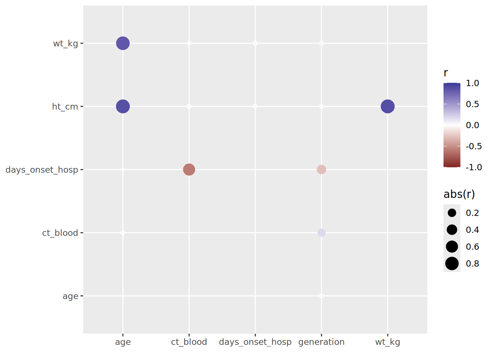

# 18  Testes estatísticos simples

Esta página demonstra como realizar testes estatísticos simples com os pacotes R **base**, **rstatix**, e **gtsummary**.

- Teste t  
- Teste de Shapiro-Wilk  
- Teste de Wilcoxon  
- Teste de Kruskal-Wallis  
- Teste qui-quadrado de Pearson  
- Correlações entre variáveis numéricas

…muitos outros testes podem ser realizados, mas mostramos apenas os mais comuns e fornecemos links para outras fontes.

Cada um dos pacotes acima possui certas vantagens e desvantagens:

- Utilize as funções do pacote R **base** para exportar resultados estatísticos para o console do R
- Utilize as funções do pacote **rstatix** para gerar os resultados em um quadro de dados, ou caso queira que os testes sejam realizados por grupos
- Utilize o pacote **gtsummary** para exportar facilmente tabelas prontas para publicação.

## 18.1 Preparação

### Carregue os pacotes

Este pequeno código carrega os pacotes necessários para as análises. Neste manual, nós estimulamos o uso da função `p_load()`, do **pacman**, que instala os pacotes, caso necessários, *e* os carrega para utilização. Também é possível carregar pacotes já instalados com a função `library()` do pacote R **base**. Veja a página sobre [Introdução ao R](basics.llms.md) para mais informações sobre pacotes do R.

``` r
pacman::p_load(
  rio,          # Importa arquivos
  here,         # Localiza arquivos
  skimr,        # visualize os dados
  tidyverse,    # gerenciamento dos dados + gráficos no ggplot2, 
  gtsummary,    # resumo estatístico e testes
  rstatix,      # estatísticas
  corrr,        # análise de correlação entre variáveis numéricas
  janitor,      # adicione totais e porcentagens às tabelas
  flextable, # converte tabelas para o formato HTML
  appliedepidata # dados de exemplo utilizados neste manual
  )
```

### Importando os dados

Nós iremos importar o banco de dados dos casos de uma simulação de epidemia de Ebola. Carregue diretamente com `appliedepidata::get_data(name = "linelist_cleaned_rds")` (consulte a página [Baixar manual e dados](download.llms.md) para mais detalhes).

``` r
# importa o 'linelist'
linelist <- appliedepidata::get_data(name = "linelist_cleaned_rds")
```

As primeiras 50 linhas dos dados são mostradas abaixo.

## 18.2 Pacote R **base**

Você pode utilizar as funções do pacote R **base** para realizar testes estatísticos. Os comandos são relativamente simples, e os resultados são exportados para o terminal do R para visualização. Entretanto, normalmente os resultados são gerados no formato de listas, o que dificulta a manipulação, caso queira utilizá-los posteriormente.

### Testes T

O [teste t](https://en.wikipedia.org/wiki/Student%27s_t-test), também chamando de “Teste t de Student”, é tipicamente utilizado para determinar se existem diferenças significativas entre as médias de variáveis numéricas de dois grupos distintos. Aqui, nós iremos mostrar duas sintaxes para realizar esse teste, de acordo com a presença ou não das colunas no mesmo quadro de dados.

**Sintaxe 1:** Esta é a sintaxe utilizada quando as colunas numéricas e categóricas estão no mesmo quadro de dados (*data frame*). Especifique a coluna numérica no lado esquerdo da equação, e a coluna categórica no lado direito. Coloque o nome do banco de dados no argumento `data =`. Opcionalmente, ajuste os argumentos `paired = TRUE`, `conf.level =` para (0.95 default), e `alternative =` para (“two.sided”, “less”, ou “greater”). Digite `?t.test` para mais detalhes.

``` r
## compare a média das idades de acordo com o sexo com um teste t
t.test(age_years ~ gender, data = linelist)
```


        Welch Two Sample t-test

    data:  age_years by gender
    t = -21.344, df = 4902.3, p-value < 2.2e-16
    alternative hypothesis: true difference in means between group f and group m is not equal to 0
    95 percent confidence interval:
     -7.571920 -6.297975
    sample estimates:
    mean in group f mean in group m 
           12.60207        19.53701 

**Sintaxe 2:** Você pode comparar dois vetores numéricos separados com essa sintaxe. Por exemplo, se as duas colunas estão em bancos de dados distintos.

``` r
t.test(df1$age_years, df2$age_years)
```

Também é possível utilizar o teste t para determinar se a média de uma amostra é significativamente diferente de algum valor específico. Aqui, nós aplicamos o teste t entre uma amostra e uma média conhecida/suposta de uma população (`mu =`):

``` r
t.test(linelist$age_years, mu = 45)
```

### Teste de Shapiro-Wilk

O [teste de Shapiro-Wilk](https://en.wikipedia.org/wiki/Shapiro%E2%80%93Wilk_test) pode ser utilizado para determinar se uma amostra foi obtida de uma população com distribuição normal (um pré-requisito de muitos outros testes e análises, como o teste t). Entretanto, isto só pode ser utilizado em uma amostra de 3 a 5000 observações. Para amostras maiores, um [gráfico de Quantil-Quantil](https://ggplot2.tidyverse.org/reference/geom_qq.html) pode ser útil.

``` r
shapiro.test(linelist$age_years)
```

### Teste de Wilcoxon

O teste de Wilcoxon, também chamado de [teste U de Mann–Whitney](https://en.wikipedia.org/wiki/Mann%E2%80%93Whitney_U_test), é frequentemente utilizado para determinar se duas amostras numéricas possuem a mesma distribuição, mesmo quando suas populações não possuem distribuição normal ou possuem variância independente (desiguais).

``` r
## compare a distribuição da idade de acordo com o grupo 'outcome' utilizando o teste wilcox
wilcox.test(age_years ~ outcome, data = linelist)
```


        Wilcoxon rank sum test with continuity correction

    data:  age_years by outcome
    W = 2501868, p-value = 0.8308
    alternative hypothesis: true location shift is not equal to 0

### Teste de Kruskal-Wallis

O [tesde de Kruskal-Wallis](https://en.wikipedia.org/wiki/Kruskal%E2%80%93Wallis_one-way_analysis_of_variance) é uma extensão do teste de Wilcoxon que pode ser utilizado para verificar diferenças na distribuição de mais de duas amostras. Quando apenas duas amostras são utilizadas, os resultados são idênticos ao teste de Wilcoxon.

``` r
## compare a distribuição da idade de acordo com o grupo 'outcome' utilizando o teste de kruskal-wallis
kruskal.test(age_years ~ outcome, linelist)
```


        Kruskal-Wallis rank sum test

    data:  age_years by outcome
    Kruskal-Wallis chi-squared = 0.045675, df = 1, p-value = 0.8308

### Teste de qui-quadrado

[O teste do qui-quadrado de Pearson](https://en.wikipedia.org/wiki/Chi-squared_test) é utilizado para verificar se existem diferenças significativas entre grupos categóricos.

``` r
## compare as proporções em cada grupo utilizando o teste do qui-quadrado
chisq.test(linelist$gender, linelist$outcome)
```


        Pearson's Chi-squared test with Yates' continuity correction

    data:  linelist$gender and linelist$outcome
    X-squared = 0.0011841, df = 1, p-value = 0.9725

## 18.3 Pacote **rstatix**

O pacote **rstatix** realiza testes estatísticos e gera os resultados de forma que possam ser manipulados (“pipe-friendly”). Os resultados são gerados automaticamente em um quadro de dados (*data frame*), sendo possível realizar operações posteriores com eles. Também é fácil agrupar os dados utilizados nas funções, podendo as estatísticas serem executadas por cada grupo.

### Estatísticas resumo

A função `get_summary_stats()` é uma maneira rápida de gerar resultados estatísticos. Simplesmente aplique seu banco de dados nessa função, e escolha as colunas para analisar. Se nenhuma coluna for especificada, as estatísticas são calculadas com todas as colunas.

Por padrão, um resumo estatístico completo é gerado: n, max, min, mediana, 25%ile, 75%ile, IQR, desvio absoluto mediano (mad), média, desvio padrão, erro padrão, e o intervalo de confiança da média.

``` r
linelist %>%
  rstatix::get_summary_stats(age, temp)
```

    # A tibble: 2 × 13
      variable     n   min   max median    q1    q3   iqr    mad  mean     sd    se
      <fct>    <dbl> <dbl> <dbl>  <dbl> <dbl> <dbl> <dbl>  <dbl> <dbl>  <dbl> <dbl>
    1 age       5802   0    84     13     6    23      17 11.9    16.1 12.6   0.166
    2 temp      5739  35.2  40.8   38.8  38.2  39.2     1  0.741  38.6  0.977 0.013
    # ℹ 1 more variable: ci <dbl>

Você pode especificar um sub-grupo do resumo estatístico a ser gerado, ao fornecer um dos seguintes valores ao argumento `type =`: “full”, “common”, “robust”, “five_number”, “mean_sd”, “mean_se”, “mean_ci”, “median_iqr”, “median_mad”, “quantile”, “mean”, “median”, “min”, “max”.

Esta função também pode ser utilizada com dados agrupados, de forma que uma linha é gerada por cada variável agrupável:

``` r
linelist %>%
  group_by(hospital) %>%
  rstatix::get_summary_stats(age, temp, type = "common")
```

    # A tibble: 12 × 11
       hospital     variable     n   min   max median   iqr  mean     sd    se    ci
       <chr>        <fct>    <dbl> <dbl> <dbl>  <dbl> <dbl> <dbl>  <dbl> <dbl> <dbl>
     1 Central Hos… age        445   0    58     12    15    15.7 12.5   0.591 1.16 
     2 Central Hos… temp       450  35.2  40.4   38.8   1    38.5  0.964 0.045 0.089
     3 Military Ho… age        884   0    72     14    18    16.1 12.4   0.417 0.818
     4 Military Ho… temp       873  35.3  40.5   38.8   1    38.6  0.952 0.032 0.063
     5 Missing      age       1441   0    76     13    17    16.0 12.9   0.339 0.665
     6 Missing      temp      1431  35.8  40.6   38.9   1    38.6  0.97  0.026 0.05 
     7 Other        age        873   0    69     13    17    16.0 12.5   0.422 0.828
     8 Other        temp       862  35.7  40.8   38.8   1.1  38.5  1.01  0.034 0.067
     9 Port Hospit… age       1739   0    68     14    18    16.3 12.7   0.305 0.598
    10 Port Hospit… temp      1713  35.5  40.6   38.8   1.1  38.6  0.981 0.024 0.046
    11 St. Mark's … age        420   0    84     12    15    15.7 12.4   0.606 1.19 
    12 St. Mark's … temp       410  35.9  40.6   38.8   1.1  38.5  0.983 0.049 0.095

O pacote **rstatix** também pode ser utilizado para realizar testes estatísticos:

### Teste t

Utilize a sintaxe de fórmula para especificar as colunas numérica e categórica:

``` r
linelist %>% 
  t_test(age_years ~ gender)
```

    # A tibble: 1 × 10
      .y.   group1 group2    n1    n2 statistic    df        p    p.adj p.adj.signif
    * <chr> <chr>  <chr>  <int> <int>     <dbl> <dbl>    <dbl>    <dbl> <chr>       
    1 age_… f      m       2807  2803     -21.3 4902. 9.89e-97 9.89e-97 ****        

Ou utilize `~ 1` e especifique `mu =` para realizar o teste t de uma amostra. Isto também pode ser realizado por grupos.

``` r
linelist %>% 
  t_test(age_years ~ 1, mu = 30)
```

    # A tibble: 1 × 7
      .y.       group1 group2         n statistic    df     p
    * <chr>     <chr>  <chr>      <int>     <dbl> <dbl> <dbl>
    1 age_years 1      null model  5802     -84.2  5801     0

Se necessário, os testes estatísticos podem ser realizados por grupos, como mostrado abaixo:

``` r
linelist %>% 
  group_by(gender) %>% 
  t_test(age_years ~ 1, mu = 18)
```

    # A tibble: 3 × 8
      gender .y.       group1 group2         n statistic    df         p
    * <chr>  <chr>     <chr>  <chr>      <int>     <dbl> <dbl>     <dbl>
    1 f      age_years 1      null model  2807    -29.8   2806 7.52e-170
    2 m      age_years 1      null model  2803      5.70  2802 1.34e-  8
    3 <NA>   age_years 1      null model   192     -3.80   191 1.96e-  4

### Tesde de Shapiro-Wilk

Como dito acima, o tamanho da amostra precisa estar entre 3 e 5000.

``` r
linelist %>% 
  head(500) %>%            # primeiras 500 linhas dos dados em linelist, para exemplificação apenas
  shapiro_test(age_years)
```

    # A tibble: 1 × 3
      variable  statistic        p
      <chr>         <dbl>    <dbl>
    1 age_years     0.917 6.67e-16

### Tesde de Wilcoxon

``` r
linelist %>% 
  wilcox_test(age_years ~ gender)
```

    # A tibble: 1 × 9
      .y.       group1 group2    n1    n2 statistic        p    p.adj p.adj.signif
    * <chr>     <chr>  <chr>  <int> <int>     <dbl>    <dbl>    <dbl> <chr>       
    1 age_years f      m       2807  2803   2829274 3.47e-74 3.47e-74 ****        

### Teste de Kruskal-Wallis

Também conhecido como teste U de Mann-Whitney.

``` r
linelist %>% 
  kruskal_test(age_years ~ outcome)
```

    # A tibble: 1 × 6
      .y.           n statistic    df     p method        
    * <chr>     <int>     <dbl> <int> <dbl> <chr>         
    1 age_years  5888    0.0457     1 0.831 Kruskal-Wallis

### Teste do Qui-quadrado

A função do teste do Qui-quadrado pode utilizar uma tabela, então primeiro criamos uma tabulação cruzada. Existem diversas formas de realizar isto (veja página de [Tabelas descritivas](tables_descriptive.llms.md)), mas aqui utilizamos a função `tabyl()`, do pacote **janitor**, e então removemos a coluna mais a esquerda (com os nomes) antes de utilizá-la na função `chisq_test()`.

``` r
linelist %>% 
  tabyl(gender, outcome) %>% 
  select(-1) %>% 
  chisq_test()
```

    # A tibble: 1 × 6
          n statistic     p    df method          p.signif
    * <dbl>     <dbl> <dbl> <int> <chr>           <chr>   
    1  5888      3.53 0.473     4 Chi-square test ns      

Muitas outras funções e testes estatísticos podem ser realizados com as funções do **rstatix**. Veja a documentação do **rstatix** [online aqui](https://github.com/kassambara/rstatix) ou digite `?rstatix`.

## 18.4 Pacote `gtsummary`

Use o **gtsummary** se você quiser adicionar os resultados de um teste estatístico em uma tabela criada com esse pacote (como descrito na seção do **gtsummary** na página de [Tabelas descritivas](tables_descriptive.llms.md#tbl_gt)).

Para realizar testes estatísticos de comparação com a função `tbl_summary`, basta adicionar a função `add_p` na tabela e especificar qual teste utilizar. É possível obter os p-valores corrigidos para testes múltiplos ao utilizar a função `add_q`. Utilize o comando `?tbl_summary` para mais detalhes.

### Teste Qui-quadrado

Compare as proporções de uma variável categórica em dois grupos. O teste estatístico padrão para a função `add_p()` para uma variável categórica é o teste Qui-quadrado de independência com correção de continuidade. Entretanto, caso alguma contagem esperada seja abaixo de 5, o teste exato de Fisher é utilizado em seu lugar.

``` r
linelist %>% 
  select(gender, outcome) %>% # selecione as variáveis de interesse
  drop_na(outcome) %>%
  tbl_summary(by = outcome) %>%  # produce summary table and specify grouping variable
  add_p()                        # especifique qual teste estatístico realizar %>% 
```

[TABLE]

### Testes t

Compare a diferença média de uma variável contínua em dois grupos. Por exemplo, compare a média das idades de acordo com a evolução clínica do paciente.

``` r
linelist %>% 
  select(age_years, outcome) %>%             # selecione as variáveis de interesse
  drop_na(outcome) %>%
  tbl_summary(                               # produza uma tabela resumo
    statistic = age_years ~ "{mean} ({sd})", # especifique quais estatísticas mostrar
    by = outcome) %>%                        # specify the grouping variable
  add_p(age_years ~ "t.test")                # especifique quais testes realizar
```

[TABLE]

### Teste de Wilcoxon

Compare a distribuição de uma variável contínua em dois grupos. O padrão é utilizar o teste de Wilcoxon e a mediana (IQR) quando comparar dois grupos. Entretanto, para dados sem distribuição normal ou ao comparar grupos múltiplos, o teste de Kruskal-Wallis é o mais apropriado.

``` r
linelist %>% 
  select(age_years, outcome) %>%                       # selecione as variáveis de interesse
  drop_na(outcome) %>%
  tbl_summary(                                         # produz uma tabela resumo
    statistic = age_years ~ "{median} ({p25}, {p75})", # especifique quais estatísticas mostrar (estes valores são padrão e podem ser removidos)
    by = outcome) %>%                                  # specify the grouping variable
  add_p(age_years ~ "wilcox.test")                     # especifique qual teste realizar (existem testes padrão, então é possível deixar os parênteses em branco)
```

[TABLE]

### Teste de Kruskal-wallis

Compare a distribuição de uma variável contínua em dois ou mais grupos, independentemente dos dados terem distribuição normal ou não.

``` r
linelist %>% 
  select(age_years, outcome) %>%                       # selecione as variáveis de interesse
  drop_na(outcome) %>%
  tbl_summary(                                         # produza tabelas resumo
    statistic = age_years ~ "{median} ({p25}, {p75})", # especifique quais estatísticas mostrar (existem valores padrão, então pode-se deixar os parênteses em branco)
    by = outcome) %>%                                  # specify the grouping variable
  add_p(age_years ~ "kruskal.test")                    # especifique qual teste realizar
```

[TABLE]

## 18.5 Correlações

Correlações entre variáveis numéricas podem ser investigadas utilizando os pacotes **tidyverse** **corrr**. Assim, é possível realizar os testes de correlação de Pearson, tau (\\\tau\\) de Kendall ou rho (\\\rho\\) de Spearman. O pacote cria uma tabela, e `stretch()` a converte em um data frame longo que plotamos com **ggplot2**.

``` r
correlation_tab <- linelist %>% 
  select(generation, age, ct_blood, days_onset_hosp, wt_kg, ht_cm) %>%   # selecione as variáveis numéricas de interesse
  correlate()      # cria uma tabela de correlação (utilizando o teste padrão pearson)

correlation_tab    # exporte a tabela para o terminal 
```

    # A tibble: 6 × 7
      term            generation      age ct_blood days_onset_hosp    wt_kg    ht_cm
      <chr>                <dbl>    <dbl>    <dbl>           <dbl>    <dbl>    <dbl>
    1 generation        NA       -2.22e-2  0.179         -0.288    -0.0302  -0.00942
    2 age               -0.0222  NA        0.00849       -0.000635  0.833    0.877  
    3 ct_blood           0.179    8.49e-3 NA             -0.600    -0.00636  0.0181 
    4 days_onset_hosp   -0.288   -6.35e-4 -0.600         NA         0.0153  -0.00953
    5 wt_kg             -0.0302   8.33e-1 -0.00636        0.0153   NA        0.884  
    6 ht_cm             -0.00942  8.77e-1  0.0181        -0.00953   0.884   NA      

``` r
## remove entradas duplicadas (a tabela acima é espelhada) 
correlation_tab <- correlation_tab %>% 
  shave()

## visualize a a tabela de correlação
correlation_tab
```

    # A tibble: 6 × 7
      term            generation       age ct_blood days_onset_hosp  wt_kg ht_cm
      <chr>                <dbl>     <dbl>    <dbl>           <dbl>  <dbl> <dbl>
    1 generation        NA       NA        NA              NA       NA        NA
    2 age               -0.0222  NA        NA              NA       NA        NA
    3 ct_blood           0.179    0.00849  NA              NA       NA        NA
    4 days_onset_hosp   -0.288   -0.000635 -0.600          NA       NA        NA
    5 wt_kg             -0.0302   0.833    -0.00636         0.0153  NA        NA
    6 ht_cm             -0.00942  0.877     0.0181         -0.00953  0.884    NA

``` r
## plote as correlações
correlation_tab %>% 
  stretch(na.rm = TRUE) %>% 
  ggplot(aes(x = x, y = y, colour = r, size = abs(r))) +
  geom_point() +
  scale_colour_gradient2(limits = c(-1, 1)) +
  labs(x = NULL, y = NULL)
```

[](stat_tests_files/figure-html/unnamed-chunk-20-1.png)

## 18.6 Recursos

Muitas informações dessa página foram adaptadas dos recursos e tutoriais online abaixo:

[gtsummary](http://www.danieldsjoberg.com/gtsummary/articles/tbl_summary.html) [dplyr](https://dplyr.tidyverse.org/articles/grouping.html) [corrr](https://corrr.tidymodels.org/articles/using-corrr.html) [sthda correlation](http://www.sthda.com/english/wiki/correlation-test-between-two-variables-in-r)
