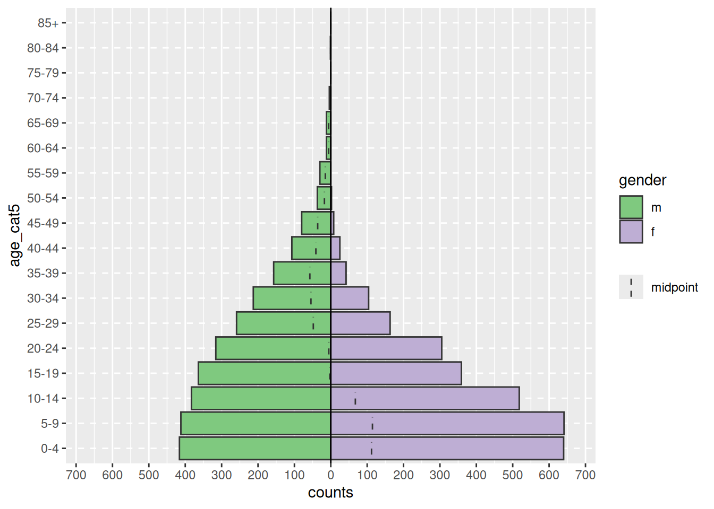
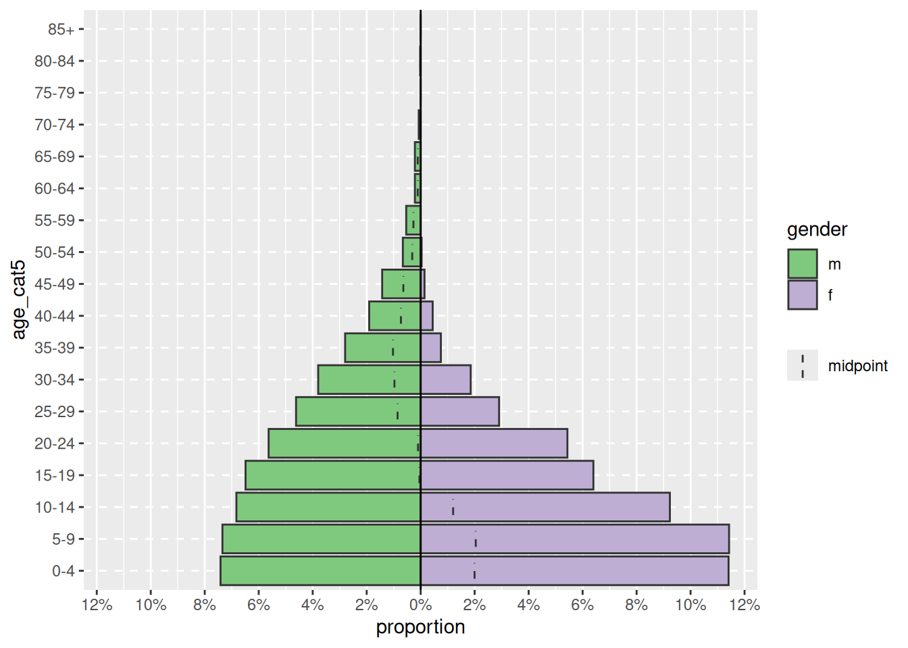
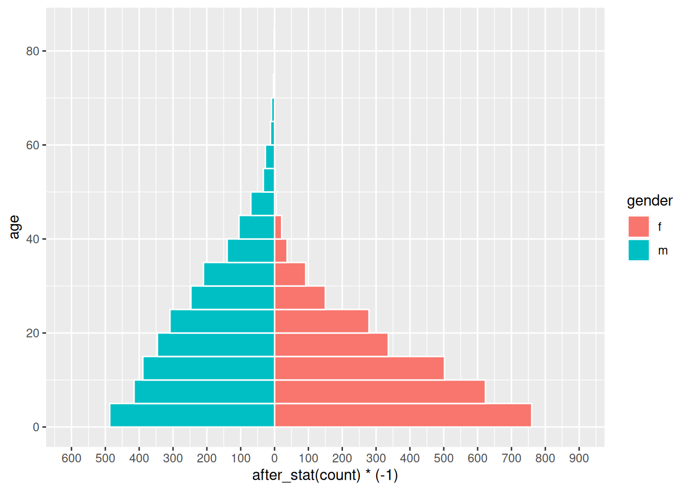
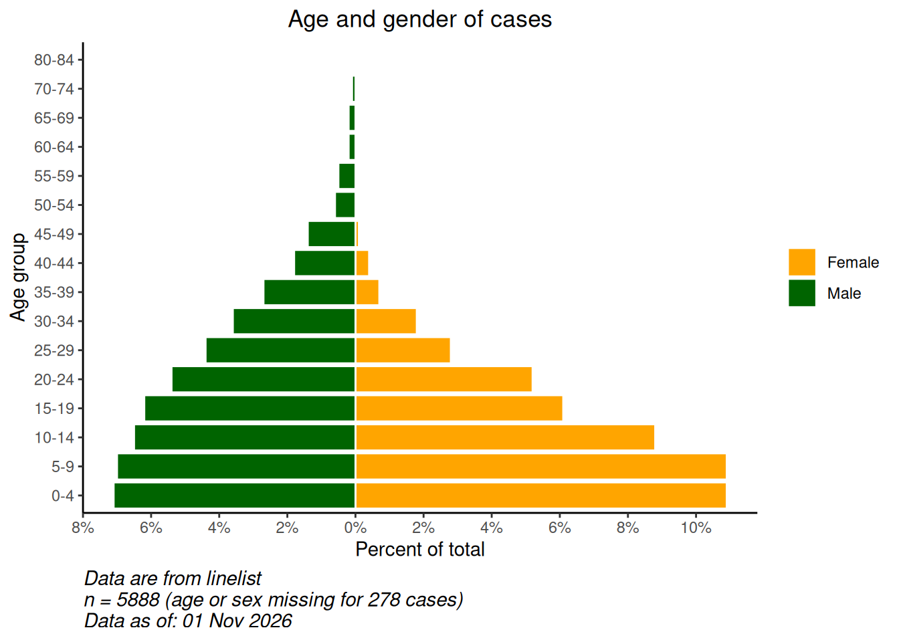

# 33  Демографические пирамиды и шкалы Лайкерта

[](../../images/pop_pyramid_baseline.png)

[](../../images/likert.png)

Демографические пирамиды полезны для отображения распределений по возрасту и полу. Аналогичный код можно использовать для визуализации результатов ответов на вопросы опроса в стиле Лайкерта (например, ” Категорически согласен”, “Согласен”, “Нейтрально”, “Не согласен”, “Категорически не согласен”). На этой странице мы рассмотрим следующее:

- Быстрые и простые пирамиды с помощью пакета **apyramid**.  
- Больше настраиваемых пирамид с помощью `ggplot()`.  
- Отображение “базовых” демографических данных на фоне пирамиды  
- Использование графиков в стиле пирамиды для отображения других типов данных (например, ответов на вопросы опроса в **стиле Лайкерта**)

## 33.1 Подготовка

### Загрузка пакетов

В этом фрагменте кода показана загрузка пакетов, необходимых для проведения анализа. В данном руководстве мы делаем акцент на `p_load()` из **pacman**, которая при необходимости устанавливает пакет *и* загружает его для использования. Установленные пакеты можно также загрузить с помощью `library()` из **базового** R. Более подробную информацию о пакетах R см. на странице [Основы R](basics.llms.md).

``` r
pacman::p_load(rio,       # для импорта данных
               here,      # для поиска файлов
               tidyverse, # для вычистки, обработки и построения графиков данных (включает пакет ggplot2)
               apyramid,  # пакет, предназначенный для создания возрастных пирамид
               janitor,   # таблицы и вычистка данных
               stringr,   # работа с последовательностями для заголовков, подписей и т.д.
               appliedepidata) # примеры данных, используемые в этом руководстве
```

### Импорт данных

Для начала мы импортируем построчный список случаев из смоделированной эпидемии лихорадки Эбола. Загрузите их напрямую с помощью `appliedepidata::get_data(name = "linelist_cleaned_rds")` (подробности см. на странице [Скачивание руководства и данных](download.llms.md)).

``` r
# импортировать построчный список
linelist <- appliedepidata::get_data(name = "linelist_cleaned_rds")
```

Ниже отображаются первые 50 строк построчного списка.

### Вычистка

Для построения традиционной возрастно-половой демографической пирамиды необходимо произвести вычистку данных следующим образом:

- Вычистке подлежит столбец “Пол”.  
- В зависимости от используемого метода возраст должен храниться либо как числовое значение, либо в столбце *возрастные категории*.

Если используются возрастные категории, то значения столбца должны быть упорядочены, либо по умолчанию буквенно-цифровые, либо намеренно заданы путем преобразования в класс фактор.

Ниже мы используем `tabyl()` из **janitor** для проверки столбцов `gender` и `age_cat5`.

``` r
linelist %>% 
  tabyl(age_cat5, gender)
```

     age_cat5   f   m NA_
          0-4 640 416  39
          5-9 641 412  42
        10-14 518 383  40
        15-19 359 364  20
        20-24 305 316  17
        25-29 163 259  13
        30-34 104 213   9
        35-39  42 157   3
        40-44  25 107   1
        45-49   8  80   5
        50-54   2  37   1
        55-59   0  30   0
        60-64   0  12   0
        65-69   0  12   1
        70-74   0   4   0
        75-79   0   0   1
        80-84   0   1   0
          85+   0   0   0
         <NA>   0   0  86

Мы также быстро строим гистограмму для столбца `age`, чтобы убедиться, что он чист и правильно классифицирован:

``` r
hist(linelist$age)
```

[](age_pyramid_files/figure-html/unnamed-chunk-7-1.png)

## 33.2 Пакет **apyramid**

Пакет **apyramid** является продуктом проекта [R4Epis](https://r4epis.netlify.com/). Подробнее об этом пакете можно прочитать [здесь](https://cran.r-project.org/web/packages/apyramid/vignettes/intro.html). Он позволяет быстро построить возрастную пирамиду. Для более сложных ситуаций см. раздел ниже [использование `ggplot()`](#demo_pyr_gg). Более подробно о пакете **apyramid** можно прочитать на его справочной странице, введя в консоли R команду `?age_pyramid`.

### Данные построчного списка

Используя вычистку данных построчного списка, мы можем создать возрастную пирамиду с помощью одной простой команды `age_pyramid()`. В этой команде:

- В качестве аргумента `data =` задается датафрейм `linelist`.  
- Аргумент `age_group =` (для оси y) задается в виде названия категориального столбца возраста (в кавычках)  
- Аргумент \``split_by =` (для оси x) задается для столбца пол

``` r
apyramid::age_pyramid(data = drop_na(linelist, age_cat5, gender),
                      age_group = "age_cat5",
                      split_by = "gender")
```

[](age_pyramid_files/figure-html/unnamed-chunk-8-1.png)

Пирамиду можно отобразить на оси x не в виде количества, а в виде процента от всех случаев, включив `proportional = TRUE`.

``` r
apyramid::age_pyramid(data = drop_na(linelist, age_cat5, gender),
                      age_group = "age_cat5",
                      split_by = "gender",
                      proportional = TRUE)
```

[](age_pyramid_files/figure-html/unnamed-chunk-9-1.png)

При использовании пакета **agepyramid**, если столбец `split_by` является бинарным (например, мужчина/женщина, или да/нет), то результат будет иметь вид пирамиды. Однако если в столбце `split_by` более двух значений (не считая `NA`), то пирамида будет выглядеть как фасетная столбчатая диаграмма с серыми полосами на “фоне”, указывающими на диапазон нефасетных данных для данной возрастной группы. При этом значения `split_by =` будут отображаться в виде меток в верхней части каждой фасетной панели. Например, ниже показано, что произойдет, если значению `split_by =` будет присвоен столбец `hospital`.

``` r
apyramid::age_pyramid(data = drop_na(linelist, age_cat5),
                      age_group = "age_cat5",
                      split_by = "hospital")  
```

[](age_pyramid_files/figure-html/unnamed-chunk-10-1.png)

#### Отсутствующие значения

Строки с пропущенными значениями `NA` в столбцах `split_by =` или `age_group =`, если они кодированы как `NA`, не будут приводить к фасетированию, показанному выше. По умолчанию эти строки не отображаются. Однако можно указать, чтобы они отображались на соседней гистограмме и в виде отдельной возрастной группы вверху, задав `na.rm = FALSE`.

``` r
apyramid::age_pyramid(data = linelist,
                      age_group = "age_cat5",
                      split_by = "gender",
                      na.rm = FALSE)         # показывать пациентов, у которых отсутствует возраст или пол
```

[](age_pyramid_files/figure-html/unnamed-chunk-11-1.png)

#### Пропорции, цвета и эстетика

По умолчанию столбики отображают подсчеты (не %), пунктирная средняя линия для каждой группы, а цвета - зеленый/пурпурный. Каждый из этих параметров может быть изменен, как показано ниже:

Кроме того, с помощью стандартного синтаксиса `ggplot()` “+” можно добавлять к графику дополнительные команды, такие как эстетические темы и корректировка меток:

``` r
apyramid::age_pyramid(
  data = drop_na(linelist, age_cat5, gender),
  age_group = "age_cat5",
  split_by = "gender",
  proportional = TRUE,              # показывать проценты, а не подсчеты
  show_midpoint = FALSE,            # удалить линию середины столбика
  #pal = c("orange", "purple")      # здесь можно указать альтернативные цвета (но не метки)
  )+                 
  
  # дополнительные команды ggplot
  theme_minimal()+                               # упростить фон
  scale_fill_manual(                             # указать цвета И метки
    values = c("orange", "purple"),              
    labels = c("m" = "Male", "f" = "Female"))+
  labs(y = "Percent of all cases",              # обратите внимание, что labs x и y поменялись местами
       x = "Age categories",                          
       fill = "Gender", 
       caption = "My data source and caption here",
       title = "Title of my plot",
       subtitle = "Subtitle with \n a second line...")+
  theme(
    legend.position = "bottom",                          # легенда к низу
    axis.text = element_text(size = 10, face = "bold"),  # шрифты/размеры
    axis.title = element_text(size = 12, face = "bold"))
```

[](age_pyramid_files/figure-html/unnamed-chunk-12-1.png)

### Агрегированные данные

В приведенных примерах предполагается, что данные представлены в виде построчного списка, каждая строка которого приходится на одно наблюдение. Если ваши данные уже агрегированы в подсчеты по возрастным категориям, вы можете использовать пакет **apyramid**, как показано ниже.

Для демонстрации мы агрегируем данные построчного списка в подсчеты по возрастной категории и по полу в “широком” формате. В результате будет создано впечатление, что данные изначально представлены в виде подсчетов. Подробнее см. страницы \[Группирование данных\] и \[Поворот данных\],

``` r
demo_agg <- linelist %>% 
  count(age_cat5, gender, name = "cases") %>% 
  pivot_wider(
    id_cols = age_cat5,
    names_from = gender,
    values_from = cases) %>% 
  rename(`missing_gender` = `NA`)
```

…в результате чего набор данных выглядит следующим образом: со столбцами для возрастной категории, а также со столбцами для количества мужчин, количества женщин и количества отсутствующих..

Чтобы настроить эти данные для возрастной пирамиды, мы повернем их вертикально с помощью функции `pivot_longer()` из **dplyr**. Это связано с тем, что функция `ggplot()` обычно предпочитает “длинные” данные, а в **apyramid** используется `ggplot()`.

``` r
# поворот агрегированных данных в длинный формат
demo_agg_long <- demo_agg %>% 
  pivot_longer(
    col = c(f, m, missing_gender),            # удлинение столбцов
    names_to = "gender",                # название для нового столбца категорий
    values_to = "counts") %>%           # название для нового столбца подсчетов
  mutate(
    gender = na_if(gender, "missing_gender")) # преобразовать "missing_gender" в NA
```

Затем с помощью аргументов `split_by =` и `count =` функции `age_pyramid()` указать соответствующие столбцы в данных:

``` r
apyramid::age_pyramid(data = drop_na(demo_agg_long),
                      age_group = "age_cat5",# название столбца для возрастной категории
                      split_by = "gender",   # название столбца для пола
                      count = "counts",      # название столбца для подсчета количества случаев
                      show_midpoint = FALSE)
```

[](age_pyramid_files/figure-html/unnamed-chunk-17-1.png)

Обратите внимание, что порядок факторов “m” и “f” отличается (пирамида перевернута). Для корректировки порядка необходимо переопределить пол в агрегированных данных как Фактор и упорядочить уровни по желанию. См. страницу \[Факторы\].

## 33.3 `ggplot()`

Использование `ggplot()` для построения возрастной пирамиды позволяет добиться большей гибкости, но требует больших усилий и понимания принципов работы `ggplot()`. Кроме того, в этом случае легче случайно допустить ошибки.

Чтобы использовать функцию `ggplot()` для построения демографических пирамид, необходимо создать два столбчатых графика (по одному для каждого пола), преобразовать значения на одном графике в отрицательные, а затем перевернуть оси x и y, чтобы отобразить столбчатые графики вертикально, а их основания сошлись в середине графика.

### Подготовка

В данном подходе используется *числовой* столбец возраста, а не *категориальный* столбец `age_cat5`. Поэтому мы проверим, действительно ли класс этого столбца является числовым.

``` r
class(linelist$age)
```

    [1] "numeric"

Аналогичную логику можно использовать для построения пирамиды из категориальных данных, используя `geom_col()` вместо `geom_histogram()`.

### Построение графика

Во-первых, следует понимать, что для построения такой пирамиды с помощью `ggplot()` используется следующий подход:

- Внутри `ggplot()` создайте **две** гистограммы, используя числовой столбец возраста. По одной для каждого из двух значений группировки (в данном случае мужского и женского полов). Для этого данные для каждой гистограммы задаются в соответствующих командах `geom_histogram()`, а соответствующие фильтры применяются к `linelist`.

- На одном графике будут положительные значения подсчетов, а на другом - отрицательные, что создает “пирамиду” со значением `0` в середине графика. Отрицательные значения создаются с помощью специального **ggplot2** термина `after_stat(count)` и умножения на -1.

- Команда `coord_flip()` переключает оси X и Y, в результате чего графики становятся вертикальными и образуют пирамиду.

- Наконец, необходимо изменить метки значений оси подсчетов таким образом, чтобы они отображались как “положительные” подсчеты на обеих сторонах пирамиды (несмотря на то, что базовые значения на одной из сторон отрицательны).

Ниже приводится **простая** версия этого варианта с использованием `geom_histogram()`:

``` r
  # начать  ggplot
  ggplot(mapping = aes(x = age, fill = gender)) +
  
  # гистограмма женского пола
  geom_histogram(data = linelist %>% filter(gender == "f"),
                 breaks = seq(0,85,5),
                 colour = "white") +
  
  # гистограмма мужского пола (значения приведены к отрицательным)
  geom_histogram(data = linelist %>% filter(gender == "m"),
                 breaks = seq(0,85,5),
                 mapping = aes(y = after_stat(count)*(-1)),
                 colour = "white") +
  
  # перевернуть оси X и Y
  coord_flip() +
  
  # настройка масштаба оси подсчета
  scale_y_continuous(limits = c(-600, 900),
                     breaks = seq(-600,900,100),
                     labels = abs(seq(-600, 900, 100)))
```

[](age_pyramid_files/figure-html/unnamed-chunk-19-1.png)

***ВНИМАНИЕ:*** Если задать слишком низкие **границы** по оси подсчетов, а столбец подсчетов превысит их, то столбец исчезнет совсем или будет искусственно укорочен! Следите за этим, если анализируете данные, которые регулярно обновляются. Во избежание этого границы оси подсчетов должны автоматически подстраиваться под данные, как показано ниже.

В этой простой версии можно многое изменить/дополнить, в том числе:

- Автоматическая настройка масштаба оси подсчета в соответствии с вашими данными (во избежание ошибок, о которых говорится в предупреждении ниже)  
- Вручную задавать цвета и метки легенды

**Преобразование подсчетов в проценты**.

Чтобы преобразовать подсчеты в проценты (от общего числа), сделайте это в своих данных перед построением графика. Ниже мы получаем подсчеты по возрасту и полу, затем `ungroup()`, а затем `mutate()` для создания новых процентных столбцов. Если вам нужны проценты по полу, пропустите шаг разгруппировки.

``` r
# создать набор данных с долей от общего числа
pyramid_data <- linelist %>%
  count(age_cat5,
        gender,
        name = "counts") %>% 
  ungroup() %>%                 # разгруппировать, чтобы проценты были не по группам
  mutate(percent = round(100*(counts / sum(counts, na.rm=T)), digits = 1), 
         percent = case_when(
            gender == "f" ~ percent,
            gender == "m" ~ -percent,     # преобразование мужского пола в отрицательные значения
            TRUE          ~ NA_real_))    # значение NA должно быть также числовым
```

Важно отметить, что мы сохраняем максимальное и минимальное значения, чтобы знать, какими должны быть границы шкалы. Они будут использованы в команде `ggplot()` ниже.

``` r
max_per <- max(pyramid_data$percent, na.rm=T)
min_per <- min(pyramid_data$percent, na.rm=T)

max_per
```

    [1] 10.9

``` r
min_per
```

    [1] -7.1

Наконец, мы выполняем функцию `ggplot()` для процентных данных. Мы указываем `scale_y_continuous()` для увеличения предварительно заданных длин в каждом направлении (положительном и “отрицательном”). Мы используем `floor()` и `ceiling()` для округления десятичных дробей в соответствующую сторону (вниз или вверх) для стороны оси.

``` r
# начать ggplot
  ggplot()+  # По оси x по умолчанию указан возраст в годах;

  # графа данных о случае
  geom_col(data = drop_na(pyramid_data, percent),
           mapping = aes(
             x = age_cat5,
             y = percent,
             fill = gender),         
           colour = "white")+       # белый цвет вокруг каждого столбика
  
  # переверните оси X и Y, чтобы пирамида стала вертикальной
  coord_flip()+
  

  # настройка масштабов осей
  # масштаб_x_непрерывный( разрывы = послед(0,100,5), метки = послед(0,100,5)) +
  scale_y_continuous(
    limits = c(min_per, max_per),
    breaks = seq(from = floor(min_per),                # последовательность значений, по 2s
                 to = ceiling(max_per),
                 by = 2),
    labels = paste0(abs(seq(from = floor(min_per),     # последовательность абсолютных значений, по 2с, с "%"
                            to = ceiling(max_per),
                            by = 2)),
                    "%"))+  

  # назначение цветов и меток легенды вручную
  scale_fill_manual(
    values = c("f" = "orange",
               "m" = "darkgreen"),
    labels = c("Female", "Male")) +
  
  # значения меток (помните, что X и Y теперь перевернуты)
  labs(
    title = "Age and gender of cases",
    x = "Age group",
    y = "Percent of total",
    fill = NULL,
    caption = stringr::str_glue("Data are from linelist \nn = {nrow(linelist)} (age or sex missing for {sum(is.na(linelist$gender) | is.na(linelist$age_years))} cases) \nData as of: {format(Sys.Date(), '%d %b %Y')}")) +
  
  # отобразить темы
  theme(
    panel.grid.major = element_blank(),
    panel.grid.minor = element_blank(),
    panel.background = element_blank(),
    axis.line = element_line(colour = "black"),
    plot.title = element_text(hjust = 0.5), 
    plot.caption = element_text(hjust=0, size=11, face = "italic")
    )
```

[](age_pyramid_files/figure-html/unnamed-chunk-22-1.png)

### Сравнить с исходным уровнем

Благодаря гибкости функции `ggplot()` можно получить второй слой столбиков на заднем плане, представляющих “истинную” или ” исходную” пирамиду населения. Это может дать хорошую визуализацию для сравнения наблюдаемых и исходных данных.

Импортируйте и просмотрите данные о численности населения (см. страницу \[Скачивание руководства и данных\]):

``` r
# импорт демографических данных населения
pop <- appliedepidata::get_data(name = "country_demographics")
```

Сначала несколько шагов по управлению данными:

Здесь мы записываем порядок возрастных категорий, которые мы хотим получить. Из-за некоторых особенностей работы функции `ggplot()` в данном конкретном сценарии проще всего хранить их в виде символьного вектора и использовать позже в функции построения графика.

``` r
# записать правильные уровни возрастных категорий
age_levels <- c("0-4","5-9", "10-14", "15-19", "20-24",
                "25-29","30-34", "35-39", "40-44", "45-49",
                "50-54", "55-59", "60-64", "65-69", "70-74",
                "75-79", "80-84", "85+")
```

Объедините данные по населению и случаю с помощью **dplyr** функции `bind_rows()`:

- Во-первых, убедитесь, что они имеют *одинаковые* названия столбцов, значения возрастных категорий и пола.  
- Пусть они имеют одинаковую структуру данных: столбцы возрастной категории, пола, количества и процента от общего числа  
- Свяжите их вместе, один поверх другого (`bind_rows()`)

``` r
# создание/преобразование данных о населении с указанием процента от общей численности
########################################################
pop_data <- pop %>% 
  pivot_longer(      # поворот столбцов по полу в длину
    cols = c(m, f),
    names_to = "gender",
    values_to = "counts") %>% 
  
  mutate(
    percent  = round(100*(counts / sum(counts, na.rm=T)),1),  # % от общего количества
    percent  = case_when(                                                        
     gender == "f" ~ percent,
     gender == "m" ~ -percent,               # если мужской пол, перевести % в отрицательное значение
     TRUE          ~ NA_real_))
```

Просмотр измененного набора данных о населении

Теперь сделаем то же самое для построчного списка случаев. Он немного отличается тем, что начинается со строк случаев, а не с подсчетов.

``` r
# создать данные о случаях с разбивкой по возрасту/полу, с указанием процента от общего числа случаев
#######################################################
case_data <- linelist %>%
  count(age_cat5, gender, name = "counts") %>%  # подсчеты по половозрастным группам
  ungroup() %>% 
  mutate(
    percent = round(100*(counts / sum(counts, na.rm=T)),1),  # рассчитать % от общего количества по половозрастным группам
    percent = case_when(                                     # перевести % в отрицательное значение, если речь идет о мужском поле
      gender == "f" ~ percent,
      gender == "m" ~ -percent,
      TRUE          ~ NA_real_))
```

Просмотр измененного набора данных по случаям

Теперь два датафрейма объединены, расположены один поверх другого (имеют одинаковые названия столбцов). Мы можем “дать название” каждому из датафреймов и использовать аргумент `.id =` для создания нового столбца “data_source”, который будет указывать, из какого датафрейма взята каждая строка. Мы можем использовать этот столбец для фильтрации в `ggplot()`.

``` r
# объединить данные по случаям и данные по населению (одинаковые названия столбцов, значения age_cat и gender)
pyramid_data <- bind_rows("cases" = case_data, "population" = pop_data, .id = "data_source")
```

Хранить максимальное и минимальное значения процентов, используемые в функции построения для определения границ графика (и не обрывать столбики!)

``` r
# Определить границы оси процентов, используемые для определения границ графика
max_per <- max(pyramid_data$percent, na.rm=T)
min_per <- min(pyramid_data$percent, na.rm=T)
```

Теперь с помощью `ggplot()` строится график:

- Одна гистограмма данных о населении (более широкие, прозрачные столбики)
- Одна гистограмма данных по случаям (мелкие, более сплошные столбики)

``` r
# начать ggplot
##############
ggplot()+  # Ось x по умолчанию - возраст в годах;

  # график данных о населении
  geom_col(
    data = pyramid_data %>% filter(data_source == "population"),
    mapping = aes(
      x = age_cat5,
      y = percent,
      fill = gender),
    colour = "black",                               # черный цвет вокруг столбиков
    alpha = 0.2,                                    # более прозрачный
    width = 1)+                                     # полная ширина
  
  # график данных о случае
  geom_col(
    data = pyramid_data %>% filter(data_source == "cases") %>% drop_na(percent), 
    mapping = aes(
      x = age_cat5,                               # возрастные категории в качестве исходной оси X
      y = percent,                                # % по сравнению с исходной осью Y
      fill = gender),                             # заливка столбиков по полу
    colour = "black",                               # черный цвет вокруг столбиков
    alpha = 1,                                      # непрозрачный 
    width = 0.3)+                                   # половина ширины
  
  # переверните оси X и Y, чтобы пирамида стала вертикальной
  coord_flip()+
  
  # вручную убедиться в правильности упорядочивания оси возраст
  scale_x_discrete(limits = age_levels)+     # определенный в фрагменте выше
  
  # задать ось процентов 
  scale_y_continuous(
    limits = c(min_per, max_per),                                          #минимальное и максимальное значения, определенные выше
    breaks = seq(floor(min_per), ceiling(max_per), by = 2),                # от min% до max% по 2 
    labels = paste0(                                                       # для меток, соедините их вместе... 
              abs(seq(floor(min_per), ceiling(max_per), by = 2)), "%"))+                                                  

  # назначение цветов и меток легенды вручную
  scale_fill_manual(
    values = c("f" = "orange",         # присвоить цвета значениям в данных
               "m" = "darkgreen"),
    labels = c("f" = "Female",
               "m"= "Male"),      # изменение меток, отображаемых в легенде, порядка примечаний
  ) +

  # метки, заголовки, надписи графика    
  labs(
    title = "Case age and gender distribution,\nas compared to baseline population",
    subtitle = "",
    x = "Age category",
    y = "Percent of total",
    fill = NULL,
    caption = stringr::str_glue("Cases shown on top of country demographic baseline\nCase data are from linelist, n = {nrow(linelist)}\nAge or gender missing for {sum(is.na(linelist$gender) | is.na(linelist$age_years))} cases\nCase data as of: {format(max(linelist$date_onset, na.rm=T), '%d %b %Y')}")) +
  
  # дополнительные эстетические темы
  theme(
    legend.position = "bottom",                             # перемещение легенды в нижнюю часть
    panel.grid.major = element_blank(),
    panel.grid.minor = element_blank(),
    panel.background = element_blank(),
    axis.line = element_line(colour = "black"),
    plot.title = element_text(hjust = 0), 
    plot.caption = element_text(hjust=0, size=11, face = "italic"))
```

[](age_pyramid_files/figure-html/unnamed-chunk-33-1.png)

## 33.4 Шкала Лайкерта

Приемы, используемые для построения пирамиды населения с помощью `ggplot()`, могут быть использованы и для построения графиков данных опроса по шкале Лайкерта.

Импортируйте данные (при желании см. страницу \[Скачивание руководства и данных\]).

``` r
# импорт данных об ответах на опросник Лайкерта
likert_data <- appliedepidata::get_data(name = "likert_data")
```

Начнем с данных, которые выглядят следующим образом: категориальная классификация каждого респондента (`status`) и его ответы на 8 вопросов по 4-балльной шкале типа Лайкерта (“Очень плохо”, “Плохо”, “Хорошо”, “Очень хорошо”).

Во-первых, некоторые шаги по управлению данными:

- Поворот данных в длинный формат.  
- Создать новый столбец `direction` в зависимости от того, был ли ответ в целом “положительным” или “отрицательным”  
- Установить порядок уровней факторов для столбца `status` и столбца `Response`.  
- Сохранить максимальное значение подсчета, чтобы границы графика были соответствующими

``` r
melted <- likert_data %>% 
  pivot_longer(
    cols = Q1:Q8,
    names_to = "Question",
    values_to = "Response") %>% 
  mutate(
    
    direction = case_when(
      Response %in% c("Poor","Very Poor")  ~ "Negative",
      Response %in% c("Good", "Very Good") ~ "Positive",
      TRUE                                 ~ "Unknown"),
    
    status = fct_relevel(status, "Junior", "Intermediate", "Senior"),
    
    # необходимо поменять 'Very Poor' и 'Poor', чтобы работал порядок
    Response = fct_relevel(Response, "Very Good", "Good", "Very Poor", "Poor")) 

# получение наибольшего значения для границ масштаба
melted_max <- melted %>% 
  count(status, Question) %>% # получить подсчеты
  pull(n) %>%                 # столбец 'n'
  max(na.rm=T)                # получить максимальное значение
```

Теперь построим график. Как и в случае с возрастными пирамидами, мы строим два столбчатых графика и инвертируем значения одного из них в отрицательные.

Мы используем `geom_bar()`, поскольку наши данные представляют собой одну строку на наблюдение, а не агрегированные подсчеты. Мы используем специальный **ggplot2** термин `after_stat(count)` в одной из гистограмм для инвертирования значений в отрицательные (\*-1), и задаем `position = "stack"`, чтобы значения складывались друг на друга.

``` r
# построить график
ggplot()+
     
  # гистограмма "отрицательных" ответов 
     geom_bar(
       data = melted %>% filter(direction == "Negative"),
       mapping = aes(
         x = status,
         y = after_stat(count)*(-1),    # инверсия подсчетов в отрицательное значение
         fill = Response),
       color = "black",
       position = "stack")+
     
     # гистограмма "положительных" ответов
     geom_bar(
       data = melted %>% filter(direction == "Positive"),
       mapping = aes(
         x = status,
         fill = Response),
       colour = "black",
       position = "stack")+
     
     # перевернуть оси X и Y
     coord_flip()+
  
     # Черная вертикальная линия на отметке 0
     geom_hline(yintercept = 0, color = "black", linewidth=1)+
     
    # преобразование меток ко всем положительным числам
    scale_y_continuous(
      
      # границы шкалы оси x
      limits = c(-ceiling(melted_max/10)*11,    # последовательность от отрицательных к положительным по 10, края округляются до ближайших 5
                 ceiling(melted_max/10)*10),   
      
      # значения масштаба по оси x
      breaks = seq(from = -ceiling(melted_max/10)*10,
                   to = ceiling(melted_max/10)*10,
                   by = 10),
      
      # метки шкалы оси x
      labels = abs(unique(c(seq(-ceiling(melted_max/10)*10, 0, 10),
                            seq(0, ceiling(melted_max/10)*10, 10))))) +
     
    # цветовые шкалы, назначенные вручную
    scale_fill_manual(
      values = c("Very Good"  = "green4", # назначает цвета
                "Good"      = "green3",
                "Poor"      = "yellow",
                "Very Poor" = "red3"),
      breaks = c("Very Good", "Good", "Poor", "Very Poor"))+ # упорядочивает легенду
     
    
     
    # фасетировать весь график, чтобы каждый вопрос был отдельным графиком
    facet_wrap( ~ Question, ncol = 3)+
     
    # метки, заголовки, надписи
    labs(
      title = str_glue("Likert-style responses\nn = {nrow(likert_data)}"),
      x = "Respondent status",
      y = "Number of responses",
      fill = "")+

     # отобразить корректировки 
     theme_minimal()+
     theme(axis.text = element_text(size = 12),
           axis.title = element_text(size = 14, face = "bold"),
           strip.text = element_text(size = 14, face = "bold"),  # подзаголовки фасетов
           plot.title = element_text(size = 20, face = "bold"),
           panel.background = element_rect(fill = NA, color = "black")) # черный квадрат вокруг каждого фасета
```

[](age_pyramid_files/figure-html/unnamed-chunk-38-1.png)

## 33.5 Ресурсы

[Документация по Apyramid](https://cran.r-project.org/web/packages/apyramid/vignettes/intro.html)
