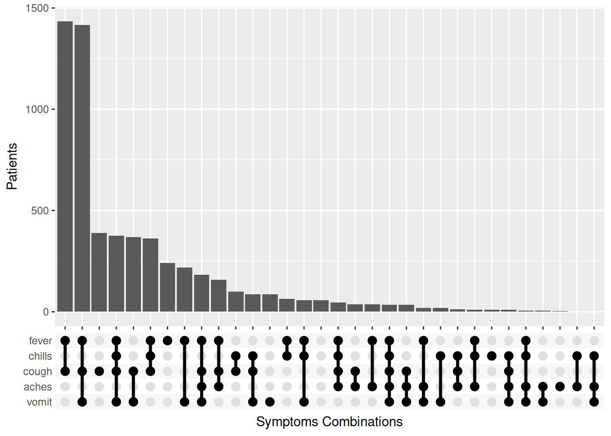
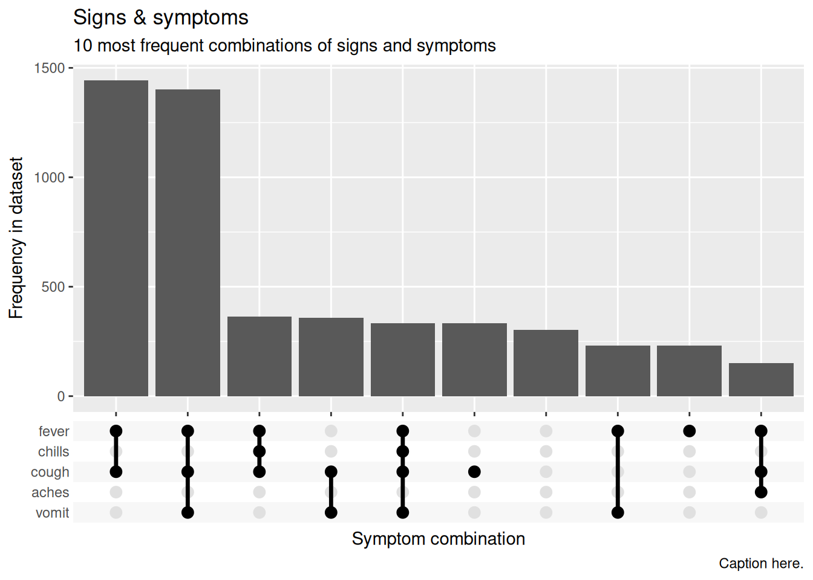

# 36  Анализ комбинаций

[](combination_analysis_files/figure-html/combination_header-1.png)

Этот анализ позволяет построить график частоты встречаемости различных **комбинаций** значений/ответов. В данном примере мы строим график частоты проявления различных комбинаций симптомов.

Этот анализ также часто называют:

- **“Анализ множественных ответов”**  
- **“Анализ множеств”**  
- **“Анализ комбинаций”**

На приведенном выше графике показаны пять симптомов. Под каждым вертикальным столбиком находится линия и точки, указывающие на комбинацию симптомов, отраженных столбиком выше.

В первом показанном нами способе используется пакет **ggupset**, во втором - пакет **UpSetR**.

## 36.1 Подготовка

### Загрузка пакетов

В этом фрагменте кода показана загрузка пакетов, необходимых для проведения анализа. В данном руководстве мы делаем акцент на функции `p_load()` из **pacman**, которая при необходимости устанавливает пакет *и* загружает его для использования. Установленные пакеты можно также загрузить с помощью `library()` из **базового** R. Более подробную информацию о пакетах R см. на странице [Основы R](basics.llms.md).

``` r
pacman::p_load(
  tidyverse,     # управление данными и их визуализация
  UpSetR,        # специальный пакет для графиков с комбинированными данными
  ggupset,       # специальный пакет для графиков с комбинированными данными
  appliedepidata) # примеры данных, используемые в этом руководстве
```

### Импорт данных

Для начала мы импортируем построчный список случаев из смоделированной эпидемии лихорадки Эбола. Загрузите их напрямую с помощью `appliedepidata::get_data(name = "linelist_cleaned_rds")` (подробности см. на странице [Скачивание руководства и данных](download.llms.md)).

``` r
# импортный построчный список 
linelist_sym <- appliedepidata::get_data(name = "linelist_cleaned_rds")
```

Этот построчный список включает пять переменных “да/нет”, касающихся заявленных симптомов. Для построения графика с помощью пакета **ggupset** нам потребуется немного преобразовать эти переменные. Просмотрите данные (прокрутите страницу вправо, чтобы увидеть переменные симптомов).

### Переформатирование значений

Для соответствия формату, ожидаемому **ggupset**, мы преобразуем ““да”” и “нет” в название симптома, используя `case_when()` из **dplyr**. Если “нет”, мы устанавливаем значение как пустое, так что значениями будут либо `NA`, либо симптом.

``` r
# создать столбец с названиями симптомов, разделенных точками с запятой
linelist_sym_1 <- linelist_sym %>% 

  # преобразовать значения "да" и "нет" в само название симптома
  # если старое значение "да", то новое - " лихорадка", в противном случае - значение отсутствует (NA)
mutate(fever = ifelse(fever == "yes", "fever", NA), 
       chills = ifelse(chills == "yes", "chills", NA),
       cough = ifelse(cough == "yes", "cough", NA),
       aches = ifelse(aches == "yes", "aches", NA),
       vomit = ifelse(vomit == "yes", "vomit", NA))
```

Теперь создадим два последних столбца:

1.  Конкатенация (склеивание) всех симптомов пациента (столбец символов)  
2.  Преобразуем приведенный столбец в класс *список*, чтобы он мог быть принят функцией **ggupset** для построения графика

Подробнее о функции `unite()` из **stringr** см. на странице [Текст и последовательности](characters_strings.llms.md).

``` r
linelist_sym_1 <- linelist_sym_1 %>% 
  unite(col = "all_symptoms",
        c(fever, chills, cough, aches, vomit), 
        sep = "; ",
        remove = TRUE,
        na.rm = TRUE) %>% 
  mutate(
    # создать копию столбца all_symptoms, но класса "список" (что необходимо для использования функции ggupset() на следующем шаге)
    all_symptoms_list = as.list(strsplit(all_symptoms, "; "))
    )
```

Просмотрите новые данные. Обратите внимание на два столбца с правой стороны - вставленные комбинированные значения и список

## 36.2 **ggupset**

Загрузка пакета

``` r
pacman::p_load(ggupset)
```

Создайте график. Мы начинаем с `ggplot()` и `geom_bar()`, но затем добавляем специальную функцию `scale_x_upset()` из **ggupset**.

``` r
# оставляем 10 самых частых комбинаций, которые показывает n_intersections = 10
top_combinations <- linelist_sym_1 %>% 
  count(all_symptoms, sort = TRUE) %>% 
  slice_head(n = 10) %>% 
  pull(all_symptoms)

ggplot(
  data = filter(linelist_sym_1, all_symptoms %in% top_combinations),
  mapping = aes(x = all_symptoms_list)) +
geom_bar() +
scale_x_upset(
  reverse = FALSE,
  n_intersections = 10,
  sets = c("fever", "chills", "cough", "aches", "vomit"))+
labs(
  title = "Signs & symptoms",
  subtitle = "10 most frequent combinations of signs and symptoms",
  caption = "Caption here.",
  x = "Symptom combination",
  y = "Frequency in dataset")
```

[](combination_analysis_files/figure-html/combination_ggupset-1.png)

Более подробную информацию о **ggupset** можно найти [онлайн](https://rdrr.io/cran/ggupset/man/scale_x_upset.html) или офлайн в документации к пакету на вкладке RStudio Help `?ggupset`.

## 36.3 `UpSetR`

Пакет **UpSetR** позволяет лучше настраивать график, но может быть более сложным в исполнении:

**Загрузка пакета**

``` r
pacman::p_load(UpSetR)
```

**Вычистка данных**

Мы должны преобразовать значения симптомов `linelist` к 1 / 0.

``` r
linelist_sym_2 <- linelist_sym %>% 
     # преобразовать значения "да" и "нет" в 1 и 0
     mutate(fever = ifelse(fever == "yes", 1, 0), 
            chills = ifelse(chills == "yes", 1, 0),
            cough = ifelse(cough == "yes", 1, 0),
            aches = ifelse(aches == "yes", 1, 0),
            vomit = ifelse(vomit == "yes", 1, 0))
```

Если вас интересует более эффективная команда, вы можете воспользоваться функцией `+()`, которая преобразует в 1 и 0 на основе логического оператора. Эта команда использует функцию `across()` для одновременного изменения нескольких столбцов (подробнее об этом читайте в разделе [Вычистка данных и ключевые функции](cleaning.llms.md#clean_across)).

``` r
# Эффективное преобразование "да" в 1 и 0
linelist_sym_2 <- linelist_sym %>% 
  
  # преобразовать значения "да" и "нет" в 1 и 0
  mutate(across(c(fever, chills, cough, aches, vomit), .fns = ~+(.x == "yes")))
```

Теперь постройте график с помощью пользовательской функции `upset()`, используя только столбцы симптомов. Вы должны указать, какие “наборы” сравнивать (названия столбцов симптомов). В качестве альтернативы можно использовать `nsets =` и `order.by = "freq"`, чтобы показать только самые первые комбинации X.

``` r
# Построить график
linelist_sym_2 %>% 
  drop_na(fever, chills, cough, aches, vomit) %>% 
  UpSetR::upset(
       sets = c("fever", "chills", "cough", "aches", "vomit"),
       order.by = "freq",
       sets.bar.color = c("blue", "red", "yellow", "darkgreen", "orange"), # optional colors
       empty.intersections = "on",
       # nsets = 3,
       number.angles = 0,
       point.size = 3.5,
       line.size = 2, 
       mainbar.y.label = "Symptoms Combinations",
       sets.x.label = "Patients with Symptom")
```

[](combination_analysis_files/figure-html/combination_upsetr-1.png)

## 36.4 Ресурсы

[Страница github на UpSetR](https://github.com/hms-dbmi/UpSetR)

[Версия Shiny App - вы можете загружать свои собственные данные](https://gehlenborglab.shinyapps.io/upsetr/)

[\*документация - сложная для интерпретации](https://cran.r-project.org/web/packages/UpSetR/UpSetR.pdf)
