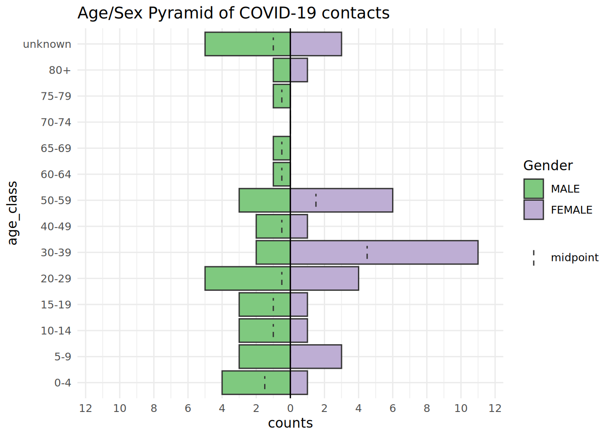

# 25  Отслеживание контактов

На этой странице демонстрируется описательный анализ данных по отслеживанию контактов, рассматриваются некоторые ключевые аспекты и подходы к такого рода данным.

На этой странице рассматриваются многие ключевые компетенции по управлению данными и визуализации в R, которые разбирались на других страницах (например, вычистка данных, поворот, таблицы, анализ временных рядов), но мы подчеркнем примеры применительно к отслеживанию контактов, которые являются полезными для принятия операционных решений. Например, это включает визуализацию данные по отслеживанию контактов в течение определенного времени или по географическому району, либо для создания таблиц ключевых показателей эффективности (KPI) для руководителей групп отслеживания контактов.

В целях демонстрации мы используем простые данные по отслеживанию контактов с платформы [Go.Data](https://www.who.int/tools/godata). Принципы, рассматриваемые здесь, будут применимы к данным по отслеживанию контактов с других платформ - возможно, вам просто нужно будет проделать другие предварительные шаги для обработки данных в зависимости от структуры данных.

Вы можете более подробно прочитать о проекте Go.Data на [сайте документации Github](https://worldhealthorganization.github.io/godata/) или в [Сообществе практиков](https://community-godata.who.int/).

## 25.1 Подготовка

### Загрузка пакетов

Данный фрагмент кода показывает загрузку пакетов, необходимых для анализа. В данном руководстве мы фокусируемся на использовании `p_load()` из пакета **pacman**, которая устанавливает пакет, если необходимо, *и* загружает его для использования. Вы можете также загрузить установленные пакеты с помощью `library()` из **базового** R. См. страницу [Основы R](basics.llms.md) для получения дополнительной информации о пакетах R.

``` r
pacman::p_load(
  rio,          # импорт данных  
  here,         # относительные пути к файлу  
  janitor,      # вычистка данных и таблицы
  lubridate,    # работа с датами
  epikit,       # функция age_categories()
  apyramid,     # возрастные пирамиды
  tidyverse,    # манипуляции с данными и визуализация
  RColorBrewer, # цветовые палитры
  formattable,  # красивые таблицы
  kableExtra, # форматирование таблиц
  appliedepidata # примеры данных, используемые в этом руководстве
)
```

### Импорт данных

Мы испортируем примеры наборов данных по контактам и их “мониторингу”. Эти данные были получены и разложены из Go.Data API и сохранены как файлы “.rds”.

Вы можете скачать все примеры данных для этого руководства на странице [Скачивание руководства и данных](download.llms.md).

Если вы хотите скачать пример данных по отслеживанию контактов, конкретно для этой страницы, используйте три ссылки для скачивания ниже:

[Кликните, чтобы скачать данные по расследованию случаев (.rds файл)](https://github.com/WorldHealthOrganization/godata/blob/master/analytics/r-reporting/data/cases_clean.rds?raw=true)

[Кликните, чтобы скачать данные по регистрации контактов (.rds файл)](https://github.com/WorldHealthOrganization/godata/blob/master/analytics/r-reporting/data/contacts_clean.rds?raw=true)

[Кликните, чтобы скачать данные по мониторингу контактов (.rds файл)](https://github.com/WorldHealthOrganization/godata/blob/master/analytics/r-reporting/data/followups_clean.rds?raw=true)

В своей оригинальной форме в скачиваемом файле данные отражают данные в той форме, в которой они предоставляются Go.Data API (читайте о [API тут](importing.llms.md#import_api)). Для иллюстрации мы вычистим данные, чтобы их легче было читать на этой странице. Если вы используете данные Go.Data, вы можете посмотреть подробные инструкции о том, как извлечь ваши данные [тут](https://github.com/WorldHealthOrganization/godata/tree/master/analytics/r-reporting).

Ниже мы импортируем наборы данных, используя функцию `import()` из пакета **rio**. См. страницу \[Импорт и экспорт\] для получения информации о разных способах импорта данных. Мы используем `here()`, чтобы уточнить путь к файлу - вы должны задать путь к файлу, специфичный для вашего компьютера. Затем мы используем `select()`, чтобы выбрать только определенные столбцы данных, чтобы упростить демонстрацию.

#### Данные о случаях

Эти данные являются таблицей случаев и информацией о них.

``` r
cases <- appliedepidata::get_data(name = "cases_clean") %>%
  select(case_id, firstName, lastName, gender, age, age_class,
         occupation, classification, was_contact, hospitalization_typeid)
```

Вот `nrow(cases)` случаев:

#### Данные о контактах

Эти данные являются таблицей всех контактных лиц и информацией о них. Опять же, задайте собственный путь к файлу. После импорта мы проведем несколько предварительных шагов по вычистке данных, включая:

- Устанавливаем age_class как фактор и меняем порядок так, чтобы более молодой возраст шел первым  
- Выбираем только некоторые столбцы, при этом переименовывая один из них  
- Искусственно присваиваем строки с отсутствующим admin level 2 в “Djembe”, чтобы повысить наглядность некоторых примеров визуализации

``` r
contacts <- appliedepidata::get_data(name = "contacts_clean") %>%
  mutate(age_class = forcats::fct_rev(age_class)) %>% 
  select(contact_id, contact_status, firstName, lastName, gender, age,
         age_class, occupation, date_of_reporting, date_of_data_entry,
         date_of_last_exposure = date_of_last_contact,
         date_of_followup_start, date_of_followup_end, risk_level, was_case, admin_2_name) %>% 
  mutate(admin_2_name = replace_na(admin_2_name, "Djembe"))
```

Вот `nrow(contacts)` строк набора данных `contacts`:

#### Данные о мониторинге

Эти данные являются записями “мониторингового” взаимодействия с контактами. Мониторинг для каждого контакта должен проводиться каждый день в течение 14 дней после воздействия.

Мы импортируем и проводим некоторую вычистку. Мы выбираем некоторые столбцы, также конвертируем текстовый столбец на все строчные буквы.

``` r
followups <- appliedepidata::get_data(name = "followups_clean") %>%
  select(contact_id, followup_status, followup_number,
         date_of_followup, admin_2_name, admin_1_name) %>% 
  mutate(followup_status = str_to_lower(followup_status))
```

Вот первые 50 строк из `nrow(followups)`-строчного набора данных `followups` (каждая строка является мониторинговым взаимодействием со статусом результата в столбце `followup_status`):

#### Данные об отношениях

Здесь мы импортируем данные, показывающие отношения между случаями и контактами. Мы выбираем для показа некоторые столбцы.

``` r
relationships <- appliedepidata::get_data(name = "relationships_clean") %>%
  select(source_visualid, source_gender, source_age, date_of_last_contact,
         date_of_data_entry, target_visualid, target_gender,
         target_age, exposure_type)
```

Ниже представлены первые 50 строк набора данных `relationships`, в котором задокументированы все отношения между случаями и контактами.

## 25.2 Описательный анализ

Вы можете использовать приемы, рассмотренные на других страницах этого руководства, чтобы провести описательный анализ ваших случаев, контактов и отношений между ними. Ниже представлены некоторые примеры

### Демографические характеристики

Как показано на странице, рассматривающей [Демографические пирамиды](age_pyramid.llms.md), вы можете визуализировать возрастное и половое распределение (здесь мы используем пакет **apyramid**).

#### Возраст и пол контактов

Представленная ниже пирамида сравнивает возрастное распределение контактов по полу. Обратите внимание, что контакты с отсутствующим возрастом включены в отдельный столбец сверху. Вы можете изменить такое поведение по умолчанию, но тогда попробуйте указать количество отсутствующих данных в подписи.

``` r
apyramid::age_pyramid(
  data = contacts,                                   # используем набор данных contacts (контакты)
  age_group = "age_class",                           # категориальный столбец age (возраст)
  split_by = "gender") +                             # пол для половинок пирамиды
  labs(
    fill = "Gender",                                 # заголовок легенды
    title = "Age/Sex Pyramid of COVID-19 contacts")+ # заголовок графика
  theme_minimal()                                    # простой фон
```

[](contact_tracing_files/figure-html/unnamed-chunk-10-1.png)

В структуре данных Go.Data набор данных об отношениях `relationships` содержит возраста и случаев, и контактов, поэтому вы можете использовать этот набор данных и создать возрастную пирамиду, показывающую различия между двумя группами людей. Датафрейм `relationships` пройдет мутацию, чтобы преобразовать числовые столбцы возраста в категории (см. страницу \[Вычистка данных и ключевые функции\]). Мы также поворачиваем датафрейм вертикально, чтобы облегчить построение графика в **ggplot2** (см. \[Поворот данных\]).

``` r
relation_age <- relationships %>% 
  select(source_age, target_age) %>% 
  transmute(                              # transmute похожа на mutate(), но удаляет все остальные не упомянутые столбцы
    source_age_class = epikit::age_categories(source_age, breakers = seq(0, 80, 5)),
    target_age_class = epikit::age_categories(target_age, breakers = seq(0, 80, 5)),
    ) %>% 
  pivot_longer(cols = contains("class"), names_to = "category", values_to = "age_class")  # поворачиваем вертикально


relation_age
```

    # A tibble: 200 × 2
       category         age_class
       <chr>            <fct>    
     1 source_age_class 80+      
     2 target_age_class 15-19    
     3 source_age_class <NA>     
     4 target_age_class 50-54    
     5 source_age_class <NA>     
     6 target_age_class 20-24    
     7 source_age_class 30-34    
     8 target_age_class 45-49    
     9 source_age_class 40-44    
    10 target_age_class 30-34    
    # ℹ 190 more rows

Теперь мы можем построить график этого преобразованного набора данных с помощью `age_pyramid()` как и ранее, но заменив `gender` на `category` (контакт или случай).

``` r
apyramid::age_pyramid(
  data = drop_na(relation_age, age_class),                               # используем модифицированный набор данных по отношениям
  age_group = "age_class",                           # категориальный столбец возраста
  split_by = "category") +                           # по случаям и контактам
  scale_fill_manual(
    values = c("orange", "purple"),                  # уточняем цвета И подписи
    labels = c("Case", "Contact"))+
  labs(
    fill = "Legend",                                           # заголовок легенды
    title = "Age/Sex Pyramid of COVID-19 contacts and cases")+ # заголовок графика
  theme_minimal()                                              # простой фон
```

[](contact_tracing_files/figure-html/unnamed-chunk-12-1.png)

Мы также можем просмотреть другие характеристики, такие как разбивка по роду деятельности (например, в виде круговой диаграммы).

``` r
# Вычищаем набор данных и считаем количество по роду деятельности
occ_plot_data <- cases %>% 
  mutate(occupation = forcats::fct_na_value_to_level(occupation, level = "(Missing)"),  # делаем NA отсутствующие значения категорией
         occupation = forcats::fct_infreq(occupation)) %>%   # упорядочиваем уровни факторов в порядке частоты
  count(occupation)                                          # получаем количество по роду деятельности
  
# Создаем круговую диаграмму
ggplot(data = occ_plot_data, mapping = aes(x = "", y = n, fill = occupation))+
  geom_bar(width = 1, stat = "identity") +
  coord_polar("y", start = 0) +
  labs(
    fill = "Occupation",
    title = "Known occupations of COVID-19 cases")+
  theme_minimal() +                    
  theme(axis.line = element_blank(),
        axis.title = element_blank(),
        axis.text = element_blank())
```

[](contact_tracing_files/figure-html/unnamed-chunk-13-1.png)

### Контакты на случай

Количество контактов на случай может быть важной метрикой для оценки качества поиска информации о контактах и соблюдения населением мер реагирования в общественном здравоохранении.

В зависимости от структуры ваших данных это можно оценить с помощью набора данных, котторый содержит все случаи и контакты. В наборах данных Go.Data связи между случаями (“sources” - “источники”) и контактами (“targets” - “цели”) хранятся в наборе данных `relationships`.

В этом наборе данных каждая строка является контактом, а случай-источник указан в строке. Нет контактов, у которых были бы отношения с несколькими случаями, но если такие ситуации существуют, вам нужно принять это во внимание до построения графика (и изучить их!).

Начнем с подсчета количества строк (контактов) на один случай-источник. Сохраняем его как датафрейм.

``` r
contacts_per_case <- relationships %>% 
  count(source_visualid)

contacts_per_case
```

       source_visualid  n
    1   CASE-2020-0001 13
    2   CASE-2020-0002  5
    3   CASE-2020-0003  2
    4   CASE-2020-0004  4
    5   CASE-2020-0005  5
    6   CASE-2020-0006  3
    7   CASE-2020-0008  3
    8   CASE-2020-0009  3
    9   CASE-2020-0010  3
    10  CASE-2020-0012  3
    11  CASE-2020-0013  5
    12  CASE-2020-0014  3
    13  CASE-2020-0016  3
    14  CASE-2020-0018  4
    15  CASE-2020-0022  3
    16  CASE-2020-0023  4
    17  CASE-2020-0030  3
    18  CASE-2020-0031  3
    19  CASE-2020-0034  4
    20  CASE-2020-0036  1
    21  CASE-2020-0037  3
    22  CASE-2020-0045  3
    23            <NA> 17

Используем `geom_histogram()`, чтобы построить гистограмму этих данных.

``` r
ggplot(data = contacts_per_case)+        # начнем с датафрейма с подсчетом, созданного выше
  geom_histogram(mapping = aes(x = n))+  # печатаем гистограмму количества контактов на случай
  scale_y_continuous(expand = c(0,0))+   # удаляем лишнее пространство ниже 0 на оси y
  theme_light()+                         # упрощаем фон
  labs(
    title = "Number of contacts per case",
    y = "Cases",
    x = "Contacts per case"
  )
```

[](contact_tracing_files/figure-html/unnamed-chunk-15-1.png)

## 25.3 Мониторинг контактов

Данные по отслеживанию контактов часто содержат данные “мониторинга”, которые документируют результаты ежедневной проверки симптомов у человека на карантине. Анализ этих данных может информировать стратегию реагирования, выявлять контакты с риском потери связи или с риском развития заболевания.

### Вычистка данных

Эти данные могут существовать в разных форматах. Они могут существовать в “широком” формате листа Excel с одной строкой на контакт и с одним столбцом на “день” мониторинга. См. \[Поворот данных\], чтобы изучить описание “длинных” и “широких” данных и то, как их поворачивать вертикально или горизонтально.

В нашем примере Go.Data эти данные хранятся в датафрейме `followups` в “длинном” формате с одной строкой на каждое мониторинговое взаимодействие. Первые 50 строк выглядят следующим образом:

***ВНИМАНИЕ:*** Будьте осторожны с дубликатами при работе с данными мониторинга; поскольку может быть несколько ошибочных мониторинговых взаимодействий в один день для определенного контакта. Возможно, это может казаться ошибкой, а на самом деле отражает реальность - например, специалист по отслеживанию контактов мог подать форму в первой половине дня, когда не дозвонился до контакта, а затем подать вторую форму позже, когда дозвонился. Это будет зависеть от операционного контекста того, как вы хотите работать с дубликатами - просто убедитесь, что четко задокументировали свой подход.

Давайте *посмотрим*, сколько у нас случаев “дублирующихся” строк:

``` r
followups %>% 
  count(contact_id, date_of_followup) %>%   # получаем уникальные контакто-дни contact_days
  filter(n > 1)                             # просматриваем записи, где количество более 1  
```

      contact_id date_of_followup n
    1       <NA>       2020-09-03 2
    2       <NA>       2020-09-04 2
    3       <NA>       2020-09-05 2

В нашем примере данных единственные данные, к которым это применимо, это те, у которых отсутствует ID! Мы можем их удалить. Но в целях демонстрации мы покажем шаги по дедупликации, чтобы было только по одному мониторинговому взаимодействию с человеком в день. См. дополнительную информацию на странице \[Дедупликация\]. Мы предположим, что наиболее свежая запись о взаимодействии является верной. Мы также используем эту возможность, чтобы вычистить столбец `followup_number` (“день” мониторинга, который должен варьироваться от 1 - 14).

``` r
followups_clean <- followups %>%
  
  # Дедупликация
  group_by(contact_id, date_of_followup) %>%        # группируем строки по контакто-дню
  arrange(contact_id, desc(date_of_followup)) %>%   # сортируем строки по контакто-дню, по дате мониторинга (самые последние наверху)
  slice_head() %>%                                  # сохраняем только первую строку для каждого уникального идентификационного номера контакта  
  ungroup() %>% 
  
  # Прочая вычистка
  mutate(followup_number = replace(followup_number, followup_number > 14, NA)) %>% # вычищаем ошибочные данные
  drop_na(contact_id)                               # удаляем строки с отсутствующим contact_id
```

Для каждого мониторингового взаимодействия, у нас есть статус мониторинга (произошло ли взаимодействие, и если да, то были ли у контакта симптомы). Чтобы увидеть все значения мы можем выполнить `tabyl()` (из **janitor**) или `table()` (из **базового** R) (см. \[Описательные таблицы\]) по статусу мониторинга `followup_status`, чтобы увидеть частоту каждого результата.

В этом наборе данных “seen_not_ok” означает “видел, с симптомами”, а “seen_ok” означает “видел, без симптомов”.

``` r
followups_clean %>% 
  tabyl(followup_status)
```

     followup_status   n    percent
              missed  10 0.02325581
       not_attempted   5 0.01162791
       not_performed 319 0.74186047
         seen_not_ok   6 0.01395349
             seen_ok  90 0.20930233

### Построение графика во времени

Так как эти данные по датам непрерывные, мы используем гистограмму, чтобы построить график с датой `date_of_followup` по оси x. Мы можем создать гистограмму “с накоплением”, задав аргумент `fill =` внутри `aes()`, которому мы присваиваем столбец `followup_status`. Потом вы можете задать заголовок легенды, используя аргумент `fill =` в `labs()`.

Мы можем видеть, что контакты выявлялись волнами (что, скорее всего, отражает эпидемические волны случаев), и что выполнение мониторинга не улучшалось с течением эпидемии.

``` r
ggplot(data = followups_clean)+
  geom_histogram(mapping = aes(x = date_of_followup, fill = followup_status)) +
  scale_fill_discrete(drop = FALSE)+   # показываем все уровни фактора (followup_status) в легенде, даже если они не использованы
  theme_classic() +
  labs(
    x = "",
    y = "Number of contacts",
    title = "Daily Contact Followup Status",
    fill = "Followup Status",
    subtitle = str_glue("Data as of {max(followups$date_of_followup, na.rm=T)}"))   # динамический подзаголовок
```

[](contact_tracing_files/figure-html/unnamed-chunk-20-1.png)

***ВНИМАНИЕ:*** Если вы готовите много графиков (например, для нескольких юрисдикций), вам нужно, чтобы легенды выглядели идентично даже при разной степени заполнения данных или разном составе. Могут быть графики, в которых присутствуют не все статусы мониторинга в данных, но вам все равно нужно, чтобы эти категории отражались в легенде. В ggplots (как выше), вы можете задать аргумент `drop = FALSE` в `scale_fill_discrete()`. В таблицах используйте `tabyl()`, который показывает все уровни фактора, либо если используете `count()` из **dplyr**, добавьте аргумент `.drop = FALSE`, чтобы включить количество для всех уровней фактора.

### Ежедневное индивидуальное отслеживание

Если ваша вспышка достаточно маленькая, вы можете рассматривать каждый контакт отдельно и смотреть его статус в течение периода мониторинга. К сачатью, этот набор данных `followups` уже содержит столбец с “номером” дня мониторинга (1-14). Если такого столбца нет в ваших данных, вы можете его создать, рассчитав разницу между датой встречи и датой начала мониторинга для контакта.

Удобным механизмом визуализации (если количество случаев не слишком велико) может быть тепловая диаграмма, построенная с помощью `geom_tile()`. См. детали на странице \[Тепловая диаграмма\].

``` r
ggplot(data = drop_na(followups_clean, followup_number))+
  geom_tile(mapping = aes(x = followup_number, y = contact_id, fill = followup_status),
            color = "grey")+       # серые линии сетки
  scale_fill_manual( values = c("yellow", "grey", "orange", "darkred", "darkgreen"))+
  theme_minimal()+
  scale_x_continuous(breaks = seq(from = 1, to = 14, by = 1))
```

[](contact_tracing_files/figure-html/unnamed-chunk-21-1.png)

### Анализ по группе

Возможно эти данные по мониторингу рассматриваются на ежедневной или еженедельной основе для принятия операционных решений. Вам может потребоваться более полезная разбивка по географическим районам или по команде по отслеживанию контактов. Мы можем это сделать, скорректировав столбцы, заданные в `group_by()`.

``` r
plot_by_region <- followups_clean %>%                                        # начинаем с набора данных по мониторингу
  count(admin_1_name, admin_2_name, followup_status) %>%   # получаем количество по уникальному региону-статусу (создает столбец 'n' с подсчетом)
  
  # начинаем ggplot()
  ggplot(                                         # начинаем ggplot
    mapping = aes(x = reorder(admin_2_name, n),     # меняем порядок уровней фактора admin по числовым значениям в столбце 'n'
                  y = n,                            # высоты столбцов из столбца 'n'
                  fill = followup_status,           # столбцы с накоплением с цветом по статусу
                  label = n))+                      # чтобы передать в geom_label()              
  geom_col()+                                     # столбцы с накоплением, структура берется из кода выше 
  geom_text(                                      # добавляем текст, структура берется из кода выше
    size = 3,                                         
    position = position_stack(vjust = 0.5), 
    color = "white",           
    check_overlap = TRUE,
    fontface = "bold")+
  coord_flip()+
  labs(
    x = "",
    y = "Number of contacts",
    title = "Contact Followup Status, by Region",
    fill = "Followup Status",
    subtitle = str_glue("Data as of {max(followups_clean$date_of_followup, na.rm=T)}")) +
  theme_classic()+                                                                      # упрощаем фон
  facet_wrap(~admin_1_name, strip.position = "right", scales = "free_y", ncol = 1)      # добавляем фасеты 

plot_by_region
```

[](contact_tracing_files/figure-html/unnamed-chunk-22-1.png)

## 25.4 Таблицы ключевых показателей эффективности (KPI)

Существует ряд разных ключевых показателей эффективности (KPI), которые можно рассчитать и отслеживать на разных уровнях дезагрегации и в разные временные периоды, чтобы осуществлять мониторинг эффективности отслеживания контактов. Как только у вас готовы расчеты и формат базовой таблицы, легко менять разные показатели KPI.

Существует ряд источников KPI для отслеживания контактов, например в [ResolveToSaveLives.org](https://contacttracingplaybook.resolvetosavelives.org/checklists/metrics). Самая основная часть работы - просмотреть вашу структуру данных и подумать о всех критериях включения/исключения. Ниже мы покажем несколько примеров; используя структуру метаданных Go.Data:

| Категория | Индикатор | Числитель Go.Data | Знаменатель Go.Data |
|----|----|----|----|
| Индикатор Процесса - Скорость отслеживания контактов | % случаев, проинтервьюированных и изолированных в течение 24 ч с момента регистрации случаев | КОЛИЧЕСТВО `case_id`, ГДЕ (`date_of_reporting` - `date_of_data_entry`) \< 1 дня И (`isolation_startdate` - `date_of_data_entry`) \< 1 дня | КОЛИЧЕСТВО `case_id` |
| Индикатор Процесса - Скорость отслеживания контактов | % контактов, уведомленных и отправленных на карантин в течение 24 ч после получения о них информации | КОЛИЧЕСТВО `contact_id`, ГДЕ `followup_status` == “SEEN_NOT_OK” ИЛИ “SEEN_OK” И `date_of_followup` - `date_of_reporting` \< 1 дня | КОЛИЧЕСТВО `contact_id` |
| Индикатор Процесса - Полнота тестирования | % новых симптоматических случаев, протестированных и проинтервьюированных в течение 3 дней с момента появления симптомов | КОЛИЧЕСТВО `case_id`, ГДЕ (`date_of_reporting` - `date_of_onset`) \< =3 дней | КОЛИЧЕСТВО `case_id` |
| Индикатор Результата - Общий | % новых случаев среди существующего списка контактов | КОЛИЧЕСТВО `case_id`, ГДЕ `was_contact` == “TRUE” | КОЛИЧЕСТВО `case_id` |

Ниже мы пошагово рассмотрим пример упражнения с созданием красивой визуальной таблицы, чтобы отразить мониторинг контактов по административным районам. В конце мы подготовим таблицу для презентации с помощью пакета **formattable** (но вы можете использовать другие пакеты, например, **flextable** - см. \[Таблицы для презентации\]).

То, как вы создаете такую таблицу, будет зависеть от структуры ваших данных по отслеживанию контактов. На странице \[Описательные таблицы\] вы можете узнать, как обобщать данные, используя функции **dplyr**.

Мы создадим таблицу, которая будет меняться по мере изменения данных. Чтобы сделать результаты интересными, мы зададим дату отчета `report_date`, чтобы мы могли имитировать подготовку таблицы в определенный день (мы выбираем 10 июня 2020). Данные будут отфильтрованы по этой дате.

``` r
# Устанавливаем дату отчета, чтобы имитировать подготовку отчета с данными "по состоянию на" эту дату
report_date <- as.Date("2020-06-10")

# создаем данные мониторинга, которые отражают дату отчета.
table_data <- followups_clean %>% 
  filter(date_of_followup <= report_date)
```

Теперь на основе нашей структуры данных мы сделаем следующее:

1.  Начинаем с данных `followups` и обобщаем их, чтобы для каждого уникального контакта они содержали:  

- дату последней записи (не важно, каков статус взаимодействия)  
- дату последнего взаимодействия, где контакт “видели”
- статус взаимодействия при последнем взаимодействии, где контакт “видели” (например, симптомы, без симптомов)  

2.  Соедините эти данные с данными по контактам, которые содержат другую информацию, такую как общий статус контакта, дата контакта со случаем и т.п. Кроме того, мы рассчитаем интересующие метрики для каждого контакта, например, количество дней с момента последнего воздействия  
3.  Мы группируем расширенные данные по контактам по географическим регионам (`admin_2_name`) и рассчитываем сводную статистику по региону  
4.  Наконец, мы форматируем таблицу для презентации

Сначала обобщим данные мониторинга, чтобы получить интересующую информацию:

``` r
followup_info <- table_data %>% 
  group_by(contact_id) %>% 
  summarise(
    date_last_record   = max(date_of_followup, na.rm=T),
    date_last_seen     = if (any(followup_status %in% c("seen_ok", "seen_not_ok"))) max(date_of_followup[followup_status %in% c("seen_ok", "seen_not_ok")], na.rm=T) else as.Date(NA),
    status_last_record = followup_status[which(date_of_followup == date_last_record)]) %>% 
  ungroup()
```

Вот как выглядят эти данные:

Теперь мы добавим эту информацию к набору данных `contacts` и рассчитаем некоторые дополнительные столбцы.

``` r
contacts_info <- followup_info %>% 
  right_join(contacts, by = "contact_id") %>% 
  mutate(
    database_date       = max(date_last_record, na.rm=T),
    days_since_seen     = database_date - date_last_seen,
    days_since_exposure = database_date - date_of_last_exposure
    )
```

Вот как выглядят эти данные. Обратите внимание на столбец `contacts` справа, а также новый самый правый рассчитанный столбец.

Далее мы обобщим данные по контакту по региону, чтобы получить краткий датафрейм столбцов сводной статистики.

``` r
contacts_table <- contacts_info %>% 
  
  group_by(`Admin 2` = admin_2_name) %>%
  
  summarise(
    `Registered contacts` = n(),
    `Active contacts`     = sum(contact_status == "UNDER_FOLLOW_UP", na.rm=T),
    `In first week`       = sum(days_since_exposure < 8, na.rm=T),
    `In second week`      = sum(days_since_exposure >= 8 & days_since_exposure < 15, na.rm=T),
    `Became case`         = sum(contact_status == "BECAME_CASE", na.rm=T),
    `Lost to follow up`   = sum(days_since_seen >= 3, na.rm=T),
    `Never seen`          = sum(is.na(date_last_seen)),
    `Followed up - signs` = sum(status_last_record == "Seen_not_ok" & date_last_record == database_date, na.rm=T),
    `Followed up - no signs` = sum(status_last_record == "Seen_ok" & date_last_record == database_date, na.rm=T),
    `Not Followed up`     = sum(
      (status_last_record == "NOT_ATTEMPTED" | status_last_record == "NOT_PERFORMED") &
        date_last_record == database_date, na.rm=T)) %>% 
    
  arrange(desc(`Registered contacts`))
```

И теперь мы применим стилизацию из пакетов **formattable** и **knitr**, включая сноску, которая покажет дату “по состоянию на”.

``` r
contacts_table %>%
  mutate(
    `Admin 2` = formatter("span", style = ~ formattable::style(
      color = ifelse(`Admin 2` == NA, "red", "grey"),
      font.weight = "bold",font.style = "italic"))(`Admin 2`),
    `Followed up - signs`= color_tile("white", "orange")(`Followed up - signs`),
    `Followed up - no signs`= color_tile("white", "#A0E2BD")(`Followed up - no signs`),
    `Became case`= color_tile("white", "grey")(`Became case`),
    `Lost to follow up`= color_tile("white", "grey")(`Lost to follow up`), 
    `Never seen`= color_tile("white", "red")(`Never seen`),
    `Active contacts` = color_tile("white", "#81A4CE")(`Active contacts`)
  ) %>%
  kable("html", escape = F, align =c("l","c","c","c","c","c","c","c","c","c","c")) %>%
  kable_styling("hover", full_width = FALSE) %>%
  add_header_above(c(" " = 3, 
                     "Of contacts currently under follow up" = 5,
                     "Status of last visit" = 3)) %>% 
  kableExtra::footnote(general = str_glue("Data are current to {format(report_date, '%b %d %Y')}"))
```

[TABLE]

## 25.5 Матрица распространения

Как обсуждалось на странице \[Тепловые диаграммы\], вы можете создать матрицу того, “кто кого заразил”, используя `geom_tile()`.

Когда создаются новые контакты, Go.Data хранит информацию об отношениях в конечной точке API `relationships`; мы можем видеть первые 50 строк этого набора данных ниже. Это означает, что мы можем создать тепловую диаграмму с относительно небольшим количеством шагов, учитывая, что каждый контакт уже соединен со случаем-источником.

Как сделано выше для возрастной пирамиды, сравнивающей случаи и контакты, мы можем выбрать несколько переменных, которые нам нужны, и создать столбцы с категориальными группами возраста как для источников (случаев), так и целей (контактов).

``` r
heatmap_ages <- relationships %>% 
  select(source_age, target_age) %>% 
  mutate(                              # transmute похожа на mutate(), но удаляет все остальные столбцы
    source_age_class = epikit::age_categories(source_age, breakers = seq(0, 80, 5)),
    target_age_class = epikit::age_categories(target_age, breakers = seq(0, 80, 5))) 
```

Как описывалось ранее, мы создаем перекрестную табуляцию;

``` r
cross_tab <- table(
  source_cases = heatmap_ages$source_age_class,
  target_cases = heatmap_ages$target_age_class)

cross_tab
```

                target_cases
    source_cases 0-4 5-9 10-14 15-19 20-24 25-29 30-34 35-39 40-44 45-49 50-54
           0-4     0   0     0     0     0     0     0     0     0     1     0
           5-9     0   0     1     0     0     0     0     1     0     0     0
           10-14   0   0     0     0     0     0     0     0     0     0     0
           15-19   0   0     0     0     0     0     0     0     0     0     0
           20-24   1   1     0     1     2     0     2     1     0     0     0
           25-29   1   2     0     0     0     0     0     0     0     0     0
           30-34   0   0     0     0     0     0     0     0     1     1     0
           35-39   0   2     0     0     0     0     0     0     0     1     0
           40-44   0   0     0     0     1     0     2     1     0     3     1
           45-49   1   2     2     0     0     0     3     0     1     0     3
           50-54   1   2     1     2     0     0     1     0     0     3     4
           55-59   0   1     0     0     1     1     2     0     0     0     0
           60-64   0   0     0     0     0     0     0     0     0     0     0
           65-69   0   0     0     0     0     0     0     0     0     0     0
           70-74   0   0     0     0     0     0     0     0     0     0     0
           75-79   0   0     0     0     0     0     0     0     0     0     0
           80+     1   0     0     2     1     0     0     0     1     0     0
                target_cases
    source_cases 55-59 60-64 65-69 70-74 75-79 80+
           0-4       1     0     0     0     0   0
           5-9       1     0     0     0     0   0
           10-14     0     0     0     0     0   0
           15-19     0     0     0     0     0   0
           20-24     1     0     0     0     0   1
           25-29     0     0     0     0     0   0
           30-34     1     0     0     0     0   0
           35-39     0     0     0     0     0   0
           40-44     1     0     0     0     1   1
           45-49     2     1     0     0     0   1
           50-54     1     0     1     0     0   1
           55-59     0     0     0     0     0   0
           60-64     0     0     0     0     0   0
           65-69     0     0     0     0     0   0
           70-74     0     0     0     0     0   0
           75-79     0     0     0     0     0   0
           80+       0     0     0     0     0   0

конвертируйте в длинный формат с долями;

``` r
long_prop <- data.frame(prop.table(cross_tab))
```

и создайте тепловую карту для возраста.

``` r
ggplot(data = long_prop)+       # используем длинные данные с долями в качестве частоты
  geom_tile(                    # визуализируем в виде плиток
    aes(
      x = target_cases,         # ось x - возраст случая
      y = source_cases,     # ось y - возраст человека, который заразил
      fill = Freq))+            # цвет плитки - столбец Freq (частота) в данных
  scale_fill_gradient(          # скорректируйте цвет заливки плиток
    low = "blue",
    high = "orange")+
  theme(axis.text.x = element_text(angle = 90))+
  labs(                          # подписи
    x = "Target case age",
    y = "Source case age",
    title = "Who infected whom",
    subtitle = "Frequency matrix of transmission events",
    fill = "Proportion of all\ntranmsission events"     # заголовок легенды
  )
```

[](contact_tracing_files/figure-html/unnamed-chunk-35-1.png)

## 25.6 Ресурсы

https://github.com/WorldHealthOrganization/godata/tree/master/analytics/r-reporting

https://worldhealthorganization.github.io/godata/

https://community-godata.who.int/
