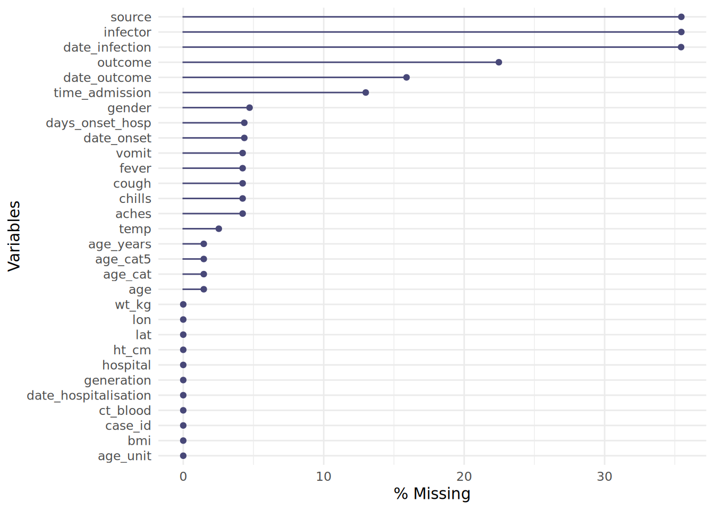
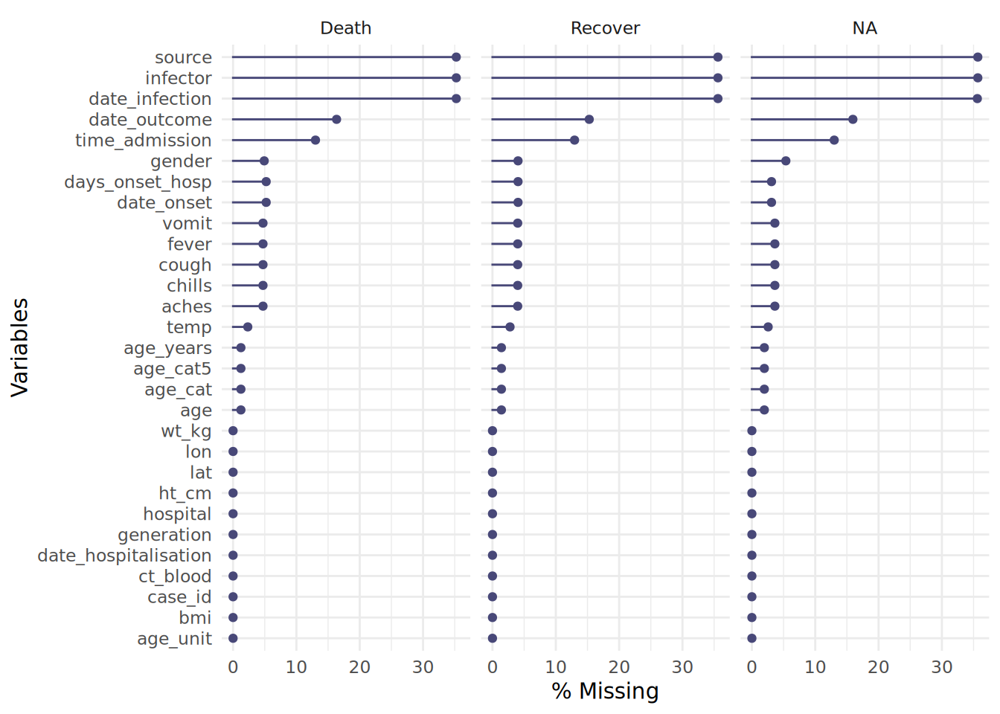

# 20  Отсутствующие данные

[](../../images/missingness.png)

[](../../images/missingness_overview.png)

На данной странице мы рассмотрим, как:

1.  Оценивать отсутствующие данные  
2.  Отфильтровывать строки с отсутствующими данными  
3.  Строить график отсутствующих данных по времени  
4.  Работать с отображением на графиках `NA`  
5.  Проводить вменение отсутствующих данных: MCAR (полностью случайные пропуски), MAR (случайные пропуски), MNAR (неслучайные пропуски)

## 20.1 Подготовка

### Загрузка пакетов

Данный фрагмент кода показывает загрузку пакетов, необходимых для анализа. В данном руководстве мы фокусируемся на использовании `p_load()` из пакета **pacman**, которая устанавливает пакет, если необходимо, *и* загружает его для использования. Вы можете также загрузить установленные пакеты с помощью `library()` из **базового** R. См. страницу [Основы R](basics.llms.md) для получения дополнительной информации о пакетах R.

``` r
pacman::p_load(
  rio,           # импорт/экспорт
  tidyverse,     # управление данными и визуализация
  naniar,        # оценка и визуализация отсутствующих данных
  mice, # вменение отсутствующих данных
  appliedepidata # примеры данных, используемые в этом руководстве
)
```

### Импорт данных

Мы импортируем набор данных о случаях имитированной эпидемии Эболы. Загрузите их напрямую с помощью `appliedepidata::get_data(name = "linelist_cleaned_rds")` (подробности см. на странице [Скачивание руководства и данных](download.llms.md)).

``` r
# импортируем построчный список
linelist <- appliedepidata::get_data(name = "linelist_cleaned_rds")
```

Первые 50 строк построчного списка отображены ниже.

### Конвертируем отсутствующие данные при импорте

При импорте ваших данных помните о значениях, которые следует классифицировать как отсутствующие. Например, 99, 999, “Missing”, пустые ячейки (““), либо ячейки с пустым пространством (” “). Вы можете их конвертировать в `NA` (версия обозначения отсутствующих данных в R) в рамках команды импорта.  
См. страницу Импорт раздел [Отсутствующие данные](importing.llms.md#import_missing) для получения детальной информации, так как точный синтаксис будет варьироваться в зависимости от типа файла.

## 20.2 Отсутствующие значения в R

Ниже мы рассматриваем способы представления и оценки отсутствия данных в R, а также некоторые смежные значения и функции.

### `NA`

В R отсутствующие значения представлены зарезервированным (специальным) значением - `NA`. Обратите внимание, что оно печатается *без* кавычек. “NA” отличается от него и является просто обычным текстовым значениям (а также строчкой из песни Beatles - Hey Jude).

В ваших данных могут быть другие способы представления отсутствующих данных, например, “99”, либо “Missing” (отсутствует), либо “Unknown” (неизвестно) - у вас даже может быть пустое текстовое значение ““, которое кажется”пустым”, либо один пробел ” “. Помните о таких значениях и подумайте, надо ли [конвертировать их в `NA` при импорте](importing.llms.md#import_missing) или при вычистке данных с помощью `na_if()`.

При вычистке данных вы можете также конвертировать в противоположном направлении - изменить все `NA` на “Missing” или нечто похожее с помощью `replace_na()` или `fct_explicit_na()` для факторов.

### Версии `NA`

В большинстве случаев `NA` представляет отсутствующее значение и все прекрасно работает. Однако в некоторых ситуациях вы можете столкнуться с необходимостью в *вариациях* `NA` для конкретного класса объекта (текстовый, числовой и т.п.). Это случается редко, но вам следует об этом знать.  
Типичный сценарий этого - создание нового столбца с помощью функции **dplyr** `case_when()`. Как описывается на странице [Вычистка данных и ключевые функции](cleaning.llms.md#clean_case_when), эта функция оценивает каждую строку датафрейма, оценивает, соответствуют ли строки конкретным логическим критериям (правая сторона кода), и присваивает правильное новое значение (левая сторона кода). *Важно: все значения в правой стороне должны быть одного класса*.

``` r
linelist <- linelist %>% 
  
  # Создайте новый столбец "age_years" из столбца "age"
  mutate(age_years = case_when(
    age_unit == "years"  ~ age,       # если возраст приведен в годах, присвоить оригинальное значение
    age_unit == "months" ~ age/12,    # если возраст приведен в месяцах, разделить на 12
    is.na(age_unit)      ~ age,       # если отсутствует ЕДИНИЦА возраста, предположить годы
    TRUE                 ~ NA_real_)) # в любых других обстоятельствах, присвоить отсутствующее значение
```

Если вам нужно `NA` с правой стороны, возможно вам потребуется уточнить одну из специальных опций `NA`, указанных ниже. Если другие значения в правой стороны являются текстовыми, рассмотрите возможность использования “Missing” вместо этого, либо используйте `NA_character_`. Если значения числовые - используйте `NA_real_`. Если они все являются датами или логическими, вы можете использовать `NA`.

- `NA` - используется для дат или логических TRUE/FALSE (ИСТИНА/ЛОЖЬ)
- `NA_character_` - используется для текстовых значений  
- `NA_real_` - используется для числовых значений

Опять же, вы вряд ли столкнетесь с этими вариациями, *кроме случаев*, когда вы используете `case_when()` для создания нового столбца. См. [Документацию R по NA](https://stat.ethz.ch/R-manual/R-devel/library/base/html/NA.html) для получения более подробной информации.

### `NULL`

`NULL` - еще одно зарезервированное значение в R. Это логическое представление утверждения, которое не является ни истиной, ни ложью. Оно выдается выражениями или функциями, чье значение не определено. Как правило, не присваивайте NULL значение, кроме случаев написания функций или использования [приложения **shiny**](shiny_basics.llms.md), чтобы выдать `NULL` в конкретных сценариях.

Неопределенное значение Null можно оценить с помощью `is.null()`, а конвертацию можно сделать с `as.null()`.

См. этот [пост в блоге](https://www.r-bloggers.com/2010/04/r-na-vs-null/), где обсуждаются различия между `NULL` и `NA`.

### `NaN`

Невозможные значения представлены специальным значением `NaN`. Примером может быть ситуация, когда вы заставляете R разделить 0 на 0. Вы можете это оценить с помощью `is.nan()`. Вы можете также столкнуться с дополнительными функциями, включая `is.infinite()` и `is.finite()`.

### `Inf`

`Inf` представляет бесконечное значение, например, когда вы делите число на 0.

В качестве примера того, как это может повлиять на вашу работу: представим, что у вас есть вектор/столбец `z`, который содержит эти значения: `z <- c(1, 22, NA, Inf, NaN, 5)`

Если вы хотите использовать `max()` для столбца, чтобы найти наибольшее значение, вы можете использовать `na.rm = TRUE`, чтобы удалить `NA` из расчета, но `Inf` и `NaN` останутся, и будет выдано `Inf`. Чтобы решить эту проблему, вы можете использовать квадратные скобки `[ ]` и `is.finite()`, чтобы создать подмножество таким образом, чтобы для расчета использовались только конечные значения: `max(z[is.finite(z)])`.

``` r
z <- c(1, 22, NA, Inf, NaN, 5)
max(z)                           # выдает NA
max(z, na.rm=T)                  # выдает Inf
max(z[is.finite(z)])             # выдает 22
```

### Примеры

| Команда R | Результат |
|----|----|
| `5 / 0` | `Inf` |
| `0 / 0` | `NaN` |
| `5 / NA` | `NA` |
| `5 / Inf |`0NA - 5`|`NAInf / 5`|`Infclass(NA)`| "logical" (логический)`class(NaN)`| "numeric" (числовой)`class(Inf)`| "numeric" (числовой)`class(NULL)\` | “NULL” |

“NAs introduced by coercion” (NA вводятся принудительно) - частое предупреждение. Это может произойти, если вы пытаетесь провести недопустимую конвертацию, например, вставить текстовое значение в вектор, который является числовым.

``` r
as.numeric(c("10", "20", "thirty", "40"))
```

    Warning: NAs introduced by coercion

    [1] 10 20 NA 40

`NULL` игнорируется в векторе.

``` r
my_vector <- c(25, NA, 10, NULL)  # определяем
my_vector                         # печатаем
```

    [1] 25 NA 10

Дисперсия одного числа выдает `NA`.

``` r
var(22)
```

    [1] NA

## 20.3 Полезные функции

Ниже приведены полезные функции **базового** R для оценки или работы с отсутствующими значениями:

### `is.na()` и `!is.na()`

Используйте `is.na()` для определения отсутствующих значений, либо используйте ее противоположность (поставив в начале `!`), чтобы определить не отсутствующие значения. Обе этих команды выдают логическое значение (`TRUE` или `FALSE`). Помните, что вы можете использовать `sum()` для получившегося вектора, чтобы посчитать количество результатов `TRUE`, например, `sum(is.na(linelist$date_outcome))`.

``` r
my_vector <- c(1, 4, 56, NA, 5, NA, 22)
is.na(my_vector)
```

    [1] FALSE FALSE FALSE  TRUE FALSE  TRUE FALSE

``` r
!is.na(my_vector)
```

    [1]  TRUE  TRUE  TRUE FALSE  TRUE FALSE  TRUE

``` r
sum(is.na(my_vector))
```

    [1] 2

### `na.omit()`

Эта функция, при применении к датафрейму, удалит строки с *любыми* отсутствующими значениями. Она также из **базового** R.  
При применении к вектору, она удалит значения `NA` из вектора, к которому она применена. Например:

``` r
na.omit(my_vector)
```

    [1]  1  4 56  5 22
    attr(,"na.action")
    [1] 4 6
    attr(,"class")
    [1] "omit"

### `drop_na()`

Это функция из **tidyr**, которая полезна в [цепочке канала вычистки данных](cleaning.llms.md). При выполнении с пустыми скобками, она удаляет строки с *любыми* отсутствующими значениями. Если указаны названия столбцов в скобках, удалены будут строки с отсутствующими значениями в этих столбцах. Вы можете также использовать синтаксис “tidyselect”, чтобы уточнить столбцы.

``` r
linelist %>% 
  drop_na(case_id, date_onset, age) # удаляет строки с отсутствующими значениями в любом из этих столбцов
```

### `na.rm = TRUE`

Когда вы выполняете математическую функцию, такую как `max()`, `min()`, `sum()` или `mean()`, если присутствуют значения `NA`, она выдаст значение `NA`. Это поведение по умолчанию определено намерено, чтобы вы увидели, что отсутствуют какие-то данные.

Вы можете этого избежать, удалив отсутствующие значения из расчета. Чтобы это сделать, включите аргумент `na.rm = TRUE` (“na.rm” означает “remove `NA`” (удалить NA)).

``` r
my_vector <- c(1, 4, 56, NA, 5, NA, 22)

mean(my_vector)     
```

    [1] NA

``` r
mean(my_vector, na.rm = TRUE)
```

    [1] 17.6

## 20.4 Оценка отсутствующих данных в датафрейме

Вы можетеиспользовать пакет **naniar**, чтобы оценить и визуализировать отсутствующие данные в датафрейме `linelist`.

``` r
# устанавливаем и/или загружаем пакет
pacman::p_load(naniar)
```

### Количественное выражение отсутствующих данных

Чтобы найти процент всех значений, которые отсутствуют, используйте `pct_miss()`. Используйте `n_miss()`, чтобы получить число отсутствующих значений.

``` r
# процент отсутствующих значений от ВСЕХ значений датафрейма
pct_miss(linelist)
```

    [1] 6.688745

Две функции, представленные ниже, выдают процент строк с любыми отсутствующими значениями, либо тех, которые заполнены полностью, соответственно. Помните, что `NA` означает отсутствующие, а \``""` или `" "` не будут считаться отсутствующими.

``` r
# Процент строк с любым отсутствующим значением
pct_miss_case(linelist)   # используйте n_complete() для подсчета абсолютного количества
```

    [1] 69.12364

``` r
# Процент строк, которые являются полными (без отсутствующих значений)  
pct_complete_case(linelist) # используйте n_complete() для подсчета абсолютного количества
```

    [1] 30.87636

### Визуализация отсутствующих данных

Функция `gg_miss_var()` покажет вам количество (или %) отсутствующих значений в каждом столбце. Несколько нюансов:

- Вы можете добавить имя столбца (не в кавычках) в аргумент `facet =`, чтобы увидеть график по группам  
- По умолчанию показывается абсолютное количество, а не проценты, это можно изменить с помощью `show_pct = TRUE`  
- Вы можете добавить подписи осей и заголовок как в обычном `ggplot()` с помощью `+ labs(...)`

``` r
gg_miss_var(linelist, show_pct = TRUE)
```

[](missing_data_files/figure-html/unnamed-chunk-18-1.png)

Здесь данные передаются по каналу `%>%` в функцию. Аргумент `facet =` также используется для разделения данных.

``` r
linelist %>% 
  gg_miss_var(show_pct = TRUE, facet = outcome)
```

[](missing_data_files/figure-html/unnamed-chunk-19-1.png)

Вы можете использовать `vis_miss()`, чтобы визуализировать датафрейм в виде тепловой карты, показывая отсутствует ли каждое значение. Вы также можете выбрать некоторые столбцы из датафрейма с помощью `select()` и передать только эти столбцы в функцию.

``` r
# Тепловая карта отсутствующих данных по всему датафрейму  
vis_miss(linelist)
```

[](missing_data_files/figure-html/unnamed-chunk-20-1.png)

### Изучение и визуализация отношений отсутствия данных

Как визуализировать то, чего нет??? По умолчанию `ggplot()` удаляет точки с отсутствующими значениями с графиков.

**naniar** предлагает решение с помощью `geom_miss_point()`. При создании диаграммы рассеяния двух столбцов записи с одним отсутствующим значением и одним присутствующим значением показаны с помощью установки отсутствуюдщего значения на 10% ниже самого меньшего значения в столбце и закрашивания их отдельным цветом.

В диаграмме рассеяния ниже, красные точки - записи, где значение одного столбца присутствует, а значение другого - отсутствует. Это позволяет вам увидеть распределение отсутствующих значений относительно неотсутствующих значений.

``` r
ggplot(
  data = linelist,
  mapping = aes(x = age_years, y = temp)) +     
  geom_miss_point()
```

[](missing_data_files/figure-html/unnamed-chunk-21-1.png)

Чтобы оценить отсутствующие значения в датафрейме, *стратифицированном по другому столбцу*, рассмотрите возможность применения `gg_miss_fct()`, которая выдаст тепловую карту процента отсутствия значений в датафрейме *по фактору/категориальному столбцу (или дате)*:

``` r
gg_miss_fct(linelist, age_cat5)
```

[](missing_data_files/figure-html/unnamed-chunk-22-1.png)

Эта функция может также использоваться со столбцом даты, чтобы посмотреть, как отсутствие данных меняется со временем:

``` r
gg_miss_fct(drop_na(linelist, date_onset), date_onset)
```

[](missing_data_files/figure-html/unnamed-chunk-23-1.png)

### “Теневые” столбцы

Еще один способ визуализации отсутствия данных в годном столбце по значениям во втором столбце - использовать “тень”, которую может создать **naniar**. `bind_shadow()` создает двоичный столбец `NA`/не `NA` для каждого существующего столбца и связывает эти новые столбцы с оригинальным набором данных с помощью добавления “\_NA”. Это удваивает число столбцов - см. ниже:

``` r
shadowed_linelist <- linelist %>% 
  bind_shadow()

names(shadowed_linelist)
```

     [1] "case_id"                 "generation"             
     [3] "date_infection"          "date_onset"             
     [5] "date_hospitalisation"    "date_outcome"           
     [7] "outcome"                 "gender"                 
     [9] "age"                     "age_unit"               
    [11] "age_years"               "age_cat"                
    [13] "age_cat5"                "hospital"               
    [15] "lon"                     "lat"                    
    [17] "infector"                "source"                 
    [19] "wt_kg"                   "ht_cm"                  
    [21] "ct_blood"                "fever"                  
    [23] "chills"                  "cough"                  
    [25] "aches"                   "vomit"                  
    [27] "temp"                    "time_admission"         
    [29] "bmi"                     "days_onset_hosp"        
    [31] "case_id_NA"              "generation_NA"          
    [33] "date_infection_NA"       "date_onset_NA"          
    [35] "date_hospitalisation_NA" "date_outcome_NA"        
    [37] "outcome_NA"              "gender_NA"              
    [39] "age_NA"                  "age_unit_NA"            
    [41] "age_years_NA"            "age_cat_NA"             
    [43] "age_cat5_NA"             "hospital_NA"            
    [45] "lon_NA"                  "lat_NA"                 
    [47] "infector_NA"             "source_NA"              
    [49] "wt_kg_NA"                "ht_cm_NA"               
    [51] "ct_blood_NA"             "fever_NA"               
    [53] "chills_NA"               "cough_NA"               
    [55] "aches_NA"                "vomit_NA"               
    [57] "temp_NA"                 "time_admission_NA"      
    [59] "bmi_NA"                  "days_onset_hosp_NA"     

Эти “теневые” столбцы могут использоваться, чтобы построить график доли отсутствующих значений по другому столбцу.

Например, график ниже показывает долю отсутствующих записей `days_onset_hosp` (количество дней с появления симптомов до госпитализации), по значению этой записи в `date_hospitalisation`. По сути, вы строите диаграмму плотности столбца оси x, но стратифицируете результаты (`color =`) по интересующему теневому столбцу. Этот анализ лучше всего работает, если ваша ось x является числовым столбцом или датой.

``` r
ggplot(data = shadowed_linelist,          # датафрейм с теневыми столбцами
  mapping = aes(x = date_hospitalisation, # числовой столбец или столбец даты
                colour = age_years_NA)) + # интересующий теневой столбец
  geom_density()                          # график кривых плотности
```

[](missing_data_files/figure-html/unnamed-chunk-25-1.png)

Вы также можете использовать эти “теневые” столбцы для стратификации статистической сводной информации, как показано ниже:

``` r
linelist %>%
  bind_shadow() %>%                # создаем теневые столбцы
  group_by(date_outcome_NA) %>%    # теневой столбец для стратификации
  summarise(across(
    .cols = age_years,             # интересующая переменная для расчета
    .fns = list("mean" = ~mean(.x, na.rm = TRUE),     # статистика для расчета
                "sd" = ~sd(.x, na.rm = TRUE),
                "var" = ~var(.x, na.rm = TRUE),
                "min" = ~min(.x, na.rm = TRUE),
                "max" = ~max(.x, na.rm = TRUE))))                 # другие аргументы для расчета статистики
```

    # A tibble: 2 × 6
      date_outcome_NA age_years_mean age_years_sd age_years_var age_years_min
      <fct>                    <dbl>        <dbl>         <dbl>         <dbl>
    1 !NA                       16.0         12.6          158.             0
    2 NA                        16.2         12.9          167.             0
    # ℹ 1 more variable: age_years_max <dbl>

Альтернативный способ построения графика долей значений столбца, которые отсутствуют на временном промежутке, показан ниже. Он *не* требует использования **naniar**. Этот пример показывает процент отсутствующих наблюдений по неделям).

1.  агрегируем данные по полезной единице времени (дни, недели и т.п.), обобщив долю наблюдений с `NA` (и любых других интересующих значений)  
2.  построим график доли отсутствующих данных в виде линии с помощью `ggplot()`

Ниже мы берем построчный список, добавляем новый столбец для недели, группируем данные по неделям, а затем рассчитываем процент записей за эту неделю, в которых отсутствует значение. (примечание: если вы хотите % от 7 дней, расчет будет чуть иным).

``` r
outcome_missing <- linelist %>%
  mutate(week = lubridate::floor_date(date_onset, "week")) %>%   # создаем новый столбец недель
  group_by(week) %>%                                             # группируем строки по неделе
  summarise(                                                     # получаем сводные данные по каждой неделе
    n_obs = n(),                                                  # количество записей
    
    outcome_missing = sum(is.na(outcome) | outcome == ""),        # количество записей с отсутствующим значением
    outcome_p_miss  = outcome_missing / n_obs,                    # доля записей с отсутствующим значением
  
    outcome_dead    = sum(outcome == "Death", na.rm=T),           # количество записей с исходом смерть
    outcome_p_dead  = outcome_dead / n_obs) %>%                   # доля записей с исходом смерть
  
  tidyr::pivot_longer(-week, names_to = "statistic") %>%         # поворачиваем все столбцы, кроме недель, в длинный формат для ggplot
  filter(stringr::str_detect(statistic, "_p_"))                  # сохраняем только значения долей
```

Затем мы откладываем долю отсутствующих в виде линии по неделям. См. страницу \[Основы ggplot\], если вы не знакомы с пакетом построения графиков **ggplot2**.

``` r
ggplot(data = drop_na(outcome_missing, week))+
    geom_line(
      mapping = aes(x = week, y = value, group = statistic, color = statistic),
      linewidth = 2,
      stat = "identity")+
    labs(title = "Weekly outcomes",
         x = "Week",
         y = "Proportion of weekly records") + 
     scale_color_discrete(
       name = "",
       labels = c("Died", "Missing outcome"))+
    scale_y_continuous(breaks = c(seq(0,1,0.1)))+
  theme_minimal()+
  theme(legend.position = "bottom")
```

[](missing_data_files/figure-html/unnamed-chunk-28-1.png)

## 20.5 Использование данных с отсутствующими значениями

### Отфильтруем строкис отсутствующими значениями

Чтобы быстро удалить строки с отсутствующими значениями, используем функцию `drop_na()` из **dplyr**.

В оригинальном `linelist` было `nrow(linelist)` строк. Скорректированное количество строк показано ниже:

``` r
linelist %>% 
  drop_na() %>%     # удаляем строки с ЛЮБЫМИ отсутствующими значениями
  nrow()
```

    [1] 1818

Вы можете уточнить, что нужно удалить строки с отсутствующими данными в определенных столбцах:

``` r
linelist %>% 
  drop_na(date_onset) %>% # удаляем строки, где отсутствует date_onset 
  nrow()
```

    [1] 5632

Вы можете указать столбцы один за другим, либо использовать [функции-помощники “tidyselect”](cleaning.llms.md#clean_tidyselect):

``` r
linelist %>% 
  drop_na(contains("date")) %>% # удаляем строки с отсутствующими значениями в любом столбце "date" (дата) 
  nrow()
```

    [1] 3029

### Работа с `NA` в `ggplot()`

Часто полезно сообщать о количестве значений, исключенных из графика, в подписи. Ниже приведен пример:

В `ggplot()` вы можете добавить `labs()` и внутри него `caption =`. В этой подписи вы можете использовать `str_glue()` из пакета **stringr**, чтобы вставить вместе значения в предложение динамичным образом, чтобы они адаптировались под данные. Пример приведен ниже:

- Обратите внимание на использование `\n` для новой строки.  
- Обратите внимание, что если несколько столбцов приводят к тому, что значения не откладываются на графике (например, возраст или пол, если они отображены на графике), тогда вам нужно фильтровать и по этим столбцам, чтобы правильно отобразить не показанное число.

``` r
labs(
  title = "",
  y = "",
  x = "",
  caption  = stringr::str_glue(
  "n = {nrow(central_data)} from Central Hospital;
  {nrow(central_data %>% filter(is.na(date_onset)))} cases missing date of onset and not shown."))  
```

Иногда легче будет сохранить последовательность как объект в команде до команды `ggplot()` и потом просто ссылаться на имя объекта последовательности внутри `str_glue()`.

### `NA` в факторах

Если интересующий вас столбец является фактором, используйте `fct_explicit_na()` из пакета **forcats**, чтобы конвертировать значения `NA` в текстовое значение. Более детальную информацию см. на странице \[Факторы\]. По умолчанию новое значение будет “(Missing)”, но это можно скорректировать с помощью аргумента `na_level =`.

``` r
pacman::p_load(forcats)   # загружаем пакет

linelist <- linelist %>% 
  mutate(gender = fct_na_value_to_level(gender, level = "Missing"))

levels(linelist$gender)
```

    [1] "f"       "m"       "Missing"

## 20.6 Вменение

Иногда при анализе данных возникает необходимость “заполнить пробелы” и вписать недостающие данные. Хотя всегда можно просто проанализировать набор данных после удаления всех недостающих значений, это может привести к различным проблемам. Вот два примера:

1.  Удаление всех наблюдений с пропущенными значениями или переменных с большим количеством пропущенных данных может снизить мощность или возможности проведения некоторых видов анализа. Например, как мы выяснили ранее, только небольшая часть наблюдений в нашем наборе данных linelist не имеет пропущенных данных по всем переменным. Если бы мы удалили большую часть нашего набора данных, то потеряли бы очень много информации! Кроме того, большинство наших переменных имеют некоторое количество пропущенных данных - для большинства видов анализа, вероятно, нецелесообразно отбрасывать все переменные, имеющие большое количество пропущенных данных.

2.  В зависимости от того, почему отсутствуют данные, анализ только не пропущенных данных может привести к смещенным или вводящим в заблуждение результатам. Например, как мы выяснили ранее, для некоторых пациентов отсутствуют данные о том, были ли у них какие-либо важные симптомы, например жар или кашель. Но, как вариант, может быть, эта информация не была записана для людей, которые просто явно не были сильно больны. В этом случае, если мы просто удалим эти наблюдения, мы исключим из нашего набора данных самых здоровых людей, и это может исказить результаты.

Важно не только понять, сколько данных отсутствует, но и подумать о том, почему они могут отсутствовать. Это поможет решить, насколько важно вменять недостающие данные, а также какой метод вменения недостающих данных лучше всего использовать в вашей ситуации.

### Типы отсутствующих данных

Вот три основных типа отсутствующих данных:

1.  **Полностью случайные пропуски** (MCAR). Это означает, что между вероятностью отсутствия данных и любыми другими переменными в ваших данных нет никакой связи. Вероятность отсутствия данных одинакова для всех случаев Это редкая ситуация. Но если у вас есть веские основания полагать, что ваши данные являются MCAR, анализ только не пропущенных данных без вменения не исказит ваши результаты (хотя вы можете потерять некоторую мощность). \[СДЕЛАТЬ: рассмотреть обсуждение статистических тестов для MCAR\]

2.  **Случайные пропуски** (MAR). На самом деле это название немного вводит в заблуждение, поскольку MAR означает, что ваши данные отсутствуют систематическим, предсказуемым образом на основе другой имеющейся у вас информации. Например, может быть, каждое наблюдение в нашем наборе данных с отсутствующим значением жара на самом деле не было зарегистрировано, поскольку предполагалось, что у каждого пациента с ознобом и ломотой есть жар, и поэтому температуру у них так и не измерили. Если это так, то мы могли бы легко предсказать, что у каждого пропущенного наблюдения с ознобом и ломотой также была температура, и использовать эту информацию для вменения недостающих данных. На практике это больше похоже на спектр. Возможно, если у пациента были и озноб, и ломота, то у него с большей вероятностью будет и жар, если ему не измеряли температуру, но не всегда. Это все равно предсказуемо, даже если не идеально предсказуемо. Это распространенный тип отсутствующих данных

3.  **Неслучайные пропуски** (MNAR). Иногда называются **Not Missing at Random** (NMAR). Здесь предполагается, что вероятность того, что значение отсутствует, НЕ является систематической или предсказуемой с помощью другой имеющейся у нас информации, но и не является случайной. В этой ситуации данные отсутствуют по неизвестным причинам или по причинам, о которых у вас нет никакой информации. Например, в нашем наборе данных может отсутствовать информация о возрасте, поскольку некоторые очень пожилые пациенты либо не знают, либо отказываются говорить, сколько им лет. В этой ситуации отсутствие данных о возрасте связано с самим значением (и, следовательно, не является случайным) и не предсказуемо на основе другой имеющейся у нас информации. MNAR - сложная проблема, и часто лучшим способом ее решения является попытка собрать больше данных или информации о причинах отсутствия данных, а не пытаться их вменить.

В целом, вменять данные MCAR часто достаточно просто, а MNAR - очень сложно или даже невозможно. Многие часто используемые методы вменения предполагают MAR.

### Полезные пакеты

Некоторые полезные пакеты для вменения отсутствующих данных включают в себя Mmisc, missForest (который использует случайные леса для вменения отсутствующих данных), и mice (Multivariate Imputation by Chained Equations - Многомерное вменение с помощью цепных уравнений). Для этого раздела мы воспользуемся пакетом mice, который использует ряд приемов. Сопровождающий пакета mice опубликовал онлайн книгу о вменении отсутствующих данных, которая рассматривает дополнительные детали (https://stefvanbuuren.name/fimd/).

Вот код для загрузки пакета mice:

``` r
pacman::p_load(mice)
```

### Вменение среднего

Иногда, если вы проводите простой анализ или у вас есть веские основания полагать, что вы можете предположить MCAR, вы можете просто установить недостающие числовые значения на среднее значение этой переменной. Возможно, мы можем предположить, что пропущенные измерения температуры в нашем наборе данных были либо MCAR, либо просто нормальными значениями. Вот код для создания новой переменной, которая заменяет пропущенные значения температуры на среднее значение температуры в нашем наборе данных. Однако во многих ситуациях замена данных средним значением может привести к погрешности, поэтому будьте осторожны.

``` r
linelist <- linelist %>%
  mutate(temp_replace_na_with_mean = replace_na(temp, mean(temp, na.rm = T)))
```

Аналогичный процесс можно проделать и для замены категориальных данных конкретным значением. Для нашего набора данных представим, что вы знаете, что все наблюдения с отсутствующим значением результата (который может быть ” Death” (умер) или “Recover” (выздоровел)) на самом деле были умершими людьми (примечание: это не совсем верно для данного набора данных):

``` r
linelist <- linelist %>%
  mutate(outcome_replace_na_with_death = replace_na(outcome, "Death"))
```

### Вменение регрессии

Несколько более продвинутый метод заключается в использовании некоторой статистической модели для предсказания вероятного значения отсутствующей величины и замены его предсказанным значением. Здесь приведен пример создания предсказанных значений для всех наблюдений, в которых температура отсутствует, а возраст и жар - нет, с помощью простой линейной регрессии, использующей в качестве предикторов состояние жара и возраст в годах. На практике лучше использовать более совершенную модель, чем такой простой подход.

``` r
simple_temperature_model_fit <- lm(temp ~ fever + age_years, data = linelist)

#используем нашу простую модель температуры, чтобы спрогнозировать значения для наблюдений, где отсутствует температура (temp)
predictions_for_missing_temps <- predict(simple_temperature_model_fit,
                                        newdata = linelist %>% filter(is.na(temp))) 
```

Либо, используя тот же подход к моделированию в пакете mice, создаем вмененные значения для отсутствующих наблюдений температуры:

``` r
model_dataset <- linelist %>%
  select(temp, fever, age_years) %>% 
  mutate(fever = as.numeric(fever == "yes"))

temp_imputed <- mice(model_dataset,
                            method = "norm.predict",
                            seed = 1,
                            m = 1,
                            print = F)

temp_imputed_values <- temp_imputed$imp$temp
```

Подобный подход используется в некоторых более продвинутых методах, например, в пакете missForest для замены отсутствующих данных предсказанными значениями. В этом случае модель предсказания представляет собой случайный лес, а не линейную регрессию. Для этого можно использовать и другие типы моделей. Однако, хотя этот подход хорошо работает в рамках MCAR, следует быть немного осторожным, если вы считаете, что MAR или MNAR более точно описывают вашу ситуацию. Качество вменения будет зависеть от того, насколько хороша ваша модель предсказания, и даже при очень хорошей модели изменчивость вмененных данных может быть недооценена.

### LOCF и BOCF

Last observation carried forward (LOCF) (Перенос данных последнего наблюдения вперед) и baseline observation carried forward (BOCF) (использование исходного документированного значения) - это методы вменения для временных рядов/продольных данных. Идея заключается в том, чтобы взять предыдущее наблюдаемое значение в качестве замены отсутствующих данных. Когда отсутствует несколько значений подряд, метод ищет последнее наблюдаемое значение.

Функцию `fill()` из пакета **tidyr** можно использовать для вменения как LOCF, так и BOCF (однако другие пакеты, такие как **HMISC**, **zoo** и **data.table** также включают методы для этого). Чтобы показать синтаксис `fill()`, создадим простой набор с временным рядом, содержащий количество случаев заболевания для каждого квартала 2000 и 2001 годов. Однако значение года для кварталов после Q1 отсутствует, так что нам нужно его вменить. Функция `fill()` также демонстрируется на странице \[Поворот данных\].

``` r
#создаем простой набор данных
disease <- tibble::tribble(
  ~quarter, ~year, ~cases,
  "Q1",    2000,    66013,
  "Q2",      NA,    69182,
  "Q3",      NA,    53175,
  "Q4",      NA,    21001,
  "Q1",    2001,    46036,
  "Q2",      NA,    58842,
  "Q3",      NA,    44568,
  "Q4",      NA,    50197)

#вменяем отсутствующие значения года:
disease %>% fill(year)
```

    # A tibble: 8 × 3
      quarter  year cases
      <chr>   <dbl> <dbl>
    1 Q1       2000 66013
    2 Q2       2000 69182
    3 Q3       2000 53175
    4 Q4       2000 21001
    5 Q1       2001 46036
    6 Q2       2001 58842
    7 Q3       2001 44568
    8 Q4       2001 50197

Примечание: убедитесь, что ваши данные правильно отсортированы до использования функции `fill()`. `fill()` по умолчанию заполняет “вниз”, но вы можете также вменять значения в других направлениях, изменив параметр `.direction`. Мы можем создать похожий набор данных, где значение года записывается только в конце года и отсутствует для кварталов до этого:

``` r
#создаем чуть отличающийся набор данных
disease <- tibble::tribble(
  ~quarter, ~year, ~cases,
  "Q1",      NA,    66013,
  "Q2",      NA,    69182,
  "Q3",      NA,    53175,
  "Q4",    2000,    21001,
  "Q1",      NA,    46036,
  "Q2",      NA,    58842,
  "Q3",      NA,    44568,
  "Q4",    2001,    50197)

#вменяем отсутствующие значения года в направлении "вверх" ("up"):
disease %>% fill(year, .direction = "up")
```

    # A tibble: 8 × 3
      quarter  year cases
      <chr>   <dbl> <dbl>
    1 Q1       2000 66013
    2 Q2       2000 69182
    3 Q3       2000 53175
    4 Q4       2000 21001
    5 Q1       2001 46036
    6 Q2       2001 58842
    7 Q3       2001 44568
    8 Q4       2001 50197

В данном примере LOCF и BOCF, несомненно, являются правильными, однако в более сложных ситуациях может быть сложнее решить, подходят ли эти методы. Например, у вас могут отсутствовать лабораторные показатели для пациента больницы после первого дня пребывания. Иногда это может означать, что лабораторные показатели не изменились… но это также может означать, что пациент выздоровел, и после первого дня его показатели будут совсем другими! Используйте эти методы с осторожностью.

### Множественное вменение

В онлайн книге, которую мы упоминали ранее, от автора пакета mice (https://stefvanbuuren.name/fimd/) есть детальное объяснение вменения множественных данных и того, зачем его использовать. Ниже приведено короткое объяснение этого метода:

При вменении множественных данных создается несколько наборов данных, в которых недостающие значения вменены как правдоподобные значения данных (в зависимости от данных исследования может потребоваться создание большего или меньшего количества таких наборов, но в пакете mice по умолчанию установлено число 5). Разница заключается в том, что вместо одного конкретного значения каждое вмененное значение берется из оценочного распределения (таким образом, в нем присутствует некоторая случайность). В результате каждый из этих наборов данных будет иметь несколько различные вмененные значения (однако неотсутствующие данные будут одинаковыми в каждом из этих вмененных наборов). Вы все еще используете какого-то рода предиктивную модель для вменения в каждом из этих новых наборов данных (в mice есть много опций для предикторных методов, включя *Метод согласования предсказанного среднего*, *логистическую регрессию* и *случайный лес*), но пакет mice может справиться с многими деталями моделирования.

Затем, создав эти новые вмененные наборы данных, можно применить любую статистическую модель или анализ, который вы планировали провести для каждого из этих новых вмененных наборов данных, и объединить результаты этих моделей вместе. Это очень хорошо работает для уменьшения ошибки как в MCAR, так и во многих MAR, и часто приводит к более точным оценкам стандартной ошибки.

Вот пример применения процесса множественного вменения для прогнозирования температуры в нашем наборе данных построчного списка, используя возраст и статус жара (наш упрощенный набор данных model_dataset, созданный выше):

``` r
# вменяем отсутствующие значения для всех переменных в model_dataset, и создаем 10 новых вмененных наборов данных
multiple_imputation = mice(
  model_dataset,
  seed = 1,
  m = 10,
  print = FALSE) 

model_fit <- with(multiple_imputation, lm(temp ~ age_years + fever))

base::summary(mice::pool(model_fit))
```

             term     estimate    std.error    statistic       df   p.value
    1 (Intercept) 3.696830e+01 0.0154805445 2388.0487849 1809.790 0.0000000
    2   age_years 4.685704e-04 0.0004977814    0.9413175 2156.365 0.3466476
    3       fever 2.044543e+00 0.0152670400  133.9187569 1038.548 0.0000000

Здесь мы использовали метод вменения по умолчанию, который представляет собой Метод согласования предсказанного среднего. Затем мы использовали эти вмененные наборы данных для отдельной оценки и последующего объединения результатов простой линейной регрессии для каждого из этих наборов данных. Существует множество деталей, на которые мы не обратили внимания, и множество настроек, которые можно регулировать в процессе множественного вменения при использовании пакета mice. Например, не всегда есть числовые данные, и может потребоваться использование других методов вменения (для многих других типов данных и методов можно по-прежнему использовать пакет mice). Однако для более надежного анализа, когда отсутствующие данные представляют собой серьезную проблему, множественное вменение является хорошим решением, которое не всегда требует больше усилий, чем проведение анализа полных случаев.

## 20.7 Ресурсы

Виньетка для [пакета naniar](https://cran.r-project.org/web/packages/naniar/vignettes/getting-started-w-naniar.html)

Галерея [визуализаций отсутствующих данных](https://cran.r-project.org/web/packages/naniar/vignettes/naniar-visualisation.html)

[Онлайн учебник](https://stefvanbuuren.name/fimd/) по множественному вменению в R от сопровождающего пакета **mice**
