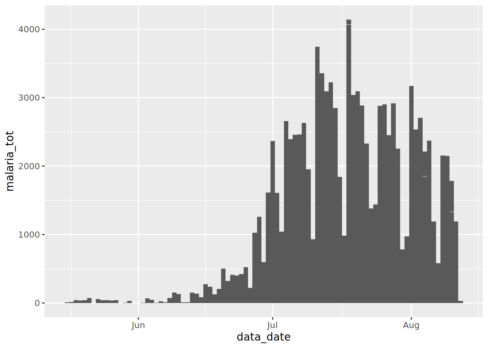
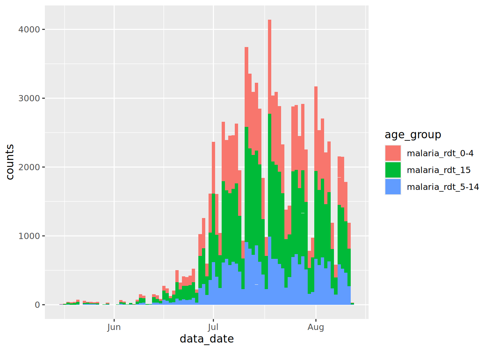

# 12  Поворот данных

[](../../images/pivoting/pivoting_500x500.png)

В управлении данными можно рассматривать английское понятие *pivoting* (поворот), как один из двух процессов:

1.  Создание *сводных таблиц - pivot tables*, которые являются статистическими таблицами, резюмирующими данные более детальной таблицы  
2.  Преобразование таблицы из **длинного** (вертикального) в **широкий** (горизонтальный) формат, либо наоборот.

**На этой странице мы сфокусируемся на втором определении.** Первое значение - важный шаг в анализе данных, и он рассматривается в других главах на страницах [Группировании данных](grouping.llms.md) и [Описательные таблицы](tables_descriptive.llms.md).

На данной странице мы рассматриваем форматы данных. Будет полезно понимать идею “аккуратных данных”, в которой у каждой переменной есть свой столбец, у каждого наблюдения есть свой ряд, а у каждого значения есть собственная ячейка. Более подробно вы можете почитать об этой теме [в этой онлайн главе R for Data Science](https://r4ds.had.co.nz/tidy-data.html).

## 12.1 Подготовка

### Загрузка пакетов

Данный фрагмент кода показывает загрузку пакетов, необходимых для анализа. В данном руководстве мы фокусируемся на использовании `p_load()` из пакета **pacman**, которая устанавливает пакет, если необходимо, *и* загружает его для использования. Вы можете также загрузить установленные пакеты с помощью `library()` из **базового** R. См. страницу [Основы R](basics.llms.md) для получения дополнительной информации о пакетах R.

``` r
pacman::p_load(
  rio,          # Импорт файла
  here,         # Место расположения файла
  kableExtra,   # Построение и манипуляции со сложными таблицами
  tidyverse,    # Управление данными + графика ggplot2
  appliedepidata) # примеры данных, используемые в этом руководстве
```

### Импорт данных

### Данные о количестве случаев малярии

На данной странице мы будем использовать выдуманный набор данных с ежедневным количеством случаев малярии в разбивке по организациям и возрастным группам. Загрузите их напрямую с помощью `appliedepidata::get_data(name = "malaria_facility_count_data")` (подробности см. на странице [Скачивание руководства и данных](download.llms.md)).

``` r
# Импорт данных
count_data <- appliedepidata::get_data(name = "malaria_facility_count_data")
```

Первые 50 строк отображены ниже.

### Построчный список случаев

Дальше на этой странице мы будем также использовать набор данных по случаям из имитационной эпидемии Эболы. Загрузите их напрямую с помощью `appliedepidata::get_data(name = "linelist_cleaned_rds")` (подробности см. на странице [Скачивание руководства и данных](download.llms.md)).

``` r
# импорт вашего набора данных
linelist <- appliedepidata::get_data(name = "linelist_cleaned_rds")
```

## 12.2 Из широкой в длинную

[](../../images/pivoting/pivot_longer_new.png)

### “Широкий” формат

Данные часто вводятся и хранятся в “широком” формате - где характеристики или ответы субъекта хранятся в одной строке. Хотя это может быть полезно для презентации, это не очень подходит для некоторых типов анализа.

Давайте возьмем набор данных `count_data`, испортированный в разделе Подготовка, в качестве примера. Вы можете видеть, что каждая строка представляет собой “день организации”. Фактическое количество случаев (в самых правых столбцах) хранится в “широком” формате таким образом, что информация для каждой возрастной группы в конкретный день в организации хранится в одной строке.

Каждое наблюдение в наборе данных относится к количеству случаев малярии в одной из 65 медицинских организаций в конкретную дату и варьируется от `count_data$data_date %>% min()` до `count_data$data_date %>% max()`. Эти организации расположены в одной провинции `Province` (Север) и в четырех районах `District` (Spring, Bolo, Dingo и Barnard). Набор данных дает общее количество случаев малярии, а также количество по трем возрастным группам - \<4 лет, 5-14 лет и 15 лет и старше.

“Широкие” данные, такие как эти, не соответствуют стандартам “аккуратных данных”, поскольку заголовки столбцов на самом деле не представляют собой “переменные” - они представляют собой *значения* гипотетической переменной “возрастная группа”.

Этот формат может быть полезен для представления информации в таблице, либо для ввода данных (например, в Excel) из форм регистрации случаев. Однако на этапе анализа эти данные, как правило, следует трансформировать в более “длинный” формат в соответствии со стандартами “аккуратных данных”. Пакет построения графиков в R **ggplot2**, например, лучше всего работает с данными в “длинном” формате.

Визуализация *общего* количества случаев малярии со временем не представляет собой сложности с данными в текущем формате:

``` r
count_data %>% 
  drop_na(malaria_tot) %>% 
  ggplot() +
  geom_col(aes(x = data_date, y = malaria_tot), width = 1)
```

[](pivoting_files/figure-html/unnamed-chunk-10-1.png)

А если бы мы хотели отобразить относительный вклад каждой возрастной группы в это общее количество? В таком случае нам нужно убедиться, что интересующая переменная (возрастная группа) появляется в наборе данных в одном столбце, который можно указать в аргументе эстетики `aes()` в `{ggplot2}`.

### `pivot_longer()`

Функция `pivot_longer()` из **tidyr** поворачивает данные “вертикально”. **tidyr** является частью пакетов R **tidyverse**.

Она принимает диапазон столбцов для трансформации (указываются в `cols =`). Следовательно, она может работать только над частью набора данных. Это полезно для данных по малярии, так как нам нужно повернуть только столбцы с количеством случаев.

В этом процессе у вас в итоге получится два “новых” столбца - один с категориями (раньше были именами столбцов), и один - с соответствующими значениям (например, количеством случаев). Вы можете принять имена по умолчанию для этих новых столбцов, либо вы можете указать собственные имена в `names_to =` и `values_to =`, соответственно.

Давайте посмотрим `pivot_longer()` в действии…

### Стандартный поворот

Мы хотим использовать функцию `pivot_longer()` из **tidyr**, чтобы конвертировать “широкие” данные в “длинный” формат. В частности, чтобы конвертировать четыре числовых столбца с данными по количеству случаев малярии в два новых столбца: один, содержащий *возрастные группы*, и один, содержащий соответствующие *значения*.

``` r
df_long <- count_data %>% 
  pivot_longer(
    cols = c(`malaria_rdt_0-4`, `malaria_rdt_5-14`, `malaria_rdt_15`, `malaria_tot`)
  )

df_long
```

Обратите внимание, что в новом созданном датафрейме (`df_long`) больше строк (12,152 по сравнению с 3,038); он стал *длиннее*. По сути он стал в четыре раза длиннее, поскольку каждая строка оригинального набора данных теперь представляет собой четыре строки в df_long, по одной для каждого из наблюдений по количеству случаев (\<4 лет, 5-14 лет, 15+ лет, и итого).

Кроме того, что набор данных стал длиннее, в нем стало меньше столбцов (8 против 10), поскольку те данные, которые раньше хранились в четырех столбцах (те, которые начинались с префикса `malaria_`), теперь хранятся в двух.

Поскольку имена этих четырех столбцов все начинаются с префикса `malaria_`, мы могли бы использовать удобную функцию из “tidyselect” `starts_with()`, чтобы добиться того же результата (см. страницу [Вычистка данных и ключевые функции](cleaning.llms.md) для получения информации о других подобных функциях-помощниках).

``` r
# задайте столбец с помощью функции-помощника tidyselect
count_data %>% 
  pivot_longer(
    cols = starts_with("malaria_")
  )
```

    # A tibble: 12,152 × 8
       location_name data_date  submitted_date Province District newid name    value
       <chr>         <date>     <date>         <chr>    <chr>    <int> <chr>   <int>
     1 Facility 1    2020-08-11 2020-08-12     North    Spring       1 malari…    11
     2 Facility 1    2020-08-11 2020-08-12     North    Spring       1 malari…    12
     3 Facility 1    2020-08-11 2020-08-12     North    Spring       1 malari…    23
     4 Facility 1    2020-08-11 2020-08-12     North    Spring       1 malari…    46
     5 Facility 2    2020-08-11 2020-08-12     North    Bolo         2 malari…    11
     6 Facility 2    2020-08-11 2020-08-12     North    Bolo         2 malari…    10
     7 Facility 2    2020-08-11 2020-08-12     North    Bolo         2 malari…     5
     8 Facility 2    2020-08-11 2020-08-12     North    Bolo         2 malari…    26
     9 Facility 3    2020-08-11 2020-08-12     North    Dingo        3 malari…     8
    10 Facility 3    2020-08-11 2020-08-12     North    Dingo        3 malari…     5
    # ℹ 12,142 more rows

либо по позиции:

``` r
# задайте столбцы по позиции
count_data %>% 
  pivot_longer(
    cols = 6:9
  )
```

либо по именованному диапазону:

``` r
# задайте диапазон последовательных столбцов
count_data %>% 
  pivot_longer(
    cols = `malaria_rdt_0-4`:malaria_tot
  )
```

Этим двум новым столбцам даются имена по умолчанию `name` и `value`, но мы можем их поменять, чтобы задать более осмысленные имена, которые помогут запомнить, что хранится в этих столбцах, используя аргументы `names_to` и `values_to`. Давайте использовать имена `age_group` и `counts`:

``` r
df_long <- 
  count_data %>% 
  pivot_longer(
    cols = starts_with("malaria_"),
    names_to = "age_group",
    values_to = "counts"
  )

df_long
```

    # A tibble: 12,152 × 8
       location_name data_date  submitted_date Province District newid age_group    
       <chr>         <date>     <date>         <chr>    <chr>    <int> <chr>        
     1 Facility 1    2020-08-11 2020-08-12     North    Spring       1 malaria_rdt_…
     2 Facility 1    2020-08-11 2020-08-12     North    Spring       1 malaria_rdt_…
     3 Facility 1    2020-08-11 2020-08-12     North    Spring       1 malaria_rdt_…
     4 Facility 1    2020-08-11 2020-08-12     North    Spring       1 malaria_tot  
     5 Facility 2    2020-08-11 2020-08-12     North    Bolo         2 malaria_rdt_…
     6 Facility 2    2020-08-11 2020-08-12     North    Bolo         2 malaria_rdt_…
     7 Facility 2    2020-08-11 2020-08-12     North    Bolo         2 malaria_rdt_…
     8 Facility 2    2020-08-11 2020-08-12     North    Bolo         2 malaria_tot  
     9 Facility 3    2020-08-11 2020-08-12     North    Dingo        3 malaria_rdt_…
    10 Facility 3    2020-08-11 2020-08-12     North    Dingo        3 malaria_rdt_…
    # ℹ 12,142 more rows
    # ℹ 1 more variable: counts <int>

Теперь мы можем передать этот новый набор данных в `{ggplot2}`, и отложить новый столбец `count` по оси y, а новый столбец `age_group` указать в аргументе `fill =` (внутренняя заливка столбца). Это позволит отобразить подсчет случаев малярии в виде столбчатой диаграммы с накоплением по возрастным группам:

``` r
df_long %>% 
  drop_na(counts) %>% 
  ggplot() +
  geom_col(
    mapping = aes(x = data_date, y = counts, fill = age_group),
    width = 1
  )
```

[](pivoting_files/figure-html/unnamed-chunk-16-1.png)

Рассмотрите этот новый график и сравните его с графиком, который мы создали ранее - *что пошло не так?*

Мы столкнулись с частой проблемой при работе с данными эпиднадзора - мы также включили общее количество случаев из столбца `malaria_tot`, поэтому высота каждого столбика на графике в два раза выше, чем должна быть.

Мы можем решить эту проблему рядом способов. Мы просто отфильтруем это общее количество из набора данных, прежде чем передать его в `ggplot()`:

``` r
df_long %>% 
  filter(age_group != "malaria_tot") %>% 
  drop_na(counts) %>% 
  ggplot() +
  geom_col(
    aes(x = data_date, y = counts, fill = age_group),
    width = 1
  )
```

[](pivoting_files/figure-html/unnamed-chunk-17-1.png)

Альтернативно мы могли бы исключить эту переменную при выполнении `pivot_longer()`, оставив ее в наборе данных как отдельную переменную. См. как значения “расширяются”, чтобы заполнить эти новые строки.

``` r
count_data %>% 
  pivot_longer(
    cols = `malaria_rdt_0-4`:malaria_rdt_15,   # не включает столбец итого
    names_to = "age_group",
    values_to = "counts"
  )
```

    # A tibble: 9,114 × 9
       location_name data_date  submitted_date Province District malaria_tot newid
       <chr>         <date>     <date>         <chr>    <chr>          <int> <int>
     1 Facility 1    2020-08-11 2020-08-12     North    Spring            46     1
     2 Facility 1    2020-08-11 2020-08-12     North    Spring            46     1
     3 Facility 1    2020-08-11 2020-08-12     North    Spring            46     1
     4 Facility 2    2020-08-11 2020-08-12     North    Bolo              26     2
     5 Facility 2    2020-08-11 2020-08-12     North    Bolo              26     2
     6 Facility 2    2020-08-11 2020-08-12     North    Bolo              26     2
     7 Facility 3    2020-08-11 2020-08-12     North    Dingo             18     3
     8 Facility 3    2020-08-11 2020-08-12     North    Dingo             18     3
     9 Facility 3    2020-08-11 2020-08-12     North    Dingo             18     3
    10 Facility 4    2020-08-11 2020-08-12     North    Bolo              49     4
    # ℹ 9,104 more rows
    # ℹ 2 more variables: age_group <chr>, counts <int>

### Поворот данных нескольких классов

Приведенный выше пример хорошо работает в тех ситуациях, где все столбцы, которые вы хотите “повернуть вертикально”, относятся к одному классу (текстовый, числовой, логический…).

Однако может быть много случаев, когда вы, как прикладной эпидемиолог, будете работать с данными, которые были подготовлены неспециалистами и которые следуют своей нестандартной логике - как сказал Хэдли Уикэм (ссылаясь на Толстого) в своей [знаковой статье](https://vita.had.co.nz/papers/tidy-data.pdf) по поводу принципов **Аккуратных данных**: “Как и семьи, аккуратные данные все одинаковы, но хаотичные данные хаотичны по-своему.”

Одной из частых проблем, с которой вы можете столкнуться, будет необходимость поворачивать столбцы, которые содержат разные классы данных. Такой поворот приведет к тому, что эти разные типы данных будут храниться в одном столбце, что не очень хорошо. Существует ряд подходов, которые можно выбрать, чтобы разобраться с созданным хаосом, но есть важный шаг, который вы можете предпринять, используя `pivot_longer()`, чтобы избежать создания такой ситуации.

Представьте ситуацию, в которой у вас есть ряд наблюдений с разными временными отрезками для каждого из трех пунктов A, B и C. Такими пунктами могут быть отдельные люди (например, контакты случая Эболы, которые отслеживаются каждый день в течение 21 дня) или отдаленные сельские медицинские пункты, в которых идет мониторинг раз в год, чтобы убедиться, что они все еще работают. Давайте используем пример с отслеживанием контактов. Представьте, что данные хранятся следующим образом:

Как видите, данные несколько запутаны. В каждой строке хранится информация об одном элементе, но при этом временной ряд с течением времени уходит все дальше и дальше вправо. Кроме того, классы столбцов чередуются между датой и текстовыми значениями.

Один из особенно плохих примеров, с которым столкнулся автор руководства, включал данные по эпиднадзору за холерой, в которых 8 столбцов наблюдений добавлялись *каждый день* в течение **4 лет**. Даже просто открытие этого Excel файла с данными требовало \>10 минут на моем ноутбуке!

Чтобы работать с этими данными, нам нужно преобразовать датафрейм в длинный формат, но при этом сохранить разделение между столбцом `date` (дата) и текстовым столбцом `character` (статус) для каждого наблюдения для каждого пункта. Если мы этого не сделаем, у нас может получиться смесь типов переменных в одном столбце (а это большое табу для управления данными и аккуратных данных):

``` r
df %>% 
  pivot_longer(
    cols = -id,
    names_to = c("observation")
  )
```

    # A tibble: 18 × 3
       id    observation value     
       <chr> <chr>       <chr>     
     1 A     obs1_date   2021-04-23
     2 A     obs1_status Healthy   
     3 A     obs2_date   2021-04-24
     4 A     obs2_status Healthy   
     5 A     obs3_date   2021-04-25
     6 A     obs3_status Unwell    
     7 B     obs1_date   2021-04-23
     8 B     obs1_status Healthy   
     9 B     obs2_date   2021-04-24
    10 B     obs2_status Healthy   
    11 B     obs3_date   2021-04-25
    12 B     obs3_status Healthy   
    13 C     obs1_date   2021-04-23
    14 C     obs1_status Missing   
    15 C     obs2_date   2021-04-24
    16 C     obs2_status Healthy   
    17 C     obs3_date   2021-04-25
    18 C     obs3_status Healthy   

Выше поворот данных привел к слиянию *дат* и *текста* в один столбец значений `value`. R отреагирует путем конвертации всего столбца в текстовый класс, и польза от дат будет потеряна.

Чтобы предотвратить такую ситуацию, мы можем воспользоваться структурой синтаксиса оригинальных имен столбцов. Существует общая структура именования с номером наблюдения, нижним подчеркиванием и либо “статусом”, либо “датой”. Мы можем использовать этот синтаксис, чтобы сохранить эти два типа данных в разных столбцах после поворота.

Мы это делаем следующим образом:

- Указываем текстовый вектор в аргументе `names_to =`, где второй пункт (`".value"` ). Это особое условие указывает на то, что повернутые столбцы будут разделены в зависимости от символа в их имени…  
- Вы также должны указать “разделяющий” символ в аргументе `names_sep =`. В данном случае это нижнее подчеркивание “\_“.

Таким образом, именование и разделение новых столбцов основано на нижнем подчеркивании в существующих именах переменных.

``` r
df_long <- 
  df %>% 
  pivot_longer(
    cols = -id,
    names_to = c("observation", ".value"),
    names_sep = "_"
  )

df_long
```

    # A tibble: 9 × 4
      id    observation date       status 
      <chr> <chr>       <chr>      <chr>  
    1 A     obs1        2021-04-23 Healthy
    2 A     obs2        2021-04-24 Healthy
    3 A     obs3        2021-04-25 Unwell 
    4 B     obs1        2021-04-23 Healthy
    5 B     obs2        2021-04-24 Healthy
    6 B     obs3        2021-04-25 Healthy
    7 C     obs1        2021-04-23 Missing
    8 C     obs2        2021-04-24 Healthy
    9 C     obs3        2021-04-25 Healthy

**Последние штрихи**:

Обратите внимание, что столбец дата `date` в настоящее время относится к *текстовому* классу - мы можем легко конвертировать его в правильный класс даты, используя функции `mutate()` и `as_date()`, описанные на странице [Работа с датами](dates.llms.md).

Нам может быть также необходимо конвертировать столбец наблюдение `observation` в числовой формат `numeric`, убрав префикс “obs” и конвертации в числовой класс. Мы можем это сделать с помощью `str_remove_all()` из пакета **stringr** (см. страницу [Текст и последовательности](characters_strings.llms.md)).

``` r
df_long <- 
  df_long %>% 
  mutate(
    date = date %>% lubridate::as_date(),
    observation = 
      observation %>% 
      str_remove_all("obs") %>% 
      as.numeric()
  )

df_long
```

    # A tibble: 9 × 4
      id    observation date       status 
      <chr>       <dbl> <date>     <chr>  
    1 A               1 2021-04-23 Healthy
    2 A               2 2021-04-24 Healthy
    3 A               3 2021-04-25 Unwell 
    4 B               1 2021-04-23 Healthy
    5 B               2 2021-04-24 Healthy
    6 B               3 2021-04-25 Healthy
    7 C               1 2021-04-23 Missing
    8 C               2 2021-04-24 Healthy
    9 C               3 2021-04-25 Healthy

Теперь мы можем начать работать с данными в этом формате, например, построив описательную мозаичную тепловую карту:

``` r
ggplot(data = df_long, mapping = aes(x = date, y = id, fill = status)) +
  geom_tile(colour = "black") +
  scale_fill_manual(
    values = 
      c("Healthy" = "lightgreen", 
        "Unwell" = "red", 
        "Missing" = "orange")
  )
```

[](pivoting_files/figure-html/unnamed-chunk-23-1.png)

## 12.3 Из длинной в широкую

[](../../images/pivoting/pivot_wider_new.png)

В некоторых случаях нам может быть необходимо конвертировать набор данных в широкий формат. Для этого мы можем использовать функцию `pivot_wider()`.

Типичный пример применения - когда мы хотим трансформировать результаты анализа в формат, который более удобен для читателя (например, [Таблицы для презентации](tables_presentation.llms.md)). Как правило, это требует трансформации набора данных, в котором информация об одном субъекте распределена на несколько строк, в формат, где информация хранится в одной строке.

### Данные

Для данного раздела страницы мы будем использовать построчный список случаев (см. раздел [Подготовка](#pivot_prep)), который содержит по одной строке на случай.

Вот первые 50 строк:

Представим, что нам нужно узнать количество лиц в разных возрастных группах по полу:

``` r
df_wide <- 
  linelist %>% 
  count(age_cat, gender)

df_wide
```

       age_cat gender   n
    1      0-4      f 640
    2      0-4      m 416
    3      0-4   <NA>  39
    4      5-9      f 641
    5      5-9      m 412
    6      5-9   <NA>  42
    7    10-14      f 518
    8    10-14      m 383
    9    10-14   <NA>  40
    10   15-19      f 359
    11   15-19      m 364
    12   15-19   <NA>  20
    13   20-29      f 468
    14   20-29      m 575
    15   20-29   <NA>  30
    16   30-49      f 179
    17   30-49      m 557
    18   30-49   <NA>  18
    19   50-69      f   2
    20   50-69      m  91
    21   50-69   <NA>   2
    22     70+      m   5
    23     70+   <NA>   1
    24    <NA>   <NA>  86

Это даст нам длинный набор данных, который хорошо подходит для подготовки визуализаций в **ggplot2**, но не очень подходит для презентации в виде таблицы:

``` r
ggplot(df_wide) +
  geom_col(aes(x = age_cat, y = n, fill = gender))
```

[](pivoting_files/figure-html/unnamed-chunk-27-1.png)

### Горизонтальный поворот

Следовательно, мы можем использовать `pivot_wider()`, чтобы преобразовать данные в более подходящий формат, чтобы включить в виде таблиц в наши отчеты.

Аргумент `names_from` определяет столбец, *из которого* генерируются новые *имена* столбца, а аргумент `values_from` уточняет столбец, *из которого* нужно взять *значения* для заполнения ячеек. Аргумент `id_cols =` является опциональным, но через него может быть задан вектор имен столбцов, которые не нужно поворачивать, и он таким образом определит каждую строку.

``` r
table_wide <- 
  df_wide %>% 
  pivot_wider(
    id_cols = age_cat,
    names_from = gender,
    values_from = n
  )

table_wide
```

    # A tibble: 9 × 4
      age_cat     f     m  `NA`
      <fct>   <int> <int> <int>
    1 0-4       640   416    39
    2 5-9       641   412    42
    3 10-14     518   383    40
    4 15-19     359   364    20
    5 20-29     468   575    30
    6 30-49     179   557    18
    7 50-69       2    91     2
    8 70+        NA     5     1
    9 <NA>       NA    NA    86

Эта таблица гораздо более удобна для читателя, следовательно, она больше подходит для включения в наши отчеты. Вы можете проводить конвертацию в красивую таблицу с помощью ряда пакетов, включая **flextable** и **knitr**. Этот процесс более детально рассматривается на странице \[Таблицы для презентации\].

``` r
table_wide %>% 
  janitor::adorn_totals(c("row", "col")) %>% # добавляем итого по строкам и столбцам
  knitr::kable() %>% 
  kableExtra::row_spec(row = 10, bold = TRUE) %>% 
  kableExtra::column_spec(column = 5, bold = TRUE) 
```

| age_cat |    f |    m |  NA | Total |
|:--------|-----:|-----:|----:|------:|
| 0-4     |  640 |  416 |  39 |  1095 |
| 5-9     |  641 |  412 |  42 |  1095 |
| 10-14   |  518 |  383 |  40 |   941 |
| 15-19   |  359 |  364 |  20 |   743 |
| 20-29   |  468 |  575 |  30 |  1073 |
| 30-49   |  179 |  557 |  18 |   754 |
| 50-69   |    2 |   91 |   2 |    95 |
| 70+     |   NA |    5 |   1 |     6 |
| NA      |   NA |   NA |  86 |    86 |
| Total   | 2807 | 2803 | 278 |  5888 |

------------------------------------------------------------------------

## 12.4 Заполнение

В некоторых ситуациях после поворота `pivot`, и еще чаще после связывания `bind`, у нас остаются пробелы в некоторых ячейках, которые нам нужно заполнить.

### Данные

Например, возьмем два набора данных, каждый с наблюдениями для номера измерений, названия организации, а также количеством случаев на этот момент. Однако во втором наборе данных есть также переменная `Year`.

``` r
df1 <- 
  tibble::tribble(
       ~Measurement, ~Facility, ~Cases,
                  1,  "Hosp 1",     66,
                  2,  "Hosp 1",     26,
                  3,  "Hosp 1",      8,
                  1,  "Hosp 2",     71,
                  2,  "Hosp 2",     62,
                  3,  "Hosp 2",     70,
                  1,  "Hosp 3",     47,
                  2,  "Hosp 3",     70,
                  3,  "Hosp 3",     38,
       )

df1 
```

    # A tibble: 9 × 3
      Measurement Facility Cases
            <dbl> <chr>    <dbl>
    1           1 Hosp 1      66
    2           2 Hosp 1      26
    3           3 Hosp 1       8
    4           1 Hosp 2      71
    5           2 Hosp 2      62
    6           3 Hosp 2      70
    7           1 Hosp 3      47
    8           2 Hosp 3      70
    9           3 Hosp 3      38

``` r
df2 <- 
  tibble::tribble(
    ~Year, ~Measurement, ~Facility, ~Cases,
     2000,            1,  "Hosp 4",     82,
     2001,            2,  "Hosp 4",     87,
     2002,            3,  "Hosp 4",     46
  )

df2
```

    # A tibble: 3 × 4
       Year Measurement Facility Cases
      <dbl>       <dbl> <chr>    <dbl>
    1  2000           1 Hosp 4      82
    2  2001           2 Hosp 4      87
    3  2002           3 Hosp 4      46

Когда мы проводим `bind_rows()`, чтобы соединить два набора данных, переменная `Year` заполняется `NA` для тех строк, по которым не было предварительной информации (т..е первый набор данных):

``` r
df_combined <- 
  bind_rows(df1, df2) %>% 
  arrange(Measurement, Facility)

df_combined
```

    # A tibble: 12 × 4
       Measurement Facility Cases  Year
             <dbl> <chr>    <dbl> <dbl>
     1           1 Hosp 1      66    NA
     2           1 Hosp 2      71    NA
     3           1 Hosp 3      47    NA
     4           1 Hosp 4      82  2000
     5           2 Hosp 1      26    NA
     6           2 Hosp 2      62    NA
     7           2 Hosp 3      70    NA
     8           2 Hosp 4      87  2001
     9           3 Hosp 1       8    NA
    10           3 Hosp 2      70    NA
    11           3 Hosp 3      38    NA
    12           3 Hosp 4      46  2002

### `fill()`

В данном случае `Year` является полезной переменной для включения, особенно если мы хотим изучить тренды со временем. Следовательно, мы используем `fill()`, чтобы *заполнить* эти пустые ячейки, указав столбец для заполнения и направление (в данном случае **up - вверх**):

``` r
df_combined %>% 
  fill(Year, .direction = "up")
```

    # A tibble: 12 × 4
       Measurement Facility Cases  Year
             <dbl> <chr>    <dbl> <dbl>
     1           1 Hosp 1      66  2000
     2           1 Hosp 2      71  2000
     3           1 Hosp 3      47  2000
     4           1 Hosp 4      82  2000
     5           2 Hosp 1      26  2001
     6           2 Hosp 2      62  2001
     7           2 Hosp 3      70  2001
     8           2 Hosp 4      87  2001
     9           3 Hosp 1       8  2002
    10           3 Hosp 2      70  2002
    11           3 Hosp 3      38  2002
    12           3 Hosp 4      46  2002

Альтернативно, мы можем сменить порядок данных, чтобы заполнять в направлении вниз:

``` r
df_combined <- 
  df_combined %>% 
  arrange(Measurement, desc(Facility))

df_combined
```

    # A tibble: 12 × 4
       Measurement Facility Cases  Year
             <dbl> <chr>    <dbl> <dbl>
     1           1 Hosp 4      82  2000
     2           1 Hosp 3      47    NA
     3           1 Hosp 2      71    NA
     4           1 Hosp 1      66    NA
     5           2 Hosp 4      87  2001
     6           2 Hosp 3      70    NA
     7           2 Hosp 2      62    NA
     8           2 Hosp 1      26    NA
     9           3 Hosp 4      46  2002
    10           3 Hosp 3      38    NA
    11           3 Hosp 2      70    NA
    12           3 Hosp 1       8    NA

``` r
df_combined <- 
  df_combined %>% 
  fill(Year, .direction = "down")

df_combined
```

    # A tibble: 12 × 4
       Measurement Facility Cases  Year
             <dbl> <chr>    <dbl> <dbl>
     1           1 Hosp 4      82  2000
     2           1 Hosp 3      47  2000
     3           1 Hosp 2      71  2000
     4           1 Hosp 1      66  2000
     5           2 Hosp 4      87  2001
     6           2 Hosp 3      70  2001
     7           2 Hosp 2      62  2001
     8           2 Hosp 1      26  2001
     9           3 Hosp 4      46  2002
    10           3 Hosp 3      38  2002
    11           3 Hosp 2      70  2002
    12           3 Hosp 1       8  2002

Теперь у нас есть полезный набор данных для построения графика:

``` r
ggplot(df_combined) +
  aes(Year, Cases, fill = Facility) +
  geom_col()
```

[](pivoting_files/figure-html/unnamed-chunk-34-1.png)

Но этот набор данных в меньшей степени подходит для презентации в виде таблицы, поэтому давайте попрактикуем конвертацию этого длинного неаккуратного датафрейма в широкий аккуратный датафрейм:

``` r
df_combined %>% 
  pivot_wider(
    id_cols = c(Measurement, Facility),
    names_from = "Year",
    values_from = "Cases"
  ) %>% 
  arrange(Facility) %>% 
  janitor::adorn_totals(c("row", "col")) %>% 
  knitr::kable() %>% 
  kableExtra::row_spec(row = 5, bold = TRUE) %>% 
  kableExtra::column_spec(column = 5, bold = TRUE) 
```

| Measurement | Facility | 2000 | 2001 | 2002 | Total |
|:------------|:---------|-----:|-----:|-----:|------:|
| 1           | Hosp 1   |   66 |   NA |   NA |    66 |
| 2           | Hosp 1   |   NA |   26 |   NA |    26 |
| 3           | Hosp 1   |   NA |   NA |    8 |     8 |
| 1           | Hosp 2   |   71 |   NA |   NA |    71 |
| 2           | Hosp 2   |   NA |   62 |   NA |    62 |
| 3           | Hosp 2   |   NA |   NA |   70 |    70 |
| 1           | Hosp 3   |   47 |   NA |   NA |    47 |
| 2           | Hosp 3   |   NA |   70 |   NA |    70 |
| 3           | Hosp 3   |   NA |   NA |   38 |    38 |
| 1           | Hosp 4   |   82 |   NA |   NA |    82 |
| 2           | Hosp 4   |   NA |   87 |   NA |    87 |
| 3           | Hosp 4   |   NA |   NA |   46 |    46 |
| Total       | \-       |  266 |  245 |  162 |   673 |

Примечание: В данном случае нам нужно было уточнить, что нужно включать только три переменных `Facility`, `Year` и `Cases`, поскольку дополнительная переменная `Measurement` мешала бы созданию таблицы:

``` r
df_combined %>% 
  pivot_wider(
    names_from = "Year",
    values_from = "Cases"
  ) %>% 
  knitr::kable()
```

| Measurement | Facility | 2000 | 2001 | 2002 |
|------------:|:---------|-----:|-----:|-----:|
|           1 | Hosp 4   |   82 |   NA |   NA |
|           1 | Hosp 3   |   47 |   NA |   NA |
|           1 | Hosp 2   |   71 |   NA |   NA |
|           1 | Hosp 1   |   66 |   NA |   NA |
|           2 | Hosp 4   |   NA |   87 |   NA |
|           2 | Hosp 3   |   NA |   70 |   NA |
|           2 | Hosp 2   |   NA |   62 |   NA |
|           2 | Hosp 1   |   NA |   26 |   NA |
|           3 | Hosp 4   |   NA |   NA |   46 |
|           3 | Hosp 3   |   NA |   NA |   38 |
|           3 | Hosp 2   |   NA |   NA |   70 |
|           3 | Hosp 1   |   NA |   NA |    8 |

## 12.5 Ресурсы

Вот полезный [самоучитель](https://datacarpentry.org/r-socialsci/03-dplyr-tidyr/index.html)
