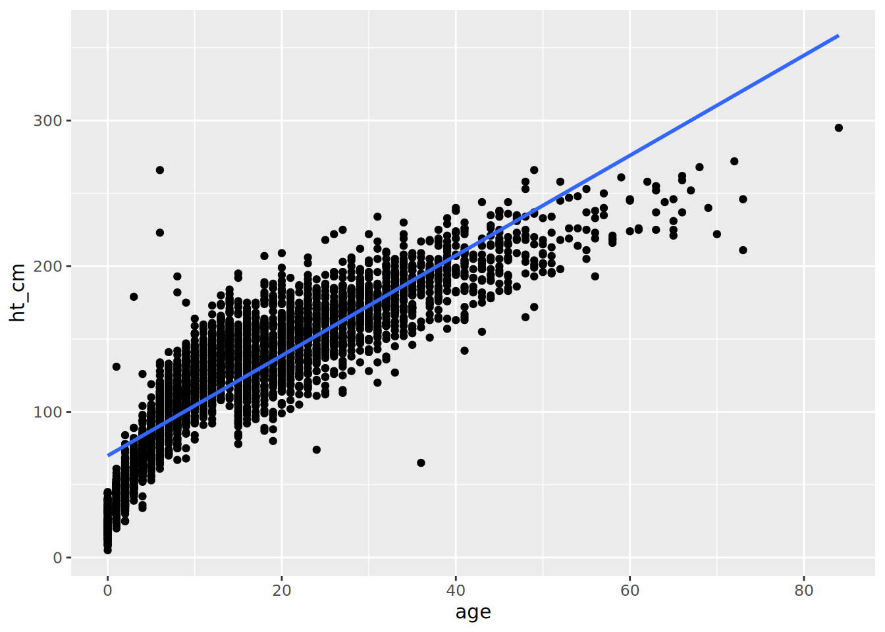

# 19  Однофакторная и многофакторная регрессия

На этой странице демонстрируется использование функций регрессии из **базового** R, таких как `glm()`, и пакета **gtsummary** для рассмотрения связей между переменными (например, отношения шансов, отношения рисков и отношения моментных рисков). Для вычистки выходных данных регрессии также используются такие функции, как `tidy()` из пакета **broom**.

1.  Однофакторная: таблицы два-на-два
2.  Стратифицированная: Оценка Мантеля-Хензеля  
3.  Многофакторная: выбор переменной, выбор модели, итоговая таблица
4.  Форест-графики

Для информации о Пропорциональной регрессии рисков Кокса см. страницу [Анализ выживаемости](survival_analysis.llms.md).

***ПРИМЕЧАНИЕ:*** Мы используем понятие *многофакторная* для регрессии с несколькими независимыми переменными. В этом смысле моделью *с множественным откликом* будет регрессия с несколькими результатами - см. эту [редакционную статью](https://www.ncbi.nlm.nih.gov/pmc/articles/PMC3518362/) для получения детальной информации

## 19.1 Подготовка

### Загрузка пакетов

Данный фрагмент кода показывает загрузку пакетов, необходимых для анализа. В данном руководстве мы фокусируемся на использовании `p_load()` из пакета **pacman**, которая устанавливает пакет, если необходимо, *и* загружает его для использования. Вы можете также загрузить установленные пакеты с помощью `library()` из **базового** R. См. страницу [Основы R](basics.llms.md) для получения дополнительной информации о пакетах R.

``` r
pacman::p_load(
  rio,          # импорт файлов
  here,         # путь к файлам
  tidyverse,    # управление данными + графика ggplot2, 
  stringr,      # манипуляции с текстовыми последовательностями 
  purrr,        # циклы над объектами по принципам аккуратных данных
  gtsummary,    # сводная статистика и тесты 
  broom,        # приведение результатов регрессий в аккуратный вид
  lmtest,       # тесты на отношение правдоподобия
  parameters,   # альтернатива для приведения результатов регрессий в аккуратный вид
  see, # альтернатива для визуализации форест-графиков
  appliedepidata # примеры данных, используемые в этом руководстве
  )
```

### Импорт данных

Мы импортируем набор данных о случаях имитированной эпидемии Эболы. Загрузите их напрямую с помощью `appliedepidata::get_data(name = "linelist_cleaned_rds")` (подробности см. на странице [Скачивание руководства и данных](download.llms.md)).

``` r
# импорт построчного списка
linelist <- appliedepidata::get_data(name = "linelist_cleaned_rds")
```

Первые 50 строк построчного списка отображены ниже.

### Вычистка данных

#### Сохранение независимых переменных

Мы храним имена столбцов независимых переменных как текстовый вектор. На него мы будем ссылаться позже.

``` r
## определяем интересующие переменные 
explanatory_vars <- c("gender", "fever", "chills", "cough", "aches", "vomit")
```

#### Конвертация в 1 и 0

Ниже мы конвертируем столбцы независимых переменных с “yes”/“no”, “m”/“f”, и “dead”/“alive” на **1 / 0**, чтобы соответствовать ожиданиям моделей логистической регрессии. Чтобы это сделать эффективным образом, используем `across()` из **dplyr**, чтобы преобразовать сразу несколько столбцов. Функция, которую мы применяем к каждому столбцу, называется `case_when()` (также из **dplyr**), она применяет логику для конвертации указанных значений в 1 и 0. См. разделы по `across()` и `case_when()` на странице [Вычистка данных и ключевые функции](cleaning.llms.md#clean_across)).

Примечание: “.” ниже представляет столбец, который обрабатывается в этот момент функцией `across()`.

``` r
## конвертируем двоичные переменные в 0/1 
linelist <- linelist %>%  
  mutate(across(                                      
    .cols = all_of(c(explanatory_vars, "outcome")),  ## для каждого указанного столбца и "outcome"
    .fns = ~case_when(                              
      . %in% c("m", "yes", "Death")   ~ 1,           ## перекодируем, мужской пол, да и смерть на 1
      . %in% c("f", "no",  "Recover") ~ 0,           ## женский пол, нет и выздоровление на 0
      TRUE                            ~ NA_real_)    ## в остальных случаях - отсутствующее значение
    )
  )
```

#### Удаление строк с отсутствующими значениями

Чтобы удалить строки с отсутствующими значениям, мы можем использовать функцию `drop_na()` из **tidyr**. Однако мы хотим это сделать только для строк, у которых отсутствуют значения в интересующих нас столбцах.

Первое, что нам нужно сделать, это убедиться, что наш вектор независимых переменных `explanatory_vars` включает столбец возраста `age` (`age` выдал бы ошибку в предыдущей операции `case_when()`, которая была только для двоичных переменных). Затем мы передаем `linelist` в команду `drop_na()`, чтобы удалить строки с отсутствующими значениями в столбце `outcome` или любом из столбцов независимых переменных `explanatory_vars`.

До выполнения кода количество строк в `linelist` составляет `nrow(linelist)`.

``` r
## добавляем age_category к независимым переменным 
explanatory_vars <- c(explanatory_vars, "age_cat")

## удаляем строки с отсутствующей информацией по интересующим переменным 
linelist <- linelist %>% 
  drop_na(any_of(c("outcome", explanatory_vars)))
```

Количество строк, остающихся в `linelist`, составляет `nrow(linelist)`.

## 19.2 Однофакторный

Как и в материалах на странице [Описательные таблицы](tables_descriptive.llms.md), конкретный способ применения определит, какой пакет R вам использовать. Мы представим две опции для проведения однофакторного анализа:

- Используйте функции, доступные в **базовом** R, чтобы быстро напечатать результаты в консоли. Используйте пакет **broom**, чтобы привести выходные данные в аккуратный вид.  
- Используйте пакет **gtsummary**, чтобы моделировать и получать готовые к публикации выходные данные.

### **базовый** R

#### Линейная регрессия

Функция **базового** R `lm()` создает линейную регрессию, оценивая отношения между числовыми независимыми и зависимыми переменными, между которыми предполагается линейное отношение.

Задайте уровнение в виде формулы, разделив названия столбцов независимой и зависимой переменной тильдой `~`. Также уточните набор данных в аргументе `data =`. Определите результаты модели как объект R, чтобы их можно было использовать позже.

``` r
lm_results <- lm(ht_cm ~ age, data = linelist)
```

Затем вы можете выполнить `summary()` для результатов модели, чтобы увидеть коэффициенты (оценки, Estimates), P-значение, остатки и другие меры.

``` r
summary(lm_results)
```


    Call:
    lm(formula = ht_cm ~ age, data = linelist)

    Residuals:
         Min       1Q   Median       3Q      Max 
    -128.579  -15.854    1.177   15.887  175.483 

    Coefficients:
                Estimate Std. Error t value Pr(>|t|)    
    (Intercept)  69.9051     0.5979   116.9   <2e-16 ***
    age           3.4354     0.0293   117.2   <2e-16 ***
    ---
    Signif. codes:  0 '***' 0.001 '**' 0.01 '*' 0.05 '.' 0.1 ' ' 1

    Residual standard error: 23.75 on 4165 degrees of freedom
    Multiple R-squared:  0.7675,    Adjusted R-squared:  0.7674 
    F-statistic: 1.375e+04 on 1 and 4165 DF,  p-value: < 2.2e-16

Альтернативно вы можете использовать функцию `tidy()` из пакета **broom**, чтобы извлечь результаты в таблицу. Результаты нам говорят, что для каждого года увеличения возраста рост увеличивается на 3.5 см. и это является статистически значимым.

``` r
tidy(lm_results)
```

    # A tibble: 2 × 5
      term        estimate std.error statistic p.value
      <chr>          <dbl>     <dbl>     <dbl>   <dbl>
    1 (Intercept)    69.9     0.598       117.       0
    2 age             3.44    0.0293      117.       0

Затем вы можете также использовать эту регрессию, чтобы добавить ее к **ggplot**, для этого мы сначала переносим точки из наблюдаемых данных и построенной линии в один датафрейм, используя функцию `augment()` из **broom**.

``` r
## сводим точки регрессии и наблюдаемые данные в один набор данных
points <- augment(lm_results)

## строим график данных, используя возраст в качестве оси x 
ggplot(points, aes(x = age)) + 
  ## добавляем точки для роста 
  geom_point(aes(y = ht_cm)) + 
  ## добавляем линию регрессии 
  geom_line(aes(y = .fitted), colour = "red")
```

[](regression_files/figure-html/lin_reg_res_plot-1.png)

Также можно добавить простую линейную регрессию сразу в **ggplot**, используя функцию `geom_smooth()`.

``` r
## добавляем данные к графику 
 ggplot(linelist, aes(x = age, y = ht_cm)) + 
  ## показываем точки
  geom_point() + 
  ## добавляем линейную регрессию 
  geom_smooth(method = "lm", formula = y ~ x, se = FALSE)
```

[](regression_files/figure-html/geom_smooth-1.png)

См. раздел Ресурсы в конце главы, в котором приведены более подробные руководства.

#### Логистическая регрессия

Функция `glm()` из пакета **stats** (часть **базового** R) используется, чтобы строить Обобщенные линейные модели (GLM).

`glm()` может использоваться для однофакторной и многофакторной логистической регрессии (например, чтобы получить отношения шансов). Вот ключевые части:

``` r
# аргументы для glm()
glm(formula, family, data, weights, subset, ...)
```

- `formula =` Модель задакется в `glm()` в виде уравнения, с зависимыми переменными слева, а независимыми переменными справа от тильды `~`.  
- `family =` Определяет тип модели, который надо выполнить. Для логистической регрессии используйте `family = "binomial"`, для пуассоновской - используйте `family = "poisson"`. Другие примеры приведены в таблице ниже.  
- `data =` Уточните ваш датафрейм

Если необходимо, вы можете также уточнить функцию связку через синтаксис `family = familytype(link = "linkfunction"))`. Вы можете более подробно ознакомиться с документацией о других семействах и опциональных аргументах, таких как `weights =` и `subset =` (`?glm`).

| Семейство            | Функция связки по умолчанию                  |
|----------------------|----------------------------------------------|
| `"binomial"`         | `(link = "logit")`                           |
| `"gaussian"`         | `(link = "identity")`                        |
| `"Gamma"`            | `(link = "inverse")`                         |
| `"inverse.gaussian"` | `(link = "1/mu^2")`                          |
| `"poisson"`          | `(link = "log")`                             |
| `"quasi"`            | `(link = "identity", variance = "constant")` |
| `"quasibinomial"`    | `(link = "logit")`                           |
| `"quasipoisson"`     | `(link = "log")`                             |

При выполнении `glm()` чаще всего результаты сохраняются как именованный объект R. Затем вы можете напечатать результаты в консоли, используя `summary()`, как показано ниже, либо провести другие операции с результатами (например, возвести в степень).

Если вам нужно выполнить отрицательную биномиальную регрессию, вы можете использовать пакет **MASS**; `glm.nb()` использует тот же синтаксис, что `glm()`. Для описания работы разных видов регрессии, см. [страницу статистики UCLA](https://stats.idre.ucla.edu/other/dae/).

#### Однофакторная `glm()`

В данном примере мы оцениваем связь между разными возрастными категориями и исходом смерти (закодирована как 1 в разделе Подготовка). Ниже представлена однофакторная модель исхода `outcome` по возрастной категории `age_cat`. Мы сохраняем выходные данные модели как `model`, затем печатаем их с помощью `summary()` в консоли. Обратите внимание, что представленные оценки являются *логарифмами отношения шансов*, и что базовый уровень является первым уровнем фактора в возрастной категории `age_cat` (“0-4”).

``` r
model <- glm(outcome ~ age_cat, family = "binomial", data = linelist)
summary(model)
```


    Call:
    glm(formula = outcome ~ age_cat, family = "binomial", data = linelist)

    Coefficients:
                  Estimate Std. Error z value Pr(>|z|)   
    (Intercept)   0.233738   0.072805   3.210  0.00133 **
    age_cat5-9   -0.062898   0.101733  -0.618  0.53640   
    age_cat10-14  0.138204   0.107186   1.289  0.19726   
    age_cat15-19 -0.005565   0.113343  -0.049  0.96084   
    age_cat20-29  0.027511   0.102133   0.269  0.78765   
    age_cat30-49  0.063764   0.113771   0.560  0.57517   
    age_cat50-69 -0.387889   0.259240  -1.496  0.13459   
    age_cat70+   -0.639203   0.915770  -0.698  0.48518   
    ---
    Signif. codes:  0 '***' 0.001 '**' 0.01 '*' 0.05 '.' 0.1 ' ' 1

    (Dispersion parameter for binomial family taken to be 1)

        Null deviance: 5712.4  on 4166  degrees of freedom
    Residual deviance: 5705.1  on 4159  degrees of freedom
    AIC: 5721.1

    Number of Fisher Scoring iterations: 4

Чтобы изменить базовый уровень определенной переменной, убедитесь, что столбец относится к классу фактор и передвиньте нужный уровень на первую позицию с помощью `fct_relevel()` (см. страницу [Факторы](factors.llms.md)). Например, ниже мы берем столбец `age_cat` и устанавливаем “20-29” в качестве базового уровня до передачи измененного датафрейма в `glm()`.

``` r
linelist %>% 
  mutate(age_cat = fct_relevel(age_cat, "20-29", after = 0)) %>% 
  glm(formula = outcome ~ age_cat, family = "binomial") %>% 
  summary()
```


    Call:
    glm(formula = outcome ~ age_cat, family = "binomial", data = .)

    Coefficients:
                 Estimate Std. Error z value Pr(>|z|)    
    (Intercept)   0.26125    0.07163   3.647 0.000265 ***
    age_cat0-4   -0.02751    0.10213  -0.269 0.787652    
    age_cat5-9   -0.09041    0.10090  -0.896 0.370220    
    age_cat10-14  0.11069    0.10639   1.040 0.298133    
    age_cat15-19 -0.03308    0.11259  -0.294 0.768934    
    age_cat30-49  0.03625    0.11302   0.321 0.748390    
    age_cat50-69 -0.41540    0.25891  -1.604 0.108625    
    age_cat70+   -0.66671    0.91568  -0.728 0.466546    
    ---
    Signif. codes:  0 '***' 0.001 '**' 0.01 '*' 0.05 '.' 0.1 ' ' 1

    (Dispersion parameter for binomial family taken to be 1)

        Null deviance: 5712.4  on 4166  degrees of freedom
    Residual deviance: 5705.1  on 4159  degrees of freedom
    AIC: 5721.1

    Number of Fisher Scoring iterations: 4

#### Печать результатов

Для большинства случаев использования необходимо внести некоторые изменения в указанные выше выходные данные. Функция `tidy()` из пакета **broom** является удобной, чтобы сделать результаты модели презентабельными.

Здесь мы демонстрируем, как комбинировать выходные данные модели с таблицей подсчетов.

1.  Получите *возведенные в степень* оценочные логарифмы отношения шансов и доверительных интервалов, передав модель в функцию `tidy()` и установив `exponentiate = TRUE` и `conf.int = TRUE`.

``` r
model <- glm(outcome ~ age_cat, family = "binomial", data = linelist) %>% 
  tidy(exponentiate = TRUE, conf.int = TRUE) %>%        # возводим в степень и создаем ДИ
  mutate(across(where(is.numeric), ~ round(.x, digits = 2)))  # округляем все числовые столбцы
```

Ниже представлена полученная на выходе таблица tibble `model`:

2.  Объединяем эти результаты модели с таблицей подсчета. Ниже мы создаем перекрестную таблицу подсчета с помощью функции `tabyl()` из пакета **janitor**, как объяснялось на странице [Описательные таблицы](tables_descriptive.llms.md).

``` r
counts_table <- linelist %>% 
  janitor::tabyl(age_cat, outcome)
```

Вот как выглядит этот датафрейм `counts_table`:

Теперь мы можем связать `counts_table` и результаты модели `model` вместе горизонтально с помощью `bind_cols()` (**dplyr**). Помните, что при использовании `bind_cols()` строки в двух датафреймах должны идеально соответствовать. В данном коде поскольку мы связываем внутри цепочки канала, мы используем `.`, чтобы представить поставленный в канал объект `counts_table`, когда мы его привязываем к модели `model`. Чтобы завершить процесс, мы используем `select()`, чтобы выбрать необходимые столбцы и их порядок, и наконец применяем функцию из **базового** R `round()` ко всем числовым столбцам, чтобы уточнить два знака после запятой.

``` r
combined <- counts_table %>%           # начинаем с таблицы подсчета
  bind_cols(., model) %>%              # объединяем с выходными данными регрессии 
  select(term, 2:3, estimate,          # выбираем и изменяем порядок столбцов
         conf.low, conf.high, p.value) %>% 
  mutate(across(where(is.numeric), ~ round(.x, digits = 2))) ## округляем до 2 знаков после запятой
```

Вот так выглядит объединенный датафрейм, красиво напечатанный в виде изображения с помощью функции из **flextable**. На странице [Таблицы для презентации](tables_presentation.llms.md) объясняется, как адаптировать такие таблицы с помощью **flextable**, либо вы можете использовать другие пакеты, такие как **knitr** или **GT**.

``` r
combined <- combined %>% 
  flextable::qflextable()
```

#### Создание цикла для нескольких однофакторных моделей

Ниже мы представим метод с использованием `glm()` и `tidy()` для более простого подхода, см. раздел **gtsummary**.

Чтобы выполнить модели на нескольких переменных воздействия, чтобы получить однофакторные отношения шансов (т.е. без контроля по отношению друг к другу), вы можете использовать подход, описанный ниже. В нем используется `str_c()` из пакета **stringr** для создания однофакторных формул (см. [Текст и последовательности](characters_strings.llms.md)), выполняется регрессия `glm()` для каждой формулы, каждый результат регрессии `glm()` передается в `tidy()` и наконец объединяются все результаты моделей с помощью `bind_rows()` из **tidyr**. Этот подход использует для итераций `map()` из пакета **purrr** - см. страницу [Итерации, циклы и списки](iteration.llms.md) для более подробной информации об этом инструменте.

1.  Создаем вектор имен столбцов независимых переменных. У нас уже есть `explanatory_vars` из раздела Подготовка на этой странице.

2.  Используем `str_c()`, чтобы создать несколько формул последовательности, при этом `outcome` будет в левой части, а название столбца из `explanatory_vars` - в правой. Точка `.` заменяет название столбца из `explanatory_vars`.

``` r
explanatory_vars %>% str_c("outcome ~ ", .)
```

    [1] "outcome ~ gender"  "outcome ~ fever"   "outcome ~ chills" 
    [4] "outcome ~ cough"   "outcome ~ aches"   "outcome ~ vomit"  
    [7] "outcome ~ age_cat"

3.  Передайте эти формулы-последовательности в `map()` и установите `~glm()` в качестве функции, которая будет применяться к каждому входному параметру. Внутри `glm()` установите формулу регрессию как `as.formula(.x)`, где `.x` будет заменяться на формулу-последовательность, определенную шагом выше. `map()` выполнит цикл для каждой из формул-последовательностей, выполнив для каждой регрессию.

4.  Выходные данные этой первой функции `map()` передаются во вторую команду `map()`, которая применяет `tidy()` к результатам регрессии.

5.  Наконец, выходные данные второй `map()` (список аккуратных датафреймов) сжимается с помощью `bind_rows()`, что приводит к созданию одного датафрейма со всеми однофакторными результатами.

``` r
models <- explanatory_vars %>%       # начинаем с интересующей переменной
  str_c("outcome ~ ", .) %>%         # объединяем каждую переменную в формулу ("исход (outcome) ~ интересующая переменная")
  
  # проводим итерацию через каждую однофакторную формулу
  map(                               
    .f = ~glm(                       # по одной передаем формулы в glm()
      formula = as.formula(.x),      # внутри glm() формула-последовательность - это .x
      family = "binomial",           # уточняем тип glm (логистическая)
      data = linelist)) %>%          # набор данных
  
  # приводим результаты регрессий glm, сделанных выше, в аккуратный формат
  map(
    .f = ~tidy(
      .x, 
      exponentiate = TRUE,           # возводим в степень 
      conf.int = TRUE)) %>%          # получаем доверительные интервалы
  
  # сжимаем список выходных данных регрессии в один датафрейм
  bind_rows() %>% 
  
  # округляем все числовые столбцы
  mutate(across(where(is.numeric), ~ round(.x, digits = 2)))
```

В этот раз конечный объект `models` длиннее, поскольку теперь представляет объединенные результаты нескольких однофакторных регрессий. Пролистайте все строки `model`.

Как и ранее, мы создаем таблицу подсчета из `linelist` для каждой независимой переменной, связываем ее с `models` и создаем прекрасную таблицу. Мы начинаем с переменных, проводим по ним итерацию с помощью `map()`. Мы проводим итерацию по определенной пользователем функции, что требует создания таблицы подсчета с помощью функций **dplyr**. Затем результаты объединяются и связываются с результатами модели `models`.

``` r
## для каждой независимой переменной
univ_tab_base <- explanatory_vars %>% 
  map(.f = 
    ~{linelist %>%                ## начинаем с построчного списка
        group_by(outcome) %>%     ## группируем набор данных по исходу
        count(.data[[.x]]) %>%    ## создаем подсчет по интересующей переменной
        pivot_wider(              ## разворачиваем на широкий формат (как в кросс-табуляции)
          names_from = outcome,
          values_from = n) %>% 
        drop_na(all_of(.x)) %>%         ## удаляем строки с отсутствующими значениями
        rename("variable" = all_of(.x)) %>%      ## меняем столбец интересующей переменной на "variable"
        mutate(variable = as.character(variable))} ## конвертируем в текст, иначе недвоичные (категориальные) переменные выйдут, как фактор, и их нельзя будет объединить
      ) %>% 
  
  ## сжимаем список выходных данных подсчетов в один датафрейм
  bind_rows() %>% 
  
  ## объединяем с выходными данными регрессии 
  bind_cols(., models) %>% 
  
  ## сохраняем только интересующие нас столбцы 
  select(term, 2:3, estimate, conf.low, conf.high, p.value) %>% 
  
  ## округляем знаки после запятой
  mutate(across(where(is.numeric), ~ round(.x, digits = 2)))
```

Ниже представлен датафрейм. См. страницу [Таблицы для презентации](tables_descriptive.llms.md), чтобы ознакомиться с идеями о том, как еще конвертировать эту таблицу в красивую таблицу в HTML (например, с помощью **flextable**).

### Пакет **gtsummary**

Ниже мы представляем использование `tbl_uvregression()` из пакета **gtsummary**. Как и на странице [Описательные таблицы](https://epirhandbook.com/descriptive-tables.html), функции **gtsummary** хорошо справляются с расчетом статистики *и* подготовкой профессионально выглядящих результатов. Эта функция создает таблицу результатов однофакторной регрессии.

Мы выбираем только необходимые столбцы из `linelist` (независимые переменные и переменная исхода) и подставляем их в `tbl_uvregression()`. Мы выполним однофакторную регрессию для каждого из столбцов, который мы определили как `explanatory_vars` на этапе Подготовки данных (пол, жар, озноб, кашель, боли, рвота, и возрастные категории age_cat).

Внутри самой функции мы задаем `method =` как `glm` (без кавычек), `y =` столбец исхода (`outcome`), уточняем в `method.args =`, что мы хотим выполнить логистическую регрессию с помощью `family = binomial`, а также говорим, что нужно возвести результаты в степень

Выходным результатом будет HTML, который содержит подсчеты

``` r
univ_tab <- linelist %>% 
  dplyr::select(all_of(explanatory_vars), outcome) %>% ## выбираем интересующие переменные

  tbl_uvregression(                         ## создаем однофакторную таблицу
    method = glm,                           ## задаем, какую регрессию выполнить (обобщенная линейная модель)
    y = outcome,                            ## задаем переменную исхода
    method.args = list(family = binomial),  ## dопределяем, какой тип glm надо выполнить (логистическая)
    exponentiate = TRUE                     ## возводим в степень, чтобы получить отношения шансов (а не логарифм отношения шансов)
  )

## просматриваем таблицу однофакторных результатов 
univ_tab
```

[TABLE]

С этими выходными данными вы можете сделать множество модификаций, например, адаптировать текстовые подписи, выделить строки жирным в зависимости от их p-значений и т.п. См. самоучители [тут](http://www.danieldsjoberg.com/gtsummary/articles/tbl_regression.html) и в других онлайн источниках.

## 19.3 Стратифицированный

Стратифицированный анализ в настоящее время разрабатывается для **gtsummary**, эта страница будет обновляться.

## 19.4 Многофакторный

Для многофакторного анализа мы также представим два подхода:

- `glm()` и `tidy()`  
- пакет **gtsummary**

Поток работ будет похож для них, отличаться будет только последний шаг свода в итоговую таблицу.

### Проведение многофакторного анализа

Здесь мы используем `glm()`, но добавляем больше переменных для анализа в правой стороне уравнения, отделяя символом плюс (`+`).

Чтобы выполнить модель со всеми независимыми переменными, мы выполним:

``` r
mv_reg <- glm(outcome ~ gender + fever + chills + cough + aches + vomit + age_cat, family = "binomial", data = linelist)

summary(mv_reg)
```


    Call:
    glm(formula = outcome ~ gender + fever + chills + cough + aches + 
        vomit + age_cat, family = "binomial", data = linelist)

    Coefficients:
                  Estimate Std. Error z value Pr(>|z|)
    (Intercept)   0.069054   0.131726   0.524    0.600
    gender        0.002448   0.065133   0.038    0.970
    fever         0.004309   0.080522   0.054    0.957
    chills        0.034112   0.078924   0.432    0.666
    cough         0.138584   0.089909   1.541    0.123
    aches        -0.070705   0.104078  -0.679    0.497
    vomit         0.086098   0.062618   1.375    0.169
    age_cat5-9   -0.063562   0.101851  -0.624    0.533
    age_cat10-14  0.136372   0.107275   1.271    0.204
    age_cat15-19 -0.011074   0.113640  -0.097    0.922
    age_cat20-29  0.026552   0.102780   0.258    0.796
    age_cat30-49  0.059569   0.116402   0.512    0.609
    age_cat50-69 -0.388964   0.262384  -1.482    0.138
    age_cat70+   -0.647443   0.917375  -0.706    0.480

    (Dispersion parameter for binomial family taken to be 1)

        Null deviance: 5712.4  on 4166  degrees of freedom
    Residual deviance: 5700.2  on 4153  degrees of freedom
    AIC: 5728.2

    Number of Fisher Scoring iterations: 4

Если вы хотите включить две переменные и взаимодействие между ними, вы можете отделить их звездочкой `*` вместо `+`. Отделяйте их двоеточием `:`, если вы только уточняете взаимодействие. Например:

``` r
glm(outcome ~ gender + age_cat * fever, family = "binomial", data = linelist)
```

*Опционально* вы можете использовать этот код, чтобы воспользоваться заранее определенным вектором имен столбцов и воссоздать использованную выше команду с помощью `str_c()`. Это может быть полезным, если у вас меняются имена независимых переменных или если вы не хотите их все снова печатать.

``` r
## выполняем регрессию со всеми интересующими переменными 
mv_reg <- explanatory_vars %>%  ## начинаем с вектора имен столбцов независимых переменных
  str_c(collapse = "+") %>%     ## объединяем все имена интересующих переменных, которые отделяются плюсом
  str_c("outcome ~ ", .) %>%    ## объединяем имена интересующих переменных с исходом в стиле формулы
  glm(family = "binomial",      ## задаем тип glm как логистическую регрессию,
      data = linelist)          ## определяем набор данных
```

#### Построение модели

Вы можете построить свою модель шаг за шагом, сохраняя разные модели, которые включают определенные независимые переменные. Вы можете сравнить эти модели с помощью тестов на отношение правдоподобия, используя `lrtest()` из пакета **lmtest**, как показано ниже:

***ПРИМЕЧАНИЕ:*** Использование **базовой** функции `anova(model1, model2, test = "Chisq)` даст те же результаты

``` r
model1 <- glm(outcome ~ age_cat, family = "binomial", data = linelist)
model2 <- glm(outcome ~ age_cat + gender, family = "binomial", data = linelist)

lmtest::lrtest(model1, model2)
```

    Likelihood ratio test

    Model 1: outcome ~ age_cat
    Model 2: outcome ~ age_cat + gender
      #Df  LogLik Df Chisq Pr(>Chisq)
    1   8 -2852.6                    
    2   9 -2852.6  1 2e-04     0.9883

Еще один вариант - взять объект модели и применить функцию `step()` из пакета **stats**. При построении этой модели уточните, какое направление выбора переменной вы хотите использовать.

``` r
## выберите модель, используя выбор вперед на основе критерия AIC
## вы также можете сделать выбор "назад" ("backward") или в обе стороны ("both"), исправив направление
final_mv_reg <- mv_reg %>%
  step(direction = "forward", trace = FALSE)
```

Вы также можете отключить экспоненциальный формат записи в вашей сессии R для ясности:

``` r
options(scipen=999)
```

Как описывается в разделе по однофакторнуму анализу, передайте выходные данные модели в `tidy()`, чтобы возвести в степень логарифмы отношения шансов и ДИ. Наконец, мы округляем все числовые столбцы до двух знаков после запятой. Просмотрите все строки.

``` r
mv_tab_base <- final_mv_reg %>% 
  broom::tidy(exponentiate = TRUE, conf.int = TRUE) %>%  ## получаем аккуратный датафрейм с оценками 
  mutate(across(where(is.numeric), ~ round(.x, digits = 2)))          ## округляем 
```

Вот как выглядит получившийся датафрейм:

### Объединение однофакторного и многофакторного анализа

#### Объединяем с помощью **gtsummary**

В пакете **gtsummary** есть функция `tbl_regression()`, которая берет выходные результаты регрессии (в данном случае `glm()`) и создает хорошую суммарную таблицу.

``` r
## показываем таблицу результатов итоговой регрессии 
mv_tab <- tbl_regression(final_mv_reg, exponentiate = TRUE)
```

Давайте посмотрим таблицу:

``` r
mv_tab
```

[TABLE]

Вы также можете объединять несколько разных таблиц выходных результатов, созданных **gtsummary** с помощью функции `tbl_merge()`. Сейчас мы объединим результаты многофакторного анализа с помощью **gtsummary** с результатам *однофакторного* анализа, который мы создали [выше](#reg_gt_uni):

``` r
## объединяем с результатами однофакторного анализа 
tbl_merge(
  tbls = list(univ_tab, mv_tab),                          # объединяем
  tab_spanner = c("**Univariate**", "**Multivariable**")) # задаем имена заголовков
```

[TABLE]

#### Объединение с помощью **dplyr**

Альтернативным способом объединения результатов однофакторного и многофакторного анализа `glm()`/`tidy()` будет использование функций соединения из **dplyr**.

- Объединяем полученные ранее результаты однофакторного анализа (`univ_tab_base`, где содержится подсчет) с аккуратными результатами многофакторного анализа `mv_tab_base`  
- Используем `select()`, чтобы сохранить только те столбцы, которые нам нужны, уточнить их порядок и переименовать их  
- Используем `round()`, чтобы задать два знака после запятой всем столбцам в классе Double (число двойной точности)

``` r
## объединяем однофакторную и многофакторную таблицу 
left_join(univ_tab_base, mv_tab_base, by = "term") %>% 
  ## выбираем столбцы и переименовываем
  select( # новое имя =  старое имя
    "characteristic" = term, 
    "recovered"      = "0", 
    "dead"           = "1", 
    "univ_or"        = estimate.x, 
    "univ_ci_low"    = conf.low.x, 
    "univ_ci_high"   = conf.high.x,
    "univ_pval"      = p.value.x, 
    "mv_or"          = estimate.y, 
    "mvv_ci_low"     = conf.low.y, 
    "mv_ci_high"     = conf.high.y,
    "mv_pval"        = p.value.y 
  ) %>% 
  mutate(across(where(is.double), ~ round(.x, 2)))   
```

    # A tibble: 20 × 11
       characteristic recovered  dead univ_or univ_ci_low univ_ci_high univ_pval
       <chr>              <dbl> <dbl>   <dbl>       <dbl>        <dbl>     <dbl>
     1 (Intercept)          909  1168    1.28        1.18         1.4       0   
     2 gender               916  1174    1           0.88         1.13      0.97
     3 (Intercept)          340   436    1.28        1.11         1.48      0   
     4 fever               1485  1906    1           0.85         1.17      0.99
     5 (Intercept)         1472  1877    1.28        1.19         1.37      0   
     6 chills               353   465    1.03        0.89         1.21      0.68
     7 (Intercept)          272   309    1.14        0.97         1.34      0.13
     8 cough               1553  2033    1.15        0.97         1.37      0.11
     9 (Intercept)         1636  2114    1.29        1.21         1.38      0   
    10 aches                189   228    0.93        0.76         1.14      0.51
    11 (Intercept)          931  1144    1.23        1.13         1.34      0   
    12 vomit                894  1198    1.09        0.96         1.23      0.17
    13 (Intercept)          338   427    1.26        1.1          1.46      0   
    14 age_cat5-9           365   433    0.94        0.77         1.15      0.54
    15 age_cat10-14         273   396    1.15        0.93         1.42      0.2 
    16 age_cat15-19         238   299    0.99        0.8          1.24      0.96
    17 age_cat20-29         345   448    1.03        0.84         1.26      0.79
    18 age_cat30-49         228   307    1.07        0.85         1.33      0.58
    19 age_cat50-69          35    30    0.68        0.41         1.13      0.13
    20 age_cat70+             3     2    0.53        0.07         3.2       0.49
    # ℹ 4 more variables: mv_or <dbl>, mvv_ci_low <dbl>, mv_ci_high <dbl>,
    #   mv_pval <dbl>

## 19.5 Форест-график

Этот раздел показывает, как создать график с результатами вашей регрессии. Есть две опции, вы можете построить график самостоятельно с помощью **ggplot2** или использовать мета-пакет под названием **easystats** (пакет, который включает много пакетов).

См. страницу [Основы ggplot](ggplot_basics.llms.md), если вы не знакомы с пакетом построения графиков **ggplot2**.

### Пакет **ggplot2**

Вы можете построить форест-график с помощью `ggplot()`, построив график с результатами многофакторной регрессии. Добавляйте слои на графики с помощью “геомов”:

- оценочные данные с помощью `geom_point()`  
- доверительные интервалы с помощью `geom_errorbar()`  
- вертикальная линия на ОШ = 1 с `geom_vline()`

Прежде чем построить график, возможно нужно использовать `fct_relevel()` из пакета **forcats**, чтобы задать порядок переменных/уровни на оси y. `ggplot()` может отобразить их в буквенно-числовом порядке, который не очень хорошо работает для значений возрастных категорий (“30” будет раньше, чем “5”). См. дополнительную информацию на странице [Факторы](factors.llms.md).

``` r
## удаляем свободный член из результатов многофакторного анализа
mv_tab_base %>% 
  
  #задаем порядок уровней по оси y
  mutate(term = fct_relevel(
    term,
    "vomit", "gender", "fever", "cough", "chills", "aches",
    "age_cat5-9", "age_cat10-14", "age_cat15-19", "age_cat20-29",
    "age_cat30-49", "age_cat50-69", "age_cat70+")) %>%
  
  # удаляем строку "intercept" из графика
  filter(term != "(Intercept)") %>% 
  
  ## строим график с переменной по оси y и оценочным показателем (ОШ) по оси x
  ggplot(aes(x = estimate, y = term)) +
  
  ## показываем оценку как точку
  geom_point() + 
  
  ## добавляем столбец ошибки для доверительных интервалов
  geom_errorbar(aes(xmin = conf.low, xmax = conf.high)) + 
  
  ## показываем, где ОШ = 1 в виде пунктирной линии для справки
  geom_vline(xintercept = 1, linetype = "dashed")
```

[](regression_files/figure-html/ggplot_forest-1.png)

### Пакеты **easystats**

В качестве альтернативы, если вам не нужен такой детальный уровень контроля, как дает **ggplot2**, можно использовать комбинацию пакетов **easystats**.

Функция `model_parameters()` из **parameters** выполняет действия, эквивалентные функции `tidy()` из пакета **broom**. Пакет **see** затем принимает эти выходные данные и создает форест-график по умолчанию в виде объекта `ggplot()`.

``` r
pacman::p_load(easystats)

## удаляем свободный член из результатов многофакторного анализа
final_mv_reg %>% 
  model_parameters(exponentiate = TRUE) %>% 
  plot()
```

[](regression_files/figure-html/easystats_forest-1.png)

## 19.6 Ресурсы

Информация для содержания этой страницы была взята из следующих онлайн ресурсов и виньеток:

[Линейная регрессия в R](https://www.datacamp.com/community/tutorials/linear-regression-R)

[gtsummary](http://www.danieldsjoberg.com/gtsummary/articles/tbl_regression.html)

[Страница по статистике UCLA](https://stats.idre.ucla.edu/other/dae/)

[Пошаговая регрессия sthda](http://www.sthda.com/english/articles/36-classification-methods-essentials/150-stepwise-logistic-regression-essentials-in-r/)
