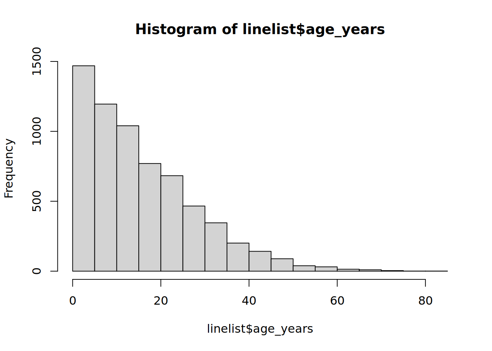
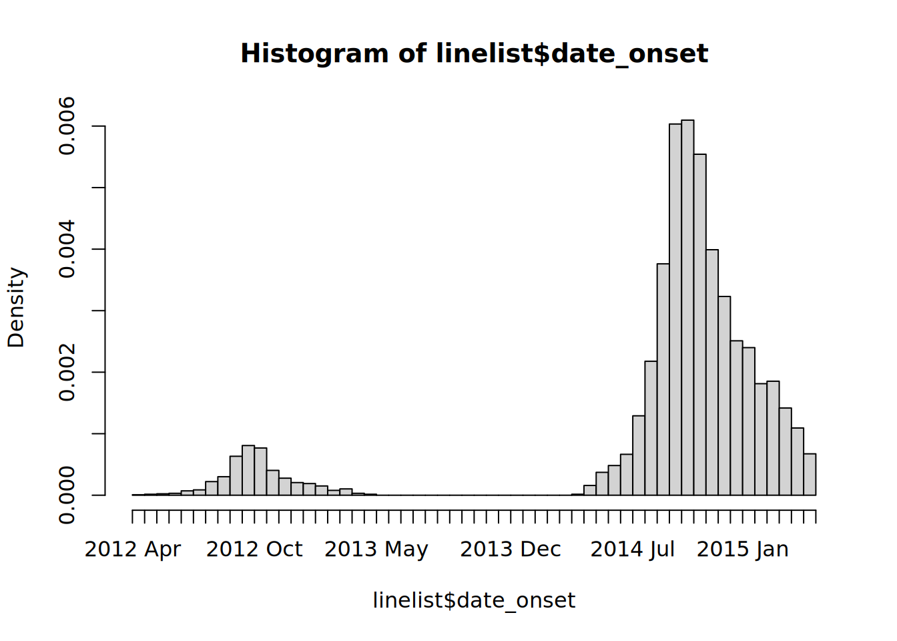

# 8  Veri temizliği ve temel fonksiyonlar

[](../../images/data_cleaning.png)

Bu sayfa, bir veritabanını “temizleme” sürecinde kullanılan genel adımları gösterir ve ayrıca birçok temel R veri yönetimi fonksiyonunun kullanımını açıklamaktadır.

Bu sayfada veri temizliğinin gösterimi için ilk olarak ham satır listesi formunda bir veritabanı içe aktarılacaktır (import). Daha sonra adım adım veri temizliği basamakları uygulanacaktır.

R kod dilinde bu süreç “tünel” zinciri olarak adlandırılır. Tünel (pipe) operatörü %\>% bir veritabanını bir operasyondan diğerine aktarır.

### Temel fonksiyonlar

Bu el kitabı R paketlerinden tidyverse ailesi fonksiyonlarının kullanımını vurgulamaktadır. [**tidyverse**](https://www.tidyverse.org/) Bu sayfada gösterilen temel R fonksiyonları aşağıda listelenmiştir.

Bu fonksiyonların çoğu dplyr R paketine aittir. Bu R paketi veri manipülasyonu problemlerini çözmek için gerekli “eylem” fonksiyonlarını içerir. ( dplyr ismi veri çerçevesi katlayıcı – data frame [plier](https://www.thefreedictionary.com/plier#:~:text=also%20ply%C2%B7er%20(pl%C4%AB%E2%80%B2,holding%2C%20bending%2C%20or%20cutting.)%22) kelimelerine referans olarak verilmiştir). [**dplyr**](https://dplyr.tidyverse.org/) dplyr , tidyverse R paketi ailesinin bir parçasıdır. Bu aile ggplot2, tidyr, stringr, tibble, purrr, magrittr ve forcats gibi birçok önemli paketi kapsar.

| Fonksiyon | Kullanımı | Paket |
|----|----|----|
| `%>%` | “tünel” veriyi bir fonksiyondan diğerine geçirir. | **magrittr** |
| `mutate()` | Sütunların oluşturulması, dönüştürülmesi, yeniden tanımlanması | **dplyr** |
| `select()` | Sütunların veritabanında tutulması, silinmesi, yeniden adlandırılması | **dplyr** |
| `rename()` | Sütunların yeniden adlandırılması | **dplyr** |
| `clean_names()` | Sütun isimlerinin sintaksının standardize edilmesi | **janitor** |
| `as.character()`, `as.numeric()`, `as.Date()`, etc. | Bir sütunun sınıfının değişimi | **base** R |
| `across()` | Birden çok sütunun aynı anda transforme edilmesi | **dplyr** |
| **tidyselect** fonksiyonu | Mantık ile sütunların seçimi | **tidyselect** |
| `filter()` | Belli satırların tutulması | **dplyr** |
| `distinct()` | Duplike satırların uzaklaştırılması | **dplyr** |
| `rowwise()` | Her satır için operasyon | **dplyr** |
| `add_row()` | Elle satır ekleme | **tibble** |
| `arrange()` | Satırların düzenlenmesi | **dplyr** |
| `recode()` | Sütundaki değerlerin yeniden kodlanması | **dplyr** |
| `case_when()` | Sütundaki değerlerin daha kompleks mantık kriterleri ile yeniden kodlanması | **dplyr** |
| `replace_na()`, `na_if()`, `coalesce()` | Yeniden kodlama için özel fonksiyonlar | **tidyr** |
| `age_categories()` ve `cut()` | Sayısal değerler içeren bir sütundan kategorik gruplar oluşturma | **epikit** ve **base** R |
| `match_df()` | Veri sözlüğü kullanarak değerlerin yeniden kodlanması ve temizliği | **matchmaker** |
| `which()` | Mantık kriterlerinin uygulanması, endekslerin elde edilmesi | **base** R |

Bu komutların Stata ya da SAS komutları ile karşılaştırılmasını görmek için [R’a geçiş](transition_to_r.llms.md) sayfasını inceleyin.

Alternatif bir veri yönetim çerçevesi olarak data.table R paketi := gibi operatörler ve sıkça köşeli parantezler \[ \] kullanır. Bu yaklaşım ve sintaksı kısaca [Veri Tablosu](data_table.llms.md) sayfasında anlatılmıştır.

### İsimlendirme

Bu el kitabında, değişken ve gözlem yerine sütun ve satır terimleri kullanılacaktır. Tidy Data sayfasında anlatıldığı gibi epidemiyolojik istatistik veritabanları; satır, sütun ve değerlerden oluşur. [“tidy data”](https://tidyr.tidyverse.org/articles/tidy-data.html)

Değişkenler, aynı temel özelliği ölçen değerleri içerir (yaş grubu, sonuç veya başlangıç tarihi gibi). Gözlemler, aynı birimde ölçülen tüm değerleri içerir (örneğin, bir kişi, bir bölge veya laboratuvar numunesi). Dolayısıyla bu özellikleri somut olarak tanımlamak zor olabilir.

“Tidy” (düzenli) veritabanlarında her sütun bir değişken, her satır bir gözlem ve her hücre tek bir değerdir. Ancak karşılaştığınız bazı veritabanları bu kalıba uymaz - “geniş” formdaki veritabanlarının birkaç sütuna bölünebilen değişkenleri olabilir (Pivoting data sayfasındaki örneğe bakın). Benzer şekilde, gözlemler birkaç satıra bölünebilir.

Bu el kitabının büyük bölümü, verileri yönetmek ve dönüştürmekle ilgilidir, bu nedenle somut veri yapıları olan satır ve sütunlara atıfta bulunmak, daha soyut özellikteki gözlemler ve değişkenlerden daha önemlidir. Veri analizi sayfalarında istisna olarak değişkenlere ve gözlemlere daha fazla değinilecektir.

## 8.1 Tünel hattını temizlemek

**Bu sayfada tipik veri temizleme basamakları ve bu basamakların tünel hattına eklenmesi gözden geçirilecektir.**

Epidemiyolojik analiz ve veri işlemede, temizleme adımları genellikle birbiri ile bağlantılı olarak sırayla gerçekleştirilir. R’da, bu genellikle ham veri kümesinin bir temizleme adımından diğerine geçirildiği veya “tünellandığı” bir temizleme “tünel hattı” olarak kendini gösterir.

Bu tür zincirler, dplyr “eylem” fonksiyonları ve magrittr tünel operatörü %\>%’yi kullanır. Bu kanal, “ham” verilerle (“linelist_raw.xlsx”) başlar ve kullanılabilen, kaydedilebilen, dışa aktarılabilen vb. “temiz” bir R veri çerçevesi (linelist) ile biter.

Bir temizleme tünel hattında adımların sırası önemlidir. Temizleme adımları şunları içerebilir: • Verilerin içe aktarılması • Sütun adlarının temizlenmesi veya değiştirilmesi • Tekilleştirme (de-duplikasyon) • Sütun oluşturma ve dönüştürme (örn. değerleri yeniden kodlama veya standartlaştırma) • Filtrelenen veya eklenen satırlar

## 8.2 Paketlerin yüklenmesi

Bu kod kümesi, analizler için gerekli olan paketlerin yüklenmesini gösterir. Bu el kitabında, gereken durumlarda paket kuran ve kullanım için yükleyen pacman’ın p_load() fonksiyonu vurgulanmaktadır. Alternatif olarak, base (temel) R’den library() komutu ile kurulu paketler yüklenebilir. R paketleri hakkında daha fazla bilgi için R’ın temelleri sayfasına bakın.

``` r
pacman::p_load(
  rio,        # verileri içe aktarma
  here,       # göreli dosya yolları
  janitor,    # veri temizleme ve tablolar
  lubridate,  # tarihlerle çalışma
  matchmaker, # dictionary-based cleaning
  epikit,     # age_categories() fonksiyonu
  tidyverse, # veri yönetimi ve görselleştirme
  appliedepidata # bu el kitabında kullanılan örnek veriler
)
```

## 8.3 Verileri içe aktar

### İçe aktarma

Burada, rio paketinden import() fonksiyonunu kullanarak “ham” vaka satır listesi formundaki Excel dosyasını içe aktarıyoruz. rio paketi birçok dosya türünü esnek bir şekilde işler (örn. .xlsx, .csv, .tsv, .rds. Satırları atlama, eksik değerleri ayarlama, Google sayfalarını içe aktarma gibi diğer durumlar hakkında daha fazla bilgi ve ipucu için İçe Aktarma ve Dışa Aktarma sayfasına bakın.

Doğrudan `appliedepidata::get_data(name = "case_linelists_linelist_raw")` ile yükleyin (ayrıntılar için [El kitabı ve veri indirme](download.llms.md) sayfasına bakın).

Veri tabanınız büyükse ve içe aktarılması uzun sürüyorsa, içe aktarma komutunun tünel zincirinden ayrı olması ve ham verinin ayrı bir dosya olarak kaydedilmesi yararlı olabilir. Bu aynı zamanda orijinal ve temizlenmiş sürümler arasında kolay karşılaştırma sağlar.

Aşağıda, ham Excel dosyasını içe aktarıyoruz ve onu linelist_raw veri çerçevesi olarak kaydediyoruz. Dosyanın çalışma dizininizde veya R proje kök dizininde bulunduğunu ve bu nedenle dosya yolunda hiçbir alt klasör belirtilmediğini varsayıyoruz.

``` r
linelist_raw <- appliedepidata::get_data(name = "case_linelists_linelist_raw")
```

Aşağıda veri çerçevesinin ilk 50 satırını görüntüleyebilirsiniz. Not: temel R fonksiyonu head (n), R konsolundaki ilk n satırı görüntülemenize olanak tanır.

### Gözden geçirme

Tüm veri çerçevesine genel bir bakış elde etmek için skimr paketindeki skim() fonksiyonunu kullanabilirsiniz (daha fazla bilgi için Tanımlayıcı tablolar sayfasına bakın). Sütunlar karakter, sayısal gibi sınıflara göre özetlenir. Not: “POSIXct” bir tür ham tarih sınıfıdır (bkz. [Tarihlerle çalışma](dates.llms.md))

``` r
skimr::skim(linelist_raw)
```

|                                                  |              |
|:-------------------------------------------------|:-------------|
| Name                                             | linelist_raw |
| Number of rows                                   | 6611         |
| Number of columns                                | 28           |
| \_\_\_\_\_\_\_\_\_\_\_\_\_\_\_\_\_\_\_\_\_\_\_   |              |
| Column type frequency:                           |              |
| character                                        | 17           |
| numeric                                          | 8            |
| POSIXct                                          | 3            |
| \_\_\_\_\_\_\_\_\_\_\_\_\_\_\_\_\_\_\_\_\_\_\_\_ |              |
| Group variables                                  | None         |

Data summary {.caption-top .table .table-sm .table-striped .small}

**Variable type: character**

| skim_variable  | n_missing | complete_rate | min | max | empty | n_unique | whitespace |
|:---------------|----------:|--------------:|----:|----:|------:|---------:|-----------:|
| case_id        |       137 |          0.98 |   6 |   6 |     0 |     5888 |          0 |
| date onset     |       293 |          0.96 |  10 |  10 |     0 |      580 |          0 |
| outcome        |      1500 |          0.77 |   5 |   7 |     0 |        2 |          0 |
| gender         |       324 |          0.95 |   1 |   1 |     0 |        2 |          0 |
| hospital       |      1512 |          0.77 |   5 |  36 |     0 |       13 |          0 |
| infector       |      2323 |          0.65 |   6 |   6 |     0 |     2697 |          0 |
| source         |      2323 |          0.65 |   5 |   7 |     0 |        2 |          0 |
| age            |       107 |          0.98 |   1 |   2 |     0 |       75 |          0 |
| age_unit       |         7 |          1.00 |   5 |   6 |     0 |        2 |          0 |
| fever          |       258 |          0.96 |   2 |   3 |     0 |        2 |          0 |
| chills         |       258 |          0.96 |   2 |   3 |     0 |        2 |          0 |
| cough          |       258 |          0.96 |   2 |   3 |     0 |        2 |          0 |
| aches          |       258 |          0.96 |   2 |   3 |     0 |        2 |          0 |
| vomit          |       258 |          0.96 |   2 |   3 |     0 |        2 |          0 |
| time_admission |       844 |          0.87 |   5 |   5 |     0 |     1091 |          0 |
| merged_header  |         0 |          1.00 |   1 |   1 |     0 |        1 |          0 |
| …28            |         0 |          1.00 |   1 |   1 |     0 |        1 |          0 |

**Variable type: numeric**

| skim_variable | n_missing | complete_rate | mean | sd | p0 | p25 | p50 | p75 | p100 |
|:---|---:|---:|---:|---:|---:|---:|---:|---:|---:|
| generation | 7 | 1.00 | 16.60 | 5.71 | 0.00 | 13.00 | 16.00 | 20.00 | 37.00 |
| lon | 7 | 1.00 | -13.23 | 0.02 | -13.27 | -13.25 | -13.23 | -13.22 | -13.21 |
| lat | 7 | 1.00 | 8.47 | 0.01 | 8.45 | 8.46 | 8.47 | 8.48 | 8.49 |
| row_num | 0 | 1.00 | 3240.91 | 1857.83 | 1.00 | 1647.50 | 3241.00 | 4836.50 | 6481.00 |
| wt_kg | 7 | 1.00 | 52.69 | 18.59 | -11.00 | 41.00 | 54.00 | 66.00 | 111.00 |
| ht_cm | 7 | 1.00 | 125.25 | 49.57 | 4.00 | 91.00 | 130.00 | 159.00 | 295.00 |
| ct_blood | 7 | 1.00 | 21.26 | 1.67 | 16.00 | 20.00 | 22.00 | 22.00 | 26.00 |
| temp | 158 | 0.98 | 38.60 | 0.95 | 35.20 | 38.30 | 38.80 | 39.20 | 40.80 |

**Variable type: POSIXct**

| skim_variable | n_missing | complete_rate | min | max | median | n_unique |
|:---|---:|---:|:---|:---|:---|---:|
| infection date | 2322 | 0.65 | 2012-04-09 | 2015-04-27 | 2014-10-04 | 538 |
| hosp date | 7 | 1.00 | 2012-04-20 | 2015-04-30 | 2014-10-15 | 570 |
| date_of_outcome | 1068 | 0.84 | 2012-05-14 | 2015-06-04 | 2014-10-26 | 575 |

## 8.4 Sütun isimleri

R’de sütun adları, bir sütunun “başlık” veya “üst” değeridir. Koddaki sütunlara atıfta bulunmak için kullanılırlar ve şekillerde varsayılan bir etiket görevi görürler.

SAS ve STATA gibi diğer istatistiksel yazılımlar, daha kısa sütun adlarının daha uzun basılı sürümleri olarak birlikte oldukları “etiketler” kullanır. R, verilere sütun etiketleri ekleme olanağı sunarken, uygulamada çoğu zaman bu vurgulanmamaktadır. Şekiller için sütun adlarını “yazıcı dostu” yapmak için, çıktı oluşturan çizim komutları içinde sütun adı gösterimleri uygun şekilde ayarlanabilir (Örneğin, bir grafiğin eksen veya gösterge (legend) başlıkları veya basılı bir tablodaki sütun başlıkları – [ggplot için ipuçları ölçekler bölümü](ggplot_tips.llms.md#ggplot_tips_scales) ve [sunum sayfaları için tablolar](tables_presentation.llms.md) sayfalarına bakabilirsiniz). Veride sütun etiketleri atamak istiyorsanız,\[buradan\] (https://cran.r-project.org/web/packages/expss/vignettes/labels-support.html) ve [buradan](https://cran.r-project.org/web/packages/labelled/vignettes/intro_labelled.html) çevrimiçi olarak daha fazlasını okuyabilirsiniz.

R sütun adları çok sık kullanıldığından, “temiz” sintaksa sahip olmalıdır. Aşağıdakileri öneriyoruz:

• Kısa isimler • Boşluk kullanmayın (bunun yerine alt çizgi \_ kullanın ) • Beklenmedik karakter kullanmayın (&, \#, \<, \>, …) • Benzer stilde adlandırmalar (örneğin tüm tarih sütunları tarih_başlangıç, tarih_rapor, tarih_ölüm… gibi aynı tarzda adlandırılmalı)

linelist_raw sütun adları, aşağıda temel R names() fonksiyonunu kullanılarak yazdırılır. Başlangıçta şunu görebiliriz: • Bazı isimler boşluk içerir (e.g. infection date) • Tarihler için farklı adlandırma kalıpları kullanılmıştır (date onset vs. infection date) • .xlsx dosyasındaki son iki sütunda birleştirilmiş bir başlık bulunmalıdır. Bunu biliyoruz, çünkü birleştirilmiş iki sütunun adı (“merged_header”) R tarafından ilk sütuna atanmıştır ve ikinci sütuna “…28” yer tutucu adı atanmıştır (boş olan 28. sütun).

``` r
names(linelist_raw)
```

     [1] "case_id"         "generation"      "infection date"  "date onset"     
     [5] "hosp date"       "date_of_outcome" "outcome"         "gender"         
     [9] "hospital"        "lon"             "lat"             "infector"       
    [13] "source"          "age"             "age_unit"        "row_num"        
    [17] "wt_kg"           "ht_cm"           "ct_blood"        "fever"          
    [21] "chills"          "cough"           "aches"           "vomit"          
    [25] "temp"            "time_admission"  "merged_header"   "...28"          

***NOT:*** Boşluk içeren bir sütun adı için, adı ters tik işaretleriyle çevreleyin, örneğin: linelist\$`\x60infection date\x60`. `.` Klavyenizdeki geri tik işaretinin (\`) tek tırnak işaretinden (’) farklı olduğunu unutmayın..

### Otomatik Temizleme

janitor paketindeki clean_names() fonksiyonu, sütun adlarını standartlaştırır ve aşağıdakileri yaparak bunları benzersiz kılar: • Tüm adları yalnızca alt çizgi, sayı ve harflerden oluşacak şekilde dönüştürür • Vurgulu karakterler ASCII’ye dönüştürülür (örneğin, ö “o” olur, İspanyolca “enye” “n” olur) • Yeni sütun adları için büyük harf kullanımı tercihi case = argümanı kullanılarak belirtilebilir (“snake” varsayılandır, alternatifler arasında “sentence” (cümle) , “title” (başlık) , “small_camel”… bulunur) • `replace =` argümanına bir vektör vererek belirli ad değişikliklerini belirtebilirsiniz (ör. `replace = c(onset = "date_of_onset")`)  
• İşte bir çevrimiçi [gösterim](https://cran.r-project.org/web/packages/janitor/vignettes/janitor.html#cleaning)

Aşağıda, temizleme tünel hattı, ham satır listesinde `clean_names()` kullanılarak başlar.

``` r
# ham veri kümesini clean_names() fonksiyonu aracılığıyla aktarın, sonucu "linelist" olarak atayın
linelist <- linelist_raw %>% 
  janitor::clean_names()

# yeni sütun adlarını görün
names(linelist)
```

     [1] "case_id"         "generation"      "infection_date"  "date_onset"     
     [5] "hosp_date"       "date_of_outcome" "outcome"         "gender"         
     [9] "hospital"        "lon"             "lat"             "infector"       
    [13] "source"          "age"             "age_unit"        "row_num"        
    [17] "wt_kg"           "ht_cm"           "ct_blood"        "fever"          
    [21] "chills"          "cough"           "aches"           "vomit"          
    [25] "temp"            "time_admission"  "merged_header"   "x28"            

***NOT:*** Son sütun adı “…28” “x28” olarak değiştirilmiştir.

### Manuel isim temizliği

Sütunları manuel olarak yeniden adlandırmak, yukarıdaki standardizasyon adımından sonra bile genellikle gereklidir. Aşağıda, bir tünel zincirinin parçası olarak dplyr paketindeki rename() fonksiyonu kullanılarak yeniden adlandırma gerçekleştirilir. rename() YENİ = ESKİ stilini kullanır - yeni sütun adı eski sütun adından önce verilir.

Aşağıda, temizleme hattına bir yeniden adlandırma komutu eklenmiştir. Kodu daha kolay okumak için hizalama amacıyla boşluklar eklenmiştir.

``` r
# TEMİZLİK 'TÜNEL' ZİNCİRİ (ham verilerle başlar ve temizleme adımları boyunca iletir)
##################################################################################
linelist <- linelist_raw %>%
    
    # sütun adı sintaksını standartlaştırın
    janitor::clean_names() %>% 
    
    # sütunları manuel olarak yeniden adlandır
           # YENİ isim             # ESKİ isim
    rename(date_infection       = infection_date,
           date_hospitalisation = hosp_date,
           date_outcome         = date_of_outcome)
```

Artık sütun adlarının değiştirildiğini görebilirsiniz:

     [1] "case_id"              "generation"           "date_infection"      
     [4] "date_onset"           "date_hospitalisation" "date_outcome"        
     [7] "outcome"              "gender"               "hospital"            
    [10] "lon"                  "lat"                  "infector"            
    [13] "source"               "age"                  "age_unit"            
    [16] "row_num"              "wt_kg"                "ht_cm"               
    [19] "ct_blood"             "fever"                "chills"              
    [22] "cough"                "aches"                "vomit"               
    [25] "temp"                 "time_admission"       "merged_header"       
    [28] "x28"                 

#### Sütun konumuna göre yeniden adlandırma

Sütun adı yerine sütun konumuna göre de yeniden adlandırabilirsiniz, örneğin:

``` r
rename(newNameForFirstColumn  = 1,
       newNameForSecondColumn = 2)
```

#### `select()` ve `summarise()` ile yeniden adlandırma

Kısa yol olarak, dplyr select() ve summarise() fonksiyonları ile sütunları yeniden adlandırabilirsiniz. select() yalnızca belirli sütunları tutmak için kullanılır (ve bu sayfanın ilerleyen kısımlarında ele alınacaktır). summarise(),[Verilerin gruplanması](grouping.llms.md) ve [Tanımlayıcı tablolar](tables_descriptive.llms.md) sayfalarında ele alınmıştır. Bu fonksiyonlar da yeni_adı = eski_adı biçimini kullanır. İşte bir örnek:

``` r
linelist_raw %>% 
  select(# YENİ isim             # ESKİ isim
         date_infection       = `infection date`,    # yeniden adlandır ve SADECE BU KOLONLARI TUT.
         date_hospitalisation = `hosp date`)
```

### Diğer sorunlar

#### Boş excel sütun isimleri

R, sütun adları (başlıklar) olmayan veri kümesi sütunlarına izin vermez. Bu nedenle, veriler içeren ancak sütun başlıkları olmayan bir Excel veri kümesini içe aktarırsanız, başlıklar “…1” veya “…2” gibi adlarla doldurulacaktır. Sayı, sütun numarasını temsil eder (örneğin, veri kümesindeki 4. sütunun başlığı yoksa, R buna “…4” adını verir).

Bu adları, konum numaralarına (yukarıdaki örneğe bakın) veya atanmış adlarına (linelist_raw\$…1) başvurarak manuel olarak temizleyebilirsiniz.

#### Birleştirilmiş Excel sütun adları ve hücreleri

Bir Excel dosyasındaki birleştirilmiş hücreler, veri alırken sık karşılaşılan bir durumdur. [R’a Geçiş](transition_to_r.llms.md) bölümünde açıklandığı gibi, birleştirilmiş hücreler verinin insan tarafından okunması için iyi olabilir, ancak “düzenli-tidy veri” değildir ve verilerin makine tarafından okunması için birçok soruna neden olur. R, birleştirilmiş hücreleri barındıramaz.

Veri girişi yapan kişilere, insan tarafından okunabilen verilerin makine tarafından okunabilen verilerle aynı olmadığını hatırlatın. Kullanıcıları düzenli veri [**tidy data**](https://r4ds.had.co.nz/tidy-data.html) ilkeleri konusunda eğitmeye çalışın. Mümkünse, verilerin birleştirilmiş hücreler olmadan düzenli bir biçimde aktarımı için prosedürleri değiştirmeye çalışın.

• Her değişkenin kendi sütunu olmalıdır. • Her gözlemin kendi satırı olmalıdır. • Her değerin kendi hücresi olmalıdır.

rio’nun import() fonksiyonunu kullanırken, birleştirilmiş hücredeki değer ilk hücreye atanacak ve sonraki hücreler boş kalacaktır.

Birleştirilmiş hücrelerle başa çıkmak için bir çözüm, verileri openxlsx paketinden readWorkbook() fonksiyonuyla içe aktarmaktır. `fillMergedCells = TRUE` değişkeni ayarlanmalıdır. Bu, birleştirilmiş hücredeki değeri, birleştirme aralığındaki tüm hücrelere verir.

``` r
linelist_raw <- openxlsx::readWorkbook("linelist_raw.xlsx", fillMergedCells = TRUE)
```

***TEHLİKE:*** Sütun adları `readWorkbook()` ile birleştirilirse, el ile düzeltmeniz gereken yinelenen sütun adları elde edersiniz - R, tekrarlayan sütun adlarıyla iyi çalışmaz! Manuel sütun adı temizleme bölümünde açıklandığı gibi, sütunların konumlarına atıfta bulunarak (örneğin sütun 5) sütunları yeniden adlandırabilirsiniz.

## 8.5 Sütunların seçimi ve yeniden düzenlenmesi

Tutmak istediğiniz sütunları seçmek ve veri çerçevesindeki sıralarını belirtmek için dplyr’dan select()’i kullanın.

***UYARI:*** Aşağıdaki örneklerde, satır listesi veri çerçevesi select() ile değiştirilip görüntülenmektedir, ancak kaydedilmemektedir. Bu örnek gösterim amaçlıdır. Değiştirilen sütun adları, veri çerçevesinin names () fonksiyonuna bağlanmasıyla yazdırılır.

**Temizleme tünel hattının bu noktasında satır listesindeki TÜM sütun adları şunlardır:**

``` r
names(linelist)
```

     [1] "case_id"              "generation"           "date_infection"      
     [4] "date_onset"           "date_hospitalisation" "date_outcome"        
     [7] "outcome"              "gender"               "hospital"            
    [10] "lon"                  "lat"                  "infector"            
    [13] "source"               "age"                  "age_unit"            
    [16] "row_num"              "wt_kg"                "ht_cm"               
    [19] "ct_blood"             "fever"                "chills"              
    [22] "cough"                "aches"                "vomit"               
    [25] "temp"                 "time_admission"       "merged_header"       
    [28] "x28"                 

### Sütunları koru

**Yalnızca kalmasını istediğiniz sütunları seçin**

Sütun adlarını tırnak işareti olmadan select() komutuna koyun. Sütunlar veri çerçevesinde istediğiniz sırayla görünürler. Var olmayan bir sütun eklerseniz, R’nin hata vereceğini unutmayın (bu durumda herhangi bir hata istemiyorsanız, aşağıdaki `any_of()` kullanımına bakın).

``` r
# linelist veri tabanı, select() komutu aracılığıyla iletilir ve name() yalnızca sütun adlarını yazdırır
linelist %>% 
  select(case_id, date_onset, date_hospitalisation, fever) %>% 
  names()  # sütun isimlerini göster
```

    [1] "case_id"              "date_onset"           "date_hospitalisation"
    [4] "fever"               

### “tidyselect” yardımcı fonksiyonları

Bu yardımcı fonksiyonlar, tutulacak, atılacak veya dönüştürülecek sütunları belirlemeyi kolaylaştırmak için oluşturulmuştur. Bu fonksiyonlar, tidyverse’de bulunan ve dplyr fonksiyonlarında sütunların nasıl seçildiğinin gösteren tidyselect paketindendir.

Örneğin, sütunları yeniden sıralamak istiyorsanız, everything() “henüz belirtilmeyen tüm sütunları” göstermek için kullanışlı bir fonksiyondur. Aşağıdaki komutlar, date_onset ve date_hospitalisation sütunlarını veritabanının başına (soluna) taşır, ancak diğer tüm sütunları tutar. everything()’in boş parantezlerle yazıldığını unutmayın:

``` r
# date_onset ve date_hospitalisation'ı başlangıca taşıyın
linelist %>% 
  select(date_onset, date_hospitalisation, everything()) %>% 
  names()
```

     [1] "date_onset"           "date_hospitalisation" "case_id"             
     [4] "generation"           "date_infection"       "date_outcome"        
     [7] "outcome"              "gender"               "hospital"            
    [10] "lon"                  "lat"                  "infector"            
    [13] "source"               "age"                  "age_unit"            
    [16] "row_num"              "wt_kg"                "ht_cm"               
    [19] "ct_blood"             "fever"                "chills"              
    [22] "cough"                "aches"                "vomit"               
    [25] "temp"                 "time_admission"       "merged_header"       
    [28] "x28"                 

Burada dplyr fonksiyonları içinde çalışan select(), across() ve summarise() gibi diğer “tidyselect” yardımcı fonksiyonları yer almaktadır:

- `everything()` - belirtilmemiş tüm diğer sütunlar  
- `last_col()` - son sütun
- `where()` - tüm sütunlara bir fonksiyon uygular ve DOĞRU (TRUE) olanları seçer  
- `contains()` - karakter dizisi (string) içeren sütunlar
  - örnek: `select(contains("time"))`  
- `starts_with()` - belirli bir ön-ekle eşleşme
  - örnek: `select(starts_with("date_"))`  
- `ends_with()` - - belirli bir son-ekle eşleşme
  - örnek: `select(ends_with("_post"))`  
- `matches()` - normal bir ifadenin (regex) uygulanması için
  - örnek: `select(matches("[pt]al"))`  
- `num_range()` - sayısal aralık x01, x02, x03 gibi
- `any_of()` - IF sütunuyla eşleşir ancak bulunamazsa hata vermez
  - örnek: `select(any_of(date_onset, date_death, cardiac_arrest))`

Ek olarak, birkaç sütunun listelenmesi için c() gibi normal operatörler kullanılır, : ardışık sütunlar için, ! zıtlar için, & AND (VE) için , \| OR (YA DA) için kullanılır.

Sütunlar için mantıksal kriterler belirtmek için where() kullanın. where() içinde bir fonksiyon kullanıyorsanız, fonksiyonun boş parantezlerini dahil etmeyin. Aşağıdaki komut, sayısal özellikteki sütunları seçer.

``` r
# Sayısal sınıfı olan sütunları seçin
linelist %>% 
  select(where(is.numeric)) %>% 
  names()
```

    [1] "generation" "lon"        "lat"        "row_num"    "wt_kg"     
    [6] "ht_cm"      "ct_blood"   "temp"      

Yalnızca sütun adının belirtilen bir karakter dizesini (string) içeren sütunları seçmek için contains() kullanın. ends_with() ve starts_with() daha fazla detay sağlar.

``` r
# belirli karakterleri içeren sütunları seçin
linelist %>% 
  select(contains("date")) %>% 
  names()
```

    [1] "date_infection"       "date_onset"           "date_hospitalisation"
    [4] "date_outcome"        

matches() fonksiyonu, contains() fonksiyonuna benzer şekilde çalışır, ancak bu fonksiyon ile parantez içinde OR (VEYA) çubuklarıyla (\|) ayrılmış birden çok dize (string) gibi bir normal ifadeler sağlanabilir. (Karakterler ve dizeler sayfasına bakın):

``` r
# birden fazla karakter eşleşmesi arandı
linelist %>% 
  select(matches("onset|hosp|fev")) %>%   # VEYA sembolüne dikkat edin "|"
  names()
```

    [1] "date_onset"           "date_hospitalisation" "hospital"            
    [4] "fever"               

***UYARI:*** Verdiğiniz sütun adlarından biri verilerde yoksa, R hata verebilir ve kodunuzu durdurabilir. Özellikle negatif seçimlerde (kaldır), var olan (ya da olmayan) sütunları seçmek için any_of() kullanmak faydalıdır.

Bu sütunlardan yalnızca biri var, ancak herhangi bir hata üretilmiyor ve kod, temizleme zincirinizi durdurmadan devam ediyor.

``` r
linelist %>% 
  select(any_of(c("date_onset", "village_origin", "village_detection", "village_residence", "village_travel"))) %>% 
  names()
```

    [1] "date_onset"

### Sütunları kaldır

Sütun adının önüne bir eksi “-” sembolü (örn. select(-outcome)) veya sütun adları vektörü (aşağıdaki gibi) belirterek hangi sütunların kaldırılacağını belirtin. Diğer tüm sütunlar korunacaktır.

``` r
linelist %>% 
  select(-c(date_onset, fever:vomit)) %>% # date_onset ve tüm sütunları ateşten kusmaya kadar kaldırın
  names()
```

     [1] "case_id"              "generation"           "date_infection"      
     [4] "date_hospitalisation" "date_outcome"         "outcome"             
     [7] "gender"               "hospital"             "lon"                 
    [10] "lat"                  "infector"             "source"              
    [13] "age"                  "age_unit"             "row_num"             
    [16] "wt_kg"                "ht_cm"                "ct_blood"            
    [19] "temp"                 "time_admission"       "merged_header"       
    [22] "x28"                 

Bir sütunu R **tabanı** sözdizimini kullanarak, onu ‘NULL’ olarak tanımlayarak da kaldırabilirsiniz. Örneğin:

``` r
linelist$date_onset <- NULL   # R tabanı sözdizimine sahip sütunu siler
```

### Bağımsız (Standalone)

select() tüneldan bağımsız bağımsız bir komut olarak da kullanılabilir. Bu durumda, ilk argüman, üzerinde çalışılacak orijinal veri çerçevesidir.

``` r
# id ve yaşla ilgili sütunlarla yeni bir satır listesi oluşturun
linelist_age <- select(linelist, case_id, contains("age"))

# Sütun adlarını göster
names(linelist_age)
```

    [1] "case_id"  "age"      "age_unit"

#### Tünel zincirine ekleme

linelist_raw’da ihtiyacımız olmayan birkaç sütun var: row_num, merged_header ve x28. Bunları temizleme tünel zincirinde bir select() komutuyla kaldırıyoruz:

``` r
# TEMİZLİK 'BORU' ZİNCİRİ (ham verilerle başlar ve temizleme adımları boyunca iletir)
##################################################################################

# tünel zincirini temizlemeye başla
###########################
linelist <- linelist_raw %>%
    
    # sütun adı sintaksını standartlaştır
    janitor::clean_names() %>% 
    
    # sütunları manuel olarak yeniden adlandır
           # YENİ isim           # ESKİ isim
    rename(date_infection       = infection_date,
           date_hospitalisation = hosp_date,
           date_outcome         = date_of_outcome) %>% 
    
    # YUKARIDAKİ TEMİZLİK ADIMLARI ZATEN TARTIŞILMIŞTIR
    #####################################################

    # satırı sil
    select(-c(row_num, merged_header, x28))
```

## 8.6 Tekilleştirme

Verilerin tekilleştirilmesinin nasıl yapılacağına ilişkin kapsamlı seçenekler için el kitabı Tekilleştirme sayfasına bakın. Burada yalnızca çok basit bir satır tekilleştirme örneği sunulmuştur.

dplyr paketi, distinct() fonksiyonunu içerir. Bu fonksiyon, her satırı inceler ve veri çerçevesini yalnızca benzersiz satırlara indirger. Yani %100 tekrarlayan satırları kaldırır.

Yinelenen satırları değerlendirirken, bir dizi sütun dikkate alınır (varsayılan ayar olarak tüm sütunlar dikkate alınır). Tekilleştirme sayfasında gösterildiği gibi, sütun aralığı, yalnızca belirli sütunlara göre satır benzersizliği değerlendirilecek şekilde ayarlanabilir.

Bu basit örnekte, tünel zincirine sadece distinct () boş komutunu ekliyoruz. Bu, diğer satırların %100 kopyası olan hiçbir satır olmamasını sağlar (burada tüm sütunlarda değerlendirilir).

Linelist’te nrow(linelist) satırları ile başlıyoruz.

``` r
linelist <- linelist %>% 
  distinct()
```

Tekilleştirmeden sonra nrow(linelist) satırları kalır. Kaldırılan herhangi bir satır, diğer satırların %100 kopyasıdır.

Aşağıda, temizleme tünel zincirine distinct() komutu eklenir:

``` r
# TEMİZLİK 'BORU' ZİNCİRİ (ham verilerle başlar ve temizleme adımları boyunca iletir)
##################################################################################

# tünel zincirini temizlemeye başla
###########################
linelist <- linelist_raw %>%
    
    # sütun adı sintaksını standartlaştır
    janitor::clean_names() %>% 
    
    # sütunları manuel olarak yeniden adlandır
           # YENİ isim           # ESKİ isim
    rename(date_infection       = infection_date,
           date_hospitalisation = hosp_date,
           date_outcome         = date_of_outcome) %>% 
    
    # sütunu sil
    select(-c(row_num, merged_header, x28)) %>% 
  
    # YUKARIDAKİ TEMİZLİK ADIMLARI ZATEN TARTIŞILMIŞTIR
    #####################################################
    
    # tekilleştirme
    distinct()
```

## 8.7 Sütun oluşturma ve dönüştürme

**Yeni bir sütun eklemek veya mevcut bir sütunu değiştirmek için dplyr mutate() fonksiyonunu kullanmanızı öneririz.**

Aşağıda, mutate() ile yeni bir sütun oluşturmaya bir örnek verilmiştir. Sintaksı: mutate(new_column_name = value or transformation)

Bu Stata’da, generate komutuna benzer, ancak R’ın mutate() fonksiyonu de mevcut bir sütunu değiştirmek için kullanılabilir.

### Yeni sütunlar

Yeni bir sütun oluşturmak için en temel mutate() komutu aşağıdaki gibdir görünebilir. Her satırdaki değerin 10 olduğu yeni bir new_col sütunu oluşturur.

``` r
linelist <- linelist %>% 
  mutate(new_col = 10)
```

Hesaplamalar için diğer sütunlardaki değerlere de başvurabilirsiniz. Aşağıda, her vaka için Vücut Kitle İndeksi’ni (VKİ) hesaplamak için yeni bir BMI sütunu oluşturulmuştur - VKİ = kg/m^2 formülü kullanılarak, ht_cm sütunu ve wt_kg sütunu kullanılarak hesaplanmıştır.

``` r
linelist <- linelist %>% 
  mutate(bmi = wt_kg / (ht_cm/100)^2)
```

Birden çok yeni sütun oluşturuyorsanız, her birini bir virgül ve yeni bir satırla ayırın. Aşağıda, stringr paketinden str_glue() kullanılarak birleştirilen diğer sütunlardan gelen değerlerden oluşanlar da dahil olmak üzere yeni sütun örnekleri verilmiştir (Karakterler ve dizeler sayfasına bakın.)

``` r
new_col_demo <- linelist %>%                       
  mutate(
    new_var_dup    = case_id,             # yeni sütun = mevcut başka bir sütunu çoğalt/kopyala
    new_var_static = 7,                   # yeni sütun = tüm değerler aynı
    new_var_static = new_var_static + 5,  # bir sütunun üzerine yazabilirsiniz ve bu, diğer değişkenleri kullanan bir hesaplama olabilir
    new_var_paste  = stringr::str_glue("{hospital} on ({date_hospitalisation})") # yeni sütun = diğer sütunlardaki değerleri birbirine yapıştırma
    ) %>% 
  select(case_id, hospital, date_hospitalisation, contains("new"))        # tanıtım amacıyla yalnızca yeni sütunları göster
```

Yeni sütunları inceleyin. Gösterim amacıyla, yalnızca yeni sütunlar ve bunları oluşturmak için kullanılan sütunlar sunulmuştur.

***İPUCU:*** : mutate() üzerindeki varyasyonlar için transmute() fonksiyonu kullanılır. Bu fonksiyon, mutate() gibi yeni bir sütun ekler, ancak parantez içinde bahsetmediğiniz diğer tüm sütunları da bırakır/kaldırır.

``` r
# yukarıda oluşturulan yeni demo sütunlarını kaldırır
# linelist <- linelist %>% 
#   select(-contains("new_var"))
#   select(-contains("new_var"))
```

### Sütun sınıfının dönüşümü

Tarihler, sayılar veya mantıksal değerler (DOĞRU/YANLIŞ) içeren sütunlar, yalnızca doğru şekilde sınıflandırıldıklarında beklendiği gibi davranacaktır. Sınıf tipi “2” ile sayısal 2 arasında fark vardır!

İçe aktarma komutları sırasında sütun sınıfını ayarlamanın yolları vardır, ancak bu genellikle zahmetlidir. Nesnelerin ve sütunların sınıfını dönüştürme hakkında daha fazla bilgi edinmek için nesne sınıflarıyla ilgili R Temelleri bölümüne bakın.

İlk olarak, önemli sütunların doğru sınıf olup olmadıklarını görmek için bazı kontroller yapalım. Bunu başlangıçta skim() komutunu çalıştırdığımızda da görmüştük.

Şu anda, yaş sütununun sınıfı karakterdir. Nicel analizler yapmak için bu sayıların sayısal olarak tanınmasına ihtiyacımız var!

``` r
class(linelist$age)
```

    [1] "character"

date_onset sütununun sınıfı da karakterdir! Analiz yapabilmek için bu tarihlerin tarih olarak kabul edilmesi gerekir!

``` r
class(linelist$date_onset)
```

    [1] "character"

Bunu çözmek için, dönüştürülmüş bir sütunu yeniden tanımlamak için mutate() fonksiyonunu kullanın. Sütunu kendisi olarak tanımlıyoruz, ancak farklı bir sınıfa dönüştürüyoruz. age sütununun sayısal sınıfta olmasını sağlayan veya dönüştüren temel bir örnek:

``` r
linelist <- linelist %>% 
  mutate(age = as.numeric(age))
```

Benzer şekilde, as.character() ve as.logical() kullanabilirsiniz. Faktör sınıfına dönüştürmek için, temel R’den factor() veya forcats’tan as_factor() kullanabilirsiniz. Faktörler sayfasında bu konuyla ilgili daha fazla bilgi edinebilirsiniz.

Tarih sınıfına geçerken dikkatli olmalısınız. Tarihlerle çalışma sayfasında çeşitli yöntemler açıklanmıştır. Tipik olarak, dönüştürmenin doğru çalışması için ham tarih değerlerinin tümü aynı biçimde olmalıdır (ör. “AA/GG/YYYY” veya “GG AA YYYY”). Tarih sınıfına dönüştürdükten sonra, her bir değerin doğru şekilde dönüştürüldüğünü doğrulamak için verilerinizi kontrol edin.

### Gruplandırılmış veri

Veri çerçeveniz zaten gruplanmışsa (verileri gruplama ile ilgili sayfaya bakın), mutate() veri çerçevesinin gruplanmamasındaki gruba göre farklı davranabilir. Ortalama(), medyan(), max(), vb. gibi herhangi bir özetleme fonksiyonu, tüm satırlara göre değil, gruba göre hesaplayacaktır.

``` r
# TÜM satırların ortalamasına göre normalleştirilmiş yaş
linelist %>% 
  mutate(age_norm = age / mean(age, na.rm=T))

# hastane grubunun ortalamasına göre normalize edilmiş yaş
linelist %>% 
  group_by(hospital) %>% 
  mutate(age_norm = age / mean(age, na.rm=T))
```

Tidyverse mutate belgelerinden gruplanmış veri çerçevelerinde mutate () kullanma hakkında daha fazla bilgi edinebilirsiniz. [tidyverse mutate dökümanları](https://dplyr.tidyverse.org/reference/mutate.html).

### Birden çok sütunu dönüştürün

Genellikle kısa bir kod ile aynı dönüşümü birden çok sütuna aynı anda uygulamak amaçlanır. dplyr paketindeki (ayrıca tidyverse paketinde de bulunur) across() fonksiyonu kullanılarak aynı anda birden çok sütuna bir dönüşüm uygulanabilir. across() herhangi bir dplyr fonksiyonuyla kullanılabilir, ancak genellikle select(), mutate(), filter() veya summarise() içinde kullanılır. [Tanımlayıcı tablolar](tables_descriptive.llms.md) sayfasındaki summarise() fonksiyonuna nasıl uygulandığını inceleyin.

.cols = argümanına sütunlar ve .fns = argümanına uygulanacak fonksiyonlar atanır. .fns fonksiyonuna sağlanacak herhangi bir argüman, yine across() içinde olmak üzere virgülden sonra dahil edilebilir.

#### `across()` sütun seçimi

.cols = argümanı ile sütunlarını seçin. Bunları tek tek adlandırabilir veya “tidyselect” yardımcı fonksiyonlarını kullanabilirsiniz. Fonksiyonu .fns = ile belirtin. Aşağıda gösterilen fonksiyon modunu kullanarak, fonksiyonun parantez ( ) olmadan yazıldığını unutmayın.

Burada as.character() dönüşümü, across() içinde tanımlanmış belirli sütunlara uygulanır.

``` r
linelist <- linelist %>% 
  mutate(across(.cols = c(temp, ht_cm, wt_kg), .fns = as.character))
```

Sütunları belirlemede size yardımcı olmak için “tidyselect” yardımcı fonksiyonları mevcuttur. Yukarıda Sütunları seçme ve yeniden sıralama bölümünde ayrıntılı olarak açıklanmıştır ve şu komutları içerir: everything(), last_col(), where(), starts_with(), ends_with(), contains(), matches(), num_range() ve any_of().

Tüm sütunların karakter sınıfına nasıl değiştirileceğine dair bir örnek:

``` r
#tüm sütunları karakter sınıfına değiştirmek için
linelist <- linelist %>% 
  mutate(across(.cols = everything(), .fns = as.character))
```

Adın “tarih” dizesini içerdiği tüm sütunları karaktere dönüştürün (virgül ve parantezlerin yerleşimine dikkat edin

``` r
#tüm sütunları karakter sınıfına değiştirmek için
linelist <- linelist %>% 
  mutate(across(.cols = contains("date"), .fns = as.character))
```

Aşağıda, POSIXct sınıfı (zaman damgalarını gösteren ham bir tarihzaman sınıfı) olan sütunları değiştirmenin bir örneği. Başka bir deyişle, burada fonksiyon is.POSIXct() DOĞRU olarak değerlendirilir. Daha sonra, bu sütunları normal bir Date sınıfına dönüştürmek için bu sütunlara as.Date() fonksiyonu uygulanır.

``` r
linelist <- linelist %>% 
  mutate(across(.cols = where(is.POSIXct), .fns = as.Date))
```

• Across() içinde, is.POSIXct’in DOĞRU veya YANLIŞ olarak değerlendirdiği where() fonksiyonunu da kullandığımızı unutmayın. • is.POSIXct() komutunun lubridate paketinden olduğunu unutmayın. is.character(), is.numeric() ve is.logical() gibi diğer benzer “is” fonksiyonları **R tabanı**’ndadır.

#### `across()` fonksiyonları

across() fonksiyonlarına ilişkin ayrıntılar için ?across ile ilgili belgeleri okuyabilirsiniz. Birkaç özet nokta: Bir sütunda gerçekleştirilecek fonksiyonları belirtmenin birkaç yolu vardır ve hatta kendi fonksiyonlarınızı tanımlayabilirsiniz: • Yalnızca fonksiyon adını sağlayabilirsiniz (örneğin, mean veya as.character) • Fonksiyonu purr stilinde yazabilirsinizi (örneğin ~ mean(.x, na.rm = TRUE)) ([bu sayfaya bakabilirsiniz](iteration.llms.md))  
\* • Bir liste ile çoklu fonksiyonlar belirlenebilir (örneğin list(mean = mean, n_miss = ~ sum(is.na(.x))). • Birden çok fonkisyon yazarsanız, giriş sütunu başına farklı adlarla col_fn biçiminde birden çok dönüştürülmüş sütun oluşturulur. Yeni sütunların .names = argümanıyla nasıl adlandırılacağını, {.col} ve {.fn}’nin giriş sütunu ve fonksiyonu için kısayol olduğu tutkal sintaksının [Karakterler ve dizeler](characters_strings.llms.md) sayfasına bakınız) kullanarak ayarlayabilirsiniz.

Burada across()kullanımı için online kaynaklar yer almakta: [yaratıcı Hadley Wickham’ın düşünceleri](https://www.tidyverse.org/blog/2020/04/dplyr-1-0-0-colwise/)

### `coalesce()`

Bu dplyr fonksiyonu, her konumda eksik olmayan ilk değeri bulur. Eksik değerleri, belirttiğiniz sırayla ilk kullanılabilir değerle “doldurur”.

İşte bir veri çerçevesi bağlamı dışında bir örnek: Diyelim ki, biri hastanın tespit edildiği köyü ve diğeri hastanın ikamet ettiği köyü içeren iki vektörünüz var. Her dizin için eksik olmayan ilk değeri seçmek için birleştirmeyi kullanabilirsiniz:

``` r
village_detection <- c("a", "b", NA,  NA)
village_residence <- c("a", "c", "a", "d")

village <- coalesce(village_detection, village_residence)
village    # yazdır
```

    [1] "a" "b" "a" "d"

Bu fonksiyon, veri çerçevesi sütunlarıyla da aynı şekilde çalışır: her satır için fonksiyon, belirtilen sütunlarda (sırayla) ilk eksik olmayan değerle yeni sütun değerini atar.

``` r
linelist <- linelist %>% 
  mutate(village = coalesce(village_detection, village_residence))
```

Bu, “satır bazında” bir işlem örneğidir. Daha karmaşık satır bazında hesaplamalar için aşağıdaki satır bazında hesaplamalar bölümüne bakın.

### Kümülatif Matematik

Bir sütunun, bir veri çerçevesinin satırlarında o noktaya kadar değerlendirildiği kümülatif toplamı/ortalama/min/maks vb. yansıtmasını istiyorsanız, aşağıdaki fonksiyonları kullanın:

cumsum() aşağıda gösterildiği gibi kümülatif toplamı verir:

``` r
sum(c(2,4,15,10))     # sadece bir sayı verir
```

    [1] 31

``` r
cumsum(c(2,4,15,10))  # her basamaktaki kümülatif toplamı verir
```

    [1]  2  6 21 31

Bu, veri çerçevesinde yeni bir sütun oluştururken de kullanılabilir. Örneğin, bir salgında günlük kümülatif vaka sayısını hesaplamak için şöyle bir kod düşünün:

``` r
cumulative_case_counts <- linelist %>%  # linelist ile başlayan vakalar
  count(date_onset) %>%                 # 'n' sütunu olarak günlük satır sayısı   
  mutate(cumulative_cases = cumsum(n))  # her satırdaki kümülatif toplamın yeni sütunu
```

Aşağıda ilk 10 satır görülmektedir:

``` r
head(cumulative_case_counts, 10)
```

       date_onset n cumulative_cases
    1  2012-04-15 1                1
    2  2012-05-05 1                2
    3  2012-05-08 1                3
    4  2012-05-31 1                4
    5  2012-06-02 1                5
    6  2012-06-07 1                6
    7  2012-06-14 1                7
    8  2012-06-21 1                8
    9  2012-06-24 1                9
    10 2012-06-25 1               10

Epikurve ile kümülatif insidansın nasıl çizileceğini öğrenmek için [Epidemik eğriler](epicurves.llms.md) sayfasına bakın.

Bunlara da bakın: `cumsum()`, `cummean()`, `cummin()`, `cummax()`, `cumany()`, `cumall()`

### R **Tabanı** kullanımı

Temel R’I (R Tabanı) kullanarak yeni bir sütun tanımlamak (veya bir sütunu yeniden tanımlamak) için, \$ ile bağlantılı veri çerçevesinin adını yeni sütuna (veya değiştirilecek sütuna) yazın. Yeni değer(ler)i tanımlamak için \<- atama operatörünü kullanın. Temel R’I kullanırken, her seferinde sütun adından önce veri çerçevesi adını belirtmeniz gerektiğini unutmayın (örn. dataframe\$column). Aşağıda, temel R kullanarak bmi sütunu oluşturmaya bir örnek verilmiştir:

``` r
linelist$bmi = linelist$wt_kg / (linelist$ht_cm / 100) ^ 2
```

### Tünel zincirine ekleme yapma

**Aşağıda, tünel zincirine yeni bir sütun eklenir ve bazı sınıflar dönüştürülür.**

``` r
# TEMİZLİK 'BORU' ZİNCİRİ (ham verilerle başlar ve temizleme adımları boyunca iletir)
##################################################################################

# tünel zincirini temizlemeye başlayın
###########################
linelist <- linelist_raw %>%
    
    # sütun adı sintaksını standartlaştır
    janitor::clean_names() %>% 
    
    # sütunları manuel olarak yeniden adlandır
           # YENİ isim             # ESKİ isim
    rename(date_infection       = infection_date,
           date_hospitalisation = hosp_date,
           date_outcome         = date_of_outcome) %>% 
    
    # sütunu sil
    select(-c(row_num, merged_header, x28)) %>% 
  
    # tekilleştir
    distinct() %>% 
  
    # YUKARIDAKİ TEMİZLİK ADIMLARI ZATEN TARTIŞILMIŞTIR
    ###################################################
    # yeni bir sütun ekle
    mutate(bmi = wt_kg / (ht_cm/100)^2) %>% 
  
    # sütun sınıfını değiştir
    mutate(across(contains("date"), as.Date), 
           generation = as.numeric(generation),
           age        = as.numeric(age)) 
```

## 8.8 Değerlerin yeniden kodlanması

Değerleri yeniden kodlamanız (değiştirmeniz) gereken birkaç senaryo:

• Belirli bir değeri düzenlemek için (örneğin, yanlış bir yıl veya biçime sahip bir tarih) • Aynı şekilde yazılmayan değerleri uzlaştırmak için • Yeni bir kategorik değerler sütunu oluşturmak için • yeni bir sayısal kategori sütunu oluşturmak için (ör. Yaş kategorileri)

### Spesifik değerler

Değerleri manuel olarak değiştirmek için mutate() fonksiyonu içindeki recode() fonksiyonunu kullanabilirsiniz. Verilerde uygun olmayan bir tarih olduğunu düşünün (örneğin “2014-14-15”): tarihi ham kaynak verilerde manuel olarak düzeltebilir veya değişikliği mutate() ve recode( aracılığıyla temizleme hattına yazabilirsiniz. ).

İkincisi daha şeffaftır ve analizinizi anlamak veya tekrarlamak isteyen herkes için tekrarlanabilir.

``` r
# hatalı değerleri düzelt                   # eski değer       # yeni değer
linelist <- linelist %>% 
  mutate(date_onset = recode(date_onset, "2014-14-15" = "2014-04-15"))
```

Yukarıdaki mutate() satırı şu şekilde okunabilir: date_onset sütununu, yeniden kodlanan date_onset sütununa eşit olacak şekilde değiştirin, böylece ESKİ DEĞER YENİ DEĞER olarak değiştirilir”. recode() için bu kalıbın (ESKİ = YENİ) diğer R kalıplarının çoğunun (yeni = eski) tersi olduğuna dikkat edin. R geliştirme topluluğu bunu gözden geçirmek için çalışmaktadır.

**İşte bir sütun içinde birden çok değeri yeniden kodlayan başka bir örnek.**

Linelist’te “hospital” sütunundaki değerler temizlenmelidir. Birkaç farklı yazım ve birçok eksik değer var.

``` r
table(linelist$hospital, useNA = "always")  # eksik olanlar dahil tüm benzersiz değerlerin tablosunu yazdır
```


                         Central Hopital                     Central Hospital 
                                      11                                  457 
                              Hospital A                           Hospital B 
                                     290                                  289 
                        Military Hopital                    Military Hospital 
                                      32                                  798 
                        Mitylira Hopital                    Mitylira Hospital 
                                       1                                   79 
                                   Other                         Port Hopital 
                                     907                                   48 
                           Port Hospital St. Mark's Maternity Hospital (SMMH) 
                                    1756                                  417 
      St. Marks Maternity Hopital (SMMH)                                 <NA> 
                                      11                                 1512 

Aşağıdaki recode() komutu, “hastane” sütununu belirtilen yeniden kodlama değişiklikleriyle geçerli “hastane” sütunu olarak yeniden tanımlar. Her birinden sonra virgül koymayı unutmayın!

``` r
linelist <- linelist %>% 
  mutate(hospital = recode(hospital,
                     # kaynak için: ESKİ = YENİ
                      "Mitylira Hopital"  = "Military Hospital",
                      "Mitylira Hospital" = "Military Hospital",
                      "Military Hopital"  = "Military Hospital",
                      "Port Hopital"      = "Port Hospital",
                      "Central Hopital"   = "Central Hospital",
                      "other"             = "Other",
                      "St. Marks Maternity Hopital (SMMH)" = "St. Mark's Maternity Hospital (SMMH)"
                      ))
```

Şimdi hospital sütunundaki yazımların düzeltildiğini ve birleştiğini görüyoruz:

``` r
table(linelist$hospital, useNA = "always")
```


                        Central Hospital                           Hospital A 
                                     468                                  290 
                              Hospital B                    Military Hospital 
                                     289                                  910 
                                   Other                        Port Hospital 
                                     907                                 1804 
    St. Mark's Maternity Hospital (SMMH)                                 <NA> 
                                     428                                 1512 

***İPUCU:*** Eşittir işaretinden önceki ve sonraki boşluk sayısı önemli değildir. Satırlar için = işaretini hizalayarak kodunuzun okunmasını kolaylaştırın. Ayrıca, gelecekteki okuyucular için hangi tarafın ESKİ ve hangi tarafın YENİ olduğunu netleştirmek için bir yorum satırı (#) eklemeyi düşünün.

***İPUCU:*** Bazen bir veri kümesinde boş bir karakter değeri bulunur (R tarafından eksik (NA) olarak tanınmaz). Bu değere, aralarında boşluk (““) olmadan iki tırnak işareti ile başvurabilirsiniz.

### Mantık kullanımı

Aşağıda, mantık ve koşulların kullanımıyla bir sütundaki değerlerin nasıl yeniden kodlanacağını gösteriyoruz:

• Basit mantık için replace(), ifelse() ve if_else() kullanımı • Daha karmaşık mantık için case_when() kullanımı

### Basit mantık

#### `replace()`

Basit mantık kriterleriyle yeniden kodlamak için mutate() içinde replace() öğesini kullanabilirsiniz. replace(), temel R’daki bir fonksiyondur. Değiştirilecek satırları belirtmek için bir mantık koşulu kullanın. Genel sintaks şöyledir:

`mutate(col_to_change = replace(col_to_change, criteria for rows, new value))`.

replace() fonksiyonunun en yaygın kullanımı; benzersiz bir satır tanımlayıcısı kullanarak bir satırdaki yalnızca bir değeri değiştirmektir. Aşağıda, case_id sütununun “2195” olduğu satırda cinsiyet “Kadın” olarak değiştirilmiştir.

``` r
# Örnek: belirli bir gözlemin cinsiyetini "Female" olarak değiştirin
linelist <- linelist %>% 
  mutate(gender = replace(gender, case_id == "2195", "Female"))
```

Temel R sintaksı ve dizinleme parantezlerini \[ \] kullanan eşdeğer komut aşağıdadır. “Veri çerçevesi satır listesinin gender sütun değerini (satır listesinin case_id sütununda ‘2195’ değerine sahip olduğu satır için) ‘Kadın’ olarak değiştirin” olarak okunur.

``` r
linelist$gender[linelist$case_id == "2195"] <- "Female"
```

#### `ifelse()` ve `if_else()`

ABasit mantık için başka bir araç ifelse() ve if_else()’dir. Bununla birlikte, çoğu durumda yeniden kodlama için case_when() kullanmak daha kolaydır (aşağıda ayrıntılı olarak açıklanmıştır). Bu “if else” komutları, if ve else programlama ifadelerinin basitleştirilmiş versiyonlarıdır. Genel sözdizimi şöyledir: `ifelse(condition, value to return if condition evaluates to TRUE, value to return if condition evaluates to FALSE)`

Aşağıda, source_known sütunu tanımlanmıştır. Sütun kaynağındaki satırın değeri eksik değilse, belirli bir satırdaki değeri “bilinen” olarak ayarlanır. Kaynaktaki değer eksikse, kaynak_bilinen içindeki değer “bilinmeyen” olarak ayarlanır.

``` r
linelist <- linelist %>% 
  mutate(source_known = ifelse(!is.na(source), "known", "unknown"))
```

if_else(), tarihleri işleyen dplyr’in özel bir sürümüdür. “doğru” değer bir tarihse, “yanlış” değerin de bir tarihi nitelemesi gerektiğini, dolayısıyla yalnızca NA yerine NA_real\_ özel değerinin kullanması gerektiğini unutmayın.

``` r
# Hasta ölmediyse NA olan bir ölüm tarihi sütunu oluşturun.
linelist <- linelist %>% 
  mutate(date_death = if_else(outcome == "Death", date_outcome, NA_real_))
```

Birçok ifelse komutunu bir araya getirmekten kaçının… bunun yerine case_when() kullanın! case_when() çok daha kolay okunur ve daha az hata yaparsınız.

[](../../images/ifelse_bad.png)

Bir veri çerçevesi bağlamı dışında, kodunuzda kullanılan bir nesnenin değerini değiştirmesini istiyorsanız, temel R’dan switch() kullanmayı düşünün.

### Karmaşık mantık

Birçok yeni gruba yeniden kodlama yapıyorsanız veya değerleri yeniden kodlamak için karmaşık mantıksal ifadeler kullanmanız gerekiyorsa dplyr’in case_when() fonksiyonunu kullanın. Bu fonkisyon, veri çerçevesindeki her satırı değerlendirir, satırların belirtilen kriterleri karşılayıp karşılamadığını değerlendirir ve doğru yeni değeri atar.

`case_when()` komutları, “tilde” ~ ile ayrılmış Sağ Taraf (RHS) ve Sol Taraf (LHS) içeren ifadelerden oluşur. Mantık kriterleri her bir ifadenin sol tarafında ve ilgili değerler sağ tarafındadır. İfadeler virgülle ayrılır.

Örneğin, burada age_years sütunu oluşturmak için age ve age_unit sütunlarını kullanıyoruz:

``` r
linelist <- linelist %>% 
  mutate(age_years = case_when(
       age_unit == "years"  ~ age,       # if age unit is years
       age_unit == "months" ~ age/12,    # if age unit is months, divide age by 12
       is.na(age_unit)      ~ age))      # if age unit is missing, assume years
                                              # Başka herhangi bir senaryo NA olarak atanır
```

Verilerdeki her satır değerlendirilirken, kriterler case_when() ifadelerinin yazıldığı sırayla - yukarıdan aşağıya - uygulanır/değerlendirilir. Belirli bir satır için en üstteki ölçüt `TRUE` olarak değerlendirilirse, RHS değeri atanır ve kalan ölçütler o satır için test edilmez. Bu nedenle, en spesifik kriterleri önce ve en genel olanı en son yazmak en iyisidir. RHS ölçütlerinin hiçbirini karşılamayan bir veri satırına NA atanır.

Bu satırlar boyunca, son ifadenizde, önceki kriterlerden herhangi birini karşılamayan satırları yakalayacak şekilde, sol tarafa DOĞRU’yu yerleştirin. Bu ifadenin sağ tarafına “kontrol et!” gibi bir değer atanabilir. veya eksik olarak değerlendirilir.

Aşağıda, doğrulanmış ve şüpheli vakalar için bir vaka tanımına göre hasta sınıflandırmasıyla yeni bir sütun oluşturmak için kullanılan bir başka `case_when()` örneği yer almaktadır:

``` r
linelist <- linelist %>% 
     mutate(case_status = case_when(
          
          # if patient had lab test and it is positive,
          # then they are marked as a confirmed case 
          ct_blood < 20                   ~ "Confirmed",
          
          # given that a patient does not have a positive lab result,
          # if patient has a "source" (epidemiological link) AND has fever, 
          # then they are marked as a suspect case
          !is.na(source) & fever == "yes" ~ "Suspect",
          
          # any other patient not addressed above 
          # is marked for follow up
          TRUE                            ~ "To investigate"))
```

***TEHLİKE:*** **Sağ taraftaki değerlerin tümü aynı sınıfta olmalıdır** - sayısal, karakter, tarih, mantıksal vb. Eksik (NA) atamak için NA_character\_, NA_real\_ (sayısal veya POSIX) ve as.Date(NA) gibi NA’nın özel varyasyonlarını kullanmanız gerekebilir. [Tarihlerle çalışma](dates.llms.md) bölümünden daha fazlasını okuyabilirsiniz.

### Eksik değerler

Aşağıda, veri temizleme bağlamında eksik değerlerle çalışmak için özel fonksiyonlar bulunmaktadır.

Eksik değerleri belirleme ve işleme konusunda daha ayrıntılı bilgi için Eksik veriler sayfasına bakın. Örneğin, eksik olup olmadığını mantıksal olarak test eden is.na() fonksiyonu.

**`replace_na()`**

Eksik değerleri (NA), “Eksik” gibi belirli bir değerle değiştirmek için, mutate() içindeki dplyr replace_na() fonksiyonunu kullanın. Bunun yukarıdaki recode ile aynı şekilde kullanıldığını unutmayın - değişkenin adı replace_na() içinde tekrarlanmalıdır.

``` r
linelist <- linelist %>% 
  mutate(hospital = replace_na(hospital, "Missing"))
```

**fct_explicit_na()**

Bu, forcats paketinden bir fonksiyondur. forcats paketi, faktör sınıfının sütunlarını işler. Faktörler, R’nin c(“Birinci”, “İkinci”, “Üçüncü”) gibi sıralı değerleri işleme veya değerlerin (örn. hastaneler) tablolarda ve çizimlerde görünme sırasını belirleme yöntemidir. Faktörler sayfasını inceleyin.

Verileriniz Faktör sınıfı ise ve replace_na() kullanarak NA’yı “Eksik”e dönüştürmeye çalışırsanız, şu hatayı alırsınız: geçersiz faktör düzeyi, NA oluşturuldu. Faktörün olası bir düzeyi olarak “Eksik” değerini bir değer olarak eklemeye çalıştığınızda reddedilirsiniz.

Bunu çözmenin en kolay yolu, bir sütunu sınıf faktörüne ve NA değerlerini “(Missing)” karakterine dönüştüren forcats fonksiyonunu fct_explicit_na() kullanmaktır.

``` r
linelist %>% 
  mutate(hospital = fct_na_value_to_level(hospital, level = "(Missing)"))
```

Daha yavaş bir alternatif, fct_expand() kullanarak faktör düzeyini eklemek ve ardından eksik değerleri dönüştürmek olabilir.

**`na_if()`**

Belirli bir değeri NA’ya dönüştürmek için dplyr’in na_if() fonksiyonunu kullanın. Aşağıdaki komut, replace_na() fonksiyonunun tersi işlemini gerçekleştirir. Aşağıdaki örnekte, hastane sütunundaki herhangi bir “Eksik” değeri NA’ya dönüştürülür.

``` r
linelist <- linelist %>% 
  mutate(hospital = na_if(hospital, "Missing"))
```

Not: na_if() **mantık kriterleri için kullanılamaz** (örneğin, “tüm değerler \> 99”) - bunun için replace() veya case_when() kullanın:

``` r
# 40'ın üzerindeki sıcaklıkları NA'ya dönüştürün
linelist <- linelist %>% 
  mutate(temp = replace(temp, temp > 40, NA))

#  1 Ocak 2000'den önceki başlangıç tarihlerini eksik tarihlere dönüştürün
linelist <- linelist %>% 
  mutate(date_onset = replace(date_onset, date_onset > as.Date("2000-01-01"), NA))
```

### Sözlüğün temizlenmesi

Bir veri çerçevesini bir temizleme sözlüğü ile temizlemek için R paketi satır **matchmaker** ve match_df() fonksiyonunu kullanın.

1.  3 sütunlu bir temizleme sözlüğü oluşturun: • Bir “-den” sütunu (yanlış değer) • Bir “-e” sütunu (doğru değer) • Değişikliklerin uygulanacağı sütunu belirten bir sütun (veya tüm sütunlara uygulanacak “.global”)

Not: .global sözlük girişleri, sütuna özel sözlük girişleri tarafından geçersiz kılınacaktır.

[](../../images/cleaning_dict.png)

2.  Sözlük dosyasını R’a aktarın. Bu örnek, [El kitabı ve veri indirme](download.llms.md) sayfasındaki talimatlar aracılığıyla indirilebilir.

``` r
cleaning_dict <- appliedepidata::get_data(name = "case_linelists_cleaning_dict")
```

3.  Ham satır listesini, dictionary = temizleme sözlüğü veri çerçevesini belirterek match_df() öğesine iletin. `from =` argümanı “eski” değerleri içeren sözlük sütununun adı olmalıdır, `by =` argümanı karşılık gelen “yeni” değerleri içeren sözlük sütunu olmalıdır ve üçüncü sütun değişikliğin yapılacağı sütunu listeler. Bir değişikliği tüm sütunlara uygulamak için `by =` sütununda `.global` kullanın. Dördüncü bir sözlük sütunu olan `order` yeni değerlerin faktör sırasını belirtmek için kullanılabilir. Bu fonksiyonun çalışmasının uzun zaman alabileceğini unutmayın.

Daha fazla ayrıntıyı `?match_df` komutunu çalıştırarak [paket dokümantasyonu](https://cran.r-project.org/web/packages/matchmaker/vignettes/intro.html) adresinden okuyabilirsiniz.

``` r
linelist <- linelist %>%               # veri setinizi sağlayın veya borulayın
     matchmaker::match_df(
          dictionary = cleaning_dict,  # sözlüğünüzün adı
          from = "from",               # değiştirilecek değerlerin bulunduğu sütun (varsayılan değer col 1'dir)
          to = "to",                   # nihai değerleri içeren sütun (varsayılan değer 2. sütundur)
          by = "col"                   # sütun adları ile sütun (varsayılan col 3'tür)
  )
```

Şimdi değerlerin nasıl değiştiğini görmek için sağa kaydırın - özellikle cinsiyet (küçük harften büyük harfe) ve tüm semptom sütunları evet/hayır’dan 1/0’a dönüştürülmüşür.

Temizleme sözlüğündeki sütun adlarınızın, temizleme komut dosyanızın bu noktasındaki adlara karşılık gelmesi gerektiğini unutmayın. Daha fazla ayrıntı için [linelist paketinin çevrimiçi referansına](https://www.repidemicsconsortium.org/linelist/reference/clean_data.html) bakın.

#### Tünel zincirine ekleme

**Aşağıda, tünel zincirine bazı yeni sütunlar ve sütun dönüşümleri eklenmiştir.**

``` r
# TEMİZLİK 'BORU' ZİNCİRİ (ham verilerle başlar ve temizleme adımları boyunca iletir
##################################################################################

# tünel zincirini temizlemeye başla
###########################
linelist <- linelist_raw %>%
    
    # sütun adı sintaksını standartlaştır
    janitor::clean_names() %>% 
    
    # sütunları manuel olarak yeniden adlandır
           # YENİ isim             # ESKİ isim
    rename(date_infection       = infection_date,
           date_hospitalisation = hosp_date,
           date_outcome         = date_of_outcome) %>% 
    
    # sütunu sil
    select(-c(row_num, merged_header, x28)) %>% 
  
    # tekilleştir
    distinct() %>% 
  
    # sütun ekle
    mutate(bmi = wt_kg / (ht_cm/100)^2) %>%     

    # sütun sınıfını değiştir
    mutate(across(contains("date"), as.Date), 
           generation = as.numeric(generation),
           age        = as.numeric(age)) %>% 
    
    # sütun ekleme: hastaneye yatışta gecikme
    mutate(days_onset_hosp = as.numeric(date_hospitalisation - date_onset)) %>% 
    
   # YUKARIDAKİ TEMİZLİK ADIMLARI ZATEN TARTIŞILMIŞTIR
   ###################################################

    # hastane sütununun temiz değerleri
    mutate(hospital = recode(hospital,
                      # ESKİ = YENİ
                      "Mitylira Hopital"  = "Military Hospital",
                      "Mitylira Hospital" = "Military Hospital",
                      "Military Hopital"  = "Military Hospital",
                      "Port Hopital"      = "Port Hospital",
                      "Central Hopital"   = "Central Hospital",
                      "other"             = "Other",
                      "St. Marks Maternity Hopital (SMMH)" = "St. Mark's Maternity Hospital (SMMH)"
                      )) %>% 
    
    mutate(hospital = replace_na(hospital, "Missing")) %>% 

    # age_years sütunu oluştur (age ve age_unit sütunlarından)
    mutate(age_years = case_when(
          age_unit == "years" ~ age,
          age_unit == "months" ~ age/12,
          is.na(age_unit) ~ age,
          TRUE ~ NA_real_))
```

## 8.9 Sayısal kategoriler

Burada sayısal sütunlardan kategoriler oluşturmaya yönelik bazı özel yaklaşımları açıklıyoruz. Yaygın örnekler arasında yaş kategorileri, laboratuvar değerleri grupları vb. bulunur. Burada şunları tartışacağız:

• epikit paketinden age_categories() • temel R’dan cut() • case_when() • quantile() ve ntile() ile nicel sonlanmalar

### Dağılımın gözden geçirilmesi

Bu örnek için age_years sütununu kullanarak bir age_cat sütunu oluşturacağız.

``` r
#linelist değişken yaşının sınıfını kontrol edin
class(linelist$age_years)
```

    [1] "numeric"

İlk olarak, uygun kesme noktaları yapmak için verilerinizin dağılımını inceleyin. [ggplot temelleri](ggplot_basics.llms.md) ile ilgili sayfaya bakabilirsiniz.

``` r
# dağılımın incelenmesi
hist(linelist$age_years)
```

[](cleaning_files/figure-html/unnamed-chunk-69-1.png)

``` r
summary(linelist$age_years, na.rm=T)
```

       Min. 1st Qu.  Median    Mean 3rd Qu.    Max.     NAs 
       0.00    6.00   13.00   16.04   23.00   84.00     107 

***UYARI:*** Bazen sayısal değişkenler “karakter” sınıfı olarak içe aktarılır. Bu durum, bazı değerlerde sayısal olmayan karakterler varsa, örneğin yaş için “2 ay” girişi veya (yerel ayarlarınıza bağlı olarak) ondalık basamakta virgül kullanılmışsa (örn. “4,5” dört buçuk yıl anlamına gelir) karşınıza çıkar.

### `age_categories()`

Epikit paketiyle, sayısal sütunları kolayca kategorilere ayırmak ve etiketlemek için age_categories() fonksiyonunu kullanabilirsiniz (not: bu fonksiyon, yaş dışı sayısal değişkenlere de uygulanabilir). Bir bonus olarak, fonkisyonun oluşturduğu çıktı sütunu otomatik olarak sıralı bir faktör özelliğinde gelir.

Gerekli girdiler: • Sayısal bir vektör (sütun) • Kesiciler = argüman - yeni gruplar için sayısal bir kesim noktası vektörü sağlar

İlk olarak, en basit örnek:

``` r
# basit örnek
################
pacman::p_load(epikit)                    # paket yükleme

linelist <- linelist %>% 
  mutate(
    age_cat = age_categories(             # yeni sütun ekleme
      age_years,                          # grupların oluşturulacağı ssayısal sütun 
      breakers = c(0, 5, 10, 15, 20,      # kesim noktaları 
                   30, 40, 50, 60, 70)))

# tabloyu göster
table(linelist$age_cat, useNA = "always")
```


      0-4   5-9 10-14 15-19 20-29 30-39 40-49 50-59 60-69   70+  <NA> 
     1227  1223  1048   827  1216   597   251    78    27     7   107 

Belirttiğiniz kesme değerleri varsayılan olarak alt sınırlardır - yani “üst” gruba dahil edilirler / gruplar alt/sol tarafta “açıktır”. Aşağıda gösterildiği gibi, üstte/sağda açık olan gruplara ulaşmak için her bir ara değerine 1 ekleyebilirsiniz.

``` r
# Aynı kategoriler için üst uçları dahil et
############################################
linelist <- linelist %>% 
  mutate(
    age_cat = age_categories(
      age_years, 
      breakers = c(0, 6, 11, 16, 21, 31, 41, 51, 61, 71)))

# tabloyu göster
table(linelist$age_cat, useNA = "always")
```


      0-5  6-10 11-15 16-20 21-30 31-40 41-50 51-60 61-70   71+  <NA> 
     1469  1195  1040   770  1149   547   231    70    24     6   107 

Ayırıcı = ile etiketlerin nasıl görüntüleneceğini ayarlayabilirsiniz. Varsayılan “-”

Ceiling = değişkeni ile en üstteki sayıların nasıl kullanılacağını ayarlayabilirsiniz. Daha yukarı seviyede eşik değeri ayarlamak için ceiling = DOĞRU. Bu kullanımda sağlanan en yüksek kesim değeri bir “tavan”dır ve “XX+” kategorisi oluşturulmaz. En yüksek kırılma değerinin üzerindeki (veya tanımlanmışsa upper =) değerler NA olarak kategorize edilir. Aşağıda ceiling = DOĞRU olan bir örnek verilmiştir, bu örnekte XX+ kategorisi yoktur ve 70’in üzerindeki değerler (en yüksek kesmi değeri) NA olarak atanır.

``` r
# Tavan DOĞRU olarak ayarlandığında
##########################
linelist <- linelist %>% 
  mutate(
    age_cat = age_categories(
      age_years, 
      breakers = c(0, 5, 10, 15, 20, 30, 40, 50, 60, 70),
      ceiling = TRUE)) # 70 tavandır, her şey NA olur

# tabloyu göster
table(linelist$age_cat, useNA = "always")
```


      0-4   5-9 10-14 15-19 20-29 30-39 40-49 50-59 60-70  <NA> 
     1227  1223  1048   827  1216   597   251    78    28   113 

Alternatif olarak, ayırıcılar = yerine, tüm lower =, upper = ve by = değerlerini verebilirsiniz:

• lower = Dikkate alınmasını istediğiniz en düşük sayı - varsayılan 0’dır • upper = dikkate alınmasını istediğiniz en yüksek sayı • by = Gruplar arasındaki yıl sayısı

``` r
linelist <- linelist %>% 
  mutate(
    age_cat = age_categories(
      age_years, 
      lower = 0,
      upper = 100,
      by = 10))

# tabloyu göster
table(linelist$age_cat, useNA = "always")
```


      0-9 10-19 20-29 30-39 40-49 50-59 60-69 70-79 80-89 90-99  100+  <NA> 
     2450  1875  1216   597   251    78    27     6     1     0     0   107 

Daha fazla ayrıntı için Yardım sayfasına bakın (R konsolunda ?age_categories).

### `cut()`

cut(), age_categories()’e alternatif bir temel R fonksiyonudur, Bu işlemin basitleştirilmesi için age_categories()’in geliştirilmiştir. age_categories()’den bazı dikkate değer farklılıkları şunlardır:

• Başka bir paket kurmanız/yüklemeniz gerekmez

• Sağda/solda grupların açık/kapalı olup olmadığını belirleyebilirsiniz.

• Doğru etiketleri kendiniz sağlamalısınız

• En alt gruba 0’ın dahil edilmesini istiyorsanız, bunu belirtmelisiniz.

cut() içindeki temel sintaksta, önce kesilecek sayısal sütun (age_years) ve ardından kesme noktalarının sayısal vektörü olan break argümanı yazılmalıdır. cut() kullanılarak elde edilen sütun sıralı bir faktördür.

Varsayılan olarak, sınıflandırma sağ/üst taraf “açık” ve kapsayıcı (ve sol/alt taraf “kapalı” veya özel) olacak şekilde gerçekleşir. Bu, age_categories() fonksiyonunun tersi davranıştır. Varsayılan etiketler, “(A, B\]” notasyonunu kullanır, bu, A’nın dahil edilmediği, ancak B’nin dahil olduğu anlamına gelir. right = DOĞRU argümanını sağlayarak bu davranışı tersine çevirin.

Bu nedenle, varsayılan olarak “0” değerleri en düşük gruptan çıkarılır ve NA olarak sınıflandırılır! “0” değerleri 0 yaş olarak kodlanmış bebekler olabilir, bu yüzden dikkatli olun! Bunu değiştirmek için, include.lowest = DOĞRU argümanını ekleyin, böylece herhangi bir “0” değeri en düşük gruba dahil edilecektir. En düşük kategori için otomatik olarak oluşturulan etiket “\[A\],B\]” olacaktır. include.lowest = DOĞRU argümanını ve right = DOĞRU’yu eklerseniz, aşırı değerleri dahil etmenin artık en düşük değil, en yüksek kesme noktası değeri ve kategorisi için geçerli olacağını unutmayın.

Etiketler = bağımsız değişkenini kullanarak bir özelleştirilmiş etiket vektörü sağlayabilirsiniz. Bunlar elle yazıldığından, doğru olduklarından emin olmak için çok dikkatli olun! Aşağıda açıklandığı gibi çapraz tablolama kullanarak çalışmanızı kontrol edin.

Yeni age_cat değişkenini yapmak için age_years’a uygulanan bir cut() örneği aşağıdadır:

``` r
# alt kesim hariç tutulmuştur, ancak her kategoride üst kesim dahil edilmiştir
# lower break is excluded but upper break is included in each category
linelist <- linelist %>% 
  mutate(
    age_cat = cut(
      age_years,
      breaks = c(0, 5, 10, 15, 20,
                 30, 50, 70, 100),
      include.lowest = TRUE         # 0'ı en düşük gruba dahil et
      ))

# grup başına gözlem sayısını tablo haline getirin
table(linelist$age_cat, useNA = "always")
```


       [0,5]   (5,10]  (10,15]  (15,20]  (20,30]  (30,50]  (50,70] (70,100] 
        1469     1195     1040      770     1149      778       94        6 
        <NA> 
         107 

**İşini kontrol et!!!** Sayısal ve kategori sütunlarını çapraz tablolayarak her yaş değerinin doğru kategoriye atandığını doğrulayın. Sınır değerlerinin atanmasını inceleyin (örneğin komşu kategoriler 10-15 ve 16-20 ise 15).

``` r
# Sayısal ve kategori sütunlarının çapraz tablosu.  
table("Numeric Values" = linelist$age_years,   # netlik için tabloda belirtilen isimler.
      "Categories"     = linelist$age_cat,
      useNA = "always")                        # NA değerlerini incelemeyi unutmayın
```

                        Categories
    Numeric Values       [0,5] (5,10] (10,15] (15,20] (20,30] (30,50] (50,70]
      0                    136      0       0       0       0       0       0
      0.0833333333333333     1      0       0       0       0       0       0
      0.25                   2      0       0       0       0       0       0
      0.333333333333333      6      0       0       0       0       0       0
      0.416666666666667      1      0       0       0       0       0       0
      0.5                    6      0       0       0       0       0       0
      0.583333333333333      3      0       0       0       0       0       0
      0.666666666666667      3      0       0       0       0       0       0
      0.75                   3      0       0       0       0       0       0
      0.833333333333333      1      0       0       0       0       0       0
      0.916666666666667      1      0       0       0       0       0       0
      1                    275      0       0       0       0       0       0
      1.5                    2      0       0       0       0       0       0
      2                    308      0       0       0       0       0       0
      3                    246      0       0       0       0       0       0
      4                    233      0       0       0       0       0       0
      5                    242      0       0       0       0       0       0
      6                      0    241       0       0       0       0       0
      7                      0    256       0       0       0       0       0
      8                      0    239       0       0       0       0       0
      9                      0    245       0       0       0       0       0
      10                     0    214       0       0       0       0       0
      11                     0      0     220       0       0       0       0
      12                     0      0     224       0       0       0       0
      13                     0      0     191       0       0       0       0
      14                     0      0     199       0       0       0       0
      15                     0      0     206       0       0       0       0
      16                     0      0       0     186       0       0       0
      17                     0      0       0     164       0       0       0
      18                     0      0       0     141       0       0       0
      19                     0      0       0     130       0       0       0
      20                     0      0       0     149       0       0       0
      21                     0      0       0       0     158       0       0
      22                     0      0       0       0     149       0       0
      23                     0      0       0       0     125       0       0
      24                     0      0       0       0     144       0       0
      25                     0      0       0       0     107       0       0
      26                     0      0       0       0     100       0       0
      27                     0      0       0       0     117       0       0
      28                     0      0       0       0      85       0       0
      29                     0      0       0       0      82       0       0
      30                     0      0       0       0      82       0       0
      31                     0      0       0       0       0      68       0
      32                     0      0       0       0       0      84       0
      33                     0      0       0       0       0      78       0
      34                     0      0       0       0       0      58       0
      35                     0      0       0       0       0      58       0
      36                     0      0       0       0       0      33       0
      37                     0      0       0       0       0      46       0
      38                     0      0       0       0       0      45       0
      39                     0      0       0       0       0      45       0
      40                     0      0       0       0       0      32       0
      41                     0      0       0       0       0      34       0
      42                     0      0       0       0       0      26       0
      43                     0      0       0       0       0      31       0
      44                     0      0       0       0       0      24       0
      45                     0      0       0       0       0      27       0
      46                     0      0       0       0       0      25       0
      47                     0      0       0       0       0      16       0
      48                     0      0       0       0       0      21       0
      49                     0      0       0       0       0      15       0
      50                     0      0       0       0       0      12       0
      51                     0      0       0       0       0       0      13
      52                     0      0       0       0       0       0       7
      53                     0      0       0       0       0       0       4
      54                     0      0       0       0       0       0       6
      55                     0      0       0       0       0       0       9
      56                     0      0       0       0       0       0       7
      57                     0      0       0       0       0       0       9
      58                     0      0       0       0       0       0       6
      59                     0      0       0       0       0       0       5
      60                     0      0       0       0       0       0       4
      61                     0      0       0       0       0       0       2
      62                     0      0       0       0       0       0       1
      63                     0      0       0       0       0       0       5
      64                     0      0       0       0       0       0       1
      65                     0      0       0       0       0       0       5
      66                     0      0       0       0       0       0       3
      67                     0      0       0       0       0       0       2
      68                     0      0       0       0       0       0       1
      69                     0      0       0       0       0       0       3
      70                     0      0       0       0       0       0       1
      72                     0      0       0       0       0       0       0
      73                     0      0       0       0       0       0       0
      76                     0      0       0       0       0       0       0
      84                     0      0       0       0       0       0       0
      <NA>                   0      0       0       0       0       0       0
                        Categories
    Numeric Values       (70,100] <NA>
      0                         0    0
      0.0833333333333333        0    0
      0.25                      0    0
      0.333333333333333         0    0
      0.416666666666667         0    0
      0.5                       0    0
      0.583333333333333         0    0
      0.666666666666667         0    0
      0.75                      0    0
      0.833333333333333         0    0
      0.916666666666667         0    0
      1                         0    0
      1.5                       0    0
      2                         0    0
      3                         0    0
      4                         0    0
      5                         0    0
      6                         0    0
      7                         0    0
      8                         0    0
      9                         0    0
      10                        0    0
      11                        0    0
      12                        0    0
      13                        0    0
      14                        0    0
      15                        0    0
      16                        0    0
      17                        0    0
      18                        0    0
      19                        0    0
      20                        0    0
      21                        0    0
      22                        0    0
      23                        0    0
      24                        0    0
      25                        0    0
      26                        0    0
      27                        0    0
      28                        0    0
      29                        0    0
      30                        0    0
      31                        0    0
      32                        0    0
      33                        0    0
      34                        0    0
      35                        0    0
      36                        0    0
      37                        0    0
      38                        0    0
      39                        0    0
      40                        0    0
      41                        0    0
      42                        0    0
      43                        0    0
      44                        0    0
      45                        0    0
      46                        0    0
      47                        0    0
      48                        0    0
      49                        0    0
      50                        0    0
      51                        0    0
      52                        0    0
      53                        0    0
      54                        0    0
      55                        0    0
      56                        0    0
      57                        0    0
      58                        0    0
      59                        0    0
      60                        0    0
      61                        0    0
      62                        0    0
      63                        0    0
      64                        0    0
      65                        0    0
      66                        0    0
      67                        0    0
      68                        0    0
      69                        0    0
      70                        0    0
      72                        1    0
      73                        3    0
      76                        1    0
      84                        1    0
      <NA>                      0  107

**NA değerlerinin yeniden etiketlenmesi**

NA değerlerine “Eksik” gibi bir etiket atamak isteyebilirsiniz. Yeni sütun faktör sınıfından (kısıtlı değerler) olduğundan replace_na() ile değiştiremezsiniz. Bunun yerine, [Faktörler](factors.llms.md) sayfasında açıklandığı gibi forcat’lerden fct_explicit_na() kullanın.

``` r
linelist <- linelist %>% 
  
  # cut()age_cat oluşturur, otomatik olarak faktör sınıfı özelliğindedir.     
  mutate(age_cat = cut(
    age_years,
    breaks = c(0, 5, 10, 15, 20, 30, 50, 70, 100),          
    right = FALSE,
    include.lowest = TRUE,        
    labels = c("0-4", "5-9", "10-14", "15-19", "20-29", "30-49", "50-69", "70-100")),
         
    # eksik değerleri açık hale getirmek
    age_cat = fct_na_value_to_level(
      age_cat,
      level = "Missing age")  # you can specify the label
  )    

# sayıları görüntülemek için tablo
table(linelist$age_cat, useNA = "always")
```


            0-4         5-9       10-14       15-19       20-29       30-49 
           1227        1223        1048         827        1216         848 
          50-69      70-100 Missing age        <NA> 
            105           7         107           0 

**Hızlı şekilde kesim noktaları ve etiket oluşturma**

Kesim noktası oluşturma ve vektörleri etiketlemenin hızlı bir yolu için aşağıdaki yöntemi kullanın. seq() ve rep() ile ilgili referanslar için [R temelleri](basics.llms.md) sayfasına bakınız.

``` r
# 0'dan 90'a 5'erli kesim noktaları yapın
age_seq = seq(from = 0, to = 90, by = 5)
age_seq

# Varsayılan cut() ayarlarına göre yukarıdaki kategoriler için etiketler yapın
age_labels = paste0(age_seq + 1, "-", age_seq + 5)
age_labels

# her iki vektörün de aynı uzunlukta olduğunu kontrol edin
length(age_seq) == length(age_labels)
```

R konsoluna ?cut yazarak cut() hakkında daha fazla bilgi edinin.

### Yüzdelik kesim noktaları

Genel olarak, “yüzdelik dilimler”, değerlerin bir kısmının altına düştüğü bir değeri ifade eder. Örneğin, satır listesindeki yaşların 95. yüzdelik dilimi, yaşın %95’inin altına düştüğü yaş olacaktır.

Bununla birlikte, konuşmada, “çeyreklikler” ve “ondalıklar”, eşit olarak 4 veya 10 gruba bölünmüş veri gruplarını da ifade edebilir (grup sayısından bir fazla kesim noktası olacağını unutmayın).

Yüzdelik kırılma noktaları elde etmek için, temel R stats paketinden quantile() öğesini kullanabilirsiniz. Sayısal bir vektör (örneğin, bir veri kümesindeki bir sütun) ve 0 ile 1.0 arasında değişen sayısal değerleri içeren vektör yazılmalıdır. Kesmi noktaları sayısal bir vektör olarak oluşturulur. Konsola ?quantile komutunu girerek istatistiksel metodolojilerin ayrıntılarını keşfedin.

• Girdiğiniz sayısal vektörde eksik değerler varsa, en iyisi na.rm = DOĞRU olarak ayarlamaktır.

• Adsız bir sayısal vektör elde etmek için names = YANLIŞ

``` r
quantile(linelist$age_years,               # üzerinde çalışılacak sayısal vektörü belirtin
  probs = c(0, .25, .50, .75, .90, .95),   # istediğiniz yüzdelik dilimleri belirtin
  na.rm = TRUE)                            # eksik değerleri yoksay 
```

     0% 25% 50% 75% 90% 95% 
      0   6  13  23  33  41 

quantile() sonuçlarını age_categories() veya cut() içinde kesim noktaları olarak kullanabilirsiniz. Aşağıda cut() kullanarak yeni bir sütun oluşturuyoruz, burada kesim noktaları age_years üzerinde quantiles() kullanılarak tanımlanıyor. Aşağıda, yüzdeleri görebilmeniz için janitor’dan tabyl() fonksiyonu kullanarak sonuçları gösteriyoruz [Tanımlayıcı tablolar](tables_descriptive.llms.md) sayfasına bakabilirsiniz. Her gruptaki, yüzdeliklerin tam olarak %10 olmadıklarına dikkat edin.

``` r
linelist %>%                                # linelist ile başla 
  mutate(deciles = cut(age_years,           # age_years sütununda cut() olarak yeni sütun ondalık oluştur
    breaks = quantile(                      # quantile() kullanarak kesim noktalarını tanımlayın
      age_years,                               # age_years çalıştır
      probs = seq(0, 1, by = 0.1),             # 0,0 ile 1,0 arasında 0,1’erlik aralıklar
      na.rm = TRUE),                           # eksik değerleri yoksay
    include.lowest = TRUE)) %>%             # cut() için 0 yaşını içerir
  janitor::tabyl(deciles)                   # görüntülemek için tabloya tünelle
```

     deciles   n    percent valid_percent
       [0,2] 748 0.11319613    0.11505922
       (2,5] 721 0.10911017    0.11090601
       (5,7] 497 0.07521186    0.07644978
      (7,10] 698 0.10562954    0.10736810
     (10,13] 635 0.09609564    0.09767728
     (13,17] 755 0.11425545    0.11613598
     (17,21] 578 0.08746973    0.08890940
     (21,26] 625 0.09458232    0.09613906
     (26,33] 596 0.09019370    0.09167820
     (33,84] 648 0.09806295    0.09967697
        <NA> 107 0.01619249            NA

### Eşit boyutlu gruplar

Sayısal gruplar oluşturmak için başka bir araç, verilerinizi eşit boyutlu gruplara ayırmaya çalışan ntile() dplyr fonksiyonudur - ancak quantile()’den farklı olarak aynı değerin birden fazla grupta görünebileceğini unutmayın. Sayısal vektörü ve ardından grup sayısını girin. Oluşturulan yeni sütundaki değerler, cut() kullanılırken olduğu gibi değer aralığının kendisi değil, yalnızca “sayılar” grubudur (örneğin 1 ila 10).

``` r
# ntile() ile gruplar oluştur
ntile_data <- linelist %>% 
  mutate(even_groups = ntile(age_years, 10))

# gruba göre sayım ve orantı tablosu yapın
ntile_table <- ntile_data %>% 
  janitor::tabyl(even_groups)
  
# aralıkları göstermek için min/maks değerleri ekleyin
ntile_ranges <- ntile_data %>% 
  drop_na(even_groups) %>% 
  group_by(even_groups) %>% 
  summarise(
    min = min(age_years, na.rm=T),
    max = max(age_years, na.rm=T)
  )

# birleştir ve yazdır - değerlerin birden fazla grupta bulunduğunu unutmayın
left_join(ntile_table, ntile_ranges, by = "even_groups")
```

     even_groups   n    percent valid_percent min max
               1 651 0.09851695    0.10013844   0   2
               2 650 0.09836562    0.09998462   2   5
               3 650 0.09836562    0.09998462   5   7
               4 650 0.09836562    0.09998462   7  10
               5 650 0.09836562    0.09998462  10  13
               6 650 0.09836562    0.09998462  13  17
               7 650 0.09836562    0.09998462  17  21
               8 650 0.09836562    0.09998462  21  26
               9 650 0.09836562    0.09998462  26  33
              10 650 0.09836562    0.09998462  33  84
              NA 107 0.01619249            NA  NA  NA

### `case_when()`

Sayısal bir sütundan kategoriler oluşturmak için case_when() dplyr fonksiyonunu kullanmak mümkündür, ancak epikit veya cut()’tan age_categories() kullanmak daha kolaydır çünkü bunlar otomatik olarak sıralı bir faktör oluşturacaktır.

case_when() kullanıyorsanız, lütfen bu sayfanın değerleri yeniden kodla bölümünde daha önce açıklandığı gibi doğru kullanıldığını kontrol edin. Ayrıca tüm sağ taraftaki değerlerin aynı sınıfta olması gerektiğini unutmayın. Bu nedenle, sağ tarafta NA istiyorsanız, “Eksik” yazmalı veya NA_character\_ özel NA değerini kullanmalısınız.

### Tünel zincirine ekleme

Aşağıda, temizleme tünel zincirine iki kategorik yaş sütunu oluşturma kodu eklenmiştir:

``` r
# TEMİZLİK 'TÜNEL' ZİNCİRİ (ham verilerle başlar ve temizleme adımları boyunca iletir)
##################################################################################

# tünel zincirini temizlemeye başla
###########################
linelist <- linelist_raw %>%
    
    # sütun adı sintaksını standartlaştır
    janitor::clean_names() %>% 
    
    # sütunları manuel olarak yeniden adlandır
           # YENİ isim             # ESKİ isim
    rename(date_infection       = infection_date,
           date_hospitalisation = hosp_date,
           date_outcome         = date_of_outcome) %>% 
    
    # sütunu sil
    select(-c(row_num, merged_header, x28)) %>% 
  
    # tekilleştir
    distinct() %>% 

    # sütun ekle
    mutate(bmi = wt_kg / (ht_cm/100)^2) %>%     

    # sütun sınıfını değiştir
    mutate(across(contains("date"), as.Date), 
           generation = as.numeric(generation),
           age        = as.numeric(age)) %>% 
    
    # sütun ekle: hastaneye yatışta gecikme
    mutate(days_onset_hosp = as.numeric(date_hospitalisation - date_onset)) %>% 
    
    # hastane sütununun temiz değerleri
    mutate(hospital = recode(hospital,
                      # ESKİ = YENİ
                      "Mitylira Hopital"  = "Military Hospital",
                      "Mitylira Hospital" = "Military Hospital",
                      "Military Hopital"  = "Military Hospital",
                      "Port Hopital"      = "Port Hospital",
                      "Central Hopital"   = "Central Hospital",
                      "other"             = "Other",
                      "St. Marks Maternity Hopital (SMMH)" = "St. Mark's Maternity Hospital (SMMH)"
                      )) %>% 
    
    mutate(hospital = replace_na(hospital, "Missing")) %>% 

    # age_years sütunu oluştur (age ve age_unit'ten)
    mutate(age_years = case_when(
          age_unit == "years" ~ age,
          age_unit == "months" ~ age/12,
          is.na(age_unit) ~ age)) %>% 
  
    # YUKARIDAKİ TEMİZLİK ADIMLARI ZATEN TARTIŞILMIŞTIR
    ###################################################   
    mutate(
          # yaş kategorileri: özel
          age_cat = epikit::age_categories(age_years, breakers = c(0, 5, 10, 15, 20, 30, 50, 70)),
        
          # yaş kategorileri: 0-85 arası, 5’erli
          age_cat5 = epikit::age_categories(age_years, breakers = seq(0, 85, 5)))
```

## 8.10 Satır ekleme

### Teker teker

Satırları tek tek manuel olarak eklemek sıkıcıdır ancak dplyr’den add_row() ile yapılabilir. Her sütunun yalnızca bir sınıfın (karakter, sayısal, mantık vb.) değerlerini içermesi gerektiğini unutmayın. Bu yüzden bir satır eklemek, bunu korumak için dikkat gerektirir.

``` r
linelist <- linelist %>% 
  add_row(row_num = 666,
          case_id = "abc",
          generation = 4,
          `infection date` = as.Date("2020-10-10"),
          .before = 2)
```

.before ve .after kullanın. Eklemek istediğiniz satırın yerleşimini belirtmek için .before = 3, yeni satırı mevcut 3. satırın önüne koyacaktır. Varsayılan davranış, satırı sonuna eklemektir. Belirtilmeyen sütunlar boş bırakılacaktır (NA).

Yeni satır numarası garip görünebilir (“…23”) ancak önceden var olan satırlardaki satır numaraları değişmiştir. Bu nedenle, komutu iki kez kullanıyorsanız, yerleştirmeyi dikkatlice inceleyin/test edin.

Sağladığınız bir sınıf kapalıysa, aşağıdaki gibi bir hata görürsünüz:

    Error: Can't combine ..1$infection date <date> and ..2$infection date <character>.

((tarih değerine sahip bir satır eklerken, tarihi `as.Date()` fonksiyonuyla `as.Date("2020-10-10")` gibi eklemeyi unutmayın)).

### Satırların bağlanması

Bir veri çerçevesinin satırlarını başka bir veri çerçevesinin altına bağlayarak veri kümelerini birleştirmek için dplyr’den bind_rows() öğesini kullanabilirsiniz. Bu yöntem, [Verileri birleştirme](joining_matching.llms.md) sayfasında daha ayrıntılı olarak açıklanmaktadır.

## 8.11 Satırların filtrelenmesi

Sütunları temizledikten ve değerleri yeniden kodladıktan sonra tipik bir temizleme adımı, dplyr filter() komutunu kullanarak belirli satırlar için veri çerçevesini filtrelemektir.

filter() içinde, veri kümesindeki bir satırın tutulması için DOĞRU olması gereken mantık koşulunu belirtin. Aşağıda, basit ve karmaşık mantıksal koşullara dayalı olarak satırların nasıl filtreleneceğini gösteriyoruz.

### Basit Filtre

Bu basit örnek, mantıksal bir koşulu karşılayacak satırları filtreleyerek veri çerçevesi satır listesini yeniden tanımlar. Yalnızca parantez içindeki mantıksal ifadenin DOĞRU olarak değerlendirildiği satırlar veri çerçevesinde tutulur.

Bu örnekte, cinsiyet sütunundaki değerin “f”ye (büyük/küçük harf duyarlı) eşit olup olmadığını soran cinsiyet == “f” mantıksal ifadesi filtreleme için kullanılmıştır.

Filtre uygulanmadan önce linelistteki satır sayısı nrow(linelist) ile gösterilir.

``` r
linelist <- linelist %>% 
  filter(gender == "f")   # yalnızca cinsiyetin "f"ye eşit olduğu satırları tut
```

Filtre uygulandıktan sonra, linelistteki satır sayısı linelist %\>% filter(gender == “f”) %\>% nrow().

### Eksik değerlerin filtrelenmesi

Eksik değerlere sahip satırları filtrelemek oldukça yaygındır. filter(!is.na(column) & !is.na(column)) yerine bu amaç için özel olarak oluşturulmuş tidyr fonksiyonunu kullanın: drop_na(). Boş parantezlerle çalıştırılırsa, eksik değerleri olan satırları kaldırır. Alternatif olarak, eksik olup olmadığı değerlendirilecek belirli sütunların adlarını sağlayabilir veya [yukarıda](#clean_tidyselect) açıklanan “tidyselect” yardımcı fonksiyonlarını kullanabilirsiniz.

``` r
linelist %>% 
  drop_na(case_id, age_years)  # case_id veya age_years için eksik değerleri olan satırları bırak
```

Verilerinizdeki eksiklikleri analiz etmeye ve yönetmeye yönelik birçok teknik için [Eksik veriler](missing_data.llms.md) sayfasına bakın.

### Satır numarasına göre filtreleme

Bir veri çerçevesinde veya tibble’da, her satır genellikle (R Viewer’da görüldüğünde) ilk sütunun solunda görünen bir “satır numarasına” sahip olacaktır. Bu satır numarası veri çerçevesinde gerçek bir sütun değildir, ancak filter() ifadesinde kullanılabilir.

“Satır numarasına” göre filtrelemek için, mantıksal filtreleme ifadesinin bir parçası olarak açık parantezlerle dplyr row_number() fonksiyonunu kullanabilirsiniz. Aşağıda gösterildiği gibi, genellikle %in% operatörünü ve bir dizi sayıyı bu mantıksal ifadenin parçası olarak kullanacaksınız. İlk N satırı görmek için özel dplyr fonksiyonu head()’i de kullanabilirsiniz.

``` r
# İlk 100 satırı gösterin
linelist %>% head(100)     # veya son n satırı görmek için tail() kullanın

# sadece 5 satırı göster
linelist %>% filter(row_number() == 5)

# satır 2'den 20'ye üç spesifik sütunu göster
linelist %>% filter(row_number() %in% 2:20) %>% select(date_onset, outcome, age)
```

Ayrıca veri çerçevenize tibble fonksiyonu rownames_to_column() (parantez içine hiçbir şey koymayın) kullanarak satır numaralarını gerçek bir sütuna dönüştürebilirsiniz.

### Karmaşık filtre

Parantezler ( ), OR \|, negate !, %in% ve AND & operatörleri kullanılarak daha karmaşık mantıksal ifadeler oluşturulabilir. Bir örnek aşağıdadır:

Not: Mantıksal bir kriteri reddetmek için ! operatörünü kullanabilirsiniz. Örneğin, !is.na(column), sütun değeri eksik değilse doğru olarak değerlendirilir. Aynı şekilde !column %in% c(“a”, “b”, “c”), sütun değeri vektörde değilse doğru olarak değerlendirilir.

#### Verinin incelenmesi

Aşağıda, başlangıç tarihlerinin bir histogramını oluşturmak için basit bir tek satırlık komut verilmiştir. Bu ham veri kümesine 2012-2013 arasında ikinci bir daha küçük salgının da dahil edildiğini görün. Analizlerimiz için, bu önceki salgın girişlerini kaldırmak istiyoruz.

``` r
hist(linelist$date_onset, breaks = 50)
```

[](cleaning_files/figure-html/unnamed-chunk-87-1.png)

#### Eksik sayısal ve tarih verilerinin filtrelenmesi

Haziran 2013’ten sonraki satırlara date_onset’e göre filtre uygulayabilir miyiz? **Dikkat! Kod filtresini uygulamak(date_onset \> as.Date(“2013-06-01”))) sonraki salgında başlangıç tarihi eksik olan tüm satırları kaldırır!**

***UYARI:*** Bir tarih veya sayıdan büyük (\>) veya küçük (\<) olarak filtrelemek, eksik değerlere sahip satırları kaldırabilir (NA)! Bunun nedeni, NA’nın sonsuz büyük ve küçük olarak kabul edilmesidir.

*(Tarihlerle çalışma ve lubridate paketi hakkında daha fazla bilgi için Tarihlerle çalışma sayfasına bakın)*

#### Filtre Dizaynı

Yalnızca istediğimiz doğru satırları hariç tuttuğumuzdan emin olmak için bir çapraz tabloyu inceleyin:

``` r
table(Hospital  = linelist$hospital,                     # hastane ismi
      YearOnset = lubridate::year(linelist$date_onset),  # date_onset yılı
      useNA     = "always")                              # eksik verileri göster
```

                                          YearOnset
    Hospital                               2012 2013 2014 2015 <NA>
      Central Hospital                        0    0  351   99   18
      Hospital A                            229   46    0    0   15
      Hospital B                            227   47    0    0   15
      Military Hospital                       0    0  676  200   34
      Missing                                 0    0 1117  318   77
      Other                                   0    0  684  177   46
      Port Hospital                           9    1 1372  347   75
      St. Mark's Maternity Hospital (SMMH)    0    0  322   93   13
      <NA>                                    0    0    0    0    0

İlk salgını (2012 ve 2013’te) veri kümesinden çıkarmak için başka hangi kriterleri filtreleyebiliriz? Şunu görüyoruz:

• 2012 ve 2013 yıllarında ilk salgın A Hastanesi ve B Hastanesi’nde meydana geldi ve ayrıca Liman Hastanesi’nde 10 vaka görüldü.

• A ve B hastanelerinde ikinci salgında vaka görülmedi ama Liman Hastanesinde görüldü.

Dışlamak istediklerimiz:

• nrow(linelist %\>% filter(hospital %in% c(“Hospital A”, “Hospital B”) \| date_onset \< as.Date(“2013-06-01”))) • A, B hastanesi veya Liman’da 2012 ve 2013’te başlayan sıralar:

• nrow(linelist %\>% filter(date_onset \< as.Date(“2013-06-01”))) 2012 ve 2013’te başlayan satırlar

• Exclude nrow(linelist %\>% filter(hospital %in% c(‘Hospital A’, ‘Hospital B’) & is.na(date_onset))) A ve B Hastanelerinden başlangıç tarihleri eksik satırlar

• Ancak nrow(linelist %\>% filter(!hospital %in% c(‘Hospital A’, ‘Hospital B’) & is.na(date_onset))) eksik tarihli diğer satırlar dışlanmayacak

nrow(linelist)\` satır listesiyle başlıyoruz. Filtre ifademiz:

``` r
linelist <- linelist %>% 
  # başlangıcın 1 Haziran 2013'ten sonra olduğu VEYA başlangıcın olmadığı ve Hastane A veya B'den DIŞINDA bir hastane olduğu satırları saklayın
  filter(date_onset > as.Date("2013-06-01") | (is.na(date_onset) & !hospital %in% c("Hospital A", "Hospital B")))

nrow(linelist)
```

    [1] 6019

Çapraz tabloyu yeniden yaptığımızda A ve B Hastanelerinin tamamen kaldırıldığını; 2012 ve 2013 yıllarındaki 10 Liman Hastanesi vakasının kaldırıldığını ve diğer tüm değerlerin aynı - istediğimiz gibi - olduğunu görüyoruz.

``` r
table(Hospital  = linelist$hospital,                     # hastane adı
      YearOnset = lubridate::year(linelist$date_onset),  # date_onset yılı
      useNA     = "always")                              # eksik değerleri göster
```

                                          YearOnset
    Hospital                               2014 2015 <NA>
      Central Hospital                      351   99   18
      Military Hospital                     676  200   34
      Missing                              1117  318   77
      Other                                 684  177   46
      Port Hospital                        1372  347   75
      St. Mark's Maternity Hospital (SMMH)  322   93   13
      <NA>                                    0    0    0

Bir filtre komutuna (virgülle ayrılmış) birden çok ifade dahil edilebilir veya kolaylık için her zaman ayrı bir filter() komutuna yönlendirebilirsiniz.

*Not: Bazı okuyucular, hiçbir eksik değer olmadığında, yalnızca date_hospitalisation’a göre filtrelemenin daha kolay olacağını fark edebilir. Bu doğrudur. Ancak date_onset, karmaşık bir filtreyi göstermek amacıyla kullanılmıştır.*

### Bağımsız (Standalone)

Filtreleme, bağımsız bir komut olarak da uygulanabilir (tünel zincirinin bir parçası değil). Diğer dplyr komutları gibi, bu durumda ilk argüman veri kümesinin kendisi olmalıdır.

``` r
# dataframe <- filter(dataframe, condition(s) for rows to keep)

linelist <- filter(linelist, !is.na(case_id))
```

Korumak istediğiniz \[satırları, sütunları\] yansıtan köşeli parantezler kullanarak alt küme için temel R ‘ı da kullanabilirsiniz.

``` r
# dataframe <- dataframe[row conditions, column conditions] (blank means keep all)

linelist <- linelist[!is.na(case_id), ]
```

### Kayıtların hızla gözden geçirilmesi

Çoğu zaman, yalnızca birkaç sütun için birkaç kaydı hızlı bir şekilde gözden geçirmek istersiniz. Temel R fonksiyonu View(), RStudio’da görüntülemek için bir veri çerçevesi yazdıracaktır.

RStudio’daki satır listesini görüntüleyin:

``` r
View(linelist)
```

Belirli hücreleri (belirli satırlar ve belirli sütunlar) görüntülemeye ilişkin iki örnek:

**dplyr fonksiyonları filter() ve select():**

View() içinde, veri çerçevesinde belirli satırları tutmak için veri kümesini filter() öğesine ve ardından belirli sütunları tutmak için select() öğesine yönlendirin. Örneğin, 3 spesifik vakanın başlangıç ve hastaneye yatış tarihlerini gözden geçirmek için

``` r
View(linelist %>%
       filter(case_id %in% c("11f8ea", "76b97a", "47a5f5")) %>%
       select(date_onset, date_hospitalisation))
```

Aynı sonucu, görmek istediğiniz alt küme için köşeli parantez \[ \] kullanarak, temel R sintaksı ile elde edebilirsiniz.

``` r
View(linelist[linelist$case_id %in% c("11f8ea", "76b97a", "47a5f5"), c("date_onset", "date_hospitalisation")])
```

#### Tünel zincirine ekleme

``` r
# TEMİZLİK 'TÜNEL' ZİNCİRİ (ham verilerle başlar ve temizleme adımları boyunca iletir)
##################################################################################

# tünel zincirini temizlemeye başla
###########################
linelist <- linelist_raw %>%
    
    # sütun adı sintaksını standartlaştır
    janitor::clean_names() %>% 
    
    # sütunları manuel olarak yeniden adlandır
           # ESKİ isim             # YENİ isim
    rename(date_infection       = infection_date,
           date_hospitalisation = hosp_date,
           date_outcome         = date_of_outcome) %>% 
    
    # sütunu sil
    select(-c(row_num, merged_header, x28)) %>% 
  
    # tekilleştir
    distinct() %>% 

    # sütun ekle
    mutate(bmi = wt_kg / (ht_cm/100)^2) %>%     

    # sütun sınıfını değiştir
    mutate(across(contains("date"), as.Date), 
           generation = as.numeric(generation),
           age        = as.numeric(age)) %>% 
    
    # sütun ekleme: yatışta gecikme
    mutate(days_onset_hosp = as.numeric(date_hospitalisation - date_onset)) %>% 
    
    # hastane sütununun temiz değerleri
    mutate(hospital = recode(hospital,
                      # ESKİ = İSİM
                      "Mitylira Hopital"  = "Military Hospital",
                      "Mitylira Hospital" = "Military Hospital",
                      "Military Hopital"  = "Military Hospital",
                      "Port Hopital"      = "Port Hospital",
                      "Central Hopital"   = "Central Hospital",
                      "other"             = "Other",
                      "St. Marks Maternity Hopital (SMMH)" = "St. Mark's Maternity Hospital (SMMH)"
                      )) %>% 
    
    mutate(hospital = replace_na(hospital, "Missing")) %>% 

    # age_years sütunu oluştur (age ve age_unit'ten)
    mutate(age_years = case_when(
          age_unit == "years" ~ age,
          age_unit == "months" ~ age/12,
          is.na(age_unit) ~ age)) %>% 
  
    mutate(
          # yaş kategorileri: özel
          age_cat = epikit::age_categories(age_years, breakers = c(0, 5, 10, 15, 20, 30, 50, 70)),
        
          # yaş kategorileri: 0-85 arası, 5’erli 
          age_cat5 = epikit::age_categories(age_years, breakers = seq(0, 85, 5))) %>% 
    
    # YUKARIDAKİ TEMİZLİK ADIMLARI ZATEN TARTIŞILMIŞTIR
    ###################################################
    filter(
          # sadece case_id'nin eksik olmadığı satırları tut
          !is.na(case_id),  
          
          # ayrıca yalnızca ikinci salgını tutmak için filtreleyin
          date_onset > as.Date("2013-06-01") | (is.na(date_onset) & !hospital %in% c("Hospital A", "Hospital B")))
```

## 8.12 Satır tabanlı hesaplamalar

Bir satır içinde bir hesaplama yapmak istiyorsanız, **dplyr**’den `rowwise()` fonksiyonuni kullanabilirsiniz. [Satır bazında hesaplamalar için bu çevrimiçi gösterime](https://cran.r-project.org/web/packages/dplyr/vignettes/rowwise.html) bakabilirsiniz. Örneğin, bu kod `rowwise()` komutunu uygular ve ardından satır listesindeki her satır için “evet” değerine sahip belirtilen semptom sütunlarının sayısını toplayan yeni bir sütun oluşturur. Sütunlar, bir `c()` vektörü içinde adlarıyla `sum()` içinde belirtilir. `rowwise()` aslında özel bir `group_by()` türüdür, bu nedenle işiniz bittiğinde `ungroup()` komutunu kullanmak en iyisidir [verileri gruplandırma sayfasınd](grouping.llms.md).

``` r
linelist %>%
  rowwise() %>%
  mutate(num_symptoms = sum(c(fever, chills, cough, aches, vomit) == "yes")) %>% 
  ungroup() %>% 
  select(fever, chills, cough, aches, vomit, num_symptoms) # gösterim için
```

    # A tibble: 5,888 × 6
       fever chills cough aches vomit num_symptoms
       <chr> <chr>  <chr> <chr> <chr>        <int>
     1 no    no     yes   no    yes              2
     2 <NA>  <NA>   <NA>  <NA>  <NA>            NA
     3 <NA>  <NA>   <NA>  <NA>  <NA>            NA
     4 no    no     no    no    no               0
     5 no    no     yes   no    yes              2
     6 no    no     yes   no    yes              2
     7 <NA>  <NA>   <NA>  <NA>  <NA>            NA
     8 no    no     yes   no    yes              2
     9 no    no     yes   no    yes              2
    10 no    no     yes   no    no               1
    # ℹ 5,878 more rows

Değerlendirilecek sütunu belirlerken, bu sayfanın select() bölümünde açıklanan “tidyselect” yardımcı fonksiyonlarını kullanmak isteyebilirsiniz. Sadece bir ayarlama yapmanız gerekir (çünkü bunları select() veya summarise() gibi bir dplyr fonksiyonunda kullanmıyorsunuz).

Sütun belirtim ölçütlerini dplyr fonksiyonu c_across() içine koyun. Bunun nedeni, c_across’un ([belgeler](https://dplyr.tidyverse.org/reference/c_across.html)) özellikle rowwise() ile çalışmak üzere tasarlanmış olmasıdır. Örneğin, aşağıdaki kod:

• rowwise() uygular, böylece her satırda aşağıdaki işlem (sum()) uygulanır (tüm sütunları toplamaz) • Yeni `num_NA_dates` sütununu oluşturur; her satır için adında “date” geçen sütunlardan `is.na()` sonucunun `TRUE` olduğu sütunların sayısını verir. • sonraki adımlar için rowwise()’ın etkilerini kaldırmak için grubu çözmek gerekir ungroup()

``` r
linelist %>%
  rowwise() %>%
  mutate(num_NA_dates = sum(is.na(c_across(contains("date"))))) %>% 
  ungroup() %>% 
  select(num_NA_dates, contains("date")) # gösterim için
```

    # A tibble: 5,888 × 5
       num_NA_dates date_infection date_onset date_hospitalisation date_outcome
              <int> <date>         <date>     <date>               <date>      
     1            1 2014-05-08     2014-05-13 2014-05-15           NA          
     2            1 NA             2014-05-13 2014-05-14           2014-05-18  
     3            1 NA             2014-05-16 2014-05-18           2014-05-30  
     4            1 2014-05-04     2014-05-18 2014-05-20           NA          
     5            0 2014-05-18     2014-05-21 2014-05-22           2014-05-29  
     6            0 2014-05-03     2014-05-22 2014-05-23           2014-05-24  
     7            0 2014-05-22     2014-05-27 2014-05-29           2014-06-01  
     8            0 2014-05-28     2014-06-02 2014-06-03           2014-06-07  
     9            1 NA             2014-06-05 2014-06-06           2014-06-18  
    10            1 NA             2014-06-05 2014-06-07           2014-06-09  
    # ℹ 5,878 more rows

Her satır için en son veya en son tarihi almak için max() gibi başka fonksiyonlar da uygulayabilirsiniz:

``` r
linelist %>%
  rowwise() %>%
  mutate(latest_date = max(c_across(contains("date")), na.rm=T)) %>% 
  ungroup() %>% 
  select(latest_date, contains("date"))  # gösterim için
```

    # A tibble: 5,888 × 5
       latest_date date_infection date_onset date_hospitalisation date_outcome
       <date>      <date>         <date>     <date>               <date>      
     1 2014-05-15  2014-05-08     2014-05-13 2014-05-15           NA          
     2 2014-05-18  NA             2014-05-13 2014-05-14           2014-05-18  
     3 2014-05-30  NA             2014-05-16 2014-05-18           2014-05-30  
     4 2014-05-20  2014-05-04     2014-05-18 2014-05-20           NA          
     5 2014-05-29  2014-05-18     2014-05-21 2014-05-22           2014-05-29  
     6 2014-05-24  2014-05-03     2014-05-22 2014-05-23           2014-05-24  
     7 2014-06-01  2014-05-22     2014-05-27 2014-05-29           2014-06-01  
     8 2014-06-07  2014-05-28     2014-06-02 2014-06-03           2014-06-07  
     9 2014-06-18  NA             2014-06-05 2014-06-06           2014-06-18  
    10 2014-06-09  NA             2014-06-05 2014-06-07           2014-06-09  
    # ℹ 5,878 more rows

## 8.13 Düzenle ve sıraya diz

Satırları sütun değerlerine göre sıralamak veya sıralamak için **dplyr** fonksiyonu `arrange()`’i kullanın.

Sütunları gereken sırayla basit bir şekilde listeleyin. Sıralamanın önce verilere uygulanan herhangi bir gruplandırma tarafından yapılmasını istiyorsanız `.by_group = TRUE` DOĞRU belirtin (bkz. Verileri gruplama sayfası).

Varsayılan olarak, sütun “artan” düzende sıralanır (sayısal ve ayrıca karakter sütunları için geçerlidir). Bir değişkeni `desc()` fonksiyonu ile sararak “azalan” düzende sıralayabilirsiniz.

Verileri `arrange()` ile sıralamak, sunum için tablolar hazırlarken, grup başına “üst” satırları almak için `slice()` kullanırken veya görünüm sırasına göre faktör düzeyi sırasını ayarlarken özellikle yararlıdır.

Örneğin, satır listesi satırlarımızı hastaneye göre, ardından azalan düzende `date_onset`’e göre sıralamak için şunu kullanırız:

``` r
linelist %>% 
   arrange(hospital, desc(date_onset))
```
