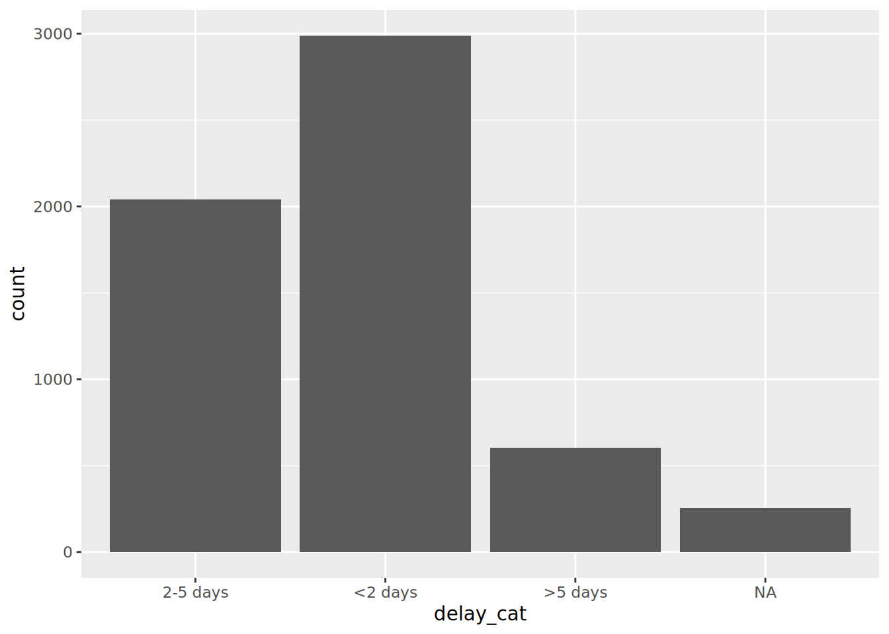
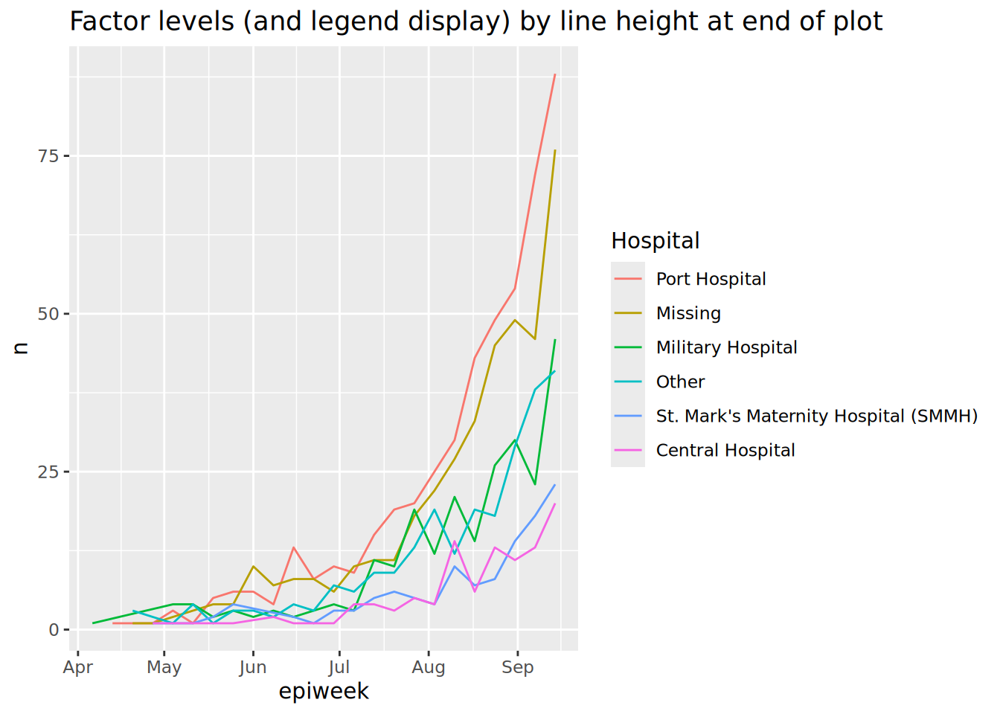
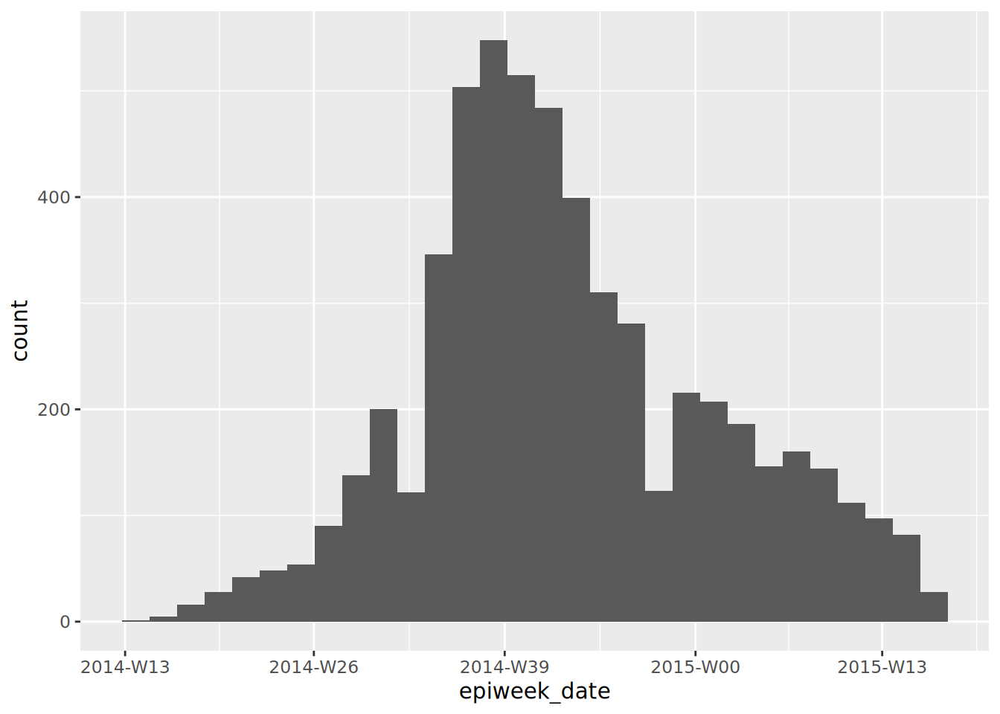

# 11  Faktörler

[](../../images/factors_1500x500.png)

R’da *faktörler*, sabit, kabul edilebilir değerler kümesiyle sıralı kategorilere izin veren bir veri sınıfıdır.

Tipik olarak, değerleri (“*levels*”), grafik ve tablolarda alfabetik olmayan bir şekilde görüntülenebilmeleri için özel bir sıralamaya tabi tutmak isterseniz bir sütunu karakter veya sayısal sınıftan bir faktöre dönüştürmeniz gerekir. Faktörlerin diğer bir yaygın kullanımı, belirli değerler verilerde geçici olarak bulunmadığında dalgalanmamaları için grafik açıklamalarını standart hale getirmektir.

Bu sayfa, **forcats** (“**for** ve **kat**egorik değişkenler” için kısa bir ad) paketi ve bazı R tabanındaki fonkisyonların kullanımını göstermektedir. Epidemiyolojik haftalarla ilgili özel faktör vakaları için **lubridat** ve **aweek** kullanımına da değiniyoruz.

**forcats** fonksiyonlarının tam listesi çevrimiçi olarak [burada](https://forcats.tidyverse.org/reference/index.html) bulunabilir. Aşağıda en yaygın olanlardan bazılarını gösteriyoruz.

## 11.1 Hazırlık

### Paketlerin yüklenmesi

Aşağıdaki kod parçası, analizler için gereken paketlerin yüklenmesini göstermektedir. Bu el kitabında, gerekirse paketi kuran *ve* kullanım için yükleyen **pacman**’dan `p_load()` vurgulamaktayız. R tabanından `library()` ile kurulu paketleri de yükleyebilirsiniz. R paketleri hakkında daha fazla bilgi için [R temelleri](basics.llms.md) sayfasına bakın.

``` r
pacman::p_load(
  rio,           # içe/dışa aktar
  here,          # dosya yolu
  lubridate,     # tarihlerle çalışma
  forcats,       # faktörler
  aweek,         # otomatik faktör seviyeleri ile epiweeks oluştur
  janitor,       # tablolar
  tidyverse, # data yönetim ve görselleştirmesi
  appliedepidata # bu el kitabında kullanılan örnek veriler
  )
```

### Veriyi içe aktarma

Simüle edilmiş bir Ebola salgınına ait vakaların veri setini içe aktarıyoruz. Doğrudan `appliedepidata::get_data(name = "linelist_cleaned_rds")` ile yükleyin (ayrıntılar için [El kitabı ve veri indirme](download.llms.md) sayfasına bakın).

``` r
# veri setini indir
linelist <- appliedepidata::get_data(name = "linelist_cleaned_rds")
```

### Yeni kategorik değişken

Bu sayfada gösterim için ortak bir senaryo kullanacağız - yeni bir kategorik değişkenin oluşturulması.

Sayısal bir sütunu sınıf faktörüne dönüştürürseniz, bunun üzerinde sayısal istatistikleri hesaplayamayacağınızı unutmayın.

#### Sütun oluşturma

Biz, mevcut `days_onset_hosp` sütununu (semptom başlangıcından hastaneye kabule kadar geçen gün) kullanarak her satırı birkaç kategoriden birine sınıflandırıp yeni bir `delay_cat` sütunu oluşturuyoruz. Bunu, her satıra sırayla mantıksal ölçütleri (sağ taraf) uygulayan ve yeni `delay_cat` sütununa karşılık gelen sol taraf değerini döndüren, **dplyr** paktenin fonksiyonu `case_when()` ile yapıyoruz. [Temizleme verileri ve temel işlevler](cleaning.llms.md) bölümünde `case_when()` hakkında daha fazla bilgi edinebilirsiniz.

``` r
linelist <- linelist %>% 
  mutate(delay_cat = case_when(
    # criteria                                   # eğer doğruysa yeni değer
    days_onset_hosp < 2                        ~ "<2 days",
    days_onset_hosp >= 2 & days_onset_hosp < 5 ~ "2-5 days",
    days_onset_hosp >= 5                       ~ ">5 days",
    is.na(days_onset_hosp)                     ~ NA_character_,
    TRUE                                       ~ "Check me"))  
```

#### Varsayılan değer sırası

`case_when()` ile oluşturulduğu gibi, yeni `delay_cat` sütunu, karakter sınıfının kategorik bir sütunudur - *henüz bir faktör değildir*. Bu nedenle, bir sıklık tablosunda, benzersiz değerlerin varsayılan bir alfa-numerik düzende sıralandığını görüyoruz - bu, sezgisel olarak pek mantıklı olmayan bir sıradır:

``` r
table(linelist$delay_cat, useNA = "always")
```


     <2 days  >5 days 2-5 days     <NA> 
        2990      602     2040      256 

Benzer şekilde, bir çubuk grafiği yaparsak, değerler de x ekseninde bu sırayla görünür (R’deki en yaygın görselleştirme paketi olan **ggplot2** hakkında daha fazla bilgi için \[ggplot temelleri\] sayfasına bakın).

``` r
ggplot(data = linelist)+
  geom_bar(mapping = aes(x = delay_cat))
```

[](factors_files/figure-html/unnamed-chunk-7-1.png)

## 11.2 Faktöre dönüştürme

Bir karakteri veya sayısal sütunu *faktör* sınıfına dönüştürmek için, **forcats** paketindeki herhangi bir fonksiyonu kullanabilirsiniz (birçoğu [aşağıda](#fct_adjust) ayrıntılı olarak verilmiştir). Bu fonksiyonlarla veriler sınıf faktörüne dönüşecek ve daha sonra seviyelerin belirli şekilde sıralanmasını gerçekleşecek veya buna izin verilecek - örneğin `fct_relevel()` kullanmak seviye sırasını manuel olarak belirlemenizi sağlar. `as_factor()` fonksiyonu, başka bir özellik eklemeden sınıfı basitçe dönüştürür.

R tabanı fonksiyonu olan `factor()`, bir sütunu faktöre dönüştürür ve seviyelerin sırasını `levels =` argümanına bir karakter vektörü olarak vererek manuel olarak belirlemenizi sağlar.

Aşağıda, `delay_cat` sütununu sınıf karakterinden sınıf faktörüne dönüştürmek için `mutate()` ve `fct_relevel()` kullanıyoruz. `delay_cat` sütunu, yukarıdaki [Hazırlık](#fct_newcat) bölümünde oluşturulmuştur.

``` r
linelist <- linelist %>%
  mutate(delay_cat = fct_relevel(delay_cat))
```

*Bu sütundaki benzersiz “değerler” artık faktörün “seviyeleri” olarak kabul edilir.* Seviyelerin bir *sırası* vardır; bu sıra R tabanı fonksiyonu `levels()` ile yazdırılabilir veya alternatif olarak R tabanındaki `table()` ya da **janitor** paketindeki `tabyl()` ile bir sayım tablosunda görüntülenebilir. Varsayılan olarak seviyelerin sırası, önceden olduğu gibi alfanümerik olacaktır. `NA`’nın bir faktör seviyesi olmadığını unutmayın.

``` r
levels(linelist$delay_cat)
```

    [1] "<2 days"  ">5 days"  "2-5 days"

`fct_relevel()` fonksiyonu, seviye sırasını manuel olarak belirlemenize izin veren ek bir özelliğe sahiptir. Düzey değerlerini, aşağıda gösterildiği gibi virgülle ayırarak sırayla, tırnak içinde yazmanız yeterlidir. Yazımın değerlerle tam olarak eşleşmesi gerektiğini unutmayın. Verilerde mevcut olmayan düzeyler oluşturmak istiyorsanız, bunun yerine [`fct_expand()` kullanın](#fct_add)).

``` r
linelist <- linelist %>%
  mutate(delay_cat = fct_relevel(delay_cat, "<2 days", "2-5 days", ">5 days"))
```

Artık seviyelerin bir önceki komutta belirtildiği gibi mantıklı bir sırayla sıralandığını görebiliriz.

``` r
levels(linelist$delay_cat)
```

    [1] "<2 days"  "2-5 days" ">5 days" 

Şimdi grafikteki sıralama da daha sezgisel bir anlam ifade ediyor.

``` r
ggplot(data = linelist)+
  geom_bar(mapping = aes(x = delay_cat))
```

[](factors_files/figure-html/unnamed-chunk-12-1.png)

## 11.3 Seviye ekleme ve çıkarma

### Ekleme

Bir faktöre seviye eklemeniz gerekiyorsa, bunu `fct_expand()` ile yapabilirsiniz. Sütun adını ve ardından yeni seviyeleri (virgülle ayırarak) yazmanız yeterlidir. Değerleri tablolaştırarak yeni seviyeleri ve sıfır sayılarını görebiliriz. R tabanından `table()`ı veya **janitor**’dan `tabyl()` kullanabilirsiniz:

``` r
linelist %>% 
  mutate(delay_cat = fct_expand(delay_cat, "Not admitted to hospital", "Transfer to other jurisdiction")) %>% 
  tabyl(delay_cat)   # print table
```

                          delay_cat    n    percent valid_percent
                            <2 days 2990 0.50781250     0.5308949
                           2-5 days 2040 0.34646739     0.3622159
                            >5 days  602 0.10224185     0.1068892
           Not admitted to hospital    0 0.00000000     0.0000000
     Transfer to other jurisdiction    0 0.00000000     0.0000000
                               <NA>  256 0.04347826            NA

Not: Eksik değerleri (`NA`) seviyelere kolayca eklemek için özel bir **forcats** fonksiyonu mevcuttur. Aşağıdaki [Eksik değerler](#fct_missing) ile ilgili bölüme bakın.

### Çıkarma

`fct_drop()`ı kullanırsanız, sıfır sayımlı “kullanılmayan” seviyeler, seviyeler grubundan çıkarılacaktır. Yukarıda eklediğimiz seviyeler (“Hastaneye kabul edilmedi”) bir seviye olarak mevcuttur, ancak hiçbir satır aslında bu değere sahip değildir. Böylece, faktör sütunumuza `fct_drop()` uygulanarak çıkarılır:

``` r
linelist %>% 
  mutate(delay_cat = fct_drop(delay_cat)) %>% 
  tabyl(delay_cat)
```

     delay_cat    n    percent valid_percent
       <2 days 2990 0.50781250     0.5308949
      2-5 days 2040 0.34646739     0.3622159
       >5 days  602 0.10224185     0.1068892
          <NA>  256 0.04347826            NA

## 11.4 Seviye sırasını düzenleme

**forcats** paketi, faktör düzeylerinin sırasını kolayca ayarlamak için kullanışlı fonksiyonlar da sunar (bir sütun sınıf faktörü olarak tanımlandıktan sonra):

Bu fonksiyonlar, iki bağlamda faktör sütununa uygulanabilir:

1.  Her zamanki gibi veri çerçevesindeki sütuna uygulanır, böylece değişen veriler daha sonra da kullanılabilir
2.  *Bir grafik içine* uygulanabilir, böylece değişiklik sadece grafik içinde kalır

### Elle düzenleme

Bu fonksiyon, faktör seviyelerini manuel olarak sıralamak için kullanılır. Faktör olmayan bir sütunda kullanılırsa, sütun önce sınıf faktörüne dönüştürülür.

Parantez içinde önce faktör sütun adını girin, ardından aşağıdakilerden birini sağlayın:

- Tüm seviyeleri istenen sırada (karakter vektörü `c()` olarak) veya
- Bir seviye ve `after =` argümanı kullanılarak düzeltilmiş sıralama

Burada, (zaten Faktör sınıfı olan) `delay_cat` sütununu yeniden tanımlamaya ve istenen tüm düzey sırasını belirtmeye bir örnek verilmiştir.

``` r
# seviye sırasını yeniden düzenle
linelist <- linelist %>% 
  mutate(delay_cat = fct_relevel(delay_cat, c("<2 days", "2-5 days", ">5 days")))
```

Sadece bir seviyeyi taşımak istiyorsanız, bunu tek başına `fct_relevel()` olarak belirtebilir ve `after =` argümanına hangi sırada olması gerektiğini belirtmek için sayı verebilirsiniz. Örneğin, aşağıdaki komut “\<2 gün” ifadesini ikinci konuma kaydırır:

``` r
# seviye sırasını yeniden düzenle
linelist %>% 
  mutate(delay_cat = fct_relevel(delay_cat, "<2 days", after = 1)) %>% 
  tabyl(delay_cat)
```

### Grafik içinde

**forcats** komutları, veri çerçevesinde veya yalnızca bir grafik içinde seviye sırasını ayarlamak için kullanılabilir. Sütun adını *grafik içinde* `ggplot()`un “sarma” komutunu kullanarak, tersine çevirebilir veya yeniden seviyelendirebilirsiniz. Değişim yalnızca bu grafik için geçerli olacaktır.

Aşağıda, `ggplot()` ile iki grafik oluşturulmuştur (\[ggplot temelleri\] sayfasına bakın). İlkinde, `delay_cat` sütunu, “satır listesi” verisinde olduğu gibi varsayılan düzey sırası ile grafiğin x eksenine eşlenir. İkinci örnekte `fct_relevel()` içine sarılmış ve grafikteki sırası değiştirilmiştir.

``` r
# Alfa-numerik varsayılan sıra - ggplot'ta düzenleme yapılmadı
ggplot(data = linelist)+
    geom_bar(mapping = aes(x = delay_cat))

# ggplot içinde faktör seviyesi düzenlendi
ggplot(data = linelist)+
  geom_bar(mapping = aes(x = fct_relevel(delay_cat, c("<2 days", "2-5 days", ">5 days"))))
```

[](factors_files/figure-html/unnamed-chunk-18-1.png)

[](factors_files/figure-html/unnamed-chunk-18-2.png)

Varsayılan x ekseni başlığının oldukça karmaşık olduğuna dikkat edin - bu başlığı **ggplot2** `labs()` argümanı ile değiştirebilirsiniz.

### Tersine döndürme

Seviye sırasını tersine çevirmek işlemi oldukça yaygındır. Faktörü `fct_rev()` ile sarmanız yeterlidir.

Gerçek faktör seviyelerini değil de *yalnızca* bir grafiğin açıklamasını tersine çevirmek istiyorsanız, bunu `guides()` ile yapabileceğinizi unutmayın (bkz. \[ggplot ipuçları\]).

### Sıklığa göre

Değerleri verilerde görünme sıklığına göre sıralamak için `fct_infreq()` kullanın. Eksik değerler (`NA`), açık bir düzeye dönüştürülmediği sürece otomatik olarak sona eklenir (bkz. [bu bölüm](#fct_missing)). `fct_rev()` ile bir daha sarmalayarak sırayı tersine çevirebilirsiniz.

Bu fonksiyon, aşağıda gösterildiği gibi bir `ggplot()` içinde kullanılabilir.

``` r
# sıklığa göre sırala
ggplot(data = linelist, aes(x = fct_infreq(delay_cat)))+
  geom_bar()+
  labs(x = "Delay onset to admission (days)",
       title = "Ordered by frequency")

# sıralamayı tersine çevir
ggplot(data = linelist, aes(x = fct_rev(fct_infreq(delay_cat))))+
  geom_bar()+
  labs(x = "Delay onset to admission (days)",
       title = "Reverse of order by frequency")
```

[](factors_files/figure-html/unnamed-chunk-19-1.png)

[](factors_files/figure-html/unnamed-chunk-19-2.png)

### Karşılaşmaya göre

Seviye sırasını, ilk satırdan başlayarak verilerdeki karşılaşma sırasına uyacak şekilde ayarlamak için `fct_inorder()` fonksiyonunu kullanın. Bu komut, veri çerçevesindeki verileri `arrange()` fonksiyonu ile düzenledikten sonra faktör sırasını tekrardan ayarlamak için faydalı olacaktır.

### Başka bir sütunun özet istatistiğine göre

Bir sütunun seviyelerini *başka bir sütunun özet istatistiğine* göre sıralamak için `fct_reorder()`yı kullanabilirsiniz. Görsel olarak, bu, çubukların/noktaların grafik boyunca istikrarlı bir şekilde yükseldiği veya alçaldığı hoş grafiklerle sonuçlanabilir.

Aşağıdaki örneklerde, x ekseni `delay_cat` ve y ekseni `ct_blood` (döngü eşiği) sayısal sütunudur. Kutu grafikleri, `delay_cat` grubuna göre CT değeri dağılımını gösterir. Kutu grafiklerini grup medyan CT değerine göre artan sırada sıralamak istiyoruz.

Aşağıdaki ilk örnekte, varsayılan sıra olarak alfa-numerik sırası kullanılır. Kutu çizim yüksekliklerinin karışık olduğunu ve belirli bir sırada olmadığını görebilirsiniz. İkinci örnekte ise, `delay_cat` sütunu (x eksenine eşlenmiştir) `fct_reorder()` içine sarılmıştır, `ct_blood` sütunu ikinci ve `"median"` üçüncü argüman olarak verilmiştir. (`"max"`, `"mean"`, `"min"` vb. de kullanabilirsiniz). Böylece, `delay_cat` seviyelerinin sırası artan medyan CT değerlerini yansıtacaktır. Bu, ikinci grafikte gösterilmektedir - kutu çizimleri yükselecek şekilde yeniden düzenlenmiştir. Açık bir düzeye dönüştürülmediği sürece, “NA”nın (eksik) sonunda nasıl görüldüğüne dikkat edin.

``` r
# kutu grafiği orjinal faktör seviyelerine göre sıralanmıştır
ggplot(data = linelist)+
  geom_boxplot(
    aes(x = delay_cat,
        y = ct_blood, 
        fill = delay_cat))+
  labs(x = "Delay onset to admission (days)",
       title = "Ordered by original alpha-numeric levels")+
  theme_classic()+
  theme(legend.position = "none")


# kutu grafiği medyan CT düzeylerine göre sıralanmıştır
ggplot(data = linelist)+
  geom_boxplot(
    aes(x = fct_reorder(delay_cat, ct_blood, "median"),
        y = ct_blood,
        fill = delay_cat))+
  labs(x = "Delay onset to admission (days)",
       title = "Ordered by median CT value in group")+
  theme_classic()+
  theme(legend.position = "none")
```

[](factors_files/figure-html/unnamed-chunk-20-1.png)

[](factors_files/figure-html/unnamed-chunk-20-2.png)

Yukarıdaki örnekte, `ggplot()` komutundan önce gerekli hiçbir adım olmadığına dikkat edin - gruplama ve hesaplamaların tümü dahili olarak ggplot komutunda yapılır.

### “Son” değere göre

Gruplandırılmış çizgi grafiklerinde `fct_reorder2()`, düzeylerin (ve dolayısıyla *açıklamanın*) grafik “sonu” çizgilerin dikey sıralamasıyla hizalandırırr. Teknik olarak konuşursak, “en büyük x değerleriyle ilişkili y değerlerine göre sıralanır.”

Örneğin, zaman içinde hastaneye göre vaka sayılarını gösteren satırlarınız varsa, `aes()` içindeki `color =` argümanına `fct_reorder2()` komutunu uygulayabilirsiniz. Öyle ki açıklamada görünen hastanelerin dikey sırası grafik sonundaki satır sırasıyla hizalanır. [Çevrimiçi belgelerde](https://forcats.tidyverse.org/reference/fct_reorder.html) daha fazlasını okuyuabilirsiniz.

``` r
epidemic_data <- linelist %>%         # satır listesiyle başla   
    filter(date_onset < as.Date("2014-09-21")) %>%    # görsel netlik için son tarih
    count(                                            # haftalık ve hastaneye göre vaka sayılarını al
      epiweek = lubridate::floor_date(date_onset, "week"),  
      hospital                                            
    ) 
  
ggplot(data = epidemic_data)+                       # grafiği başlat
  geom_line(                                        # çizgileri hazırla
    aes(
      x = epiweek,                                  # x-axis epiweek
      y = n,                                        # boyu haftalık vaka sayısıdır
      color = fct_reorder2(hospital, epiweek, n)))+ # veriyi, grafik sonu yüksekliği ve hastaneye göre gruplandırılıp renklendir
  labs(title = "Factor levels (and legend display) by line height at end of plot",
       color = "Hospital")                          # başlığı değiştir
```

[](factors_files/figure-html/unnamed-chunk-21-1.png)

## 11.5 Eksik değerler

Faktör sütununuzda `NA` değerleri varsa, bunları `fct_explicit_na()` ile kolayca “Eksik” gibi adlandırılmış bir düzeye dönüştürebilirsiniz. `NA` değerleri, sıralamanın sonunda varsayılan olarak “(Eksik)” değerine dönüştürülür. Seviye adını `na_level =` argümanıyla ayarlayabilirsiniz.

Aşağıda, bu işlem `delay_cat` sütununda ’NA’ları “Missing delay”e dönüştürür. Bu, `tabyl()` ile bir tabloya yazdırılır.

``` r
linelist %>% 
  mutate(delay_cat = fct_na_value_to_level(delay_cat, level = "Missing delay")) %>% 
  tabyl(delay_cat)
```

         delay_cat    n    percent
          2-5 days 2040 0.34646739
           <2 days 2990 0.50781250
           >5 days  602 0.10224185
     Missing delay  256 0.04347826

## 11.6 Seviyeleri birleştirme

### Elle düzenleme

Seviye göstergelerini `fct_recode()` ile manuel olarak ayarlayabilirsiniz. Bu, **dplyr** fonksiyonu `recode()` gibidir (bkz. \[Temizleme verileri ve temel işlevler\]), farklı olarak yeni faktör seviyelerinin oluşturulmasına izin verir. Bir faktörde basit `recode()`komutunu kullanırsanız, önceden izin verilen seviyeler ayarlanmadıkça yeni kodlanmış değerler reddedilecektir.

Bu araç, yeniden kodlanmış değeri birden çok seviyeye atayarak seviyeleri “birleştirmek” için de kullanılabilir. Sadece bilgileri kaybetmemeye dikkat edin! Bu birleştirme adımlarını yeni bir sütunda yapmayı düşünün (mevcut sütunun üzerine yazmayın).

`fct_recode()`, `recode()`dan farklı bir sözdizimine sahiptir. `recode()`, `ESKİ = YENİ`yi kullanırken, `fct_recode()`, `YENİ = ESKİ`yi kullanır.

Geçerli `delay_cat` seviyeleri şunlardır:

``` r
levels(linelist$delay_cat)
```

    [1] "<2 days"  "2-5 days" ">5 days" 

Yeni düzeyler, `fct_recode(column, "new" = "old", "new" = "old", "new" = "old")` sözdizimi kullanılarak oluşturulur ve yazdırılır:

``` r
linelist %>% 
  mutate(delay_cat = fct_recode(
    delay_cat,
    "Less than 2 days" = "<2 days",
    "2 to 5 days"      = "2-5 days",
    "More than 5 days" = ">5 days")) %>% 
  tabyl(delay_cat)
```

            delay_cat    n    percent valid_percent
     Less than 2 days 2990 0.50781250     0.5308949
          2 to 5 days 2040 0.34646739     0.3622159
     More than 5 days  602 0.10224185     0.1068892
                 <NA>  256 0.04347826            NA

Burada seviyeler `fct_recode()` ile manuel olarak birleştirilirler. “5 günden az” yeni bir düzeyin oluşturulmasında herhangi bir hata olmadığını unutmayın.

``` r
linelist %>% 
  mutate(delay_cat = fct_recode(
    delay_cat,
    "Less than 5 days" = "<2 days",
    "Less than 5 days" = "2-5 days",
    "More than 5 days" = ">5 days")) %>% 
  tabyl(delay_cat)
```

            delay_cat    n    percent valid_percent
     Less than 5 days 5030 0.85427989     0.8931108
     More than 5 days  602 0.10224185     0.1068892
                 <NA>  256 0.04347826            NA

### “Diğerine” indirgeme

Faktör seviyelerini bir “Diğer” seviyeye manuel olarak atamak için `fct_other()` komutunu kullanabilirsiniz. Aşağıda, “Port Hospital” ve “Central Hospital” dışındaki “hospital” sütunundaki tüm seviyeler “Other Hospital” olarak birleştirilmiştir. `keep =` veya `drop =` için bir vektör sağlayabilirsiniz. “Diğer” düzeyinin görünümünü `other_level =` ile değiştirebilirsiniz.

``` r
linelist %>%    
  mutate(hospital = fct_other(                      # adjust levels
    hospital,
    keep = c("Port Hospital", "Central Hospital"),  # keep these separate
    other_level = "Other Hospital")) %>%            # All others as "Other Hospital"
  tabyl(hospital)                                   # print table
```

             hospital    n    percent
     Central Hospital  454 0.07710598
        Port Hospital 1762 0.29925272
       Other Hospital 3672 0.62364130

### Frekansa göre indirgeme

`fct_lump()` kullanarak az görülen faktör düzeylerini otomatik olarak birleştirebilirsiniz.

Birçok düşük frekans düzeyini bir “Diğer” grubuna “toplamak” için aşağıdakilerden birini yapın:

- Tutmak istediğiniz grup sayısını `n =` olarak ayarlayın. En çok görülen n seviyeleri tutulacak ve diğerlerinin tamamı “Diğer” olarak birleştirilecektir.
- “prop =” değerini, üzerinde tutmak istediğiniz seviyeler için eşik frekans oranı olarak ayarlayın. Diğer tüm değerler “Diğer” olarak birleşecektir.

“Diğer” düzeyinin görünümünü `other_level =` ile değiştirebilirsiniz. Aşağıda, en sık rastlanan iki hastane dışındaki tüm hastaneler “Other Hospital” olarak birleştirilmiştir.

``` r
linelist %>%    
  mutate(hospital = fct_lump(                      # seviyeleri düzenle
    hospital,
    n = 2,                                          # ilk 2 seviyeyi tut
    other_level = "Other Hospital")) %>%            # geri kalanını "Other Hospital" olarak tanımla
  tabyl(hospital)                                   # tabloyu yazdır
```

           hospital    n   percent
            Missing 1469 0.2494905
      Port Hospital 1762 0.2992527
     Other Hospital 2657 0.4512568

## 11.7 Tüm seviyeleri gösterme

Faktörleri kullanmanın bir diğer faydası da, bir veri kümesinde gerçekte hangi değerlerin mevcut olduğuna bakılmaksızın, grafik açıklamalarının ve tabloların görünümünü standart hale getirmesidir.

Çok sayıda grafik hazırlıyorsanız (örneğin, birden fazla idari bölge için), veri tamlığı veya veri kompozisyonu değişen seviyelerde olsa bile gösterge ve tabloların aynı görünmesini isteyeceksiniz.

### Grafiklerde

Bir `ggplot()` grafiğinde, ilgili `scale_xxxx()` fonksiyonuna “drop = FALSE” argümanını eklemeniz yeterlidir. Verilerde bulunup bulunmadıklarına bakılmaksızın tüm faktör seviyeleri görüntülenecektir. Faktör sütun seviyeleriniz `fill =` kullanılarak görüntüleniyorsa, o zaman `scale_fill_discrete()` içine aşağıda gösterildiği gibi `drop = FALSE` değerini eklersiniz. Seviyeleriniz `x =` (x eksenine göre) `color =` veya `size =` ile görüntüleniyorsa, bunu `scale_color_discrete()` veya `scale_size_discrete()` argümanlarıyla sağlayabilirsiniz.

Aşağıdaki örnek, hastaneye göre yaş kategorisine ait çubuk grafiğidir. `scale_fill_discrete(drop = FALSE)` eklenmesi, verilerde mevcut olmasa bile tüm yaş gruplarının açıklamada görünmesini sağlar.

``` r
ggplot(data = linelist)+
  geom_bar(mapping = aes(x = hospital, fill = age_cat)) +
  scale_fill_discrete(drop = FALSE)+                        # boş olsa bile tüm verileri açıklamada göster
  labs(
    title = "All age groups will appear in legend, even if not present in data")
```

[](factors_files/figure-html/unnamed-chunk-29-1.png)

### Tablolarda

Hem R tabanında `table()` hem de **janitor**’dan `tabyl()` tüm faktör seviyelerini (kullanılmayan seviyeler bile) gösterecektir.

Bir tablo oluşturmak için **dplyr**’den `count()` veya `summarise()` kullanırsanız, kullanılmamış olanlar da dahil tüm faktör düzeylerini dahil etmek için ‘.drop = FALSE’ bağımsız değişkenini ekleyin.

\[Açıklayıcı tablolar\] sayfasında, [scale_discrete belgelerinde](https://ggplot2.tidyverse.org/reference/scale_discrete.html) veya [count() belgelerinde](https://dplyr.%20tidyverse.org/reference/count.html). \[Bulaşıcı takibi\] sayfasında başka bir örnek görebilirsiniz.

## 11.8 Epiweeks

Lütfen \[Gruplama verileri\] sayfasında epidemiyolojik haftaların nasıl oluşturulacağına ilişkin kapsamlı tartışmaya bakın.

Epidemiyolojik haftaların nasıl oluşturulacağı ve biçimlendirileceğiyle ilgili ipuçları için lütfen \[Tarihlerle çalışma\] sayfasına da bakın.

### Grafiklerde epiweeks

Amacınız bir grafikte görüntülenecek epiweeks oluşturmaksa, bunu \[Gruplama verileri\] sayfasında açıklandığı gibi **lubridate**’nin `floor_date()` ile yapabilirsiniz. Döndürülen değerler YYYY-AA-GG biçiminde Date sınıfında olacaktır. Bu sütunu bir grafik içinde kullanırsanız, tarihler doğal olarak sıralanır; seviyeler veya sınıf Faktörüne dönüştürme konusunda endişelenmenize gerek yoktur. Aşağıdaki başlangıç tarihlerine ait `ggplot()` histogramına bakın.

Bu yaklaşımda, `scale_x_date()` ile bir eksen üzerindeki tarihlerin *görüntülenmesini* ayarlayabilirsiniz. Daha fazla bilgi için \[Salgın eğrileri\] ile ilgili sayfaya bakın. `scale_x_date()` öğesinin ‘date_labels =’ bağımsız değişkenine bir “strptime” görüntüleme biçimi belirleyebilirsiniz. Bu biçimler “%” yer tutucularını kullanır. Yer tutucular \[Tarihlerle çalışma\] sayfasında ele alınmıştır. 4 basamaklı bir yılı temsil etmek için “%Y” ve hafta numarasını temsil etmek için “%W” veya “%U” kullanın (sırasıyla Pazartesi veya Pazar haftaları).

``` r
linelist %>% 
  mutate(epiweek_date = floor_date(date_onset, "week")) %>%  # hafta sütununu oluştur
  drop_na(epiweek_date) %>%                                  # başlangıç tarihi olmayan satırları çıkarın
  ggplot()+                                                  # ggplotu başlat
  geom_histogram(mapping = aes(x = epiweek_date))+           # başlangıç tarihinin histogramı
  scale_x_date(date_labels = "%Y-W%W")                       # tarihlerin gösterimini YYYY-WWw olacak şekilde ayarla
```

[](factors_files/figure-html/unnamed-chunk-30-1.png)

### Verilerde epiweeks

Verileri faktöre çevirmedeki amacınız grafik yapmak *değilse*, bunu iki yoldan yapabilirsiniz:

1.  *Görüntüleme üzerindeki hassas kontrol* için, **lubridate** epiweek sütununu (YYYY-AA-GG) *veri çerçevesinin kendi içinde* istenen görüntüleme formatına (YYYY-WWw) çevirin ve ardından bunu sınıf Faktörüne dönüştürün.

İlk olarak, tarih gösterimini YYYY-AA-GG’den YYYY-Www gösterimine dönüştürmek için R tabanından `format()` komutunu kullanın (bkz. \[Tarihlerle çalışma\] sayfası). Bu süreçte veriler sınıftan karaktere dönüşmüş olacaktır. Ardından, `factor()` ile karakterden tekrar sınıf Factor’a dönüştürün.

``` r
linelist <- linelist %>% 
  mutate(epiweek_date = floor_date(date_onset, "week"),       # epiweeks oluştur (YYYY-AA-GG)
         epiweek_formatted = format(epiweek_date, "%Y-W%W"),  # (YYYY-HHh) formatına dönüştür
         epiweek_formatted = factor(epiweek_formatted))       # faktöre dönüştür

# seviyeleri göster
levels(linelist$epiweek_formatted)
```

     [1] "2014-W13" "2014-W14" "2014-W15" "2014-W16" "2014-W17" "2014-W18"
     [7] "2014-W19" "2014-W20" "2014-W21" "2014-W22" "2014-W23" "2014-W24"
    [13] "2014-W25" "2014-W26" "2014-W27" "2014-W28" "2014-W29" "2014-W30"
    [19] "2014-W31" "2014-W32" "2014-W33" "2014-W34" "2014-W35" "2014-W36"
    [25] "2014-W37" "2014-W38" "2014-W39" "2014-W40" "2014-W41" "2014-W42"
    [31] "2014-W43" "2014-W44" "2014-W45" "2014-W46" "2014-W47" "2014-W48"
    [37] "2014-W49" "2014-W50" "2014-W51" "2015-W00" "2015-W01" "2015-W02"
    [43] "2015-W03" "2015-W04" "2015-W05" "2015-W06" "2015-W07" "2015-W08"
    [49] "2015-W09" "2015-W10" "2015-W11" "2015-W12" "2015-W13" "2015-W14"
    [55] "2015-W15" "2015-W16"

***TEHLİKE:*** Haftaları yılların önüne koyarsanız (“Www-YYYY”) (“%W-%Y”), varsayılan alfa-numerik sıralaması yanlış olacaktır (ör. 01-2015, 35-2014’ten önce olacaktır). Uzun ve sancılı bir süreçle, sırayı manuel olarak ayarlamanız gerekebilir.

2.  *Hızlı varsayılan görüntüleme* için **aweek** paketini ve `date2week()` fonksiyonunu kullanın. `week_start =` ile haftanın ilk gününü ayarlayabilirsiniz. `factor = TRUE` olarak ayarlarsanız, çıktı sütunu sıralı bir faktör olacaktır. Ek olarak, faktör, o hafta hiç vaka olmasa bile, aralıktaki *tüm* haftalar için seviyeleri içermektedir.

``` r
df <- linelist %>% 
  mutate(epiweek = date2week(date_onset, week_start = "Monday", factor = TRUE))

levels(df$epiweek)
```

**aweek** hakkında daha fazla bilgi için \[Tarihlerle çalışma\] sayfasına bakın. Ayrıca `week2date()` ters fonksiyonu da bu paket içinde mevcuttur.

## 11.9 Kaynaklar

[faktörler ile ilgili Veri Bilimi sayfası için R](https://r4ds.had.co.nz/factors.html)  
[aweek paketi skeci](https://cran.r-project.org/web/packages/aweek/vignettes/introduction.html)
