# 30  ggplot temelleri

[](../../images/ggplot_basics_top.png)

**ggplot2** en popüler veri görselleştirme R paketidir. `ggplot()` fonksiyonu bu paketin merkezindedir ve tüm bu yaklaşım akademik camiada *“ggplot”* olarak; ortaya çıkan grafikler de sevgi dolu bir ifade ile “ggplots” olarak adlandırılır. Bu isimlerdeki “gg”, şekilleri oluşturmak için kullanılan “**g**rammar of **g**raphics” (grafiklerin grameri) kalıbının kısaltmasıdır. **ggplot2**, işlevselliğini daha da artıran pek çok tamamlayıcı R paketlerinden yararlanmaktadır.

Sözdizimi, R tabanındaki fonksiyon ve komutlardan önemli ölçüde farklıdır ve öğrenmesi de bununla ilişkili olarak daha zordur. **ggplot2** fonksiyonlarını doğru kullanabilmek için genellikle, kullanıcılar verilerini, **tidyverse**e yüksek düzeyde uyumlu bir şekilde biçimlendirmek gerekir, bu da bu paketleri birlikte kullanmayı sonuçta çok etkili kılar.

Bu sayfada **ggplot2** ile çizim yapmanın temellerini ele alacağız. Planlarınızın gerçekten güzel görünmesini sağlayacak öneriler ve gelişmiş teknikler için \[ggplot ipuçları\] sayfasına bakabilirsiniz.

Kaynaklar bölümünde bağlantılı birkaç kapsamlı **ggplot2** rehberi bulabilirsiniz. Ayrıca RStudio web sitesinden [ggplot ile veri görselleştirme kopya kağıdını](https://github.com/rstudio/cheatsheets/raw/master/data-visualization-2.1.pdf) indirebilirsiniz. Veri görselleştirmelerinizi daha yaratıcı bir şekilde yaparken birkaç ilham almak isterseniz, [R grafiği galerisi](https://www.r-graph-gallery.com/) ve [Data-to-viz](https://www.data-to-viz.com/caveats.html) gibi web sitelerini incelemenizi öneririz.

## 30.1 Hazırlık

### Paketlerin yüklenmesi

Aşağıdaki bu kod parçası, analizler için gerekli olan paketlerin yüklenmesini gösterir. Bu el kitabında, gerekirse paketi kuran *ve* kullanım için yükleyen **pacman**’dan `p_load()` fonksiyonunu kullanacağız. R tabanından `library()` ile kurulu paketleri de yükleyebilirsiniz. R paketleri hakkında daha fazla bilgi için \[R temelleri\] sayfasına bakabilirsiniz.

``` r
pacman::p_load(
  tidyverse,      # ggplot2 ve diğer veri yönetim paketlerini içerir
  janitor,        # veri temizleme
  ggforce,        # ggplot2'ye ekstra grafik öğeleri ekler
  rio,            # içe / dışa aktarma
  here,           # dosya lokasyonu bulma
  stringr, # metinle çalışmak için
  appliedepidata # bu el kitabında kullanılan örnek veriler
)
```

### Verileri içe aktarma

Örnek için Ebola salgınını simüle vakaların veri setini içe aktaracağız. Doğrudan `appliedepidata::get_data(name = "linelist_cleaned_rds")` ile yükleyin (ayrıntılar için [El kitabı ve veri indirme](download.llms.md) sayfasına bakın).

``` r
linelist <- appliedepidata::get_data(name = "linelist_cleaned_rds")
```

Satır listesinin ilk 50 satırı aşağıda gösterilmiştir. “age” (yaş), “wt_kg” (kilo cinsinden ağırlık), “ct_blood” (CT değerleri) ve “days_onset_hosp” (başlangıç tarihi ile hastaneye yatış arasındaki fark) sürekli değişkenlerine odaklanacağız.

### Genel temizleme

Çizilecek verileri hazırlarken, verilerin mümkün olduğunca [“tidy” veri standartlarına](https://r4ds.had.co.nz/tidy-data.html) uygun düzenlemek gerekir. Bunun nasıl yapılacağı, bu el kitabının \[Verileri temizleme ve temel işlevler\] gibi veri yönetimi sayfalarında ayrıntılı olarak açıklanmıştır.

Verileri çizim için daha iyi hale getirmek için kullanılan bazı basit yollar, verilerin içeriğini görüntüleme için daha iyi hale getirmeyi içerebilir. Bu yolların, veri işlemeyi her zaman daha da kolaylaştıracağı anlamına gelmez. Örneğin:

- Bir karakter sütunundaki `NA` değerlerini “Bilinmeyen” karakter dizesiyle değiştirme  
- Sütunu *faktör* sınıfına çevirerek, değerleri sıralı düzeylere dönüştürme
- Bazı sütunları, alt çizgi vb. içeren “veri dostu” değerlerinin normal metin veya büyük/küçük harfe dönüştürülmesi (bkz. \[Karakterler ve dizeler\])

İşte bu yolların bazı örnekleri:

``` r
# sütunların görüntü sürümünü daha kolay adlara değiştirme
linelist <- linelist %>%
  mutate(
    gender_disp = case_when(gender == "m" ~ "Male",        # m'den Male'e çevirme 
                            gender == "f" ~ "Female",      # f'den Female'e çevirme
                            is.na(gender) ~ "Unknown"),    # NA'dan Unknown'a çevirme
    
    outcome_disp = replace_na(outcome, "Unknown")          # replace NA outcome with "unknown"
  )
```

### Uzun formata döndürme

Veri yapısıyla ilgili olarak, **ggplot2** için genellikle verilerimizi *daha uzun* biçimlere döndürmek isteyebiliriz. Bununla ilgili daha fazla bilgiyi \[Verilerin Pivotlanması\] sayfasında bulabilirsiniz.

[](../../images/pivoting/pivot_longer_new.png)

Örneğin, `linelist`’teki her bir vaka ve ilişkili verilerini “geniş” bir biçimde çizmek istediğimizi varsayalım. Aşağıda, yalnızca `case_id` ve semptomların sütunlarını içeren `symptoms_data` adlı bir mini satır listesi oluşturuyoruz.

``` r
symptoms_data <- linelist %>% 
  select(c(case_id, fever, chills, cough, aches, vomit))
```

Bu mini-satır listesinin ilk 50 satırı aşağıdaki şekilde görünür - her bir semptomun sütunda nasıl “geniş” olarak biçimlendirildiklerini görebilirsiniz:

Spesifik semptomları olan vakaların sayısını çizmek istersek, her semptomun belirli bir sütunda olması gerçeğiyle sınırlıyız. Ancak, semptom sütunlarını aşağıdaki gibi daha uzun bir biçime *pivot*layabiliriz:

``` r
symptoms_data_long <- symptoms_data %>%    # symptoms_data adlı "mini" satır listesiyle başla
  
  pivot_longer(
    cols = -case_id,                       # case_id dışındaki tüm sütunları döndür (tüm belirti sütunları)
    names_to = "symptom_name",             # semptomları içeren yeni sütun için ad ata
    values_to = "symptom_is_present") %>%  # değerleri tutan yeni sütun için ad ata (evet/hayır)
  
  mutate(symptom_is_present = replace_na(symptom_is_present, "unknown")) # NA'yı "unknown"a dönüştür
```

İşte ilk 50 satır. Burada vakaların 5 satırı olduğunu unutmayın - her olası semptom için bir tane. Yeni `symptom_name` ve `symptom_is_present` sütunları, pivotlamanın sonucudur. Bu formatın diğer işlemler için çok yararlı olmayabileceğini, ancak çizim için faydalı olduğunu unutmayın.

## 30.2 ggplot temelleri

**“Grafiklerin grameri” - ggplot2**

**ggplot2** ile çizim, çizim katmanları ve tasarım öğelerinin birbirinin üzerine “eklenmesi” prensibine dayanır. Her komut bir öncekine bir artı sembolü (`+`) ile eklenir. Sonuç, kaydedilebilen, değiştirilebilen, yazdırılabilen, dışa aktarılabilen vb. çok katmanlı bir çizim nesnesidir.

ggplot nesneleri oldukça karmaşık olabilir, ancak katmanların temel sırası genellikle şöyle görünür:

1.  Başta temel `ggplot()` komutuyla başlayın - bu, ggplot fonksiyonunu “açar” ve sonraki işlevlerin “+” ile eklenmesine izin verir. Tipik olarak veri kümesi de bu komutta belirtilir.
2.  “Geom” katmanlarını ekleyin - bu işlevler verileri *geometriler* (*şekiller*) olarak görselleştirir, ör. çubuk grafik, çizgi grafiği, dağılım grafiği, histogram (veya bir kombinasyon!) olarak. Bu işlevlerin tümü, önek olarak “geom\_” ile başlar.
3.  Eksen etiketleri, başlık, yazı tipleri, boyutlar, renk şemaları, göstergeler veya eksen dönüşü gibi tasarım öğelerini çizime ekleyin

Basit bir kod dizilim örneği aşağıdaki gibidir. Her bir bileşeni aşağıdaki bölümlerde açıklayacağız.

``` r
# my_data sütunlarındaki verileri kırmızı noktalar olarak çiz
ggplot(data = my_data)+                   # "my_data" veri kümesini kullan
  geom_point(                             # bir nokta katmanı ekle (noktalar)
    mapping = aes(x = col1, y = col2),    # veri sütununu eksene "haritala"
    color = "red")+                       # geom için diğer özellikler
  labs()+                                 # buraya başlıklar, eksen etiketleri vb. eklenir
  theme()                                 # burada veri olmayan çizim öğelerinin (eksenler, başlık vb.) rengi, yazı tipi, boyutu vb. ayarlanır 
```

## 30.3 `ggplot()`

Herhangi bir ggplot2 grafiğinin açılış komutu `ggplot()` şeklindedir. Bu komut, üzerine katmanların ekleneceği boş bir arka plan oluşturur. Bir `+` sembolü ile ek katmanların eklenmesinin yolunu “açar”.

Tipik olarak, `ggplot()` komutu, çizim için gerekli olan `data =` argümanını içerir. Bu, grafiğin sonraki katmanları için kullanılacak varsayılan veri kümesini ayarlar.

Bu komut, kapanış parantezlerinden sonra bir `+` ile bitecektir. Bu, komutu “açık” bırakır. ggplot yalnızca, tam komut sonunda bir `+` *olmadan* son bir katman içerdiğinde yürütülür/görünür.

``` r
# Bu komut, boş bir arka planı olan bir grafik yaratacaktır.
ggplot(data = linelist)
```

## 30.4 Geomlar

Boş bir arka plan kesinlikle yeterli değildir - verilerden (örneğin çubuk grafikler, histogramlar, dağılım grafikleri, kutu grafikleri) geometriler (şekiller) oluşturmanız gerekir.

Grafikler, ilk `ggplot()` komutuna `geom` katmanları eklenerek yapılır. `Geom` oluşturabilen birçok **ggplot2** fonksiyonu mevcuttur. Bu fonksiyonların her biri `geom_` ile başlar, bu nedenle onlardan genel olarak `geom_XXXX()` olarak bahsedeceğiz. **ggplot2**’de 40’tan fazla geom ve hayranlar tarafından oluşturulmuş daha birçok geom bulunmaktadır. Bunları [ggplot2 galerisinden](https://exts.ggplot2.tidyverse.org/gallery/) görüntüleyebilirsiniz. Bazı yaygın geomlar aşağıda listelenmiştir:

- Histogramlar - `geom_histogram()`  
- Çubuk grafikler - `geom_bar()` yada `geom_col()` ([“Çubuk grafikleri” bölümüne bakabilirsiniz](#ggplot_basics_bars))  
- Kutu grafiği - `geom_boxplot()`  
- Noktalar (örn. dağılım grafikleri) - `geom_point()`  
- Çizgi grafikler - `geom_line()` yada `geom_path()`  
- Trend eğrileri - `geom_smooth()`

Bir çizimde bir veya birden fazla geom görüntüleyebilirsiniz. Her biri önceki **ggplot2** komutlarına bir \`+’ ile eklenir ve sonraki coğrafi konumlar öncekilerin üzerine yerleştirilecek şekilde sırayla çizilir.

## 30.5 Verileri grafiğe eşleme

Çoğu geom fonksiyonunda şekilleri oluştururken *ne için kullanacakları* söylenmelidir - bu nedenle fonksiyonda *verilerinizdeki sütunları* ilgili grafikle eşleştirerek eksenini, şeklini, rengini, boyutunu vb. tanımlamalısınız. vb. Çoğu grafik konum verileri için, eşlenmesi gereken *temel* bileşenler x ekseni ve (gerekirse) y eksenidir.

Bu “eşleme”, `mapping =` argümanıyla gerçekleşir. `mapping` için sağladığınız eşlemeler `aes()` fonksiyonunda sarılmalıdır, bu nedenle aşağıda gösterildiği gibi `mapping = aes(x = col1, y = col2)` şeklinde yazabilirsiniz.

Aşağıda, `ggplot()` komutunda veriler `linelist` durumu olarak ayarlanır. `mapping = aes()` argümanında `age` sütunu x eksenine, `wt_kg` sütunu ise y eksenine eşlenir.

`+` işaretinden sonra çizim komutları devam eder. `geom` fonksiyonu olan `geom_point()` ile bir şekil oluşturulur. Bu geom, yukarıdaki `ggplot()` komutundan eşlemeleri *devralır* - eksen-sütun atamalarını bilir ve bu ilişkileri alan üzerinde *noktalar* olarak görselleştirmeye devam eder.

``` r
ggplot(data = linelist %>% drop_na(age, wt_kg), mapping = aes(x = age, y = wt_kg))+
  geom_point()
```

[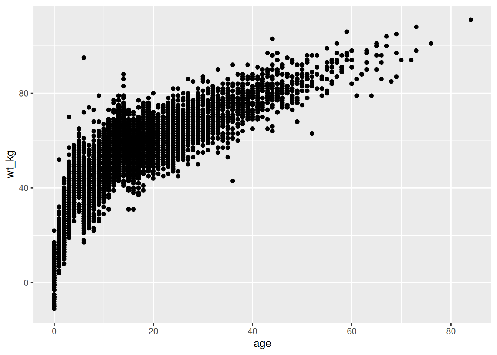](ggplot_basics_files/figure-html/unnamed-chunk-14-1.png)

Başka bir örnek olarak, aşağıdaki komutlar aynı verileri, biraz farklı bir eşlemeyi ve farklı bir geom’u kullanır. `geom_histogram()` fonksiyonu, sayımlar y ekseni otomatik olarak oluşturulduğundan, yalnızca x eksenine eşlenmiş bir sütun gerektirir.

``` r
ggplot(data = linelist %>% drop_na(age), mapping = aes(x = age))+
  geom_histogram()
```

[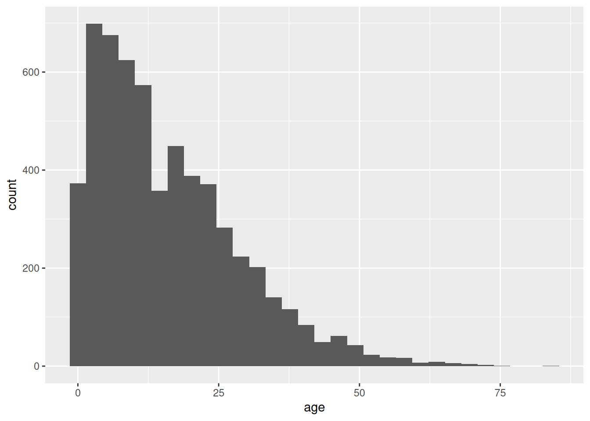](ggplot_basics_files/figure-html/unnamed-chunk-15-1.png)

### Grafik estetiği

ggplot terminolojisinde “estetik” konusunun belirli bir anlamı vardır. Burada estetik, *çizilmiş verinin* görsel bir özelliğini ifade eder. Buradaki “estetik” ifadesinin *geomlarda/şekillerde* çizilen verileri de kapsadığını unutmayın - başlıklar, eksen etiketleri, arka plan rengi gibi genel İngilizcede “estetik” kelimesiyle ilişkilendirebileceğiniz çevredeki görüntü değil. ggplot’ta bu ayrıntılara “temalar” denir ve bir `theme()` komutuyla ayarlanır (bkz. [bu bölüm](#ggplot_basics_themes)).

Bu nedenle, çizim nesnesinin *estetiği*, çizilen verilerin renkleri, boyutları, asetatları, yerleşimi vb. olabilir. Tüm geomlar aynı estetik seçeneklere sahip değildir, ancak çoğu geom tarafından kullanılabilir. İşte bazı örnekler:

- `shape =` Bir noktayı nokta, yıldız, üçgen veya kare olarak `geom_point()` ile gösterme…
- `fill =` İç renk (örneğin bir çubuk veya kutu grafiği)
- `color =` Bir çubuğun, kutu grafiğinin vb. dış çizgisi veya `geom_point()` kullanılıyorsa noktanın rengi
- `size =` Boyut (ör. çizgi kalınlığı, nokta boyutu)
- `alpha =` Şeffaflık (1 = opak, 0 = görünmez)  
- `binwidth =` Histogram bölmelerinin genişliği
- `width =` “Çubuk grafiği” sütunlarının genişliği
- `linetype =` Çizgi türü (ör. düz, kesikli, noktalı)

Bu çizim nesnesi *estetiğine* değerler iki şekilde atanabilir:

1.  Tüm çizilen gözlemlere uygulanacak statik bir değer (ör. \``color = "blue"`) atanması  
2.  Her bir gözlemin görüntülenmesi o sütundaki değerine bağlı olacak şekilde bir veri sütununa (ör. `color = hospital`) atanması

### Statik bir değer ayarlama

Çizim nesnesine ait estetik değerlerin statik olmasını istiyorsanız, yani - verilerdeki her gözlem için aynı olmasını istiyorsanız, atamasını geom içine, ancak herhangi bir `mapping = aes()` ifadesinin *dışına* yazmalısınız. Bu atamalar `size = 1` veya `color = "blue"` gibi görünebilir. İşte iki örnek:

- İlk örnekte, `mapping = aes()`, `ggplot()` komutunun içindedir ve eksenler, verilerdeki yaş ve ağırlık sütunlarına eşlenir. Çizim estetiğindeki `color =`, `size =` ve `alpha =`(saydamlık) parametrelerine statik değerler atanır. Anlaşılır olması için, bu, daha sonra çizim estetiği için farklı değerler alacak başka geom’lar ekleyebileceğiniz için ‘geom_point()’ işlevinde yapılmıştır.
- İkinci örnekte, histogram yalnızca bir sütuna eşlenen x eksenini gerektirmektedir. `binwidth =`, `color =`, `fill =` (iç renk) ve `alpha =` parametreleri geom içinde tekrar statik değerlere ayarlanır.

``` r
# dağılım grafiği
ggplot(data = linelist %>% drop_na(age, wt_kg), mapping = aes(x = age, y = wt_kg))+  # veri ve eksen eşlemesini ayarla
  geom_point(color = "darkgreen", size = 0.5, alpha = 0.2)         # statik nokta estetiğini ayarla

# histogram
ggplot(data = linelist %>% drop_na(age), mapping = aes(x = age))+       # veri ve eksenleri ayarla
  geom_histogram(                # histogramı göster
    binwidth = 7,                # kutuların genişliği
    color = "red",               # sınır çizgi rengi
    fill = "blue",               # kutu iç rengi
    alpha = 0.1)                 # kutu şeffaflığı
```

[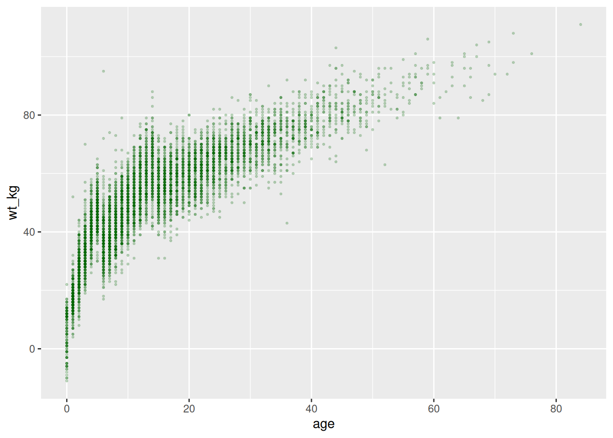](ggplot_basics_files/figure-html/unnamed-chunk-16-1.png)

[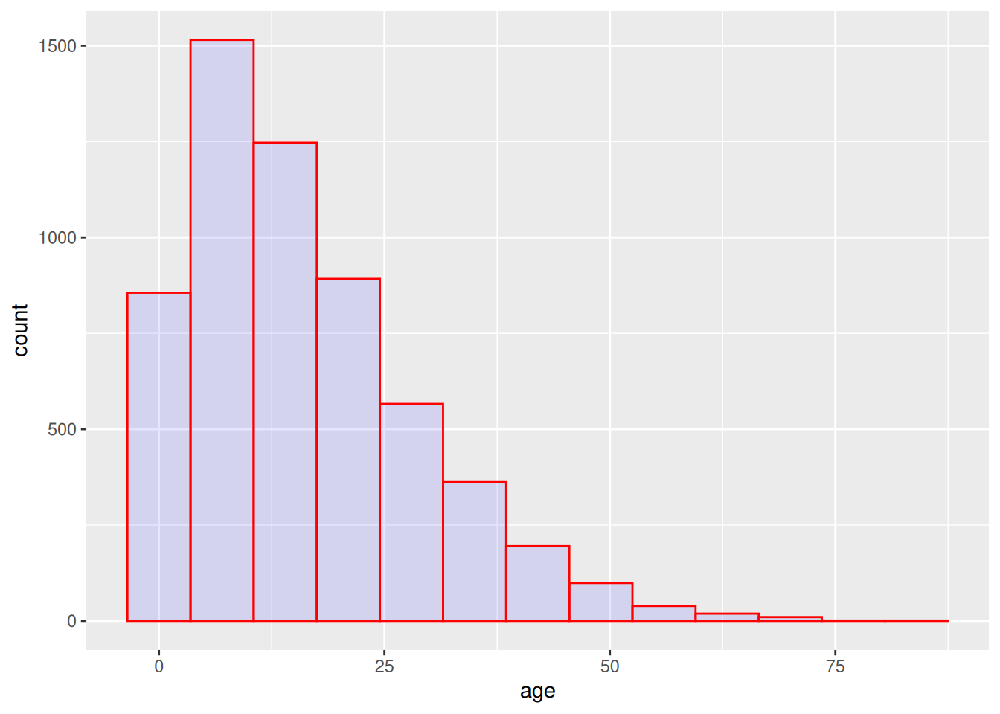](ggplot_basics_files/figure-html/unnamed-chunk-16-2.png)

### Sütun değerlerine ölçekleme

Alternatif olarak, çizim nesnesi estetiğini bir sütundaki değerlerle ölçekleyebiliriz. Bu yaklaşımda, estetiğin görüntüsü, o veri sütunundaki gözlemin değerine bağlı olacaktır. Sütun değerleri sürekli ise, o estetik için görüntü ölçeği de (açıklama) sürekli olacaktır. Sütun değerleri ayrıysa, gösterge her bir değeri görüntüleyecek ve çizilen veriler belirgin bir şekilde “gruplanmış” olarak görünecektirr (bu sayfanın [gruplandırma](#ggplotgroups) bölümünde daha fazlasını okuyabilirsiniz).

Bunu başarmak için, estetiği bir *sütun adına* eşlemeniz gerekmektedir (tırnak içinde değil). Bu eşleme, *`mapping = aes()` fonksiyonu* içinde yapılmalıdır (not: [aşağıda](#ggplot_basics_map_loc) tartışıldığı gibi kodda bu eşleme atamalarını yapabileceğiniz birkaç yer vardır).

İki örnek aşağıda verilmiştir.

- İlk örnekte, `color =` parametresi (her noktanın) `age` sütununa eşlenir - açıklamada bir ölçek belirir! Şimdilik ölçeğin var olduğuna dikkat etmeniz yeterlidir- sonraki bölümlerde nasıl değiştirileceğini paylaşcağız.
- İkinci örnekte, iki yeni çizim estetiği de sütunlarla eşlenir (`color =` ve `size =`), `shape =` ve `alpha =` parametreleri herhangi bir `mapping = aes()` fonksiyonu dışındaki statik değerlere eşlenir.

``` r
# dağılım grafiği
ggplot(data = linelist %>% drop_na(age, wt_kg),   # veri ayarla
       mapping = aes(     # estetiği sütun değerlerine eşle
         x = age,           # x eksenini yaşa eşle          
         y = wt_kg,         # y eksenini ağırlıkla eşle
         color = age)
       )+     # yaşa göre rengi eşle
  geom_point()         # verileri nokta olarak göster

# dağılım grafiği
ggplot(data = linelist %>% drop_na(age, wt_kg),   # veri ayarla
       mapping = aes(     # estetiği sütun değerlerine eşle
         x = age,           # x eksenini yaşa eşle           
         y = wt_kg,         # y eksenini ağırlıkla eşle
         color = age,       # yaşa göre rengi eşle
         size = age))+      # yaşa göre boyutu eşle
  geom_point(             # verileri nokta olarak göster
    shape = "diamond",      # noktalar elmas olarak görüntülenir
    alpha = 0.3)            # nokta şeffaflığı 30%
```

[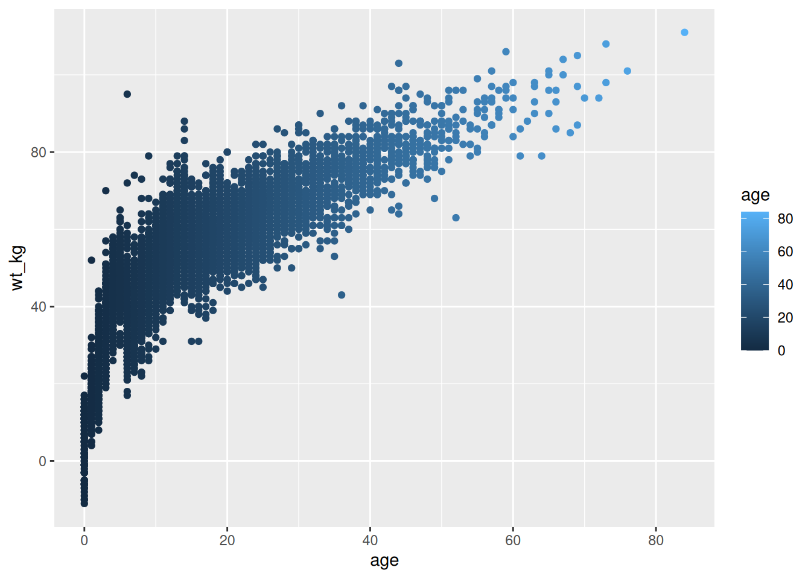](ggplot_basics_files/figure-html/unnamed-chunk-17-1.png)

[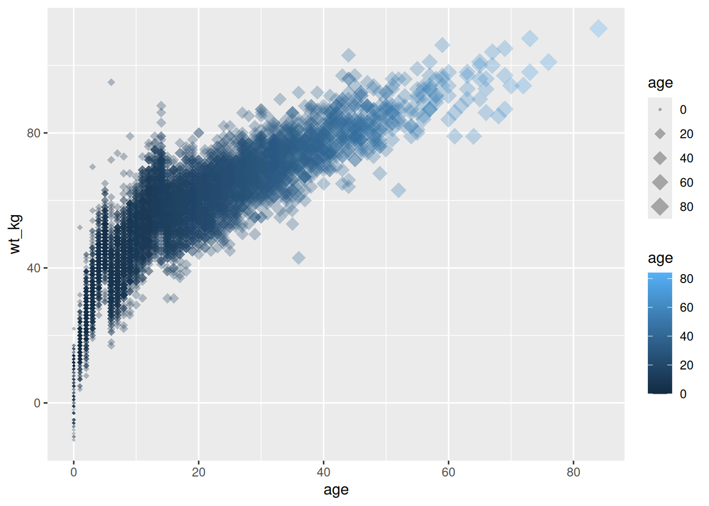](ggplot_basics_files/figure-html/unnamed-chunk-17-2.png)

Not: Eksen atamaları her zaman verilerdeki sütunlara atanır (statik değerlere değil) ve bu her zaman `mapping = aes()` içinde yapılır.

Daha karmaşık grafikler oluştururken çizim katmanlarınızı ve estetiğinizi takip etmek daha da önemli hale gelir - örneğin birden fazla geom içeren grafikler. Aşağıdaki örnekte, `geom_point()` `size = 1` değerini, `geom_smooth()` ise `linewidth = 2` değerini alır. Her ikisi de statik değerdir.

``` r
ggplot(data = linelist %>% drop_na(age, wt_kg),
       mapping = aes(           # estetiği sütunlara eşle
         x = age,
         y = wt_kg,
         color = age_years)
       ) + 
  geom_point(                   # her veri satırı için puan ekle
    size = 1,
    alpha = 0.5) +  
  geom_smooth(                  # trend eğrisi ekle
    method = "lm",              # linear metodla
    linewidth = 2,                   # çizgi genişliği 2
    color = "#3366FF")
```

[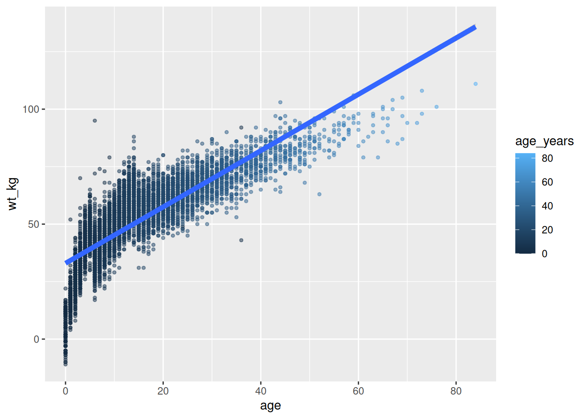](ggplot_basics_files/figure-html/unnamed-chunk-18-1.png)

### Harita atamaları nerede yapılır

`mapping = aes()` içindeki estetik haritalama, çizim komutlarınızda birden fazla kez yazılabilir. Bu argüman, en üstteki `ggplot()` komutuna ve/veya altındaki her bir geoma yazılabilir. Nüanslar şunları içerir:

- En üstteki `ggplot()` komutunda yapılan eşleme atamaları (`x =` ve `y =` öğelerinin nasıl devralındığı gibi atamalar) aşağıdaki herhangi bir geomda varsayılan olarak devralınır.
- Bir geom içinde yapılan eşleme atamaları yalnızca o geom için geçerlidir

Benzer şekilde, en üstteki `ggplot()` içinde belirtilen `data =` aşağıdaki herhangi bir geomda varsayılan olarak geçerli olacaktır, ancak her bir geom için farklı veri de belirtebilirsiniz (ancak bu daha zordur).

Böylece, aşağıdaki komutların her biri aynı grafiği oluşturacaktır:

``` r
# Bu komutlar tam olarak aynı grafiği üretecek
ggplot(data = linelist, mapping = aes(x = age))+
  geom_histogram()

ggplot(data = linelist)+
  geom_histogram(mapping = aes(x = age))

ggplot()+
  geom_histogram(data = linelist, mapping = aes(x = age))
```

### Grouplar

Verileri kolayca gruplayabilir ve “gruba göre çizebilirsiniz”. Aslında, bunu zaten yaptınız!

Bir `mapping = aes()` argümanı içinde “grouping” sütununu uygun çizim estetiğine atayın. Yukarıda, `age` sütununa `size =` argümanını atadığımızda sürekli değerler kullanarak bunu gösterdik. Ancak bu, ayrık/kategorik sütunlar için aynı şekilde çalışır.

Örneğin, puanların cinsiyete göre görüntülenmesini istiyorsanız, `mapping = aes(color = gender)` değerini ayarlamanız gerekmektedir. Otomatik olarak bir açıklama belirir. Bu atama, en üstteki `ggplot()` komutundaki `mapping = aes()` argümanı içinde yapılabilir (ve geom tarafından miras alınabilir) veya geom içinde ayrı bir `mapping = aes()` içinde ayarlanabilir. Aşağıdaki her iki yaklaşım da aşağıda gösterilmiştir:

``` r
ggplot(data = linelist %>% drop_na(age, wt_kg),
       mapping = aes(x = age, y = wt_kg, color = gender))+
  geom_point(alpha = 0.5)
```

[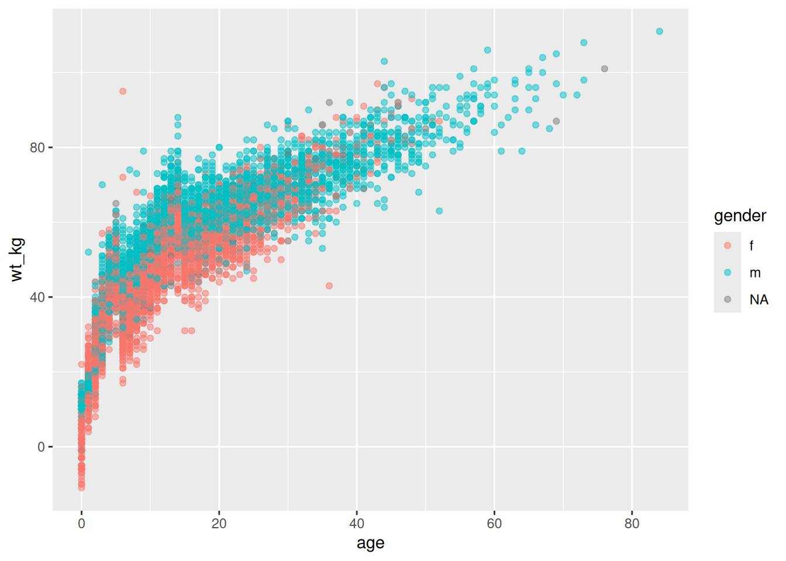](ggplot_basics_files/figure-html/unnamed-chunk-20-1.png)

``` r
# Bu alternatif kod aynı grafiği üretir
ggplot(data = linelist,
       mapping = aes(x = age, y = wt_kg))+
  geom_point(
    mapping = aes(color = gender),
    alpha = 0.5)
```

Geom değerlerine bağlı olarak, verileri gruplamak için farklı argümanlar kullanmanız gerekeceğini unutmayın. `geom_point()` için büyük olasılıkla `color =`, `shape =` veya `size =` kullanacaksınız. Oysa `geom_bar()` için `fill =` argümanını kullanmanız daha olasıdır. Bu sadece geoma ve gruplamaları yansıtmak istediğiniz grafik estetiğine bağlıdır.

Bilginize - verileri gruplandırmanın en temel yolu, yalnızca `mapping = aes()` içindeki `group =` argümanını kullanmaktır. Ancak, bu tek başına renkleri, dolguyu veya şekilleri değiştirmeyecektir. Ayrıca yeni bir açıklama da oluşturmayacaktır. Yine de veriler gruplandırılmıştır, bu nedenle istatistiksel görüntüler etkilenebilir.

Bir grafikteki grupların sırasını ayarlamak için \[ggplot ipuçları\] sayfasına veya \[Faktörler\] sayfasına bakabilirsiniz. Aşağıdaki bölümlerde, sürekli ve kategorik verilerin çizilmesine ilişkin birçok gruplanmış grafik örneği bulunmaktadır.

## 30.6 Yüzeyler / Küçük katlar

Yüzeyler veya “küçük katlar”, bir grafiği, veri grubu başına bir panel (“yüzey”) olacak şekilde çok panelli bir şekle bölmek için kullanılır. Aynı tip çizim, her biri aynı veri setinin bir alt grubunu kullanarak, birden çok kez oluşturulabilir.

Yüzey ekleme, **ggplot2** ile birlikte gelen bir fonksiyondur, bu nedenle model “panellerinin” açıklamaları ve eksenleri otomatik olarak hizalanır. \[ggplot ipuçları\] sayfasında tartışılan ve tamamen farklı çizimleri (**cowplot** ve **patchwork**) tek bir şekilde birleştirmek için kullanılan başka paketler de vardır.

Yüzey ekleme, aşağıdaki **ggplot2** işlevlerinden biriyle yapılır:

1.  `facet_wrap()` *tek* değişkenin her düzeyine ait farklı bir panel oluşturmak için kullanılır. Örnek olarak, bir bölgedeki her hastane için farklı bir salgın eğrisi gösteriyor olabilir. Değişken, tanımlanmış başka bir sıralamaya sahip bir faktör olmadığı sürece, yönler alfabetik olarak sıralanır.

- Yüzeylerin düzenini belirlemek için belirli seçenekleri çağırabilirsiniz, örn. Yönlü grafiklerin düzenlendiği satır veya sütun sayısını kontrol etmek için `nrow = 1` veya `ncol = 1`.

2.  `facet_grid()` yüzey düzenlemesine ikinci bir değişken getirmek istediğinizde kullanılır. Burada her bir alan, *iki sütundaki* değerler arasındaki kesişimi gösterir. Örneğin, her bir hastane-yaş grubu için salgın eğrileri, hastaneler üstte (sütunlar) ve yaş grupları yanda (sıralar) bulunur.

- alt gruplar bir dizilimde gösterildiğinden `nrow` ve `ncol` ile alakalı değildir

Bu fonksiyonların her biri, yüzey eklemek için sütunları belirten bir söz dizimini kabul eder. Her ikisi de bir tilde `~` işaretinin her iki tarafında birer tane olmak üzere en fazla iki sütunu kabul eder.

- `facet_wrap()` için genellikle, `facet_wrap(~hospital)` gibi önüne bir tilde (`~`) gelen sütunun adını yazarsınız. Ancak iki sütunu `facet_wrap(outcome ~ hospital)` şeklinde yazabilirsiniz - her benzersiz kombinasyon ayrı bir panelde görüntülenecektir. Ancak bir dizilim halinde düzenlenmeyecektir. Başlıklar birleşik terimleri gösterecek ve bunlar sütunlara karşılık satırları özel olarak göstermeyecektir. Yalnızca bir yönlü değişken sağlıyorsanız, formülün diğer tarafında yer tutucu olarak nokta `.` kullanabilirsiniz - aşağıdaki kod örneklerine bakın.

- `facet_grid()` için formülde bir veya iki sütun da belirtebilirsiniz (dizilim ‘satırlar ~ sütunlar’ şeklindedir). Yalnızca birini belirtmek istiyorsanız, tildenin diğer tarafına `facet_grid(. ~ hospital)` veya `facet_grid(hospital ~ .)` gibi bir nokta `.` koyabilirsiniz.

Yüzeyler, hızlı bir şekilde karmaşıklaşabilir - yüzey eklemeyi seçtiğiniz her bir değişkenin çok fazla düzeye sahip olmadığından emin olmalısınız. Tesislerin yaş grubuna göre günlük sıtma vaka sayılarından oluşan sıtma veri seti ile ilgili bazı hızlı örnekler aşağıdadır (bkz. \[El kitabı ve verileri indirme\]).

Aşağıda, basit örnek için bazı değişiklikleri içe aktarıp düzenliyoruz:

``` r
# Bu veriler, tesis-gününe göre günlük sıtma vakası sayılarıdır.
malaria_data <- appliedepidata::get_data(name = "malaria_facility_count_data") %>% # içe aktar
  select(-submitted_date, -Province, -newid)                                 # gereksiz sütunları kaldır
```

Sıtma verilerinin ilk 50 satırı aşağıdadır. `malaria_tot` sütununun yanı sıra yaş grubuna göre sayımları içeren sütunlar olduğunu unutmayın (bunlar ikinci, `facet_grid()` örneğinde kullanılacaktır).

### `facet_wrap()`

`malaria_tot` ve `District` sütunlarına odaklanalım. Şimdilik yaşa özel sayım sütunlarını yok sayabilirsiniz. `malaria_tot` sütununda verilen belirtilen y ekseni yüksekliğinde her gün için bir sütun üreten `geom_col()` ile salgın eğrileri çizeceğiz (veriler zaten günlük sayılardır, bu nedenle `geom_col()` kullanıyoruz - bkz. [aşağıdaki “Çubuk grafiği” bölümü](#ggplot_basics_bars)).

`facet_wrap()` komutunu eklediğimizde, bir tilde ve sonra yüzey üzerinde sütunu tanımlarız (bu durumda `District`). Yaklaşık işaretinin sol tarafına başka bir sütun yerleştirebilirsiniz, - bu her kombinasyon için bir yüzey oluşturacaktır - ancak bunu bunun yerine `facet_grid()` ile yapmanızı öneririz. Bu kullanım örneğinde, “Bölge”nin her benzersiz değeri için bir yüzey oluşturulur.

``` r
# Bölgelere göre yüzeyleri olan bir grafik
ggplot(malaria_data %>% drop_na(malaria_tot), aes(x = data_date, y = malaria_tot)) +
  geom_col(width = 1, fill = "darkred") +       # sayım verilerini sütun olarak çiz
  theme_minimal()+                              # arka plan panellerini basitleştir
  labs(                                         # grafik etiketleri, başlık vb. ekle
    x = "Date of report",
    y = "Malaria cases",
    title = "Malaria cases by district") +
  facet_wrap(~District)                       # yüzeyler oluşturuldu
```

[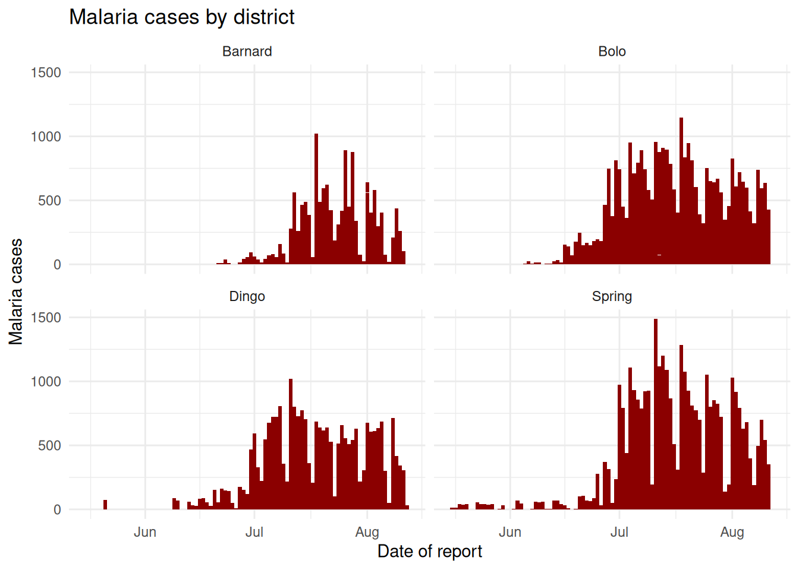](ggplot_basics_files/figure-html/unnamed-chunk-24-1.png)

### `facet_grid()`

İki değişkeni çaprazlamak için `facet_grid()` yaklaşımını kullanabiliriz. Diyelim ki `District` verilerini yaşa göre gruplandırmak istiyoruz. Bu verileri ggplot tarafından tercih edilen “long” formatına sokmak için yaş sütunlarında bazı verileri dönüştürmemiz gerekiyor. Yaş gruplarının hepsinin kendine ait sütunları mevcut - biz onları `age_group` a ve `num_cases` adlı sütunlarda toplamak istiyoruz. Bu işlem hakkında daha fazla bilgi için \[Pivoting data\] sayfasına bakabilirsiniz.

``` r
malaria_age <- malaria_data %>%
  select(-malaria_tot) %>% 
  pivot_longer(
    cols = c(starts_with("malaria_rdt_")),  # sütunları long formatına çevir
    names_to = "age_group",      # sütun adları yaş grubu olacak
    values_to = "num_cases"      # tek bir sütuna sayılar aktarılacak (num_cases)
  ) %>%
  mutate(
    age_group = str_replace(age_group, "malaria_rdt_", ""),
    age_group = forcats::fct_relevel(age_group, "5-14", after = 1))
```

İlk 50 veri satırı aşağıdaki gibi görünmektedir:

İki değişkeni `facet_grid()` öğesine ilettiğinizde, en kolay yöntem, x’in satır ve y’nin sütun olduğu formül gösterimini (örneğin `x ~ y`) kullanmak olacaktır. Burada, `age_group` ve `District` sütunlarının her bir kombinasyonunun çizimlerinde `facet_grid()` kullanılımı gösterilmiştir.

``` r
ggplot(malaria_age %>% drop_na(num_cases), aes(x = data_date, y = num_cases)) +
  geom_col(fill = "darkred", width = 1) +
  theme_minimal()+
  labs(
    x = "Date of report",
    y = "Malaria cases",
    title = "Malaria cases by district and age group"
  ) +
  facet_grid(District ~ age_group)
```

[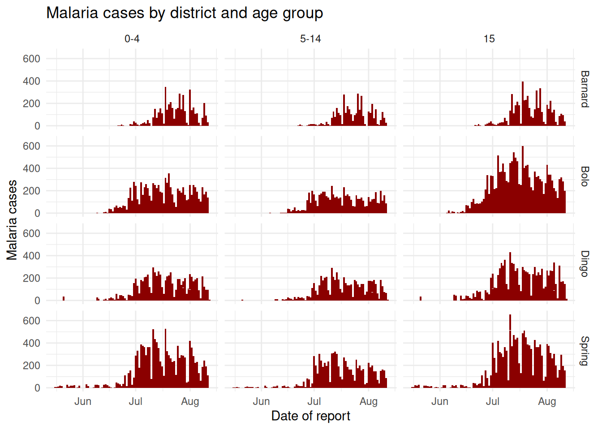](ggplot_basics_files/figure-html/unnamed-chunk-27-1.png)

### Serbest veya sabit eksenler

Yüzey düzenlemesi sırasında görüntülenen eksen ölçekleri, varsayılan olarak tüm yüzeylerde aynıdır (sabit). Bu, çapraz karşılaştırma için yararlıyken her zaman uygun format olmayabilir.

`facet_wrap()` veya `facet_grid()` kullanırken, “serbest” eksenleri belirlemek için `scales = "free_y"` argümanını kullanabilir veya panellerin y eksenlerini veri alt kümelerine uygun bir şekilde ölçeklendirmesi için serbest bırakabiliriz. Bu, özellikle alt kategorilerden biri için gerçek sayıların küçük olması ve eğilimlerin görülmesinin zorlaşması durumunda işe yarayabilir. “free_y” yerine, x eksenini serbest kılmak için (örneğin tarihlerde) “free_x” veya her iki eksen için “free” yazabiliriz. `facet_grid` fonksiyonunda, aynı satırdaki yüzeyler için y ölçeğinin ve aynı sütundaki yüzeyler için x ölçeğinin aynı olacağına dikkat etmelisiniz.

Yalnızca `facet_grid` kullanıldığı durumlarda, `space = "free_y"` veya `space = "free_x"` argümanlarını ekleyebiliriz. Böylece yüzeyin gerçek yüksekliği veya genişliği, içindeki şeklin değerlerine göre ağırlıklandırılır. Bu, yalnızca `scales = "free"` (y veya x) argümanı mevcutsa çalışır.

``` r
# Serbest y ekseni
ggplot(malaria_data %>% drop_na(malaria_tot), aes(x = data_date, y = malaria_tot)) +
  geom_col(width = 1, fill = "darkred") +       # sayım verilerini sütun olarak çiz
  theme_minimal()+                              # arka plan panellerini basitleştir
  labs(                                         # grafik etiketleri, başlık vb. ekle
    x = "Date of report",
    y = "Malaria cases",
    title = "Malaria cases by district - 'free' x and y axes") +
  facet_wrap(~District, scales = "free")        # yüzeyler oluşturuldu
```

[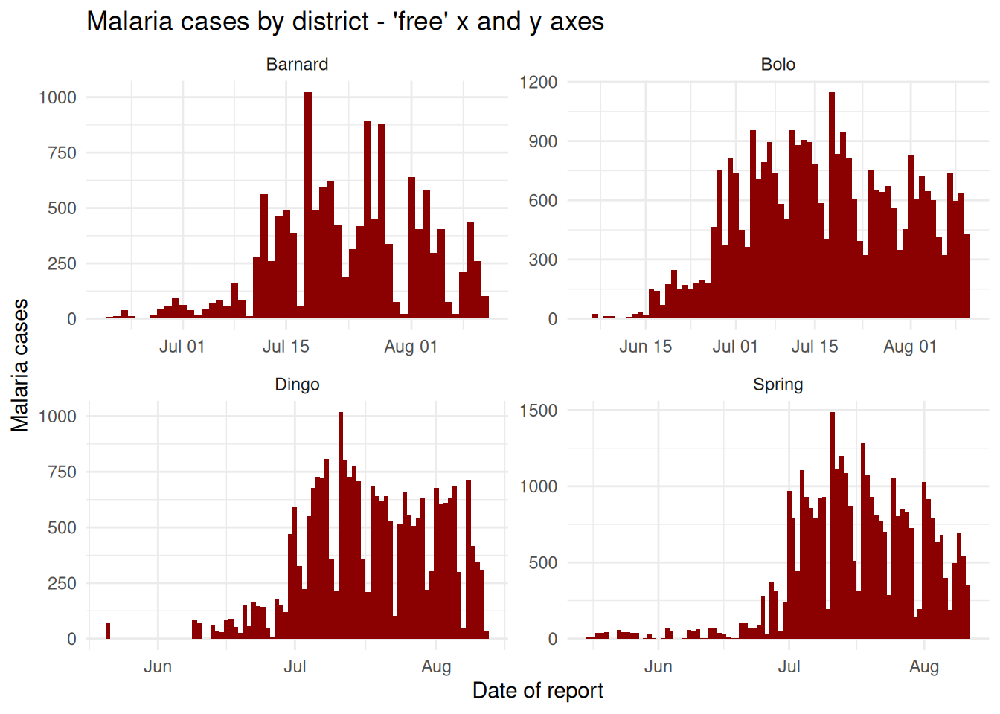](ggplot_basics_files/figure-html/unnamed-chunk-28-1.png)

### Yüzeylerde faktör düzeyi sırası

Faktör seviyelerinin yüzeyler *içinde* nasıl yeniden sıralanacağını öğrenmek için bu [blog yazısına](https://juliasilge.com/blog/reorder-within/) bakabilirsiniz.

## 30.7 Grafikleri depolama

### Grafikleri kaydetme

Varsayılan olarak bir `ggplot()` komutunu çalıştırdığınızda, grafik Plots RStudio bölmesinde görüntülenecektir. Ancak, `<-` atama operatörünü kullanarak ve ona bir isim vererek grafiği bir nesne olarak da kaydedebilirsiniz. Bundan sonra, nesne adının kendisi çalıştırılmadıkça grafik yazdırılmayacaktır. Ek olarak, nesne adını `print()` ile sararak da yazdırabilirsiniz, ancak bu bir kerede birden çok grafiği yazdırmak için kullanılan bir *for döngüsü* gibi belirli durumlarda gereklidir (bkz. \[Yineleme, döngüler ve listeler\] sayfası).

``` r
# grafiği tanımla
age_by_wt <- ggplot(data = linelist %>% drop_na(age_years, wt_kg), mapping = aes(x = age_years, y = wt_kg, color = age_years))+
  geom_point(alpha = 0.1)

# yazdır
age_by_wt    
```

[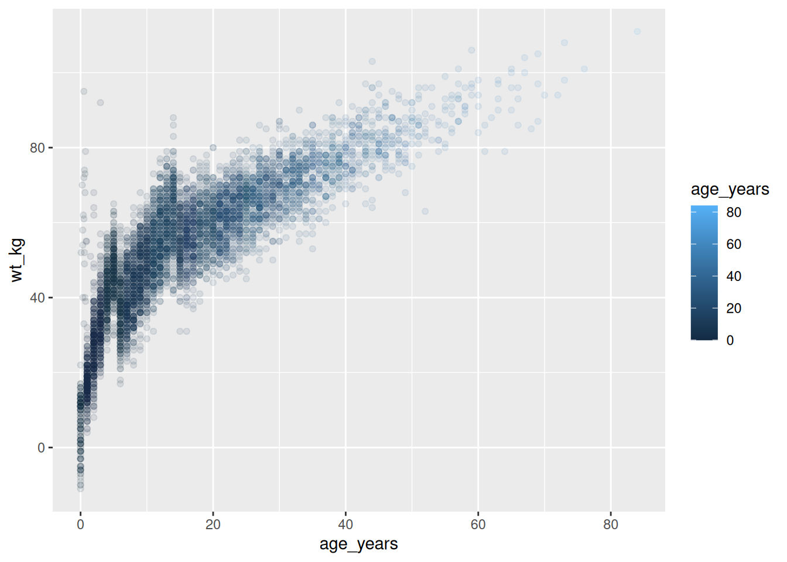](ggplot_basics_files/figure-html/unnamed-chunk-29-1.png)

### Kayıtlı grafikleri değiştirme

**ggplot2** ile ilgili güzel bir şey de, bir grafiği (yukarıdaki gibi) tanımlayabilmeniz ve ardından buna adından başlayarak yeni katmanlar ekleyebilmenizdir. Orijinal grafiği oluşturan tüm komutları tekrarlamanız gerekmez!

Örneğin, yukarıda tanımlanan `age_by_wt` grafiğini 50 yaş sütununda dikey bir çizgi içerecek şekilde değiştirmek için, sadece bir ‘+’ ile ek katmanlar eklemeye başlarız.

``` r
age_by_wt+
  geom_vline(xintercept = 50)
```

[](ggplot_basics_files/figure-html/unnamed-chunk-30-1.png)

### Grafikleri dışa aktarma

**ggplot2**’den `ggsave()` fonksiyonuyla grafikleri dışa kolayca aktarabiliriz. Bunu iki şekilde de yapabiliriz:

- Grafik nesnesinin adını, ardından dosya yolunu ve uzantılı adı belirterek
  - Örnek: `ggsave(my_plot, here("plots", "my_plot.png"))`  
- Yazdırılan son grafiği kaydetmek için komutu bir dosya yolu ile çalıştırarak
  - Örnek: `ggsave(here("plots", "my_plot.png"))`

Dosya yolunda dosya uzantısını tanımlayarak; png, pdf, jpeg, tiff, bmp, svg gibi pek çok formatta dışarı aktarabilirsiniz.

Ayrıca `width =`, `height =` ve `units =` (“in”, “cm” veya “mm”) bağımsız değişkenlerini de tanımlayabilirsiniz. Çizim çözünürlüğü için bir sayı ile `dpi =` argümanını ekleyebilirsiniz (ör. 300). “?ggsave” komutunu girerek veya [çevrimiçi belgeleri](https://ggplot2.tidyverse.org/reference/ggsave.html) okuyarak fonksiyonu daha ayrıntılı inceleyebilirsiniz.

İstediğiniz dosya yolunu sağlamak için `here()` sözdizimini kullanabileceğinizi unutmayın. Daha fazla bilgi için \[İçe ve dışa aktar\] sayfasına bakabilirsiniz.

## 30.8 Etiketler

Elbette grafik etiketlerini eklemek veya ayarlamak isteyeceksiniz. Bunlar en kolay şekilde, tıpkı geom’larda olduğu gibi `+` ile grafiğe eklenen ‘labs()’ fonksiyonu ile düzenlenir.

`labs()` fonksiyonu içinde aşağıdaki argümanları kullanabilirsiniz:

- `x =` ve `y =` x ve y ekseni başlığı (etiketler)
- `title =` Ana grafik başlığı
- `subtitle =` Grafiğin alt başlığı, başlığın altında daha küçük metinle
- `caption =` Grafik başlığı, varsayılan olarak sağ altta

İşte daha önce yaptığımız, ancak daha güzel etiketlerle bir grafik:

``` r
age_by_wt <- ggplot(
  data = linelist %>% drop_na(age, wt_kg),   # veriyi belirle
  mapping = aes(     # estetiği sütun değerlerine eşle
         x = age,           # x eksenini yaşa eşle           
         y = wt_kg,         # y eksenini ağırlıkla eşle
         color = age))+     # rengi yaşla eşle
  geom_point()+           # verileri nokta olarak göster
  labs(
    title = "Age and weight distribution",
    subtitle = "Fictional Ebola outbreak, 2014",
    x = "Age in years",
    y = "Weight in kilos",
    color = "Age",
    caption = stringr::str_glue("Data as of {max(linelist$date_hospitalisation, na.rm=T)}"))

age_by_wt
```

[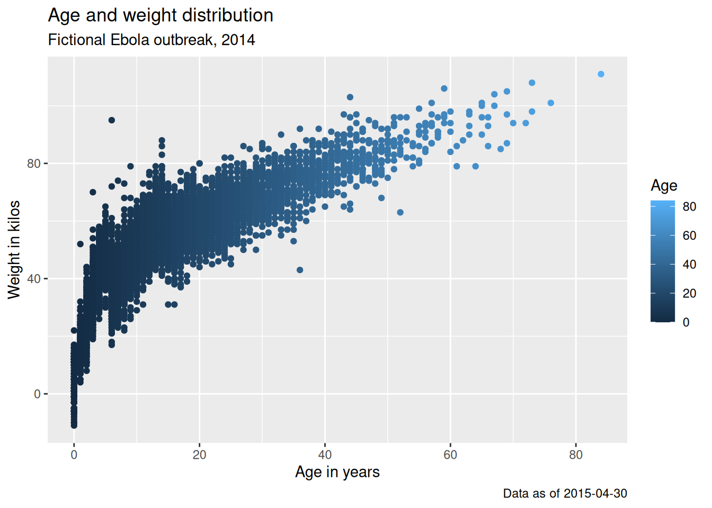](ggplot_basics_files/figure-html/unnamed-chunk-31-1.png)

Dize metnine dinamik R kodunu yerleştirmek için altyazı atamasında **stringr** paketinden `str_glue()` fonksiyonunu nasıl kullandığımıza dikkat edin. Altyazı, satır listesindeki en büyük hastaneye yatış tarihini yansıtan “Data as of:” tarihini gösterecektir. Daha fazla bilgiyi \[Karakterler ve dizeler\] sayfasından okuyabilirsiniz.

*Açıklama* başlığının belirlenmesine ilişkin bir not: Açıklamalarda birden fazla skalanız olabileceğinden, tek bir “açıklama başlığı” argümanı yoktur. `labs()` içinde, açıklamayı oluşturmak için kullanılan çizim estetiğinde gerekli argümanı kullanarak başlığı tanımlayabilirsiniz. Örneğin, açıklama oluşturmak için yukarıda `color = age` argümanını kullandık. Bu nedenle, `labs()` fonksiyonuna `color =` argümanını ekler ve istediğimiz açıklama başlığını yazarız (büyük Y ile “Yaş”). Açıklamayı `aes(fill = COLUMN)` ile oluşturursanız, `labs()` içinde bu açıklamanın başlığını ayarlamak için `fill =` yazmak zorundasınız. \[ggplot ipuçları\] sayfasındaki renk ölçekleriyle ilgili bölüm, açıklamaları düzenleme hakkında daha fazla ayrıntı ve `scales_()` fonksiyonuyla alternatif yaklaşımları içermektedir.

## 30.9 Temalar

**ggplot2**’nin en iyi yanlarından biri, grafik üzerinde sahip olduğunuz kontrol düzeyidir - her şeyi tanımlayabilirsiniz! Yukarıda bahsedilen, veri şekilleri/geometrileri ile ilgili *olmayan* tasarım özellikleri `theme()` fonksiyonu içerisinde düzenlenir. Örneğin, arka plan rengi, kılavuz çizgilerinin varlığı/yokluğu ve metnin yazı tipi/boyutu/renk/hizalaması (başlıklar, alt yazılar, açıklamalar, eksen başlıkları…). Bu düzenlemeler iki yolla yapılabilir:

- Kapsamlı ayarlamalar yapmak için bir [*tam tema*](https://ggplot2.tidyverse.org/reference/ggtheme.html) “theme\_()” fonksiyonu kullanma - örn. `theme_classic()`, `theme_minimal()`, `theme_dark()`, `theme_light()` `theme_grey()`, `theme_bw()`
- `theme()` içinde grafiğin her yönünü ayrı ayrı düzenleme

### Tam temalar

Oldukça basit oldukları için, aşağıda tüm tema işlevlerini göstereceğiz ve burada daha fazla açıklamayacağız. `theme()` ile yapılan tüm mikro ayarlamaların, tam bir tema kullanıldıktan *sonra* yapılması gerektiğini unutmamalısınız.

Bunları boş parantez ile yazınız.

``` r
ggplot(data = linelist %>% drop_na(age, wt_kg), mapping = aes(x = age, y = wt_kg))+  
  geom_point(color = "darkgreen", size = 0.5, alpha = 0.2)+
  labs(title = "Theme classic")+
  theme_classic()

ggplot(data = linelist %>% drop_na(age, wt_kg), mapping = aes(x = age, y = wt_kg))+  
  geom_point(color = "darkgreen", size = 0.5, alpha = 0.2)+
  labs(title = "Theme bw")+
  theme_bw()

ggplot(data = linelist %>% drop_na(age, wt_kg), mapping = aes(x = age, y = wt_kg))+  
  geom_point(color = "darkgreen", size = 0.5, alpha = 0.2)+
  labs(title = "Theme minimal")+
  theme_minimal()

ggplot(data = linelist %>% drop_na(age, wt_kg), mapping = aes(x = age, y = wt_kg))+  
  geom_point(color = "darkgreen", size = 0.5, alpha = 0.2)+
  labs(title = "Theme gray")+
  theme_gray()
```

[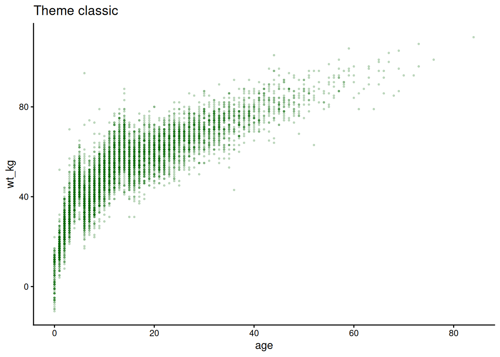](ggplot_basics_files/figure-html/unnamed-chunk-32-1.png)

[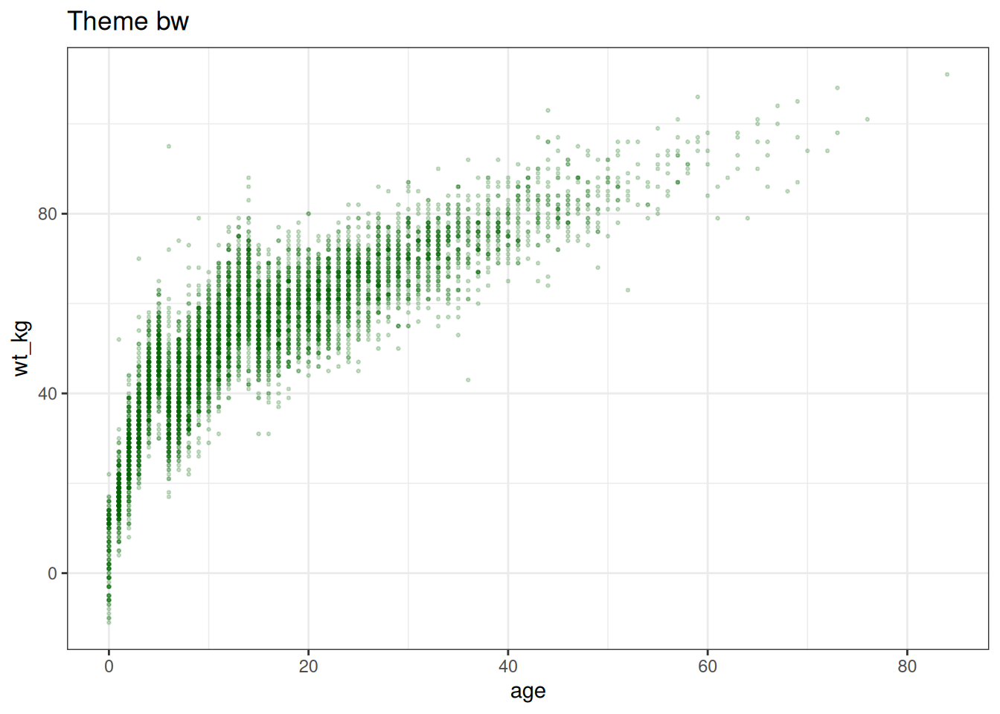](ggplot_basics_files/figure-html/unnamed-chunk-32-2.png)

[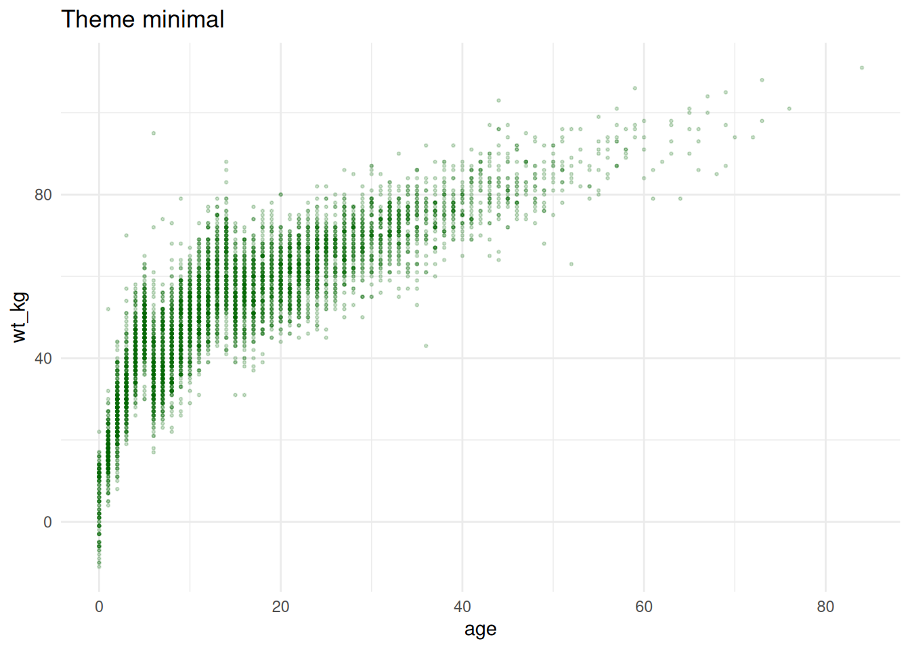](ggplot_basics_files/figure-html/unnamed-chunk-32-3.png)

[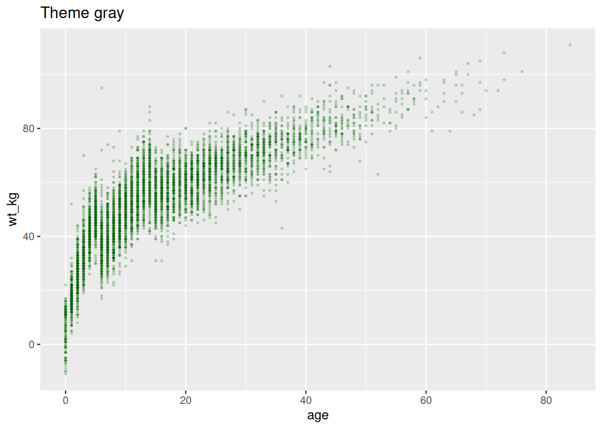](ggplot_basics_files/figure-html/unnamed-chunk-32-4.png)

### Temayı düzenleme

`theme()` fonksiyonu, her biri grafiğin çok özel bir yönünü düzenleyen pek çok sayıda argüman alabilir. Tüm argümanları ele almamız mümkün değil, ancak onların tamamı geçerli olan genel kalıbı tanımlayacağız. İhtiyacınız olan argüman adını nasıl bulacağınızı göstereceğiz. Bu fonksiyonun temel sözdizimi aşağıdaki gibidir:

1.  `theme()` fonksiyonu içinde, düzenlemek istediğiniz grafiğin argüman adını `plot.title =` olarak yazın.
2.  Argümana bir `element_()` fonksiyonu ekleyin

- Çoğu zaman `element_text()` fonksiyonu kullanılır, ancak sık kullanılan diğerleri de arka plan renkleri için `element_rect()` veya grafik öğelerini kaldırmak için `element_blank()`

4.  `element_()` fonksiyonu içinde, istediğiniz ince ayarları yapmak için argümanlar kullanın.

Biliyoruz, bu açıklama oldukça soyuttu. Daha iyi açıklamak adına bir kaç örnek paylaşacağız.

Aşağıdaki grafiğin oldukça saçma bir örnek olduğunun farkındayız, ancak size grafikleri nasıl ayarlayabileceğinizi göstermekte bize yardımcı olacak.

- İlk olarak tanımlanan `age_by_wt` grafiğiyle başlayıp `theme_classic()` fonksiyonunu ekliyoruz
- Daha ince ayarlamalar için `theme()` fonksiyonu ve ayarlanacak her grafik öğesi için bir argüman ekleriz.

Argümanları mantıksal bir şekilde düzenlemek güzel olabilir. Aşağıda bir kaçını tanımladık:

- `legend.position =` “bottom”, “top”, “left” ve “right” gibi basit değerleri kabul etmesi bakımından benzersizdir. Ancak genellikle metinle ilgili argümanlar, ayrıntıları `element_text()` *içine* yerleştirmenizi gerektirir.
- `element_text(size = 30)` ile başlık boyutu  
- `element_text(hjust = 0)` ile yazıyı yatay olarak hizalama (sağdan sola)
- Altyazı, `element_text(face = "italic")` ile italik yazılır

``` r
age_by_wt + 
  theme_classic()+                                 # önceden tanımlanmış tema ayarlamaları
  theme(
    legend.position = "bottom",                    # açıklamayı aşağıya taşı
    
    plot.title = element_text(size = 30),          # başlığın boyutu 30
    plot.caption = element_text(hjust = 0),        # sola hizalı başlık
    plot.subtitle = element_text(face = "italic"), # italik alt başlık
    
    axis.text.x = element_text(color = "red", size = 15, angle = 90), # yalnızca x ekseni metnini ayarlar
    axis.text.y = element_text(size = 15),         # yalnızca y ekseni metnini ayarlar
    
    axis.title = element_text(size = 20)           # her iki eksen başlığını da ayarlar
    )     
```

[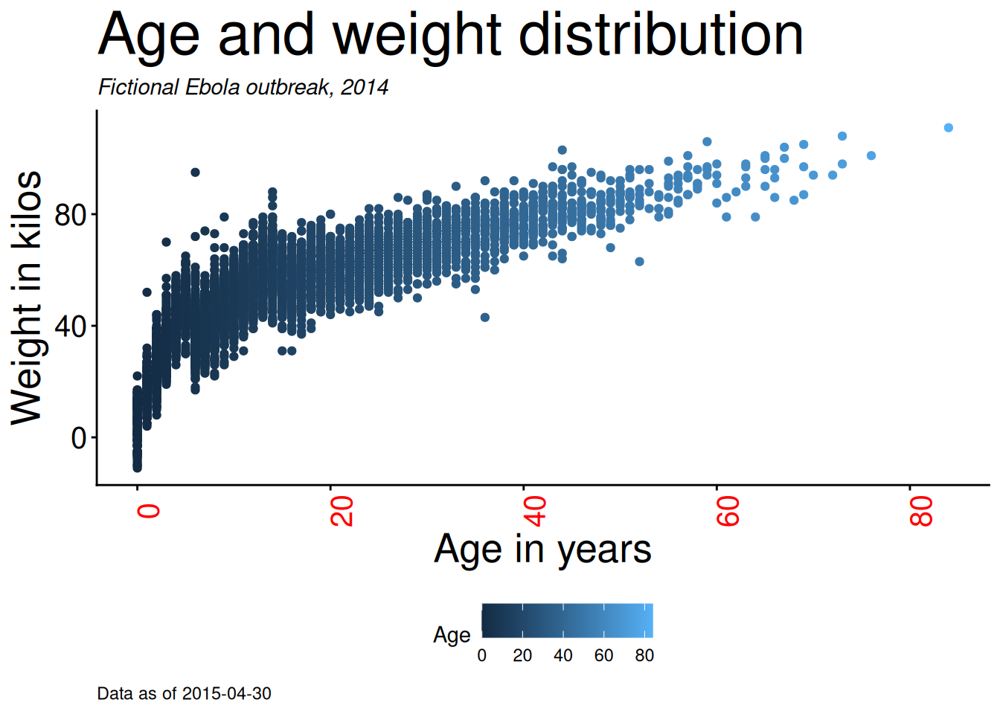](ggplot_basics_files/figure-html/unnamed-chunk-33-1.png)

Burada özellikle yaygın olan bazı `theme()` argümanları verilmiştir. Değişikliği yalnızca bir eksene uygulamak için “.x” veya “.y” ekini ekleyebilirsiniz.

| `theme()` argümanı | Etkilediği yer |
|----|----|
| `plot.title = element_text()` | Ana başlık |
| `plot.subtitle = element_text()` | Alt başlık |
| `plot.caption = element_text()` | Başlık (family, face, color, size, angle, vjust, hjust…) |
| `axis.title = element_text()` | Eksen başlığı (x ve y) (size, face, angle, color…) |
| `axis.title.x = element_text()` | X ekseni başlığı (y ekseni için `.y` ekini kullanın) |
| `axis.text = element_text()` | Eksen metni (x ve y) |
| `axis.text.x = element_text()` | X ekseni metni (y ekseni için `.y` ekini kullanın) |
| `axis.ticks = element_blank()` | Eksen işaretlerini kaldır |
| `axis.line = element_line()` | Eksen çizgisi (colour, size, linetype: solid dashed dotted etc) |
| `strip.text = element_text()` | Yön şerit metni (colour, face, size, angle…) |
| `strip.background = element_rect()` | Yön şeridi (fill, colour, size…) |

Daha pek çok tema argümanı mevcuttur! Hepsini nasıl hatırlayabilirim diye endişelenmenize gerek yok - hepsini hatırlamanız imkansız. Neyse ki size yardımcı olacak birkaç araç var:

Tam bir liste içeren [tema değiştirme](https://ggplot2.tidyverse.org/reference/theme.html) hakkındaki **tidyverse** belgeleri.

***İPUCU:*** Konsola 90’dan fazla `theme()` argümanının listesini yazdırmak için **ggplot2** paketinden `theme_get()` fonksiyonunu çalıştırın.

***İPUCU:*** Grafiğin bir öğesini kaldırmak isterseniz, bunu `theme()` aracılığıyla da yapabilirsiniz. Tamamen kaybolması için bir argümana `element_blank()`ı eklemeniz yeterlidir. Açıklamalar için de `legend.position = "none"` argümanını kullanabilirsiniz.

## 30.10 Renkler

Lütfen [ggplot ipuçları sayfasının renk skalalarıyla ilgili bölüme](ggplot_tips.llms.md#ggplot_tips_colors) bakın.

## 30.11 **ggplot2** içine tünelleme

Verilerinizi temizlemek ve dönüştürmek için tünelleme metodunu kullandıysanız, dönüştürülmüş bu verileri `ggplot()`a kolayca geçirebilirsiniz.

Veri kümesini fonksiyondan fonksiyona taşıma işlemi, `ggplot()` kullanımında “+” eklenmiş gibi davranacaktır. Bu durumda, otomatik olarak iletilen veri kümesi olarak tanımlandığından, `data =` argümanını kullanmaya gerek olmadığını unutmayın.

Kodun söz dizimi aşağıdaki gibi görülebilir:

``` r
linelist %>%                                                     # satır listesiyle başla
  select(c(case_id, fever, chills, cough, aches, vomit)) %>%     # sütunları seç
  pivot_longer(                                                  # long formatına dönüştür
    cols = -case_id,                                  
    names_to = "symptom_name",
    values_to = "symptom_is_present") %>%
  mutate(                                                        # eksik verileri düzenle
    symptom_is_present = replace_na(symptom_is_present, "unknown")) %>% 
  
  ggplot(                                                        # ggplot'u başlat
    mapping = aes(x = symptom_name, fill = symptom_is_present))+
  geom_bar(position = "fill", col = "black") +                    
  theme_classic() +
  labs(
    x = "Symptom",
    y = "Symptom status (proportion)"
  )
```

[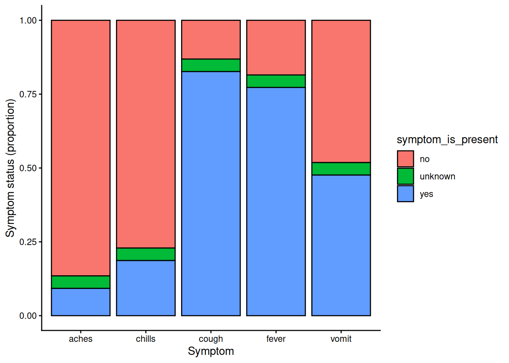](ggplot_basics_files/figure-html/unnamed-chunk-34-1.png)

## 30.12 Sürekli verilere ait grafikler

Bu sayfa boyunca, sürekli veri grafiklerine ait birçok örneği zaten gördünüz. Burada bunları kısaca tekrarlayıp birkaç varyasyonu paylaşacağız.

Burada kapsanan görselleştirmeler aşağıda listelenmiştir:

- Bir sürekli değişken için grafikler:
  - **Histogram**, sürekli bir değişkenin dağılımını sunar
  - **Kutu grafiği** 25., 50. ve 75. yüzdelikleri, dağılımın uçlarını ve aykırı değerleri gösterir ([önemli kısıtlamaları öğrenmek için linke tıklaın](https://www.data-to-viz.com/caveat/boxplot.html)).  
  - **Jitter grafiği**, tüm değerleri ‘titreyen’ noktalar olarak gösterir, böylece ikisi aynı değere sahip olsa bile (çoğunlukla) bütün noktalar görülebilir.
  - **Violin grafiği**, ‘kemanın’ simetrik genişliğine dayalı sürekli bir değişkenin dağılımını gösterir
  - **Sina grafiği**, tek tek noktaları ve dağılımı simetrik şekilde (**ggforce** paketi aracılığıyla) gösterir. Jitter ve Violin grafiklerinin bir kombinasyonudur.  
- İki sürekli değişken için **Dağılım grafiği**.
- Üç sürekli değişken için **Isı grafikleri** (\[Isı grafikleri\] sayfasına bağlantılı)

### Histogramlar

Histogramlar çubuk grafikler gibi görünebilir, ancak farklıdır çünkü *sürekli* bir değişkenin dağılımını ölçerler. “Çubuklar” arasında boşluk yoktur ve `geom_histogram()` fonksiyonu için yalnızca bir sütun sağlanır.

Aşağıda, sürekli verileri aralık halinde gruplayan ve değişen yükseklikteki bitişik çubuklarda görüntüleyen **histogram** kodları paylaşılmıştır. Grafik çizimi, `geom_histogram()` kullanılarak yapılır. `geom_histogram()`, `geom_bar()` ve `geom_col()` arasındaki farkı anlamak için ggplot temelleri sayfasının [“Çubuk grafiği” bölümüne](#ggplot_basics_bars) bakabilirsiniz.

Aşağıdaki örnekte vakaların yaş dağılımını göstereceğiz. `mapping = aes()` argümanı içinde, dağılımını görmek istediğiniz sütunu tanımlamanız gerekmektedir. Bu sütunu x veya y eksenine atayabilirsiniz.

Satırlar, sayısal yaşlarına göre “bin”lere atanacak ve bunlar, çubuklarla temsil edilecektir. `bins =` argümanıyla çubuk sayısını belirtirseniz, kırılma noktaları, histogramın minimum ve maksimum değerleri arasında eşit aralıklarla yerleştirilir. `bins =` argümanı belirtilmemişse, uygun sayıdaki bin değeri tahmin edilir ve çizimden sonra bu aşağıdaki mesaj görüntülenir:

    ## `stat_bin()` using `bins = 30`. Pick better value with `binwidth`.

`bins =` için bir sayı belirtmek istemiyorsanız, alternatif olarak ilgili eksenin birimlerini `binwidth =` argümanıyla tanımlayabilirsiniz. Aşağıda farklı “bin” sayısı ve genişliklerini gösteren birkaç örnek veriyoruz:

``` r
# A) Normal histogram
ggplot(data = linelist %>% drop_na(age), aes(x = age))+  # x parametresi tanımla
  geom_histogram()+
  labs(title = "A) Default histogram (30 bins)")

# B) Daha çok bin
ggplot(data = linelist %>% drop_na(age), aes(x = age))+  # x parametresi tanımla
  geom_histogram(bins = 50)+
  labs(title = "B) Set to 50 bins")

# C) Daha az "bin"
ggplot(data = linelist %>% drop_na(age), aes(x = age))+  # x parametresi tanımla
  geom_histogram(bins = 5)+
  labs(title = "C) Set to 5 bins")


# D) More bins
ggplot(data = linelist %>% drop_na(age), aes(x = age))+  # x parametresi tanımla
  geom_histogram(binwidth = 1)+
  labs(title = "D) binwidth of 1")
```

[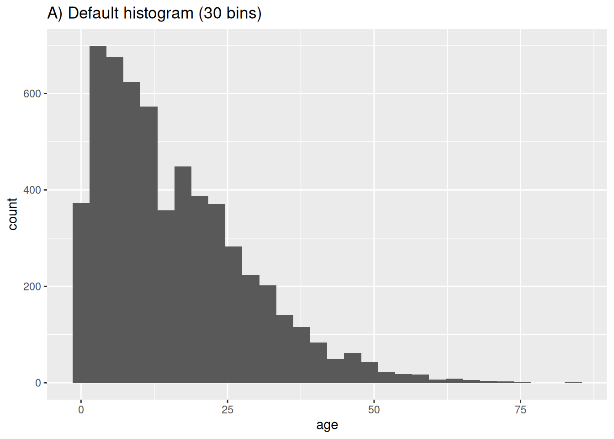](ggplot_basics_files/figure-html/unnamed-chunk-35-1.png)

[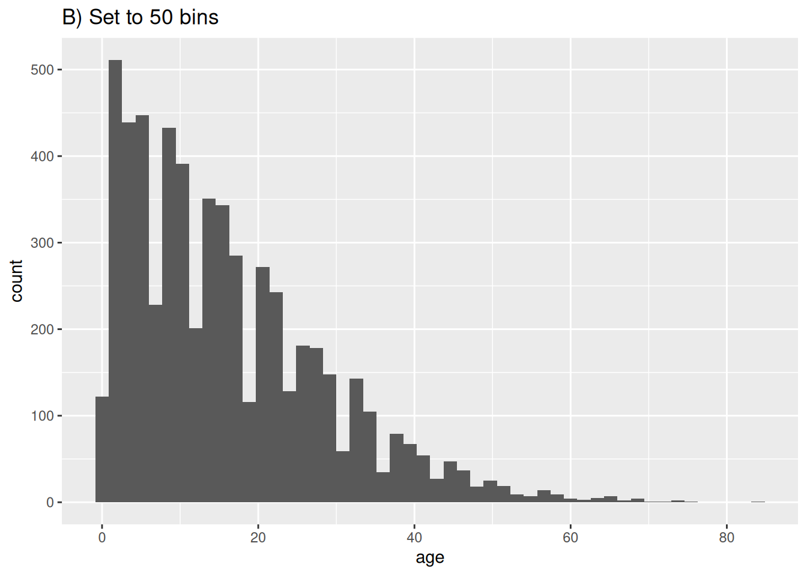](ggplot_basics_files/figure-html/unnamed-chunk-35-2.png)

[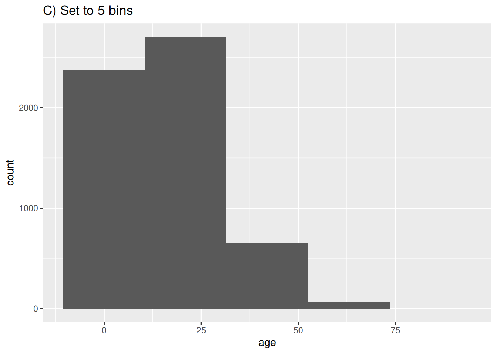](ggplot_basics_files/figure-html/unnamed-chunk-35-3.png)

[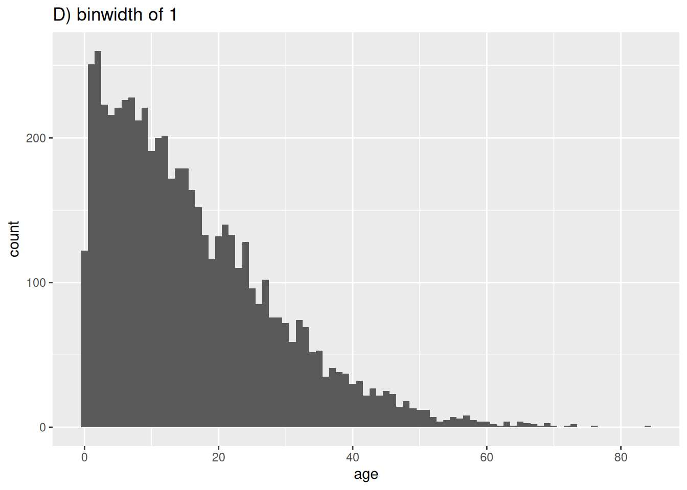](ggplot_basics_files/figure-html/unnamed-chunk-35-4.png)

Düzleştirilmiş oranlar elde etmek için `geom_density()` fonksiyonunu kullanabilirsiniz:

``` r
# Oran eksenli frekans, düzleştirilmiş
ggplot(data = linelist %>% drop_na(age), mapping = aes(x = age)) +
  geom_density(linewidth = 2, alpha = 0.2)+
  labs(title = "Proportional density")

# Oran ekseni ile yığılmış frekans, düzleştirilmiş
ggplot(data = linelist %>% drop_na(age), mapping = aes(x = age, fill = gender)) +
  geom_density(linewidth = 2, alpha = 0.2, position = "stack")+
  labs(title = "'Stacked' proportional densities")
```

[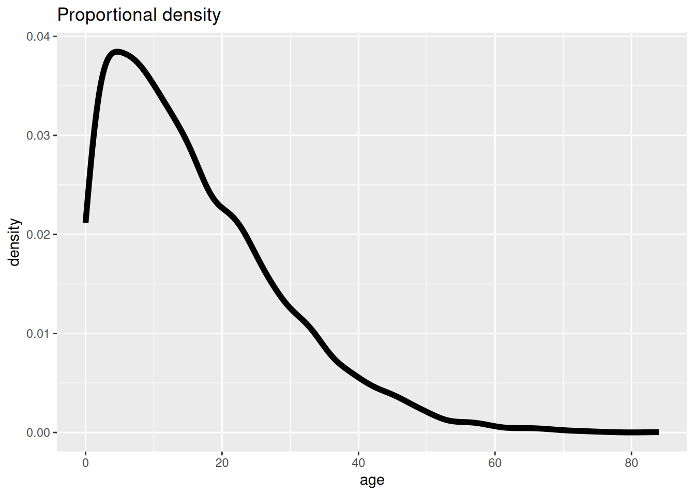](ggplot_basics_files/figure-html/unnamed-chunk-36-1.png)

[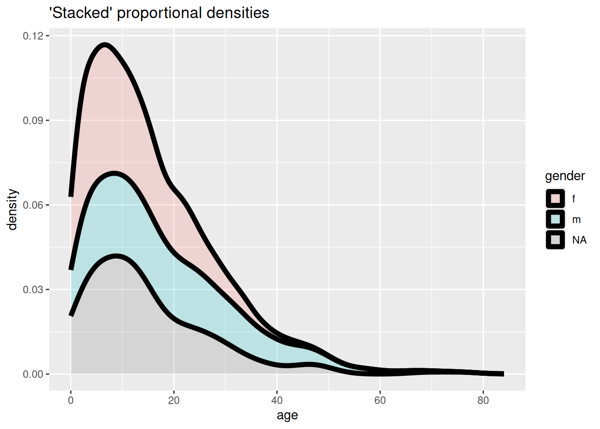](ggplot_basics_files/figure-html/unnamed-chunk-36-2.png)

“Yığılmış” bir histogram (sürekli bir veri sütunundan) oluşturmak için aşağıdakilerden birini yapabilirsiniz:

1.  ‘aes()’ fonksiyonu içindeki ‘fill =’ argümanına atanmış bir gruplandırma sütununu ‘geom_histogram()’ fonksiyonuyla birlikte kullanma,
2.  Muhtemelen okunması daha kolay olan `geom_freqpoly()` fonksiyonunu kullanma (`binwidth =` argümanını kullanmaya devam edebilirsiniz),
3.  Tüm değerlerin oranlarını görmek için `y = after_stat(density)` değerini ayarlama (bu sözdizimini tam olarak kullanın - verileriniz değişmedi). Not: *grup başına* oranları gösterecektir.

Her bir seçenek aşağıda gösterilmiştir (\*kodlardaki `color =` vs `fill =` kullanımına dikkat edin):

``` r
# "Yığılmış" histogram
ggplot(data = linelist %>% drop_na(age), mapping = aes(x = age, fill = gender)) +
  geom_histogram(binwidth = 2)+
  labs(title = "'Stacked' histogram")

# Sıklık 
ggplot(data = linelist %>% drop_na(age), mapping = aes(x = age, color = gender)) +
  geom_freqpoly(binwidth = 2, linewidth = 2)+
  labs(title = "Freqpoly")

# Oran eksenli frekans
ggplot(data = linelist %>% drop_na(age), mapping = aes(x = age, y = after_stat(density), color = gender)) +
  geom_freqpoly(binwidth = 5, linewidth = 2)+
  labs(title = "Proportional freqpoly")

# Oran eksenli frekans, düzleştirilmiş
ggplot(data = linelist %>% drop_na(age), mapping = aes(x = age, y = after_stat(density), fill = gender)) +
  geom_density(linewidth = 2, alpha = 0.2)+
  labs(title = "Proportional, smoothed with geom_density()")
```

[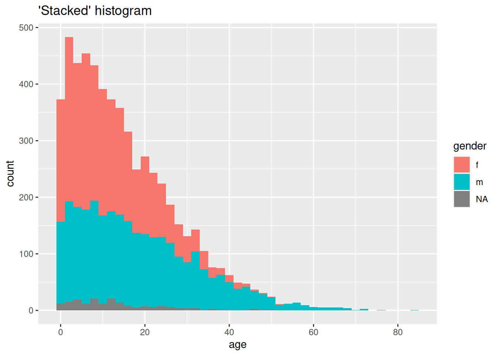](ggplot_basics_files/figure-html/unnamed-chunk-37-1.png)

[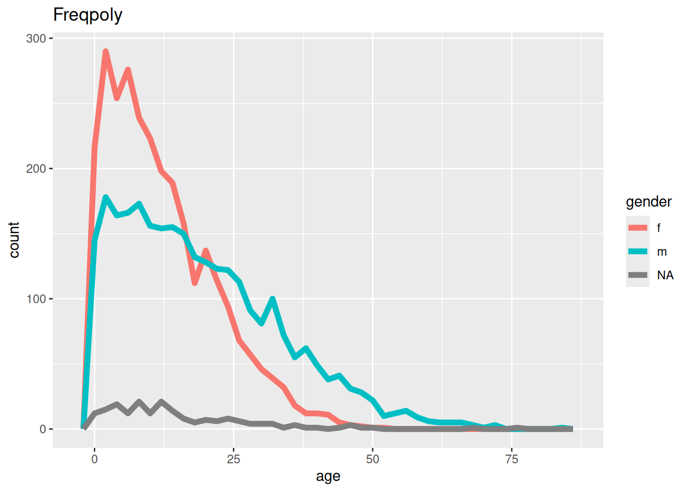](ggplot_basics_files/figure-html/unnamed-chunk-37-2.png)

[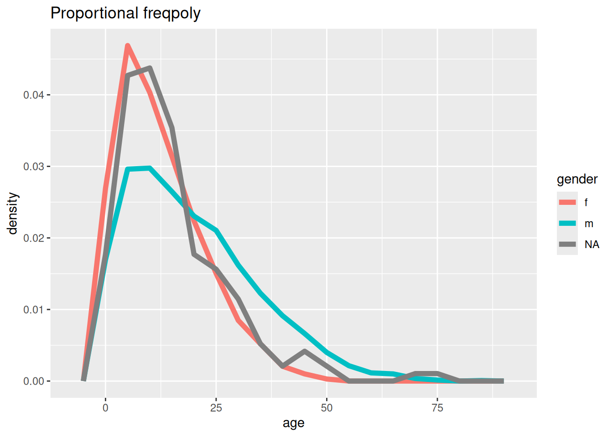](ggplot_basics_files/figure-html/unnamed-chunk-37-3.png)

[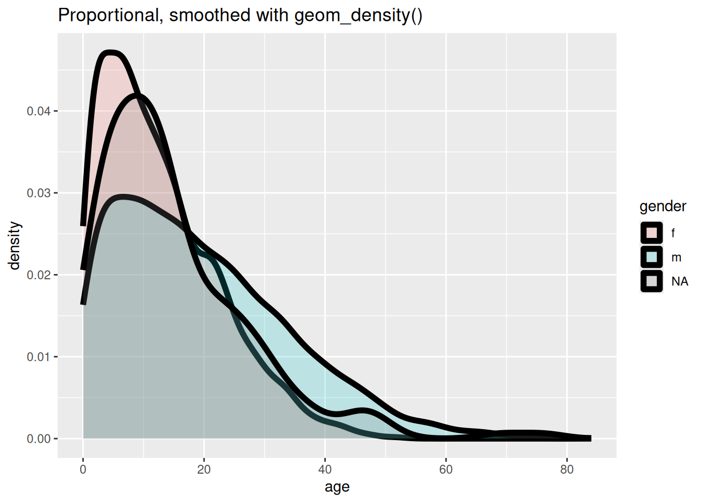](ggplot_basics_files/figure-html/unnamed-chunk-37-4.png)

Biraz eğlenmek istiyorsanız, **ggridges** paketinden [“geom_density_ridges”i deneyebilirsiniz](https://cran.r-project.org/web/packages/ggridges/vignettes/introduction.html) .

**tidyverse** [geom_histogram() sayfasındaki](https://ggplot2.tidyverse.org/reference/geom_histogram.html) histogramlar hakkında daha fazla bilgi edinebilirsiniz.

### Çubuk grafikleri

Çubuk grafikleri yaygındır, ancak önemli kısıtlamalara sahiptir. İlk olarak gerçek dağılımı gizleyebilirler - ör. iki modlu bir dağıtım. Detaylı bilgi için [R grafiği galerisine](https://www.r-graph-gallery.com/boxplot.html) ve bu [data-to-viz makalesine](https://www.data-to-viz.com/caveat/boxplot.html) bakabilirsiniz. Bununla birlikte, çeyrekler arasındaki mesafeyi ve aykırı değerleri güzel bir şekilde gösterirler - böylece dağılımı daha ayrıntılı gösteren diğer grafik türlerinin üzerine eklenebilirler.

Aşağıda size bir kutu grafiğinin çeşitli bileşenlerini hatırlatıyoruz:

[](../../images/boxplot.png)

Bir kutu grafiği oluşturmak için `geom_boxplot()` fonksiyonunu kullanırken, genellikle `aes()` içinde yalnızca bir ekseni (x veya y) eşlersiniz. Tanımlanan eksen, grafiklerin yatay mı yoksa dikey mi olduğunu belirler.

Çoğu geomlarda, `color =` veya `fill =` gibi bir estetiği `aes()` içindeki bir sütuna eşleyerek grup başına bir çizim oluşturursunuz. Bununla birlikte, kutu grafiğinde sütunu boş bir eksene (x veya y) atayarak elde edebilirsiniz. Aşağıda, kod örneklerinin ilkinde *tüm* yaş değerlerinin kutu grafiği kodlanmıştır. İkincisinde ise veri kümesindeki her (eksik olmayan) cinsiyet için bir kutu grafiği kodlanmıştır. Kaldırılmadığı sürece `NA` (eksik) değerlerin ayrı bir kutu grafiği olarak görüneceğini unutmayın. Bu örnekte, her grafiğin farklı bir renk olması için `outcome` sütununa farklı bir `fill` argümanı tanımladık - ancak rutinde bu gerekli değildir.

``` r
# A) Genel yaş grafiği
ggplot(data = linelist %>% drop_na(age))+  
  geom_boxplot(mapping = aes(y = age))+   # only y axis mapped (not x)
  labs(title = "A) Overall boxplot")

# B) Cinsiyete göre çubuk grafiği
ggplot(data = linelist %>% drop_na(age), mapping = aes(y = age, x = gender, fill = gender)) + 
  geom_boxplot()+                     
  theme(legend.position = "none")+   # remove legend (redundant)
  labs(title = "B) Boxplot by gender")      
```

[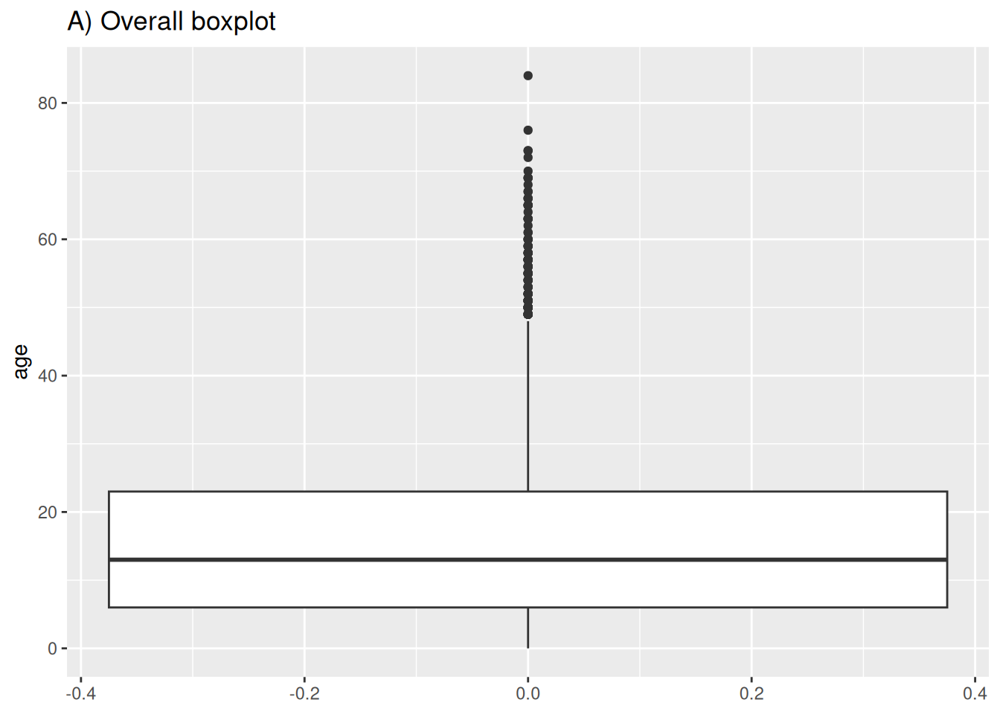](ggplot_basics_files/figure-html/unnamed-chunk-39-1.png)

[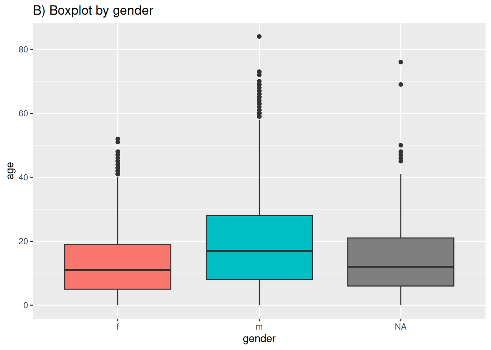](ggplot_basics_files/figure-html/unnamed-chunk-39-2.png)

Bir dağılım grafiğinin (“marjinal” grafikler) kenarına kutu grafiği eklemenin nasıl yapıldığını görmek için \[ggplot ipuçları\] sayfasına bakabilirsiniz.

### Violin, jitter ve sina grafikleri

Aşağıda, dağılımları göstermek için **violin** (`geom_violin`) ve **jitter grafiklerinin** (`geom_jitter`) nasıl kodlandığı gösterilmiştir. Bu seçenekleri `aes()` içine ekleyerek dolgu veya rengin de veriler tarafından belirlenmesini sağlayabilirsiniz.

``` r
# A) Jitter grafiği
ggplot(data = linelist %>% drop_na(outcome, age),      # Eksik değerleri kaldır
       mapping = aes(y = age,                     # Sürekli değişken
           x = outcome,                           # Gruplama değişkeni
           color = outcome))+                     # Renk değişkeni
  geom_jitter()+                                  # Jitter grafiği oluştur
  labs(title = "A) jitter plot by gender")     


# B) Violin grafiği
ggplot(data = linelist %>% drop_na(outcome, age),       # Eksik değerleri kaldır
       mapping = aes(y = age,                      # Sürekli değişken
           x = outcome,                            # Gruplama değişkeni
           fill = outcome))+                       # Dolgu değişkeni (renk)
  geom_violin()+                                   # Violin grafiği oluştur
  labs(title = "B) violin plot by gender")    
```

[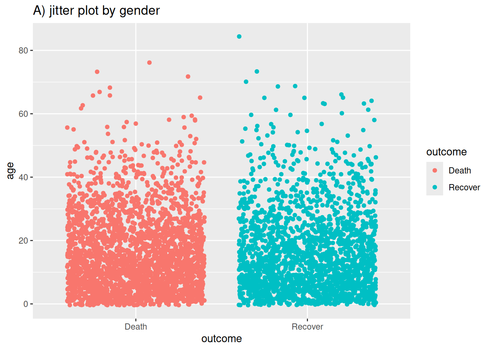](ggplot_basics_files/figure-html/unnamed-chunk-40-1.png)

[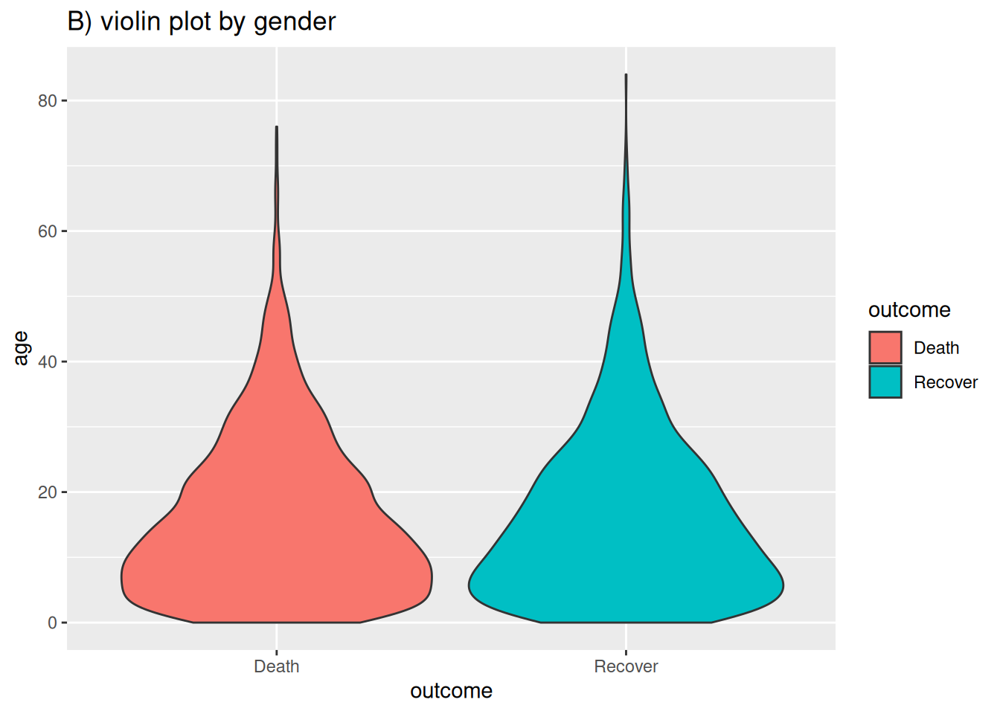](ggplot_basics_files/figure-html/unnamed-chunk-40-2.png)

**ggforce** paketindeki `geom_sina()` fonksiyonunu kullanarak iki grafiği birleştirebilirsiniz. Sina, jitter noktalarını violin grafiği şeklinde çizer. Violin grafiği üzerine eklendiğinde (şeffaflığı düzenlenerek), oluşan yeni grafiğin görsel olarak yorumlanması daha kolay olabilir.

``` r
# A) Sina grafiği
ggplot(
  data = linelist %>% drop_na(outcome, age), 
  aes(y = age,           # numerik değişken
      x = outcome)) +    # grup değişkeni
  geom_violin(
    aes(fill = outcome), # dolgu (violin grafiğinin arka planının rengi)
    color = "white",     # beyaz anahat
    alpha = 0.2)+       # şefaflık
  geom_sina(
    size=1,                # jitter noktalarının boyutunu değiştir
    aes(color = outcome))+ # renk (noktaların rengi)
  scale_fill_manual(       # Death/recovery violin grafiği arka planı için dolguyu tanımla
    values = c("Death" = "#bf5300", 
              "Recover" = "#11118c")) + 
  scale_color_manual(      # death/recover noktaları için renkleri tanımla
    values = c("Death" = "#bf5300", 
              "Recover" = "#11118c")) + 
  theme_minimal() +                                # Gri arka planı kaldır
  theme(legend.position = "none") +                # Gereksiz açıklamayı kaldır
  labs(title = "B) violin and sina plot by gender, with extra formatting")      
```

[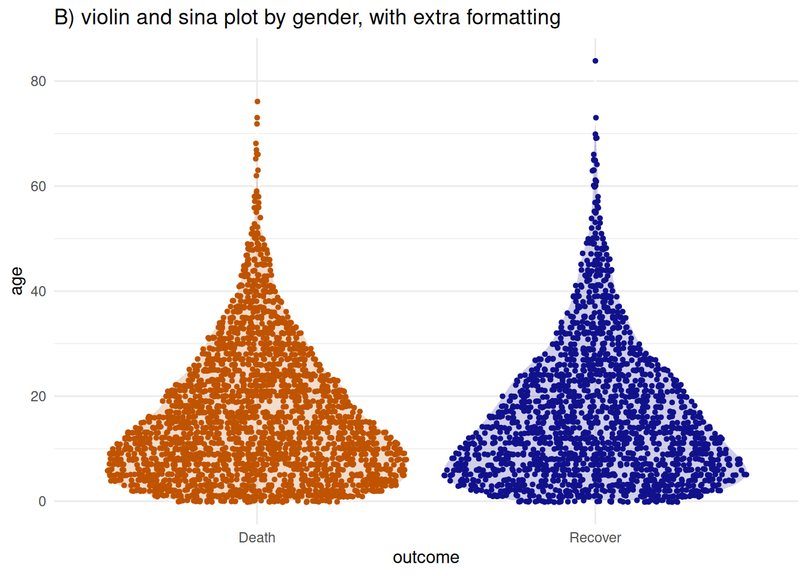](ggplot_basics_files/figure-html/unnamed-chunk-41-1.png)

### İki sürekli değişken

Benzer sözdizimini takip ederek, `geom_point()`, bir **dağılım grafiğinde** iki sürekli değişkeni birbirine karşı çizmenize izin verir. Bu, dağılımlarından ziyade gerçek değerleri göstermek için kullanışlıdır. Yaş ve kilonun temel bir dağılım grafiği (A)’da gösterilmektedir. (B)’de, satır listesindeki iki sürekli değişken arasındaki ilişkiyi göstermek için yine `facet_grid()` fonksiyonunu kullanıyoruz.

``` r
# Ağırlık ve yaşın temel dağılım grafiği
ggplot(data = linelist %>% drop_na(age, wt_kg), 
       mapping = aes(y = wt_kg, x = age))+
  geom_point() +
  labs(title = "A) Scatter plot of weight and age")

# Cinsiyete ve Ebola sonucuna göre ağırlık ve yaş dağılım grafiği
ggplot(data = linelist %>% drop_na(gender, outcome), # filtre eksik olmayan cinsiyeti/sonucu korur
       mapping = aes(y = wt_kg, x = age))+
  geom_point() +
  labs(title = "B) Scatter plot of weight and age faceted by gender and outcome")+
  facet_grid(gender ~ outcome) 
```

[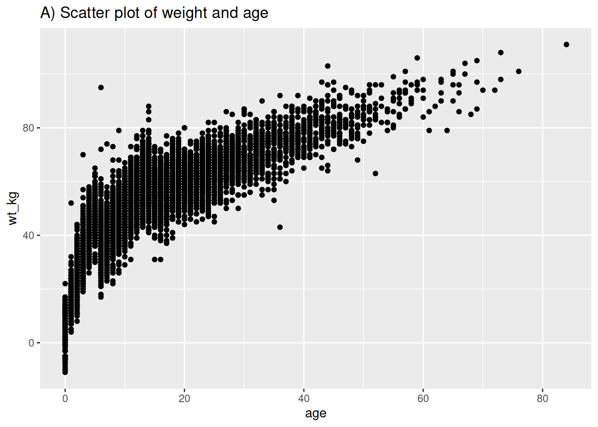](ggplot_basics_files/figure-html/unnamed-chunk-42-1.png)

[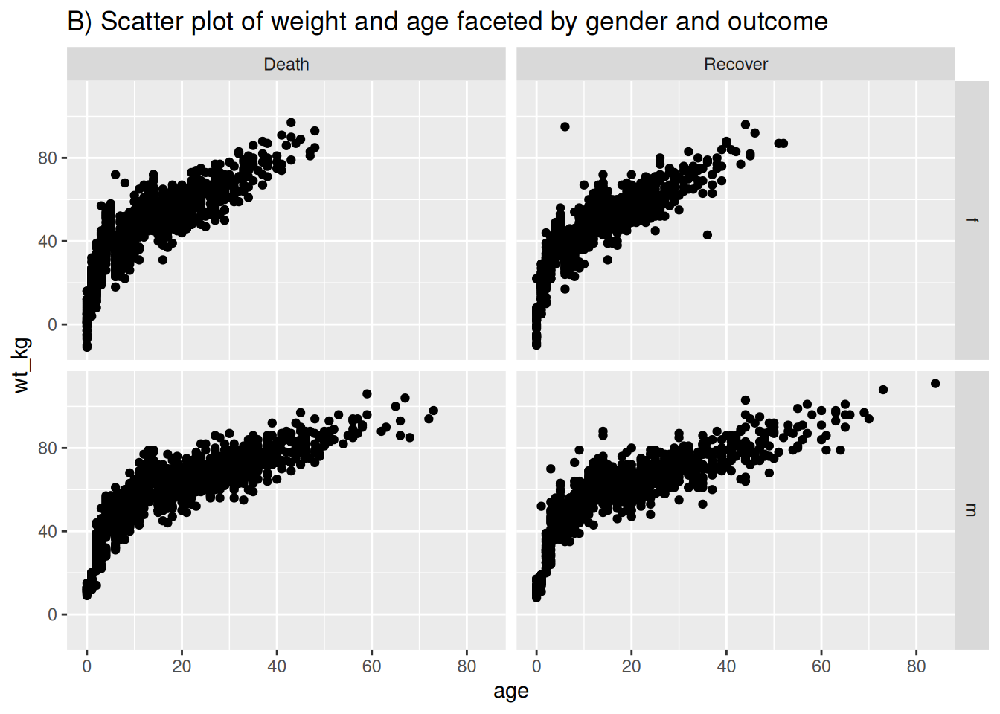](ggplot_basics_files/figure-html/unnamed-chunk-42-2.png)

### Üç sürekli değişken

Bir *ısı grafiği* oluşturmak için `fill =` argümanını kullanarak üç sürekli değişkeni görüntüleyebilirsiniz. Her “hücrenin” rengi, üçüncü sürekli veri sütununun değerini yansıtacaktır. Daha fazla ayrıntı ve birkaç örnek için \[ggplot ipuçları\] ve \[Isı grafikleri\] hakkındaki sayfaya bakabilirsiniz.

R’da 3D grafikler oluşturmanın yolları vardır, ancak uygulamalı epidemiyoloji için bunların yorumlanması genellikle zordur ve bu nedenle karar verme süreçlerinde daha az kullanılırlar.

## 30.13 Kategorik verilere ait grafikler

Kategorik veriler karakter değerleri, mantıksal (DOĞRU/YANLIŞ) veya faktör olabilir (\[Faktörler\] sayfasına bakınız).

### Hazırlık

#### Veri yapısı

Kategorik verileriniz hakkında anlamanız gereken ilk şey, verilerin bir satır listesi gibi ham gözlemler olarak mı yoksa sayıları veya oranları tutan bir özet veya toplu veri çerçevesi olarak mı var olduğudur. Verilerinizin durumu, kullandığınız çizim fonksiyonunu etkiler:

- Verileriniz gözlem başına bir satır içeren ham gözlemlerse, büyük olasılıkla `geom_bar()` fonksiyonunu kullanacaksınız.
- Verileriniz zaten sayılar veya oranlar halinde toplanmışsa, büyük olasılıkla ‘geom_col()’ fonksiyonunu kullanacaksınız.

#### Sütun sınıfı ve değer sıralaması

Bu aşamadan sonra, çizmek istediğiniz sütunların sınıfını incelemelisiniz. Önce R tabanından `class()` ve **janitor** paketinden `tabyl()` fonksiyonuyla `hospital` sütununa bakıyoruz.

``` r
# Hastane sütununun sınıfını görüntüleyin - bunun bir karakter olduğunu görebiliriz
class(linelist$hospital)
```

    [1] "character"

``` r
# Hastane sütunundaki değerlere ve oranlara bakın
linelist %>% 
  tabyl(hospital)
```

                                 hospital    n    percent
                         Central Hospital  454 0.07710598
                        Military Hospital  896 0.15217391
                                  Missing 1469 0.24949049
                                    Other  885 0.15030571
                            Port Hospital 1762 0.29925272
     St. Mark's Maternity Hospital (SMMH)  422 0.07167120

Hastane adları olduğu ve varsayılan olarak alfabetik olarak sıralandığı için içindeki değerlerin karakter olduğunu görebiliriz. Kırılımları sunarken en son sırada olmasını tercih edeceğimiz ‘Other’ ve ‘Missing’ değerleri de mevcuttur. Bu yüzden bu sütunu bir faktöre değiştirip yeniden sıralıyoruz. Konu, \[Faktörler\] sayfasında daha ayrıntılı olarak ele alınmaktadır.

``` r
# Faktöre dönüştürün ve seviye sırasını "Other" ve "Missing" en son olacak şekilde tanımlayın
linelist <- linelist %>% 
  mutate(
    hospital = fct_relevel(hospital, 
      "St. Mark's Maternity Hospital (SMMH)",
      "Port Hospital", 
      "Central Hospital",
      "Military Hospital",
      "Other",
      "Missing"))
```

``` r
levels(linelist$hospital)
```

    [1] "St. Mark's Maternity Hospital (SMMH)"
    [2] "Port Hospital"                       
    [3] "Central Hospital"                    
    [4] "Military Hospital"                   
    [5] "Other"                               
    [6] "Missing"                             

### `geom_bar()`

Çubuk yüksekliğinin (veya yığılmış çubuk bileşenlerinin yüksekliğinin) *verilerdeki ilgili satırların sayısını* yansıtmasını istiyorsanız, `geom_bar()` fonksiyonunu kullanmalısınız. `width =` çizim estetiği ayarlanmadığı sürece, bu çubukların aralarında boşluklar olacaktır.

- Yalnızca bir eksene sütun atayın (tipik olarak x ekseni). x ve y eksenlerinin her ikisine de sütun tanımlarsanız, `Error: stat_count() can only have an x or y aesthetic.` hatasını alırsınız.
- `mapping = aes()` içinde bir `fill =` argümanına sütun ekleyerek yığılmış çubuk grafiği oluşturabilirsiniz.
- Karşı eksen, satır sayısını temsil ettiği için varsayılan olarak “count” olarak adlandırılacaktır.

Aşağıda, sonucu y eksenine atadık, ancak bu aynı kolaylıkla x ekseni de olabilirdi. Daha uzun karakter değerleriniz varsa, bazen çubukları yana çevirip açıklamayı en alta koymak iyi bir seçenek olabilir. Bu, faktör seviyelerinizin nasıl sıralandığını etkileyebilir - bu durumda, “missing” ve “other” değerlerini en alta koymak için sıralamayı `fct_rev()` ile tersine çeviriyoruz.

``` r
# A) Tüm vakaların çıktıları
ggplot(linelist %>% drop_na(outcome)) + 
  geom_bar(aes(y = fct_rev(hospital)), width = 0.7) +
  theme_minimal()+
  labs(title = "A) Number of cases by hospital",
       y = "Hospital")


# B) Tüm vakaların hastaneye göre çıktıları
ggplot(linelist %>% drop_na(outcome)) + 
  geom_bar(aes(y = fct_rev(hospital), fill = outcome), width = 0.7) +
  theme_minimal()+
  theme(legend.position = "bottom") +
  labs(title = "B) Number of recovered and dead Ebola cases, by hospital",
       y = "Hospital")
```

[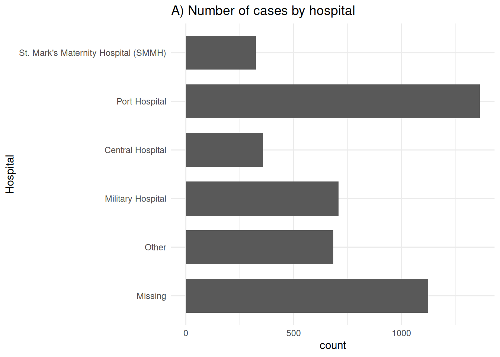](ggplot_basics_files/figure-html/unnamed-chunk-46-1.png)

[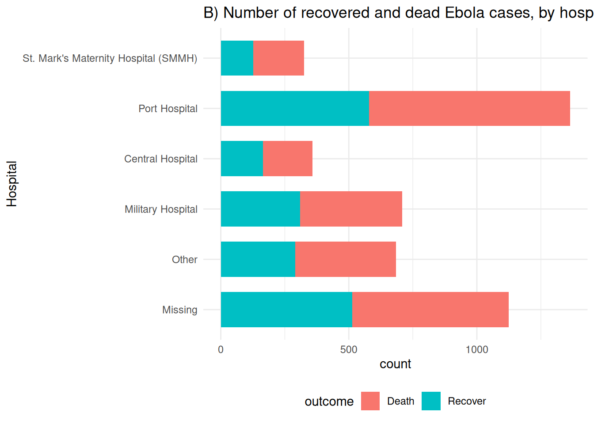](ggplot_basics_files/figure-html/unnamed-chunk-46-2.png)

### `geom_col()`

Çubuk yüksekliğinin (veya yığılmış çubuk bileşenlerinin yüksekliğinin) verilerde bulunan önceden hesaplanmış *değerleri* yansıtmasını istiyorsanız, `geom_col()` fonksiyonunu kullanmalısınız. Bunlar genellikle özet, “toplanmış” sayılar veya oranlardır.

`geom_col()` fonksiyonunda *her iki* eksen için de sütun atamalısınız. Tipik olarak x ekseni sütununuz ayrık verilerden oluşurken y ekseni sütununuz sayısaldır.

Diyelim ki `outcomes` veri setimiz var:

    # A tibble: 2 × 3
      outcome     n proportion
      <chr>   <int>      <dbl>
    1 Death    1022       56.2
    2 Recover   796       43.8

Aşağıda, Ebola hasta sonuçlarının dağılımını gösteren basit bir çubuk grafiği oluşturmak için `geom_col` fonksiyonu kullanılmıştır. `geom_col` fonksiyonunda hem x hem de y tanımlanmalıdır. Burada x kategorik değişkendir ve y “oran”dır.

``` r
# Tüm vakaların çıktıları
ggplot(outcomes) + 
  geom_col(aes(x=outcome, y = proportion)) +
  labs(subtitle = "Number of recovered and dead Ebola cases")
```

[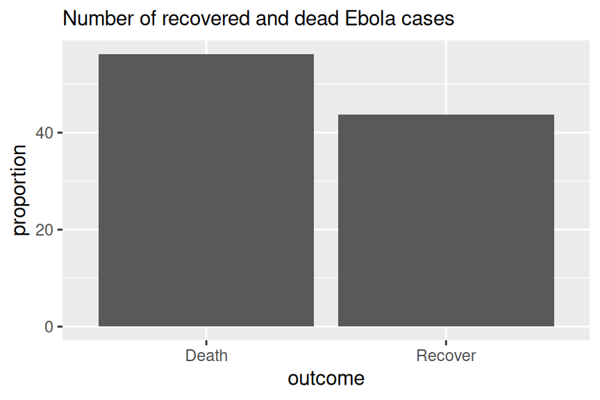](ggplot_basics_files/figure-html/unnamed-chunk-48-1.png)

Hastanelere göre dağılımları göstermek için tablomuzun daha fazla bilgi içermesi ve “long” formatında olması gerekir. Bu tabloyu `outcome` ve `hospital` birleşik kategorilerinin frekanslarıyla oluşturuyoruz (gruplandırma ipuçları için \[Gruplama verileri\] sayfasına bakabilirsiniz).

``` r
outcomes2 <- linelist %>% 
  drop_na(outcome) %>% 
  count(hospital, outcome) %>%  # hastaneye ve sonuca göre sayımları al
  group_by(hospital) %>%        # Oranlar hastane toplamı dışında olacak şekilde gruplandır
  mutate(proportion = n/sum(n)*100) # hastane toplamının oranlarını hesapla

head(outcomes2) # verili göster
```

    # A tibble: 6 × 4
    # Groups:   hospital [3]
      hospital                             outcome     n proportion
      <fct>                                <chr>   <int>      <dbl>
    1 St. Mark's Maternity Hospital (SMMH) Death     199       61.2
    2 St. Mark's Maternity Hospital (SMMH) Recover   126       38.8
    3 Port Hospital                        Death     785       57.6
    4 Port Hospital                        Recover   579       42.4
    5 Central Hospital                     Death     193       53.9
    6 Central Hospital                     Recover   165       46.1

Daha sonra bazı ek biçimlendirmelerle ggplot’u oluştururuz:

- **Axis flip**: Hastane isimlerini okuyabilmemiz için ekseni `coord_flip()` fonksiyonu ile değiştirdik.
- **Columns side-by-side**: Ölüm ve iyileşme çubuklarının yığılması yerine yan yana sunulması için bir `position = "dodge"` argümanı eklendi. Not yığılmış çubuklar varsayılandır.
- **Column width**: ‘Genişlik’ tanımlanır, bu nedenle sütunlar mümkün olan tam genişliğin yarısı kadar incelir.
- **Column order**: ‘Other’ ve ‘Missing’ altta olacak şekilde, `scale_x_discrete(limits=rev)` ile kategorilerin sırasını y ekseninde tersine çevrildi. `scale_y_discrete` yerine x kullandığımıza dikkat edin, çünkü hastane `aes()`’in `x` argümanında tanımlanmıştır. (görsel olarak y ekseninde olsa bile). Bunu yapıyoruz çünkü Ggplot, biz tersini söylemedikçe kategorileri geriye doğru sıralamaktadır.
- **Other details**: Sırasıyla `labs` ve `scale_fill_color` argümanları içine eklenen etiket/başlık ve renkler.

``` r
# Tüm vakaların hastaneye göre çıktıları
ggplot(outcomes2) +  
  geom_col(
    mapping = aes(
      x = proportion,                 # önceden hesaplanmış orantı değerlerini göster
      y = fct_rev(hospital),          # missing/other altta kalması için ters çevir
      fill = outcome),                # sonuca göre yığılmış
    width = 0.5)+                    # daha ince çubuklar (max: 1)
  theme_minimal() +                  # Minimal tema 
  theme(legend.position = "bottom")+
  labs(subtitle = "Number of recovered and dead Ebola cases, by hospital",
       fill = "Outcome",             # açıklama başlığı
       y = "Count",                  # y ekseni başlığı
       x = "Hospital of admission")+ # x ekseni başlığı
  scale_fill_manual(                 # renkleri manuel ekle
    values = c("Death"= "#3B1c8C",
               "Recover" = "#21908D" )) 
```

[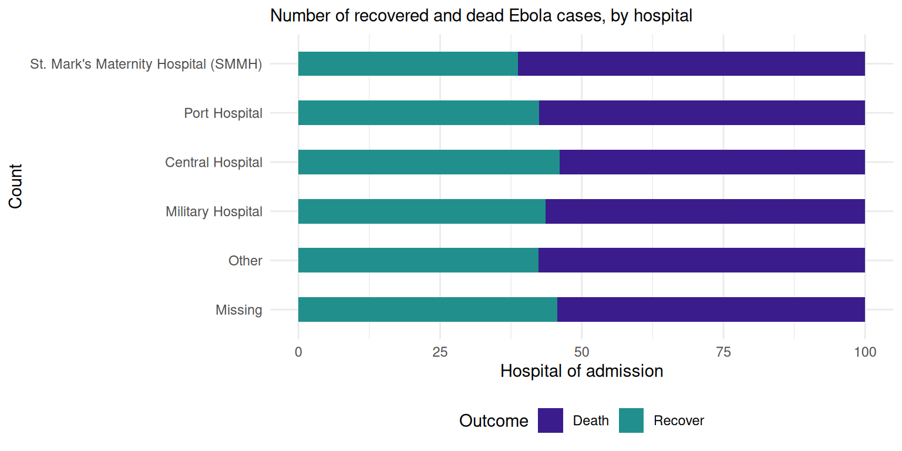](ggplot_basics_files/figure-html/unnamed-chunk-50-1.png)

Oranların ikili olduğuna dikkat edin, bu nedenle ‘recover’ verilerini bırakıp sadece ölen oranını göstermeyi tercih edebiliriz. Bu sadece örnekleme amaçlıdır.

Tarih verilerinde `geom_col()` fonksiyonunu kullanıyorsanız (örneğin, toplu verilerden bir dış eğri) - çubuklar arasındaki “boşluğu” kaldırmak için `width =` argümanını ayarlamalısınız. Günlük veri seti kullanılıyorsa `width = 1`. Haftalık ise, `width = 7`. Ayların düzgün bir şekilde gösterilmesi mümkün değildir çünkü her ayın gün sayısı bir diğerinden farklıdır.

### `geom_histogram()`

Histogramlar çubuk grafikler gibi görünebilir, ancak farklıdır çünkü *sürekli* bir değişkenin dağılımını ölçerler. “Çubuklar” arasında boşluk yoktur ve `geom_histogram()` fonksiyonu için yalnızca bir sütun gerekir. Verilerin nasıl gruplanacağını belirtmek için `bin_width =` ve `breaks =` gibi histograma özgü argümanlar vardır. Yukarıdaki sürekli verilerle ilgili bölüm ve \[Salgın eğrileri\] sayfasaında daha detaylı bilgi bulabilirsiniz.

## 30.14 Kaynaklar

Özellikle ggplot ile ilgili çevrimiçi olarak çok miktarda kaynak mevcuttur. Bunlardan bazıları:

- [ggplot2 kopya kağıdı](http://r-statistics.co/ggplot2-cheatsheet.html)
- [başka bir kopya kağıdı](https://biostats.w.uib.no/the-ggplot2-cheat-sheet-by-rstudio/)
- [tidyverse ggplot temelleri sayfası](https://ggplot2.tidyverse.org/reference/)  
- [sürekli değişkenleri çizmek](http://www.sthda.com/english/articles/32-r-graphics-essentials/131-plot-two-continuous-variables-scatter-graph-and-alternatives/)  
- [Veri Bilimi için R’da veri görselleştirme bölümü](https://r4ds.had.co.nz/data-visualisation.html)
- [iletişim için grafikler](https://r4ds.had.co.nz/graphics-for-communication.html)
