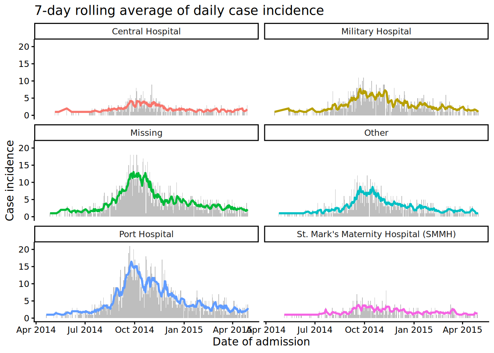

# 22  Hareketli ortalamalar

[](../../images/moving_avg_epicurve.png)

Bu sayfa, hareketli ortalamaları hesaplamak ve görselleştirmek için iki yöntemi kapsayacaktır:

1.  **slider** paketi ile hesaplama
2.  \*\*tidyquant\* paketi ile `ggplot()` komutu *içinde* hesaplama

## 22.1 Hazırlık

### Paketleri yükleme

Bu kod parçası, analizler için gerekli olan paketlerin yüklenmesini göstermektedir. Bu el kitabında, gerekirse paketi kuran ve kullanım için yükleyen **pacman**’ın `p_load()` fonksiyonunu öneriyoruz. Ayrıca, R tabanından `library()` ile kurulu paketleri yükleyebilirsiniz. R paketleri hakkında daha fazla bilgi için \[R temelleri\] sayfasına bakın.

``` r
pacman::p_load(
  tidyverse,      # verinin yönetimi ve görselleştirilmesi için
  slider,         # hareketli ortalamaları hesaplamak için
  tidyquant, # ggplot içinde hareketli ortalamaları hesaplamak için
  appliedepidata # bu el kitabında kullanılan örnek veriler
)
```

### Verinin içe aktarımı

Simüle edilmiş Ebola salgını vakalarını içeren veri setini içe aktarıyoruz. Doğrudan `appliedepidata::get_data(name = "linelist_cleaned_rds")` ile yükleyin (ayrıntılar için [El kitabı ve veri indirme](download.llms.md) sayfasına bakın).

``` r
# satır listesini içe aktar
linelist <- appliedepidata::get_data(name = "linelist_cleaned_rds")
```

Satır listesinin ilk 50 satırı aşağıda görüntülenir.

## 22.2 **slider** ile hesaplama

**Grafik haline getirmeden önce bir veri çerçevesinde hareketli ir ortalama hesaplamak için bu yaklaşımı kullanın.**

**slider** paketi, yuvarlanan ortalamaları, kümülatif toplamları, yuvarlanan regresyonları vb. hesaplamak için “kayan pencere” fonksiyonu içerir. Bir veri çerçevesini bir satır vektörü olarak ele alır ve bir veri çerçevesi üzerinde satır bazında yinelemelere izin verir.

Ortak fonksiyonlardan bazıları:

- `slide_dbl()` - kayan pencere kullanarak işlem gerçekleştiren *sayısal* bir sütunu yineler (dolayısıyla “\_dbl”)
  - `slide_sum()` - `slide_dbl()` için yuvarlanan toplam kısayol fonksiyonu  
  - `slide_mean()` - `slide_dbl()` için yuvarlanan ortalama kısayol fonksiyonu
- `slide_index_dbl()` - pencere ilerlemesini *indekslemek* için ayrı bir sütun kullanarak; yuvarlanan pencereyi sayısal bir sütuna uygular (bazı tarihler eksikken tarihe göre yuvarlanıyorsa kullanışlıdır)
  - `slide_index_sum()` - indeksleme ile birlikte yuvarlanan toplam kısayol fonksiyonu  
  - `slide_index_mean()` - indekslemeli yuvarlanan ortalama kısayol fonksiyonu

**slider** paketi, bu sayfada Kaynaklar bölümünde ele alınan birçok başka fonkisyona da sahiptir. En yaygın olanlara kısaca değineceğiz.

**Temel argümanlar**

- Varsayılan ilk argüman olan `.x`, yinelenecek ve fonksiyonu uygulayacak vektördür.
- `.i` = **slider** fonksiyonların “indeks” versiyonları için - geçişi “indekslemek” için bir sütun verin [aşağıdaki bölüme bakın](#roll_index))
- `.f =`, varsayılan ikinci argüman;
  - `mean` gibi parantezsiz yazılmış bir fonksiyon veya
  - Bir fonksiyona dönüştürülecek bir formül. Örneğin `~ .x - mean(.x)`, mevcut değerden pencerenin değerinin ortalamasını hesaplar ve elde edilen sonucu sunar.
- Daha fazla ayrıntı için bu [kaynak materyaline bakın](https://davisvaughan.github.io/slider/reference/slide.html)

**Pencere büyüklüğü**

`.before`, `.after` veya her iki argümanı kullanarak pencerenin boyutunu belirtin:

- `.before =` - Bir tamsayı verin  
- `.after =` - Bir tamsayı verin  
- `.complete =` - Yalnızca eksiksiz pencerelerde hesaplama yapılmasını istiyorsanız bunu `TRUE` olarak ayarlayın

Örneğin, mevcut değeri ve önceki altı değeri içeren 7 günlük bir pencere elde etmek için `.before = 6` argümanını kullanın. “Ortalanmış” bir pencere elde etmek için hem `.before =` hem de `.after =` için aynı sayıyı sağlayın.

Varsayılan olarak, `.complete = FALSE` olarak kodlanmıştır, bu nedenle tam satır penceresi mevcut değilse, fonksiyonlar hesaplamayı gerçekleştirmek için mevcut satırları kullanacaktır. Bu argümanı `TRUE` olarak ayarlamak, hesaplamaların yalnızca eksiksiz pencerelerde gerçekleştirilmesini sağlar.

**Pencerenin genişletilmesi**

*Kümülatif* işlemleri gerçekleştirmek için, `.before =` argümanını `Inf` olarak ayarlayın. Bu argüman, işlemi mevcut değerde ve daha önceki değerlerde yürütecektir.

### Tarihe göre yuvarlama

Uygulamalı epidemiyolojide yuvarlanan hesaplamanın en olası kullanım durumu, *zaman içinde* değişim gösteren bir ölçümün incelenmesidir (Örnek: Günlük vaka sayılarına dayalı olarak vaka insidansının yuvarlanan bir ölçümü)

Her tarih için değer içeren temiz bir zaman serisi veriniz varsa, burada [Zaman Serisi ve Salgın Tespiti](time_series.llms.md#timeseries_moving) sayfasında gösterildiği gibi `slide_dbl()` fonksiyonunu kullanabilirsiniz.

Bununla birlikte, birçok epidemiyoloji uygulamasında, kaydedilen hiçbir olayın gerçekleşmediği, verilerinizde eksik tarihler olabilir. Bu durumlarda, **slider** fonksiyonların “indeks” sürümlerini kullanmak doğrudur.

### İndekslenmiş veri

Aşağıda, vaka satır listesinde `slide_index_dbl()` fonksiyonunu kullanan bir örnek gösterilmiştir. Diyelim ki hedefimiz 7 günlük bir insidansı hesaplamak (7 günlük bir pencere kullanarak vakaların toplamını göstermek). Yuvarlanan ortalama örneği için, [gruplandırılmış yuvarlanma](#roll_slider_group) ile ilgili aşağıdaki bölüme bakın.

Başlamak için, **dplyr**’den `count()` fonksiyonu ile hesaplandığı gibi, `linelist`’teki günlük vaka sayılarını göstermek için `daily_counts` veri kümesi oluşturulur.

``` r
# günlük sayımların veri kümesini oluştur
daily_counts <- linelist %>% 
  count(date_hospitalisation, name = "new_cases")
```

`daily_counts` veri çerçevesinden `nrow(daily_counts)` satır elde edilebilir. Günlük vaka sayısında her gün bir satırla temsil edilmektedir, ancak özellikle salgının başlarında *bazı günler mevcut değil (o günlerde hastaneye yatırılan vaka olmamıştır)*.

Standart bir yuvarlanma işlevinin (`slide_dbl()` gibi) 7 *günlük* değil 7 *satırlık* bir pencere kullanacağını bilmek önemlidir. Dolayısıyla, eksik tarihler varsa, bazı pencereler aslında 7 takvim gününden daha fazla uzatılacaktır!

`slide_index_dbl()` ile “akıllı” bir yuvarlanma penceresi elde edilebilir. “İndeks”, işlevin yuvarlanan pencere için “indeks” olarak alacağı *ayrı bir sütun* kullandığı anlamına gelir. Pencere sadece veri çerçevesinin satırlarına bağlı değildir.

İndeks sütunu bir tarihse, pencere içeriğini **lubridate** `days()` veya `months()` fonksiyonları ile `.before =` ve/veya `.after =` olarak belirtebilirsiniz. Bu durumda fonksiyon, pencerede olmayan günleri sanki oradaymış gibi (`NA` değerleri olarak) kabul edecektir.

Bir karşılaştırma gösterilirse. Aşağıda, düzenli ve indekslenmiş pencerelerle 7 günlük vaka insidansını hesaplıyoruz.

``` r
rolling <- daily_counts %>% 
  mutate(                                # yeni sütunlar oluştur
    # Using slide_dbl()
    ###################
    reg_7day = slide_dbl(
      new_cases,                         # new_cases üzerinde hesapla
      .f = ~sum(.x, na.rm = T),          # fonksiyon, eksik değerler kaldırılmış sum() işlemidir
      .before = 6),                      # pencere mevcut SATIR ve 6 önceki SATIR
    
    # slide_index_dbl() kullanımı
    #########################
    indexed_7day = slide_index_dbl(
        new_cases,                       # new_cases üzerinde hesapla
        .i = date_hospitalisation,       # date_onset ile indekse eklenme 
        .f = ~sum(.x, na.rm = TRUE),     # fonksiyon, eksik değerlerin olmadığı sum() işlevidir
        .before = days(6))               # pencere mevcut GÜN ve 6 önceki GÜN
    )
```

İlk 7 satır için normal sütunda, *satırlar birbirine için 7 günlük aralık içinde olmamasına rağmen* istikrarlı artışı gözlemleyin! Komşu “indekslenmiş” sütun, eksik takvim günlerini de hesaba katar, bu nedenle 7 günlük toplamları, vakaların birbirlerinden daha uzak zamanlarda görüldüğü salgın döneminde çok daha düşüktür.

Bu veri, `ggplot()` fonksiyonu kullanılarak grafik haline getirilebilir.

``` r
ggplot(data = rolling)+
  geom_line(mapping = aes(x = date_hospitalisation, y = indexed_7day), linewidth = 1)
```

[](moving_average_files/figure-html/unnamed-chunk-10-1.png)

### Gruba göre yuvarlanma

**slider** fonksiyonlarını kullanmadan önce verilerinizi gruplandırırsanız, kayan pencereler grup olarak uygulanacaktır. Satırlarınızı *grup bazında* istediğiniz sıraya göre düzenlemeye özen gösteriniz.

Her yeni grup başladığında, kayan pencere yeniden başlayacaktır. Bu nedenle, bilinmesi gereken bir ayrıntı vardır. Verileriniz gruplandırılmışsa *ve* `.complete = TRUE` olarak ayarladıysanız, gruplar arasındaki her geçişte boş değerler elde edersiniz. Fonksiyon satırlar arasında aşağı doğru hareket ettikçe, gruplandırma sütunundaki her geçiş, hesaplamaya izin vermek için minimum pencere boyutunun oluşturulma sürecini yeniden başlatacaktır.

Verileri gruplandırmayla ilgili ayrıntılar için \[Verilerin Gruplandırılması\] ile ilgili el kitabı sayfasına bakın.

Aşağıda, listedeki vakaları tarihe *ve* hastaneye göre sayıyoruz. Daha sonra sıraları artan şekilde, önce hastaneye göre sonra da tarihe göre sıralamaktayız. Sonrasında `group_by()` fonksiyonunu ayarlıyoruz. Ardından yeni yuvarlanan ortalamamızı oluşturabiliriz.

``` r
grouped_roll <- linelist %>%

  count(hospital, date_hospitalisation, name = "new_cases") %>% 

  arrange(hospital, date_hospitalisation) %>%   # satırları hastaneye ve ardından tarihe göre düzenle
  
  group_by(hospital) %>%              # hastaneye göre grupla
    
  mutate(                             # yuvarlanan ortalama  
    mean_7day_hosp = slide_index_dbl(
      .x = new_cases,                 # hastane-gün başına vaka sayısı
      .i = date_hospitalisation,      # giriş tarihi indeksi
      .f = mean,                      # mean() kullanımı                  
      .before = days(6)               # mevcut günü ve önceki 6 günü kullan
      )
  )
```

İşte yeni veri seti:

Artık `ggplot()` içinde `~ hospital` `facet_wrap()` içinde belirterek verileri grup bazında görüntüleyerek hareketli ortalamaları çizebiliriz. Burada iki şekil oluşturuyoruz - günlük vaka sayılarını gösteren bir `geom_col()` ve 7 günlük hareketli ortalamayı gösteren bir `geom_line()`.

``` r
ggplot(data = grouped_roll)+
  geom_col(                       # günlük vaka sayılarını gri çubuklar olarak çiz
    mapping = aes(
      x = date_hospitalisation,
      y = new_cases),
    fill = "grey",
    width = 1)+
  geom_line(                      # hastaneye göre renklendirilen çizgi olarak yuvarlanan ortalama grafiği
    mapping = aes(
      x = date_hospitalisation,
      y = mean_7day_hosp,
      color = hospital),
    linewidth = 1)+
  facet_wrap(~hospital, ncol = 2)+ # hastane başına mini grafikler oluştur
  theme_classic()+                 # arka planı basitleştir  
  theme(legend.position = "none")+ # çizelgeyi (legend) kaldır
  labs(                            # grafik etiketlerini ekle
    title = "7-day rolling average of daily case incidence",
    x = "Date of admission",
    y = "Case incidence")
```

[](moving_average_files/figure-html/unnamed-chunk-13-1.png)

\*\*TEHLİKE:\_\*\* *“slide() tsibble 0.9.0’da kullanımdan kaldırılmıştır ve artık geçersizdir”* şeklinde bir hata alırsanız, lütfen bunun yerine `slider::slide()` kullanın. Bu, **tsibble** paketindeki `slide()` fonksiyonunun, slider paketindeki `slide()` fonksiyonunu maskelediği anlamına gelir. `slider::slide_dbl()` şekklinde komutunuzda paketi belirterek bu hatayı düzeltin.

## 22.3 `ggplot()` içinde **tidyquant** hesabı

**tidyquant** paketi, bir `ggplot()` komutunun *içinde* hareketli ortalamaları hesaplamak için başka bir yaklaşım sunar.

*Satır listesinin* altındaki veriler, başlangıç tarihine göre sayılır ve soluk bir çizgi (`alpha` \< 1) olarak çizilir. Üstte, **tidyquant** paketinden `geom_ma()` ile oluşturulan, belirtilen renk ve kalınlıkta 7 günlük (`n = 7`) pencereli bir satır yer alır.

Varsayılan olarak `geom_ma()` basit hareketli ortalama kullanır (`ma_fun = "SMA"`), ancak başka türler de belirtilebilir, örneğin:

- “EMA” - üstel hareketli ortalama (son gözlemlere daha fazla ağırlık verilir)  
- “WMA” - ağırlıklı hareketli ortalama (ağırlık, hareketli ortalamadaki gözlemleri ağırlıklandırmak için kullanılır)  
- Diğerleri fonksiyon belgelerinde bulunabilir

``` r
linelist %>% 
  count(date_onset) %>%                 # gün başına vaka sayımı
  drop_na(date_onset) %>%               # başlangıç tarihi eksik vakaları kaldır
  ggplot(aes(x = date_onset, y = n))+   # ggplot’u başlat
    geom_line(                          # ham değerleri çiz
      linewidth = 1,
      alpha = 0.2                       # yarı şeffaf çizgi
      )+             
    tidyquant::geom_ma(                 # hareketli ortalama grafiği çiz
      n = 7,           
      linewidth = 1,
      color = "blue")+ 
  theme_minimal()                       # sade arka plan
```

[](moving_average_files/figure-html/unnamed-chunk-14-1.png)

**tidyquant**’ta bulunan seçenekler hakkında daha fazla ayrıntı için bu [skece](https://cran.r-project.org/web/packages/tidyquant/vignettes/TQ04-charting-with-tidyquant.html) bakın.

## 22.4 Kaynaklar

[slider paketi için yararlı çevrimiçi skeç](https://cran.r-project.org/web/packages/slider/vignettes/slider.html)

[slider github sayfası](https://github.com/DavisVaughan/slider)

[slider skeci](https://davisvaughan.github.io/slider/articles/slider.html)

[tidyquant skeci](https://cran.r-project.org/web/packages/tidyquant/vignettes/TQ04-charting-with-tidyquant.html)

Hafta sonlarını ve tatilleri “atlamanızı” gerekiyorsa, **almanac** paketini kullabilirsiniz.
