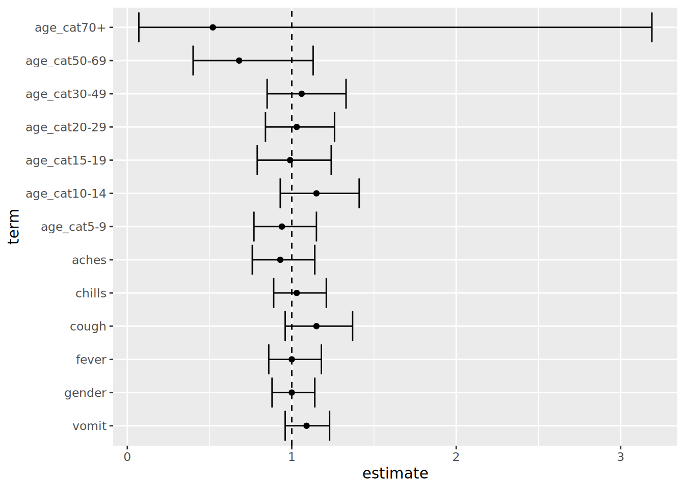
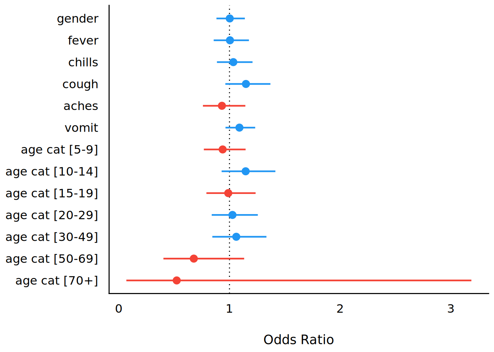

# 19  Tek değişkenli ve çok değişkenli regresyon

Bu sayfa, “glm()” ve **gtsummary** paketi gibi **base** R regresyon fonksiyonlarının kullanımını gösterir. Değişkenler arasındaki ilişkilere bakarak bunu yapar (örneğin, odds oranları, risk oranları ve tehlike oranları). Ayrıca regresyon çıktılarını temizlemek için **broom** paketindeki ‘tidy()’ gibi fonksiyonları kullanır.

1.  Tek değişkenli: ikiye iki tablo
2.  Tabakalı: mantel-haenszel tahminleri
3.  Çok değişkenli: değişken seçimi, model seçimi, final tablosu
4.  Forest Grafikleri

Cox orantılı tehlike regresyonu için \[Hayatta kalma analizi\] sayfasına bakınız.

***NOT:*** *Multivariable* (çok değişkenli) terimini, birden fazla açıklayıcı değişken içeren bir regresyona atıfta bulunmak için kullanırız. Bu anlamda *multivariate* bir model, çeşitli sonuçları olan bir regresyon olacaktır - ayrıntılar için [editoryal](https://www.ncbi.nlm.nih.gov/pmc/articles/PMC3518362/) e bakabilirsiniz

## 19.1 Hazırlık

### Paketleri yükleyin

Bu kod parçası, analizler için gerekli olan paketlerin yüklenmesini gösterir. Bu el kitabında, gerekirse paketi kuran *ve* kullanım için yükleyen **pacman**’dan `p_load()` vurgusunu yapıyoruz. **base** R’dan `library()` ile kurulu paketleri de yükleyebilirsiniz. R paketleri hakkında daha fazla bilgi için \[R basics\] sayfasına bakın.

``` r
pacman::p_load(
  rio,          # Dosyayı içe aktarma
  here,         # Dosyayı konumlama
  tidyverse,    # veri yönetimi + ggplo2 grafikleri 
  stringr,      # metin dizelerini düzenle 
  purrr,        # düzenli bir şekilde nesneler üzerinde döngü sağlama
  gtsummary,    # özet istatistikler ve testler
  broom,        # regresyonlardan elde edilen sonuçları toparlama
  lmtest,       # olasılık oranı testleri
  parameters,   # regresyonlardan elde edilen sonuçları toparlamaya alternatif
  see, # Forest grafiklerini görselleştirmeye alternatif
  appliedepidata # bu el kitabında kullanılan örnek veriler
  )
```

### Verileri içe aktar

Simüle edilmiş bir Ebola salgınından vakaların veri setini içe aktarıyoruz. Doğrudan `appliedepidata::get_data(name = "linelist_cleaned_rds")` ile yükleyin (ayrıntılar için [El kitabı ve veri indirme](download.llms.md) sayfasına bakın).

``` r
# Vaka listesini içe aktarma
linelist <- appliedepidata::get_data(name = "linelist_cleaned_rds")
```

Vaka listesinin ilk 50 satırı aşağıda görüntülenir.

### Temiz veri

#### Açıklayıcı değişkenleri saklayın

Açıklayıcı sütunların adlarını bir karakter vektörü olarak saklıyoruz. Buna daha sonra atıfta bulunulacaktır.

``` r
## ilgilenilen değişkenleri tanımlama 
explanatory_vars <- c("gender", "fever", "chills", "cough", "aches", "vomit")
```

#### 1’lere ve 0’lara dönüştür

Aşağıda, lojistik regresyon modellerinin beklentileriyle işbirliği yapmak için “evet”/“hayır”, “e”/“k” ve “ölü”/“canlı” olan açıklayıcı sütunları **1/0**’a çeviriyoruz. Bunu verimli bir şekilde yapmak için, aynı anda birden çok sütunu dönüştürmek için **dplyr**’den ‘across()’ kullanıldı. Her sütuna uyguladığımız fonksiyon, belirtilen değerleri 1’lere ve 0’lara dönüştürmek için mantık uygulayan ‘case_when()’ (ayrıca **dplyr**) fonksiyonudur. [Temizleme verileri ve temel işlevler sayfasındaki](cleaning.llms.md#clean_across) ‘across()’ ve ‘case_when()’ ile ilgili bölümlere bakınız

Not: “.” aşağıdaki, ‘across()’ tarafından işlenmekte olan sütunu temsil eder.

``` r
## ikili değişkenleri 0/1'e dönüştür
linelist <- linelist %>%  
  mutate(across(                                      
    .cols = all_of(c(explanatory_vars, "outcome")),  ## listelenen her sütun ve "sonuç" için
    .fns = ~case_when(                              
      . %in% c("m", "yes", "Death")   ~ 1,           ## erkek, evet ve ölü'yü 1 olarak yeniden kodla
      . %in% c("f", "no",  "Recover") ~ 0,           ## kadın, hayır ve iyileşme'yi sıfır olarak kodla
      TRUE                            ~ NA_real_)    ## geri kalanını kayıp veri olarak kaydet
    )
  )
```

#### Eksik değerlere sahip satırları bırakın

Eksik değerleri olan satırları bırakmak için, **tidyr** `drop_na()` fonksiyonunu kullanabilirsiniz. Ancak, bunu yalnızca ilgilenilen sütunlarda değerleri eksik olan satırlar için yapmak istiyoruz.

Yapmamız gereken ilk şey, “explanatory_vars” vektörümüzün “age” sütununu içerdiğinden emin olmaktır (“age”, yalnızca ikili değişkenler için olan önceki “case_when()” işleminde bir hata üretebilirdi). Ardından, “outcome” sütununda veya “explanatory_vars” sütunlarından herhangi birinde eksik değerleri olan satırları kaldırmak için “linelist”i “drop_na()”ya yönlendiririz.

Kodu çalıştırmadan önce, ‘linelist’teki satır sayısı ’nrow(linelist)’ şeklindedir.

``` r
## açıklayıcı değişkenlere age_category ekleyin 
explanatory_vars <- c(explanatory_vars, "age_cat")

## ilgilenilen değişkenler için eksik bilgi içeren satırları bırak 
linelist <- linelist %>% 
  drop_na(any_of(c("outcome", explanatory_vars)))
```

‘linelist’te’ kalan satır sayısı ‘nrow(linelist)’ şeklindedir.

## 19.2 Tek değişkenli

Tıpkı [Açıklayıcı tablolar](https://epirhandbook.com/descriptive-tables.html) sayfasında olduğu gibi, kullandığınız senaryo hangi R paketini kullanacağınızı belirleyecektir. Tek değişkenli analiz yapmak için iki seçenek sunuyoruz:

- Sonuçları konsola hızlı bir şekilde yazdırmak için **base** R’da bulunan fonksiyonları kullanın. Çıktıları düzenlemek için **broom** paketini kullanın.
- Yayına hazır çıktıları modellemek ve almak için **gtsummary** paketini kullanın

### **base** R

#### Doğrusal (Lineer) regresyon

**base** R fonskiyonu ‘lm()’, sayısal yanıt ile doğrusal bir ilişkiye sahip olduğu varsayılan açıklayıcı değişkenler arasındaki ilişkiyi değerlendirerek doğrusal regresyon gerçekleştirir.

Denklemi, yanıt ve açıklayıcı sütun adları yaklaşık bir “~” ile ayrılmış şekilde bir formül olarak sağlayın. Ayrıca, veri kümesini `data =` olarak belirtin. Model sonuçlarını daha sonra kullanmak üzere bir R nesnesi olarak tanımlayın.

``` r
lm_results <- lm(ht_cm ~ age, data = linelist)
```

Daha sonra katsayıları (Tahminler), P-değerini, artıkları ve diğer ölçüleri görmek için model sonuçlarında “summary()” komutunu çalıştırabilirsiniz.

``` r
summary(lm_results)
```


    Call:
    lm(formula = ht_cm ~ age, data = linelist)

    Residuals:
         Min       1Q   Median       3Q      Max 
    -128.579  -15.854    1.177   15.887  175.483 

    Coefficients:
                Estimate Std. Error t value Pr(>|t|)    
    (Intercept)  69.9051     0.5979   116.9   <2e-16 ***
    age           3.4354     0.0293   117.2   <2e-16 ***
    ---
    Signif. codes:  0 '***' 0.001 '**' 0.01 '*' 0.05 '.' 0.1 ' ' 1

    Residual standard error: 23.75 on 4165 degrees of freedom
    Multiple R-squared:  0.7675,    Adjusted R-squared:  0.7674 
    F-statistic: 1.375e+04 on 1 and 4165 DF,  p-value: < 2.2e-16

Alternatif olarak, **broom** paketindeki `tidy()` fonksiyonunu kullanabilirsiniz. Sonuçlar bir tabloya dönüştürülür. Sonuçlarda her yıl yaş arttıkça boy da 3.5 cm artıyor ve bu istatistiksel olarak anlamlıdır.

``` r
tidy(lm_results)
```

    # A tibble: 2 × 5
      term        estimate std.error statistic p.value
      <chr>          <dbl>     <dbl>     <dbl>   <dbl>
    1 (Intercept)    69.9     0.598       117.       0
    2 age             3.44    0.0293      117.       0

Daha sonra bu regresyonu bir **ggplot**’a eklemek için de kullanabilirsiniz, bunu yapmak için önce **broom**dan ‘augment()’ fonksiyonunu kullanarak gözlemlenen veri ve uygun çizgi için noktaları tek bir veri çerçevesine çekeriz.

``` r
## regresyon noktalarını ve gözlemlenen verileri tek bir veri kümesine çekin
points <- augment(lm_results)

## x ekseni olarak yaşı kullanarak verileri grafikleştirin
ggplot(points, aes(x = age)) + 
  ## boy için noktalar koyun 
  geom_point(aes(y = ht_cm)) + 
  ## regresyon çizginizi çizin 
  geom_line(aes(y = .fitted), colour = "red")
```

[](regression_files/figure-html/lin_reg_res_plot-1.png)

Ayrıca, “geom_smooth()” fonksiyonunu kullanarak **ggplot**’a doğrudan basit bir doğrusal regresyon eklemek de mümkündür.

``` r
## verinizi bir grafiğe ekleyin 
 ggplot(linelist, aes(x = age, y = ht_cm)) + 
  ## noktaları gösterin
  geom_point() + 
  ## lineer regresyon ekleyin 
  geom_smooth(method = "lm", formula = y ~ x, se = FALSE)
```

[](regression_files/figure-html/geom_smooth-1.png)

Daha ayrıntılı öğreticiler için bu bölümün sonundaki Kaynak bölümüne bakabilirsiniz.

#### Lojistik regresyon

**stats** paketindeki (**base** R’ın bir parçası) ‘glm()’ fonksiyonu, Genelleştirilmiş Doğrusal Modellere (GLM) uymak için kullanılır.

`glm()`, tek değişkenli ve çok değişkenli lojistik regresyon için kullanılabilir (örneğin, Odds Ratio’ları elde etmek için). İşte temel parçalar:

``` r
# glm() için değişkenler
glm(formula, family, data, weights, subset, ...)
```

- `formula =` Model `glm()` için bir denklem olarak sağlanır, tilde `~` nin solunda çıktı, sağında açıklayıcı değişkenler bulunur.
- `family =` Bu, çalıştırılacak modelin türünü belirler. Lojistik regresyon için `family = "binomial"` kullanın, poisson için `family = "poisson"` kullanın. Diğer örnekler aşağıdaki tablodadır.
- `data =` Veri çerçevenizi belirtin

Gerekirse, bağlantı işlevini `family = familytype(link = "linkfunction"))` sözdizimi aracılığıyla da belirtebilirsiniz. Diğer aileler ve ‘ağırlıklar =’ ve ‘alt küme =’ (‘?glm’) gibi isteğe bağlı bağımsız değişkenler hakkındaki belgelerde daha fazlasını okuyabilirsiniz.

| Family               | Varsayılan bağlantı fonksiyonu               |
|----------------------|----------------------------------------------|
| `"binomial"`         | `(link = "logit")`                           |
| `"gaussian"`         | `(link = "identity")`                        |
| `"Gamma"`            | `(link = "inverse")`                         |
| `"inverse.gaussian"` | `(link = "1/mu^2")`                          |
| `"poisson"`          | `(link = "log")`                             |
| `"quasi"`            | `(link = "identity", variance = "constant")` |
| `"quasibinomial"`    | `(link = "logit")`                           |
| `"quasipoisson"`     | `(link = "log")`                             |

`glm()` çalıştırıldığında, sonuçların adlandırılmış bir R nesnesi olarak kaydedilmesi en yaygın yöntemdir. Ardından, aşağıda gösterildiği gibi `summary()` kullanarak sonuçları konsolunuza yazdırabilir veya sonuçlar üzerinde diğer işlemleri gerçekleştirebilirsiniz ( örneğin; üstünü almak gibi).

Negatif bir binom regresyonu çalıştırmanız gerekiyorsa **MASS** paketini kullanabilirsiniz; “glm.nb()”, “glm()” ile aynı sözdizimini kullanır. Farklı regresyonların gözden geçirilmesi için [UCLA istatistik sayfasına](https://stats.idre.ucla.edu/other/dae/) bakabilirsiniz.

#### Tek değişkenli `glm()`

Bu örnekte, farklı yaş kategorileri ile ölümün sonucu arasındaki ilişkiyi değerlendiriyoruz (Hazırlık bölümünde 1 olarak kodlanmıştır). Aşağıda, “age_cat” tarafından “sonucun” tek değişkenli bir modeli verilmiştir. Model çıktısını `model` olarak kaydedip ardından `summary()` ile konsola yazdırıyoruz. Sağlanan tahminlerin *log oranları* olduğunu ve temel seviyenin “age_cat” (“0-4”) birinci faktör seviyesi olduğunu unutmayınız.

``` r
model <- glm(outcome ~ age_cat, family = "binomial", data = linelist)
summary(model)
```


    Call:
    glm(formula = outcome ~ age_cat, family = "binomial", data = linelist)

    Coefficients:
                  Estimate Std. Error z value Pr(>|z|)   
    (Intercept)   0.233738   0.072805   3.210  0.00133 **
    age_cat5-9   -0.062898   0.101733  -0.618  0.53640   
    age_cat10-14  0.138204   0.107186   1.289  0.19726   
    age_cat15-19 -0.005565   0.113343  -0.049  0.96084   
    age_cat20-29  0.027511   0.102133   0.269  0.78765   
    age_cat30-49  0.063764   0.113771   0.560  0.57517   
    age_cat50-69 -0.387889   0.259240  -1.496  0.13459   
    age_cat70+   -0.639203   0.915770  -0.698  0.48518   
    ---
    Signif. codes:  0 '***' 0.001 '**' 0.01 '*' 0.05 '.' 0.1 ' ' 1

    (Dispersion parameter for binomial family taken to be 1)

        Null deviance: 5712.4  on 4166  degrees of freedom
    Residual deviance: 5705.1  on 4159  degrees of freedom
    AIC: 5721.1

    Number of Fisher Scoring iterations: 4

Belirli bir değişkenin temel seviyesini değiştirmek için, sütunun Faktör sınıfı olduğundan emin olun ve istenen seviyeyi `fct_relevel()` ile ilk konuma taşıyın (\[Faktörler\] sayfasındaki sayfaya bakabilirsiniz). Örneğin, aşağıda ‘age_cat’ sütununu alıyoruz ve değiştirilmiş veri çerçevesini ‘glm()’ içine aktarmadan önce temel olarak “20-29” ayarlıyoruz.

``` r
linelist %>% 
  mutate(age_cat = fct_relevel(age_cat, "20-29", after = 0)) %>% 
  glm(formula = outcome ~ age_cat, family = "binomial") %>% 
  summary()
```


    Call:
    glm(formula = outcome ~ age_cat, family = "binomial", data = .)

    Coefficients:
                 Estimate Std. Error z value Pr(>|z|)    
    (Intercept)   0.26125    0.07163   3.647 0.000265 ***
    age_cat0-4   -0.02751    0.10213  -0.269 0.787652    
    age_cat5-9   -0.09041    0.10090  -0.896 0.370220    
    age_cat10-14  0.11069    0.10639   1.040 0.298133    
    age_cat15-19 -0.03308    0.11259  -0.294 0.768934    
    age_cat30-49  0.03625    0.11302   0.321 0.748390    
    age_cat50-69 -0.41540    0.25891  -1.604 0.108625    
    age_cat70+   -0.66671    0.91568  -0.728 0.466546    
    ---
    Signif. codes:  0 '***' 0.001 '**' 0.01 '*' 0.05 '.' 0.1 ' ' 1

    (Dispersion parameter for binomial family taken to be 1)

        Null deviance: 5712.4  on 4166  degrees of freedom
    Residual deviance: 5705.1  on 4159  degrees of freedom
    AIC: 5721.1

    Number of Fisher Scoring iterations: 4

#### Sonuçları yazdırmak

Çoğu kullanım için, yukarıdaki çıktılarda birkaç değişiklik yapılmalıdır. **broom** paketindeki ‘tidy()’ fonksiyonu, model sonuçlarını sunulabilir kılmak için uygundur.

Burada model çıktılarının bir sayım tablosuyla nasıl birleştirileceğini gösteriyoruz.

1.  Modeli “tidy()” öğesine geçirerek ve “üssel = TRUE” ve “conf.int = TRUE” ayarını yaparak *üslü* log odds oranı tahminlerini ve güven aralıklarını(GA) alın.

``` r
model <- glm(outcome ~ age_cat, family = "binomial", data = linelist) %>% 
  tidy(exponentiate = TRUE, conf.int = TRUE) %>%        # GA'larını üret ve üstelleştir
  mutate(across(where(is.numeric), ~ round(.x, digits = 2)))  # tüm sayısal sütunları yuvarla
```

Çıktı alınan tibble ‘model’ aşağıdadır:

2.  Bu model sonuçlarını bir sayım tablosuyla birleştirin. Aşağıda, \[Açıklayıcı tablolar\] sayfasında anlatıldığı gibi, **janitor**’dan ‘tabyl()’ fonksiyonuyla bir sayımlar çapraz tablosunu oluşturuyoruz.

``` r
counts_table <- linelist %>% 
  janitor::tabyl(age_cat, outcome)
```

Bu “counts_table” veri çerçevesi şöyle görünür:

Şimdi ‘counts_table’ ve ‘model’ sonuçlarını ‘bind_cols()’ (**dplyr**) ile yatay olarak birbirine bağlayabiliriz. `bind_cols()` ile iki veri çerçevesindeki satırların mükemmel şekilde hizalanması gerektiğini unutmayın. Bu kodda, bir tünel zinciri içinde bağlı olduğumuz için, tünelli nesneyi “counts_table” olarak temsil etmek için “.” kullanırız ve onu “model”e bağlarız. İşlemi bitirmek için, istenen sütunları ve sıralarını seçmek için ‘select()’ kullanırız ve son olarak 2 ondalık basamak belirtmek için tüm sayısal sütunlara **base** R ‘round()’ fonksiyonunu uygularız.

``` r
combined <- counts_table %>%           # sayım tablosuyla başla
  bind_cols(., model) %>%              # regresyonun çıktıları ile birleştir 
  select(term, 2:3, estimate,          # sütunları seç ve yeniden düzenle
         conf.low, conf.high, p.value) %>% 
  mutate(across(where(is.numeric), ~ round(.x, digits = 2))) ## 2 basamak şeklinde yuvarla
```

Birleştirilmiş veri çerçevesinin nasıl göründüğü, **flextable** fonksiyonuyla güzel bir görüntü olarak yazdırılmıştır. \[Tablolar sunum\], bu tür tabloların **flextable** ile nasıl özelleştirileceğini veya **knitr** veya **GT** gibi çok sayıda başka paketin nasıl kullanılacağını açıklar.

``` r
combined <- combined %>% 
  flextable::qflextable()
```

#### Birden çok tek değişkenli modeli döngüye alma

Aşağıda daha basit bir yaklaşım için `glm()` ve `tidy()` kullanan bir yöntem sunuyoruz, **gtsummary** bölümüne bakın.

Tek değişkenli olasılık oranları (yani birbirini kontrol etmeyen) üretmek için modelleri çeşitli maruziyet değişkenleri üzerinde çalıştırmak için aşağıdaki yaklaşımı kullanabilirsiniz. Tek değişkenli formüller oluşturmak için **stringr**’den `str_c()` kullanır (bkz. [Karakterler ve dizeler](characters_strings.llms.md)), her formül üzerinde `glm()` regresyonunu çalıştırır, her `glm()` çıktısını `tidy()` fonksiyonuna aktarır ve son olarak **tidyr**’den `bind_rows()` ile birlikte tüm model çıktılarını daraltır. Bu yaklaşım, yineleme için **purrr** paketinden `map()` kullanır - bu araç hakkında daha fazla bilgi için \[Yineleme, döngüler ve listeler\] sayfasına bakın.

1.  Açıklayıcı değişkenlerin sütun adlarından oluşan bir vektör oluşturun. Bunu zaten bu sayfanın Hazırlık bölümünden ‘açıklayıcı_değişkenler’ olarak aldık.

2.  Solda “sonuç” ve sağda “açıklayıcı_değişkenler”den bir sütun adı ile birden çok dize formülü oluşturmak için “str_c()” kullanın. “.” noktası, “açıklayıcı_değişkenler”deki sütun adının yerini alır.

``` r
explanatory_vars %>% str_c("outcome ~ ", .)
```

    [1] "outcome ~ gender"  "outcome ~ fever"   "outcome ~ chills" 
    [4] "outcome ~ cough"   "outcome ~ aches"   "outcome ~ vomit"  
    [7] "outcome ~ age_cat"

3.  Bu dizi formüllerini ‘map()’ öğesine iletin ve her girişe uygulanacak fonksiyon olarak ‘~glm()’ öğesini ayarlayın. “glm()” içinde, regresyon formülünü “as.formula(.x)” olarak ayarlayın, burada “.x”, yukarıdaki adımda tanımlanan dizi formülüyle değiştirilecektir. `map()`, her biri için gerilemeler çalıştırarak, dizi formüllerinin her biri üzerinde döngü yapacaktır.

4.  Bu ilk ‘map()’ çıktıları, regresyon çıktılarına ‘tidy()’ uygulayan ikinci bir ‘map()’ komutuna iletilir.

5.  Son olarak, ikinci ‘map()’ çıktısı (düzenlenmiş veri çerçevelerinin bir listesi) ‘bind_rows()’ ile yoğunlaştırılır, bu da tüm tek değişkenli sonuçları içeren bir veri çerçevesiyle sonuçlanır.

``` r
models <- explanatory_vars %>%       # ilgilenilen değişkenlerle başla
  str_c("outcome ~ ", .) %>%         # her değişkeni formüle birleştir ("outcome ~ variable of interest")
  
  # her tek değişkenli formülü yineleyin
  map(                               
    .f = ~glm(                       # formülleri birer birer glm() öğesine iletin
      formula = as.formula(.x),      # glm() içinde, dizİ formülü .x'tir
      family = "binomial",           # glm (logistic) tipini belirle
      data = linelist)) %>%          # veri kümesi
  
  # glm regresyon çıktılarının her birini düzenleyin
  map(
    .f = ~tidy(
      .x, 
      exponentiate = TRUE,           # üstelleştirme 
      conf.int = TRUE)) %>%          # güven aralığına dönme
  
  # regresyon çıktılarının listesini bir veri çerçevesine daralt
  bind_rows() %>% 
  
  # tüm sayısal sütunları yuvarla
  mutate(across(where(is.numeric), ~ round(.x, digits = 2)))
```

Bu sefer, son nesne ‘modelleri’ daha uzundur çünkü artık birkaç tek değişkenli regresyonun birleşik sonuçlarını temsil etmektedir. Tüm “model” satırlarını görmek için tıklayın.

Daha önce olduğu gibi, her açıklayıcı değişken için ‘vaka listesi’nden bir sayım tablosu oluşturabilir, onu ’modellere’ bağlayabilir ve güzel bir tablo yapabiliriz. Değişkenlerle başlıyoruz ve onları `map()` ile yineliyoruz. **dplyr** fonksiyonlarıyla bir sayım tablosu oluşturmayı içeren kullanıcı tanımlı bir fonksiyonu yineliyoruz. Daha sonra sonuçlar birleştirilir ve ‘modeller’ model sonuçlarıyla birleştirilir.

``` r
## Her açıklayıcı değişken için
univ_tab_base <- explanatory_vars %>% 
  map(.f = 
    ~{linelist %>%                ## vaka listesiyle başla
        group_by(outcome) %>%     ## veri setini çıktıya göre gruplandırma
        count(.data[[.x]]) %>%    ## ilgilenilen değişken için sayılar üret
        pivot_wider(              ## geniş formata yayılma (çapraz tablodaki gibi)
          names_from = outcome,
          values_from = n) %>% 
        drop_na(all_of(.x)) %>%         ## eksik olan satırları bırak
        rename("variable" = all_of(.x)) %>%      ## ilgili sütununun değişkenini "değişken" olarak değiştir
        mutate(variable = as.character(variable))} ## karaktere dönüştürün, aksi takdirde ikili olmayan (kategorik) değişkenler faktör olarak ortaya çıkar ve birleştirilemez
      ) %>% 
  
  ## sayım çıktılarının listesini bir veri çerçevesine daralt
  bind_rows() %>% 
  
  ## regresyon çıktıları ile birleştirme 
  bind_cols(., models) %>% 
  
  ## yalnızca ilgilenilen sütunları tutma 
  select(term, 2:3, estimate, conf.low, conf.high, p.value) %>% 
  
  ## ondalık basamakları yuvarla
  mutate(across(where(is.numeric), ~ round(.x, digits = 2)))
```

Aşağıda veri çerçevesinin neye benzediği görülmektedir. Bu tablonun güzel HTML çıktısına nasıl dönüştürüleceği hakkında fikirler için \[Tablolar\] hakkındaki sayfaya bakın (ör. **flextable** ile).

### **gtsummary** paketi

Aşağıda **gtsummary** paketinden `tbl_uvregression()` kullanımını sunuyoruz. Tıpkı [Tanımlayıcı tablolar](https://epirhandbook.com/descriptive-tables.html) sayfasındaki gibi, **gtsummary** fonksiyonları istatistikleri çalıştırmada *ve* profesyonel görünümlü çıktılar üretmede iyi bir iş çıkarır. Bu fonksiyon, tek değişkenli regresyon sonuçlarının bir tablosunu üretir.

‘Vaka listesi’nden (açıklayıcı değişkenler ve sonuç değişkeni) yalnızca gerekli sütunları seçiyoruz ve bunları ’tbl_uvregression()’ içine aktarıyoruz. Veri Hazırlama bölümünde ‘açıklayıcı_değişkenler’ olarak tanımladığımız sütunların her biri üzerinde (cinsiyet, ateş, titreme, öksürük, ağrı, kusmuk ve yaş_kedi) tek değişkenli regresyon uygulayacağız.

Fonksiyonun kendi içinde, `method =` as `glm` (tırnak işaretleri olmadan), `y =` sonuç sütununu (`outcome`) sağlarız, `family = binomial` yoluyla, lojistik regresyonu çalıştırmak istediğimizi `method.args =` ile belirtiriz. Ve ona sonuçları üslü hale getirmesini söylüyoruz.

Çıktı HTML’dir ve sayıları içermektedir.

``` r
univ_tab <- linelist %>% 
  dplyr::select(all_of(explanatory_vars), outcome) %>% ## ilgilenilen değişkenleri seç

  tbl_uvregression(                         ## tek değişkenli tablo üret
    method = glm,                           ## çalıştırmak istediğiniz regresyonu tanımlayın (genelleştirilmiş doğrusal model)
    y = outcome,                            ## sonuç değişkenini tanımlayın
    method.args = list(family = binomial),  ## ne tür bir glm çalıştırmak istediğini tanımla (lojistik)
    exponentiate = TRUE                     ## odds oranlarını üretmek için üstelleştir (logaritmik oranlar yerine)
  )

## tek değişkenli sonuç tablosunu göster 
univ_tab
```

[TABLE]

Bu tablo çıktısında, metin etiketlerini ayarlamak, satırları p değerlerine göre kalınlaştırmak vb. gibi birçok değişiklik yapabilirsiniz. Öğreticilere [buradan](http://www.danieldsjoberg.com/gtsummary/articles/tbl_regression%20.html) ve başka çevrimiçi yerlerden bakabilirsiniz.

## 19.3 Tabakalı

Tabakalı analiz **gtsummary** için halen geliştirilmektedir, bu sayfa zamanı gelince güncellenecektir.

## 19.4 Çok Değişkenli

Çok değişkenli analiz için yine iki yaklaşım sunuyoruz:

- `glm()` ve `tidy()`
- **gtsummary** paketi

İş akışı her biri için benzerdir ve yalnızca son tabloyu bir araya getirmenin son adımı farklıdır.

### Çok değişkenli yürütme

Burada `glm()` kullanıyoruz ama denklemin sağ tarafına artı sembolleriyle (`+`) ayırarak daha fazla değişken ekliyoruz.

Modeli tüm açıklayıcı değişkenlerimizle çalıştırmak için şunu çalıştırırız:

``` r
mv_reg <- glm(outcome ~ gender + fever + chills + cough + aches + vomit + age_cat, family = "binomial", data = linelist)

summary(mv_reg)
```


    Call:
    glm(formula = outcome ~ gender + fever + chills + cough + aches + 
        vomit + age_cat, family = "binomial", data = linelist)

    Coefficients:
                  Estimate Std. Error z value Pr(>|z|)
    (Intercept)   0.069054   0.131726   0.524    0.600
    gender        0.002448   0.065133   0.038    0.970
    fever         0.004309   0.080522   0.054    0.957
    chills        0.034112   0.078924   0.432    0.666
    cough         0.138584   0.089909   1.541    0.123
    aches        -0.070705   0.104078  -0.679    0.497
    vomit         0.086098   0.062618   1.375    0.169
    age_cat5-9   -0.063562   0.101851  -0.624    0.533
    age_cat10-14  0.136372   0.107275   1.271    0.204
    age_cat15-19 -0.011074   0.113640  -0.097    0.922
    age_cat20-29  0.026552   0.102780   0.258    0.796
    age_cat30-49  0.059569   0.116402   0.512    0.609
    age_cat50-69 -0.388964   0.262384  -1.482    0.138
    age_cat70+   -0.647443   0.917375  -0.706    0.480

    (Dispersion parameter for binomial family taken to be 1)

        Null deviance: 5712.4  on 4166  degrees of freedom
    Residual deviance: 5700.2  on 4153  degrees of freedom
    AIC: 5728.2

    Number of Fisher Scoring iterations: 4

İki değişken ve aralarında bir etkileşim eklemek istiyorsanız, bunları “+” yerine yıldız işareti “\*” ile ayırabilirsiniz. Yalnızca etkileşimi belirtiyorsanız, bunları iki nokta üst üste `:` ile ayırın. Örneğin:

``` r
glm(outcome ~ gender + age_cat * fever, family = "binomial", data = linelist)
```

*İsteğe bağlı olarak*, bu kodu, önceden tanımlanmış sütun adları vektöründen yararlanmak ve `str_c()` kullanarak yukarıdaki komutu yeniden oluşturmak için kullanabilirsiniz. Bu, açıklayıcı değişken adlarınız değişiyorsa veya hepsini yeniden yazmak istemiyorsanız yararlı olabilir.

``` r
##  ilgilenilen tüm değişkenlerle bir regresyon çalıştırın 
mv_reg <- explanatory_vars %>%  ## açıklayıcı sütun adlarının vektörüyle başlayın
  str_c(collapse = "+") %>%     ## bir artı ile ayrılmış ilgilenilen değişkenlerin tüm adlarını birleştirin
  str_c("outcome ~ ", .) %>%    ## formül stilinde sonuç ile ilgilenilen değişkenlerin adlarını birleştirin
  glm(family = "binomial",      ## glm tipini lojistik olarak tanımlayın
      data = linelist)          ## veri setinizi tanımlayın
```

#### Modeli oluşturma

Belirli açıklayıcı değişkenleri içeren çeşitli modelleri kaydederek modelinizi adım adım oluşturabilirsiniz. Bu modelleri, aşağıdaki gibi **lmtest** paketinden `lrtest()` kullanarak olasılık-oran testleri ile karşılaştırabilirsiniz:

***NOT:*** **base** `anova(model1, model2, test = "Chisq)` kullanılması aynı sonuçları verir

``` r
model1 <- glm(outcome ~ age_cat, family = "binomial", data = linelist)
model2 <- glm(outcome ~ age_cat + gender, family = "binomial", data = linelist)

lmtest::lrtest(model1, model2)
```

    Likelihood ratio test

    Model 1: outcome ~ age_cat
    Model 2: outcome ~ age_cat + gender
      #Df  LogLik Df Chisq Pr(>Chisq)
    1   8 -2852.6                    
    2   9 -2852.6  1 2e-04     0.9883

Diğer bir seçenek ise model nesnesini alıp **stats** paketinden `step()` fonksiyonunu uygulamaktır. Modeli oluştururken hangi değişken seçim yönünü kullanmak istediğinizi belirtin.

``` r
## AIC'ye (Akaike information criterion) dayalı ileri seçimi kullanarak bir model seçin
## yönü ayarlayarak "geri" veya "her ikisini" de yapabilirsiniz.
final_mv_reg <- mv_reg %>%
  step(direction = "forward", trace = FALSE)
```

Netlik için R oturumunuzda bilimsel gösterimi de kapatabilirsiniz:

``` r
options(scipen=999)
```

Tek değişkenli analiz bölümünde açıklandığı gibi, log oranlarını ve GA’nı üslendirmek için model çıktısını ‘tidy()’ öğesine iletin. Son olarak, tüm sayısal sütunları iki ondalık basamağa yuvarlarız. Tüm satırları görmek için kaydırın.

``` r
mv_tab_base <- final_mv_reg %>% 
  broom::tidy(exponentiate = TRUE, conf.int = TRUE) %>%  ## düzenli veri çerçevesinin tahminlerini elde edin 
  mutate(across(where(is.numeric), ~ round(.x, digits = 2)))          ## yuvarlama 
```

Ortaya çıkan veri çerçevesi şöyle görünür:

### Tek değişkenli ve çok değişkenli birleştirme

#### **gtsummary** ile birleştirme

**gtsummary** paketi, `tbl_regression()` fonksiyonunu sağlar. Bu fonksiyon, bir regresyondan (bu durumda `glm()`) elde edilen çıktıları alır ve güzel bir özet tablo üretir.

``` r
## son regresyonun sonuç tablosunu göster
mv_tab <- tbl_regression(final_mv_reg, exponentiate = TRUE)
```

Tabloyu görelim:

``` r
mv_tab
```

[TABLE]

**gtsummary** tarafından üretilen birkaç farklı çıktı tablosunu `tbl_merge()` fonksiyonuyla da birleştirebilirsiniz. Şimdi çok değişkenli sonuçları, oluşturduğumuz **gtsummary** *tek değişkenli* sonuçlarla birleştiriyoruz [yukarıda](#reg_gt_uni):

``` r
## tek değişkenli sonuçlarla birleştir
tbl_merge(
  tbls = list(univ_tab, mv_tab),                          # birleştir
  tab_spanner = c("**Univariate**", "**Multivariable**")) # başlık adlarını ayarla
```

[TABLE]

#### **dplyr** ile birleştirme

`glm()`/`tidy()` tek değişkenli ve çok değişkenli çıktıları birleştirmenin alternatif bir yolu, **dplyr** birleştirme fonksiyonlarıdır.

- Daha önceki tek değişkenli sonuçları (sayıları içeren ‘univ_tab_base’) derlenmiş çok değişkenli sonuçlar ‘mv_tab_base’ ile birleştirebilirsiniz
- Yalnızca istediğimiz sütunları tutmak, sıralarını belirlemek ve yeniden adlandırmak için `select()` kullanabilirsiniz
- Double sınıfı olan tüm sütunlarda iki ondalık basamakla `round()` kullanabilirsiniz

``` r
## tek ve çok değişkenli tabloları birleştir
left_join(univ_tab_base, mv_tab_base, by = "term") %>% 
  ## sütunları seç ve yeniden isimlendir
  select( # yeni isim =  eski isim
    "characteristic" = term, 
    "recovered"      = "0", 
    "dead"           = "1", 
    "univ_or"        = estimate.x, 
    "univ_ci_low"    = conf.low.x, 
    "univ_ci_high"   = conf.high.x,
    "univ_pval"      = p.value.x, 
    "mv_or"          = estimate.y, 
    "mvv_ci_low"     = conf.low.y, 
    "mv_ci_high"     = conf.high.y,
    "mv_pval"        = p.value.y 
  ) %>% 
  mutate(across(where(is.double), ~ round(.x, 2)))   
```

    # A tibble: 20 × 11
       characteristic recovered  dead univ_or univ_ci_low univ_ci_high univ_pval
       <chr>              <dbl> <dbl>   <dbl>       <dbl>        <dbl>     <dbl>
     1 (Intercept)          909  1168    1.28        1.18         1.4       0   
     2 gender               916  1174    1           0.88         1.13      0.97
     3 (Intercept)          340   436    1.28        1.11         1.48      0   
     4 fever               1485  1906    1           0.85         1.17      0.99
     5 (Intercept)         1472  1877    1.28        1.19         1.37      0   
     6 chills               353   465    1.03        0.89         1.21      0.68
     7 (Intercept)          272   309    1.14        0.97         1.34      0.13
     8 cough               1553  2033    1.15        0.97         1.37      0.11
     9 (Intercept)         1636  2114    1.29        1.21         1.38      0   
    10 aches                189   228    0.93        0.76         1.14      0.51
    11 (Intercept)          931  1144    1.23        1.13         1.34      0   
    12 vomit                894  1198    1.09        0.96         1.23      0.17
    13 (Intercept)          338   427    1.26        1.1          1.46      0   
    14 age_cat5-9           365   433    0.94        0.77         1.15      0.54
    15 age_cat10-14         273   396    1.15        0.93         1.42      0.2 
    16 age_cat15-19         238   299    0.99        0.8          1.24      0.96
    17 age_cat20-29         345   448    1.03        0.84         1.26      0.79
    18 age_cat30-49         228   307    1.07        0.85         1.33      0.58
    19 age_cat50-69          35    30    0.68        0.41         1.13      0.13
    20 age_cat70+             3     2    0.53        0.07         3.2       0.49
    # ℹ 4 more variables: mv_or <dbl>, mvv_ci_low <dbl>, mv_ci_high <dbl>,
    #   mv_pval <dbl>

## 19.5 Forest Grafiği

Bu bölüm, regresyonunuzun çıktılarıyla bir grafiğin nasıl üretileceğini gösterir. İki seçenek vardır, **ggplot2** kullanarak kendiniz bir grafik oluşturabilir veya **easystats** (birçok paket içeren bir paket) adlı bir meta paket kullanabilirsiniz.

**ggplot2** çizim paketine aşina değilseniz \[ggplot temelleri\] sayfasına bakın.

### **ggplot2** paketi

Çok değişkenli regresyon sonuçlarının öğelerini çizerek `ggplot()` ile bir Forest grafiği oluşturabilirsiniz. Bu “geomları” kullanarak grafiklerin katmanlarını ekleyin:

- `geom_point()` ile tahminler
- `geom_errorbar()` ile güven aralıkları
- OR(Odds Ratio)= 1’de `geom_vline()` ile dikey bir çizgi

Çizmeden önce, y eksenindeki değişkenlerin/seviyelerin sırasını ayarlamak için **forcats** paketinden `fct_relevel()` kullanmak isteyebilirsiniz. “ggplot()”, bu yaş kategorisi değerleri için iyi çalışmayan (“30”, “5”ten önce görünür) alfa-sayısal sırada görüntüleyebilir. Daha fazla ayrıntı için \[Faktörler\] sayfasına bakın.

``` r
## kesme değerini çok değişkenli sonuçlarınızdan kaldırın
mv_tab_base %>% 
  
  #y ekseni boyunca görünecek seviyelerin sırasını ayarlayın
  mutate(term = fct_relevel(
    term,
    "vomit", "gender", "fever", "cough", "chills", "aches",
    "age_cat5-9", "age_cat10-14", "age_cat15-19", "age_cat20-29",
    "age_cat30-49", "age_cat50-69", "age_cat70+")) %>%
  
  # grafikten "kesme değeri" satırını kaldır
  filter(term != "(Intercept)") %>% 
  
  ## değişkeni y eksenine göre grafikleştir, x eksenini tahmin et(OR)
  ggplot(aes(x = estimate, y = term)) +
  
  ## tahminini nokta olarak göster
  geom_point() + 
  
  ## güven aralıkları için bir hata çubuğu ekleyin
  geom_errorbar(aes(xmin = conf.low, xmax = conf.high)) + 
  
  ## OR = 1'in referans için nerede olduğunu kesikli çizgi olarak göster
  geom_vline(xintercept = 1, linetype = "dashed")
```

[](regression_files/figure-html/ggplot_forest-1.png)

### **easystats** paketleri

**ggplot2**’nin sağladığı iyi düzeyde kontrolü istemiyorsanız, alternatif olarak **easystats** paketlerinin bir kombinasyonunu kullanabilirsiniz.

**parameters** paketindeki ‘model_parameters()’ fonksiyonu, **broom** paket işlevi ‘tidy()’ ile eşdeğerdir. **see** paketi daha sonra bu çıktıları kabul eder ve bir “ggplot()” nesnesi olarak varsayılan bir Forest grafiği oluşturur.

``` r
pacman::p_load(easystats)

## kesme değerini çok değişkenli sonuçlarınızdan kaldırın 
final_mv_reg %>% 
  model_parameters(exponentiate = TRUE) %>% 
  plot()
```

[](regression_files/figure-html/easystats_forest-1.png)

## 19.6 Kaynaklar

Bu sayfanın içeriği şu kaynaklar ve çevrimiçi gösterimlerden yararlanılarak hazırlanmıştır.

[R’da Linear regression](https://www.datacamp.com/community/tutorials/linear-regression-R)

[gtsummary](http://www.danieldsjoberg.com/gtsummary/articles/tbl_regression.html)

[UCLA stats sayfası](https://stats.idre.ucla.edu/other/dae/)

[sthda stepwise regression](http://www.sthda.com/english/articles/36-classification-methods-essentials/150-stepwise-logistic-regression-essentials-in-r/)
