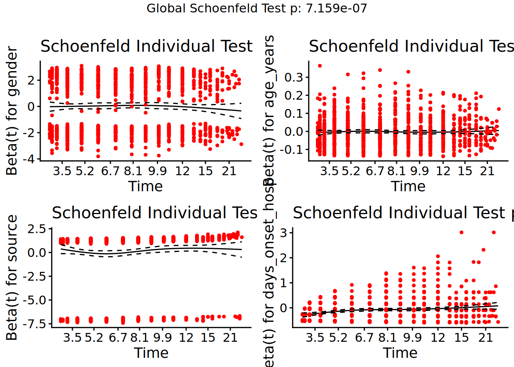
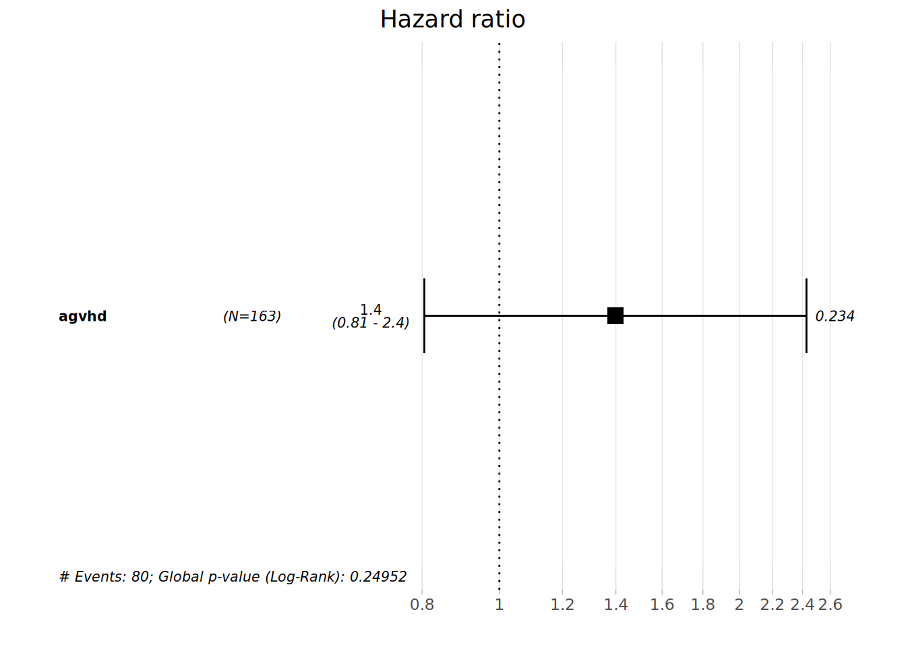

# 27  Sağkalım Analizi

[](../../images/survival_analysis.png)

## 27.1 Genel Bakış

*Sağkalım analizi*, belirli bir birey veya birey grubu için, ***başarısızlık*** (bir hastalığın ortaya çıkması, bir hastalıktan iyileşme, ölüm, tedaviye yanıttan sonra nüks…) olarak adlandırılan bir olay noktasını tanımlamaya odaklanır. Bu, bireylerin gözlemlendiği ***başarısızlık süresi*** (veya kohort/nüfus temelli çalışmalarda ***izleme süresi***) olarak adlandırılan bir süreden sonra ortaya çıkar. Başarısızlık süresini belirlemek için, daha sonra bir başlangıç zamanı tanımlamak gerekir (bu, dahil etme tarihi, teşhis tarihi olabilir…).

Sağkalım analizinin nihayi çıktısı, başlangıç noktası ile olay arasındaki zamandır. Mevcut tıbbi araştırmalarda, örneğin klinik çalışmalarda bir tedavinin etkisini veya çeşitli kanser sağkalım ölçümlerini değerlendirmek için kanser epidemiyolojisinde yaygın olarak kullanılmaktadır.

Genellikle ***sağkalım ihtimali*** ile ifade edilir;ki bu, ilgilenilen olayın t süresi boyunca gerçekleşmemiş olma olasılığıdır.

***Sansürleme***: Sansür; izlem sonunda, bazı kişilerin ilgilendikleri olay olmadığında ve bu nedenle gerçek zamanlarının bilinmediği durumlarda meydana gelir. Burada çoğunlukla sağdan sansürlemeye odaklanacağız, ancak genel olarak sansürleme ve sağkalım analizi hakkında daha fazla ayrıntı için referansları görebilirsiniz.

## 27.2 Hazırlık

### Paketleri yükleyin

R’da sağkalım analizlerini çalıştırmak için en yaygın kullanılan paketlerden biri **survival** paketidir. Önce o kurulur ve ardından bu bölümde kullanılacak diğer paketlerin yanı sıra o da yüklenir:

Bu el kitabında, gerekirse paketi kuran *ve* kullanım için yükleyen **pacman**’dan `p_load()` vurgusu yapılmaktadır. R tabanı’ndan `library()` ile kurulu paketler de yüklenebilir. R paketleri hakkında daha fazla bilgi için [R’ın temelleri](basics.llms.md) sayfasına bakabilirsiniz.

Bu sayfa, önceki sayfaların çoğunda kullanılan ve uygun bir sağkalım verisine sahip olmak için bazı değişiklikler uyguladığımız satır listesini kullanarak sağkalım analizlerini araştırmaktadır.

### Veri kümesini içe aktar

Simüle edilmiş bir Ebola salgınından vakaların veri seti içe aktarılmaktadır. Doğrudan `appliedepidata::get_data(name = "linelist_cleaned_rds")` ile yükleyin (ayrıntılar için [El kitabı ve veri indirme](download.llms.md) sayfasına bakın).

``` r
# import linelist
linelist_case_data <- appliedepidata::get_data(name = "linelist_cleaned_rds")
```

### Veri yönetimi ve dönüştürme

Kısacası, sağkalım verileri aşağıdaki üç özelliğe sahip olarak tanımlanabilir:

1.  Bağımlı değişken veya sonuç, iyi tanımlanmış bir olayın meydana gelmesine kadar geçen bekleme süresidir.
2.  Gözlemler, bazı birimler için verilerin analiz edildiği sırada ilgili olayın meydana gelmediği anlamında sansürlenir.
3.  Bekleme süresi üzerindeki etkisini değerlendirmek veya kontrol etmek istediğimiz öngörüler veya açıklayıcı değişkenler vardır.

Böylece, bu yapıya uymak ve sağkalım analizini yürütmek için gereken farklı değişkenler ortaya çıkarılmaktadır.

- Bu analiz için yeni bir veri çerçevesini `linelist_surv` olarak;
- İlgilendiğimiz olayı “ölüm” olarak; (dolayısıyla sağkalım olasılığımız, başlangıç zamanından belirli bir süre sonra sağkalım olasılığı olacaktır),
- Başlangıç zamanı ile sonuç zamanı arasındaki izlem süresini (`futime`) *gün olarak*;
- Sansürlenmiş hastalar iyileşen veya nihai sonucu bilinmeyen, yani “ölüm” olayının gözlemlenmediği hastalar olarak (`event=0`); tanımlanmaktadır.

***DİKKAT:*** Gerçek bir kohort çalışmasında, bireyler gözlendiğinde, başlangıç zamanı ve izlem sonu hakkındaki bilgiler bilindiği için, başlangıç tarihi veya sonuç tarihi bilinmiyorsa gözlemler kaldırılacaktır. Ayrıca başlangıç tarihinin sonuç tarihinden sonra olduğu durumlar da yanlış kabul edildiğinden kaldırılacaktır.

***İPUCU:*** Bir tarihe göre büyük (\>) veya küçük (\<) olarak filtrelemenin eksik değerlere sahip satırları kaldırabileceği göz önüne alındığında, filtreyi yanlış tarihlere uygulamak eksik tarihlere sahip satırları da kaldıracaktır.

Ardından, içinde yalnızca 3 yaş kategorisi bulunan bir `age_cat_small` sütunu oluşturmak için `case_when()` kullanılmaktadır.

``` r
#create a new data called linelist_surv from the linelist_case_data

linelist_surv <-  linelist_case_data %>% 
     
  dplyr::filter(
       # remove observations with wrong or missing dates of onset or date of outcome
       date_outcome > date_onset) %>% 
  
  dplyr::mutate(
       # create the event var which is 1 if the patient died and 0 if he was right censored
       event = ifelse(is.na(outcome) | outcome == "Recover", 0, 1), 
    
       # create the var on the follow-up time in days
       futime = as.double(date_outcome - date_onset), 
    
       # create a new age category variable with only 3 strata levels
       age_cat_small = dplyr::case_when( 
            age_years < 5  ~ "0-4",
            age_years >= 5 & age_years < 20 ~ "5-19",
            age_years >= 20   ~ "20+"),
       
       # previous step created age_cat_small var as character.
       # now convert it to factor and specify the levels.
       # Note that the NA values remain NA's and are not put in a level "unknown" for example,
       # since in the next analyses they have to be removed.
       age_cat_small = fct_relevel(age_cat_small, "0-4", "5-19", "20+")
       )
```

***İPUCU:*** Oluşturulan yeni sütunlar, `futime` hakkında bir özet ve oluşturulduğu `event` ve `outcome` arasında bir çapraz tablo yapılarak doğrulanabilir. Bu doğrulamanın yanı sıra, sağkalım analizi sonuçlarını yorumlarken medyan takip süresini iletmek iyi bir alışkanlıktır.

``` r
summary(linelist_surv$futime)
```

       Min. 1st Qu.  Median    Mean 3rd Qu.    Max. 
       1.00    6.00   10.00   11.98   16.00   64.00 

``` r
# cross tabulate the new event var and the outcome var from which it was created
# to make sure the code did what it was intended to
linelist_surv %>% 
  tabyl(outcome, event)
```

     outcome    0    1
       Death    0 1952
     Recover 1547    0
        <NA> 1040    0

Doğru atamaları sağlamak için yeni age_cat_small var ve eski age_cat sütunu çapraz tablo haline getirilmektedir.

``` r
linelist_surv %>% 
  tabyl(age_cat_small, age_cat)
```

     age_cat_small 0-4 5-9 10-14 15-19 20-29 30-49 50-69 70+ NA_
               0-4 834   0     0     0     0     0     0   0   0
              5-19   0 852   717   575     0     0     0   0   0
               20+   0   0     0     0   862   554    69   5   0
              <NA>   0   0     0     0     0     0     0   0  71

Şimdi, belirli değişkenlere (yeni oluşturulanlar dahil) bakarak `linelist_surv` verilerinin ilk 10 gözlemi gözden geçirilmektedir.

``` r
linelist_surv %>% 
  select(case_id, age_cat_small, date_onset, date_outcome, outcome, event, futime) %>% 
  head(10)
```

       case_id age_cat_small date_onset date_outcome outcome event futime
    1   8689b7           0-4 2014-05-13   2014-05-18 Recover     0      5
    2   11f8ea           20+ 2014-05-16   2014-05-30 Recover     0     14
    3   893f25           0-4 2014-05-21   2014-05-29 Recover     0      8
    4   be99c8          5-19 2014-05-22   2014-05-24 Recover     0      2
    5   07e3e8          5-19 2014-05-27   2014-06-01 Recover     0      5
    6   369449           0-4 2014-06-02   2014-06-07   Death     1      5
    7   f393b4           20+ 2014-06-05   2014-06-18 Recover     0     13
    8   1389ca           20+ 2014-06-05   2014-06-09   Death     1      4
    9   2978ac          5-19 2014-06-06   2014-06-15   Death     1      9
    10  fc15ef          5-19 2014-06-16   2014-07-09 Recover     0     23

Bu yeni sütunun cinsiyete göre dağılımı hakkında daha fazla ayrıntıya sahip olmak için `age_cat_small` ve `gender` sütunları da çapraz tablo haline getirilebilir. [Açıklayıcı tablolar](tables_descriptive.llms.md) sayfasında açıklandığı gibi **janitor**’dan `tabyl()` ve *adorn* fonksiyonları kullanılmaktadır.

``` r
linelist_surv %>% 
  tabyl(gender, age_cat_small, show_na = F) %>% 
  adorn_totals(where = "both") %>% 
  adorn_percentages() %>% 
  adorn_pct_formatting() %>% 
  adorn_ns(position = "front")
```

     gender         0-4          5-19           20+          Total
          f 482 (22.4%) 1,184 (54.9%)   490 (22.7%) 2,156 (100.0%)
          m 325 (15.0%)   880 (40.6%)   960 (44.3%) 2,165 (100.0%)
      Total 807 (18.7%) 2,064 (47.8%) 1,450 (33.6%) 4,321 (100.0%)

## 27.3 Sağkalım analizinin temelleri

### Sağkalım analiz materyali oluşturma

İzlem süresi ve olay sütunlarından bir hayatta kalma nesnesi oluşturmak için ilk olarak **survival**’den `Surv()` kısmını kullanılır.

Böyle bir adımın sonucu, zaman bilgisini ve ilgilenilen olayın (ölüm) gözlemlenip gözlemlenmediğini özetleştiren *surv* türünde bir nesne üretmektir. Bu nesne nihai olarak sonraki model formüllerinin sağ tarafında kullanılacaktır (bkz. [belgeler](https://cran.r-project.org/web/packages/survival/vignettes/survival.pdf)).

``` r
# Use Suv() syntax for right-censored data
survobj <- Surv(time = linelist_surv$futime,
                event = linelist_surv$event)
```

İncelemek için, burada yalnızca bazı önemli sütunları görüntüleyen `linelist_surv` verilerinin ilk 10 satırı verilmiştir.

``` r
linelist_surv %>% 
  select(case_id, date_onset, date_outcome, futime, outcome, event) %>% 
  head(10)
```

       case_id date_onset date_outcome futime outcome event
    1   8689b7 2014-05-13   2014-05-18      5 Recover     0
    2   11f8ea 2014-05-16   2014-05-30     14 Recover     0
    3   893f25 2014-05-21   2014-05-29      8 Recover     0
    4   be99c8 2014-05-22   2014-05-24      2 Recover     0
    5   07e3e8 2014-05-27   2014-06-01      5 Recover     0
    6   369449 2014-06-02   2014-06-07      5   Death     1
    7   f393b4 2014-06-05   2014-06-18     13 Recover     0
    8   1389ca 2014-06-05   2014-06-09      4   Death     1
    9   2978ac 2014-06-06   2014-06-15      9   Death     1
    10  fc15ef 2014-06-16   2014-07-09     23 Recover     0

Burada `survobj`un ilk 10 unsuru izlenmektedir. Esasen bir gözlemin sağdan sansürlenip sansürlenmediğini göstermek için, “+” ile birlikte izlem süresi vektörü olarak yazdırılır. Rakamların yukarıda ve aşağıda nasıl hizalandığını görülmektedir.

``` r
#print the 50 first elements of the vector to see how it presents
head(survobj, 10)
```

     [1]  5+ 14+  8+  2+  5+  5  13+  4   9  23+

### İlk analizleri çalıştırma

Gözlemlenen olay zamanlarında atlamalı bir adım fonksiyonu olan genel (marjinal) hayatta kalma eğrisinin ***Kaplan Meier*** (KM) tahminleri için varsayılan hesaplamalara uyan bir *survfit nesnesi* üretmek için `survfit()` işlevini kullanarak analize başlanır. Sonuçta *survfit nesnesi* bir veya daha fazla sağkalım eğrisi içerir ve model formülünde bir yanıt değişkeni olarak *Surv* nesnesi kullanılarak oluşturulur.

***NOT:*** Kaplan-Meier tahmini, sağkalım fonksiyonunun parametrik olmayan maksimum olabilirlik tahminidir (MLE). . (daha fazla bilgi için kaynaklara bakın).

Bu *survfit nesnesinin* özeti, *yaşam tablosu*’nu verecektir. Gerçekleşen (artan şekilde) bir olayın takip edilen her bir zaman adımı için (`time`):

- Olayı geliştirme riski altında olan kişi sayısı (henüz olaya sahip olmayan veya sansürlenmemiş kişiler: `n.risk`),
- Olayı geliştirenler: (`n.event`),
- Yukarıdakilerin devamı olarak: Olayın *gelişmeme* olasılığı (ölmeme veya belirli bir zamandan sonra sağkalım olasılığı) bulunur;
- Son olarak, bu olasılık için standart hata ve güven aralığı türetilir ve görüntülenir.

KM tahminleri, daha önce Surv nesnesi “survobj” un yanıt değişkeni olduğu formül kullanılarak oturtulur. Genel sağkalım için modeli çalıştırılan kesinlik “~ 1” ’dir.

``` r
# fit the KM estimates using a formula where the Surv object "survobj" is the response variable.
# "~ 1" signifies that we run the model for the overall survival  
linelistsurv_fit <-  survival::survfit(survobj ~ 1)

#print its summary for more details
summary(linelistsurv_fit)
```

    Call: survfit(formula = survobj ~ 1)

     time n.risk n.event survival std.err lower 95% CI upper 95% CI
        1   4539      30    0.993 0.00120        0.991        0.996
        2   4500      69    0.978 0.00217        0.974        0.982
        3   4394     149    0.945 0.00340        0.938        0.952
        4   4176     194    0.901 0.00447        0.892        0.910
        5   3899     214    0.852 0.00535        0.841        0.862
        6   3592     210    0.802 0.00604        0.790        0.814
        7   3223     179    0.757 0.00656        0.745        0.770
        8   2899     167    0.714 0.00700        0.700        0.728
        9   2593     145    0.674 0.00735        0.660        0.688
       10   2311     109    0.642 0.00761        0.627        0.657
       11   2081     119    0.605 0.00788        0.590        0.621
       12   1843      89    0.576 0.00809        0.560        0.592
       13   1608      55    0.556 0.00823        0.540        0.573
       14   1448      43    0.540 0.00837        0.524        0.556
       15   1296      31    0.527 0.00848        0.511        0.544
       16   1152      48    0.505 0.00870        0.488        0.522
       17   1002      29    0.490 0.00886        0.473        0.508
       18    898      21    0.479 0.00900        0.462        0.497
       19    798       7    0.475 0.00906        0.457        0.493
       20    705       4    0.472 0.00911        0.454        0.490
       21    626      13    0.462 0.00932        0.444        0.481
       22    546       8    0.455 0.00948        0.437        0.474
       23    481       5    0.451 0.00962        0.432        0.470
       24    436       4    0.447 0.00975        0.428        0.466
       25    378       4    0.442 0.00993        0.423        0.462
       26    336       3    0.438 0.01010        0.419        0.458
       27    297       1    0.436 0.01017        0.417        0.457
       29    235       1    0.435 0.01030        0.415        0.455
       38     73       1    0.429 0.01175        0.406        0.452

`summary()` kullanılırken `times` seçeneği eklenebilir ve sağkalım bilgisinin görülmek istendiği zamanlar belirtilebilir.

``` r
#print its summary at specific times
summary(linelistsurv_fit, times = c(5,10,20,30,60))
```

    Call: survfit(formula = survobj ~ 1)

     time n.risk n.event survival std.err lower 95% CI upper 95% CI
        5   3899     656    0.852 0.00535        0.841        0.862
       10   2311     810    0.642 0.00761        0.627        0.657
       20    705     446    0.472 0.00911        0.454        0.490
       30    210      39    0.435 0.01030        0.415        0.455
       60      2       1    0.429 0.01175        0.406        0.452

`print()` fonksiyonu da kullanılabilir. `print.rmean = TRUE` argümanı, ortalama sağkalım süresini ve standart hatayı (se) elde etmek için kullanılır.

***NOT:*** Kısıtlı ortalama sağkalım süresi (RMST), kanser sağkalım analizinde giderek daha fazla kullanılan ve kısıtlı T süresine kadar hastaları gözlemlediğimiz, göz önüne alındığında genellikle hayatta kalma eğrisinin altındaki alan olarak tanımlanan spesifik bir hayatta kalma ölçüsüdür. (Daha fazla ayrıntı için kaynaklar bölümüne bakın).

``` r
# print linelistsurv_fit object with mean survival time and its se. 
print(linelistsurv_fit, print.rmean = TRUE)
```

    Call: survfit(formula = survobj ~ 1)

            n events rmean* se(rmean) median 0.95LCL 0.95UCL
    [1,] 4539   1952   33.1     0.539     17      16      18
        * restricted mean with upper limit =  64 

***İPUCU:*** *surv nesnesi* doğrudan `survfit()` işlevinde oluşturulabilir ve bir kod satırı kaydedilebilir. Bu daha sonra şöyle görünecektir: `linelistsurv_quick <- survfit(Surv(futime, event) ~ 1, data=linelist_surv)`.

### Kümülatif risk

`summary()` işlevinin yanı sıra, `survfit()` nesnesinin yapısı hakkında daha fazla ayrıntı veren `str()` işlevi de kullanılabilir. Liste 16 unsurdan meydana gelir.

Bu unsurlardan önemli bir tanesi de sayısal bir vektör olan `cumhaz` ’dır. Bu, ***kümülatif risk*** in gösterilmesine izin verecek şekilde belirlenebilir, ***risk*** ***olayın anlık meydana gelme oranı*** dır (kaynaklara bakınız).

``` r
str(linelistsurv_fit)
```

    List of 17
     $ n        : int 4539
     $ time     : num [1:59] 1 2 3 4 5 6 7 8 9 10 ...
     $ n.risk   : num [1:59] 4539 4500 4394 4176 3899 ...
     $ n.event  : num [1:59] 30 69 149 194 214 210 179 167 145 109 ...
     $ n.censor : num [1:59] 9 37 69 83 93 159 145 139 137 121 ...
     $ surv     : num [1:59] 0.993 0.978 0.945 0.901 0.852 ...
     $ std.err  : num [1:59] 0.00121 0.00222 0.00359 0.00496 0.00628 ...
     $ cumhaz   : num [1:59] 0.00661 0.02194 0.05585 0.10231 0.15719 ...
     $ std.chaz : num [1:59] 0.00121 0.00221 0.00355 0.00487 0.00615 ...
     $ type     : chr "right"
     $ logse    : logi TRUE
     $ conf.int : num 0.95
     $ conf.type: chr "log"
     $ lower    : num [1:59] 0.991 0.974 0.938 0.892 0.841 ...
     $ upper    : num [1:59] 0.996 0.982 0.952 0.91 0.862 ...
     $ t0       : num 0
     $ call     : language survfit(formula = survobj ~ 1)
     - attr(*, "class")= chr "survfit"

### Kaplan-Meier eğrilerinin çizilmesi

KM tahminleri yerleştirildikten sonra, “Kaplan-Meier eğrisi” ni çizen temel `plot()` işlevi kullanılarak belirli bir süre boyunca sağkalım olasılığı görselleştirilebilir. Başka bir deyişle, aşağıdaki eğri, tüm hasta grubunda sağkalım deneyiminin geleneksel bir gösterimidir.

Eğrideki min ve max takip süresi hızlı bir şekilde doğrulanabilir.

Yorumlamanın kolay bir yolu, başlangıçta tüm katılımcıların hala hayatta olduğunu ve sağkalım olasılığının %100 olduğunu söylemektir. Hastalar öldükçe bu olasılık zamanla azalır. 60 günlük izlemden sağ kalanların oranı %40 civarındadır.

``` r
plot(linelistsurv_fit, 
     xlab = "Days of follow-up",    # x-axis label
     ylab="Survival Probability",   # y-axis label
     main= "Overall survival curve" # figure title
     )
```

[](survival_analysis_files/figure-html/unnamed-chunk-13-1.png)

KM sağkalım tahminlerinin güven aralığı da varsayılan olarak çizilir ve `plot()` komutuna `conf.int = FALSE` seçeneği eklenerek reddedilebilir.

İlgilenilen olay “ölüm” olduğu için, sağkalım oranlarının tamamlayıcılarını tanımlayan bir eğri çizmek, kümülatif ölüm oranlarının çizilmesini sağlayacaktır. Bu, mevcut bir çizime bilgi ekleyen `lines()` ile yapılabilir.

``` r
# original plot
plot(
  linelistsurv_fit,
  xlab = "Days of follow-up",       
  ylab = "Survival Probability",       
  mark.time = TRUE,              # mark events on the curve: a "+" is printed at every event
  conf.int = FALSE,              # do not plot the confidence interval
  main = "Overall survival curve and cumulative mortality"
  )

# draw an additional curve to the previous plot
lines(
  linelistsurv_fit,
  lty = 3,             # use different line type for clarity
  fun = "event",       # draw the cumulative events instead of the survival 
  mark.time = FALSE,
  conf.int = FALSE
  )

# add a legend to the plot
legend(
  "topright",                               # position of legend
  legend = c("Survival", "Cum. Mortality"), # legend text 
  lty = c(1, 3),                            # line types to use in the legend
  cex = .85,                                # parametes that defines size of legend text
  bty = "n"                                 # no box type to be drawn for the legend
  )
```

[](survival_analysis_files/figure-html/unnamed-chunk-14-1.png)

## 27.4 Sağkalım eğrilerinin karşılaştırılması

Gözlemlenen katılımcılarımızın veya hastalarımızın farklı gruplar içindeki sağkalımını karşılaştırmak için, önce ilgili sağkalım eğrilerine bakmamız ve ardından bağımsız gruplar arasındaki farkı değerlendirmek için testler yapmamız gerekebilir. Bu karşılaştırma cinsiyet, yaş, tedavi, komorbidite bazında gruplarla ilgili olabilir…

### Log rank testi

Log rank testi, iki veya daha fazla *bağımsız* grup arasındaki tüm sağkalım deneyimini karşılaştıran popüler bir testtir ve sağkalım eğrilerinin aynı (örtüşen) olup olmadığını gösteren bir test olarak düşünülebilir (gruplar arasında sağkalımda hiçbir farkın olmadığı sıfır hipotezi). **Hayatta kalma paketi** nin `survdiff()` işlevi, `rho = 0` (varsayılan) belirttiğimizde log rank testinin çalıştırılmasına izin verir. Log rank istatistiği yaklaşık olarak bir ki-kare test istatistiği şeklinde dağıtıldığından, test sonuçları bir p-değeri ile birlikte bir ki-kare değeri verir.

İlk önce sağkalım eğrileri cinsiyet grubuna göre karşılaştırılır. Bunun için eğriler önce görselleştirilmeye çalışılır (iki hayatta kalma eğrisinin örtüşüp örtüşmediğini kontrol edilir). Biraz farklı bir formülle yeni bir *survfit nesnesi* oluşturulup; ardından *survdiff nesnesi* oluşturulur.

Formülün sağ tarafına `~ gender` yerleştirilerek, genel sağkalıma göre değil, cinsiyete göre planlama yapılır.

``` r
# create the new survfit object based on gender
linelistsurv_fit_sex <-  survfit(Surv(futime, event) ~ gender, data = linelist_surv)
```

Şimdi sağkalım eğrileri cinsiyete göre çizilebilir. Renkler ve açıklamalar tanımlanmadan önce cinsiyet sütunundaki katman düzeylerinin *sıra* sına bakılır.

``` r
# set colors
col_sex <- c("lightgreen", "darkgreen")

# create plot
plot(
  linelistsurv_fit_sex,
  col = col_sex,
  xlab = "Days of follow-up",
  ylab = "Survival Probability")

# add legend
legend(
  "topright",
  legend = c("Female","Male"),
  col = col_sex,
  lty = 1,
  cex = .9,
  bty = "n")
```

[](survival_analysis_files/figure-html/unnamed-chunk-15-1.png)

Şimdi `survdiff()` kullanılarak sağkalım eğrileri arasındaki fark testi hesaplanabilir.

``` r
#compute the test of the difference between the survival curves
survival::survdiff(
  Surv(futime, event) ~ gender, 
  data = linelist_surv
  )
```

    Call:
    survival::survdiff(formula = Surv(futime, event) ~ gender, data = linelist_surv)

    n=4321, 218 observations deleted due to missingness.

                N Observed Expected (O-E)^2/E (O-E)^2/V
    gender=f 2156      924      909     0.255     0.524
    gender=m 2165      929      944     0.245     0.524

     Chisq= 0.5  on 1 degrees of freedom, p= 0.5 

Kadınlar ve erkekler için sağkalım eğrilerinin örtüştüğü ve log-rank testinin kadınlar ve erkekler arasında bir sağkalım farkı olduğuna dair kanıt vermediği görülmektedir.

Diğer bazı R paketleri, farklı gruplar için sağkalım eğrilerinin gösterilmesine ve bir defada farkın test edilmesine izin verir. **survminer** paketindeki `ggsurvplot()` işlevi kullanılarak, eğriye her grup için yazdırılmış risk tabloları ve log-rank testinden elde edilen p değeri de eklenebilir.

***DİKKAT:*** **survminer** işlevleri, sağkalım nesnesini \* ve\* sağkalım nesnesine sığdırmak için kullanılan verilerin yeniden belirtilmesini gerektirir. Spesifik olmayan hata mesajlarından kaçınmak için bu işlemin yapılması ihmal edilmemelidir.

``` r
survminer::ggsurvplot(
    linelistsurv_fit_sex, 
    data = linelist_surv,          # again specify the data used to fit linelistsurv_fit_sex 
    conf.int = FALSE,              # do not show confidence interval of KM estimates
    surv.scale = "percent",        # present probabilities in the y axis in %
    break.time.by = 10,            # present the time axis with an increment of 10 days
    xlab = "Follow-up days",
    ylab = "Survival Probability",
    pval = T,                      # print p-value of Log-rank test 
    pval.coord = c(40,.91),        # print p-value at these plot coordinates
    risk.table = T,                # print the risk table at bottom 
    tables.col = "strata",         # colour the risk table numbers by group
    legend.title = "Gender",       # legend characteristics
    legend.labs = c("Female","Male"),
    font.legend = 10, 
    palette = "Dark2",             # specify color palette 
    surv.median.line = "hv",       # draw horizontal and vertical lines to the median survivals
    ggtheme = theme_light()        # simplify plot background
)
```

[](survival_analysis_files/figure-html/unnamed-chunk-17-1.png)

Ayrıca enfeksiyon kaynağına (kontaminasyon kaynağı) göre sağkalım farklılıkları test edilmek istenebilir.

Bu durumda, Log rank testi, `alpha= 0.005` değerinde sağkalım olasılıkları arasında bir fark olduğuna dair yeterli kanıt sağlar. Cenazelerde enfekte olan hastaların sağkalım olasılıkları, başka yerlerde enfekte olan hastaların sağkalım olasılıklarından daha yüksektir; bu da sağkalım avantajı olduğunu düşündürür.

``` r
linelistsurv_fit_source <-  survfit(
  Surv(futime, event) ~ source,
  data = linelist_surv
  )

# plot
ggsurvplot( 
  linelistsurv_fit_source,
  data = linelist_surv,
  linetype = "strata",   # line types
  conf.int = T,
  surv.scale = "percent",  
  break.time.by = 10, 
  xlab = "Follow-up days",
  ylab= "Survival Probability",
  pval = T,
  pval.coord = c(40,.91),
  risk.table = T,
  tables.col = "strata",
  legend.title = "Source of \ninfection",
  legend.labs = c("Funeral", "Other"),
  font.legend = 10,
  palette = c("#E7B800","#3E606F"),
  surv.median.line = "hv", 
  ggtheme = theme_light()
)
```

[](survival_analysis_files/figure-html/unnamed-chunk-18-1.png)

## 27.5 Cox regresyon analizi

Cox orantılı hazards regresyonu, sağkalım analizi için en popüler regresyon tekniklerinden biridir. Cox modeli, orantılı hazards varsayımı gibi uygun bir kullanım için doğrulanması gereken *önemli varsayımlar* gerektirdiğinden başka modeller de kullanılabilir (kaynaklara bakın).

Cox orantılı hazards regresyon modelinde, etkinin ölçüsü, katılımcının belirli bir süreye kadar yaşadığı göz önüne alındığında, başarısızlık riski (veya örneğimizde ölüm riski) olan ***hazard rate*** (HR)’dir. Genellikle, *bağımsız* grupları risklerine göre karşılaştırmakla ilgileniriz ve çoklu lojistik regresyon analizi ortamındaki bir olasılık oranına benzer bir tehlike oranı (HR) kullanırız. **survival** paketindeki `cox.ph()` işlevi modele uyması için kullanılır. **survival** paketindeki `cox.zph()` işlevi ise bir Cox regresyon modeli uyumu için orantılı hazards varsayımını test etmek için kullanılabilir.

***NOT:*** Bir olasılık 0 ile 1 aralığında olmalıdır. Ancak hazard (tehlike/risk), bir zaman birimi başına beklenen olay sayısını temsil eder.

- Bir prediktör için tehlike oranı 1’e yakınsa, o prediktör sağkalımı etkilemez,
- HR 1’den küçükse, prediktör koruyucudur (yani, iyileştirilmiş sağkalım ile ilişkilidir),
- ve HR 1’den büyükse, prediktör risk artışı (veya azalmış sağkalım) ile ilişkilidir.

### Cox modelini uyarlama

İlk olarak yaş ve cinsiyetin sağkalım üzerindeki etkilerini değerlendirmek için bir model uyarlanabilir. Sadece modeli yazdırarak elde edilen bilgiler:

- prediktörler ile sonuç arasındaki ilişkiyi ölçen tahmini regresyon katsayıları `coef`,
- *hazard oranı* nı üreten üstelleri (yorumlanabilirlik için `exp(coef)`),
- onların standart hatası `se(coef)`,
- z-skoru: 0’dan uzakta tahmin edilen katsayının standart hata miktarı,
- ve p değeri: Tahmini katsayının 0 olma olasılığı.

Cox model nesnesine uygulanan `summary()` işlevi, tahmini HR’nin güven aralığı ve farklı test puanları gibi daha fazla bilgi verir.

İlk ortak değişken `gender` in etkisi ilk satırda sunulmaktadır. `genderm` (erkek) yazdırılır, bu da ilk katman seviyesinin (“f”), yani kadın grubunun cinsiyet için referans grubu olduğunu gösterir. Bu nedenle, test parametresinin yorumu, kadınlara kıyasla erkeklerinkiyle aynıdır. p değeri, cinsiyetin beklenen tehlike üzerindeki etkisine veya cinsiyet ile tüm nedenlere bağlı ölüm arasındaki ilişkiye dair yeterli kanıt olmadığını gösterir.

Aynı kanıt eksikliği, yaş grubuyla ilgili olarak da belirtilmiştir.

``` r
#fitting the cox model
linelistsurv_cox_sexage <-  survival::coxph(
              Surv(futime, event) ~ gender + age_cat_small, 
              data = linelist_surv
              )


#printing the model fitted
linelistsurv_cox_sexage
```

    Call:
    survival::coxph(formula = Surv(futime, event) ~ gender + age_cat_small, 
        data = linelist_surv)

                          coef exp(coef) se(coef)      z     p
    genderm           -0.03149   0.96900  0.04767 -0.661 0.509
    age_cat_small5-19  0.09400   1.09856  0.06454  1.456 0.145
    age_cat_small20+   0.05032   1.05161  0.06953  0.724 0.469

    Likelihood ratio test=2.8  on 3 df, p=0.4243
    n= 4321, number of events= 1853 
       (218 observations deleted due to missingness)

``` r
#summary of the model
summary(linelistsurv_cox_sexage)
```

    Call:
    survival::coxph(formula = Surv(futime, event) ~ gender + age_cat_small, 
        data = linelist_surv)

      n= 4321, number of events= 1853 
       (218 observations deleted due to missingness)

                          coef exp(coef) se(coef)      z Pr(>|z|)
    genderm           -0.03149   0.96900  0.04767 -0.661    0.509
    age_cat_small5-19  0.09400   1.09856  0.06454  1.456    0.145
    age_cat_small20+   0.05032   1.05161  0.06953  0.724    0.469

                      exp(coef) exp(-coef) lower .95 upper .95
    genderm               0.969     1.0320    0.8826     1.064
    age_cat_small5-19     1.099     0.9103    0.9680     1.247
    age_cat_small20+      1.052     0.9509    0.9176     1.205

    Concordance= 0.514  (se = 0.007 )
    Likelihood ratio test= 2.8  on 3 df,   p=0.4
    Wald test            = 2.78  on 3 df,   p=0.4
    Score (logrank) test = 2.78  on 3 df,   p=0.4

Modeli çalıştırmak ve sonuçlara bakmak ilginç olsa da, orantılı hazards varsayımlarına uyulup uyulmadığını doğrulamak için göz atmak zamandan tasarruf etmenize yardımcı olabilir..

``` r
test_ph_sexage <- survival::cox.zph(linelistsurv_cox_sexage)
test_ph_sexage
```

                  chisq df    p
    gender        0.454  1 0.50
    age_cat_small 0.838  2 0.66
    GLOBAL        1.399  3 0.71

***NOT:*** Cox modeli hesaplanırken, bağların nasıl ele alınacağını belirleyen *yöntem* adlı ikinci bir argüman belirtilebilir. *varsayılan* “efron” dur ve diğer seçenekler “breslow” ve “exact” dır.

Başka bir modelde, enfeksiyonun kaynağı ve başlangıç tarihi ile kabul arasındaki gün sayısı gibi daha fazla risk faktörü eklenir. Bu sefer, ilerlemeden önce orantılı hazards varsayımını doğrularız.

Bu modele sürekli bir prediktör (`days_onset_hosp`) eklendi. Bu durumda, parametre tahminlerini, diğer prediktörleri sabit tutarak, prediktördeki her bir birimlik artış için nispi tehlikenin beklenen logundaki artış olarak yorumlanır. İlk önce orantılı hazards varsayımı doğrulanır.

``` r
#fit the model
linelistsurv_cox <-  coxph(
                        Surv(futime, event) ~ gender + age_years+ source + days_onset_hosp,
                        data = linelist_surv
                        )


#test the proportional hazard model
linelistsurv_ph_test <- cox.zph(linelistsurv_cox)
linelistsurv_ph_test
```

                       chisq df       p
    gender           0.45062  1    0.50
    age_years        0.00199  1    0.96
    source           1.79622  1    0.18
    days_onset_hosp 31.66167  1 1.8e-08
    GLOBAL          34.08502  4 7.2e-07

Bu varsayımın grafiksel doğrulaması, **survminer** paketindeki `ggcoxzph()` fonksiyonu ile gerçekleştirilebilir.

``` r
survminer::ggcoxzph(linelistsurv_ph_test)
```

[](survival_analysis_files/figure-html/unnamed-chunk-19-1.png)

Model sonuçları, başlangıçtan hastaneye başvurana kadar olan süre ile tüm nedenlere bağlı mortalite arasında negatif bir ilişki olduğunu göstermektedir. Cinsiyet sabit tutulduğunda, bir gün sonra hastaneye başvuran bir kişide beklenen risk, diğerinden 0,9 kat daha düşüktür. Ya da daha açık bir anlatımla, hastaneye başvuruya başlama süresindeki bir birimlik artış, ölüm riskinde %10,7’lik (`coef *100`) bir azalma ile ilişkilidir.

Ayrıca sonuçlar enfeksiyon kaynağı ile tüm nedenlere bağlı ölümler arasında pozitif bir ilişki olduğunu göstermektedir. Yani cenaze dışında bir enfeksiyon kaynağı olan hastalarda ölüm riski (1.21x) artmaktadır.

``` r
#print the summary of the model
summary(linelistsurv_cox)
```

    Call:
    coxph(formula = Surv(futime, event) ~ gender + age_years + source + 
        days_onset_hosp, data = linelist_surv)

      n= 2772, number of events= 1180 
       (1767 observations deleted due to missingness)

                         coef exp(coef)  se(coef)      z Pr(>|z|)    
    genderm          0.004710  1.004721  0.060827  0.077   0.9383    
    age_years       -0.002249  0.997753  0.002421 -0.929   0.3528    
    sourceother      0.178393  1.195295  0.084291  2.116   0.0343 *  
    days_onset_hosp -0.104063  0.901169  0.014245 -7.305 2.77e-13 ***
    ---
    Signif. codes:  0 '***' 0.001 '**' 0.01 '*' 0.05 '.' 0.1 ' ' 1

                    exp(coef) exp(-coef) lower .95 upper .95
    genderm            1.0047     0.9953    0.8918    1.1319
    age_years          0.9978     1.0023    0.9930    1.0025
    sourceother        1.1953     0.8366    1.0133    1.4100
    days_onset_hosp    0.9012     1.1097    0.8764    0.9267

    Concordance= 0.566  (se = 0.009 )
    Likelihood ratio test= 71.31  on 4 df,   p=1e-14
    Wald test            = 59.22  on 4 df,   p=4e-12
    Score (logrank) test = 59.54  on 4 df,   p=4e-12

Bu ilişki bir tablo ile doğrulanabilir:

``` r
linelist_case_data %>% 
  tabyl(days_onset_hosp, outcome) %>% 
  adorn_percentages() %>%  
  adorn_pct_formatting()
```

     days_onset_hosp Death Recover   NA_
                   0 44.3%   31.4% 24.3%
                   1 46.6%   32.2% 21.2%
                   2 43.0%   32.8% 24.2%
                   3 45.0%   32.3% 22.7%
                   4 41.5%   38.3% 20.2%
                   5 40.0%   36.2% 23.8%
                   6 32.2%   48.7% 19.1%
                   7 31.8%   38.6% 29.5%
                   8 29.8%   38.6% 31.6%
                   9 30.3%   51.5% 18.2%
                  10 16.7%   58.3% 25.0%
                  11 36.4%   45.5% 18.2%
                  12 18.8%   62.5% 18.8%
                  13 10.0%   60.0% 30.0%
                  14 10.0%   50.0% 40.0%
                  15 28.6%   42.9% 28.6%
                  16 20.0%   80.0%  0.0%
                  17  0.0%  100.0%  0.0%
                  18  0.0%  100.0%  0.0%
                  22  0.0%  100.0%  0.0%
                  NA 52.7%   31.2% 16.0%

Bu ilişkinin verilerde neden var olduğunun düşünülmesi ve araştırılması gerekir. Olası bir açıklama, daha sonra kabul edilecek kadar uzun yaşayan hastaların başlangıçta daha az şiddetli hastalığa sahip olmaları olabilir. Belki de daha olası bir başka açıklama, simüle edilmiş sahte bir veri seti kullanıldığı için bu modelin gerçeği yansıtmamasıdır!

### Forest grafikleri

Daha sonra, **survminer paketi** nin `ggforest()` işleviyle pratik forest grafikleri kullanılarak cox modelinin sonuçları görselleştirilebilir..

``` r
ggforest(linelistsurv_cox, data = linelist_surv)
```

[](survival_analysis_files/figure-html/forestp-1.png)

## 27.6 Sağkalım modellerinde zamana bağlı değişkenler

Aşağıdaki bölümlerden bazıları, faydalı bir kaynaktan izin alınarak uyarlanmıştır [introduction to survival analysis in R](https://www.emilyzabor.com/tutorials/survival_analysis_in_r_tutorial.html) by [Dr. Emily Zabor](https://www.emilyzabor.com/)

Son bölümde, ilgilenilen ortak değişkenler ve sağkalım sonuçları arasındaki ilişkileri incelemek için Cox regresyonunu kullanma ele alındı. Ancak bu analizler, başlangıçta, yani olayın takip süresi başlamadan önce ölçülen ortak değişkene dayanır.

Takip süresi başladıktan **sonra** ölçülen bir ortak değişkenle ilgileniyorsanız ne olur? Ya da zamanla değişebilen bir ortak değişkeniniz varsa?

Örneğin, zaman içinde değişebilen hastane laboratuvar değerleri ölçümlerini tekrarladığınız klinik verilerle çalışıyor olabilirsiniz. Bu, bir **Zaman Bağımlı Ortak Değişken** örneğidir. Bunu ele almak için özel bir kuruluma ihtiyacınız var, ancak neyse ki cox modeli çok esnektir ve bu tür veriler **sağkalım** paketindeki araçlarla da modellenebilir.

### Zaman bağımlı ortak değişken kurulumu

R’daki zaman bağımlı ortak değişkenlerin analizi, özel bir veri setinin kurulmasını gerektirir. İlgileniyorsanız, **sağkalım** paketi yazarının bu konu hakkındaki daha ayrıntılı makalesine bakılabilir [Cox Modelinde Zamana Bağlı Ortak Değişkenleri ve Zamana Bağlı Katsayıları Kullanma](https://cran.r-project.org/web/packages/survival/vignettes/timedep.pdf).

Bunun için, 137 kemik iliği nakli hastasının verilerini içeren `BMT` adlı `SemiCompRisks` paketinden yeni bir veri seti kullanılabilir. Odaklanılacak değişkenler şunlardır:

- `T1` - ölüme veya son takibe kadar geçen süre (gün olarak)
- `delta1` - ölüm göstergesi; 1-Ölü, 0-Canlı
- `TA` - akut graft-versus-host hastalığına kadar geçen süre (gün olarak)
- `deltaA` - akut graft-versus-host hastalığı göstergesi;
  - 1 - Gelişmiş akut graft-versus-host hastalığı
  - 0 - Hiçbir zaman akut graft-versus-host hastalığı geliştirmedi.

Bu veri seti **sağkalım** paketinden **temel** R komutu `data()` kullanarak yüklenir; bu, zaten yüklü olan bir R paketine dahil olan verileri yüklemek için kullanılabilir. `BMT` veri çerçevesi R ortamında görünecektir.

``` r
data(BMT, package = "SemiCompRisks")
```

#### Özgün hasta tanımlayıcısı ekleme

`BMT` verilerinde, istenilen veri seti çeşidini oluşturmak için gerekli olan özgün bir ID sütunu yoktur. Bu nedenle, **tidyverse** paketinden **tibble** `rowid_to_column()` işlevini `my_id` adlı yeni bir ID sütunu oluşturmak için kullanılır (1’den başlayarak sıralı satır kimlikleriyle veri çerçevesinin başına sütun ekler) . Veri çerçevesi `bmt` olarak adlandırılır.

``` r
bmt <- rowid_to_column(BMT, "my_id")
```

Veri seti şimdi şöyle görünür:

#### Hasta dizilerini genişletme

Daha sonra, yeniden yapılandırılmış veri setini oluşturmak için `event()` ve `tdc()` yardımcı işlevleriyle `tmerge()` işlevi kullanılır. Amaç; her hasta için, farklı bir `deltaA` değerine sahip oldukları her zaman aralığı için ayrı bir satır oluşturmak üzere veri setini yeniden yapılandırmaktır. Bu durumda, veri toplama döneminde akut graft-versus-host hastalığı geliştirip geliştirmediğine bağlı olarak her hasta en fazla iki sıraya sahip olabilir. Akut graft-versus-host hastalığı gelişimi için yeni göstergeye `agvhd` adı verilir.

- `tmerge()`, her hasta için tanımlanan farklı ortak değişken değerler için birden fazla zaman aralığı içeren uzun bir veri seti oluşturur
- `event()`, yeni oluşturulan zaman aralıklarıyla uyumlu olacak yeni olay göstergesini yaratır
- `tdc()` , yeni oluşturulan zaman aralıklarına uygun olarak zamana bağlı ortak değişken sütunu `agvhd` yi oluşturur

``` r
td_dat <- 
  tmerge(
    data1 = bmt %>% select(my_id, T1, delta1), 
    data2 = bmt %>% select(my_id, T1, delta1, TA, deltaA), 
    id = my_id, 
    death = event(T1, delta1),
    agvhd = tdc(TA)
    )
```

Bunun ne işe yaradığını görmek için ilk 5 özgün hastaya ait verilere bakıldığında orijinal verilerdeki ilgili değişkenler bu şekilde görünür:

``` r
bmt %>% 
  select(my_id, T1, delta1, TA, deltaA) %>% 
  filter(my_id %in% seq(1, 5))
```

      my_id   T1 delta1   TA deltaA
    1     1 2081      0   67      1
    2     2 1602      0 1602      0
    3     3 1496      0 1496      0
    4     4 1462      0   70      1
    5     5 1433      0 1433      0

Aynı hastalar için yeni veri seti şuna benzer:

``` r
td_dat %>% 
  filter(my_id %in% seq(1, 5))
```

      my_id   T1 delta1 tstart tstop death agvhd
    1     1 2081      0      0    67     0     0
    2     1 2081      0     67  2081     0     1
    3     2 1602      0      0  1602     0     0
    4     3 1496      0      0  1496     0     0
    5     4 1462      0      0    70     0     0
    6     4 1462      0     70  1462     0     1
    7     5 1433      0      0  1433     0     0

Şimdi bazı hastalarımızın veri setinde yeni değişkenimiz `agvhd` için farklı bir değere sahip oldukları aralıklara karşılık gelen iki satırı var. Örneğin, Hasta 1 artık 0 zamanından 67. zamana kadar sıfır `agvhd` değerine ve 67’den 2081’e kadar 1 değerine sahip iki satıra sahiptir.

### Zamana bağlı ortak değişkenlerle cox regresyonu

Veriler yeniden şekillendirildiğine ve yeni zamana bağlı `aghvd` değişkeni eklediğine göre, şimdi basit tek değişkenli bir cox regresyon modeli uygulanabilir. Daha önce olduğu gibi aynı `coxph()` işlevi kullanılabilir; `time1 =` ve `time2 =` bağımsız değişkenlerini kullanarak her bir aralık için hem başlangıç hem de bitiş zamanını belirtmek için `Surv()` işlevini değiştirmek yeterlidir.

``` r
bmt_td_model = coxph(
  Surv(time = tstart, time2 = tstop, event = death) ~ agvhd, 
  data = td_dat
  )

summary(bmt_td_model)
```

    Call:
    coxph(formula = Surv(time = tstart, time2 = tstop, event = death) ~ 
        agvhd, data = td_dat)

      n= 163, number of events= 80 

            coef exp(coef) se(coef)    z Pr(>|z|)
    agvhd 0.3351    1.3980   0.2815 1.19    0.234

          exp(coef) exp(-coef) lower .95 upper .95
    agvhd     1.398     0.7153    0.8052     2.427

    Concordance= 0.535  (se = 0.024 )
    Likelihood ratio test= 1.33  on 1 df,   p=0.2
    Wald test            = 1.42  on 1 df,   p=0.2
    Score (logrank) test = 1.43  on 1 df,   p=0.2

Yine, **survminer paketi** ’nden `ggforest()` işlevi kullanılarak cox model sonuçları görselleştirilebilir.:

``` r
ggforest(bmt_td_model, data = td_dat)
```

[](survival_analysis_files/figure-html/unnamed-chunk-28-1.png)

Forest grafiğinden, güven aralığından ve p-değerinden görülebildiği üzere, basit modelimiz bağlamında ölüm ile akut graft-versus-host hastalığı arasında güçlü bir ilişki yok gibi görünmektedir.

## 27.7 Kaynaklar

[Sağkalım Analizi Bölüm I: Temel kavramlar ve ilk analizler](https://www.ncbi.nlm.nih.gov/pmc/articles/PMC2394262/)

[R’da Sağkalım Analizi](https://www.emilyzabor.com/tutorials/survival_analysis_in_r_tutorial.html)

[Bulaşıcı hastalık araştırmalarında sağkalım analizi: Olayları zaman içinde tanımlama](https://www.ncbi.nlm.nih.gov/pmc/articles/PMC2954271/)

[Gelişmiş sağkalım modelleri Princeton ile ilgili bölüm](https://data.princeton.edu/wws509/notes/c7.pdf)

[Cox Modelinde Zamana Bağlı Ortak Değişkenleri ve Zamana Bağlı Katsayıları Kullanma](https://cran.r-project.org/web/packages/survival/vignettes/timedep.pdf)

[R kopya kağıdında sağkalım analizi](https://publicifsv.sund.ku.dk/~ts/survival/survival-cheat.pdf)

[Survminer kopya kağıdı](https://paulvanderlaken.files.wordpress.com/2017/08/survminer_cheatsheet.pdf)

[Ek materyal olarak sağlanan R Kodu ile kanser kayıt verileri için farklı sağkalım ölçüleri hakkında bir sayfa](https://www.ncbi.nlm.nih.gov/pmc/articles/PMC6322561/)
