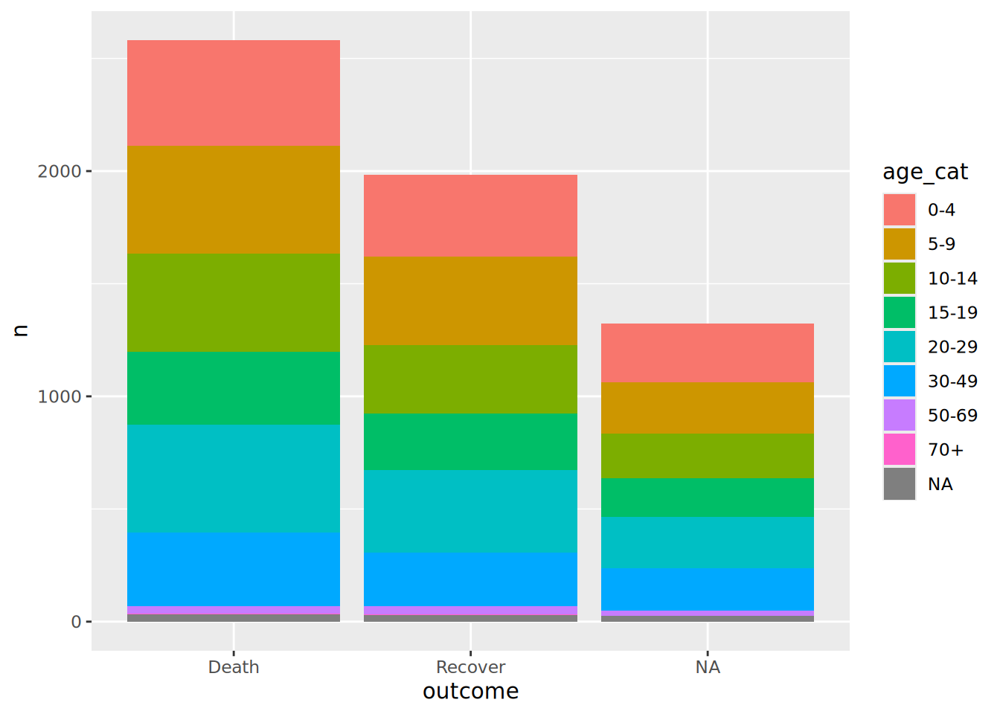

# 17  Tanımlayıcı tablolar

[](../../images/descriptive_tables.png)

Bu sayfa, verileri özetlemek ve tanımlayıcı istatistiklerle tablolar oluşturmak için **janitor, dplyr, gtsummary, rstatix ve temel R’ın** kullanımını göstermektedir.

Bu sayfa, temel tabloların nasıl oluşturulacağını, sunum için tablolar sayfası ise tabloların nasıl güzel bir şekilde biçimlendirileceğini ve yazdırılacağını kapsar.

Bu paketlerin her birinin kod dilinin basitliği, çıktıların erişilebilirliği, basılı çıktıların kalitesi alanlarında avantajları ve dezavantajları vardır. Senaryonuz için hangi yaklaşımın işe yaradığına karar vermek için bu sayfayı kullanın.

Tablolama ve çapraz tablo özet tabloları için birkaç seçeneğiniz vardır. Göz önünde bulundurulması gereken faktörlerden bazıları, kod basitliği, özelleştirilebilirlik, istenen çıktı (veri çerçevesi olarak veya “güzel” yani .png/.jpeg/.html görüntüsü olarak R konsoluna yazdırılabilir) ve çıktı sonrası işleme kolaylığıdır. Durumunuz için aracı seçerken aşağıdaki noktaları göz önünde bulundurun.

• Tabloları ve çapraz tabloları oluşturmak ve “süslemek” için janitor’dan **tabyl()** kullanın

• Birden çok sütun ve/veya grup için sayısal özet istatistiklerin veri çerçevelerini kolayca oluşturmak için rstatix’ten **get_summary_stats()** kullanın

• Daha karmaşık istatistikler, düzenli veri çerçevesi çıktıları veya ggplot() için veri hazırlamak için dplyr’den **summarise()** ve **count()** kullanın

• Ayrıntılı ve yayına hazır tablolar oluşturmak için gtsummary’den tbl_summary() kullanın • Yukarıdaki paketlere erişiminiz yoksa, temel R’dan table() kullanın

## 17.1 Hazırlık

### Paketleri yükleme

Bu kod bloğu, analizler için gerekli olan paketlerin yüklenmesini gösterir. Bu el kitabında, gerekirse paketi kuran ve kullanım için yükleyen pacman’ın p_load() fonksiyonu vurgulanmaktadır. Ayrıca, temel R’dan library() ile kurulu paketleri yükleyebilirsiniz. R paketleri hakkında daha fazla bilgi için R’ın temelleri sayfasına bakabilirsiniz.

``` r
pacman::p_load(
  rio,          # Dosya içeri aktarımı
  here,         # Dosyaların tespit edilmesi 
  skimr,        # Verinin gözden geçirilmesi 
  tidyverse,    # Veri yönetimi + ggplot2 grafikleri  
  gtsummary,    # Özet istatistikler ve testler
  rstatix,      # Özet istatistikler ve istatistik testler
  janitor,      # Toplamların ve yüzdelerin eklenmesi 
  scales,       # Yüzdelerin oranlara kolayca çevrilmesi 
  flextable, # Tabloların “güzel” resimlere dönüştürülmesi
  appliedepidata # bu el kitabında kullanılan örnek veriler
  )
```

### Verinin içeri aktarımı

Simüle edilmiş bir Ebola salgını veri setini içe aktarıyoruz. Doğrudan `appliedepidata::get_data(name = "linelist_cleaned_rds")` ile yükleyin (ayrıntılar için [El kitabı ve veri indirme](download.llms.md) sayfasına bakın).

``` r
# satır listesini içe aktar
linelist <- appliedepidata::get_data(name = "linelist_cleaned_rds")
```

The first 50 rows of the linelist are displayed below.

## 17.2 Verileri gözden geçirme

### **skimr** paketi

skimr paketini kullanarak, veri tabaınızdaki değişkenlerin her biri için ayrıntılı ve estetik bir genel bakış elde edebilirsiniz. github sayfasında [github](https://github.com/ropensci/skimr). **skimr** hakkında daha fazla bilgi edinin.

Aşağıda, ’skim()’fonksiyonu tüm satır listesi veri çerçevesine uygulanır. Veri çerçevesine genel bir bakış ve her sütunun (sınıfa göre) bir özeti çıkarılır.

``` r
## veritabanındaki her değişken için bilgiyi edin 
skim(linelist)
```

|                                                  |          |
|:-------------------------------------------------|:---------|
| Name                                             | linelist |
| Number of rows                                   | 5888     |
| Number of columns                                | 30       |
| \_\_\_\_\_\_\_\_\_\_\_\_\_\_\_\_\_\_\_\_\_\_\_   |          |
| Column type frequency:                           |          |
| character                                        | 13       |
| Date                                             | 4        |
| factor                                           | 2        |
| numeric                                          | 11       |
| \_\_\_\_\_\_\_\_\_\_\_\_\_\_\_\_\_\_\_\_\_\_\_\_ |          |
| Group variables                                  | None     |

Data summary {.caption-top .table .table-sm .table-striped .small}

**Variable type: character**

| skim_variable  | n_missing | complete_rate | min | max | empty | n_unique | whitespace |
|:---------------|----------:|--------------:|----:|----:|------:|---------:|-----------:|
| case_id        |         0 |          1.00 |   6 |   6 |     0 |     5888 |          0 |
| outcome        |      1323 |          0.78 |   5 |   7 |     0 |        2 |          0 |
| gender         |       278 |          0.95 |   1 |   1 |     0 |        2 |          0 |
| age_unit       |         0 |          1.00 |   5 |   6 |     0 |        2 |          0 |
| hospital       |         0 |          1.00 |   5 |  36 |     0 |        6 |          0 |
| infector       |      2088 |          0.65 |   6 |   6 |     0 |     2697 |          0 |
| source         |      2088 |          0.65 |   5 |   7 |     0 |        2 |          0 |
| fever          |       249 |          0.96 |   2 |   3 |     0 |        2 |          0 |
| chills         |       249 |          0.96 |   2 |   3 |     0 |        2 |          0 |
| cough          |       249 |          0.96 |   2 |   3 |     0 |        2 |          0 |
| aches          |       249 |          0.96 |   2 |   3 |     0 |        2 |          0 |
| vomit          |       249 |          0.96 |   2 |   3 |     0 |        2 |          0 |
| time_admission |       765 |          0.87 |   5 |   5 |     0 |     1072 |          0 |

**Variable type: Date**

| skim_variable | n_missing | complete_rate | min | max | median | n_unique |
|:---|---:|---:|:---|:---|:---|---:|
| date_infection | 2087 | 0.65 | 2014-03-19 | 2015-04-27 | 2014-10-11 | 359 |
| date_onset | 256 | 0.96 | 2014-04-07 | 2015-04-30 | 2014-10-23 | 367 |
| date_hospitalisation | 0 | 1.00 | 2014-04-17 | 2015-04-30 | 2014-10-23 | 363 |
| date_outcome | 936 | 0.84 | 2014-04-19 | 2015-06-04 | 2014-11-01 | 371 |

**Variable type: factor**

| skim_variable | n_missing | complete_rate | ordered | n_unique | top_counts |
|:---|---:|---:|:---|---:|:---|
| age_cat | 86 | 0.99 | FALSE | 8 | 0-4: 1095, 5-9: 1095, 20-: 1073, 10-: 941 |
| age_cat5 | 86 | 0.99 | FALSE | 17 | 0-4: 1095, 5-9: 1095, 10-: 941, 15-: 743 |

**Variable type: numeric**

| skim_variable | n_missing | complete_rate | mean | sd | p0 | p25 | p50 | p75 | p100 |
|:---|---:|---:|---:|---:|---:|---:|---:|---:|---:|
| generation | 0 | 1.00 | 16.56 | 5.79 | 0.00 | 13.00 | 16.00 | 20.00 | 37.00 |
| age | 86 | 0.99 | 16.07 | 12.62 | 0.00 | 6.00 | 13.00 | 23.00 | 84.00 |
| age_years | 86 | 0.99 | 16.02 | 12.64 | 0.00 | 6.00 | 13.00 | 23.00 | 84.00 |
| lon | 0 | 1.00 | -13.23 | 0.02 | -13.27 | -13.25 | -13.23 | -13.22 | -13.21 |
| lat | 0 | 1.00 | 8.47 | 0.01 | 8.45 | 8.46 | 8.47 | 8.48 | 8.49 |
| wt_kg | 0 | 1.00 | 52.64 | 18.58 | -11.00 | 41.00 | 54.00 | 66.00 | 111.00 |
| ht_cm | 0 | 1.00 | 124.96 | 49.52 | 4.00 | 91.00 | 129.00 | 159.00 | 295.00 |
| ct_blood | 0 | 1.00 | 21.21 | 1.69 | 16.00 | 20.00 | 22.00 | 22.00 | 26.00 |
| temp | 149 | 0.97 | 38.56 | 0.98 | 35.20 | 38.20 | 38.80 | 39.20 | 40.80 |
| bmi | 0 | 1.00 | 46.89 | 55.39 | -1200.00 | 24.56 | 32.12 | 50.01 | 1250.00 |
| days_onset_hosp | 256 | 0.96 | 2.06 | 2.26 | 0.00 | 1.00 | 1.00 | 3.00 | 22.00 |

Tüm bir veri tabanı hakkında bilgi almak için temel R’dan summary() fonksiyonunu da kullanabilirsiniz, ancak bu çıktıyı okumak skimr çıktısından daha zor olabilir. Bu nedenle, sayfa sayısından tasarruf etmek için çıktı aşağıda gösterilmemiştir.

``` r
## veritabanındaki her sütun için bilgiyi edin  
summary(linelist)
```

### Özet İstatistikleri

Sayısal bir sütunda özet istatistikleri göstermek için temel R işlevlerini kullanabilirsiniz. Bir sayısal sütun için yararlı özet istatistiklerin çoğunu aşağıdaki gibi summary() kullanarak elde edebilirsiniz. Veri çerçevesi adının da aşağıda gösterildiği gibi belirtilmesi gerektiğini unutmayın.

``` r
summary(linelist$age_years)
```

       Min. 1st Qu.  Median    Mean 3rd Qu.    Max.     NAs 
       0.00    6.00   13.00   16.02   23.00   84.00      86 

Dizin parantezleri \[ \] ile bu çıktının belirli bir bölümüne erişebilir ve kaydedebilirsiniz:

``` r
summary(linelist$age_years)[[2]]            # yalnızca ikinci ögeyi göster
```

    [1] 6

``` r
# eşdeğeri, eleman adı için yukarıdakine alternatif olarak 
# summary(linelist$age_years)[["1st Qu."]]  
```

max(), min(), median(), mean(), quantile(), sd() ve range() gibi temel R işlevleriyle istatistikleri tek tek elde edebilirsiniz. Tam bir liste için R’ın temelleri sayfasına bakabilirsiniz.

***UYARI:*** Verileriniz eksik değerler içeriyorsa, R bunu belirtmenizi ister. Bu nedenle, na.rm = TRUE argümanı aracılığıyla R’nin eksik değerleri yok saymasını belirtmediğiniz sürece komut NA değerini verir.`na.rm = TRUE`.

Özet istatistikleri bir veri çerçevesi biçiminde döndürmek için rstatix’teki get_summary_stats() fonkisyonunu kullanabilirsiniz. Bu fonksiyon, sonraki işlemleri gerçekleştirmek veya istatistiklerle çizim yapmak için yardımcı olabilir. rstatix paketi ve işlevleri hakkında daha fazla ayrıntı için Temel istatistiksel testler sayfasına bakın.

``` r
linelist %>% 
  get_summary_stats(
    age, wt_kg, ht_cm, ct_blood, temp,  # hesaplanacak sütunlar
    type = "common")                    # döndürülecek özet istatistikler
```

    # A tibble: 5 × 10
      variable     n   min   max median   iqr  mean     sd    se    ci
      <fct>    <dbl> <dbl> <dbl>  <dbl> <dbl> <dbl>  <dbl> <dbl> <dbl>
    1 age       5802   0    84     13      17  16.1 12.6   0.166 0.325
    2 wt_kg     5888 -11   111     54      25  52.6 18.6   0.242 0.475
    3 ht_cm     5888   4   295    129      68 125.  49.5   0.645 1.26 
    4 ct_blood  5888  16    26     22       2  21.2  1.69  0.022 0.043
    5 temp      5739  35.2  40.8   38.8     1  38.6  0.977 0.013 0.025

## 17.3 **janitor** paketi

janitor paketleri, yüzdeleri, oranları, sayıları vb. görüntülemek için yardımcı işlevlerin uygulandığı tablolar ve çapraz tablolar oluşturmak için tabyl() fonksiyonunu sunar.

Aşağıda, sıra listesi veri çerçevesini janitor fonksiyonlarına aktarıyoruz ve sonucu yazdırıyoruz. İstenirse, sonuç tablolarını \<- atama operatörü ile de kaydedebilirsiniz.

### Basit tabyl

‘tabyl()’ öğesinin belirli bir sütunda varsayılan kullanımı, değerler, sayılar ve sütun bazında “yüzdeler” (oranlar) oluşturur. Oranlar çok basamaklı olabilir. Aşağıda açıklandığı gibi ‘adorn_rounding()’ ile ondalık basamak sayısını ayarlayabilirsiniz.

``` r
linelist %>% tabyl(age_cat)
```

     age_cat    n     percent valid_percent
         0-4 1095 0.185971467   0.188728025
         5-9 1095 0.185971467   0.188728025
       10-14  941 0.159816576   0.162185453
       15-19  743 0.126188859   0.128059290
       20-29 1073 0.182235054   0.184936229
       30-49  754 0.128057065   0.129955188
       50-69   95 0.016134511   0.016373664
         70+    6 0.001019022   0.001034126
        <NA>   86 0.014605978            NA

Yukarıda gördüğünüz gibi, eksik değerler varsa, etiketli bir satırda görüntülenirler. Bunların gösterimini show_na = FALSE ile kapatabilirsiniz. Eksik değer yoksa bu satır görünmez. Eksik değerler varsa, tüm oranlar hem ham olarak (paydadaki NA sayıları dahil) hem de “geçerli” (paydadaki NA sayıları hariç) formda verilir.

Sütun sınıfı faktörse ve verilerinizde yalnızca belirli düzeyler varsa, tüm düzeyler tabloda görünmeye devam eder. show_missing_levels = FALSE belirterek bu özelliği kapatabilirsiniz. Faktörler sayfasında daha fazla bilgiye ulaşabilirsiniz.

### Çapraz tablolar

Çapraz tablolar, tabyl() içinde bir veya daha fazla ek sütun eklenerek elde edilir. Çıktıda yalnızca sayıların elde edildiğini unutmayın - oranlar ve yüzdeler, aşağıda gösterilen ek adımlarla eklenebilir.

``` r
linelist %>% tabyl(age_cat, gender)
```

     age_cat   f   m NA_
         0-4 640 416  39
         5-9 641 412  42
       10-14 518 383  40
       15-19 359 364  20
       20-29 468 575  30
       30-49 179 557  18
       50-69   2  91   2
         70+   0   5   1
        <NA>   0   0  86

### tabyl’in “süslenmesi”

Toplamları eklemek veya oranlara, yüzdelere dönüştürme işlemi veya ekranı başka bir şekilde ayarlamak için **janitor** “adorn” fonkisyonlarını kullanın. Tabloyu bu fonksiyonlardan birkaçından geçirebilirsiniz.

| Fonksiyon | Çıktı |
|----|----|
| `adorn_totals()` | Toplamların eklenmesi (where = “row”, “col”, veya “both”). name = “Total” için. |
| `adorn_percentages()` | Sayımların orana dönüştürülmesi denominator = “row”, “col”, veya “all” |
| `adorn_pct_formatting()` | Oranların yüzdelere çevrimi. digits = belirtilmelidir. “%” sembolü bu argüman ile uzaklaştırılır. `affix_sign = FALSE`. |
| `adorn_rounding()` | Oranların digits = sayıda basamağa yuvarlanması. Yüzdelerin yuvarlanması için `adorn_pct_formatting()`. |
| `adorn_ns()` | Oranlar veya yüzdeler tablosuna sayıları ekleyin. Sayıları parantez içinde göstermek için position = “rear” veya yüzdeleri parantez içinde koymak için “front” belirtin. |
| `adorn_title()` | DEğişkenler aracılığıyla dize (string)eklenmesi row_name = and/or col_name = |

Yukarıdaki işlevleri uyguladığınız sıra önemlidir. Aşağıda bazı örnekler verilmiştir.

Varsayılan oranlar yerine yüzdeleri olan basit, tek yönlü bir tablo örneği:

``` r
linelist %>%               # vaka satır listesi 
  tabyl(age_cat) %>%       # sayıları-oranları yaşa göre tablo haline getirin
  adorn_pct_formatting()   # oranları yüzdelere çevir
```

     age_cat    n percent valid_percent
         0-4 1095   18.6%         18.9%
         5-9 1095   18.6%         18.9%
       10-14  941   16.0%         16.2%
       15-19  743   12.6%         12.8%
       20-29 1073   18.2%         18.5%
       30-49  754   12.8%         13.0%
       50-69   95    1.6%          1.6%
         70+    6    0.1%          0.1%
        <NA>   86    1.5%             -

Toplam satır ve satır yüzdelerini içeren bir çapraz tablo.

``` r
linelist %>%                                  
  tabyl(age_cat, gender) %>%                  # yaş ve cinsiyete göre sayılar
  adorn_totals(where = "row") %>%             # toplam satırı ekle
  adorn_percentages(denominator = "row") %>%  # sayıları oranlara dönüştür
  adorn_pct_formatting(digits = 1)            # oranları yüzdelere çevir
```

     age_cat     f     m    NA_
         0-4 58.4% 38.0%   3.6%
         5-9 58.5% 37.6%   3.8%
       10-14 55.0% 40.7%   4.3%
       15-19 48.3% 49.0%   2.7%
       20-29 43.6% 53.6%   2.8%
       30-49 23.7% 73.9%   2.4%
       50-69  2.1% 95.8%   2.1%
         70+  0.0% 83.3%  16.7%
        <NA>  0.0%  0.0% 100.0%
       Total 47.7% 47.6%   4.7%

Hem sayıların hem de yüzdelerin görüntülenmesi için ayarlanmış bir çapraz tablo.

``` r
linelist %>%                                  # vaka listesi
  tabyl(age_cat, gender) %>%                  # çapraz tablo sayıları
  adorn_totals(where = "row") %>%             # toplam satırı ekle
  adorn_percentages(denominator = "col") %>%  # oranlara dönüştürmek
  adorn_pct_formatting() %>%                  # yüzdeye dönüştür
  adorn_ns(position = "front") %>%            # "sayı (yüzde)" olarak görüntüleme
  adorn_title(                                # başlıkların ayarlanması 
    row_name = "Age Category",
    col_name = "Gender")
```

                          Gender                            
     Age Category              f              m          NA_
              0-4   640  (22.8%)   416  (14.8%)  39  (14.0%)
              5-9   641  (22.8%)   412  (14.7%)  42  (15.1%)
            10-14   518  (18.5%)   383  (13.7%)  40  (14.4%)
            15-19   359  (12.8%)   364  (13.0%)  20   (7.2%)
            20-29   468  (16.7%)   575  (20.5%)  30  (10.8%)
            30-49   179   (6.4%)   557  (19.9%)  18   (6.5%)
            50-69     2   (0.1%)    91   (3.2%)   2   (0.7%)
              70+     0   (0.0%)     5   (0.2%)   1   (0.4%)
             <NA>     0   (0.0%)     0   (0.0%)  86  (30.9%)
            Total 2,807 (100.0%) 2,803 (100.0%) 278 (100.0%)

### tabyl çıktısının alınması

Varsayılan olarak tabyl, R konsolunuza ham formda yazdıracaktır.

Alternatif olarak, RStudio Viewer’da .png, .jpeg, .html, vb. olarak dışa aktarılabilen bir resim olarak yazdırmak için tabyl’i flextable veya benzeri bir pakete geçirebilirsiniz. Bu işlem, Sunum için tablolar sayfasında tartışılmaktadır. Bu şekilde yazdırıyorsanız ve adorn_titles() kullanıyorsanız, placement = argümanını “combined” belirtmeniz gerektiğini unutmayın.

``` r
linelist %>%
  tabyl(age_cat, gender) %>% 
  adorn_totals(where = "col") %>% 
  adorn_percentages(denominator = "col") %>% 
  adorn_pct_formatting() %>% 
  adorn_ns(position = "front") %>% 
  adorn_title(
    row_name = "Age Category",
    col_name = "Gender",
    placement = "combined") %>% # resim olarak yazdırmak için bu gereklidir
  flextable::flextable() %>%    # güzel görüntüye dönüştür
  flextable::autofit()          # satır başına bir satıra biçimlendir
```

| Age Category/Gender | f           | m           | NA\_       | Total         |
|---------------------|-------------|-------------|------------|---------------|
| 0-4                 | 640 (22.8%) | 416 (14.8%) | 39 (14.0%) | 1,095 (18.6%) |
| 5-9                 | 641 (22.8%) | 412 (14.7%) | 42 (15.1%) | 1,095 (18.6%) |
| 10-14               | 518 (18.5%) | 383 (13.7%) | 40 (14.4%) | 941 (16.0%)   |
| 15-19               | 359 (12.8%) | 364 (13.0%) | 20 (7.2%)  | 743 (12.6%)   |
| 20-29               | 468 (16.7%) | 575 (20.5%) | 30 (10.8%) | 1,073 (18.2%) |
| 30-49               | 179 (6.4%)  | 557 (19.9%) | 18 (6.5%)  | 754 (12.8%)   |
| 50-69               | 2 (0.1%)    | 91 (3.2%)   | 2 (0.7%)   | 95 (1.6%)     |
| 70+                 | 0 (0.0%)    | 5 (0.2%)    | 1 (0.4%)   | 6 (0.1%)      |
|                     | 0 (0.0%)    | 0 (0.0%)    | 86 (30.9%) | 86 (1.5%)     |

### Diğer tablolarda kullanımı

janitor adorn\_\*() işlevlerini, dplyr’den summarise() ve count() veya temel R’dan table() tarafından oluşturulanlar diğer tabloları da kullanabilirsiniz. Tabloyu istenen janitor fonksiyonuna yönlendirmeniz yeterlidir. Örneğin:

``` r
linelist %>% 
  count(hospital) %>%   # dplyr fonksiyonu
  adorn_totals()        # janitor fonksiyonu
```

                                 hospital    n
                         Central Hospital  454
                        Military Hospital  896
                                  Missing 1469
                                    Other  885
                            Port Hospital 1762
     St. Mark's Maternity Hospital (SMMH)  422
                                    Total 5888

### tabyl kaydedilmesi

Tabloyu flextable gibi bir paketle “güzel” bir resme dönüştürürseniz, o paketteki fonksiyonlarla kaydedebilirsiniz (flextable’da save_as_html(), save_as_word(), save_as_ppt() ve save_as_image() gibi fonksiyonlar bulunmaktadır. Sunum için tablolar sayfasında kapsamlı bir şekilde tartışılmıştır. Aşağıdaki tablo, elle düzenlenebilen bir Word belgesi olarak kaydedilmiştir:

``` r
linelist %>%
  tabyl(age_cat, gender) %>% 
  adorn_totals(where = "col") %>% 
  adorn_percentages(denominator = "col") %>% 
  adorn_pct_formatting() %>% 
  adorn_ns(position = "front") %>% 
  adorn_title(
    row_name = "Age Category",
    col_name = "Gender",
    placement = "combined") %>% 
  flextable::flextable() %>%                     # convert to image
  flextable::autofit() %>%                       # satır başına yalnızca bir satır
  flextable::save_as_docx(path = "tabyl.docx")   # dosya yoluna Word belgesi kaydet
```

[](../../images/tabyl_word.png)

### İstatistikler

Aşağıda gösterildiği gibi, stats paketinden chisq.test() veya fisher.test() gibi fonksiyonlarla tablolar üzerinde istatistiksel testler uygulayabilirsiniz. Bu işlem, eksik değerlere izin verilmez, bu nedenle show_na = FALSE ile tablodan hariç tutulurlar.

70+ satırında beklenen frekanslar 5’ten küçük olduğu için ki-kare yaklaşımı güvenilir değildir, bu nedenle `fisher.test()` kullanıyoruz. Bu 8 x 2 tabloda kesin test bir hatayla durur:

``` r
age_by_outcome <- linelist %>% 
  tabyl(age_cat, outcome, show_na = FALSE) 

fisher.test(age_by_outcome)
```

    Error in `stats::fisher.test()`:
    ! FEXACT error 7(location). LDSTP=17820 is too small for this problem,
      (pastp=817.256, ipn_0:=ipoin[itp=178]=174, stp[ipn_0]=815.749).
    Increase workspace or consider using 'simulate.p.value=TRUE'

`fisher.test()` kesin p değerini bir ağ algoritmasıyla hesaplar. Algoritma ara sonuçları bir tabloda saklar ve `workspace` argümanı bu tablonun boyutunu belirler. “FEXACT error 7”, bu tablonun bu problemin ara sonuçları için çok küçük olduğu anlamına gelir. Burada daha büyük bir `workspace` sorunu çözmez, çünkü `workspace = 2e8` de başarısız olur. Bunun yerine `simulate.p.value = TRUE`, aynı satır ve sütun toplamlarına sahip rastgele tablolardan aynı kesin p değerini tahmin eder. `set.seed()` bu tahmini tekrarlanabilir kılar.

``` r
set.seed(1)
fisher.test(age_by_outcome, simulate.p.value = TRUE)
```


        Fisher's Exact Test for Count Data with simulated p-value (based on
        2000 replicates)

    data:  age_by_outcome
    p-value = 0.4863
    alternative hypothesis: two.sided

Daha fazla kod ve istatistiklerle ilgili ipuçları için [Temel istatistik testleri](stat_tests.llms.md) sayfasına bakın.

### Diğer ipuçları

• Yukarıdaki hesaplamalardan herhangi birinden eksik değerleri hariç tutmak için na.rm = TRUE değişkenini kullanın.

• tabyl() tarafından oluşturulmamış tablolara herhangi bir adorn\_\*() yardımcı fonksiyonu uyguluyorsanız, bunları adorn_percentage(,,,c(cases,deaths)) sintaksıyla belirli sütunlara uygulayabilirsiniz. (Sütunlar 4. değişken olarak belirtilmedir.). Sintaksı basit değil, bu nedenle bu işlem yerine summarise() kullanmayı düşünün.

• Daha fazla ayrıntıyı janitor sayfasından ve tabyl gösteriminden okuyabilirsiniz. [janitor sayfası](https://cran.r-project.org/web/packages/janitor/vignettes/janitor.html) ve [tabyl göstergesi](https://cran.r-project.org/web/packages/janitor/vignettes/tabyls.html).

## 17.4 **dplyr** paketi

dplyr, tidyverse paketlerinin bir parçasıdır ve çok yaygın bir veri yönetimi aracıdır.

dplyr’ın summarise() ve count() fonksiyonları tablolar oluşturmak, istatistikleri hesaplamak, gruba göre özetlemek veya tabloları ggplot()’a geçirmek için kullanışlı bir yaklaşımdır.

summarise(), yeni bir özet veri çerçevesi oluşturur. Veriler gruplandırılmamışsa, tüm veri çerçevesinin belirtilen özet istatistiklerini içeren tek satırlık bir veri çerçevesi oluşturur. Veriler gruplandırılmışsa, yeni veri çerçevesinde grup başına bir satır oluşturacaktır (bkz. Verilerin gruplandırması sayfası).

summarise() fonksiyonunun parantezleri içinde, her yeni özet sütununun adını ve ardından bir eşittir işareti ve uygulanacak istatistiksel işlevi argüman olarak belirtmelisiniz.  

***İPUCU:*** Özetleme işlevi hem İngiliz hem de Amerikan İngilizcesi ile yazılabilir. (summarise() and summarize()).

### Gözlem sayılarını elde etme

summarise() içinde uygulanacak en basit fonksiyon n()’dir. Satır sayısını elde etmek için parantezleri boş bırakın.

``` r
linelist %>%                 # satır listesiyle başla
  summarise(n_rows = n())    # n_rows sütunu ile özet veri çerçevesi elde edilir
```

      n_rows
    1   5888

Verileri önceden gruplandırıldığında bu daha ilginç sonuçlar elde edilir.

``` r
linelist %>% 
  group_by(age_cat) %>%     # verileri age_cat sütunundaki değerlere göre gruplandır
  summarise(n_rows = n())   # *grup başına* satır sayısı elde edilir
```

    # A tibble: 9 × 2
      age_cat n_rows
      <fct>    <int>
    1 0-4       1095
    2 5-9       1095
    3 10-14      941
    4 15-19      743
    5 20-29     1073
    6 30-49      754
    7 50-69       95
    8 70+          6
    9 <NA>        86

Yukarıdaki komut, count() işlevi kullanılarak kısaltılabilir. count() şunları yapar:

1.  Verileri belirlenen sütunlara göre gruplandırır
2.  Verileri n() ile özetler (n sütunu oluşturur)
3.  Verileri gruplarını çözer

``` r
linelist %>% 
  count(age_cat)
```

      age_cat    n
    1     0-4 1095
    2     5-9 1095
    3   10-14  941
    4   15-19  743
    5   20-29 1073
    6   30-49  754
    7   50-69   95
    8     70+    6
    9    <NA>   86

Sayılar sütununun adını varsayılan n’den name = değişkeniyle değiştirebilirsiniz.

İki veya daha fazla gruplandırma sütunundaki sayılar “uzun” biçimde tablo halinde döndürülür. n sütununda gözlem sayıları bulunmaktadır. “Uzun” ve “geniş” veri biçimleri hakkında bilgi edinmek için verileri pivotlama sayfasına bakın.

``` r
linelist %>% 
  count(age_cat, outcome)
```

       age_cat outcome   n
    1      0-4   Death 471
    2      0-4 Recover 364
    3      0-4    <NA> 260
    4      5-9   Death 476
    5      5-9 Recover 391
    6      5-9    <NA> 228
    7    10-14   Death 438
    8    10-14 Recover 303
    9    10-14    <NA> 200
    10   15-19   Death 323
    11   15-19 Recover 251
    12   15-19    <NA> 169
    13   20-29   Death 477
    14   20-29 Recover 367
    15   20-29    <NA> 229
    16   30-49   Death 329
    17   30-49 Recover 238
    18   30-49    <NA> 187
    19   50-69   Death  33
    20   50-69 Recover  38
    21   50-69    <NA>  24
    22     70+   Death   3
    23     70+ Recover   3
    24    <NA>   Death  32
    25    <NA> Recover  28
    26    <NA>    <NA>  26

### Tüm seviyelerin gösterimi

Bir sınıf faktörü sütunu oluştururken, summarise() veya count() komutuna .drop = FALSE argümanını ekleyerek (yalnızca verilerde değerleri olan seviyeleri değil) tüm seviyelerin gösterebilirsiniz.

Bu teknik, tablolarınızı/grafiklerinizi standart hale getirmek için kullanışlıdır. Özellikle, birden fazla alt grup için grafik oluştururken ya da rutin raporlar için tekrarlayan grafiklerr oluştururken faydalıdır. Bu koşulların her birinde, verilerdeki değerler değişse de sabit kalan seviyeler tanımlayabilirsiniz.

Daha fazla bilgi için \[Faktörler\] sayfasına bakın.

### Oranlar

Oranlar, yeni bir sütun oluşturmak için tablonun mutate() fonksiyonuna yönlendirmesi ile elde edilebilir. Yeni sütun, sayım sütununun (varsayılan olarak n) sayım sütununun toplamının elde edildiği sum()’a bölünmesiyle oluşturulur (bu işlem bir oran verir).

Bu durumda, mutate() komutundaki sum() öğesinin, oranın paydası olarak kullanılmak üzere tüm n sütununun toplamını vereceğini unutmayın. Verileri gruplandırılması sayfasında açıklandığı gibi, gruplandırılmış verilerde sum() fonksiyonu kullanılıyorsa (örneğin, mutate() fonksiyonu group_by() komutunu takip ediyorsa), gruba göre toplamlar elde edilir. Yukarıda belirtildiği gibi, count() fonksiyonu grupları çözerek görevini tamamlar. Böylece, bu senaryoda tam sütun oranlarını elde ederiz.

Yüzdeleri kolayca görüntülemek için, scales paketinden percent() fonksiyonunu kullanabilirsiniz (bu fonksiyonda verinin sınıf karakterine dönüştürüldüğünü unutmayın).

``` r
age_summary <- linelist %>% 
  count(age_cat) %>%                     # cinsiyete göre grupla ve say ("n" sütunu oluşur)
  mutate(                                # sütunun yüzdesini oluştur – paydaya dikkat edin 
    percent = scales::percent(n / sum(n))) 

# çıktı al 
age_summary
```

      age_cat    n percent
    1     0-4 1095  18.60%
    2     5-9 1095  18.60%
    3   10-14  941  15.98%
    4   15-19  743  12.62%
    5   20-29 1073  18.22%
    6   30-49  754  12.81%
    7   50-69   95   1.61%
    8     70+    6   0.10%
    9    <NA>   86   1.46%

Aşağıda gruplar içindeki oranları hesaplamak için bir yöntem gösterilmiştir. Seçici olarak uygulanan farklı veri gruplama düzeylerine dayanan bir yöntemdir. İlk olarak, veriler group_by() aracılığıyla sonuca göre gruplandırılır. Ardından, count() uygulanır. Bu fonksiyon, verileri age_cat’e göre gruplandırır ve her sonuç-age_cat kombinasyonu için gözlem sayılarını verir. Daha önemlisi, count() aynı zamanda age_cat gruplandırmasını da çözer, bu nedenle geriye kalan tek veri gruplaması sonuca göre orijinal gruplandırmadır. Bu nedenle, oranları hesaplamada son adımı (payda sum(n)) hala sonuca göre gruplandırılmıştır.

``` r
age_by_outcome <- linelist %>%                  # satır listesiyle başla
  group_by(outcome) %>%                         # sonuca göre gruplandır
  count(age_cat) %>%                            # age_cat ile gruplandır ve say ve ardından age_cat gruplamasını kaldır 
  mutate(percent = scales::percent(n / sum(n))) # yüzdeyi hesapla - paydanın sonuç grubuna göre olduğuna dikkat edin
```

### Grafikleştirme

Yukarıdaki gibi “uzun” bir tablo ggplot() ile rahatça görüntülenebilir. Veriler ggplot() tarafından doğal olarak kabul edilen “uzun” formattadır. ggplot temelleri ve ggplot ipuçları sayfalarındaki diğer örneklere bakın.

``` r
linelist %>%                      # satır listesiyle başlama
  count(age_cat, outcome) %>%     # sayıları iki sütuna göre gruplandırın ve tablolaştırın
  ggplot()+                       # yeni veri çerçevesini ggplot'a geçir
    geom_col(                     # sütun grafiği oluştur
      mapping = aes(   
        x = outcome,              # sonucu x eksenine eşle
        fill = age_cat,           # age_cat'i dolguya eşle
        y = n))                   # sayım sütununu `n` yüksekliğe eşle
```

[](tables_descriptive_files/figure-html/unnamed-chunk-29-1.png)

### Özet istatistiği

dplyr ve summarise()’in önemli bir avantajı, median(), mean(), max(), min(), sd() (standart sapma) ve yüzdelikler gibi daha ileri istatistik özetleri oluşturma yeteneğidir. Belirli mantık kriterlerini karşılayan satır sayılarını elde etmek için sum() fonksiyonuna da kullanabilirsiniz. Yukarıdaki gibi, bu çıktılar tüm veri çerçevesi için veya belli grup gruplar için oluşturulabilir.

Sintaks aynıdır - summarise() parantezleri içinde yeni özet sütunlarının adları, ardından bir eşittir işareti ve uygulanacak istatistiksel fonksiyonlar yazılmalıdır. İstatistiksel fonksiyon içinde, üzerinde çalışılacak sütunları ve ilgili argümanlar yazılmalıdır (örneğin, çoğu matematiksel fonksiyon için na.rm = TRUE).

Mantıksal bir ölçütü karşılayan satır sayısını elde etmek için sum()’u da kullanabilirsiniz. İçindeki ifade TRUE olarak değerlendirilirse sayıma girer. Örneğin:

- `sum(age_years < 18, na.rm=T)`  
- `sum(gender == "male", na.rm=T)`  
- `sum(response %in% c("Likely", "Very Likely"))`

Aşağıda, satır listesi verilerinde, semptom başlangıcından hastaneye kabule kadar geçen gün gecikmesi değişkeni (sütun days_onset_hosp) hastaneye göre özetlenmiştir.

``` r
summary_table <- linelist %>%                                        # linelist ile başlayın, yeni nesne olarak kaydedin
  group_by(hospital) %>%                                             # tüm hesaplamaları hastaneye göre gruplandır
  summarise(                                                         # yalnızca aşağıdaki özet sütunları elde edilecek
    cases       = n(),                                                # grup başına satır sayısı
    delay_max   = max(days_onset_hosp, na.rm = T),                    # maksimum gecikme
    delay_mean  = round(mean(days_onset_hosp, na.rm=T), digits = 1),  # ortalama gecikme, yuvarlanmış
    delay_sd    = round(sd(days_onset_hosp, na.rm = T), digits = 1),  # gecikmelerin standart sapması, yuvarlanmış
    delay_3     = sum(days_onset_hosp >= 3, na.rm = T),               # 3 veya daha fazla gün gecikmeli satır sayısı
    pct_delay_3 = scales::percent(delay_3 / cases)                    # önceden tanımlanmış gecikme sütununu yüzdeye dönüştür
  )

summary_table  # yazdır
```

    # A tibble: 6 × 7
      hospital               cases delay_max delay_mean delay_sd delay_3 pct_delay_3
      <chr>                  <int>     <dbl>      <dbl>    <dbl>   <int> <chr>      
    1 Central Hospital         454        12        1.9      1.9     108 24%        
    2 Military Hospital        896        15        2.1      2.4     253 28%        
    3 Missing                 1469        22        2.1      2.3     399 27%        
    4 Other                    885        18        2        2.2     234 26%        
    5 Port Hospital           1762        16        2.1      2.2     470 27%        
    6 St. Mark's Maternity …   422        18        2.1      2.3     116 27%        

Bazı ipuçları

• Belirli ölçütleri karşılayan (==) satırları “saymak” için bir mantıksal ifadeyle sum() kullanın • sum() gibi matematiksel fonksiyonlarda na.rm = TRUE kullanımına dikkat edin, aksi takdirde eksik değerler varsa NA elde edilir. • Yüzdelere kolayca dönüştürmek için scales paketindeki percent() işlevini kullanın • Sırasıyla 1 veya 2 ondalık basamak sağlamak için accuracy = argümanını 0,1 veya 0,01 olarak ayarlayın • Ondalık sayıları belirtmek için temel R’dan round() fonksiyonunu kullanın • Bu istatistikleri tüm veri kümesinde hesaplamak için, group_by() olmadan summarise() kullanın. • Daha sonraki hesaplamalar için (örneğin payda oluşturmak için) sütunlar oluşturabilir ve bu sütunları en sonunda select() ile veri çerçevenizden çıkarabilirsiniz.

### Koşullu istatistikler

Koşullu istatistikleri elde etmek isteyebilirsiniz - ör. belirli ölçütleri karşılayan satırların maksimum değeri elde edilebilir. Bu işlem, sütun parantez \[ \] ile alt kümelere ayrılarak gerçekleştirilebilir. Aşağıdaki örnek, ateşi olan veya olmayan hastalar için maksimum vücut sıcaklığını verir. Ancak unutmayın - group_by()ve pivot_wider() komutlarıyla (aşağıda gösterildiği gibi) başka bir sütun eklemek daha uygun olabilir. (#tbls_pivot_wider)).

``` r
linelist %>% 
  group_by(hospital) %>% 
  summarise(
    max_temp_fvr = max(temp[fever == "yes"], na.rm = T),
    max_temp_no = max(temp[fever == "no"], na.rm = T)
  )
```

    # A tibble: 6 × 3
      hospital                             max_temp_fvr max_temp_no
      <chr>                                       <dbl>       <dbl>
    1 Central Hospital                             40.4        38  
    2 Military Hospital                            40.5        38  
    3 Missing                                      40.6        38  
    4 Other                                        40.8        37.9
    5 Port Hospital                                40.6        38  
    6 St. Mark's Maternity Hospital (SMMH)         40.6        37.9

### Hepsini birleştirmek

stringr’den str_glue() fonksiyonu, birkaç sütundaki değerleri yeni bir sütunda birleştirmek için kullanışlıdır. Genellikle bu fonksiyon summarise() komutundan sonra kullanılır.

Karakterler ve dizeler sayfasında, unite() ve paste0() dahil olmak üzere sütunları birleştirmek için çeşitli seçenekler tartışılmaktadır. Bu kullanım örneğinde, unite()’den daha esnek olduğu ve paste0()’dan daha basit sözdizimine sahip olduğu için str_glue() vurgulanmıştır.

Aşağıdaki örnekte, summary_table veri çerçevesinde, delay_mean ve delay_sd sütunları birleştirilecek, yeni sütuna parantez biçimlendirmesi eklenecek ve ilgili eski sütunlar kaldırılacaktır.

Ardından, tabloyu daha anlaşılır hale getirmek için, janitor’dan adorn_totals() ile toplam bir satır eklenir (bu fonksiyon sayısal olmayan sütunları yok sayar). Son olarak, hem yeniden sıralamak hem de sütunları yeniden adlandırmak için dplyr’den select() kullanıyoruz.

Artık flextable’a geçebilir ve tablonun çıktısını Word, .png, .jpeg, .html, Powerpoint, RMarkdown, vb.’ye alabilirsiniz! (Sunum için tablolar sayfasına bakınız).

``` r
summary_table %>% 
  mutate(delay = str_glue("{delay_mean} ({delay_sd})")) %>%  # diğer değerleri birleştir ve biçimlendir
  select(-c(delay_mean, delay_sd)) %>%                       # iki eski sütunu sil  
  adorn_totals(where = "row") %>%                            # toplam satırı ekle
  select(                                                    # sütunları sırala ve yeniden adlandır
    "Hospital Name"   = hospital,
    "Cases"           = cases,
    "Max delay"       = delay_max,
    "Mean (sd)"       = delay,
    "Delay 3+ days"   = delay_3,
    "% delay 3+ days" = pct_delay_3
    )
```

                            Hospital Name Cases Max delay Mean (sd) Delay 3+ days
                         Central Hospital   454        12 1.9 (1.9)           108
                        Military Hospital   896        15 2.1 (2.4)           253
                                  Missing  1469        22 2.1 (2.3)           399
                                    Other   885        18   2 (2.2)           234
                            Port Hospital  1762        16 2.1 (2.2)           470
     St. Mark's Maternity Hospital (SMMH)   422        18 2.1 (2.3)           116
                                    Total  5888       101         -          1580
     % delay 3+ days
                 24%
                 28%
                 27%
                 26%
                 27%
                 27%
                   -

#### Yüzdelikler

Burada dplyr’deki yüzdelikler ve çeyrekliklere özel olarak değinilecektir. Yüzdelikleri döndürmek için, ‘quantile()’ fonksiyonunu varsayılanlarla kullanın veya istediğiniz değeri/değerleri ‘probs =’ değişkeni ile belirtin.

``` r
# yaşın varsayılan yüzdelik değerlerini alın (%0, %25, %50, %75, %100)
linelist %>% 
  reframe(age_percentiles = quantile(age_years, na.rm = TRUE))
```

      age_percentiles
    1               0
    2               6
    3              13
    4              23
    5              84

``` r
# manuel olarak belirtilen yaş yüzdelik değerlerini alın (%5, %50, %75, %98)
linelist %>% 
  reframe(
    age_percentiles = quantile(
      age_years,
      probs = c(.05, 0.5, 0.75, 0.98), 
      na.rm=TRUE)
    )
```

      age_percentiles
    1               1
    2              13
    3              23
    4              48

Yüzdelikleri gruplara göre elde etmek istiyorsanız, group_by() öğesine basitçe başka bir sütun eklerseniz, uzun ve kullanışsız çıktılarla karşılaşabilirsiniz. Bu nedenle, bunun yerine istenen her yüzdelik düzeyi için bir sütun oluşturma yöntemini kullanın.

``` r
#   manuel olarak belirtilen yaş yüzdelik değerlerini alın (%5, %50, %75, %98)
linelist %>% 
  group_by(hospital) %>% 
  summarise(
    p05 = quantile(age_years, probs = 0.05, na.rm=T),
    p50 = quantile(age_years, probs = 0.5, na.rm=T),
    p75 = quantile(age_years, probs = 0.75, na.rm=T),
    p98 = quantile(age_years, probs = 0.98, na.rm=T)
    )
```

    # A tibble: 6 × 5
      hospital                               p05   p50   p75   p98
      <chr>                                <dbl> <dbl> <dbl> <dbl>
    1 Central Hospital                         1    12    21  48  
    2 Military Hospital                        1    13    24  45  
    3 Missing                                  1    13    23  48.2
    4 Other                                    1    13    23  50  
    5 Port Hospital                            1    14    24  49  
    6 St. Mark's Maternity Hospital (SMMH)     2    12    22  50.2

dplyr summarise() fonksiyonu kesinlikle daha iyi kontrol sağlarken, ihtiyacınız olan tüm özet istatistiklerin rstatix paketinden get_summary_stat() ile elde edebilirsiniz. Gruplandırılmış veriler üzerinde çalışıyorsanız, %0, %25, %50, %75 ve %100 değerlerini elde edebilirsiniz. Gruplandırılmamış verilere uygularsanız, yüzdelikleri probs = c(.05, .5, .75, .98) değişkeni ile belirtebilirsiniz.

``` r
linelist %>% 
  group_by(hospital) %>% 
  rstatix::get_summary_stats(age, type = "quantile")
```

    # A tibble: 6 × 8
      hospital                         variable     n  `0%` `25%` `50%` `75%` `100%`
      <chr>                            <fct>    <dbl> <dbl> <dbl> <dbl> <dbl>  <dbl>
    1 Central Hospital                 age        445     0     6    12    21     58
    2 Military Hospital                age        884     0     6    14    24     72
    3 Missing                          age       1441     0     6    13    23     76
    4 Other                            age        873     0     6    13    23     69
    5 Port Hospital                    age       1739     0     6    14    24     68
    6 St. Mark's Maternity Hospital (… age        420     0     7    12    22     84

``` r
linelist %>% 
  rstatix::get_summary_stats(age, type = "quantile")
```

    # A tibble: 1 × 7
      variable     n  `0%` `25%` `50%` `75%` `100%`
      <fct>    <dbl> <dbl> <dbl> <dbl> <dbl>  <dbl>
    1 age       5802     0     6    13    23     84

### Birleştirilmiş verileri özetleyin

*Birleştirilmiş verilerle başlarsanız*, n() fonksiyonunu kullandığınızda, toplanan sayıların toplamını değil, satır sayısını elde edersiniz. Toplamları almak için verilerin sayımlar sütununda sum() öğesini kullanın. Örneğin, linelist_agg adında sayım veri çerçevesiyle başladığınızı varsayalım- vaka sayıları sonuca ve cinsiyete göre “uzun” biçimde gösterilir. Aşağıda, sonuca ve cinsiyete göre satır listesi vaka sayılarının örnek veri çerçevesini oluşturuyoruz (Anlaşılması için eksik değerler kaldırıldı).

``` r
linelist_agg <- linelist %>% 
  drop_na(gender, outcome) %>% 
  count(outcome, gender)

linelist_agg
```

      outcome gender    n
    1   Death      f 1227
    2   Death      m 1228
    3 Recover      f  953
    4 Recover      m  950

Sayıları (n sütunundaki) gruba göre toplamak için summarise()’i kullanabilirsiniz, ancak yeni sütunu sum(n, na.rm=T) değerine eşitlemeniz gerekmektedir. Toplam işlemine koşullu öğe eklemek için, sayımlar sütunundaki alt küme ayracını \[ \] kullanabilirsiniz.

``` r
linelist_agg %>% 
  group_by(outcome) %>% 
  summarise(
    total_cases  = sum(n, na.rm=T),
    male_cases   = sum(n[gender == "m"], na.rm=T),
    female_cases = sum(n[gender == "f"], na.rm=T))
```

    # A tibble: 2 × 4
      outcome total_cases male_cases female_cases
      <chr>         <int>      <int>        <int>
    1 Death          2455       1228         1227
    2 Recover        1903        950          953

### `across()` birden çok sütun arasından

summarise() fonksiyonunu across() kullanarak birden çok sütuna uygulayabilirsiniz. Bu şekilde birçok sütun için aynı istatistikleri hesaplayabilirsiniz . summarise() fonksiyonu içine across() fonksiyonunu yerleştirin ve aşağıdakileri belirtin:

- `.cols =` sütun adlarının bir vektörü olarak .cols = c() veya “tidyselect” yardımcı işlevleri (aşağıda açıklanmıştır)
- `.fns =`gerçekleştirilecek fonksiyon (parantez yok) - bir liste içinde birden çok fonksiyon belirtebilirsiniz.

Aşağıda, mean() birkaç sayısal sütuna uygulanmıştır. Bir sütun vektörü .cols = argümanı olarak belirtilir ve .fns = olarak tek bir fonksiyon- bu durumda (parantez olmadan) ortalama belirtilir. İşlev için ek argümanlar (ör. na.rm=TRUE), .fns = argümanından sonra virgülle ayrılmış olarak yazılır.

Across() kullanılırken parantez ve virgüllerin sırasını doğru yapmak zor olabilir. Across() içinde, sütunları, fonksiyonları ve fonkisyonlar için gereken fazladan argümanları dahil etmeniz gerektiğini unutmayın.

``` r
linelist %>% 
  group_by(outcome) %>% 
  summarise(across(.cols = c(age_years, temp, wt_kg, ht_cm),  # sütunlar
                   .fns = ~ mean(.x, na.rm=T)))                                  # ekstra değişkenler
```

    # A tibble: 3 × 5
      outcome age_years  temp wt_kg ht_cm
      <chr>       <dbl> <dbl> <dbl> <dbl>
    1 Death        15.9  38.6  52.6  125.
    2 Recover      16.1  38.6  52.5  125.
    3 <NA>         16.2  38.6  53.0  125.

Aynı anda birden fazla fonksiyon çalıştırılabilir. Aşağıda, bir liste list() içinde .fns = için mean ve sd fonkisyonları sağlanır. Yeni sütunları istediğimiz gibbi adlandırabiliriz (örneğin, “ortalama” ve “sd”).

``` r
linelist %>% 
  group_by(outcome) %>% 
  summarise(across(.cols = c(age_years, temp, wt_kg, ht_cm), # sütunlar
                   .fns = list("mean" = ~mean(.x, na.rm=T), "sd" = ~sd(.x, na.rm=T))))                                 # ekstra değişkenler
```

    # A tibble: 3 × 9
      outcome age_years_mean age_years_sd temp_mean temp_sd wt_kg_mean wt_kg_sd
      <chr>            <dbl>        <dbl>     <dbl>   <dbl>      <dbl>    <dbl>
    1 Death             15.9         12.3      38.6   0.962       52.6     18.4
    2 Recover           16.1         13.0      38.6   0.997       52.5     18.6
    3 <NA>              16.2         12.8      38.6   0.976       53.0     18.9
    # ℹ 2 more variables: ht_cm_mean <dbl>, ht_cm_sd <dbl>

Sütunları seçmek için .cols = argümanı için sağlayabileceğiniz “tidyselect” yardımcı işlevleri şunlardır:

• everything() - belirtilmeyen diğer tüm sütunlar • last_col() – son sütun • where() - tüm sütunlara bir fonksiyonu uygular ve DOĞRU olanları seçer • starts_with() - belirli bir ön-ekle eşleşir. Örnek: starts_with(“date”) • ends_with() - belirli bir son-ekle eşleşir. Örnek:ends_with(“\_end”) • contains() - bir karakter dizisi içeren sütunlar. Örnek:contains(“time”) • matches() - regüler bir ifade (regex) uygulamak için. Örnek:contains(“\[pt\]al”) • num_range() - • any_of() – sütun adlandırılmışsa eşleşir. Ad mevcut değilse kullanışlıdır. Örnek: • any_of(date_onset, date_death, cardiac_arrest)

Örneğin, her sayısal sütunun ortalamasını elde etmek için where() fonksiyonunu kullanın ve içinde is.numeric’i parentez olmadan kullanın. Bütün bunlar across() komutu içinde kalır.

``` r
linelist %>% 
  group_by(outcome) %>% 
  summarise(across(
    .cols = where(is.numeric),  # veri çerçevesindeki tüm sayısal sütunlar
    .fns = ~ mean(.x, na.rm=T)))
```

    # A tibble: 3 × 12
      outcome generation   age age_years   lon   lat wt_kg ht_cm ct_blood  temp
      <chr>        <dbl> <dbl>     <dbl> <dbl> <dbl> <dbl> <dbl>    <dbl> <dbl>
    1 Death         16.7  15.9      15.9 -13.2  8.47  52.6  125.     21.3  38.6
    2 Recover       16.4  16.2      16.1 -13.2  8.47  52.5  125.     21.1  38.6
    3 <NA>          16.5  16.3      16.2 -13.2  8.47  53.0  125.     21.2  38.6
    # ℹ 2 more variables: bmi <dbl>, days_onset_hosp <dbl>

### Pivot genişletme

Tablonuzu “geniş” biçimde oluşturmayı tercih ederseniz, tidyr pivot_wider() fonksiyonunu kullanarak dönüştürebilirsiniz. Sütunları rename() ile yeniden adlandırmanız gerekebilir. Daha fazla bilgi için Verilerin pivotlanması sayfasına bakın.

Aşağıdaki örnek, oranlar bölümündeki “uzun” tablodur ve age_by_outcome ile başlamaktadır.

``` r
age_by_outcome <- linelist %>%                  # satır listesiyle başla
  group_by(outcome) %>%                         # sonuca göre gruplandır
  count(age_cat) %>%                            # age_cat ile gruplandırın ve sayın ve ardından age_cat gruplamasını kaldırın
  mutate(percent = scales::percent(n / sum(n))) # yüzdeyi hesapla - paydanın sonuç grubuna göre olduğuna dikkat edin
```

Daha geniş bir tablo halinde özetlemek için ScriptTo ile, mevcut age_cat sütunundaki değerlerden names_from = age_cat ayarını yaparak yeni sütunlar yaratırız. Yeni tablo değerleri mevcut n sütunundan, values_from = n ile elde edilecektir. Pivotlama komutumuzda (çıktı) belirtilmeyen sütunlar, en sol tarafta değişmeden kalacaktır.

``` r
age_by_outcome %>% 
  select(-percent) %>%   # basit gösterim için sadece sayımlar 
  pivot_wider(names_from = age_cat, values_from = n)  
```

    # A tibble: 3 × 10
    # Groups:   outcome [3]
      outcome `0-4` `5-9` `10-14` `15-19` `20-29` `30-49` `50-69` `70+`  `NA`
      <chr>   <int> <int>   <int>   <int>   <int>   <int>   <int> <int> <int>
    1 Death     471   476     438     323     477     329      33     3    32
    2 Recover   364   391     303     251     367     238      38     3    28
    3 <NA>      260   228     200     169     229     187      24    NA    26

### Toplam satırlar

summarise () işlevi, gruplanmış veriler üzerinde çalıştığında, otomatik olarak “toplam” istatistikler üretmez. Aşağıda, toplam satır eklemeye yönelik iki yaklaşım sunulmaktadır:

#### **janitor**’ün `adorn_totals()` fonskiyonu

Tablonuz yalnızca toplamda elde edilebilecek sayılardan veya orantılardan/yüzdelerden oluşuyorsa, yukarıdaki bölümde açıklandığı gibi janitor adorn_totals() fonksiyonunu kullanarak toplamları ekleyebilirsiniz. Bu fonkisyonun yalnızca sayısal sütunları toplayabileceğine dikkat edin - diğer toplam özet istatistiklerini hesaplamak istiyorsanız dplyr ile sonraki yaklaşıma bakın.

Aşağıda, satır listesi cinsiyete göre gruplandırılmıştır ve sonucu bilinen, ölen ve iyileşen vakaların sayısını açıklayan bir tabloda özetlenmiştir. Tabloyu adorn_totals()’a yönlendirmek, tablonun altına her sütunun toplamını yansıtan bir toplam satır ekler. Diğer adorn\_\*() işlevleri, kodda belirtildiği gibi ekranı ayarlar.

``` r
linelist %>% 
  group_by(gender) %>%
  summarise(
    known_outcome = sum(!is.na(outcome)),           # Sonucun eksik olmadığı gruptaki satır sayısı
    n_death  = sum(outcome == "Death", na.rm=T),    # Sonucun ölüm olduğu gruptaki satır sayısı
    n_recover = sum(outcome == "Recover", na.rm=T), # Sonucun hayatta kalma olduğu gruptaki satır sayısı
  ) %>% 
  adorn_totals() %>%                                # Toplam satırı (her sayısal sütunun toplamı)
  adorn_percentages("col") %>%                      # Sütun oranlarını al
  adorn_pct_formatting() %>%                        # Oranları yüzdelere dönüştür
  adorn_ns(position = "front")                      # % ve sayıları göster (sayılar önde)
```

     gender  known_outcome        n_death      n_recover
          f 2,180  (47.8%) 1,227  (47.5%)   953  (48.1%)
          m 2,178  (47.7%) 1,228  (47.6%)   950  (47.9%)
       <NA>   207   (4.5%)   127   (4.9%)    80   (4.0%)
      Total 4,565 (100.0%) 2,582 (100.0%) 1,983 (100.0%)

#### Toplam veride summarise() sonrasında bind_rows() fonksiyonu

Tablonuz median(), mean() vb. özet istatistiklerden oluşuyorsa, yukarıda gösterilen adorn_totals() yaklaşımı yeterli olmayacaktır. Bunun yerine, tüm veri kümesi için özet istatistikleri elde etmek için ayrı bir summarise() komutu kullanarak hesaplamanız ve ardından sonuçları orijinal gruplandırılmış özet tablosuna eklemeniz gerekir. Birleştirmeyi yapmak için, Verilerin birleştirilmesi sayfasında açıklanan dplyr’dan bind_rows() fonksiyonunu kullanabilirsiniz. Aşağıda bir örnek verilmiştir:

group_by() ve summarise() ile hastane bazında sonuçların özetini şu şekilde çıkarabilirsiniz:

``` r
by_hospital <- linelist %>% 
  filter(!is.na(outcome) & hospital != "Missing") %>%  # Eksik sonuç veya hastane verisi olan vakaları sil
  group_by(hospital, outcome) %>%                      # Veriyi grupla 
  summarise(                                           # İlgilenilen göstergelerin yeni özet sütunları oluşturun
    N = n(),                                            # Hastane-sonuç grubu başına satır sayısı
    ct_value = median(ct_blood, na.rm=T))               # by_hospital grubu başına medyan CT değeri
  
by_hospital # tabloyu yazdır  
```

    # A tibble: 10 × 4
    # Groups:   hospital [5]
       hospital                             outcome     N ct_value
       <chr>                                <chr>   <int>    <dbl>
     1 Central Hospital                     Death     193       22
     2 Central Hospital                     Recover   165       22
     3 Military Hospital                    Death     399       21
     4 Military Hospital                    Recover   309       22
     5 Other                                Death     395       22
     6 Other                                Recover   290       21
     7 Port Hospital                        Death     785       22
     8 Port Hospital                        Recover   579       21
     9 St. Mark's Maternity Hospital (SMMH) Death     199       22
    10 St. Mark's Maternity Hospital (SMMH) Recover   126       22

Toplamları almak için summarise() komutunu çalıştırın, ancak verileri yalnızca sonuca göre (hastaneye göre değil) şu şekilde gruplandırın:

``` r
totals <- linelist %>% 
      filter(!is.na(outcome) & hospital != "Missing") %>%
      group_by(outcome) %>%                            # Hastaneye göre değil, yalnızca sonuca göre gruplandırılmış  
      summarise(
        N = n(),                                       # Bu istatistikler artık sadece sonuca göre     
        ct_value = median(ct_blood, na.rm=T))

totals # tabloyu yazdır
```

    # A tibble: 2 × 3
      outcome     N ct_value
      <chr>   <int>    <dbl>
    1 Death    1971       22
    2 Recover  1469       22

Bu iki veri çerçevesini birbirine bağlayabiliriz. by_hospital’in 4 sütunu, toplamların ise 3 sütunu olduğunu unutmayın. bind_rows() kullanılarak, sütunlar ada göre birleştirilir ve fazladan boşluklar NA ifadesi ile doldurulur (örneğin, iki yeni toplam satırı için sütun hastane değerleri). Satırları bağladıktan sonra, bu boş alanları replace_na() kullanarak “toplam”a dönüştürürüz (bkz. Veri temizliği ve çekirdek fonksiyonlar sayfaları).

``` r
table_long <- bind_rows(by_hospital, totals) %>% 
  mutate(hospital = replace_na(hospital, "Total"))
```

Altta “Toplam” satırları olan yeni tablo yer almaktadır.

Bu tablo, istediğiniz gibi “uzun” biçimdedir. İsteğe bağlı olarak, tabloyu daha okunabilir hale getirmek için bu tabloyu daha geniş forma pivotlayabilirsiniz. Yukarıdaki daha geniş pivotlama ile ilgili bölüme ve Verilerin pivotlanması sayfasına bakın. Ayrıca daha fazla sütun ekleyebilir ve düzenleyebilirsiniz. İlgili kod aşağıdadır.

``` r
table_long %>% 
  
  # Daha geniş pivotlama ve formatlama 
  ########################
  mutate(hospital = replace_na(hospital, "Total")) %>% 
  pivot_wider(                                         # Uzundan genişe pivotlama
    values_from = c(ct_value, N),                       # yeni değerler ct ve count sütunlarından alınmıştır
    names_from = outcome) %>%                           # sonuçlardan yeni sütun adları 
  mutate(                                              # Yeni sütunlar ekle
    N_Known = N_Death + N_Recover,                               # sonucu bilinen sayı
    Pct_Death = scales::percent(N_Death / N_Known, 0.1),         # ölen vakaların yüzdesi (1 ondalık basamağa kadar)
    Pct_Recover = scales::percent(N_Recover / N_Known, 0.1)) %>% # iyileşenlerin yüzdesi (1 ondalık basamağa kadar)
  select(                                              # Sütunları yeniden sırala
    hospital, N_Known,                                   # Giriş sütunları
    N_Recover, Pct_Recover, ct_value_Recover,            # İyileşenlerin sütunları
    N_Death, Pct_Death, ct_value_Death)  %>%             # Ölen vakaların sütunları
  arrange(N_Known)                                  # Satırları en düşükten en yükseğe doğru düzenleyin (Toplam satır en altta)
```

    # A tibble: 6 × 8
    # Groups:   hospital [6]
      hospital      N_Known N_Recover Pct_Recover ct_value_Recover N_Death Pct_Death
      <chr>           <int>     <int> <chr>                  <dbl>   <int> <chr>    
    1 St. Mark's M…     325       126 38.8%                     22     199 61.2%    
    2 Central Hosp…     358       165 46.1%                     22     193 53.9%    
    3 Other             685       290 42.3%                     21     395 57.7%    
    4 Military Hos…     708       309 43.6%                     22     399 56.4%    
    5 Port Hospital    1364       579 42.4%                     21     785 57.6%    
    6 Total            3440      1469 42.7%                     22    1971 57.3%    
    # ℹ 1 more variable: ct_value_Death <dbl>

Daha sonra bu tablo daha “güzel” bir şekilde yazdırabilir. Aşağıda flextable ile elde edilen çıktı yer almaktadır. Bu “güzel” tablonun nasıl elde edileceği hakkında daha ayrıntılı bilgiyi Sunum için Tablolar sayfasından okuyabilirsiniz.

| Hospital | Total cases with known outcome | Recovered |  |  | Died |  |  |
|----|----|----|----|----|----|----|----|
|  |  | Total | % of cases | Median CT values | Total | % of cases | Median CT values |
| St. Mark's Maternity Hospital (SMMH) | 325 | 126 | 38.8% | 22 | 199 | 61.2% | 22 |
| Central Hospital | 358 | 165 | 46.1% | 22 | 193 | 53.9% | 22 |
| Other | 685 | 290 | 42.3% | 21 | 395 | 57.7% | 22 |
| Military Hospital | 708 | 309 | 43.6% | 22 | 399 | 56.4% | 21 |
| Missing | 1,125 | 514 | 45.7% | 21 | 611 | 54.3% | 21 |
| Port Hospital | 1,364 | 579 | 42.4% | 21 | 785 | 57.6% | 22 |
| Total | 3,440 | 1,469 | 42.7% | 22 | 1,971 | 57.3% | 22 |

## 17.5 **gtsummary** paketi

Özet istatistiklerinizi yayına hazır bir grafikte yazdırmak istiyorsanız, gtsummary paketini ve onun tbl_summary() fonksiyonunu kullanabilirsiniz. Kod ilk başta karmaşık görünebilir, ancak çıktıları güzel görünür ve RStudio Viewer panelinize HTML görüntüsü olarak yazdırılır. [gösterimi burada](http://www.danieldsjoberg.com/gtsummary/articles/tbl_summary.html).

Ayrıca istatistiksel testlerin sonuçlarını gtsummary tablolarına ekleyebilirsiniz. Bu işlem, Basit istatistik testleri sayfasının gtsummary bölümünde açıklanmıştır.[Basit istatistiksel testler](stat_tests.llms.md#stats_gt) sayfası.

tbl_summary()’yi tanıtmak için öncelikle büyük ve güzel tablolar oluşturan en temel işlevlerini göstereceğiz. Daha sonra düzenlemelerin ve özel tablolar yapımını detaylı olarak inceleyeceğiz.

### Özet tablosu

tbl_summary()’nin varsayılan fonksiyonuyla belirtilen sütunları alır ve tek komutta bir özet tablo oluşturur. İşlev, sütun sınıfına uygun istatistikleri yazdırır: sayısal sütunlar için medyan ve çeyrekler arası aralık (IQR) ve kategorik sütunlar için gözlem sayısı (%) istatistiklerini verir. Eksik değerler “Bilinmeyen” ifadesnie dönüştürülür. İstatistikleri açıklamak için en alta dipnotlar eklenirken, toplam N üstte gösterilir.

``` r
linelist %>% 
  select(age_years, gender, outcome, fever, temp, hospital) %>%  # sadece ilgilenilen sütunları tut
  tbl_summary()                                                  # varsayılan
```

[TABLE]

### Ayarlar

Şimdi fonksiyonun nasıl çalıştığını ve ayarlamaların nasıl yapıldığını anlatacağız. Temel değişkenler aşağıda detaylandırılmıştır:

**`by =`**  
2 yönlü bir tablo oluşturarak tablonuzu bir sütuna göre (örn. sonuca göre) tabakalandırabilirsiniz.

**`statistic =`**  
Hangi istatistiklerin gösterileceğini ve nasıl görüntüleneceğini belirtmek için denklem kullanın. Denklemin bir tilde ~ işareti ile ayrılmış iki tarafı vardır. Sağ tarafta istenen istatistiksel hesap, sol tarafta ise bu hesabın uygulanacağı sütunlar yer almaktadır.

• Denklemin sağ tarafı, **stringr**’den `str_glue()` sözdizimini kullanır (bkz. [Karakterler ve dizeler](characters_strings.llms.md)); istenen görüntüleme dizesi tırnak içinde, istatistiklerin kendisi ise küme parantezleri içinde yazılır. “n” (sayılar için), “N” (payda için), “mean”, “median”, “sd”, “max”, “min”, yüzdelikleri ( “p##” olarak; örneğin p25, toplamın yüzdeliği p) dahil edebilirsiniz. Ayrıntılar için ?tbl_summary komutunu uygulayın.

• Denklemin sol tarafı için sütunları ada göre (örn. yaş veya c(yaş, cinsiyet)) veya all_continuous(), all_categorical(), contains(), starts_with(), vb. gibi yardımcıları kullanarak belirtebilirsiniz.

Basit bir statistic = denklemi örneği, yalnızca age_years sütununun ortalamasını yazdırmak için aşağıdaki gibi görünebilir:

``` r
linelist %>% 
  select(age_years) %>%         # yalnızca ilgilenilen sütunları tut
  tbl_summary(                  # özet tablo oluştur
    statistic = age_years ~ "{mean}") # yaş ortalamasını yazdır
```

| **Characteristic** | **N = 5,888**¹ |
|--------------------|----------------|
| age_years          | 16             |
|     Unknown        | 86             |
| ¹ Mean             |                |

Biraz daha karmaşık gibi görünebilen denklem “({min}, {max})”, maksimum ve minimum değerleri parantez içine alır ve virgülle ayırır:

``` r
linelist %>% 
  select(age_years) %>%                       # yalnızca ilgilenilen sütunları tut 
  tbl_summary(                                # özet tablo oluştur
    statistic = age_years ~ "({min}, {max})") # yaşın en küçük ve en büyük değerlerini yazdır
```

| **Characteristic** | **N = 5,888**¹ |
|--------------------|----------------|
| age_years          | (0, 84)        |
|     Unknown        | 86             |
| ¹ (Min, Max)       |                |

Ayrı sütunlar veya sütun türleri için sintaksı de farklılaştırabilirsiniz. Aşağıdaki daha karmaşık örnekte, statistic = argümanına sağlanan değer, tablonun tüm sürekli sayısal sütunlar için parantez içinde standart sapma ile ortalamayı, tüm kategorik sütunlar için ise n, payda ve yüzdeyi yazdırması gerektiğini belirten bir listedir.

**digits =** Rakamları ve yuvarlamayı ayarlayın. İsteğe bağlı olarak, bu yalnızca sürekli sütunlar için belirtilebilir (aşağıdaki gibi).

**label=** Sütun adının nasıl görüntüleneceğini ayarlayın. Bir tilde ~ ile ayrılmış sütun adını ve istenen etiketi sağlayın. Varsayılan, sütun adıdır.

**Missing_text=** Eksik değerlerin nasıl görüntüleneceğini ayarlayın. Varsayılan ifade “Bilinmeyen”dir.

**type =** Bu argüman, istatistiklerin hangi düzeyinin gösterileceğini ayarlamak için kullanılır. Sintaksı, statistic = değişkeni ile benzerdir, çünkü solda sütunlar ve sağda değer içeren bir denklem oluşturursunuz. İki yaygın senaryo şunları içerir:

• type = all_categorical() ~ “categorical” İkili sütunları (örn. ateş evet/hayır) yalnızca “evet” satırı yerine tüm seviyeleri göstermeye zorlar

• type = all_continuous() ~ “continuous2” Daha sonraki bir bölümde gösterildiği gibi, değişken başına çok satırlı istatistiklere izin verir

Aşağıdaki örnekte, bu bağımsız değişkenlerin her biri orijinal özet tablosunu değiştirmek için kullanılır:

``` r
linelist %>% 
  select(age_years, gender, outcome, fever, temp, hospital) %>% # yalnızca ilgilenilen sütunları tut
  drop_na(outcome) %>%
  tbl_summary(     
    by = outcome,                                               # tüm tabloyu sonuca göre katmanlandır
    statistic = list(all_continuous() ~ "{mean} ({sd})",        # sürekli sütunlar için istatistikler ve biçim
                     all_categorical() ~ "{n} / {N} ({p}%)"),   # kategorik sütunlar için istatistikler ve biçim
    digits = all_continuous() ~ 1,                              # sürekli sütunlar için yuvarlama
    type   = all_categorical() ~ "categorical",                 # tüm kategorik seviyeleri görüntülemeye zorla
    label  = list(                                              # sütun adları için etiketleri göster
      age_years ~ "Age (years)",
      gender    ~ "Gender",
      temp      ~ "Temperature",
      hospital  ~ "Hospital"),
    missing_text = "Missing"                                    # eksik değerler nasıl gösterilmelidir
  )
```

[TABLE]

### Sürekli değişkenler için çok satırlı istatistikler

Sürekli değişkenler için birden çok istatistik satırı yazdırmak istiyorsanız, bunu type = değişkenini “continuous2” olarak ayarlayarak belirtebilirsiniz. Hangi istatistikleri göstermek istediğinizi seçerek, daha önce gösterilen tüm öğeleri tek bir tabloda birleştirebilirsiniz. Bunun için type argümanına “continuous2” girerek tabloyu geri almak istediğinizi fonksiyona belirtmeniz gerekir. Eksik değerlerin sayısı “Bilinmeyen” olarak gösterilir.

``` r
linelist %>% 
  select(age_years, temp) %>%                      # yalnızca ilgilenilen sütunları tut
  tbl_summary(                                     # özet tablo oluştur
    type = all_continuous() ~ "continuous2",       # birden fazla istatistik yazdırmak istediğinizi belirtin
    statistic = all_continuous() ~ c(
      "{mean} ({sd})",                             # 1. satır: ortalama ve SD
      "{median} ({p25}, {p75})",                   # 2. satır: medyan ve IQR
      "{min}, {max}")                              # satır 3: min ve maks
    )
```

[TABLE]

Bu tabloları p değerleri eklenerek, renk ve başlıkları ayarlayarak vb. gibi birçok başka şekilde değiştirilebilir. Bu işlemler çoğu belgelerde açıklanmıştır (Konsol’a ?tbl_summary komutunu girin) ve diğer işlemler ise istatistiksel testler bölümünde açıklanmıştır.[istatistiksel testler](https://epirhandbook.com/simple-statistical-tests.html).

## 17.6 R **tabanı**

Sütunları tablolamak ve çapraz tablo oluşturmak için table() fonkisyonunu kullanabilirsiniz. Yukarıdaki seçeneklerden farklı olarak, aşağıda gösterildiği gibi bir sütun adına her başvurduğunuzda veri çerçevesini belirtmelisiniz.

***Uyarı:*** NA (eksik) değerler, useNA = “always” (aynı zamanda “no” veya “ifany” olarak da ayarlanabilir) değişkenini eklemediğiniz sürece tablo haline getirilmeyecektir.

***İPUCU:*** Baz fonksiyonlarda tekrarlanan veri çerçevesi belirtme ihtiyacını ortadan kaldırmak için magrittr’den %\\% operatörünü kullanabilirsiniz. Örneğin aşağıdaki tablo \`linelist %\\% table(outcome, useNA = “always”)\` şeklinde yazılabilir.

``` r
table(linelist$outcome, useNA = "always")
```


      Death Recover    <NA> 
       2582    1983    1323 

Birden çok sütun, virgülle ayrılmış şekilde ardışık olarak listelenerek çapraz tablo haline getirilebilir. İsteğe bağlı olarak, her sütuna Outcome = linelist\$outcome değişkeni gösterildiği gibi bir ad atayabilirsiniz.

``` r
age_by_outcome <- table(linelist$age_cat, linelist$outcome, useNA = "always") # tabloyu nesne olarak kaydet
age_by_outcome   # tabloyu yazdır
```

           
            Death Recover <NA>
      0-4     471     364  260
      5-9     476     391  228
      10-14   438     303  200
      15-19   323     251  169
      20-29   477     367  229
      30-49   329     238  187
      50-69    33      38   24
      70+       3       3    0
      <NA>     32      28   26

### Oranlar

Oranları elde etmek için yukarıdaki tabloyu prop.table() aktarın geçirin. Oranların (1) satırlardan mı, (2) sütunlardan mı yoksa tüm tablodan mı (3) olmasını istediğinizi belirtmek için margins = argümanını kullanın. Kolay anlaşılmasını sağlamak için, 2 basamak belirterek tabloyu temel R’daki round() fonksiyonuna yönlendiririz.

``` r
# yukarıda tanımlanan tablo oranlarını, satırlara göre, yuvarlanmış olarak alın
prop.table(age_by_outcome, 1) %>% round(2)
```

           
            Death Recover <NA>
      0-4    0.43    0.33 0.24
      5-9    0.43    0.36 0.21
      10-14  0.47    0.32 0.21
      15-19  0.43    0.34 0.23
      20-29  0.44    0.34 0.21
      30-49  0.44    0.32 0.25
      50-69  0.35    0.40 0.25
      70+    0.50    0.50 0.00
      <NA>   0.37    0.33 0.30

### Toplamlar

Satır ve sütun toplamlarını eklemek için tabloyu addmargins() fonksiyonuna iletin. Bu fonksiyon hem sayılar hem de oranlar için geçerlidir. ”

``` r
addmargins(age_by_outcome)
```

           
            Death Recover <NA>  Sum
      0-4     471     364  260 1095
      5-9     476     391  228 1095
      10-14   438     303  200  941
      15-19   323     251  169  743
      20-29   477     367  229 1073
      30-49   329     238  187  754
      50-69    33      38   24   95
      70+       3       3    0    6
      <NA>     32      28   26   86
      Sum    2582    1983 1323 5888

### Veri çerçevesine dönüştürmek

Bir tablo() nesnesini doğrudan bir veri çerçevesine dönüştürmek kolay değildir. Bir yaklaşım aşağıda gösterilmiştir:

1.  tabloyu useNA = “always” değişkenini kullanmadan oluşturun. Bunun yerine forcats’tan fct_explicit_na() fonksiyonu ile NA değerlerini “(Missing)”e dönüştürün.
2.  Toplamları (isteğe bağlı) addmargins() fonkisyonuna yönlendirerek ekleyin
3.  Temel R fonksiyonuna tünelleme için as.data.frame.matrix() fonksiyonunu kullanın
4.  İlk sütunun adını belirterek tabloyu rownames_to_column() tibble fonksiyonuna aktarın
5.  Tabloyu istediğiniz gibi yazdırın, görüntüleyin veya dışa aktarın. Bu örnekte, Sunum için tablolar sayfasında açıklandığı gibi flextable paketinden flextable() fonksiyonu kullanılmıştır. Bu şekilde tablo RStudio görüntüleyici bölmesine HTML görüntüsü olarak yazdırılacaktır.

``` r
table(fct_na_value_to_level(linelist$age_cat, level = "(Missing)"), fct_na_value_to_level(linelist$outcome, level = "(Missing)")) %>% 
  addmargins() %>% 
  as.data.frame.matrix() %>% 
  tibble::rownames_to_column(var = "Age Category") %>% 
  flextable::flextable()
```

| Age Category | Death | Recover | (Missing) | Sum   |
|--------------|-------|---------|-----------|-------|
| 0-4          | 471   | 364     | 260       | 1,095 |
| 5-9          | 476   | 391     | 228       | 1,095 |
| 10-14        | 438   | 303     | 200       | 941   |
| 15-19        | 323   | 251     | 169       | 743   |
| 20-29        | 477   | 367     | 229       | 1,073 |
| 30-49        | 329   | 238     | 187       | 754   |
| 50-69        | 33    | 38      | 24        | 95    |
| 70+          | 3     | 3       | 0         | 6     |
| (Missing)    | 32    | 28      | 26        | 86    |
| Sum          | 2,582 | 1,983   | 1,323     | 5,888 |

## 17.7 Kaynaklar

Bu sayfadaki bilgilerin çoğu şu kaynaklardan ve çevrimiçi görüntülerden uyarlanmıştır:

[gtsummary](http://www.danieldsjoberg.com/gtsummary/articles/tbl_summary.html)

[dplyr](https://dplyr.tidyverse.org/articles/grouping.html)
