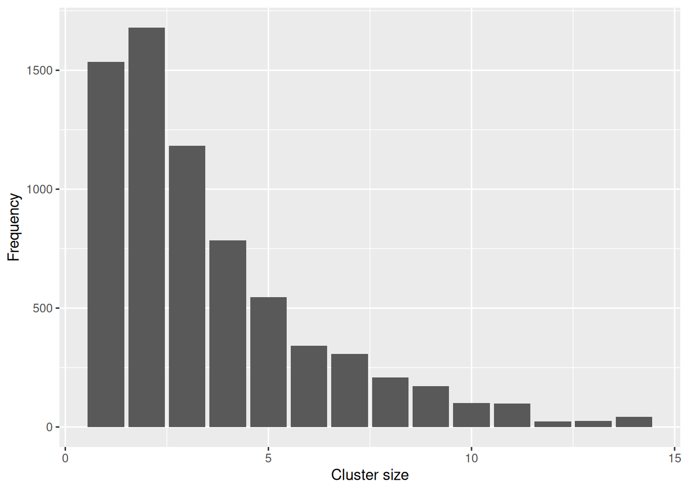

# 37  İletim Zincirleri

## 37.1 Genel Bakış

İletim zincirlerini ve temas izleme verilerini işlemek, analiz etmek ve görselleştirmek için birincil araç, RECON tarafından geliştirilen epicontacts paketidir. Daha fazla bilgi için imleci nodların üzerine getirerek, taşımak için sürükleyerek ve aşağı akış durumlarını vurgulamak için üzerlerine tıklayarak aşağıdaki etkileşimli grafiği deneyin

## 37.2 Hazırlık

### Paketlerin yüklenmesi

Önce verilerin içe aktarılması ve işlenmesi için gereken standart paketleri yükleyin. Bu el kitabında, gerekirse paketi kuran ve kullanım için yükleyen pacman’ın ‘p_load()’ fonksiyonunu vurguluyoruz. Ayrıca R tabanı’ndan ‘library()’ ile paketleri yükleyebilirsiniz. R paketleri hakkında daha fazla bilgi için R’ın temelleri\[R Basics\] sayfasına bakın.

``` r
pacman::p_load(
   rio,          # Dosyanın içe aktarımı 
   here,         # Dosyanın konumlandırılması 
   tidyverse,    # Veri yönetimi + ggplot2 grafikleri
   remotes       # github’dan paketlerin kurulumu  
)
```

Pacman’ın p_install_github() fonksiyonu kullanılarak github’dan yüklenebilen epicontacts’ın geliştirme sürümüne ihtiyacınız olacak. Aşağıdaki komutu yalnızca bir kez çalıştırmanız gerekir, paketi her kullandığınızda değil (bundan sonra her zamanki gibi p_load() kullanabilirsiniz).

``` r
pacman::p_install_gh("reconhub/epicontacts@timeline")
```

### Verinin içeri aktarımı

Simüle edilmiş bir Ebola salgını vakalarından oluşan veri setini içe aktarıyoruz. Adım adım verileri indirmek istiyorsanız, el kitabı ve verilerin indirilmesi sayfasındaki talimatlara [Download handbook and data](download.llms.md) bakın. Veri seti, rio paketinden import() fonkisyonu kullanılarak içe aktarılır. Verileri içe aktarmanın çeşitli yolları için İçe ve dışa aktarma sayfasına \[Import and export\] bakın.

``` r
# satır listesini içe aktarın
linelist <- appliedepidata::get_data(name = "linelist_cleaned_rds")
```

Çizgi listesinin ilk 50 satırı aşağıda gösterilmiştir. Özellikle ilgi çekici olan sütunlar : ‘case_id’, ‘generation’, ‘infector’ ve ‘source’.

### Epicontacts nesnesi oluşturma

Daha sonra iki tür veri gerektiren bir epicontacts nesnesi oluşturmamız gerekiyor: • Sütunların değişken olduğu ve satırların benzersiz durumlara karşılık geldiği bir satır listesi • Benzersiz kimliklerle vakalar arasındaki bağlantıları tanımlayan kenarların bir listesi (bunlar kişiler, aktarım olayları vb. olabilir)

Halihazırda bir satır listemiz olduğundan, vakalar arasında, daha spesifik olarak kimlikleri arasında bir kenar listesi oluşturmamız gerekiyor. Enfektör sütununu ‘case_id’ sütununa bağlayarak satır listesinden iletim bağlantılarını çıkarabiliriz. Bu noktada, vakaların kendilerini değil, iki durum arasındaki bağlantıyı tanımlayan herhangi bir değişkeni gösterdiğimiz kenar özelliklerini (edge properties) de ekleyebiliriz. Örnek olarak, iletim olayının konumunu tanımlayan bir konum değişkeni ve gün cinsinden temasın süresini tanımlayan bir süre değişkeni ekleyeceğiz.

Aşağıdaki kodda, dplyr fonksiyonu transmut’e, yalnızca fonksiyon içinde belirttiğimiz sütunları tutması dışında mutate’e benzer. drop_na fonksiyonu, belirtilen sütunlarda bir NA değeri olan tüm satırları filtreleyecektir; bu durumda, yalnızca bulaştırıcının bilindiği satırları tutmak istiyoruz.

``` r
## kişileri oluştur
set.seed(1)
contacts <- linelist %>%
  transmute(
    infector = infector,
    case_id = case_id,
    location = sample(c("Community", "Nosocomial"), n(), TRUE),
    duration = sample.int(10, n(), TRUE)
  ) %>%
  drop_na(infector)
```

Artık ‘make_epicontacts’ fonksiyonunu kullanarak epicontacts nesnesini oluşturabiliriz. Satır listesindeki hangi sütunun benzersiz vaka tanımlayıcısına işaret ettiğini ve ayrıca ilgili kişilerdeki hangi sütunların bağlantıda yer alan vakaların benzersiz tanımlayıcılarına işaret ettiğini belirtmemiz gerekir. Bu bağlantılar, enfeksiyonun bulaştırıcıdan vakaya gittiği yöndedir, bu nedenle başlangıç ve sonuç değişkenlerini belirtmemiz gerekir. Bu sebeple, gelecekteki işlemleri etkileyecek olan yönlendirilmiş (directed) değişkenini TRUE olarak ayarladık.

``` r
## epicontacts nesnesi oluştur 
epic <- make_epicontacts(
  linelist = linelist,
  contacts = contacts,
  id = "case_id",
  from = "infector",
  to = "case_id",
  directed = TRUE
)
```

Epicontacts nesnelerini inceledikten sonra, satır listesindeki case_id sütununun id olarak yeniden adlandırıldığını ve temaslılardaki case_id ve infector sütunlarının from (-den) ve to (-e) olarak yeniden adlandırıldığını görebiliriz. Bu adım, sonraki işleme, görselleştirme ve analiz işlemlerinde tutarlılık sağlar.

``` r
##  epicontacts nesnesini göster
epic
```


    /// Epidemiological Contacts //

      // class: epicontacts
      // 5,888 cases in linelist; 3,800 contacts; directed 

      // linelist

    # A tibble: 5,888 × 30
       id     generation date_infection date_onset date_hospitalisation date_outcome
       <chr>       <dbl> <date>         <date>     <date>               <date>      
     1 5fe599          4 2014-05-08     2014-05-13 2014-05-15           NA          
     2 8689b7          4 NA             2014-05-13 2014-05-14           2014-05-18  
     3 11f8ea          2 NA             2014-05-16 2014-05-18           2014-05-30  
     4 b8812a          3 2014-05-04     2014-05-18 2014-05-20           NA          
     5 893f25          3 2014-05-18     2014-05-21 2014-05-22           2014-05-29  
     6 be99c8          3 2014-05-03     2014-05-22 2014-05-23           2014-05-24  
     7 07e3e8          4 2014-05-22     2014-05-27 2014-05-29           2014-06-01  
     8 369449          4 2014-05-28     2014-06-02 2014-06-03           2014-06-07  
     9 f393b4          4 NA             2014-06-05 2014-06-06           2014-06-18  
    10 1389ca          4 NA             2014-06-05 2014-06-07           2014-06-09  
    # ℹ 5,878 more rows
    # ℹ 24 more variables: outcome <chr>, gender <chr>, age <dbl>, age_unit <chr>,
    #   age_years <dbl>, age_cat <fct>, age_cat5 <fct>, hospital <chr>, lon <dbl>,
    #   lat <dbl>, infector <chr>, source <chr>, wt_kg <dbl>, ht_cm <dbl>,
    #   ct_blood <dbl>, fever <chr>, chills <chr>, cough <chr>, aches <chr>,
    #   vomit <chr>, temp <dbl>, time_admission <chr>, bmi <dbl>,
    #   days_onset_hosp <dbl>

      // contacts

    # A tibble: 3,800 × 4
       from   to     location   duration
       <chr>  <chr>  <chr>         <int>
     1 f547d6 5fe599 Community         7
     2 f90f5f b8812a Community         5
     3 11f8ea 893f25 Nosocomial        6
     4 aec8ec be99c8 Community         7
     5 893f25 07e3e8 Community         7
     6 133ee7 369449 Community         3
     7 996f3a 2978ac Community         5
     8 133ee7 57a565 Community        10
     9 37a6f6 fc15ef Community         3
    10 9f6884 2eaa9a Community         8
    # ℹ 3,790 more rows

## 37.3 İdare

### Altkümeleme

epicontacts nesneleri için subset() yöntemi, diğer nesnelerin yanı sıra, satır listesinin (“düğüm(nod) öznitelikleri”) ve kişiler veritabanının (“kenar öznitelikleri”) özelliklerine dayalı olarak ağların filtrelenmesine olanak tanır. Bu değerler, ilgili bağımsız değişkene adlandırılmış listeler olarak iletilmelidir. Örneğin, aşağıdaki kodda sadece Nisan-Temmuz 2014 arasında enfeksiyonu olan (tarihler aralık olarak belirtilmiştir) erkek vakaları ve hastanede meydana gelen bulaşma bağlantılarını satır listesinde tutuyoruz.

``` r
sub_attributes <- subset(
  epic,
  node_attribute = list(
    gender = "m",
    date_infection = as.Date(c("2014-04-01", "2014-07-01"))
  ), 
  edge_attribute = list(location = "Nosocomial")
)
sub_attributes
```


    /// Epidemiological Contacts //

      // class: epicontacts
      // 69 cases in linelist; 1,941 contacts; directed 

      // linelist

    # A tibble: 69 × 30
       id     generation date_infection date_onset date_hospitalisation date_outcome
       <chr>       <dbl> <date>         <date>     <date>               <date>      
     1 5fe599          4 2014-05-08     2014-05-13 2014-05-15           NA          
     2 893f25          3 2014-05-18     2014-05-21 2014-05-22           2014-05-29  
     3 2978ac          4 2014-05-30     2014-06-06 2014-06-08           2014-06-15  
     4 57a565          4 2014-05-28     2014-06-13 2014-06-15           NA          
     5 fc15ef          6 2014-06-14     2014-06-16 2014-06-17           2014-07-09  
     6 99e8fa          7 2014-06-24     2014-06-28 2014-06-29           2014-07-09  
     7 f327be          6 2014-06-14     2014-07-12 2014-07-13           2014-07-14  
     8 90e5fe          5 2014-06-18     2014-07-13 2014-07-14           2014-07-16  
     9 a47529          5 2014-06-13     2014-07-17 2014-07-18           2014-07-26  
    10 da8ecb          5 2014-06-20     2014-07-18 2014-07-20           2014-08-01  
    # ℹ 59 more rows
    # ℹ 24 more variables: outcome <chr>, gender <chr>, age <dbl>, age_unit <chr>,
    #   age_years <dbl>, age_cat <fct>, age_cat5 <fct>, hospital <chr>, lon <dbl>,
    #   lat <dbl>, infector <chr>, source <chr>, wt_kg <dbl>, ht_cm <dbl>,
    #   ct_blood <dbl>, fever <chr>, chills <chr>, cough <chr>, aches <chr>,
    #   vomit <chr>, temp <dbl>, time_admission <chr>, bmi <dbl>,
    #   days_onset_hosp <dbl>

      // contacts

    # A tibble: 1,941 × 4
       from   to     location   duration
       <chr>  <chr>  <chr>         <int>
     1 11f8ea 893f25 Nosocomial        6
     2 a75c7f 7f5a01 Nosocomial        1
     3 a15e13 f327be Nosocomial        7
     4 beb26e 959170 Nosocomial       10
     5 567136 8ebf6e Nosocomial        4
     6 894024 e56412 Nosocomial        2
     7 a2086d a47529 Nosocomial        4
     8 d6584f f5c142 Nosocomial       10
     9 312ecf 3ad520 Nosocomial        1
    10 52ea64 062638 Nosocomial        5
    # ℹ 1,931 more rows

thin fonksiyonunu, ‘what = “linelist”’ değişkeniyle temaslılarda bulunan vakaları dahil etmek için satır listesini filtrelemek veya ‘what = “contacts”’ değişkeniyle satır listesinde bulunan vakaları dahil etmek için kullanabiliriz. Aşağıdaki kodda, yukarıda filtrelediğimiz Nisan ve Temmuz ayları arasında enfekte olan erkek vakaları içeren iletim bağlantılarını tutmak için epicontacts nesnesini ayrıca filtreliyoruz. Sadece 3 bilinen iletim bağlantısının bu filtreye uyduğunu görebiliriz.

``` r
sub_attributes <- thin(sub_attributes, what = "contacts")
nrow(sub_attributes$contacts)
```

    [1] 3

Nod ve kenar özniteliklerine göre alt kümelemeye ek olarak, ağlar yalnızca belirli nodlara bağlı bileşenleri içerecek şekilde budanabilir. ‘Cluster_id’ değişkeni, vaka kimliklerinin bir vektörünü alır ve doğrudan veya dolaylı olarak bu kimliklere bağlı bireylerin satır listesini getirir. Aşağıdaki kodda, ‘2ae019’ ve ‘71577a’ içeren kümelerde toplam 13 satır listesi vakasının yer aldığını görebiliriz.

``` r
sub_id <- subset(epic, cluster_id = c("2ae019","71577a"))
nrow(sub_id$linelist)
```

    [1] 13

epicontacts nesneleri için subset() yöntemi ayrıca cs, cs_min ve cs_max değişkenlerini kullanarak küme boyutuna göre filtrelemeye izin verir. Aşağıdaki kodda, yalnızca 10 vaka veya daha büyük kümelere dahil olan vakaları tutuyoruz ve bu kümelerde 271 satır listesi vakasının yer aldığını görebiliriz.

``` r
sub_cs <- subset(epic, cs_min = 10)
nrow(sub_cs$linelist)
```

    [1] 271

### ID’lere ulaşmak

get_id() fonksiyonu, veri setindeki vaka kimlikleri hakkında bilgi toplar ve aşağıdaki gibi parametrelenebilir: • **linelist**: satır listesi verilerindeki kimlikler • **contacts**: temaslı veri setindeki kimlikler (“from-kimden” ve “to-kime” birleşik) • **from**: temaslı veri setinin “kimden” sütunundaki kimlikler • **to**: temaslı veri setinin “to” sütunundaki kimliklere • **all**: Her iki veri kümesinde de herhangi bir yerde görünen kimlikler • **common**: Hem temaslı veri setinde hem de satır listesinde görünen kimlikler

Örneğin, temaslı veri setindeki ilk on kimlik nedir?

``` r
contacts_ids <- get_id(epic, "contacts")
head(contacts_ids, n = 10)
```

     [1] "f547d6" "f90f5f" "11f8ea" "aec8ec" "893f25" "133ee7" "996f3a" "37a6f6"
     [9] "9f6884" "4802b1"

Hem satır listesinde hem de temaslılarda kaç kimlik var?

``` r
length(get_id(epic, "common"))
```

    [1] 4352

## 37.4 Görselleştirme

### Temel grafik oluşturma

Epicontacts nesnelerinin tüm görselleştirmeleri, plot fonksiyonu tarafından gerçekleşitirilr. İlk önce epicontacts nesnesini subset fonksiyonunu kullanarak yalnızca Haziran 2014 başlangıç tarihine sahip vakaları içerecek şekilde filtreleyeceğiz ve thin fonksiyonu kullanarak bu vakalarla bağlantılı kişileri dahil edeceğiz.

``` r
## epicontacts nesnesi alt kümesi 
sub <- epic %>%
  subset(
    node_attribute = list(date_onset = c(as.Date(c("2014-06-30", "2014-06-01"))))
  ) %>%
 thin("contacts")
```

Daha sonra basit bir etkileşimli grafiği aşağıdaki gibi kolay şekilde oluşturabiliriz:

``` r
## epicontacts nesne grafiği
plot(
  sub,
  width = 700,
  height = 700
)
```

Nodları sürükleyerek hareket ettirebilir, daha fazla bilgi için üzerlerine gelebilir ve bağlantılı vakaları vurgulamak için üzerlerine tıklayabilirsiniz.

Bu grafiği daha da değiştirmek için çok sayıda değişken bulunur. Esas olanları burada ele alacağız, ancak fonksiyonun tam bir açıklamasını elde etmek için ?vis_epicontacts (bir epicontacts nesnesi üzerinde çizim kullanılırken çağrılan fonksiyon) aracılığıyla belgelere bakın.

#### Nod özelliklerinin görselleştirilmesi

Nod rengi, şekli ve boyutu, node_color, node_shape ve node_size bağımsız değişkenleri kullanılarak satır listesindeki belirli bir sütuna eşlenebilir. Bu, ggplot2’den tanıyabileceğiniz aes sözdizimine benzer.

Nodların belirli renkleri, şekilleri ve boyutları aşağıdaki gibi belirlenebilir: • Col_pal değişkeni aracılığıyla, aşağıda yapıldığı gibi her rengin manuel olarak belirtilmesi için bir ad listesi yazarak ya da colorRampPalette(c(“siyah”, “kırmızı”, “turuncu”) gibi bir renk paleti fonksiyonu ile sağlayarak), belirtilenler arasında bir renk gradyanı oluşturulabilir. • Shapes (Şekiller) adlandırılmış bir liste ileterek, node_shape tarafından belirtilen satır listesi sütunundaki her benzersiz öğe için bir şekil belirtilebilir. Kullanılabilir şekiller için codeawesome’a bakın. • Size_range nodların boyut aralığını ileterek boyutlandırma. Rengin sonucu, cinsiyetin şekli ve yaşın ise boyutu temsil ettiği bir örnek:

``` r
plot(
  sub, 
  node_color = "outcome",
  node_shape = "gender",
  node_size = "age",
  col_pal = c(Death = "firebrick", Recover = "green"),
  shapes = c(f = "female", m = "male"),
  size_range = c(40, 60),
  height = 700,
  width = 700
)
```

#### Kenar özelliklerinin görselleştirilmesi

Kenar rengi, genişliği ve çizgi tipi, edge_color, edge_width ve edge_linetype değişkenleri kullanılarak temasların veri çerçevesindeki belirli bir sütuna eşlenebilir. Kenarların belirli renkleri ve genişlikleri aşağıdaki gibi belirtilebilir:

• Col_pal için kullanılanla aynı şekilde edge_col_pal aracılığıyla renkler. • Genişlik_aralığı argümanına nodların boyut aralığını ileterek genişlik belirlenir

İşte bir örnek:

``` r
plot(
  sub, 
  node_color = "outcome",
  node_shape = "gender",
  node_size = 'age',
  col_pal = c(Death = "firebrick", Recover = "green"),
  shapes = c(f = "female", m = "male"),
  size_range = c(40, 60),
  edge_color = 'location',
  edge_linetype = 'location',
  edge_width = 'duration',
  edge_col_pal = c(Community = "orange", Nosocomial = "purple"),
  width_range = c(1, 3),
  height = 700,
  width = 700
)
```

### Temporal eksen

x_axis değişkeni satır listesindeki bir sütuna eşleyerek ağı zamansal bir eksen boyunca görselleştirebiliriz. Aşağıdaki örnekte, x ekseni, semptom başlangıç tarihini temsil eder. Ayrıca okların çok büyük olmamasını sağlamak için arrow_size (ok boyutu) değişkenini belirledik ve şekli daha az karmaşık hale getirmek için label değişkenini = YANLIŞ olarak ayarladık.

``` r
plot(
  sub,
  x_axis = "date_onset",
  node_color = "outcome",
  col_pal = c(Death = "firebrick", Recover = "green"),
  arrow_size = 0.5,
  node_size = 13,
  label = FALSE,
  height = 700,
  width = 700
)
```

Bu ağın zamansal bir eksen boyunca nasıl görselleştirildiğini daha ayrıntılı olarak göstermek için çok sayıda ek argüman vardır; bunları ?vis_temporal_interactive (bir epicontacts nesnesi üzerinde çizimi x_axis üzerinden belirtilen şekilde göstermek çağrılan fonkisyon) aracılığıyla inceleyebilirsiniz. Aşağıda bazılarını gözden geçireceğiz.

#### İletim ağacı şeklinin belirlenmesi

Network_shape değişkeni kullanılarak belirtilen, iletim ağacının alabileceği iki ana şekil vardır. Birincisi, düz bir kenarın herhangi iki düğümü birleştirdiği, yukarıda gösterildiği gibi bir dallanma şeklidir. Bu en iyi anlaşılan temsildir, ancak yoğun bir şekilde bağlantılar içeren bir ağda üst üste binen kenarlara neden olabilir. İkinci şekil, bir filogenik ağaca benzeyen bir ağaç oluşturan dikdörtgendir. Örneğin:

``` r
plot(
  sub,
  x_axis = "date_onset",
  network_shape = "rectangle",
  node_color = "outcome",
  col_pal = c(Death = "firebrick", Recover = "green"),
  arrow_size = 0.5,
  node_size = 13,
  label = FALSE,
  height = 700,
  width = 700
)
```

Her durum nodunda, position_dodge değişkeni değiştirilerek benzersiz bir dikey konum atanabilir. Bağlantısız vakaların konumu (yani, bildirilen herhangi bir kişi olmadan), unlinked_pos değişkeni kullanılarak belirtilir.

``` r
plot(
  sub,
  x_axis = "date_onset",
  network_shape = "rectangle",
  node_color = "outcome",
  col_pal = c(Death = "firebrick", Recover = "green"),
  position_dodge = TRUE,
  unlinked_pos = "bottom",
  arrow_size = 0.5,
  node_size = 13,
  label = FALSE,
  height = 700,
  width = 700
)
```

Üst nodun alt nodlara göre konumu, ‘parent_pos’ değişkeni kullanılarak belirlenebilir. Varsayılan seçenek, üst nodu ortaya yerleştirmektir, ancak altta (parent_pos = ‘alt’) veya üstte (parent_pos = ‘üst’) yerleştirilebilir.

``` r
plot(
  sub,
  x_axis = "date_onset",
  network_shape = "rectangle",
  node_color = "outcome",
  col_pal = c(Death = "firebrick", Recover = "green"),
  parent_pos = "top",
  arrow_size = 0.5,
  node_size = 13,
  label = FALSE,
  height = 700,
  width = 700
)
```

#### Şekil ve grafiklerin kaydedilmesi

**VisNetwork** paketindeki ‘visSave’ fonksiyonuyla bir grafiği etkileşimli, bağımsız bir html dosyası olarak kaydedebilirsiniz:

``` r
plot(
  sub,
  x_axis = "date_onset",
  network_shape = "rectangle",
  node_color = "outcome",
  col_pal = c(Death = "firebrick", Recover = "green"),
  parent_pos = "top",
  arrow_size = 0.5,
  node_size = 13,
  label = FALSE,
  height = 700,
  width = 700
) %>%
  visNetwork::visSave("network.html")
```

Bu ağ çıktılarını bir görüntü olarak kaydetmek ne yazık ki zordur ve dosyayı bir html olarak kaydetmenizi ve ardından ‘webshot’ paketini kullanarak bu dosyanın ekran görüntüsünü almanızı gerektirir. Aşağıdaki kodda, yukarıda kaydedilen html dosyasını PNG’ye dönüştürüyoruz:

``` r
webshot(url = "network.html", file = "network.png")
```

### Zaman Çizelgeleri

Ayrıca, her bir vakanın x ekseninde temsil edildiği zaman çizelgeleri de verebilirsiniz. Zaman çizergeleri, vaka konumlarını veya sonuca ulaşma zamanını görselleştirmek için kullanılabilir. Bir zaman çizelgesi oluşturmak için, vaka kimliğini, “olay”ın başlangıç tarihini ve “olay”ın bitiş tarihini gösteren en az üç sütundan oluşan bir veri çerçevesi oluşturmamız gerekiyor. Ayrıca, zaman çizelgesinin nod ve kenar özelliklerine eşlenebilecek, istediğiniz sayıda başka sütun da ekleyebilirsiniz. Aşağıdaki kodda, semptom başlangıcından sonuç tarihine kadar bir zaman çizelgesi oluşturuyoruz ve nod şeklini ve rengini tanımlamak için kullandığımız sonuç ve hastane değişkenlerini veri tabanımızda tutuyoruz. Örneğin, bir vaka birden fazla hastane arasında sevk ediliyorsa, vaka başına birden fazla zaman çizelgesi satırına/olayına sahip olabileceğinizi unutmayın.

``` r
## zaman çizelgesini oluştur
timeline <- linelist %>%
  transmute(
    id = case_id,
    start = date_onset,
    end = date_outcome,
    outcome = outcome,
    hospital = hospital
  ) %>%
  filter(id %in% get_id(sub, "common"), !is.na(start), !is.na(end))
```

Daha sonra zaman çizelgesi öğesini ‘timeline’ değişkenine iletiriz. Zaman çizelgesi özniteliklerini zaman çizelgesi nod renklerine, şekillerine ve boyutlarına önceki bölümlerde tanımlandığı şekilde eşleyebiliriz, ancak iki nodumuz vardır: Bir zaman çizelgesinin ayrı ayrı değişkenleri olan başlangıç ve bitiş nodları. Örneğin, ‘tl_start_node_color’, hangi zaman çizelgesi sütununun başlangıç nodunun rengiyle eşlendiğini tanımlarken ‘tl_end_node_shape’, hangi zaman çizelgesi sütununun bitiş nodunun şekliyle eşlendiğini tanımlar. Ayrıca ’tl_edge\_\*’ değişkenleri aracılığıyla renk, genişlik, çizgi tipi ve etiketleri zaman çizelgesi kenarına eşleyebiliriz.

Değişkenlerle ilgili ayrıntılı belgeler için ‘?vis_temporal_interactive’ e (bir epicontacts nesnesi çizilirken çağrılan fonksiyon) bakın. Her değişken aşağıdaki kodda da açıklanmıştır:

``` r
## şekilleri tanımla
shapes <- c(
  f = "female",
  m = "male",
  Death = "user-times",
  Recover = "heartbeat",
  "NA" = "question-circle"
)

## renkleri tanımla
colours <- c(
  Death = "firebrick",
  Recover = "green",
  "NA" = "grey"
)

## grafiği oluştur
plot(
  sub,
  ## başlangıç tarihi için maksimum x koordinatı 
  x_axis = "date_onset",
  ## dikdörtgen ağ şeklini kullan 
  network_shape = "rectangle",
  ## nod şekillerini cinsiyet sütununa göre şekillendir 
  node_shape = "gender",
  ## nod rengini herhangi bir sütun ile eşleştirmiyoruz çünkü varsayılan değeri id sütunudur bu da renk şemamızı bozar
  ## default value is to map to node id, which will mess up the colour scheme
  node_color = NULL,
  ## nod büyüklüğünü 30’a ayarla (nod büyüklüğü herhangi bir karakter değildir, herhangi bir sütuna eşleştirilmez, doğrudan nod büyüklüğü belirtilir
  ## mapped to a column but instead interpreted as the actual node size)
  node_size = 30,
  ## set transmission link width to 4 (as this is not a character, edge_width is
  ## iletim bağlantısı kalınlığını 4’e ayarla (bu kalınlık bir karakter ile eşleşmemiştir) 
  edge_width = 4,
  ## zaman çizelgesi nesnesi sağla 
  timeline = timeline,
  ## bitiş nodunun şeklini zaman çizelgesi nesnesindeki sonuç sütununa eşle
  tl_end_node_shape = "outcome",
  ## son nodun boyutunu 15'e ayarla (bir karakter olmadığından, bu argüman bir sütuna eşlenmez, bunun yerine gerçek nod boyutu olarak yorumlanır)
  ## argument is not mapped to a column but instead interpreted as the actual
  ## node size)
  tl_end_node_size = 15,
  ## zaman çizelgesi kenarının rengini hastane sütununa eşle
  tl_edge_color = "hospital",
  ## set the width of the timeline edge to 2 (as this is not a character, this
  ## argument is not mapped to a column but instead interpreted as the actual
  ## zaman çizelgesi kenarının genişliğini 2'ye ayarla (bu bir karakter olmadığından, bu değişken bir sütuna eşlenmez, bunun yerine gerçek kenar genişliği olarak yorumlanır)
  tl_edge_width = 2,
  ## kenar etiketlerini hastane değişkenine eşleyin
  tl_edge_label = "hospital",
  ## nod şeklini belirt (yukarıda tanımlanmıştır)
  shapes = shapes,
  ## renk paletini belirt (yukarıda tanımlanmıştır)
  col_pal = colours,
  ## ok büyüklüğünü 0.5’e ayarla 
  arrow_size = 0.5,
  ## lejantta iki sütun olsun 
  legend_ncol = 2,
  ## font büyüklüğünü ayarla 
  font_size = 15,
  ## tarih formatı ayarla 
  date_labels = c("%d %b %Y"),
  ## nodların altında ID etiketini grafik olarak gösterme
  label = FALSE,
  ## yüksekliği belirt 
  height = 1000,
  ## genişliği belirt
  width = 1200,
  ## her vaka nodunun benzersiz bir y koordinatına sahip olduğundan emin olun - zaman çizelgelerini kullanırken bu çok önemlidir, aksi takdirde farklı vakalarda çakışan zaman çizelgeleriniz olur 
  ## when using timelines, otherwise you will have overlapping timelines from
  ## different cases
  position_dodge = TRUE
)
```

## 37.5 Analiz

### Özetleme

‘summary’ fonkisyonunu kullanarak bazı ağ özelliklerine genel bir bakış elde edebiliriz.

``` r
## epicontacts nesnesini özetle 
summary(epic)
```


    /// Overview //
      // number of unique IDs in linelist: 5888
      // number of unique IDs in contacts: 5511
      // number of unique IDs in both: 4352
      // number of contacts: 3800
      // contacts with both cases in linelist: 56.868 %

    /// Degrees of the network //
      // in-degree summary:
       Min. 1st Qu.  Median    Mean 3rd Qu.    Max. 
     0.0000  0.0000  1.0000  0.5392  1.0000  1.0000 

      // out-degree summary:
       Min. 1st Qu.  Median    Mean 3rd Qu.    Max. 
     0.0000  0.0000  0.0000  0.5392  1.0000  6.0000 

      // in and out degree summary:
       Min. 1st Qu.  Median    Mean 3rd Qu.    Max. 
      0.000   1.000   1.000   1.078   1.000   7.000 

    /// Attributes //
      // attributes in linelist:
     generation date_infection date_onset date_hospitalisation date_outcome outcome gender age age_unit age_years age_cat age_cat5 hospital lon lat infector source wt_kg ht_cm ct_blood fever chills cough aches vomit temp time_admission bmi days_onset_hosp

      // attributes in contacts:
     location duration

Örneğin, temaslıların yalnızca %57’sinin satır listesinde her iki vakaya da sahip olduğunu görebiliriz. Bu iletim zincirlerine dahil olan önemli sayıda vaka hakkında linelist veriye sahip olmadığımız anlamına gelir.

### Çift Özellikleri

‘get_pairwise()’ fonkisyonu, temaslı veri kümesindeki her bir çifte göre satır listesindeki değişken(ler)in işlenmesine izin verir. Aşağıdaki örnekte, her bir çift için hastalık başlangıç tarihi arasındaki farkı hesaplamak için, hastalık başlangıç tarihi satır listesinden çıkarılır. Bu karşılaştırmadan üretilen değer, seri aralığını (serial interval-si) temsil eder.

``` r
si <- get_pairwise(epic, "date_onset")   
summary(si)
```

       Min. 1st Qu.  Median    Mean 3rd Qu.    Max.     NAs 
       0.00    5.00    9.00   11.01   15.00   99.00    1820 

``` r
tibble(si = si) %>%
  drop_na(si) %>%
  ggplot(aes(si)) +
  geom_histogram(bins = 30) +
  labs(
    x = "Serial interval",
    y = "Frequency"
  )
```

[](transmission_chains_files/figure-html/transmission_chains_pairwise-1.png)

‘get_pairwise()’, karşılaştırma için kullanılan sütunun sınıfını yorumlayacak ve buna göre değerleri karşılaştırma yöntemini ayarlayacaktır. Sayılar ve tarihler için (yukarıdaki *si* örneğinde olduğu gibi) fonksiyon, değerleri çıkaracaktır. Karakter içeren veya kategorik sütunlara uygulandığında, get_pairwise() fonksiyonu değerleri birbirine yapıştırır. Fonksiyon aynı zamanda keyfi işlemeye de izin verdiğinden (bkz. “f” değişkeni), bu ayrık kombinasyonlar kolayca tablo haline getirilebilir ve analiz edilebilir.

``` r
head(get_pairwise(epic, "gender"), n = 10)
```

     [1] "f -> m" NA       "m -> m" NA       "m -> f" "f -> f" NA       "f -> m"
     [9] NA       "m -> f"

``` r
get_pairwise(epic, "gender", f = table)
```

               values.to
    values.from   f   m
              f 464 516
              m 510 468

``` r
fisher.test(get_pairwise(epic, "gender", f = table))
```


        Fisher's Exact Test for Count Data

    data:  get_pairwise(epic, "gender", f = table)
    p-value = 0.03758
    alternative hypothesis: true odds ratio is not equal to 1
    95 percent confidence interval:
     0.6882761 0.9892811
    sample estimates:
    odds ratio 
     0.8252575 

Burada, iletim bağlantıları ve cinsiyet arasında önemli bir ilişki görüyoruz.

### Kümelerin tanımlanması

get_clusters() fonksiyonu, bir epicontacts nesnesindeki bağlı bileşenleri tanımlamak için kullanılabilir. İlk olarak, küme bilgisini içeren bir veri çerçevesi elde etmek için kullanırız:

``` r
clust <- get_clusters(epic, output = "data.frame")
table(clust$cluster_size)
```


       1    2    3    4    5    6    7    8    9   10   11   12   13   14 
    1536 1680 1182  784  545  342  308  208  171  100   99   24   26   42 

``` r
ggplot(clust, aes(cluster_size)) +
  geom_bar() +
  labs(
    x = "Cluster size",
    y = "Frequency"
  )
```

[](transmission_chains_files/figure-html/transmission_chains_cluster-1.png)

En büyük kümelere bakalım. Bunun için epicontacts nesnesine küme bilgisi ekliyoruz ve ardından yalnızca en büyük kümeleri içerecek şekilde alt kümelerini oluşturuyoruz:

``` r
epic <- get_clusters(epic)
max_size <- max(epic$linelist$cluster_size)
plot(subset(epic, cs = max_size))
```

### Derecelerin hesaplanması

Bir nodun derecesi, kenar sayısına veya diğer nodlarla olan bağlantılarına karşılık gelir. ‘get_degree()’, epicontacts ağları için bu değeri hesaplamakta kolay bir yöntem sağlar. Bu bağlamda yüksek bir derece, birçok başka kişiyle temas halinde olmuş bir kişiyi gösterir. ‘type’ değişkeni hem iç dereceyi (in-degree) hem de dış dereceyi (out-degree) saymak istediğimizi belirtir, ‘only_linelist’ değişkeni sadece satır listesindeki vakalar için dereceyi hesaplamak istediğimizi belirtir.

``` r
deg_both <- get_degree(epic, type = "both", only_linelist = TRUE)
```

Hangi kişiler en fazla on temasa sahip?

``` r
head(sort(deg_both, decreasing = TRUE), 10)
```

    916d0a 858426 6833d7 f093ea 11f8ea 3a4372 38fc71 c8c4d5 a127a7 02d8fd 
         7      6      6      6      5      5      5      5      5      5 

Ortalama temaslı sayısı nedir?

``` r
mean(deg_both)
```

    [1] 1.078473

## 37.6 Kaynaklar

[epicontacts page](https://www.repidemicsconsortium.org/epicontacts/index.html) Epicontacts sayfası, paket fonksiyonlarına genel bir bakış sağlar ve bazı daha ayrıntılı gösterimler içerir.

[github page](http://github.com/reconhub/epicontacts) Github sayfası, sorunları dile getirmek ve yeni özellikler talep etmek için kullanılabilir.
