# 28  GIS cơ bản

[](../../images/gis_head_image.png)

## 28.1 Tổng quan

Các khía cạnh không gian trong dữ liệu của bạn có thể cung cấp nhiều thông tin chi tiết về tình hình đợt bùng phát dịch và để trả lời các câu hỏi như:

- Các điểm nóng về dịch bệnh hiện nay ở đâu?
- Các điểm nóng đã thay đổi như thế nào theo thời gian?
- Việc tiếp cận các cơ sở y tế như thế nào? Có cần thêm sự tăng cường nào không?

Trọng tâm hiện tại trong chương GIS này nhằm giải quyết nhu cầu của các nhà dịch tễ học ứng dụng trong ứng phó với các đợt bùng phát dịch. Chúng ta sẽ khám phá các phương pháp trực quan hóa dữ liệu không gian cơ bản bằng cách sử dụng package **tmap** và **ggplot2**. Chúng ta cũng sẽ đi qua một số phương pháp quản lý và truy vấn dữ liệu không gian cơ bản với package **sf**. Cuối cùng, chúng ta sẽ đề cập ngắn gọn đến các khái niệm về *thống kê không gian (spatial statistics)* như mối quan hệ không gian, tự tương quan không gian và hồi quy không gian bằng cách sử dụng package **spdep**.

## 28.2 Các thuật ngữ chính

Dưới đây chúng tôi giới thiệu một số thuật ngữ chính. Để được giới thiệu kỹ lưỡng về GIS và phân tích không gian, chúng tôi khuyên bạn nên xem lại một trong các hướng dẫn hoặc khóa học dài hơn được liệt kê trong phần Tài nguyên học liệu.

**Hệ thống thông tin địa lý (Geographic Information System - GIS)** - GIS là một framework hoặc môi trường để thu thập, quản lý, phân tích và trực quan hóa dữ liệu không gian.

### Phần mềm GIS

Một số phần mềm GIS phổ biến cho phép tương tác bằng các thao tác chuột để phát triển bản đồ và phân tích không gian. Những công cụ này đi kèm với những lợi thế như không cần phải học code và dễ dàng lựa chọn và đặt các biểu tượng và tính năng trên bản đồ theo cách thủ công. Dưới đây là hai phần mềm phổ biến:

**ArcGIS** - Một phần mềm GIS thương mại do công ty ESRI phát triển, rất phổ biến nhưng khá đắt

**QGIS** - Một phần mềm GIS mã nguồn mở nhưng làm được hầu hết mọi thứ mà ArcGIS có thể làm được. Bạn có thể [tải QGIS tại đây](https://qgis.org/en/site/forusers/download.html)

Sử dụng R để thao tác GIS thoạt đầu có vẻ đáng sợ hơn bởi vì thay bằng các “thao tác chuột”, nó có “giao diện dòng lệnh” (bạn phải viết code để có được kết quả mong muốn). Tuy nhiên, đây là một lợi thế lớn nếu bạn cần tạo bản đồ lặp đi lặp lại hoặc tạo các phân tích có thể tái lập được.

### Dữ liệu không gian

Hai dạng dữ liệu không gian chính được sử dụng trong GIS là dữ liệu vectơ và raster:

**Vector Data** - Định dạng phổ biến nhất của dữ liệu không gian được sử dụng trong GIS, dữ liệu vectơ bao gồm các đặc điểm hình học của vertices and paths. Dữ liệu không gian dạng vectơ có thể được chia thành ba loại nhỏ được sử dụng rộng rãi:

- *Điểm (Points)* - Một điểm bao gồm một cặp tọa độ (x, y) đại diện cho một vị trí cụ thể trong một hệ tọa độ. Điểm là dạng dữ liệu không gian cơ bản nhất và có thể được sử dụng để biểu thị một trường hợp (vd: nhà bệnh nhân) hoặc một vị trí (vd: bệnh viện) trên bản đồ.

- *Đường (Lines)* - Một đường bao gồm hai điểm kết nối với nhau. Đường có độ dài và có thể được sử dụng để biểu thị những thứ như con đường hoặc sông.

- *Đa giác (Polygons)* - A polygon is composed of at least three line segments connected by points. Polygon features have a length (i.e. the perimeter of the area) as well as an area measurement. Polygons may be used to note an area (i.e. a village) or a structure (i.e. the actual area of a hospital).

**Raster Data** - Một đa giác bao gồm ít nhất ba đoạn thẳng được nối với nhau bằng các điểm. Các đối tượng đa giác có chiều dài (vd: chu vi của khu vực) cũng như số đo diện tích. Đa giác có thể được sử dụng để biểu diễn một khu vực (vd: một ngôi làng) hoặc một cấu trúc (vd: diện tích thực tế của một bệnh viện).

### Trực quan hóa dữ liệu không gian

Để thể hiện trực quan dữ liệu không gian trên bản đồ, phần mềm GIS yêu cầu bạn cung cấp đầy đủ thông tin về vị trí của các đối tượng địa lý khác nhau, trong mối quan hệ của chúng với nhau. Nếu bạn đang sử dụng dữ liệu vectơ, điều này sẽ đúng cho hầu hết các trường hợp sử dụng, thông tin này thường sẽ được lưu trữ trong một shapefile:

**Shapefiles** - Shapefile là một định dạng dữ liệu phổ biến để lưu trữ dữ liệu không gian “vectơ” bao gồm hoặc đường, điểm hoặc đa giác. Một shapefile thực chất là một tập hợp của ít nhất ba tệp - .shp, .shx và .dbf. Tất cả các tệp thành phần phụ này phải nằm trong cùng một thư mục để chúng có thể đọc được. Các tệp liên quan này có thể được nén vào một thư mục ZIP để gửi qua email hoặc tải xuống từ một trang web.

Shapefile sẽ chứa thông tin về bản thân các đối tượng địa lý cũng như vị trí định vị chúng trên bề mặt Trái đất. Điều này rất quan trọng bởi vì trong khi Trái đất là một quả địa cầu, các bản đồ thường là hai chiều; các lựa chọn về cách “làm phẳng” dữ liệu không gian có thể có tác động lớn đến giao diện và cách giải thích các kết quả..

**Hệ trục tọa độ tham chiếu (Coordinate Reference Systems - CRS)** - CRS là một hệ thống dựa trên tọa độ được sử dụng để xác định vị trí các đối tượng địa lý trên bề mặt Trái đất. Nó có một số thành phần chính:

- *Hệ tọa độ* - Có nhiều hệ tọa độ khác nhau, vì vậy hãy đảm bảo rằng bạn biết hệ tọa độ của mình là từ hệ nào. Các kinh độ/vĩ độ là phổ biến nhẩt, nhưng bạn cũng có thể gặp hệ tọa độ [UTM](https://www.maptools.com/tutorials/utm/quick_guide).

- *Đơn vị* - Các đơn vị dành cho hệ tọa độ của bạn (ví dụ: độ thập phân, mét)

- *Dữ liệu* - Một phiên bản được mô hình hóa cụ thể của Trái đất. Chúng đã được sửa đổi trong nhiều năm, vì vậy hãy đảm bảo rằng các lớp bản đồ của bạn đang sử dụng cùng một dữ liệu..

- *Phép chiếu* - Tham chiếu đến phương trình toán học được sử dụng để chiếu trái đất hình tròn lên một bề mặt phẳng (bản đồ).

Hãy nhớ rằng bạn có thể tóm tắt dữ liệu không gian mà không cần sử dụng các công cụ lập bản đồ được hiển thị bên dưới. Đôi khi một bảng đơn giản phân chia theo địa lý (ví dụ: huyện, quốc gia, v.v.) là tất cả những gì cần thiết!

## 28.3 Bắt đầu với GIS

Có một số thứ quan trọng bạn sẽ cần phải có và suy nghĩ tới khi tạo bản đồ. Bao gồm:

- Một **tập dữ liệu** – tập dữ liệu này có thể ở định dạng dữ liệu không gian (chẳng hạn như shapefiles, như đã lưu ý ở trên) hoặc nó có thể không ở định dạng không gian (chẳng hạn như csv).

- Nếu tập dữ liệu của bạn không ở định dạng không gian, bạn cũng sẽ cần một **tập dữ liệu tham chiếu**. Dữ liệu tham chiếu bao gồm biểu diễn không gian của dữ liệu và **các thuộc tính** liên quan, sẽ bao gồm tài liệu chứa thông tin vị trí và địa chỉ của các đối tượng địa lý cụ thể.

&nbsp;

    +   Nếu bạn đang làm việc với các ranh giới địa lý được xác định trước (ví dụ: khu vực hành chính), các shapefiles tham chiếu thường có sẵn miễn phí để tải xuống từ cơ quan chính phủ hoặc tổ chức chia sẻ dữ liệu. Khi nghi ngờ, bạn có thể tìm kiếm trên Google cụm từ "[tên vùng] shapefile"

    +   Nếu bạn có thông tin địa chỉ, nhưng không có vĩ độ và kinh độ, bạn có thể cần sử dụng một **công cụ mã hóa địa lý** để lấy dữ liệu không gian tham chiếu cho bản ghi của mình.

- Ý tưởng về **cách bạn muốn trình bày** thông tin trong bộ dữ liệu của mình cho đối tượng mục tiêu. Có nhiều loại bản đồ khác nhau, và điều quan trọng là phải suy nghĩ xem loại bản đồ nào phù hợp nhất với nhu cầu của bạn.

### Các loại bản đồ để trực quan hóa dữ liệu

**Bản đồ Choropleth** - một loại bản đồ trong đó màu sắc, sự đổ bóng, hoặc các họa tiết được sử dụng để thể hiện các vùng địa lý liên quan đến giá trị của một thuộc tính. Ví dụ: giá trị lớn hơn có thể được biểu thị bằng màu tối hơn giá trị nhỏ hơn. Loại bản đồ này đặc biệt hữu ích khi trực quan hóa một biến số và xem cách nó thay đổi trên các vùng hoặc khu vực địa chính trị xác định.

[](../../images/gis_choropleth.png)

**Bản đồ nhiệt mật độ trường hợp** - một loại bản đồ trong đó màu sắc được sử dụng để thể hiện cường độ của một giá trị, tuy nhiên, nó không sử dụng các vùng hoặc ranh giới địa chính trị xác định để nhóm dữ liệu. Loại bản đồ này thường được sử dụng để hiển thị ‘điểm nóng’ hoặc các khu vực có mật độ hoặc tập trung điểm cao.

[](../../images/gis_heatmap.png)

**Bản đồ mật độ điểm** - một loại bản đồ sử dụng các điểm để biểu thị các giá trị thuộc tính trong dữ liệu của bạn. Loại bản đồ này được sử dụng tốt nhất để trực quan hóa phân tán dữ liệu của bạn và scan một cách trực quan các cụm.

[](../../images/gis_dot_density.png)

**Bản đồ ký hiệu tỷ lệ (bản đồ ký hiệu chia độ)** - một loại bản đồ tương tự như bản đồ choropleth, nhưng thay vì sử dụng màu sắc để biểu thị giá trị của một thuộc tính, nó sử dụng một ký hiệu (thường là một vòng tròn) liên quan đến giá trị. Ví dụ, một giá trị lớn hơn có thể được biểu thị bằng một ký hiệu lớn hơn một giá trị nhỏ hơn. Loại bản đồ này được sử dụng tốt nhất khi bạn muốn trực quan hóa kích thước hoặc số lượng dữ liệu của mình trên các vùng địa lý.

[](../../images/gis_proportional_symbols.png)

Bạn cũng có thể kết hợp một số loại trực quan hóa khác nhau để hiển thị các trường hợp địa lý phức tạp. Ví dụ, các trường hợp (điểm) trong bản đồ dưới đây được tô màu theo cơ sở y tế gần nhất của họ (xem phần chú thích). Các vòng tròn lớn hiển thị *cơ sở y tế gần nhất trong khu vực* ở một bán kính xác định, và các điểm màu đỏ tươi là những cơ sở y tế không nằm trong bất kỳ bán kính nào:

[](../../images/gis_hf_catchment.png)

Lưu ý: Trọng tâm chính trong chương GIS này được dựa trên tình huống đáp ứng các vụ dịch tại thực địa. Do đó, nội dung của chương sẽ bao gồm các thao tác, hình ảnh hóa và phân tích dữ liệu không gian cơ bản.

## 28.4 Chuẩn bị

### Gọi package

Đoạn code này hiển thị việc gọi các package cần thiết cho các phân tích. Trong cuốn sách này, chúng tôi nhấn mạnh việc sử dụng hàm `p_load()` từ package **pacman**, giúp cài đặt các package cần thiết *và* gọi chúng ra để sử dụng. Bạn cũng có thể gọi các packages đã cài đặt với hàm `library()` của **base** R. Xem thêm chương [R cơ bản](basics.llms.md) để có thêm thông tin về các packages trong R.

``` r
pacman::p_load(
  rio,           # to import data
  here,          # to locate files
  tidyverse,     # to clean, handle, and plot the data (includes ggplot2 package)
  sf,            # to manage spatial data using a Simple Feature format
  tmap,          # to produce simple maps, works for both interactive and static maps
  janitor,       # to clean column names
  OpenStreetMap, # to add OSM basemap in ggplot map
  spdep          # spatial statistics
  )
```

Bạn có thể xem tổng quan về tất cả các package trong R xử lý dữ liệu không gian tại [CRAN “Spatial Task View”](https://cran.r-project.org/web/views/Spatial.html).

### Dữ liệu trường hợp mẫu

Với mục đích minh họa, chúng ta sẽ làm việc với một mẫu ngẫu nhiên gồm 1000 trường hợp từ bộ dữ liệu một vụ dịch Ebola mô phỏng có tên `linelist` (về mặt tính toán, việc làm việc với ít trường hợp hơn sẽ dễ hiển thị hơn trong sổ tay này). Bộ dữ liệu `linelist` đã được làm sạch nằm trong package **appliedepidata**.

Vì chúng ta đang lấy một mẫu ngẫu nhiên của các trường hợp, nên kết quả của bạn có thể hơi khác so với những gì được minh họa ở đây khi bạn tự chạy code của mình.

Nạp bộ `linelist` đã được làm sạch bằng hàm `get_data()` từ package **appliedepidata** (xem chương [Tải sách và dữ liệu](download.llms.md)).

``` r
# import clean case linelist
linelist <- appliedepidata::get_data(name = "linelist_cleaned_rds")
```

Tiếp theo, chúng ta chọn một mẫu ngẫu nhiên gồm 1000 hàng bằng hàm `sample()` từ **base** R.

``` r
# generate 1000 random row numbers, from the number of rows in linelist
sample_rows <- sample(nrow(linelist), 1000)

# subset linelist to keep only the sample rows, and all columns
linelist <- linelist[sample_rows,]
```

Bây giờ chúng ta muốn chuyển đổi bộ dữ liệu `linelist` đang là một dataframe, thành một đối tượng “sf” (spatial features - các đặc tính không gian). Do bộ dữ liệu linelist có hai cột “lon” và “lat” đại diện cho kinh độ và vĩ độ của nơi cư trú của từng trường hợp, nên việc chuyển đổi này khá dễ dàng.

Chúng ta sử dụng package **sf** (spatial features - các đặc tính không gian) và hàm `st_as_sf()` của nó để tạo đối tượng mới có tên `linelist_sf`. Đối tượng mới này về cơ bản giống với linelist, nhưng các cột `lon` và `lat` đã được chỉ định là cột tọa độ, và một hệ thống tham chiếu tọa độ (CRS) đã được gán khi các điểm được hiển thị. 4326 xác định tọa độ của chúng ta dựa trên [Hệ thống trắc địa thế giới 1984 (WGS84)](https://gisgeography.com/wgs84-world-geodetic-system/) - là tiêu chuẩn cho tọa độ GPS.

``` r
# Create sf object
linelist_sf <- linelist %>%
     sf::st_as_sf(coords = c("lon", "lat"), crs = 4326)
```

Dưới đây là cách bộ dữ liệu `linelist` gốc được hiển thị. Trong phần minh họa này, chúng ta sẽ chỉ sử dụng cột `date_onset` và `geometry` (được xây dựng từ các trường kinh độ và vĩ độ ở trên và là cột cuối cùng trong khung dữ liệu).

``` r
DT::datatable(head(linelist_sf, 10), rownames = FALSE, options = list(pageLength = 5, scrollX=T), class = 'white-space: nowrap' )
```

### Shapefiles phân cấp hành chính

**Sierra Leone: shapefiles phân cấp hành chính**

Tất cả các phân cấp hành chính của Sierra Leone đến từ [website của Humanitarian Data Exchange (HDX)](https://data.humdata.org/dataset/sierra-leone-all-ad-min-level-boundaries). Chương này nạp chúng bằng `get_data()` từ package **appliedepidata**, như được giải thích trong trang [Tải sách và dữ liệu](download.llms.md).

Bây giờ chúng ta sẽ thực hiện những bước sau để lưu shapefile hành chính cấp 3 vào R:

1.  Nhập shapefile  
2.  Làm sạch tên cột  
3.  Lọc các hàng để chỉ giữ lại các khu vực quan tâm

Để đọc shapefile của riêng bạn, hãy dùng hàm `read_sf()` từ package **sf** với đường dẫn tệp của nó (xem chương [Nhập xuất dữ liệu](importing.llms.md) và [Dự án R](r_projects.llms.md) để biết thêm chi tiết).

``` r
sle_adm3_raw <- appliedepidata::get_data(name = "sle_adm3")
```

Tiếp theo, chúng ta sử dụng hàm `clean_names()` từ package **janitor** để chuẩn hóa tên các cột của shapefile. Chúng ta cũng sử dụng hàm `filter()` để chỉ giữ lại các hàng có tên admin2 là “Western Area Urban” hoặc “Western Area Rural”.

``` r
# ADM3 level clean
sle_adm3 <- sle_adm3_raw %>%
  janitor::clean_names() %>% # standardize column names
  filter(admin2name %in% c("Western Area Urban", "Western Area Rural")) # filter to keep certain areas
```

Dưới đây, bạn có thể thấy shapefile trông như thế nào sau khi nhập và làm sạch. *Cuộn sang phải* to see how there are columns hành chính cấp 0 (quốc gia), hành chính cấp 1, hành chính cấp 2, và cuối cùng là hành chính cấp 3. Mỗi cấp độ có một tên và một mã định danh duy nhất “pcode”. Pcode mở rộng với mỗi sự tăng lên của cấp hành chính, vd. SL (Sierra Leone) -\> SL04 (Western) -\> SL0410 (Western Area Rural) -\> SL040101 (Koya Rural).

### Dữ liệu dân số

**Sierra Leone: Dân số theo ADM3**

Những dữ liệu này nằm trong R package **appliedepidata** (xem chương [Tải sách và dữ liệu](download.llms.md)). Chúng cũng có trên HDX (link [tại đây](https://data.humdata.org/dataset/sierra-leone-population)). Chúng ta nạp dữ liệu bằng hàm `get_data()`, sau đó chuyển kết quả tới hàm `clean_names()` để chuẩn hóa cú pháp tên cột.

``` r
# Population by ADM3
sle_adm3_pop <- appliedepidata::get_data(name = "sle_admpop_adm3_2020") %>%
  janitor::clean_names()
```

Bộ dữ liệu dân số trông sẽ như bên dưới. Cuộn sang bên phải để xem các cột dân số nam (`male`), dân số nữ (`female`) và tổng dân số (`total`). Các cột còn lại chia dân số theo nhóm tuổi.

### Các cơ sở y tế

**Sierra Leone: Dữ liệu cơ sở y tế từ OpenStreetMap**

Thông tin vị trí của các cơ sở y tế đến từ HDX [tại đây](https://data.humdata.org/dataset/hotosm_sle_health_facilities). Chương này nạp chúng bằng `get_data()` từ package **appliedepidata**, như được giải thích trong chương [Tải sách và dữ liệu](download.llms.md).

Chúng ta làm sạch lại tên cột, sau đó lọc để chỉ giữ lại các điểm được gắn thẻ là “hospital”, “clinic”, hoặc “doctors”.

``` r
# OSM health facility shapefile
sle_hf <- appliedepidata::get_data(name = "sle_hf") %>%
  janitor::clean_names() %>%
  filter(amenity %in% c("hospital", "clinic", "doctors"))
```

Dưới đây là dataframe kết quả - *Cuộn phải* để xem tên cơ sở và tọa độ `geometry`.

## 28.5 Vẽ đồ thị tọa độ

Cách dễ nhất để vẽ đồ thị tọa độ X-Y (kinh độ / vĩ độ, điểm), trong trường hợp này, là vẽ chúng dưới dạng điểm trực tiếp từ đối tượng `linelist_sf` mà chúng ta đã tạo trong phần chuẩn bị.

Package **tmap** cung cấp khả năng lập bản đồ đơn giản ở cả dạng tĩnh (“plot” mode) và tương tác (“view” mode) chỉ với một vài dòng code. Cú pháp của **tmap** tương tự như cú pháp của **ggplot2**, chẳng hạn như các lệnh được thêm vào nhau bằng dấu `+`. Đọc thêm chi tiết trong [hướng dẫn này](https://cran.r-project.org/web/packages/tmap/vignettes/tmap-getstarted.html).

1.  Thiết lập **tmap** mode. Trong trường hợp này chúng ta sẽ sử dụng “plot” mode để tạo ra các biểu đồ tĩnh.

``` r
tmap_mode("plot") # choose either "view" or "plot"
```

Dưới đây, các điểm được vẽ độc lập. Hàm `tm_shape()` được cung cấp bởi đối tượng `linelist_sf`. Chúng ta sau đó thêm các điểm thông qua hàm `tm_dots()`, và cụ thể kích thước và màu sắc. `linelist_sf` là một đối tượng sf đã được chúng ta chỉ định hai cột chứa tọa độ vĩ độ/kinh độ và hệ quy chiếu tọa độ (CRS):

``` r
# Just the cases (points)
tm_shape(linelist_sf) + tm_dots(size=0.08, fill='blue')
```

[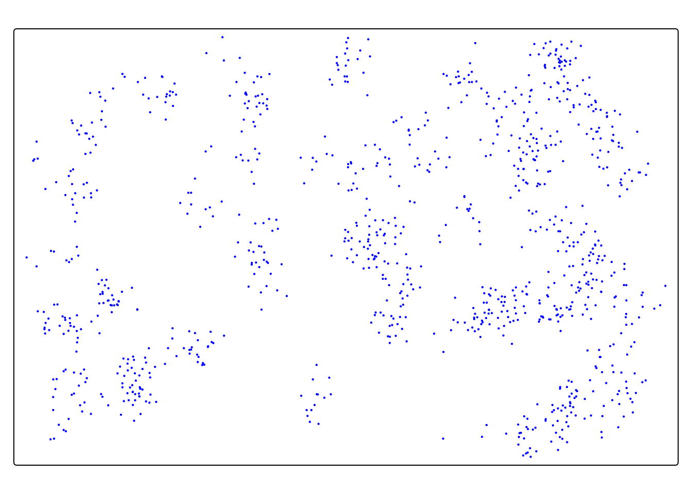](gis_files/figure-html/unnamed-chunk-21-1.png)

Khi đứng một mình, các điểm không cho biết nhiều thông tin. Vì vậy, chúng ta nên lập bản đồ địa giới hành chính:

Một lần nữa chúng ta sử dụng hàm `tm_shape()` (xem [tài liệu này](https://www.rdocumentation.org/packages/tmap/versions/3.3/topics/tm_shape)) nhưng thay vì cung cấp shapefile tọa độ điểm các trường hợp, chúng ta cung cấp shapefile địa giới hành chính (đa giác).

Với đối số `bbox =` (bbox là viết tắt của “bounding box”), chúng ta có thể chỉ định các ranh giới tọa độ. Đầu tiên, chúng ta hiển thị bản đồ mà không có `bbox`, và sau đó thêm nó vào.

``` r
# Just the administrative boundaries (polygons)
tm_shape(sle_adm3) +               # admin boundaries shapefile
  tm_polygons(fill = "#F7F7F7")+    # show polygons in light grey
  tm_borders(col = "#000000",      # show borders with color and line weight
             lwd = 2) +
  tm_text("admin3name")            # column text to display for each polygon


# Same as above, but with zoom from bounding box
tm_shape(sle_adm3,
         bbox = sf::st_bbox(c(xmin = -13.3, ymin = 8.43,    # corner
                              xmax = -13.2, ymax = 8.5),  # corner
                            crs = 4326)) +
  tm_polygons(fill = "#F7F7F7") +
  tm_borders(col = "#000000", lwd = 2) +
  tm_text("admin3name")
```

[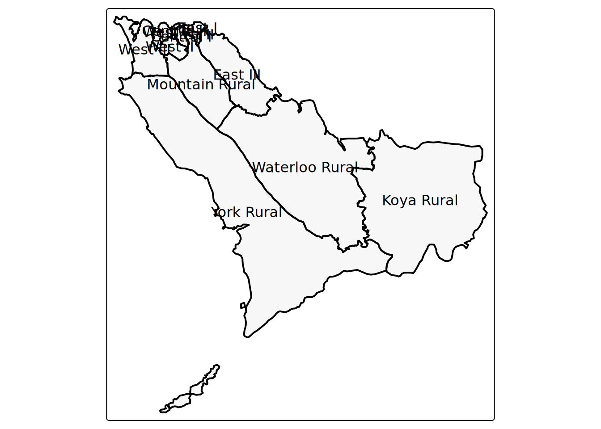](gis_files/figure-html/unnamed-chunk-22-1.png)

[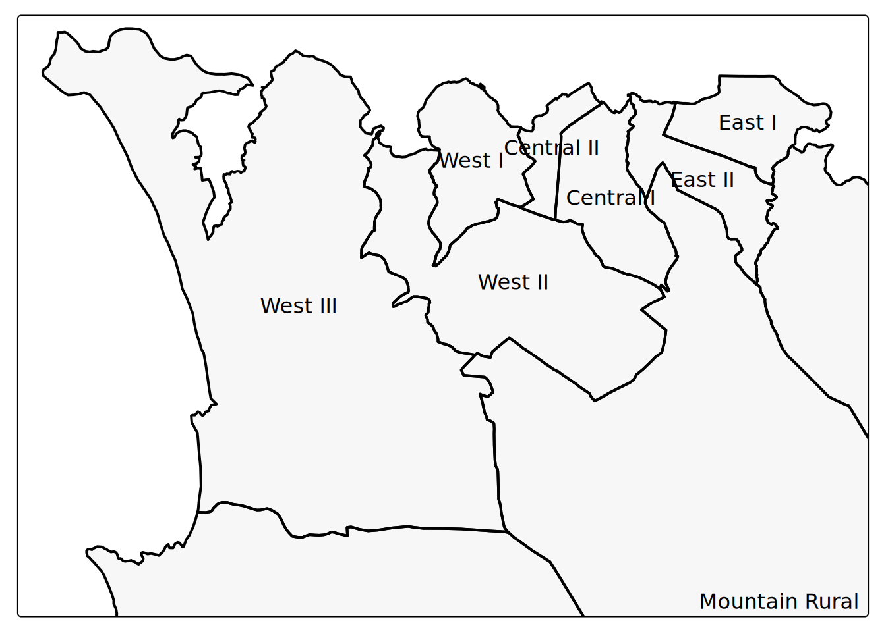](gis_files/figure-html/unnamed-chunk-22-2.png)

Và bây giờ hiển thị các điểm và đa giác cùng nhau:

``` r
# All together
tm_shape(sle_adm3, bbox = sf::st_bbox(c(xmin = -13.3, ymin = 8.43, xmax = -13.2, ymax = 8.5), crs = 4326)) +     #
  tm_polygons(fill = "#F7F7F7") +
  tm_borders(col = "#000000", lwd = 2) +
  tm_text("admin3name")+
tm_shape(linelist_sf) +
  tm_dots(size=0.08, fill='blue', fill_alpha = 0.5) +
  tm_title("Distribution of Ebola cases")   # give title to map
```

[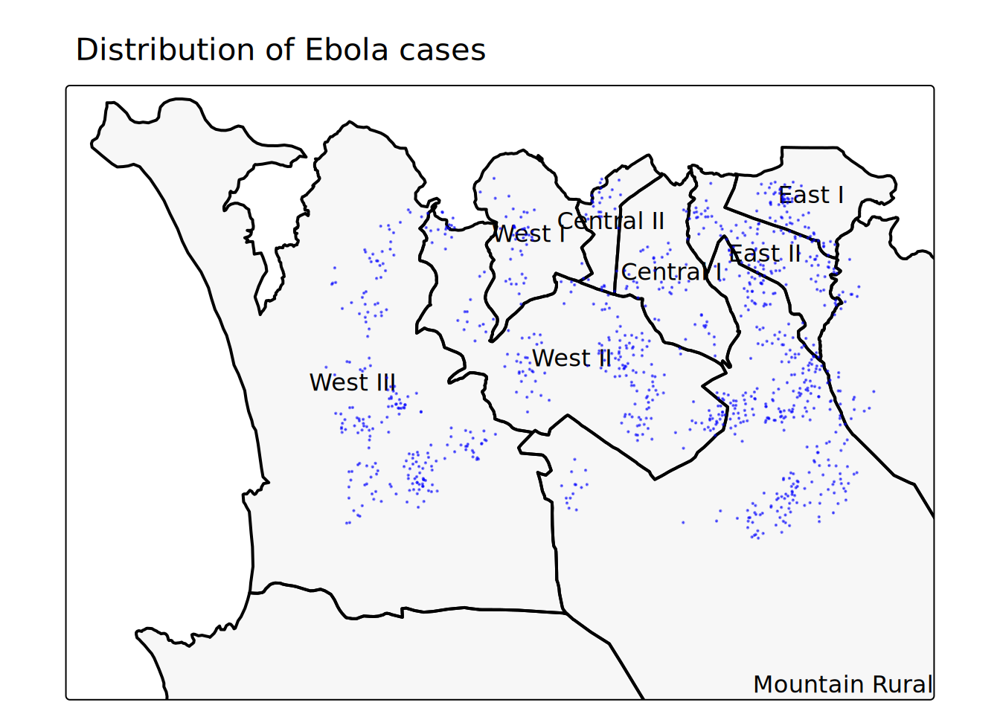](gis_files/figure-html/unnamed-chunk-23-1.png)

Để đọc một bài so sánh hay về các tùy chọn vẽ bản đồ trong R, hãy xem [bài đăng blog này](https://rstudio-pubs-static.s3.amazonaws.com/324400_69a673183ba449e9af4011b1eeb456b9.html).

## 28.6 Phép nối theo không gian

Bạn có thể đã quen với việc *nối* dữ liệu từ một tập dữ liệu này sang một tập dữ liệu khác. Một số phương pháp được thảo luận trong chương [Nối dữ liệu](joining_matching.llms.md) của cuốn sổ tay này. Một phép nối theo không gian phục vụ một mục đích tương tự nhưng tận dụng các mối quan hệ không gian. Thay vì dựa vào các giá trị chung trong các cột để khớp chính xác các quan sát, bạn có thể sử dụng các mối quan hệ không gian của chúng, chẳng hạn như một đối tượng địa lý *nằm trong* đối tượng khác, hoặc *hàng xóm gần nhất* với đối tượng khác, hoặc ở trong *vùng đệm* của một bán kính nhất định từ đối tượng khác, v.v.

Package **sf** cung cấp nhiều phương thức khác nhau để nối theo không gian. Xem thêm tài liệu về phương pháp st_join và các kiểu nối theo không gian trong [tài liệu tham khảo này](https://r-spatial.github.io/sf/reference/geos_binary_pred.html).

### Điểm trong đa giác

**Gán đơn vị hành chính cho các trường hợp theo không gian**

Sau đây là một câu hỏi hóc búa thú vị: linelist không chứa bất kỳ thông tin nào về các đơn vị hành chính của các trường hợp. Mặc dù lý tưởng nhất là thu thập thông tin như vậy trong giai đoạn thu thập dữ liệu ban đầu, chúng ta cũng có thể gán các đơn vị hành chính cho các trường hợp riêng lẻ dựa trên mối quan hệ không gian của chúng (tức là điểm giao với một đa giác)..

Dưới đây, chúng ta sẽ giao các vị trí (điểm) theo không gian với địa giới hành chính cấp 3 (đa giác):

1.  Bắt đầu với linelist (các điểm)  
2.  Nối theo không gian tới các địa giới, thiết lập kiểu nối là “st_intersects”  
3.  Sử dụng hàm `select()` để chỉ giữ lại một số cột địa giới hành chính mới

``` r
linelist_adm <- linelist_sf %>%
  
  # join the administrative boundary file to the linelist, based on spatial intersection
  sf::st_join(sle_adm3, join = st_intersects)
```

Tất cả các cột từ `sle_adm3` đã được thêm vào linelist! Mỗi trường hợp bây giờ có các cột thể hiện chi tiết cấp hành chính mà nó nằm trong đó. Trong ví dụ này, chúng ta chỉ muốn giữ lại hai trong số các cột mới (địa giới hành chính cấp 3), vì vậy chúng dùng hàm `select()` để chọn tên các cột cũ và chỉ hai cột bổ sung quan tâm:

``` r
linelist_adm <- linelist_sf %>%
  
  # join the administrative boundary file to the linelist, based on spatial intersection
  sf::st_join(sle_adm3, join = st_intersects) %>% 
  
  # Keep the old column names and two new admin ones of interest
  select(names(linelist_sf), admin3name, admin3pcod)
```

Dưới đây, chỉ với mục đích hiển thị, bạn có thể thấy mười trường hợp đầu tiên và địa giới hành chính cấp 3 của chúng đã được gắn với nhau, dựa trên vị trí giao nhau trong không gian giữa các điểm với đa giác.

``` r
# Now you will see the ADM3 names attached to each case
linelist_adm %>% select(case_id, admin3name, admin3pcod)
```

    Simple feature collection with 1000 features and 3 fields
    Geometry type: POINT
    Dimension:     XY
    Bounding box:  xmin: -13.27082 ymin: 8.447753 xmax: -13.20522 ymax: 8.490397
    Geodetic CRS:  WGS 84
    First 10 features:
         case_id     admin3name admin3pcod                   geometry
    1017  704af6 Mountain Rural   SL040102 POINT (-13.21623 8.461503)
    4775  8bfb52        West II   SL040207 POINT (-13.23329 8.461142)
    2177  42b86c           <NA>       <NA> POINT (-13.25563 8.485687)
    5026  dc1027       West III   SL040208 POINT (-13.26241 8.463639)
    1533  e15861        West II   SL040207 POINT (-13.22477 8.462286)
    4567  f0cafa        West II   SL040207 POINT (-13.23482 8.470267)
    2347  4cc78f        West II   SL040207 POINT (-13.25653 8.482027)
    270   4d9850        East II   SL040204 POINT (-13.21696 8.479449)
    4050  81cc9b        East II   SL040204 POINT (-13.22171 8.484846)
    5307  d59299        West II   SL040207 POINT (-13.24575 8.466352)

Bây giờ chúng ta có thể mô tả các trường hợp theo đơn vị hành chính - điều mà chúng ta đã không thể làm trước khi nối theo không gian!

``` r
# Make new dataframe containing counts of cases by administrative unit
case_adm3 <- linelist_adm %>%          # begin with linelist with new admin cols
  as_tibble() %>%                      # convert to tibble for better display
  group_by(admin3pcod, admin3name) %>% # group by admin unit, both by name and pcode 
  summarise(cases = n()) %>%           # summarize and count rows
  arrange(desc(cases))                 # arrange in descending order

case_adm3
```

    # A tibble: 10 × 3
    # Groups:   admin3pcod [10]
       admin3pcod admin3name     cases
       <chr>      <chr>          <int>
     1 SL040102   Mountain Rural   298
     2 SL040208   West III         211
     3 SL040207   West II          188
     4 SL040204   East II           94
     5 SL040203   East I            59
     6 SL040201   Central I         49
     7 SL040206   West I            43
     8 SL040202   Central II        26
     9 SL040205   East III          24
    10 <NA>       <NA>               8

Chúng ta cũng có thể tạo một biểu đồ cột về số lượng trường hợp theo đơn vị hành chính.

Trong ví dụ này, chúng ta bắt đầu hàm `ggplot()` với bộ dữ liệu `linelist_adm`, trong đó chúng ta có thể áp dụng các hàm làm việc với factor như `fct_infreq()` để sắp xếp các cột theo tần suất (xem chương [Factors](factors.llms.md) để biết thêm các mẹo).

``` r
ggplot(
    data = linelist_adm,                       # begin with linelist containing admin unit info
    mapping = aes(
      x = fct_rev(fct_infreq(admin3name))))+ # x-axis is admin units, ordered by frequency (reversed)
  geom_bar()+                                # create bars, height is number of rows
  coord_flip()+                              # flip X and Y axes for easier reading of adm units
  theme_classic()+                           # simplify background
  labs(                                      # titles and labels
    x = "Admin level 3",
    y = "Number of cases",
    title = "Number of cases, by adminstative unit",
    caption = "As determined by a spatial join, from 1000 randomly sampled cases from linelist"
  )
```

[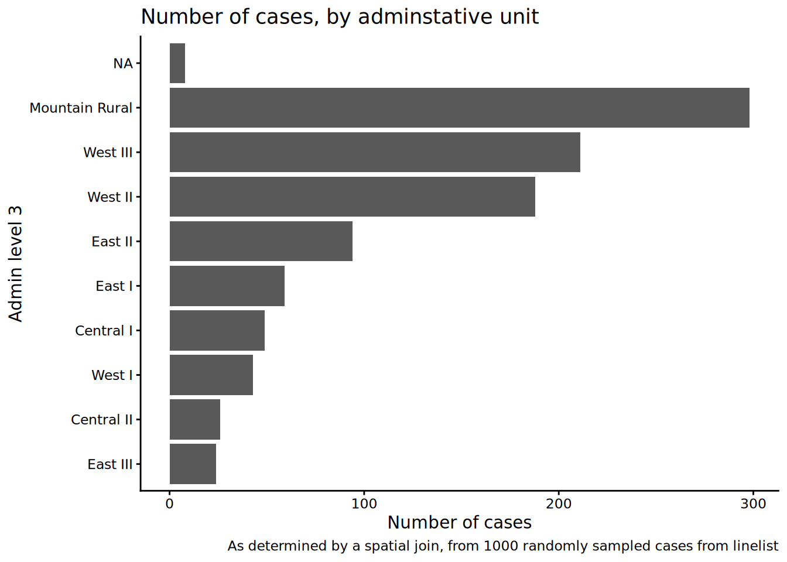](gis_files/figure-html/unnamed-chunk-28-1.png)

### Hàng xóm gần nhất

**Tìm cơ sở y tế gần nhất / khu vực cung cấp dịch vụ y tế**

Có thể sẽ hữu ích nếu biết các cơ sở y tế nằm ở đâu trong mối liên quan đến các điểm nóng về dịch bệnh.

Chúng ta có thể sử dụng phương pháp nối *st_nearest_feature* trong hàm `st_join()` (**sf** package) để trực quan hóa cơ sở y tế gần nhất với các trường hợp bệnh nhân.

1.  Chúng ta bắt đầu với shapefile linelist có tên `linelist_sf`  
2.  Chúng ta nối theo không gian với đối tượng `sle_hf`, chứa thông tin về vị trí của các cơ sở y tế và phòng khám (các điểm)

``` r
# Closest health facility to each case
linelist_sf_hf <- linelist_sf %>%                  # begin with linelist shapefile  
  st_join(sle_hf, join = st_nearest_feature) %>%   # data from nearest clinic joined to case data 
  select(case_id, osm_id, name, amenity) %>%       # keep columns of interest, including id, name, type, and geometry of healthcare facility
  rename("nearest_clinic" = "name")                # re-name for clarity
```

Chúng ta có thể thấy bên dưới (50 hàng đầu tiên) rằng mỗi trường hợp hiện đã có dữ liệu về phòng khám/bệnh viện gần nhất

Chúng ta có thể thấy rằng “Den Clinic” là cơ sở y tế gần nhất với khoảng ~30% các trường hợp.

``` r
# Count cases by health facility
hf_catchment <- linelist_sf_hf %>%   # begin with linelist including nearest clinic data
  as.data.frame() %>%                # convert from shapefile to dataframe
  count(nearest_clinic,              # count rows by "name" (of clinic)
        name = "case_n") %>%         # assign new counts column as "case_n"
  arrange(desc(case_n))              # arrange in descending order

hf_catchment                         # print to console
```

                             nearest_clinic case_n
    1       Shriners Hospitals for Children    351
    2                            Den Clinic    347
    3         GINER HALL COMMUNITY HOSPITAL    168
    4                             panasonic     40
    5 Princess Christian Maternity Hospital     34
    6                     ARAB EGYPT CLINIC     30
    7                                  <NA>     16
    8                  MABELL HEALTH CENTER     14

Để trực quan hóa kết quả, chúng ta có thể sử dụng **tmap** - lúc này interactive mode sẽ xem dễ dàng hơn

``` r
tmap_mode("view")   # set tmap mode to interactive  

# plot the cases and clinic points 
tm_shape(linelist_sf_hf) +            # plot cases
  tm_dots(size=0.08,                  # cases colored by nearest clinic
          fill='nearest_clinic') +
tm_shape(sle_hf) +                    # plot clinic facilities in large black dots
  tm_dots(size=0.3, fill='black', fill_alpha = 0.4) +
  tm_text("name") +                   # overlay with name of facility
tm_view(set_view = c(-13.2284, 8.4699, 13), # adjust zoom (center coords, zoom)
        set_zoom_limits = c(13,14))+
tm_title("Cases, colored by nearest clinic")
```

### Vùng đệm

Chúng ta cũng có thể tìm hiểu xem có bao nhiêu trường hợp nằm trong khoảng cách đi bộ 2 km (~30 phút) từ cơ sở y tế gần nhất.

*Chú ý: sf xử lý đối tượng kinh/vĩ độ như một đối tượng cầu. Do đó, khoảng cách bạn truyền vào `st_buffer()` hoặc `st_distance()` có đơn vị là mét. Để tính diện tích hoặc khoảng cách chính xác, hãy chiếu lại sang một hệ tọa độ phẳng. Hãy chọn hệ tọa độ đó theo địa điểm và phép đo, ví dụ múi UTM địa phương.*

Xem thêm thông tin về phép chiếu bản đồ và hệ tọa độ tại bài viết này [esri article](https://www.esri.com/arcgis-blog/products/arcgis-pro/mapping/gcs_vs_pcs/). [Blog này](http://www.geo.hunter.cuny.edu/~jochen/gtech201/lectures/lec6concepts/map%20coordinate%20systems/how%20to%20choose%20a%20projection.htm) nói về các loại phép chiếu bản đồ khác nhau và cách người ta có thể chọn phép chiếu phù hợp tùy thuộc vào khu vực quan tâm và bối cảnh của bản đồ/phân tích của bạn.

**Đầu tiên**, tạo một vùng đệm 2 km xung quanh mỗi cơ sở y tế bằng `st_buffer()` trong package **sf**. Đối tượng ở dạng kinh/vĩ độ, nên **sf** đo khoảng cách đó bằng mét trên mặt cầu.

``` r
sle_hf_2k <- sle_hf %>%
  st_buffer(dist = 2000)     # mét: sf dùng hình học cầu cho đối tượng kinh/vĩ độ 
```

Sau đây chúng ta vẽ biểu đồ của chính các vùng đệm, cùng với các điểm cơ sở y tế:

``` r
tmap_mode("plot")
# Create circular buffers
tm_shape(sle_hf_2k) +
  tm_borders(col = "black", lwd = 2)+
tm_shape(sle_hf) +                    # plot clinic facilities in large red dots
  tm_dots(size=0.3, fill='black')
```

[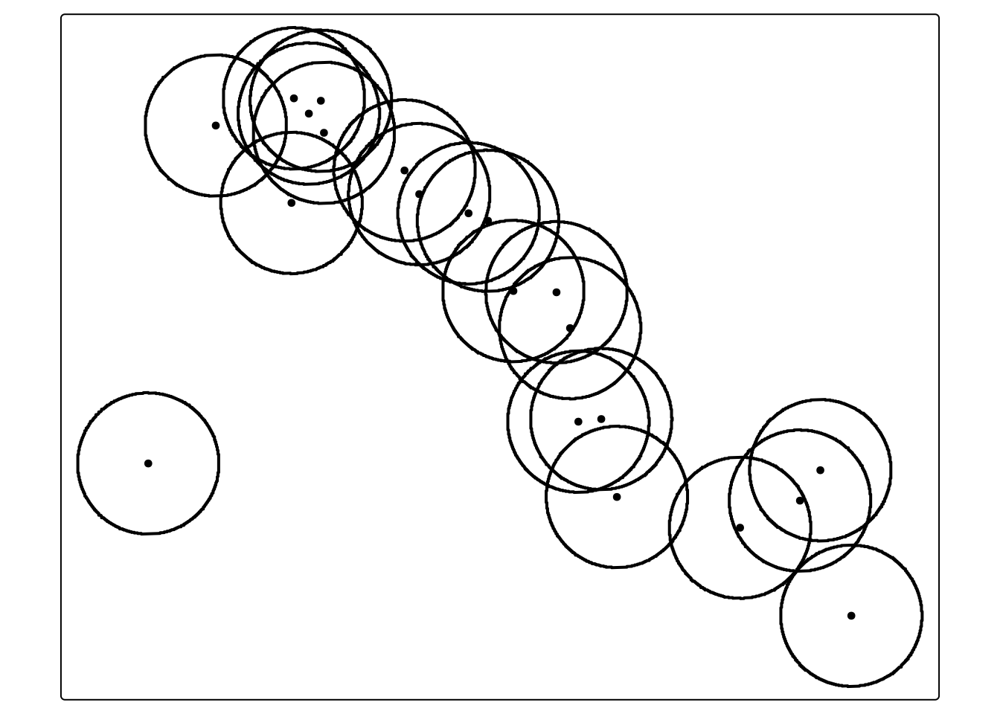](gis_files/figure-html/unnamed-chunk-34-1.png)

**Thứ hai**, *chúng ta giao các vùng đệm này với các trường hợp (điểm) bằng cách sử dụng hàm `st_join()` và kiểu nối là st_intersects*. Tức là, dữ liệu từ vùng đệm được nối với các điểm mà chúng giao với nhau.

``` r
# Intersect the cases with the buffers
linelist_sf_hf_2k <- linelist_sf_hf %>%
  st_join(sle_hf_2k, join = st_intersects, left = TRUE) %>%          # một hàng cho mỗi ca bệnh và mỗi vùng đệm chứa ca đó; osm_id.y là NA khi không vùng đệm nào chứa ca
  select(case_id, osm_id.x, nearest_clinic, amenity.x, osm_id.y) %>%
  distinct(case_id, .keep_all = TRUE)                                # một hàng cho mỗi ca bệnh, nên một ca chỉ nằm ngoài khi không vùng đệm nào chứa ca
```

Bây giờ chúng ta có thể đếm kết quả: có 226 trường hợp trong số 1000 trường hợp không giao nhau với bất kỳ vùng đệm nào (giá trị đó bị thiếu), và do đó họ sống ở nơi cách nhiều hơn 30 phút đi bộ tới cơ sở y tế gần nhất.

``` r
# Cases which did not get intersected with any of the health facility buffers
linelist_sf_hf_2k %>% 
  filter(is.na(osm_id.y)) %>%
  nrow()
```

    [1] 226

Chúng ta có thể trực quan hóa kết quả sao cho các trường hợp không giao nhau với bất kỳ vùng đệm nào sẽ xuất hiện với màu đỏ.

``` r
tmap_mode("view")

# First display the cases in points
tm_shape(linelist_sf_hf) +
  tm_dots(size=0.08, fill='nearest_clinic') +

# plot clinic facilities in large black dots
tm_shape(sle_hf) +                    
  tm_dots(size=0.3, fill='black')+

# Then overlay the health facility buffers in polylines
tm_shape(sle_hf_2k) +
  tm_borders(col = "black", lwd = 2) +

# Highlight cases that are not part of any health facility buffers
# in red dots  
tm_shape(linelist_sf_hf_2k %>%  filter(is.na(osm_id.y))) +
  tm_dots(size=0.1, fill='red') +
tm_view(set_view = c(-13.2284,8.4699, 13), set_zoom_limits = c(13,14))+

# add title  
tm_title("Cases by clinic catchment area")
```

### Các hàm nối theo không gian khác

Các giá trị tùy chọn cho đối số `join` bao gồm (lấy từ [tài liệu này](https://r-spatial.github.io/sf/reference/st_join.html))

- st_contains_properly  
- st_contains  
- st_covered_by  
- st_covers  
- st_crosses  
- st_disjoint  
- st_equals_exact  
- st_equals  
- st_is_within_distance  
- st_nearest_feature  
- st_overlaps  
- st_touches  
- st_within

## 28.7 Bản đồ Choropleth

Bản đồ Choropleth có thể hữu ích để trực quan hóa dữ liệu của bạn theo khu vực được xác định trước, thường là đơn vị hành chính hoặc khu vực y tế. Ví dụ, trong ứng phó với ổ dịch, điều này có thể giúp xác định mục tiêu phân bổ nguồn lực cho các khu vực cụ thể có tỷ lệ mắc bệnh cao.

Bây giờ chúng ta đã gán tên đơn vị hành chính cho tất cả các trường hợp (xem phần về phép nối không gian, ở trên), chúng ta có thể bắt đầu lập bản đồ số lượng trường hợp theo khu vực (bản đồ choropleth).

Vì chúng ta cũng có dữ liệu dân số theo cấp hành chính cấp 3 (ADM3), chúng ta có thể thêm thông tin này vào bảng *case_adm3* đã được tạo trước đó.

Chúng ta bắt đầu với dataframe `case_adm3` được tạo trong bước trước đó, là bảng tóm tắt của từng đơn vị hành chính và số lượng các trường hợp của nó.

1.  Dữ liệu dân số `sle_adm3_pop` được nối sử dụng hàm `left_join()` từ **dplyr** trên cơ sở các giá trị chung trên cột `admin3pcod` trong bộ dữ liệu `case_adm3`, và cột `adm_pcode` trong bộ dữ liệu `sle_adm3_pop`. Xem chương [Nối dữ liệu](joining_matching.llms.md).  
2.  `select()` được áp dụng trên dataframe mới, để chỉ giữ những cột cần thiệt - `total` nghĩa là tổng dân số  
3.  Các trường hợp trên 10,000 dân được tính toán bằng cách tạo cột mới với hàm `mutate()`

``` r
# Add population data and calculate cases per 10K population
case_adm3 <- case_adm3 %>% 
     left_join(sle_adm3_pop,                             # add columns from pop dataset
               by = c("admin3pcod" = "adm3_pcode")) %>%  # join based on common values across these two columns
     select(names(case_adm3), total) %>%                 # keep only important columns, including total population
     mutate(case_10kpop = round(cases/total * 10000, 3)) # make new column with case rate per 10000, rounded to 3 decimals

case_adm3                                                # print to console for viewing
```

    # A tibble: 10 × 5
    # Groups:   admin3pcod [10]
       admin3pcod admin3name     cases  total case_10kpop
       <chr>      <chr>          <int>  <int>       <dbl>
     1 SL040102   Mountain Rural   298  33993       87.7 
     2 SL040208   West III         211 210252       10.0 
     3 SL040207   West II          188 145109       13.0 
     4 SL040204   East II           94  99821        9.42
     5 SL040203   East I            59  68284        8.64
     6 SL040201   Central I         49  69683        7.03
     7 SL040206   West I            43  60186        7.14
     8 SL040202   Central II        26  23874       10.9 
     9 SL040205   East III          24 500134        0.48
    10 <NA>       <NA>               8     NA       NA   

Nối bảng này với đa giác shapfile ADM3 để vẽ bản đồ

``` r
case_adm3_sf <- case_adm3 %>%                 # begin with cases & rate by admin unit
  left_join(sle_adm3, by="admin3pcod") %>%    # join to shapefile data by common column
  select(objectid, admin3pcod,                # keep only certain columns of interest
         admin3name = admin3name.x,           # clean name of one column
         admin2name, admin1name,
         cases, total, case_10kpop,
         geometry) %>%                        # keep geometry so polygons can be plotted
  drop_na(objectid) %>%                       # drop any empty rows
  st_as_sf()                                  # convert to shapefile
```

Vẽ bản đồ kết quả

``` r
# tmap mode
tmap_mode("plot")               # view static map

# plot polygons
tm_shape(case_adm3_sf) + 
        tm_polygons("cases") +  # color by number of cases column
        tm_text("admin3name")   # name display
```

[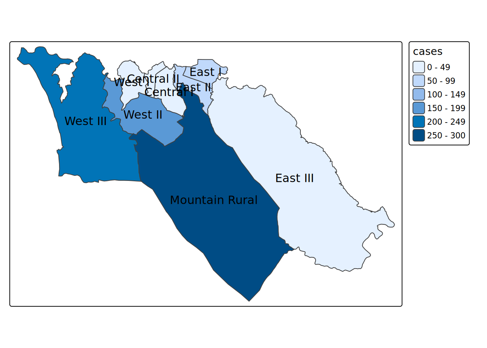](gis_files/figure-html/unnamed-chunk-40-1.png)

Chúng ta cũng có thể lập bản đồ tỷ suất mới mắc

``` r
# Cases per 10K population
tmap_mode("plot")             # static viewing mode

# plot
tm_shape(case_adm3_sf) +                # plot polygons
  tm_polygons("case_10kpop",            # color by column containing case rate
              fill.scale = tm_scale_intervals(
                breaks = c(0, 10, 50, 100), # define break points for colors
                values = "brewer.purples")  # use a purple color palette
              ) +
  tm_text("admin3name")                 # display text
```

[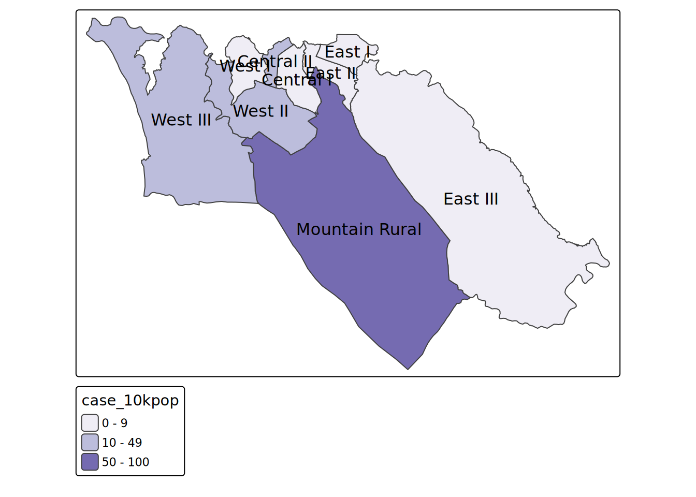](gis_files/figure-html/unnamed-chunk-41-1.png)

## 28.8 Vẽ bản đồ với ggplot2

Nếu bạn đã quen với việc sử dụng **ggplot2**, bạn có thể sử dụng package này để vẽ bản đồ tĩnh cho dữ liệu của bạn. Hàm `geom_sf()` sẽ vẽ các đối tượng khác nhau dựa trên các đối tượng địa lý (điểm, đường thẳng hoặc đa giác) có trong dữ liệu của bạn. Ví dụ: bạn có thể sử dụng hàm `geom_sf()` trong `ggplot()` bằng cách sử dụng dữ liệu `sf` với dạng hình học đa giác để tạo bản đồ choropleth.

Để minh họa cách thức hoạt động của nó, Chúng ta có thể bắt đầu với shapefile đa giác ADM3 mà chúng ta đã sử dụng lúc trước. Xin nhớ lại rằng đây là các khu vực hành chính cấp 3 ở Sierra Leone:

``` r
sle_adm3
```

    Simple feature collection with 12 features and 19 fields
    Geometry type: MULTIPOLYGON
    Dimension:     XY
    Bounding box:  xmin: -13.29894 ymin: 8.094272 xmax: -12.91333 ymax: 8.499809
    Geodetic CRS:  WGS 84
    # A tibble: 12 × 20
       objectid admin3name   admin3pcod admin3ref_n admin2name admin2pcod admin1name
     *    <dbl> <chr>        <chr>      <chr>       <chr>      <chr>      <chr>     
     1      155 Koya Rural   SL040101   Koya Rural  Western A… SL0401     Western   
     2      156 Mountain Ru… SL040102   Mountain R… Western A… SL0401     Western   
     3      157 Waterloo Ru… SL040103   Waterloo R… Western A… SL0401     Western   
     4      158 York Rural   SL040104   York Rural  Western A… SL0401     Western   
     5      159 Central I    SL040201   Central I   Western A… SL0402     Western   
     6      160 East I       SL040203   East I      Western A… SL0402     Western   
     7      161 East II      SL040204   East II     Western A… SL0402     Western   
     8      162 Central II   SL040202   Central II  Western A… SL0402     Western   
     9      163 West III     SL040208   West III    Western A… SL0402     Western   
    10      164 West I       SL040206   West I      Western A… SL0402     Western   
    11      165 West II      SL040207   West II     Western A… SL0402     Western   
    12      167 East III     SL040205   East III    Western A… SL0402     Western   
    # ℹ 13 more variables: admin1pcod <chr>, admin0name <chr>, admin0pcod <chr>,
    #   date <date>, valid_on <date>, valid_to <date>, shape_leng <dbl>,
    #   shape_area <dbl>, rowcacode0 <chr>, rowcacode1 <chr>, rowcacode2 <chr>,
    #   rowcacode3 <chr>, geometry <MULTIPOLYGON [°]>

Chúng ta có thể sử dụng hàm `left_join()` từ **dplyr** để thêm dữ liệu mà chúng ta muốn vẽ tới đối tượng shapefile. Trong trường hợp này, chúng ta sẽ sử dụng bộ dữ liệu `case_adm3` mà chúng ta đã tạo trước đó để tóm tắt số lượng trường hợp theo khu vực hành chính; tuy nhiên, chúng ta có thể sử dụng phương pháp tương tự này để vẽ bất kỳ dữ liệu nào được lưu trữ trong data frame.

``` r
sle_adm3_dat <- sle_adm3 %>% 
  inner_join(case_adm3, by = "admin3pcod") # inner join = retain only if in both data objects

select(sle_adm3_dat, admin3name.x, cases) # print selected variables to console
```

    Simple feature collection with 9 features and 2 fields
    Geometry type: MULTIPOLYGON
    Dimension:     XY
    Bounding box:  xmin: -13.29894 ymin: 8.384533 xmax: -13.12612 ymax: 8.499809
    Geodetic CRS:  WGS 84
    # A tibble: 9 × 3
      admin3name.x   cases                                                  geometry
      <chr>          <int>                                        <MULTIPOLYGON [°]>
    1 Mountain Rural   298 (((-13.21496 8.474341, -13.21479 8.474289, -13.21465 8.4…
    2 Central I         49 (((-13.22646 8.489716, -13.22648 8.48955, -13.22644 8.48…
    3 East I            59 (((-13.2129 8.494033, -13.21076 8.494026, -13.21013 8.49…
    4 East II           94 (((-13.22653 8.491883, -13.22647 8.491853, -13.22642 8.4…
    5 Central II        26 (((-13.23154 8.491768, -13.23141 8.491566, -13.23144 8.4…
    6 West III         211 (((-13.28529 8.497354, -13.28456 8.496497, -13.28403 8.4…
    7 West I            43 (((-13.24677 8.493453, -13.24669 8.493285, -13.2464 8.49…
    8 West II          188 (((-13.25698 8.485518, -13.25685 8.485501, -13.25668 8.4…
    9 East III          24 (((-13.20465 8.485758, -13.20461 8.485698, -13.20449 8.4…

Để tạo biểu đồ cột về số lượng trường hợp theo khu vực, sử dụng **ggplot2**, sau đó chúng ta có thể gọi `geom_col()` như sau:

``` r
ggplot(data=sle_adm3_dat) +
  geom_col(aes(x=fct_reorder(admin3name.x, cases, .desc=T),   # reorder x axis by descending 'cases'
               y=cases)) +                                  # y axis is number of cases by region
  theme_bw() +
  labs(                                                     # set figure text
    title="Number of cases, by administrative unit",
    x="Admin level 3",
    y="Number of cases"
  ) + 
  guides(x=guide_axis(angle=45))                            # angle x-axis labels 45 degrees to fit better
```

[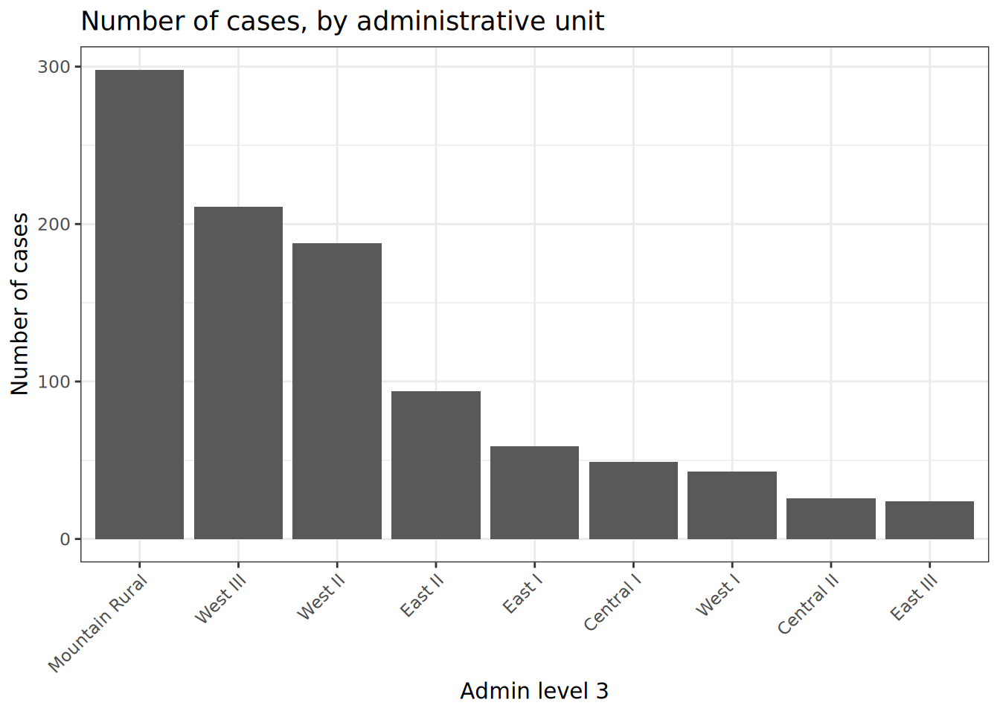](gis_files/figure-html/unnamed-chunk-44-1.png)

Nếu chúng ta muốn sử dụng **ggplot2** để tạo bản đồ choropleth về số lượng trường hợp, chúng ta có thể sử dụng cú pháp tương tự để gọi hàm `geom_sf()`:

``` r
ggplot(data=sle_adm3_dat) + 
  geom_sf(aes(fill=cases))    # set fill to vary by case count variable
```

[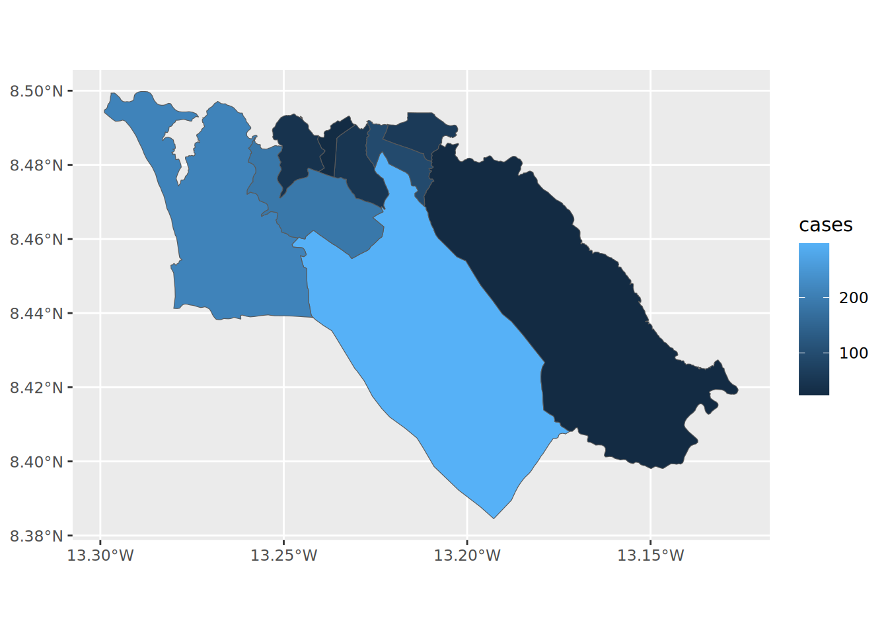](gis_files/figure-html/unnamed-chunk-45-1.png)

Sau đó, chúng ta có thể tùy chỉnh hình thức bản đồ bằng cách sử dụng ngữ pháp nhất quán trên **ggplot2**, ví dụ:

``` r
ggplot(data=sle_adm3_dat) +                           
  geom_sf(aes(fill=cases)) +                        
  scale_fill_continuous(high="#54278f", low="#f2f0f7") +    # change color gradient
  theme_bw() +
  labs(title = "Number of cases, by administrative unit",   # set figure text
       subtitle = "Admin level 3"
  )
```

[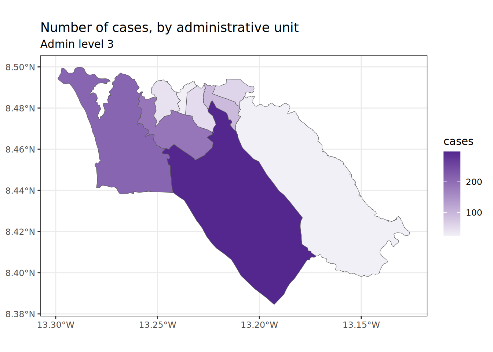](gis_files/figure-html/unnamed-chunk-46-1.png)

Đối với người dùng R cảm thấy thoải mái khi làm việc với **ggplot2**, `geom_sf()` cung cấp một cách làm đơn giản và trực tiếp, phù hợp với việc trực quan hóa bản đồ cơ bản. Để tìm hiểu thêm, hãy đọc [hướng dẫn geom_sf() này](https://ggplot2.tidyverse.org/reference/ggsf.html) hoặc [sách về ggplot2](https://ggplot2-book.org/maps.html).

## 28.9 Bản đồ cơ sở

### OpenStreetMap

Dưới đây, chúng tôi mô tả cách lấy được bản đồ cơ sở cho bản đồ **ggplot2** bằng cách sử dụng các tính năng của OpenStreetMap. Các phương pháp thay thế bao gồm sử dụng **ggmap**, yêu cầu bạn đăng ký miễn phí với Google ([chi tiết](https://www.earthdatascience.org/courses/earth-analytics/lidar-raster-data-r/ggmap-basemap/)).

[**OpenStreetMap**](https://en.wikipedia.org/wiki/OpenStreetMap) là một dự án hợp tác nhằm tạo ra một bản đồ thế giới có thể chỉnh sửa miễn phí. Dữ liệu vị trí địa lý nền tảng ví dụ: vị trí của các thành phố, đường xá, đặc điểm tự nhiên, sân bay, trường học, bệnh viện, đường xá, v.v.) được coi là đầu ra chính của dự án.

Đầu tiên, chúng ta gọi package **OpenStreetMap** để lấy bản đồ cơ sở.

Sau đó chúng ta tạo đối tượng `map`, được xác định bằng cách sử dụng hàm `openmap()` từ package **OpenStreetMap** ([tài liệu](https://www.rdocumentation.org/packages/OpenStreetMap/versions/0.3.4/topics/openmap)). Chúng ta cung cấp những thông tin sau:

- `upperLeft` và `lowerRight` Hai cặp tọa độ xác định giới hạn của ô bản đồ cơ sở

  - Trong trường hợp này, chúng tôi đã đưa giá trị tối đa và tối thiểu từ các hàng trong linelist, vì vậy bản đồ sẽ tương tác động với dữ liệu  

- `zoom =` (nếu null nó sẽ được xác định tự động)  

- `type =` loại bản đồ cơ sở nào - chúng tôi đã liệt kê một số khả năng ở đây và code hiện đang sử dụng cái đầu tiên (`[1]`) “osm”  

- `mergeTiles =` chúng tôi đã chọn TRUE để tất cả các lớp nền được hợp nhất thành một

``` r
# load package
pacman::p_load(OpenStreetMap)

# Fit basemap by range of lat/long coordinates. Choose tile type
map <- OpenStreetMap::openmap(
  upperLeft = c(max(linelist$lat, na.rm=T), max(linelist$lon, na.rm=T)),   # limits of basemap tile
  lowerRight = c(min(linelist$lat, na.rm=T), min(linelist$lon, na.rm=T)),
  zoom = NULL,
  type = c("osm", "stamen-toner", "stamen-terrain", "stamen-watercolor", "esri","esri-topo")[1])
```

Đoạn mã này tải các ô bản đồ hiện tại từ máy chủ ô bản đồ của OpenStreetMap, vì vậy nó cần kết nối internet. Điều này được cho phép khi bạn tự xem bản đồ. Không chạy đoạn mã này trong một bản dựng tự động. Không lưu các ô bản đồ để dùng ngoại tuyến. Xem [chính sách sử dụng ô bản đồ của OpenStreetMap](https://operations.osmfoundation.org/policies/tiles/).

Sổ tay hiển thị hình ảnh của các bản đồ mà đoạn mã này tạo ra. Các hình ảnh được tạo vào ngày 2 tháng 9 năm 2026 để trang có thể được dựng mà không cần kết nối internet. Dữ liệu bản đồ © OpenStreetMap contributors ([openstreetmap.org/copyright](https://www.openstreetmap.org/copyright)).

Nếu chúng ta vẽ bản đồ cơ sở này ngay bây giờ, sử dụng hàm `autoplot.OpenStreetMap()` từ package **OpenStreetMap**, bạn sẽ thấy rằng các đơn vị trên các trục không phải là kinh/vĩ độ. Nó đang sử dụng một hệ tọa độ khác. Để hiển thị chính xác nơi cứ trú các trường hợp (được lưu trữ theo vĩ độ/kinh độ), điều này phải được thay đổi.

``` r
autoplot.OpenStreetMap(map)
```

[](../../images/gis_basemap_01_mercator.png)

Dữ liệu bản đồ © OpenStreetMap contributors ([openstreetmap.org/copyright](https://www.openstreetmap.org/copyright)).

Vì vậy, chúng ta muốn chuyển đổi bản đồ thành vĩ độ/kinh độ với hàm `openproj()` từ package **OpenStreetMap**. Chúng ta cung cấp bản đồ cơ sở `map` và cũng cung cấp Hệ thống tham chiếu tọa độ (CRS) mà chúng ta muốn. Chúng ta thực hiện điều này bằng cách cung cấp chuỗi ký tự “proj.4” cho phép chiếu WGS 1984, nhưng bạn cũng có thể cung cấp CRS theo những cách khác. (xem [trang này](https://www.earthdatascience.org/courses/earth-analytics/spatial-data-r/understand-epsg-wkt-and-other-crs-definition-file-types/) để hiểu rõ hơn chuỗi proj.4 là gì)

``` r
# Projection WGS84
map_latlon <- openproj(map, projection = "+proj=longlat +ellps=WGS84 +datum=WGS84 +no_defs")
```

Bây giờ khi chúng ta tạo biểu đồ, chúng ta thấy rằng dọc theo các trục là tọa độ vĩ độ và kinh độ. Hệ tọa độ đã được chuyển đổi. Bây giờ các trường hợp của chúng ta sẽ được biểu diễn chính xác nếu được phủ lên!

``` r
# Plot map. Must use "autoplot" in order to work with ggplot
autoplot.OpenStreetMap(map_latlon)
```

[](../../images/gis_basemap_02_latlon.png)

Dữ liệu bản đồ © OpenStreetMap contributors ([openstreetmap.org/copyright](https://www.openstreetmap.org/copyright)).

Xem các hướng dẫn [tại đây](http://data-analytics.net/cep/Schedule_files/geospatial.html) và [tại đây](https://www.rdocumentation.org/packages/OpenStreetMap/versions/0.3.4/topics/autoplot.OpenStreetMap) để biết thêm chi tiết.

## 28.10 Bản đồ nhiệt mật độ đường viền

Dưới đây, chúng tôi mô tả cách đạt được bản đồ nhiệt mật độ đường viền của các trường hợp, trên một bản đồ cơ sở, bắt đầu với một danh sách dòng (một dòng cho mỗi trường hợp).

1.  Tạo ô bản đồ cơ sở từ OpenStreetMap, như được mô tả ở trên  
2.  Vẽ biểu đồ các trường hợp từ `linelist` bằng cách sử dụng cột vĩ độ và kinh độ  
3.  Chuyển đổi các điểm thành bản đồ nhiệt mật độ với hàm `stat_density_2d()` trong **ggplot2**,

Khi chúng ta có một bản đồ cơ sở với tọa độ vĩ độ/kinh độ, chúng ta có thể vẽ các trường hợp của mình lên trên bằng cách sử dụng tọa độ vĩ độ/kinh độ của nơi cư trú của chúng.

Xây dựng dựa trên hàm `autoplot.OpenStreetMap()` để tạo bản đồ cơ sở, các hàm **ggplot2** sẽ dễ dàng thêm vào trên cùng, như được hiển thị với hàm `geom_point()` bên dưới:

``` r
# Plot map. Must be autoplotted to work with ggplot
autoplot.OpenStreetMap(map_latlon)+                 # begin with the basemap
  geom_point(                                       # add xy points from linelist lon and lat columns 
    data = linelist,                                
    aes(x = lon, y = lat),
    size = 1, 
    alpha = 0.5,
    show.legend = FALSE) +                          # drop legend entirely
  labs(x = "Longitude",                             # titles & labels
       y = "Latitude",
       title = "Cumulative cases")
```

[](../../images/gis_basemap_03_points.png)

Dữ liệu bản đồ © OpenStreetMap contributors ([openstreetmap.org/copyright](https://www.openstreetmap.org/copyright)).

Bản đồ trên có thể khó giải thích, đặc biệt là với các điểm trùng lặp. Vì vậy, thay vào đó bạn có thể vẽ một bản đồ mật độ 2d bằng cách sử dụng hàm `stat_density_2d()` trong **ggplot2**. Bạn vẫn đang sử dụng tọa độ vĩ độ/kinh độ của linelist, nhưng ước tính mật độ lõi 2D được thực hiện và kết quả được hiển thị với các đường đồng mức - giống như bản đồ địa hình. Đọc bản đầy đủ [tài liệu tại đây](https://ggplot2.tidyverse.org/reference/geom_density_2d.html).

``` r
# begin with the basemap
autoplot.OpenStreetMap(map_latlon)+
  
  # add the density plot
  ggplot2::stat_density_2d(
        data = linelist,
        aes(
          x = lon,
          y = lat,
          fill = after_stat(level),
          alpha = after_stat(level)),
        bins = 10,
        geom = "polygon",
        contour_var = "count",
        show.legend = F) +                          
  
  # specify color scale
  scale_fill_gradient(low = "black", high = "red")+
  
  # labels 
  labs(x = "Longitude",
       y = "Latitude",
       title = "Distribution of cumulative cases")
```

[](../../images/gis_basemap_04_density.png)

Dữ liệu bản đồ © OpenStreetMap contributors ([openstreetmap.org/copyright](https://www.openstreetmap.org/copyright)).

### Bản đồ nhiệt chuỗi thời gian

Bản đồ nhiệt mật độ ở trên cho thấy *các trường hợp tích lũy*. Chúng ta có thể khảo sát các vụ dịch theo thời gian và không gian bằng cách faceting bản đồ nhiệt dựa trên *tháng khởi phát triệu chứng*, như được rút ra từ linelist.

Chúng ta bắt đầu với `linelist`, tạo một cột mới với Năm và Tháng khởi phát. Hàm `format()` trong **base** R thay đổi cách hiển thị ngày. Trong trường hợp này, chúng ta muốn “YYYY-MM”..

``` r
# Extract month of onset
linelist <- linelist %>% 
  mutate(date_onset_ym = format(date_onset, "%Y-%m"))

# Examine the values 
table(linelist$date_onset_ym, useNA = "always")
```


    2014-04 2014-05 2014-06 2014-07 2014-08 2014-09 2014-10 2014-11 2014-12 2015-01 
          1       7      11      38      78     191     192     130      93      76 
    2015-02 2015-03 2015-04    <NA> 
         53      46      30      54 

Bây giờ, chúng ta chỉ cần đơn giản facet thông qua **ggplot2** vào bản đồ nhiệt mật độ. `facet_wrap()` được áp dụng, sử dụng cột mới làm hàng. Chúng ta thiết lập số lượng cột được facet là 4 cho rõ ràng.

``` r
# packages
pacman::p_load(OpenStreetMap, tidyverse)

# begin with the basemap
autoplot.OpenStreetMap(map_latlon)+
  
  # add the density plot
  ggplot2::stat_density_2d(
        data = linelist,
        aes(
          x = lon,
          y = lat,
          fill = after_stat(level),
          alpha = after_stat(level)),
        bins = 10,
        geom = "polygon",
        contour_var = "count",
        show.legend = F) +                          
  
  # specify color scale
  scale_fill_gradient(low = "black", high = "red")+
  
  # labels 
  labs(x = "Longitude",
       y = "Latitude",
       title = "Distribution of cumulative cases over time")+
  
  # facet the plot by month-year of onset
  facet_wrap(~ date_onset_ym, ncol = 4)               
```

[](../../images/gis_basemap_05_density_month.png)

Dữ liệu bản đồ © OpenStreetMap contributors ([openstreetmap.org/copyright](https://www.openstreetmap.org/copyright)).

## 28.11 Thống kê không gian

Hầu hết các cuộc thảo luận của chúng ta cho đến nay đều tập trung vào việc trực quan hóa dữ liệu không gian. Trong một số trường hợp, bạn cũng có thể quan tâm đến việc sử dụng *thống kê không gian* để định lượng mối quan hệ không gian của các thuộc tính trong dữ liệu của mình. Phần này sẽ cung cấp một cái nhìn tổng quan ngắn gọn về một số khái niệm chính trong thống kê không gian và đề xuất một số tài liệu sẽ hữu ích để khám phá nếu bạn muốn thực hiện các phân tích không gian toàn diện hơn.

### Mối quan hệ không gian

Trước khi có thể tính toán bất kỳ số liệu thống kê không gian nào, chúng ta cần xác định mối quan hệ giữa các đối tượng địa lý trong dữ liệu của mình. Có nhiều cách để khái niệm hóa các mối quan hệ không gian, nhưng một mô hình đơn giản và thường được áp dụng để sử dụng là mô hình *adjancy - liền kề* - cụ thể là chúng ta mong đợi mối quan hệ địa lý giữa các khu vực có chung biên giới hoặc “láng giềng” với nhau..

Chúng ta có thể định lượng các mối quan hệ liền kề giữa các vùng địa giới hành chính trong dữ liệu `sle_adm3_dat` mà chúng ta đang sử dụng với package **spdep**. Chúng ta sẽ cụ thể sự tiếp giáp *queen*, có nghĩa là các khu vực sẽ là hàng xóm của nhau nếu chúng có chung ít nhất một điểm dọc theo biên giới của chúng. Phương pháp thay thế có thể là sự tiếp giáp *rook*, đòi hỏi các khu vực phải chia sẻ một cạnh - trong trường hợp của chúng ta, với các đa giác không đều, sự phân biệt là không đáng kể, nhưng trong một số trường hợp, sự lựa chọn giữa queen và rook có thể có ảnh hưởng.

``` r
sle_nb <- spdep::poly2nb(sle_adm3_dat, queen=T) # create neighbors 
sle_adjmat <- spdep::nb2mat(sle_nb)    # create matrix summarizing neighbor relationships
sle_listw <- spdep::nb2listw(sle_nb)   # create listw (list of weights) object -- we will need this later

sle_nb
```

    Neighbour list object:
    Number of regions: 9 
    Number of nonzero links: 30 
    Percentage nonzero weights: 37.03704 
    Average number of links: 3.333333 

``` r
round(sle_adjmat, digits = 2)
```

         1    2    3    4    5   6    7    8    9
    1 0.00 0.20 0.00 0.20 0.00 0.2 0.00 0.20 0.20
    2 0.25 0.00 0.00 0.25 0.25 0.0 0.00 0.25 0.00
    3 0.00 0.00 0.00 0.50 0.00 0.0 0.00 0.00 0.50
    4 0.25 0.25 0.25 0.00 0.00 0.0 0.00 0.00 0.25
    5 0.00 0.33 0.00 0.00 0.00 0.0 0.33 0.33 0.00
    6 0.50 0.00 0.00 0.00 0.00 0.0 0.00 0.50 0.00
    7 0.00 0.00 0.00 0.00 0.50 0.0 0.00 0.50 0.00
    8 0.20 0.20 0.00 0.00 0.20 0.2 0.20 0.00 0.00
    9 0.33 0.00 0.33 0.33 0.00 0.0 0.00 0.00 0.00
    attr(,"call")
    spdep::nb2mat(neighbours = sle_nb)

Ma trận được in ở trên hiển thị mối quan hệ giữa các vùng trong dữ liệu `sle_adm3_dat` của chúng ta. Điểm 0 cho biết hai vùng không phải là láng giềng, trong khi bất kỳ giá trị nào khác 0 cho biết mối quan hệ láng giềng. Các giá trị trong ma trận được chia tỷ lệ để mỗi vùng có tổng trọng số hàng là 1.

Một cách tốt hơn để trực quan hóa những mối quan hệ láng giềng này là vẽ biểu đồ chúng:

``` r
plot(sle_adm3_dat$geometry) +                                           # plot region boundaries
  spdep::plot.nb(sle_nb,as(sle_adm3_dat, 'Spatial'), col='grey', add=T) # add neighbor relationships
```

[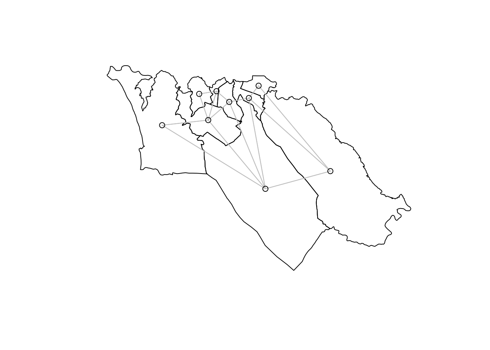](gis_files/figure-html/unnamed-chunk-61-1.png)

Chúng ta đã sử dụng phương pháp tiếp cận adjacency để xác định các đa giác hàng xóm; những người hàng xóm mà chúng ta đã xác định đôi khi cũng được gọi là **những người hàng xóm dựa trên sự tiếp giáp**. Nhưng đây chỉ là một cách để lựa chọn các khu vực dự kiến có mối quan hệ địa lý. Các cách tiếp cận thay thế phổ biến nhất để xác định các mối quan hệ địa lý tạo ra **những người hàng xóm dựa trên khoảng cách**; ngắn gọn thì chúng là:

- **K-nearest neighbors** - Dựa trên khoảng cách giữa các tâm (trung tâm có trọng số địa lý của mỗi vùng đa giác), hãy chọn *n* vùng gần nhất làm vùng lân cận. Ngưỡng khoảng cách tối đa cũng có thể được chỉ định. Trong **spdep**, bạn có thể sử dụng hàm `knearneigh()` (xem [tài liệu](https://r-spatial.github.io/spdep/reference/knearneigh.html)).

- **Distance threshold neighbors** - Chọn tất cả hàng xóm trong một ngưỡng khoảng cách. Trong **spdep**, các mối quan hệ láng giềng này có thể được xác định bằng cách sử dụng hàm `dnearneigh()` (xem [tài liệu](https://www.rdocumentation.org/packages/spdep/versions/1.1-7/topics/dnearneigh)).

### Tự tương quan không gian

Định luật địa lý đầu tiên được trích dẫn của Tobler tuyên bố rằng “mọi thứ đều liên quan đến mọi thứ khác, nhưng những thứ ở gần có liên quan hơn những thứ ở xa”. Trong dịch tễ học, điều này thường có nghĩa là nguy cơ về một kết quả sức khỏe cụ thể ở một vùng nhất định tương tự với các vùng lân cận hơn là những vùng xa. Khái niệm này đã được chính thức hóa dưới dạng **tự tương quan không gian** - thuộc tính thống kê mà các đối tượng địa lý có giá trị tương tự được nhóm lại với nhau trong không gian. Các phép đo thống kê về tự tương quan không gian có thể được sử dụng để *định lượng mức độ phân cụm không gian* trong dữ liệu của bạn, *xác định vị trí xảy ra phân cụm*, và *xác định các xu hướng chung về tự tương quan không gian* giữa các biến khác nhau trong dữ liệu của bạn. Phần này giới thiệu tổng quan về một số thước đo phổ biến của tự tương quan không gian và cách tính chúng trong R.

**Moran’s I** - Đây là thống kê tóm tắt mang tính toàn cục (global) về mối tương quan giữa giá trị của một biến trong một vùng và giá trị của cùng một biến ở các vùng lân cận. Thống kê Moran’s I thường dao động từ -1 tới 1. Giá trị 0 cho thấy không có tương quan không gian, trong khi các giá trị gần 1 hoặc -1 cho thấy tự tương quan không gian (các giá trị tương tự gần nhau) hoặc phân tán không gian (các giá trị không tương tự ở gần nhau) mạnh hơn.

Ví dụ: chúng ta sẽ tính toán thống kê Moran’s I để định lượng tự tương quan theo không gian trong các trường hợp Ebola mà chúng ta đã mapping trước đó (hãy nhớ rằng đây là một tập con các trường hợp từ một vụ dịch mô phỏng trong dataframe `linelist`). Package **spdep** có hàm `moran.test` có thể giúp chúng ta thực hiện phép tính toán này:

``` r
moran_i <-spdep::moran.test(sle_adm3_dat$cases,    # numeric vector with variable of interest
                            listw=sle_listw)       # listw object summarizing neighbor relationships

moran_i                                            # print results of Moran's I test
```


        Moran I test under randomisation

    data:  sle_adm3_dat$cases  
    weights: sle_listw    

    Moran I statistic standard deviate = 1.4732, p-value = 0.07034
    alternative hypothesis: greater
    sample estimates:
    Moran I statistic       Expectation          Variance 
           0.17423778       -0.12500000        0.04125554 

Đầu ra từ hàm `moran.test()` cho chúng ta thấy kết quả thống kê Moran I statistic từ hàm 0.17. Điều này cho thấy sự hiện diện của tự tương quan không gian trong dữ liệu của chúng ta - cụ thể là những khu vực có số ca mắc Ebola tương tự nhau thì có khả năng ở gần nhau. Giá trị p cung cấp bởi kiểm định `moran.test()` được tạo ra bằng cách so sánh với kỳ vọng trong giả thuyết không là không có tự tương quan không gian, và có thể được sử dụng nếu bạn cần báo cáo kết quả của một kiểm định giả thuyết chính thức.

**Local Moran’s I** - Chúng ta có thể phân tách thống kê Moran’s I (toàn cục - global) được tính toán ở trên để xác định tự tương quan *cục bộ (local)*; nghĩa là, để xác định các cụm cụ thể trong dữ liệu của chúng ta. Thống kê này, đôi khi còn được gọi là **Local Indicator of Spatial Association (LISA)**, tóm tắt mức độ tự tương quan không gian xung quanh mỗi vùng riêng lẻ. Nó có thể hữu ích để tìm các điểm “nóng - hot” và “lạnh - cold” trên bản đồ.

Để hiển thị một ví dụ, chúng ta có thể tính toán và lập bản đồ Local Moran’s I cho các trường hợp Ebola ở trên với hàm `local_moran()` từ package **spdep**:

``` r
# calculate local Moran's I
local_moran <- spdep::localmoran(                  
  sle_adm3_dat$cases,                              # variable of interest
  listw=sle_listw                                  # listw object with neighbor weights
)

# join results to sf data
sle_adm3_dat<- cbind(sle_adm3_dat, local_moran)    

# plot map
ggplot(data=sle_adm3_dat) +
  geom_sf(aes(fill=Ii)) +
  theme_bw() +
  scale_fill_gradient2(low="#2c7bb6", mid="#ffffbf", high="#d7191c",
                       name="Local Moran's I") +
  labs(title="Local Moran's I statistic for Ebola cases",
       subtitle="Admin level 3 regions, Sierra Leone")
```

[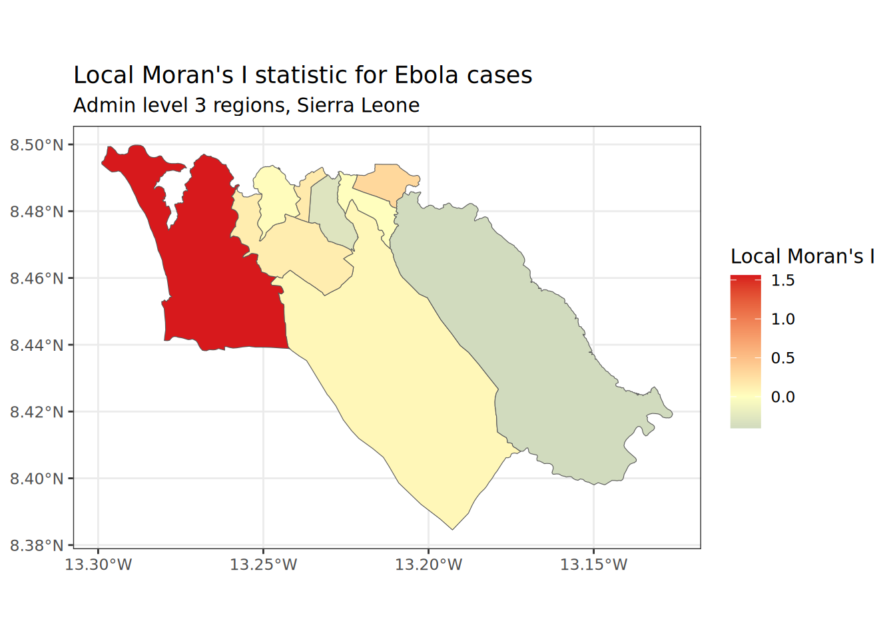](gis_files/figure-html/unnamed-chunk-63-1.png)

**Getis-Ord Gi\*** - Đây là một thống kê khác thường được sử dụng để phân tích điểm nóng - hotspot analysis; mức độ phổ biến của thống kê này liên quan đến ứng dụng của nó trong công cụ Phân tích điểm nóng của ArcGIS. Nó dựa trên giả định rằng thông thường, sự khác biệt về giá trị của một biến giữa các vùng lân cận phải tuân theo phân phối chuẩn. Nó sử dụng cách tiếp cận z-score để xác định các vùng có giá trị cao hơn đáng kể (điểm nóng) hoặc thấp hơn đáng kể (điểm lạnh) của một biến cụ thể, so với các vùng lân cận của chúng..

Chúng ta có thể tính toán và lập bản đồ chỉ số Gi\* sử dụng hàm `localG()` từ package **spdep**:

``` r
# Perform local G analysis
getis_ord <- spdep::localG(
  sle_adm3_dat$cases,
  sle_listw
)

# join results to sf data
sle_adm3_dat$getis_ord <- as.numeric(getis_ord)

# plot map
ggplot(data=sle_adm3_dat) +
  geom_sf(aes(fill=getis_ord)) +
  theme_bw() +
  scale_fill_gradient2(low="#2c7bb6", mid="#ffffbf", high="#d7191c",
                       name="Gi*") +
  labs(title="Getis-Ord Gi* statistic for Ebola cases",
       subtitle="Admin level 3 regions, Sierra Leone")
```

[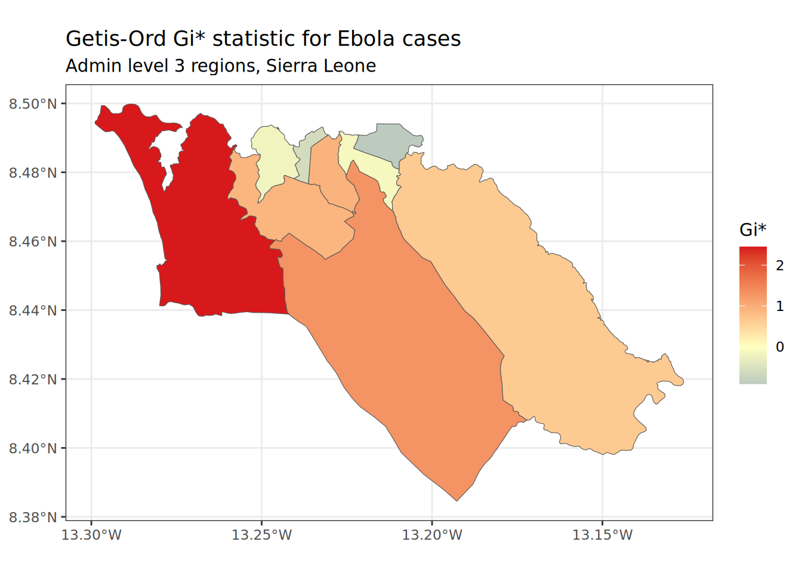](gis_files/figure-html/unnamed-chunk-64-1.png)

Như bạn có thể thấy, bản đồ được tạo ra bởi Getis-Ord Gi\* trông hơi khác so với bản đồ của Local Moran’s I được tạo ra trước đó. Điều này phản ánh rằng phương pháp được sử dụng để tính toán hai số liệu thống kê này hơi khác nhau; bạn nên sử dụng cái nào tùy thuộc vào trường hợp sử dụng cụ thể của bạn và câu hỏi nghiên cứu quan tâm.

**Lee’s L test** - Đây là một kiểm định thống kê về mối tương quan không gian giữa hai biến. Nó cho phép bạn kiểm định xem xu hướng không gian của một biến *x* có tương tự với xu hướng không gian của một biến *y* khác hay không, với giả định là chúng có mối tương quan không gian với nhau

Để đưa ra một ví dụ, hãy kiểm định liệu rằng xu hướng không gian các trường hợp Ebola từ một vụ dịch mô phỏng có tương quan với xu hướng không gian của dân số hay không. Để bắt đầu, chúng ta cần có một biến `population` trong bộ dữ liệu `sle_adm3_dat` của mình. Chúng ta có thể sử dụng biến `total` từ bộ dữ liệu `sle_adm3_pop` mà chúng ta đã tải trước đó.

``` r
sle_adm3_dat <- sle_adm3_dat %>% 
  rename(population = total)                          # rename 'total' to 'population'
```

Chúng ta có thể trực quan hóa nhanh xu hướng không gian của hai biến cạnh nhau, để xem liệu chúng có tương tự nhau hay không:

``` r
tmap_mode("plot")

cases_map <- tm_shape(sle_adm3_dat) + tm_polygons("cases") + tm_title("Cases")
pop_map <- tm_shape(sle_adm3_dat) + tm_polygons("population") + tm_title("Population")

tmap_arrange(cases_map, pop_map, ncol=2)   # arrange into 2x1 facets
```

[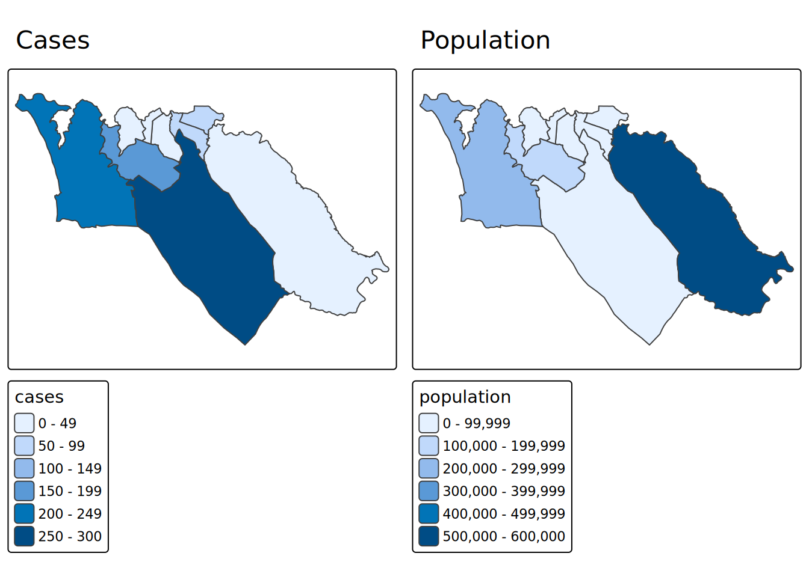](gis_files/figure-html/unnamed-chunk-66-1.png)

Một cách trực quan, các xu hướng có vẻ không giống nhau. Chúng ta có thể sử dụng hàm `lee.test()` trong package **spdep** để kiểm định liệu xu hướng tự tương quan không gian giữa hai biến số có liên quan có ý nghĩa thống kê với nhau hay không. Thống kê L sẽ gần tới 0 nếu không có mối tương quan giữa các xu hướng, gần bằng 1 nếu có mối tương quan dương mạnh (tức là các xu hướng tương tự nhau) và gần bằng -1 nếu có mối tương quan âm mạnh (tức là các xu hướng là ngược nhau).

``` r
lee_test <- spdep::lee.test(
  x=sle_adm3_dat$cases,          # variable 1 to compare
  y=sle_adm3_dat$population,     # variable 2 to compare
  listw=sle_listw                # listw object with neighbor weights
)

lee_test
```


        Lee's L statistic randomisation

    data:  sle_adm3_dat$cases ,  sle_adm3_dat$population 
    weights: sle_listw  

    Lee's L statistic standard deviate = -1.1034, p-value = 0.8651
    alternative hypothesis: greater
    sample estimates:
    Lee's L statistic       Expectation          Variance 
          -0.16600550       -0.04353710        0.01231898 

Kết quả từ thống kê Lee’s L cho hai biến là -0.17, chỉ ra rằng chúng có mối tương quan âm yếu. Điều này khẳng định đánh giá trực quan của chúng ta rằng xu hướng các trường hợp bệnh và dân số không liên quan đến nhau cũng như cung cấp bằng chứng rằng xu hướng không gian của các trường hợp không hoàn toàn là kết quả của mật độ dân số ở các khu vực có nguy cơ cao.

Thống kê Lee L có thể hữu ích để đưa ra các suy luận về mối quan hệ phân bố theo không gian giữa các biến; tuy nhiên, để mô tả bản chất của mối quan hệ giữa hai biến một cách chi tiết hơn, hoặc điều chỉnh cho nhiễu, sẽ cần đến các kỹ thuật *hồi quy không gian*. Chúng sẽ được mô tả ngắn gọn trong phần sau.

### Hồi quy không gian

Bạn có thể muốn đưa ra các suy luận thống kê về mối quan hệ giữa các biến trong dữ liệu không gian của mình. Trong những trường hợp này, sẽ hữu ích khi xem xét các kỹ thuật *hồi quy không gian* - nghĩa là, các cách tiếp cận hồi quy xem xét rõ ràng tổ chức không gian của các đơn vị trong dữ liệu của bạn. Một số lý do mà bạn có thể cần xem xét các mô hình hồi quy không gian, thay vì các mô hình hồi quy tiêu chuẩn như GLM, bao gồm:

- Các mô hình hồi quy tiêu chuẩn giả định rằng các phần dư là độc lập với nhau. Khi có hiện tượng *tự tương quan không gian* mạnh, các phần dư của mô hình hồi quy chuẩn cũng có khả năng tự tương quan không gian, do đó vi phạm giả định này. Điều này có thể dẫn đến các vấn đề trong việc giải thích kết quả mô hình, trong trường hợp đó, một mô hình không gian sẽ được ưu tiên hơn.

- Các mô hình hồi quy cũng thường giả định rằng tác động của một biến *x* là không đổi đối với tất cả các quan sát. Trong trường hợp *không đồng nhất về không gian - spatial heterogenity*, các tác động mà chúng ta muốn ước tính có thể thay đổi theo không gian và chúng ta có thể quan tâm đến việc định lượng những khác biệt đó. Trong trường hợp này, các mô hình hồi quy không gian mang lại sự linh hoạt hơn cho việc ước lượng và giải thích các tác động.

Các chi tiết về phương pháp tiếp cận hồi quy không gian nằm ngoài phạm vi của sổ tay này. Thay vào đó, phần này sẽ cung cấp tổng quan về các mô hình hồi quy không gian phổ biến nhất và cách sử dụng của chúng, đồng thời giới thiệu cho bạn tài liệu tham khảo có thể sử dụng nếu bạn muốn khám phá thêm lĩnh vực này.

**Các mô hình sai số không gian - Spatial error models** - Các mô hình này giả định rằng sai số trên các đơn vị không gian có tương quan với nhau, trong trường hợp đó, dữ liệu sẽ vi phạm các giả định của mô hình OLS tiêu chuẩn. Các mô hình này đôi khi còn được biết đến với tên **Các mô hình tự hồi quy đồng thời - simultaneous autoregressive (SAR) models**. Mô hình được fit bằng cách sử dụng hàm `errorsarlm()` trong package **spatialreg** (các hàm hồi quy không gian là một phần của package **spdep**).

**Các mô hình độ trễ không gian - Spatial lag models** - Các mô hình này giả định rằng biến phụ thuộc của một vùng *i* không chỉ bị ảnh hưởng bởi giá trị của các biến độc lập trong *i*, mà còn bởi giá trị của các biến đó ở các vùng lân cận *i*. Tương tự như các mô hình sai số không gian, các mô hình độ trễ không gian cũng thường được biết đến với tên gọi **Các mô hình tự hồi quy đồng thời**. Mô hình được fit bằng cách sử dụng hàm `lagsarlm()` trong package **spatialreg**.

Package **spdep** chứa một số kiểm định hữu ích để quyết định lựa chọn giữa các mô hình OLS chuẩn, độ trễ không gian và sai số không gian. Các kiểm định này được gọi là *chẩn đoán Lagrange Multiplier*, có thể được sử dụng để xác định loại phụ thuộc không gian trong dữ liệu của bạn và chọn mô hình nào phù hợp nhất. Hàm `lm.LMtests()` có thể được sử dụng để tính toán tất cả các kiểm định Lagrange Multiplier. Anselin (1988) cũng cung cấp một sơ đồ khối hữu ích để quyết định sử dụng mô hình hồi quy không gian nào dựa trên kết quả của các kiểm định Lagrange Multiplier:

[](../../images/gis_lmflowchart.jpg)

**Các mô hình Bayesian phân tầng - Bayesian hierarchical models** - Phương pháp tiếp cận Bayes thường được sử dụng cho một số ứng dụng trong phân tích không gian, phổ biến nhất là [lập bản đồ dịch bệnh](https://pubmed.ncbi.nlm.nih.gov/15690999/). Chúng được ưu tiên sử dụng trong các trường hợp dữ liệu trường hợp được phân phối thưa thớt (ví dụ trong trường hợp các outcome là hiếm gặp) hoặc “nhiễu” về mặt thống kê, vì chúng có thể được sử dụng để tạo ra các ước tính “mượt mà” về nguy cơ bệnh tật bằng cách tính đến quy trình không gian tiềm ẩn cơ bản. Điều này có thể giúp cải thiện chất lượng của các ước tính. Chúng cũng cho phép người điều tra cụ thể trước (thông qua việc lựa chọn prior) các xu hướng tương quan không gian phức tạp có thể tồn tại trong dữ liệu, mà có thể giải thích cho các sự biến động phụ thuộc hoặc không phụ thuộc không gian trong cả biến độc lập và phụ thuộc. Trong R, các mô hình Bayesian phân tầng có thể sử dụng thông qua package **CARbayes** (xem [hưỡng dẫn](https://cran.r-project.org/web/packages/CARBayes/vignettes/CARBayes.pdf)) hoặc R-INLA (xem [trang web](https://www.r-inla.org/home) và [sách giáo khoa](https://becarioprecario.bitbucket.io/inla-gitbook/)). R cũng có thể được sử dụng để gọi phần mềm bên ngoài thực hiện ước lượng Bayes, chẳng hạn như JAGS hoặc WinBUGS.

## 28.12 Tài nguyên học liệu

- R Các tính năng cơ bản và package sf [vignette](https://cran.r-project.org/web/packages/sf/vignettes/sf1.html)

- R tmap package [vignette](https://cran.r-project.org/web/packages/tmap/vignettes/tmap-getstarted.html)

- ggmap: [Trực quan hóa không gian với ggplot2](https://journal.r-project.org/archive/2013-1/kahle-wickham.pdf)

- [Giới thiệu về cách tạo bản đồ với R, tổng quan về các package khác nhau](https://bookdown.org/nicohahn/making_maps_with_r5/docs/introduction.html)

- Dữ liệu không gian trong R [(khóa học EarthLab)](https://www.earthdatascience.org/courses/earth-analytics/spatial-data-r/)

- Phân tích dữ liệu không gian ứng dụng trong R [sách giáo khoa](https://link.springer.com/book/10.1007/978-1-4614-7618-4)

- **SpatialEpiApp** - một [ứng dụng Shiny có thể tải xuống dưới dạng một package trong R](https://github.com/Paula-Moraga/SpatialEpiApp), cho phép bạn cung cấp dữ liệu của riêng mình và tiến hành lập bản đồ, phân tích cụm và thống kê không gian.

- Giới thiệu về kinh tế lượng không gian với R [hội thảo](http://www.econ.uiuc.edu/~lab/workshop/Spatial_in_R.html)
