# 38  Cây phả hệ

## 38.1 Tổng quan

**Cây phả hệ** được sử dụng để trực quan hóa và mô tả mối liên hệ cũng như sự tiến hóa của các sinh vật dựa trên trình tự mã di truyền của chúng.

Chúng có thể được xây dựng từ trình tự di truyền bằng các phương pháp dựa trên khoảng cách (distance-based methods) (chẳng hạn như phương pháp neighbor-joining) hoặc các phương pháp dựa trên ký tự (character-based methods) (chẳng hạn như phương pháp maximum likelihood và Bayesian Markov Chain Monte Carlo). Công nghệ giải trình tự gen thế hệ mới (Next Generation Sequencing - NGS) có giá thành ngày càng hợp lý và ngày càng được sử dụng rộng rãi hơn trong y tế công cộng để mô tả các mầm bệnh gây ra các bệnh truyền nhiễm. Các thiết bị giải trình tự di động giúp giảm thời gian quay vòng và hứa hẹn cung cấp dữ liệu để hỗ trợ điều tra ổ dịch trong thời gian thực. Dữ liệu NGS có thể được sử dụng để xác định nguồn gốc hoặc nguồn gốc của một chủng bùng phát và sự lan truyền của nó, cũng như xác định sự hiện diện của các gen kháng thuốc kháng sinh. Để trực quan hóa mối quan hệ di truyền giữa các mẫu, một cây phát sinh loài được xây dựng.

Trong chương này chúng ta sẽ học cách sử dụng package **ggtree**, cho phép kết hợp cây phả hệ với dữ liệu bổ sung dưới dạng một dataframe. Điều này sẽ cho phép chúng ta quan sát các xu hướng và nâng cao hiểu biết về động học của dịch bệnh.

[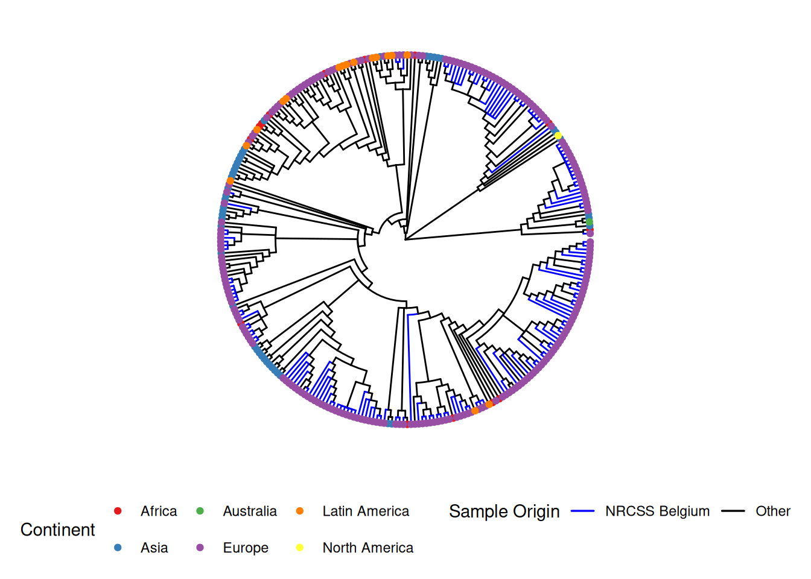](phylogenetic_trees_files/figure-html/phylogenetic_trees_overview_graph-1.png)

## 38.2 Chuẩn bị

### Gọi packages

Đoạn code này hiển thị việc gọi các package cần thiết cho các phân tích. Trong cuốn sách này, chúng tôi nhấn mạnh việc sử dụng hàm `p_load()` từ package **pacman**, giúp cài đặt các package cần thiết *và* gọi chúng ra để sử dụng. Bạn cũng có thể gọi các packages đã cài đặt với hàm `library()` của **base** R. Xem thêm chương [R cơ bản](basics.llms.md) để có thêm thông tin về các packages trong R.

``` r
pacman::p_load(
  rio,             # import/export
  here,            # relative file paths
  tidyverse,       # general data management and visualization
  ape,             # to import and export phylogenetic files
  ggtree,          # to visualize phylogenetic files
  treeio,          # to visualize phylogenetic files
  ggnewscale,      # to add additional layers of color schemes
  appliedepidata) # example datasets used in this handbook
```

### Nhập dữ liệu

Dữ liệu sử dụng trong chương này có thể tải xuống với hướng dẫn từ chương [Tải sách và dữ liệu](download.llms.md).

Có một số định dạng khác nhau mà cây phát sinh loài có thể được lưu trữ (vd: Newick, NEXUS, Phylip). Định dạng phổ biến là ở dạng tệp Newick (.nwk), là tiêu chuẩn để biểu diễn cây ở dạng máy tính có thể đọc được. Điều này có nghĩa là toàn bộ cây có thể được biểu diễn ở định dạng chuỗi chẳng hạn như “((t2:0.04,t1:0.34):0.89,(t5:0.37,(t4:0.03,t3:0.67):0.9):0.59);”, liệt kê toàn bộ các nút và tips cũng như mối quan hệ của chúng (độ dài nhánh) với nhau.

Lưu ý: Điều quan trọng là phải hiểu rằng bản thân tệp cây phát sinh loài không chứa dữ liệu trình tự, mà chỉ đơn thuần là kết quả của khoảng cách gen giữa các trình tự. Do đó, chúng ta không thể trích xuất dữ liệu trình tự từ tệp cây.

Đầu tiên, chúng ta sử dụng hàm `read.tree()` từ package **ape** để nhập một tệp cây phát sinh loài Newick ở định dạng .txt, và lưu nó dưới dạng một đối tượng danh sách với kiểu dữ liệu (class) “phylo”. Nếu cần, hãy sử dụng hàm `here()` từ package **here** để chỉ định đường dẫn tệp tương đối.

Lưu ý: Trong trường hợp này, newick tree được lưu dưới dạng tệp .txt để dễ dàng xử lý và tải xuống từ Github.

``` r
tree <- appliedepidata::get_data(name = "Shigella_tree")
```

Chúng ta khảo sát đối tượng cây của chúng ta và thấy nó chứa 299 tips (hoặc mẫu) và 236 nút (nodes).

``` r
tree
```


    Phylogenetic tree with 299 tips and 236 internal nodes.

    Tip labels:
      SRR5006072, SRR4192106, S18BD07865, S18BD00489, S17BD08906, S17BD05939, ...
    Node labels:
      17, 29, 100, 67, 100, 100, ...

    Rooted; includes branch length(s).

Thứ hai, chúng ta nhập một bảng được lưu trữ dưới dạng tệp .csv với thông tin bổ sung cho từng mẫu được giải trình tự, chẳng hạn như giới tính, quốc gia xuất xứ và các thuộc tính kháng kháng sinh, bằng cách sử dụng hàm `import()` từ package **rio**:

``` r
sample_data <- appliedepidata::get_data(name = "sample_data_Shigella_tree")
```

Dưới đây là 50 dòng đầu tiên của bộ dữ liệu:

### Làm sạch và khảo sát dữ liệu

Chúng ta làm sạch và khảo sát dữ liệu để gán dữ liệu mẫu chính xác cho cây phát sinh loài, các giá trị trong cột `Sample_ID` của data frame `sample_data` cần phải khớp với giá trị `tip.labels` ở trong tệp `tree`:

Chúng ta kiểm tra định dạng của `tip.labels` trong tệp `tree` bằng cách xem xét 6 hàng đầu tiên với hàm `head()` của **base** R.

``` r
head(tree$tip.label) 
```

    [1] "SRR5006072" "SRR4192106" "S18BD07865" "S18BD00489" "S17BD08906"
    [6] "S17BD05939"

Chúng ta cũng cần chắc chắn rằng cột đầu tiên trong data frame `sample_data` là cột `Sample_ID`. Chúng ta xem tên các cột của dataframe bằng cách sử dụng hàm `colnames()` từ **base** R.

``` r
colnames(sample_data)   
```

     [1] "Sample_ID"                  "serotype"                  
     [3] "Country"                    "Continent"                 
     [5] "Travel_history"             "Year"                      
     [7] "Belgium"                    "Source"                    
     [9] "Gender"                     "gyrA_mutations"            
    [11] "macrolide_resistance_genes" "MIC_AZM"                   
    [13] "MIC_CIP"                   

Chúng ta hãy để ý cột `Sample_IDs` trong data frame để chắc chắn rằng các định dạng là tương tự với `tip.label` (vd: các chữ cái đều viết hoa, không có dấu gạch dưới thừa `_` giữa ký tự và số, v.v.)

``` r
head(sample_data$Sample_ID) # we again inspect only the first 6 using head()
```

    [1] "S17BD05944" "S15BD07413" "S18BD07247" "S19BD07384" "S18BD07338"
    [6] "S18BD02657"

Chúng ta cũng có thể so sánh nếu tất cả các mẫu có trong tệp `tree` và ngược lại bằng cách tạo một vectơ logic TRUE hoặc FALSE khi chúng khớp hoặc không khớp. Chúng không được in ở đây để cho đơn giản.

``` r
sample_data$Sample_ID %in% tree$tip.label

tree$tip.label %in% sample_data$Sample_ID
```

Chúng ta có thể sử dụng các vectơ này để hiển thị bất kỳ ID mẫu nào không có trên cây (không có ID nào).

``` r
sample_data$Sample_ID[!tree$tip.label %in% sample_data$Sample_ID]
```

    character(0)

Sau khi khảo sát, chúng ta có thể thấy định dạng của cột `Sample_ID` trong dataframe tương ứng với định dạng của tên mẫu tại `tip.labels`. Chúng không cần phải được sắp xếp theo cùng một thứ tự để có thể khớp.

Bây giờ chúng ta đã sẵn sàng!

## 38.3 Trực quan hóa cây đơn giản

### Các bố cục cây khác nhau

**ggtree** cung cấp nhiều định dạng bố cục khác nhau và một số có thể phù hợp với mục đích cụ thể của bạn hơn những định dạng khác. Dưới đây là một vài minh hoạt. Đối với các tùy chọn khác, hãy xem [cuốn sách trực tuyến này](http://yulab-smu.top/treedata-book/chapter4.html).

Dưới đây là một số bố cục cây mẫu:

``` r
ggtree(tree)                                            # simple linear tree
ggtree(tree,  branch.length = "none")                   # simple linear tree with all tips aligned
ggtree(tree, layout="circular")                         # simple circular tree
ggtree(tree, layout="circular", branch.length = "none") # simple circular tree with all tips aligned
```

[](phylogenetic_trees_files/figure-html/phylogenetic_trees_example_formats-1.png)

[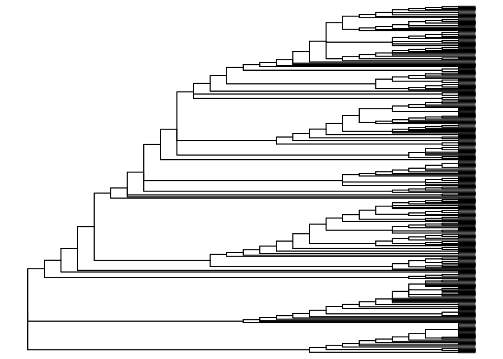](phylogenetic_trees_files/figure-html/phylogenetic_trees_example_formats-2.png)

[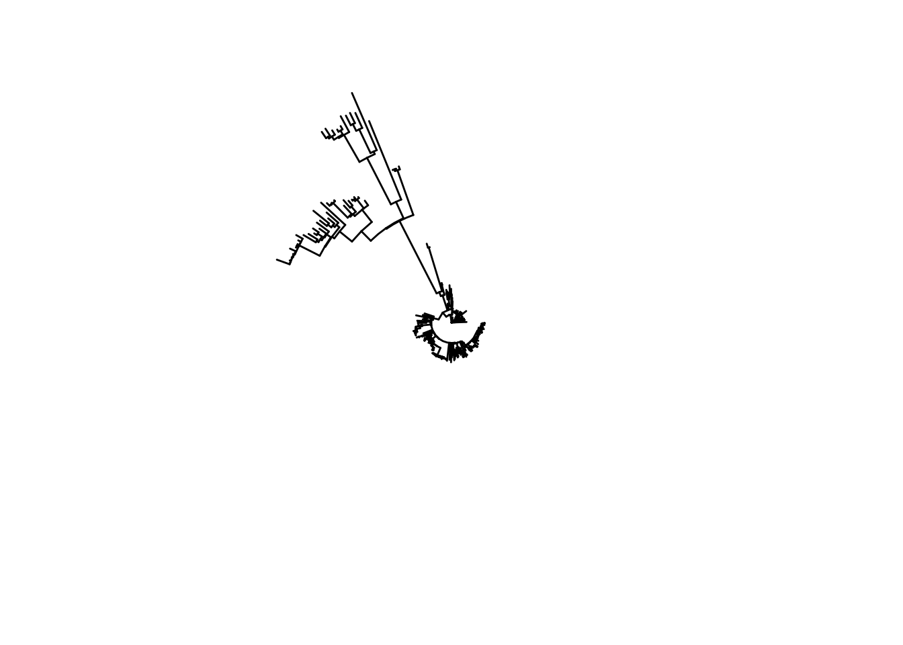](phylogenetic_trees_files/figure-html/phylogenetic_trees_example_formats-3.png)

[](phylogenetic_trees_files/figure-html/phylogenetic_trees_example_formats-4.png)

### Cây đơn giản cộng với dữ liệu mẫu

Toán tử **%\<+%** được sử dụng để kết nối data frame `sample_data` tới tệp `tree`. Cách chú thích dễ dàng nhất cho cây của bạn là thêm tên mẫu ở các ngọn, cũng như tô màu các điểm ngọn và các nhánh nếu muốn:

Dưới đây là một ví dụ về cây phả hệ dạng tròn:

``` r
ggtree(tree, layout = "circular", branch.length = 'none') %<+% sample_data + # %<+% adds dataframe with sample data to tree
  aes(color = Belgium)+                       # color the branches according to a variable in your dataframe
  scale_color_manual(
    name = "Sample Origin",                      # name of your color scheme (will show up in the legend like this)
    breaks = c("Yes", "No"),                     # the different options in your variable
    labels = c("NRCSS Belgium", "Other"),        # how you want the different options named in your legend, allows for formatting
    values = c("blue", "black"),                  # the color you want to assign to the variable 
    na.value = "black") +                        # color NA values in black as well
  new_scale_color()+                             # allows to add an additional color scheme for another variable
    geom_tippoint(
      mapping = aes(color = Continent),          # tip color by continent. You may change shape adding "shape = "
      size = 1.5)+                               # define the size of the point at the tip
  scale_color_brewer(
    name = "Continent",                    # name of your color scheme (will show up in the legend like this)
    palette = "Set1",                      # we choose a set of colors coming with the brewer package
    na.value = "grey") +                    # for the NA values we choose the color grey
  geom_tiplab(                             # adds name of sample to tip of its branch 
    color = 'black',                       # (add as many text lines as you wish with + , but you may need to adjust offset value to place them next to each other)
    offset = 1,
    size = 1,
    geom = "text",
    align = TRUE)+    
  ggtitle("Phylogenetic tree of Shigella sonnei")+       # title of your graph
  theme(
    axis.title.x = element_blank(), # removes x-axis title
    axis.title.y = element_blank(), # removes y-axis title
    legend.title = element_text(    # defines font size and format of the legend title
      face = "bold",
      size = 12),   
    legend.text=element_text(       # defines font size and format of the legend text
      face = "bold",
      size = 10),  
    plot.title = element_text(      # defines font size and format of the plot title
      size = 12,
      face = "bold"),  
    legend.position = "bottom",     # defines placement of the legend
    legend.box = "vertical",        # defines placement of the legend
    legend.margin = margin())   
```

[](phylogenetic_trees_files/figure-html/phylogenetic_trees_adding_sampledata-1.png)

Bạn có thể xuất biểu đồ cây với hàm `ggsave()` như cách bạn làm với bất kỳ đối tượng ggplot nào khác. Được viết theo cách này, `ggsave()` lưu hình ảnh cuối cùng được tạo vào đường dẫn tệp bạn chỉ định. Hãy nhớ rằng bạn có thể sử dụng hàm `here()` và các đường dẫn tệp tương đối để dễ dàng lưu trong các thư mục con, v.v.

``` r
ggsave("example_tree_circular_1.png", width = 12, height = 14)
```

## 38.4 Thao tác với cây

Đôi khi bạn có thể có một cây phát sinh loài rất lớn và bạn chỉ quan tâm đến một phần của cây. Ví dụ, bạn muốn tạo ra một cây bao gồm các mẫu lịch sử hoặc quốc tế để có cái nhìn tổng quan về vị trí mà tập dữ liệu của bạn có thể phù hợp trong bức tranh lớn hơn. Nhưng sau đó để xem xét kỹ hơn dữ liệu của bạn, bạn chỉ muốn kiểm tra phần đó của cây lớn hơn.

Vì tệp cây phát sinh loài chỉ là sản phẩm đầu ra của phân tích dữ liệu trình tự, chúng ta không thể thao tác trên thứ tự của các nút và nhánh trên chính tệ đó. Chúng đã được xác định trong phân tích trước đó từ dữ liệu NGS thô. Mặc dù vậy, chúng ta có thể phóng to các thành phần, ẩn các thành phần và thậm chí tạo tập con một phần của cây.

### Phóng to

Nếu bạn không muốn “chặt” cây của mình mà chỉ kiểm tra kỹ hơn một phần của nó, bạn có thể phóng to để xem một phần cụ thể.

Đầu tiên, chúng ta vẽ toàn bộ cây ở định dạng tuyến tính và thêm các nhãn số cho mỗi nút trong cây.

``` r
p <- ggtree(tree,) %<+% sample_data +
  geom_tiplab(size = 1.5) +                # labels the tips of all branches with the sample name in the tree file
  geom_text2(
    mapping = aes(subset = !isTip,
                  label = node),
    size = 5,
    color = "darkred",
    hjust = 1,
    vjust = 1)                            # labels all the nodes in the tree

p  # print
```

[](phylogenetic_trees_files/figure-html/phylogenetic_trees_zoom_in-1.png)

Để phóng to vào một nhánh cụ thể (nhô ra bên phải), hãy sử dụng hàm `viewClade()` trên đối tượng ggtree có tên `p` và cung cấp số nút để xem gần hơn:

``` r
viewClade(p, node = 452)
```

[](phylogenetic_trees_files/figure-html/phylogenetic_trees_zoom_in_452-1.png)

### Thu gọn nhánh

Tuy nhiên, chúng ta có thể muốn bỏ qua nhánh này và có thể thu gọn nó tại cùng một nút đó (nút nr. 452) bằng cách sử dụng hàm `collapse()`. Cây này sẽ được gán cho đối tượng mới có tên `p_collapsed`.

``` r
p_collapsed <- collapse(p, node = 452)
p_collapsed
```

[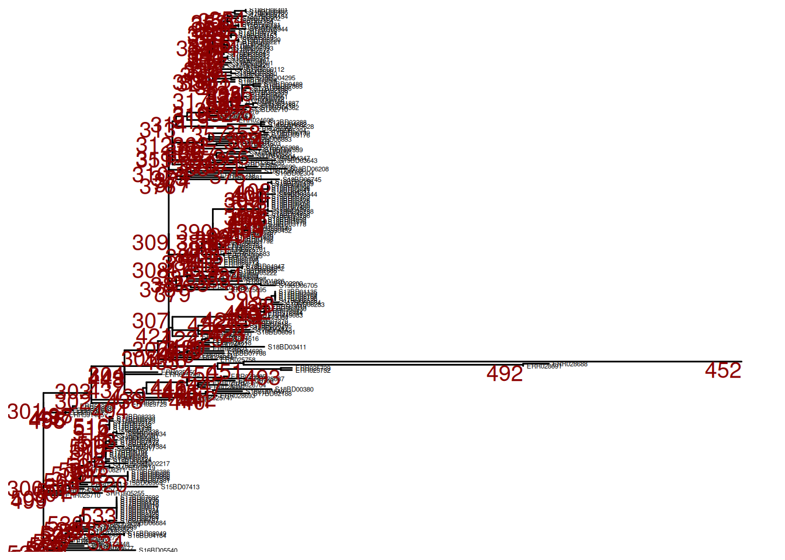](phylogenetic_trees_files/figure-html/phylogenetic_trees_collapse_452-1.png)

Để rõ ràng, khi chúng ta in `p_collapsed`, chúng ta thêm một điểm (viên kim cương màu xanh) với hàm `geom_point2()` tại nút của nhánh được thu gọn.

``` r
p_collapsed + 
geom_point2(aes(subset = (node == 452)),  # we assign a symbol to the collapsed node
            size = 5,                     # define the size of the symbol
            shape = 23,                   # define the shape of the symbol
            fill = "steelblue")           # define the color of the symbol
```

[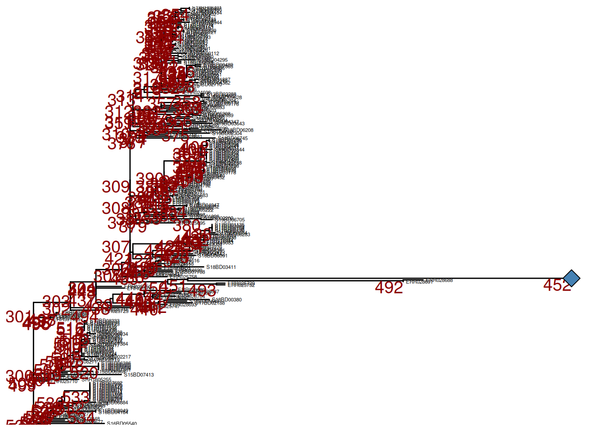](phylogenetic_trees_files/figure-html/unnamed-chunk-12-1.png)

### Tạo tập con một cây

Nếu chúng ta muốn thực hiện một thay đổi lâu dài hơn và tạo một cây mới, gọn hơn để làm việc, chúng ta có thể subset một phần của nó với hàm `tree_subset()`. Sau đó, bạn có thể lưu nó dưới dạng tệp newick tree hoặc tệp .txt mới.

Đầu tiên, chúng ta kiểm tra các nút cây và các nhãn của tips để quyết định cái gì sẽ được subset.

``` r
ggtree(
  tree,
  branch.length = 'none',
  layout = 'circular') %<+% sample_data +               # we add the asmple data using the %<+% operator
  geom_tiplab(size = 1)+                                # label tips of all branches with sample name in tree file
  geom_text2(
    mapping = aes(subset = !isTip, label = node),
    size = 3,
    color = "darkred") +                                # labels all the nodes in the tree
 theme(
   legend.position = "none",                            # removes the legend all together
   axis.title.x = element_blank(),
   axis.title.y = element_blank(),
   plot.title = element_text(size = 12, face="bold"))
```

[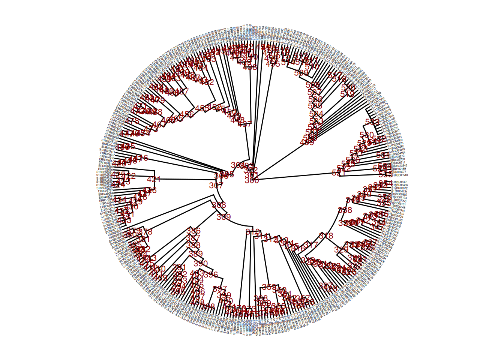](phylogenetic_trees_files/figure-html/phylogenetic_trees_subsetting-1.png)

Bây giờ, giả sử chúng ta đã quyết định subset cây tại nút số 528 (chỉ giữ lại các tips bên trong nhánh sau nút 528) và lưu nó vào một đối tượng mới `sub_tree1`:

``` r
sub_tree1 <- tree_subset(
  tree,
  node = 528)                                            # we subset the tree at node 528
```

Hãy cùng xem cây con 1:

``` r
ggtree(sub_tree1) +
  geom_tiplab(size = 3) +
  ggtitle("Subset tree 1")
```

[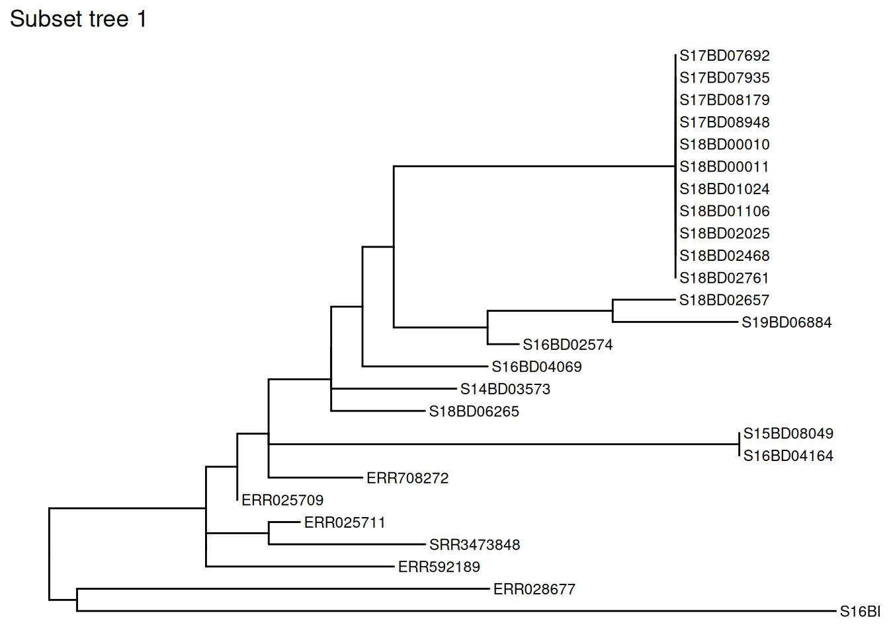](phylogenetic_trees_files/figure-html/unnamed-chunk-14-1.png)

Bạn cũng có thể subset dựa trên một mẫu cụ thể, bằng cách chỉ định số lượng nút “backwards” bạn muốn đưa vào. Hãy subset chính phần đó của cây dựa trên một mẫu, trong trường hợp này là S17BD07692, quay lại 9 nút và chúng ta lưu nó dưới dạng đối tượng `sub_tree2` mớit:

``` r
sub_tree2 <- tree_subset(
  tree,
  "S17BD07692",
  levels_back = 9) # levels back defines how many nodes backwards from the sample tip you want to go
```

Giờ hãy cùng xem cây con 2:

``` r
ggtree(sub_tree2) +
  geom_tiplab(size =3)  +
  ggtitle("Subset tree 2")
```

[](phylogenetic_trees_files/figure-html/unnamed-chunk-16-1.png)

Bạn cũng có thể lưu cây mới của mình dưới dạng kiểu Newick hoặc thậm chí là tệp văn bản bằng cách sử dụng hàm `write.tree()` từ package **ape**:

``` r
# to save in .nwk format
ape::write.tree(sub_tree2, file='data/phylo/Shigella_subtree_2.nwk')

# to save in .txt format
ape::write.tree(sub_tree2, file='data/phylo/Shigella_subtree_2.txt')
```

### Xoay các nút trong một cây

Như đã đề cập bên trên, chúng ta không thể thay đổi thứ tự của các tips hoặc nút trong cây, vì điều này dựa trên mối liên hệ di truyền của chúng và không phải là đối tượng cho các điều chỉnh thị giác. Nhưng chúng ta có thể xoay các nhánh xung quanh nút nếu điều đó giúp chúng ta dễ nhìn hơn.

Đầu tiên, chúng ta hãy vẽ subset tree 2 với nhãn nút để chọn nút mà chúng ta muốn thao tác và lưu nó vào một đối tượng biểu đồ ggtree có tên `p`.

``` r
p <- ggtree(sub_tree2) +  
  geom_tiplab(size = 4) +
  geom_text2(aes(subset=!isTip, label=node), # labels all the nodes in the tree
             size = 5,
             color = "darkred", 
             hjust = 1, 
             vjust = 1) 
p
```

[](phylogenetic_trees_files/figure-html/phylogenetic_trees_rotating_1-1.png)

Sau đó chúng ta có thể thao tác với các nút bằng cách áp dụng hàm **ggtree::rotate()** hoặc **ggtree::flip()**: Lưu ý: để biểu diễn những nút nào chúng ta đang thao tác, trước tiên chúng ta áp dụng hàm **geom_hilight()** từ package **ggtree** để đánh dấu các mẫu trong các nút mà chúng ta quan tâm và lưu trữ sang một đối tượng biểu đồ mới có tên `p1`.

``` r
p1 <- p + geom_hilight(  # highlights node 39 in blue, "extend =" allows us to define the length of the color block
  node = 39,
  fill = "steelblue",
  extend = 0.0017) +  
geom_hilight(            # highlights the node 37 in yellow
  node = 37,
  fill = "yellow",
  extend = 0.0017) +               
ggtitle("Original tree")


p1 # print
```

[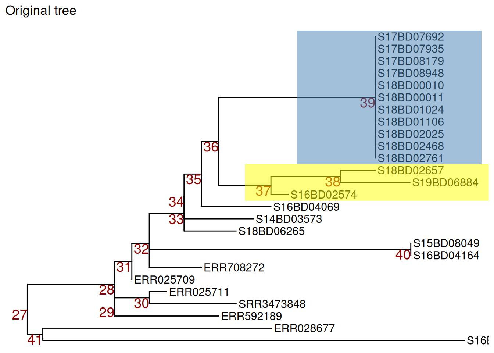](phylogenetic_trees_files/figure-html/phylogenetic_trees_rotating_2-1.png)

Bây giờ chúng ta có thể xoay nút 37 trong đối tượng `p1` để các mẫu trên nút 38 di chuyển lên đỉnh. Chúng ta lưu trữ cây đã xoay trong một đối tượng mới có tên `p2`.

``` r
p2 <- ggtree::rotate(p1, 37) + 
      ggtitle("Rotated Node 37")


p2   # print
```

[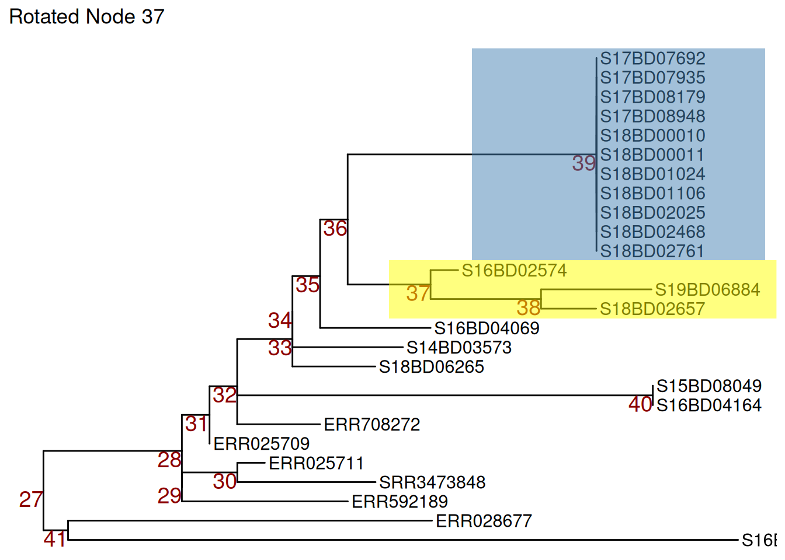](phylogenetic_trees_files/figure-html/unnamed-chunk-17-1.png)

Hoặc chúng ta có thể sử dụng lệnh `flip` để xoay nút 36 trong đối tượng `p1` và đổi nút 37 lên đỉnh và nút 39 xuống dưới đáy. Chúng ta lưu cây đã được lật lại vào một đối tượng mới có tên `p3`.

``` r
p3 <-  flip(p1, 39, 37) +
      ggtitle("Rotated Node 36")


p3   # print
```

[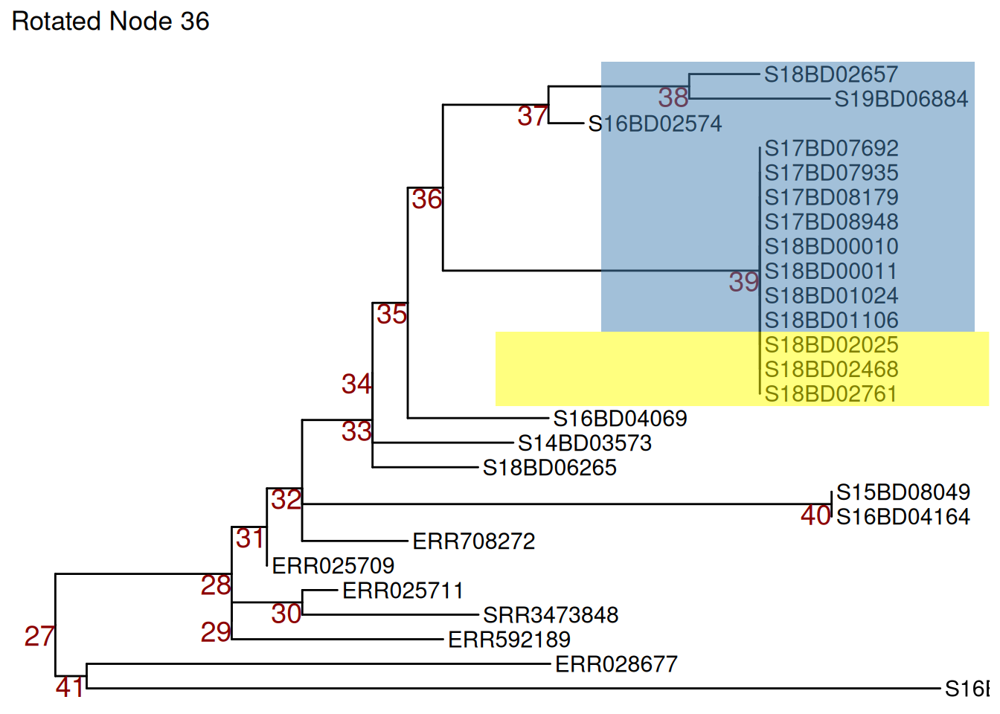](phylogenetic_trees_files/figure-html/unnamed-chunk-18-1.png)

### Ví dụ về cây con với chú thích dữ liệu mẫu

Giả sử chúng tôi đang điều tra cụm các trường hợp có sự mở rộng dòng vô tính (clonal expansion) xảy ra vào năm 2017 và 2018 tại nút 39 trong cây con của chúng ta. Chúng ta thêm năm phân lập chủng cũng như lịch sử di chuyển và màu sắc theo quốc gia để xem nguồn gốc của các chủng có liên quan gần khác:

``` r
ggtree(sub_tree2) %<+% sample_data +     # we use th %<+% operator to link to the sample_data
  geom_tiplab(                          # labels the tips of all branches with the sample name in the tree file
    size = 2.5,
    offset = 0.001,
    align = TRUE) + 
  theme_tree2()+
  xlim(0, 0.015)+                       # set the x-axis limits of our tree
  geom_tippoint(aes(color=Country),     # color the tip point by continent
                size = 1.5)+ 
  scale_color_brewer(
    name = "Country", 
    palette = "Set1", 
    na.value = "grey")+
  geom_tiplab(                          # add isolation year as a text label at the tips
    aes(label = Year),
    color = 'blue',
    offset = 0.0045,
    size = 3,
    linetype = "blank" ,
    geom = "text",
    align = TRUE)+ 
  geom_tiplab(                          # add travel history as a text label at the tips, in red color
    aes(label = Travel_history),
    color = 'red',
    offset = 0.006,
    size = 3,
    linetype = "blank",
    geom = "text",
    align = TRUE)+ 
  ggtitle("Phylogenetic tree of Belgian S. sonnei strains with travel history")+  # add plot title
  xlab("genetic distance (0.001 = 4 nucleotides difference)")+                    # add a label to the x-axis 
  theme(
    axis.title.x = element_text(size = 10),
    axis.title.y = element_blank(),
    legend.title = element_text(face = "bold", size = 12),
    legend.text = element_text(face = "bold", size = 10),
    plot.title = element_text(size = 12, face = "bold"))
```

[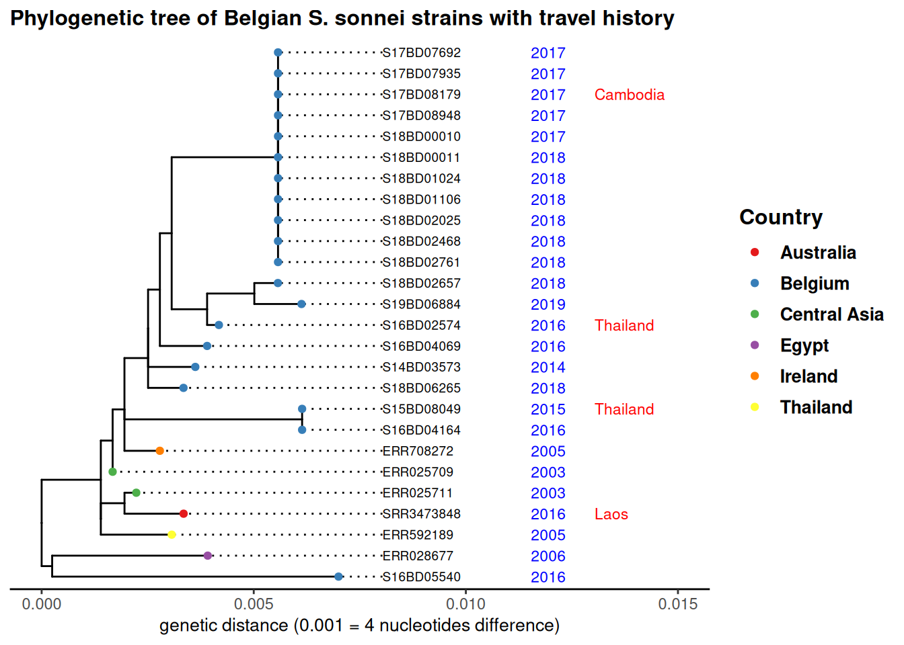](phylogenetic_trees_files/figure-html/phylogenetic_trees_inspect_subset_example-1.png)

Quan sát của chúng ta hướng tới một sự kiện nhập khẩu các chủng từ châu Á, sau đó lưu hành ở Bỉ trong nhiều năm và dường như đã gây ra đợt bùng phát mới nhất của chúng ta.

## Các cây phức tạp hơn: thêm bản đồ nhiệt của dữ liệu mẫu

Chúng tôi có thể thêm thông tin phức tạp hơn, chẳng hạn như sự phân loại của các gen kháng thuốc và các giá trị đo lường về khả năng kháng thuốc dưới dạng bản đồ nhiệt bằng cách sử dụng hàm **ggtree::gheatmap()**.

Trước tiên, chúng ta cần vẽ cây của mình (có thể là tuyến tính hoặc hình tròn) và lưu trữ nó trong một đối tượng biểu đồ ggtree mới có tên `p`: Chúng ta sẽ sử dụng sub_tree từ phần 3.)

``` r
p <- ggtree(sub_tree2, branch.length='none', layout='circular') %<+% sample_data +
  geom_tiplab(size =3) + 
 theme(
   legend.position = "none",
    axis.title.x = element_blank(),
    axis.title.y = element_blank(),
    plot.title = element_text(
      size = 12,
      face = "bold",
      hjust = 0.5,
      vjust = -15))
p
```

[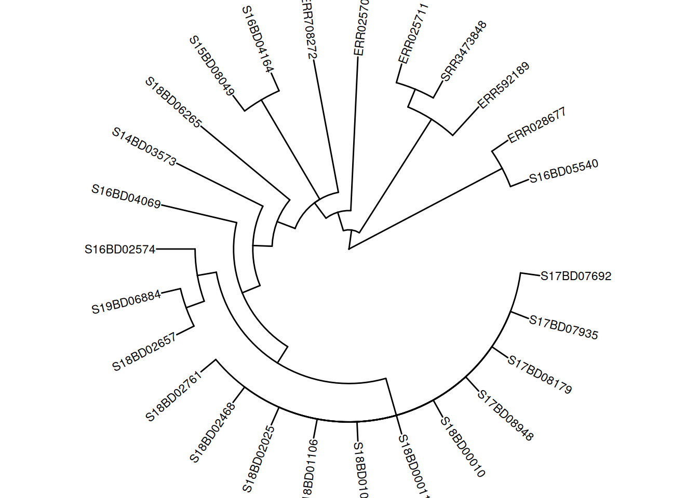](phylogenetic_trees_files/figure-html/phylogenetic_trees_sampledata_heatmap-1.png)

Thứ hai, chúng ta chuẩn bị dữ liệu của mình. Để trực quan hóa các biến khác nhau bằng các phối màu mới, chúng ta subset dataframe thành các biến mong muốn. Điều quan trọng là phải thêm `Sample_ID` làm tên hàng nếu không nó không thể khớp dữ liệu với cây `tip.labels`:

Trong ví dụ của này, chúng ta muốn xem xét giới tính và các đột biến có thể dẫn đến kháng Ciprofloxacin, một loại kháng sinh hàng đầu quan trọng được sử dụng để điều trị nhiễm trùng Shigella.

Chúng ta tạo một dataframe cho biến giới tính:

``` r
gender <- data.frame("gender" = sample_data[,c("Gender")])
rownames(gender) <- sample_data$Sample_ID
```

Chúng ta tạo một dataframe cho đột biến ở gen gyrA, gen này tạo ra khả năng kháng Ciprofloxacin:

``` r
cipR <- data.frame("cipR" = sample_data[,c("gyrA_mutations")])
rownames(cipR) <- sample_data$Sample_ID
```

Chúng ta tạo một dataframe đối với nồng độ ức chế tối thiểu đo được (MIC) đối với Ciprofloxacin trong phòng thí nghiệm:

``` r
MIC_Cip <- data.frame("mic_cip" = sample_data[,c("MIC_CIP")])
rownames(MIC_Cip) <- sample_data$Sample_ID
```

Chúng ta tạo một biểu đồ đầu tiên và thêm bản đồ nhiệt nhị phân cho giới tính vào cây phát sinh loài và lưu trữ nó trong một đối tượng biểu đồ ggtree mới `h1`:

``` r
h1 <-  gheatmap(p, gender,                                 # we add a heatmap layer of the gender dataframe to our tree plot
                offset = 10,                               # offset shifts the heatmap to the right,
                width = 0.10,                              # width defines the width of the heatmap column,
                color = NULL,                              # color defines the boarder of the heatmap columns
         colnames = FALSE) +                               # hides column names for the heatmap
  scale_fill_manual(name = "Gender",                       # define the coloring scheme and legend for gender
                    values = c("#00d1b1", "purple"),
                    breaks = c("Male", "Female"),
                    labels = c("Male", "Female")) +
   theme(legend.position = "bottom",
        legend.title = element_text(size = 12),
        legend.text = element_text(size = 10),
        legend.box = "vertical", legend.margin = margin())
```

    Scale for y is already present.
    Adding another scale for y, which will replace the existing scale.
    Scale for fill is already present.
    Adding another scale for fill, which will replace the existing scale.

``` r
h1
```

[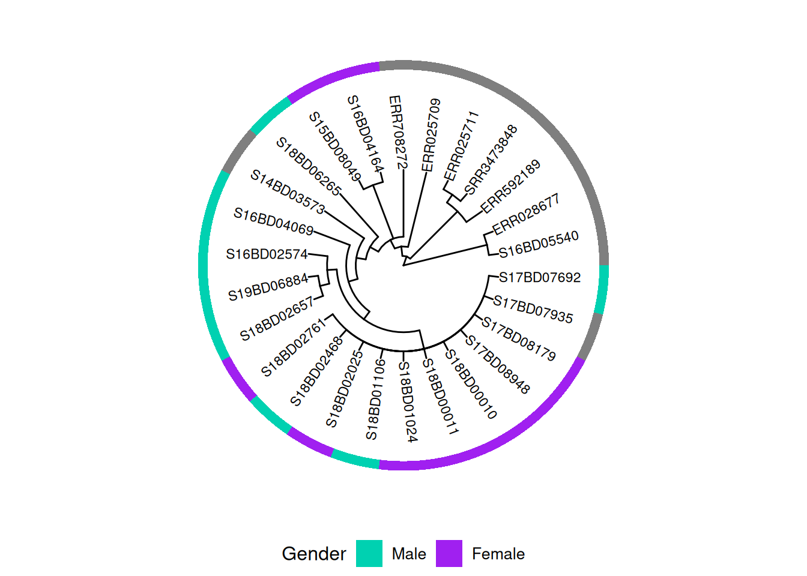](phylogenetic_trees_files/figure-html/phylogenetic_trees_sampledata_heatmap_gender-1.png)

Sau đó, chúng ta thêm thông tin về các đột biến trong gen gyrA, gen này tạo ra khả năng kháng Ciprofloxacin:

Lưu ý: Sự hiện diện của đột biến điểm nhiễm sắc thể trong dữ liệu WGS đã được xác định trước bằng cách sử dụng công cụ PointFinder do Zankari et al phát triển. (xem tham khảo trong phần tài liệu tham khảo bổ sung)

Đầu tiên, chúng ta gán một bảng màu mới cho đối tượng biểu đồ `h1` có sẵn và lưu nó thành một đối tượng mới có tên `h2`. Điều này cho phép chúng ta xác định và thay đổi màu sắc cho biến thứ hai của chúng tôi trong bản đồ nhiệt.

``` r
h2 <- h1 + new_scale_fill() 
```

Sau đó, chúng ta thêm lớp bản đồ nhiệt thứ hai vào `h2` và lưu biểu đồ thành đối tượng mới có tên `h3`:

``` r
h3 <- gheatmap(h2, cipR,         # adds the second row of heatmap describing Ciprofloxacin resistance mutations
               offset = 12, 
               width = 0.10, 
               colnames = FALSE) +
  scale_fill_manual(name = "Ciprofloxacin resistance \n conferring mutation",
                    values = c("#fe9698","#ea0c92"),
                    breaks = c( "gyrA D87Y", "gyrA S83L"),
                    labels = c( "gyrA d87y", "gyrA s83l")) +
   theme(legend.position = "bottom",
        legend.title = element_text(size = 12),
        legend.text = element_text(size = 10),
        legend.box = "vertical", legend.margin = margin())+
  guides(fill = guide_legend(nrow = 2,byrow = TRUE))
```

    Scale for y is already present.
    Adding another scale for y, which will replace the existing scale.
    Scale for fill is already present.
    Adding another scale for fill, which will replace the existing scale.

``` r
h3
```

[](phylogenetic_trees_files/figure-html/phylogenetic_trees_sampledata_heatmap_cip_genes-1.png)

Chúng tôi lặp lại quy trình trên, trước tiên bằng cách thêm một lớp thang màu mới vào đối tượng hiện có `h3`, sau đó thêm dữ liệu liên tục về nồng độ ức chế tối thiểu (MIC) của Ciprofloxacin cho mỗi chủng vào đối tượng kết quả `h4` để tạo ra đối tượng cuối cùng `h5`:

``` r
# First we add the new coloring scheme:
h4 <- h3 + new_scale_fill()

# then we combine the two into a new plot:
h5 <- gheatmap(h4, MIC_Cip,  
               offset = 14, 
               width = 0.10,
                colnames = FALSE)+
  scale_fill_continuous(name = "MIC for Ciprofloxacin",  # here we define a gradient color scheme for the continuous variable of MIC
                      low = "yellow", high = "red",
                      breaks = c(0, 0.50, 1.00),
                      na.value = "white") +
   guides(fill = guide_colourbar(barwidth = 5, barheight = 1))+
   theme(legend.position = "bottom",
        legend.title = element_text(size = 12),
        legend.text = element_text(size = 10),
        legend.box = "vertical", legend.margin = margin())
```

    Scale for y is already present.
    Adding another scale for y, which will replace the existing scale.
    Scale for fill is already present.
    Adding another scale for fill, which will replace the existing scale.

``` r
h5
```

[](phylogenetic_trees_files/figure-html/phylogenetic_trees_sampledata_heatmap_cip_MIC-1.png)

Chúng ta có thể thực hiện tương tự đối với cây tuyến tính:

``` r
p <- ggtree(sub_tree2) %<+% sample_data +
  geom_tiplab(size = 3) + # labels the tips
  theme_tree2()+
  xlab("genetic distance (0.001 = 4 nucleotides difference)")+
  xlim(0, 0.015)+
 theme(legend.position = "none",
      axis.title.y = element_blank(),
      plot.title = element_text(size = 12, 
                                face = "bold",
                                hjust = 0.5,
                                vjust = -15))
p
```

[](phylogenetic_trees_files/figure-html/phylogenetic_trees_sampledata_heatmap_linear_1-1.png)

Đầu tiên chúng ta thêm giới:

``` r
h1 <-  gheatmap(p, gender, 
                offset = 0.003,
                width = 0.1, 
                color="black", 
         colnames = FALSE)+
  scale_fill_manual(name = "Gender",
                    values = c("#00d1b1", "purple"),
                    breaks = c("Male", "Female"),
                    labels = c("Male", "Female"))+
   theme(legend.position = "bottom",
        legend.title = element_text(size = 12),
        legend.text = element_text(size = 10),
        legend.box = "vertical", legend.margin = margin())
```

    Scale for y is already present.
    Adding another scale for y, which will replace the existing scale.
    Scale for fill is already present.
    Adding another scale for fill, which will replace the existing scale.

``` r
h1
```

[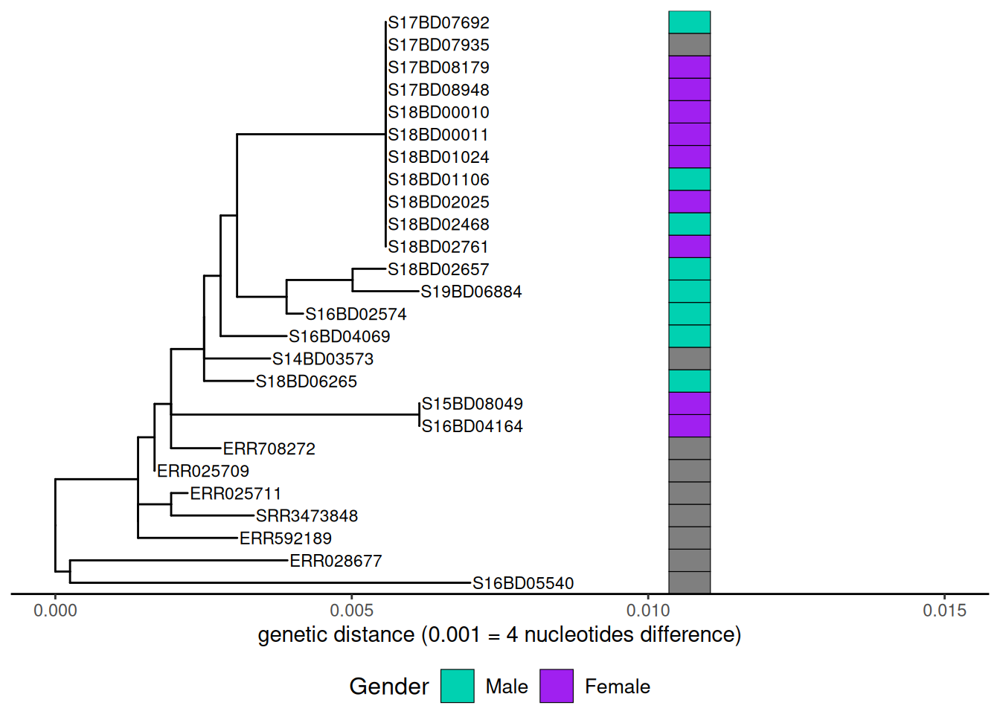](phylogenetic_trees_files/figure-html/phylogenetic_trees_sampledata_heatmap_linear_2-1.png)

Sau đó, chúng ta thêm các đột biến kháng Ciprofloxacin sau khi thêm một lớp phối màu khác:

``` r
h2 <- h1 + new_scale_fill()
h3 <- gheatmap(h2, cipR,   
               offset = 0.004, 
               width = 0.1,
               color = "black",
                colnames = FALSE)+
  scale_fill_manual(name = "Ciprofloxacin resistance \n conferring mutation",
                    values = c("#fe9698","#ea0c92"),
                    breaks = c( "gyrA D87Y", "gyrA S83L"),
                    labels = c( "gyrA d87y", "gyrA s83l"))+
   theme(legend.position = "bottom",
        legend.title = element_text(size = 12),
        legend.text = element_text(size = 10),
        legend.box = "vertical", legend.margin = margin())+
  guides(fill = guide_legend(nrow = 2,byrow = TRUE))
```

    Scale for y is already present.
    Adding another scale for y, which will replace the existing scale.
    Scale for fill is already present.
    Adding another scale for fill, which will replace the existing scale.

``` r
 h3
```

[](phylogenetic_trees_files/figure-html/phylogenetic_trees_sampledata_heatmap_linear_3-1.png)

Sau đó, chúng ta thêm nồng độ ức chế tối thiểu được xác định bởi phòng thí nghiệm (MIC):

``` r
h4 <- h3 + new_scale_fill()
h5 <- gheatmap(h4, MIC_Cip, 
               offset = 0.005,  
               width = 0.1,
               color = "black", 
                colnames = FALSE)+
  scale_fill_continuous(name = "MIC for Ciprofloxacin",
                      low = "yellow", high = "red",
                      breaks = c(0,0.50,1.00),
                      na.value = "white")+
   guides(fill = guide_colourbar(barwidth = 5, barheight = 1))+
   theme(legend.position = "bottom",
        legend.title = element_text(size = 10),
        legend.text = element_text(size = 8),
        legend.box = "horizontal", legend.margin = margin())+
  guides(shape = guide_legend(override.aes = list(size = 2)))
```

    Scale for y is already present.
    Adding another scale for y, which will replace the existing scale.
    Scale for fill is already present.
    Adding another scale for fill, which will replace the existing scale.

``` r
h5
```

[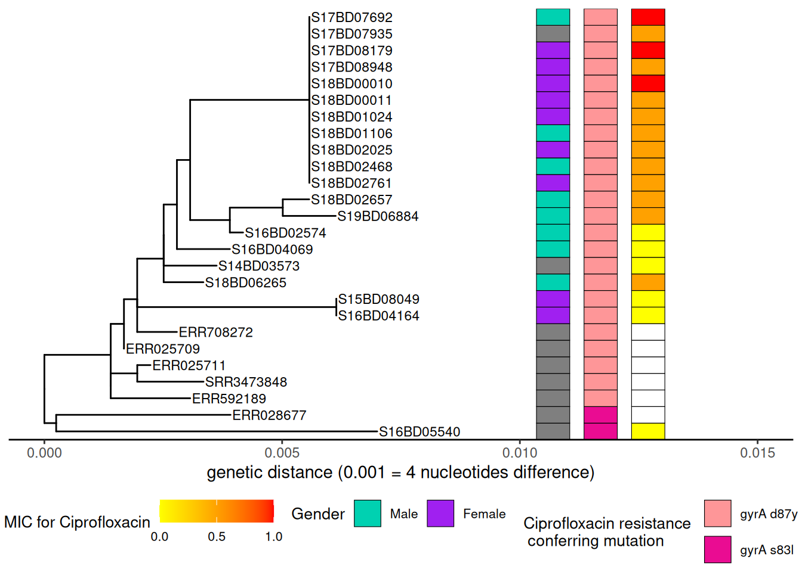](phylogenetic_trees_files/figure-html/phylogenetic_trees_sampledata_heatmap_linear_4-1.png)

## 38.5 Nguồn

http://hydrodictyon.eeb.uconn.edu/eebedia/index.php/Ggtree# Clade_Colors https://bioconductor.riken.jp/packages/3.2/bioc/vignettes/ggtree/inst/doc/treeManipulation.html https://guangchuangyu.github.io/ggtree-book/chapter-ggtree.html https://bioconductor.riken.jp/packages/3.8/bioc/vignettes/ggtree/inst/doc/treeManipulation.html

Ea Zankari, Rosa Allesøe, Katrine G Joensen, Lina M Cavaco, Ole Lund, Frank M Aarestrup, PointFinder: a novel web tool for WGS-based detection of antimicrobial resistance associated with chromosomal point mutations in bacterial pathogens, Journal of Antimicrobial Chemotherapy, Volume 72, Issue 10, October 2017, Pages 2764–2768, https://doi.org/10.1093/jac/dkx217
