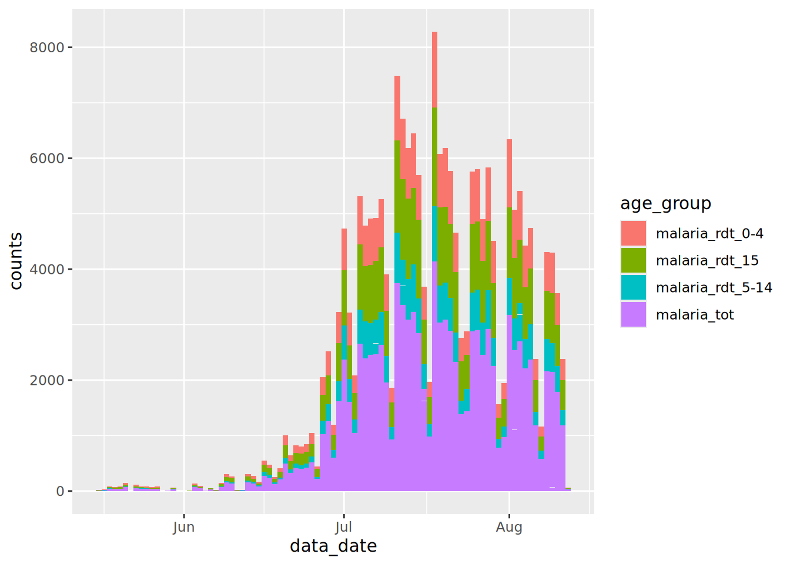

# 12  Xoay trục dữ liệu

[](../../images/pivoting/pivoting_500x500.png)

Khi quản lý dữ liệu, *xoay trục* có thể được hiểu là đề cập đến một trong hai quy trình:

1.  Tạo *bảng dữ liệu tổng hợp (pivot tables)*, là bảng thống kê tóm tắt dữ liệu từ một bảng dữ liệu lớn hơn.  
2.  Chuyển đổi một bảng từ định dạng **dọc** sang định dạng **ngang** hoặc ngược lại.

**Trong chương này, chúng ta sẽ tập trung vào định nghĩa thứ hai**. Định nghĩa thứ nhất là một bước quan trọng trong phân tích dữ liệu và được đề cập ở những chương khác như trong chương [Nhóm dữ liệu](grouping.llms.md) và [Bảng mô tả](tables_descriptive.llms.md).

Chương này thảo luận về các định dạng của dữ liệu. Sẽ rất hữu ích khi biết ý tưởng về “dữ liệu gọn gàng”, trong đó mỗi biến có cột riêng, mỗi quan sát có hàng riêng và mỗi giá trị có ô riêng. Bạn có thể tìm thêm thông tin về chủ đề này tại [bản trực tuyến của sách R for Data Science](https://r4ds.had.co.nz/tidy-data.html).

## 12.1 Chuẩn bị

### Gọi package

Đoạn code này hiển thị cách gọi các package cần thiết cho phân tích. Trong cuốn sách này, chúng tôi nhấn mạnh đến hàm `p_load()` từ **pacman**, cài đặt package nếu cần và gọi ra để sử dụng. Bạn cũng có thể gọi các package đã cài đặt với hàm `library()` từ **base** R. Xem chương [R cơ bản](basics.llms.md) để biết thêm thông tin về các package trong R.

``` r
pacman::p_load(
  rio,          # File import
  here,         # File locator
  kableExtra,   # Build and manipulate complex tables
  tidyverse,    # data management + ggplot2 graphics
  appliedepidata) # example datasets used in this handbook
```

### Nhập dữ liệu

### Dữ liệu số trường hợp sốt rét

Trong chương này, chúng ta sẽ sử dụng một bộ dữ liệu giả định về các trường hợp ghi nhận sốt rét hàng ngày, theo cơ sở y tế và nhóm tuổi. Tải trực tiếp bằng `appliedepidata::get_data(name = "malaria_facility_count_data")` (xem trang [Tải sách và dữ liệu](download.llms.md) để biết chi tiết).

``` r
# Import data
count_data <- appliedepidata::get_data(name = "malaria_facility_count_data")
```

Dưới đây là 50 hàng đầu tiên được hiển thị.

### Bộ dữ liệu các trường hợp `linelist`

Trong phần cuối của chương này, chúng ta cũng sẽ sử dụng tập dữ liệu mô phỏng về các trường hợp từ một vụ dịch Ebola. Tải trực tiếp bằng `appliedepidata::get_data(name = "linelist_cleaned_rds")` (xem trang [Tải sách và dữ liệu](download.llms.md) để biết chi tiết).

``` r
# import your dataset
linelist <- appliedepidata::get_data(name = "linelist_cleaned_rds")
```

## 12.2 Định dạng dữ liệu từ “ngang-sang-dọc”

[](../../images/pivoting/pivot_longer_new.png)

### Định dạng “ngang”

Dữ liệu thường được nhập và lưu trữ ở định dạng “ngang” - nghĩa là các đặc điểm hoặc phản hồi của chủ thể được lưu trữ trong một hàng duy nhất. Mặc dù điều này có thể hữu ích cho việc hiển thị, tuy nhiên chưa phải là lý tưởng cho một số phân tích.

Chúng ta hãy lấy bộ dữ liệu `count_data` đã nhắc đến trong phần Chuẩn bị ở trên để làm ví dụ. Bạn có thể thấy rằng mỗi hàng đại diện cho một “cơ sở y tế-ngày (facility-day)”. Số lượng trường hợp thực tế (các cột ngoài cùng bên phải) được lưu trữ ở định dạng “ngang”, nghĩa là thông tin cho mọi nhóm tuổi trong một cơ sở y tế-ngày nhất định được lưu trữ trong một hàng.

Mỗi quan sát trong bộ dữ liệu này đề cập đến số lượng ca sốt rét tại một trong 65 cơ sở y tế vào một ngày cụ thể, trong khoảng từ `count_data$data_date %>% min()` đến `count_data$data_date %>% max()`. Các cơ sở này nằm ở một tỉnh `Province` (North) và bốn quận `District` (Spring, Bolo, Dingo và Barnard). Bộ dữ liệu cung cấp số lượng tổng thể của các ca bệnh sốt rét, cũng như số lượng cụ thể theo độ tuổi ở mỗi nhóm trong ba nhóm tuổi - \<4 tuổi, 5-14 tuổi và từ 15 tuổi trở lên.

Dữ liệu “ngang” như vậy không tuân theo tiêu chuẩn “dữ liệu gọn gàng”, bởi vì tiêu đề cột không thực sự đại diện cho “biến” - chúng đại diện cho các *giá trị* của biến giả định là “nhóm tuổi” .

Định dạng kiểu này có thể hữu ích để trình bày thông tin trong bảng hoặc để nhập dữ liệu (ví dụ: trong Excel) từ các biểu mẫu báo cáo ca bệnh (CRFs). Tuy nhiên, trong quá trình phân tích, những dữ liệu này thường phải được chuyển đổi sang định dạng “dọc” để phù hợp hơn với các tiêu chuẩn về “dữ liệu gọn gàng”. Package vẽ biểu đồ **ggplot2** trong R nói riêng hoạt động tốt nhất khi dữ liệu ở định dạng “dọc”.

Trực quan hóa *tổng số lượng* ca sốt rét theo thời gian không gây khó khăn gì với dữ liệu ở định dạng hiện tại:

``` r
count_data %>% 
  drop_na(malaria_tot) %>% 
  ggplot() +
  geom_col(aes(x = data_date, y = malaria_tot), width = 1)
```

[](pivoting_files/figure-html/unnamed-chunk-10-1.png)

Tuy nhiên, điều gì sẽ xảy ra nếu chúng ta muốn hiển thị các đóng góp một cách tương đối của từng nhóm tuổi vào tổng số này? Trong trường hợp này, chúng ta cần đảm bảo rằng biến quan tâm (nhóm tuổi), xuất hiện trong bộ dữ liệu trong một cột duy nhất có thể được chuyển tiếp tới đối số `aes()` “mapping aesthetics” trong `{ggplot2}`.

### `pivot_longer()`

Hàm `pivot_longer()` trong **tidyr** giúp biến đổi dữ liệu thành định dạng “dọc”. **tidyr** là một package con trong hệ sinh thái **tidyverse** của R.

Hàm này chấp nhận sử dụng nhiều cột cùng thực hiện biến đổi (cụ thể với `cols =`). Do đó, nó chỉ có thể hoạt động trên một phần của bộ dữ liệu. Điều này rất hữu ích cho bộ dữ liệu về sốt rét, vì chúng ta chỉ muốn xoay trục các cột số ca bệnh.

Trong quá trình này, kết quả trả về hai cột “mới” - một cột có các danh mục (tên cột cũ) và một cột chứa các giá trị tương ứng (ví dụ: số lượng ca bệnh). Bạn có thể chấp nhận tên mặc định của cột mới hoặc có thể tùy chỉnh bằng `names_to =` và `values_to =`, tương ứng.

Hãy cùng xem hàm `pivot_longer()` hoạt động như thế nào …

### Xoay trục tiêu chuẩn

Chúng ta muốn sử dụng hàm `pivot_longer()` trong package **tidyr** để chuyển đổi dữ liệu từ “ngang” sang định dạng “dọc”. Cụ thể, để chuyển đổi bốn cột dạng số có dữ liệu về số lượng ca sốt rét thành hai cột mới: một cột chứa *nhóm tuổi* và một cột chứa các *giá trị* tương ứng.

``` r
df_long <- count_data %>% 
  pivot_longer(
    cols = c(`malaria_rdt_0-4`, `malaria_rdt_5-14`, `malaria_rdt_15`, `malaria_tot`)
  )

df_long
```

Lưu ý rằng bộ dữ liệu mới được tạo (`df_long`) có nhiều hàng hơn (12.152 so với 3.038); bộ dữ liệu đã trở nên “*dài hơn*”. Trên thực tế, bộ dữ liệu đã dài hơn gấp bốn lần, bởi vì mỗi hàng trong tập dữ liệu ban đầu hiện đại diện cho bốn hàng trong `df_long`, một hàng cho mỗi quan sát số lượng ca sốt rét (\<4 tuổi, 5-14 tuổi, 15+ tuổi và tổng số).

Ngoài việc dài hơn, bộ dữ liệu mới có ít cột hơn (8 so với 10), vì dữ liệu trước đây được lưu trữ trong bốn cột (những cột bắt đầu bằng tiền tố `malaria_`), hiện được lưu trữ chỉ trong hai cột.

Vì tên của bốn cột này đều bắt đầu bằng tiền tố `malaria_`, chúng ta có thể sử dụng hàm “tidyselect” `starts_with()` để đạt được kết quả tương tự (xem chương [Làm sạch số liệu và các hàm quan trọng](cleaning.llms.md) để biết thêm về các hàm trợ giúp này).

``` r
# provide column with a tidyselect helper function
count_data %>% 
  pivot_longer(
    cols = starts_with("malaria_")
  )
```

    # A tibble: 12,152 × 8
       location_name data_date  submitted_date Province District newid name    value
       <chr>         <date>     <date>         <chr>    <chr>    <int> <chr>   <int>
     1 Facility 1    2020-08-11 2020-08-12     North    Spring       1 malari…    11
     2 Facility 1    2020-08-11 2020-08-12     North    Spring       1 malari…    12
     3 Facility 1    2020-08-11 2020-08-12     North    Spring       1 malari…    23
     4 Facility 1    2020-08-11 2020-08-12     North    Spring       1 malari…    46
     5 Facility 2    2020-08-11 2020-08-12     North    Bolo         2 malari…    11
     6 Facility 2    2020-08-11 2020-08-12     North    Bolo         2 malari…    10
     7 Facility 2    2020-08-11 2020-08-12     North    Bolo         2 malari…     5
     8 Facility 2    2020-08-11 2020-08-12     North    Bolo         2 malari…    26
     9 Facility 3    2020-08-11 2020-08-12     North    Dingo        3 malari…     8
    10 Facility 3    2020-08-11 2020-08-12     North    Dingo        3 malari…     5
    # ℹ 12,142 more rows

hoặc sử dụng vị trí cột:

``` r
# provide columns by position
count_data %>% 
  pivot_longer(
    cols = 6:9
  )
```

hoặc sử dụng khoảng tên cột:

``` r
# provide range of consecutive columns
count_data %>% 
  pivot_longer(
    cols = `malaria_rdt_0-4`:malaria_tot
  )
```

Hai cột mới này được đặt tên mặc định là `name` và `value`, nhưng chúng ta có thể ghi đè các giá trị mặc định này để cung cấp tên cột có ý nghĩa hơn, có thể giúp ghi nhớ dễ dàng đặc điểm các giá trị được lưu trữ bên trong, bằng cách sử dụng các đối số `names_to` và `values_to`. Hãy sử dụng tên `age_group` và `counts`:

``` r
df_long <- 
  count_data %>% 
  pivot_longer(
    cols = starts_with("malaria_"),
    names_to = "age_group",
    values_to = "counts"
  )

df_long
```

    # A tibble: 12,152 × 8
       location_name data_date  submitted_date Province District newid age_group    
       <chr>         <date>     <date>         <chr>    <chr>    <int> <chr>        
     1 Facility 1    2020-08-11 2020-08-12     North    Spring       1 malaria_rdt_…
     2 Facility 1    2020-08-11 2020-08-12     North    Spring       1 malaria_rdt_…
     3 Facility 1    2020-08-11 2020-08-12     North    Spring       1 malaria_rdt_…
     4 Facility 1    2020-08-11 2020-08-12     North    Spring       1 malaria_tot  
     5 Facility 2    2020-08-11 2020-08-12     North    Bolo         2 malaria_rdt_…
     6 Facility 2    2020-08-11 2020-08-12     North    Bolo         2 malaria_rdt_…
     7 Facility 2    2020-08-11 2020-08-12     North    Bolo         2 malaria_rdt_…
     8 Facility 2    2020-08-11 2020-08-12     North    Bolo         2 malaria_tot  
     9 Facility 3    2020-08-11 2020-08-12     North    Dingo        3 malaria_rdt_…
    10 Facility 3    2020-08-11 2020-08-12     North    Dingo        3 malaria_rdt_…
    # ℹ 12,142 more rows
    # ℹ 1 more variable: counts <int>

Bây giờ chúng ta có thể chuyển tiếp bộ dữ liệu mới này tới `{ggplot2}`, và định vị cột mới `count` với trục y và cột mới `age_group` tới độ số `fill =` (màu bên trong cột). Việc này giúp hiển thị số lượng ca bệnh sốt rét trong một biểu đồ cột chồng, theo nhóm tuổi:

``` r
df_long %>% 
  drop_na(counts) %>% 
  ggplot() +
  geom_col(
    mapping = aes(x = data_date, y = counts, fill = age_group),
    width = 1
  )
```

[](pivoting_files/figure-html/unnamed-chunk-16-1.png)

Kiểm tra biểu đồ mới này và so sánh với biểu đồ chúng ta đã tạo trước đó - *hãy xem điều gì đã xảy ra?*

Chúng ta đã gặp phải một vấn đề phổ biến khi tổng hợp dữ liệu giám sát - chúng ta cũng đã gộp tổng số từ cột `malaria_tot`, vì vậy độ lớn của mỗi thanh trong biểu đồ cao gấp đôi so với bình thường.

Chúng ta có thể xử lý vấn đề này theo một số cách. Chúng ta có thể đơn giản lọc bỏ tổng số này ra khỏi bộ dữ liệu trước khi chuyển tới `ggplot()`:

``` r
df_long %>% 
  filter(age_group != "malaria_tot") %>% 
  drop_na(counts) %>% 
  ggplot() +
  geom_col(
    aes(x = data_date, y = counts, fill = age_group),
    width = 1
  )
```

[](pivoting_files/figure-html/unnamed-chunk-17-1.png)

Ngoài ra, chúng ta có thể đã loại bỏ biến này khi chúng ta chạy lệnh `pivot_longer()`, bằng cách đó có thể giữ biến đó trong bộ dữ liệu như một biến riêng biệt. Hãy xem cách mà giá trị của biến này “mở rộng” để lấp đầy các hàng mới.

``` r
count_data %>% 
  pivot_longer(
    cols = `malaria_rdt_0-4`:malaria_rdt_15,   # does not include the totals column
    names_to = "age_group",
    values_to = "counts"
  )
```

    # A tibble: 9,114 × 9
       location_name data_date  submitted_date Province District malaria_tot newid
       <chr>         <date>     <date>         <chr>    <chr>          <int> <int>
     1 Facility 1    2020-08-11 2020-08-12     North    Spring            46     1
     2 Facility 1    2020-08-11 2020-08-12     North    Spring            46     1
     3 Facility 1    2020-08-11 2020-08-12     North    Spring            46     1
     4 Facility 2    2020-08-11 2020-08-12     North    Bolo              26     2
     5 Facility 2    2020-08-11 2020-08-12     North    Bolo              26     2
     6 Facility 2    2020-08-11 2020-08-12     North    Bolo              26     2
     7 Facility 3    2020-08-11 2020-08-12     North    Dingo             18     3
     8 Facility 3    2020-08-11 2020-08-12     North    Dingo             18     3
     9 Facility 3    2020-08-11 2020-08-12     North    Dingo             18     3
    10 Facility 4    2020-08-11 2020-08-12     North    Bolo              49     4
    # ℹ 9,104 more rows
    # ℹ 2 more variables: age_group <chr>, counts <int>

### Xoay trục dữ liệu trên nhiều định dạng cột

Ví dụ trên hoạt động ổn trong các trường hợp mà tất cả các cột bạn muốn “xoay trục dọc” đều thuộc cùng một phân lớp, định dạng (ký tự, số, lôgic, …).

Tuy nhiên, sẽ có nhiều trường hợp, với tư cách là một nhà dịch tễ học thực địa, bạn sẽ làm việc với dữ liệu được chuẩn bị bởi những người không phải là chuyên gia và tuân theo những logic không chuẩn của riêng họ - như Hadley Wickham đã lưu ý (trích dẫn từ Tolstoy) trong [bài báo](https://vita.had.co.nz/papers/tidy-data.pdf) của ông ấy về nguyên tắc của **dữ liệu gọn gàng**: “Giống như các gia đình, các bộ dữ liệu sạch đều giống nhau nhưng mọi bộ dữ liệu lộn xộn đều lộn xộn theo cách riêng của nó.”

Một vấn đề đặc biệt phổ biến mà bạn sẽ gặp phải là nhu cầu xoay trục các cột chứa các phân lớp dữ liệu khác nhau. Việc xoay trục này sẽ dẫn đến việc lưu trữ các kiểu định dạng dữ liệu khác nhau này trong cùng một cột duy nhất, và đây không phải là một kịch bản tốt. Có nhiều cách tiếp cận khác nhau mà người ta có thể thực hiện để loại bỏ sự hỗn độn này, nhưng có một bước quan trọng bạn có thể thực hiện bằng cách sử dụng hàm `pivot_longer()` để tránh tạo ra tình huống như vậy.

Hãy thực hiện một tình huống trong đó có một loạt các quan sát ở các sự kiện thời gian khác nhau cho từng danh mục trong số ba danh mục A, B và C. Ví dụ về các danh mục đó có thể là từng cá nhân (ví dụ: các mối liên hệ của một trường hợp Ebola được theo dõi mỗi ngày trong 21 ngày) hoặc các trạm y tế thôn bản vùng sâu, vùng xa được theo dõi mỗi năm một lần để đảm bảo chúng vẫn được duy trì hoạt động. Hãy sử dụng ví dụ theo dõi mối liên hệ. Hãy tưởng tượng rằng dữ liệu sẽ được lưu trữ như sau:

Có thể thấy, dữ liệu hơi phức tạp. Mỗi hàng lưu trữ thông tin về một danh mục, nhưng với chuỗi thời gian chạy ngày càng xa về bên phải khi thời gian tịnh tiến. Hơn nữa, các cột dạng phân loại xen kẽ giữa các giá trị ngày tháng và giá trị ký tự.

Một ví dụ đặc biệt tồi tệ mà tác giả này gặp phải liên quan đến dữ liệu giám sát dịch tả, trong đó 8 cột quan sát mới được thêm vào mỗi *ngày* trong suốt **4 năm**. Mất hơn 10 phút trên máy tính xách tay của tôi chỉ để mở tệp tin Excel lưu trữ những dữ liệu này!

Để làm việc với những dữ liệu này, chúng ta cần chuyển đổi bộ dữ liệu sang định dạng dọc, nhưng vẫn giữ sự riêng biệt giữa cột `date` và cột `character` (trạng thái), cho mỗi quan sát cho mỗi danh mục. Nếu không, chúng ta có thể thu về một sự hỗn hợp các loại biến trong một cột duy nhất (một điều rất “tối kỵ” khi nhắc đến quản lý dữ liệu và dữ liệu sạch):

``` r
df %>% 
  pivot_longer(
    cols = -id,
    names_to = c("observation")
  )
```

    # A tibble: 18 × 3
       id    observation value     
       <chr> <chr>       <chr>     
     1 A     obs1_date   2021-04-23
     2 A     obs1_status Healthy   
     3 A     obs2_date   2021-04-24
     4 A     obs2_status Healthy   
     5 A     obs3_date   2021-04-25
     6 A     obs3_status Unwell    
     7 B     obs1_date   2021-04-23
     8 B     obs1_status Healthy   
     9 B     obs2_date   2021-04-24
    10 B     obs2_status Healthy   
    11 B     obs3_date   2021-04-25
    12 B     obs3_status Healthy   
    13 C     obs1_date   2021-04-23
    14 C     obs1_status Missing   
    15 C     obs2_date   2021-04-24
    16 C     obs2_status Healthy   
    17 C     obs3_date   2021-04-25
    18 C     obs3_status Healthy   

Ở trên, trục xoay của chúng ta đã hợp nhất giá trị *ngày* và giá trị *ký tự* trong cùng một cột giá trị duy nhất. R sẽ hoạt động bằng cách chuyển toàn bộ cột thành định dạng ký tự, và các định dạng liên quan đến giá trị ngày sẽ không còn.

Để ngăn chặn tình trạng này, chúng ta có thể tận dụng cấu trúc cú pháp của các tên cột ban đầu. Có một cấu trúc đặt tên phổ biến, với số quan sát, dấu gạch dưới và sau đó là “trạng thái” hoặc “ngày-tháng”. Chúng ta có thể tận dụng cú pháp này để giữ lại hai kiểu dữ liệu này trong các cột riêng biệt sau khi xoay trục.

Chúng ta thực hiện như sau:

- Cung cấp một vectơ dạng ký tự cho đối số `names_to =`, với mục thứ hai là (`".value"`). Thuật ngữ đặc biệt này chỉ ra rằng các cột được xoay trục sẽ được phân chia dựa trên ký tự trong tên của chúng …  
- Bạn cũng cần cung cấp ký tự “phân tách” cho đối số `names_sep =`. Trong trường hợp này, đó là dấu gạch dưới “\_”.

Do đó, việc đặt tên và tách cột mới được dựa trên dấu gạch dưới trong các tên biến hiện có.

``` r
df_long <- 
  df %>% 
  pivot_longer(
    cols = -id,
    names_to = c("observation", ".value"),
    names_sep = "_"
  )

df_long
```

    # A tibble: 9 × 4
      id    observation date       status 
      <chr> <chr>       <chr>      <chr>  
    1 A     obs1        2021-04-23 Healthy
    2 A     obs2        2021-04-24 Healthy
    3 A     obs3        2021-04-25 Unwell 
    4 B     obs1        2021-04-23 Healthy
    5 B     obs2        2021-04-24 Healthy
    6 B     obs3        2021-04-25 Healthy
    7 C     obs1        2021-04-23 Missing
    8 C     obs2        2021-04-24 Healthy
    9 C     obs3        2021-04-25 Healthy

**Hoàn thiện:**

Lưu ý rằng cột `date` hiện đang ở dạng *ký tự* - chúng ta có thể dễ dàng chuyển đổi cột này thành dạng ngày thích hợp bằng cách sử dụng hàm `mutate()` và `as_date()` được mô tả trong chương [Làm việc với ngày tháng](dates.llms.md).

Chúng ta cũng có thể muốn chuyển đổi cột `observation` sang định dạng `numeric` bằng cách bỏ tiền tố “obs” và chuyển đổi thành số. Chúng ta có thể thực hiện với hàm `str_remove_all()` từ package **stringr** (xem chương [Ký tự và chuỗi](characters_strings.llms.md)).

``` r
df_long <- 
  df_long %>% 
  mutate(
    date = date %>% lubridate::as_date(),
    observation = 
      observation %>% 
      str_remove_all("obs") %>% 
      as.numeric()
  )

df_long
```

    # A tibble: 9 × 4
      id    observation date       status 
      <chr>       <dbl> <date>     <chr>  
    1 A               1 2021-04-23 Healthy
    2 A               2 2021-04-24 Healthy
    3 A               3 2021-04-25 Unwell 
    4 B               1 2021-04-23 Healthy
    5 B               2 2021-04-24 Healthy
    6 B               3 2021-04-25 Healthy
    7 C               1 2021-04-23 Missing
    8 C               2 2021-04-24 Healthy
    9 C               3 2021-04-25 Healthy

Và bây giờ, chúng ta có thể bắt đầu làm việc với dữ liệu ở định dạng này, ví dụ: bằng cách vẽ biểu đồ mô tả dạng lưới-nhiệt:

``` r
ggplot(data = df_long, mapping = aes(x = date, y = id, fill = status)) +
  geom_tile(colour = "black") +
  scale_fill_manual(
    values = 
      c("Healthy" = "lightgreen", 
        "Unwell" = "red", 
        "Missing" = "orange")
  )
```

[](pivoting_files/figure-html/unnamed-chunk-23-1.png)

## 12.3 Dọc-thành-ngang

[](../../images/pivoting/pivot_wider_new.png)

Trong một số trường hợp, chúng ta có thể muốn chuyển đổi bộ dữ liệu sang định dạng ngang. Đối với điều này, chúng ta có thể sử dụng hàm `pivot_wider()`.

Tình huống phổ biến là khi chúng ta muốn chuyển đổi kết quả phân tích thành một định dạng dễ hiểu hơn cho người đọc (chẳng hạn như trong chương \[Trình bày bảng\]). Thông thường, điều này bao gồm việc chuyển đổi một bộ dữ liệu trong đó thông tin chủ thể được trải rộng trên nhiều hàng, sau đó được thống nhất thành một định dạng mà thông tin được lưu trữ trên một hàng duy nhất.

### Dữ liệu

Trong chương này, chúng ta sẽ sử dụng bộ dữ liệu ca bệnh `linelist` (xem mục [Chuẩn bị](#pivot_prep)), với mỗi trường hợp nằm trên một hàng.

Dưới đây là 50 hàng đầu tiên:

Giả sử rằng chúng ta muốn biết số lượng cá thể ở các nhóm tuổi khác nhau, theo giới tính:

``` r
df_wide <- 
  linelist %>% 
  count(age_cat, gender)

df_wide
```

       age_cat gender   n
    1      0-4      f 640
    2      0-4      m 416
    3      0-4   <NA>  39
    4      5-9      f 641
    5      5-9      m 412
    6      5-9   <NA>  42
    7    10-14      f 518
    8    10-14      m 383
    9    10-14   <NA>  40
    10   15-19      f 359
    11   15-19      m 364
    12   15-19   <NA>  20
    13   20-29      f 468
    14   20-29      m 575
    15   20-29   <NA>  30
    16   30-49      f 179
    17   30-49      m 557
    18   30-49   <NA>  18
    19   50-69      f   2
    20   50-69      m  91
    21   50-69   <NA>   2
    22     70+      m   5
    23     70+   <NA>   1
    24    <NA>   <NA>  86

Điều này cho chúng ta một bộ dữ liệu dạng dọc, rất tốt để trực quan hóa trong **ggplot2**, nhưng không lý tưởng để trình bày bảng:

``` r
ggplot(df_wide) +
  geom_col(aes(x = age_cat, y = n, fill = gender))
```

[](pivoting_files/figure-html/unnamed-chunk-27-1.png)

### Xoay trục ngang

Do đó, chúng ta có thể sử dụng hàm `pivot_wider()` để chuyển đổi dữ liệu sang định dạng tốt hơn để đưa vào các bảng trong báo cáo.

Đối số `names_from` chỉ định cột mà *từ đó* tạo ra *tên* cột mới, trong khi đối số `values_from` chỉ định cột mà *từ đó* nhận các *giá trị* để điền. Đối số `id_cols =` là tùy chọn, nhưng nó có thể được chứa một vectơ tên các cột không xoay trục và do đó sẽ xác định từng hàng.

``` r
table_wide <- 
  df_wide %>% 
  pivot_wider(
    id_cols = age_cat,
    names_from = gender,
    values_from = n
  )

table_wide
```

    # A tibble: 9 × 4
      age_cat     f     m  `NA`
      <fct>   <int> <int> <int>
    1 0-4       640   416    39
    2 5-9       641   412    42
    3 10-14     518   383    40
    4 15-19     359   364    20
    5 20-29     468   575    30
    6 30-49     179   557    18
    7 50-69       2    91     2
    8 70+        NA     5     1
    9 <NA>       NA    NA    86

Bảng này thân thiện với người đọc hơn nhiều và có thể thêm vào báo cáo của chúng ta. Bạn có thể chuyển đổi thành một bảng tuyệt vời với một số package bao gồm **flextable** và **knitr**. Quá trình này được trình bày chi tiết trong chương [Trình bày bảng](tables_descriptive.llms.md).

``` r
table_wide %>% 
  janitor::adorn_totals(c("row", "col")) %>% # adds row and column totals
  knitr::kable() %>% 
  kableExtra::row_spec(row = 10, bold = TRUE) %>% 
  kableExtra::column_spec(column = 5, bold = TRUE) 
```

| age_cat |    f |    m |  NA | Total |
|:--------|-----:|-----:|----:|------:|
| 0-4     |  640 |  416 |  39 |  1095 |
| 5-9     |  641 |  412 |  42 |  1095 |
| 10-14   |  518 |  383 |  40 |   941 |
| 15-19   |  359 |  364 |  20 |   743 |
| 20-29   |  468 |  575 |  30 |  1073 |
| 30-49   |  179 |  557 |  18 |   754 |
| 50-69   |    2 |   91 |   2 |    95 |
| 70+     |   NA |    5 |   1 |     6 |
| NA      |   NA |   NA |  86 |    86 |
| Total   | 2807 | 2803 | 278 |  5888 |

------------------------------------------------------------------------

## 12.4 Điền

Trong một số tình huống sau khi `pivot`, và phổ biến hơn là sau khi `bind`, chúng ta sẽ để lại một số ô trống mà chúng ta sẽ muốn lấp đầy.

### Dữ liệu

Ví dụ: lấy hai bộ dữ liệu, mỗi bộ dữ liệu có các quan sát về các đại lượng đo lường, tên của cơ sở y tế và số ca bệnh tại thời điểm đó. Tuy nhiên, bộ dữ liệu thứ hai cũng có biến `Year`.

``` r
df1 <- 
  tibble::tribble(
       ~Measurement, ~Facility, ~Cases,
                  1,  "Hosp 1",     66,
                  2,  "Hosp 1",     26,
                  3,  "Hosp 1",      8,
                  1,  "Hosp 2",     71,
                  2,  "Hosp 2",     62,
                  3,  "Hosp 2",     70,
                  1,  "Hosp 3",     47,
                  2,  "Hosp 3",     70,
                  3,  "Hosp 3",     38,
       )

df1 
```

    # A tibble: 9 × 3
      Measurement Facility Cases
            <dbl> <chr>    <dbl>
    1           1 Hosp 1      66
    2           2 Hosp 1      26
    3           3 Hosp 1       8
    4           1 Hosp 2      71
    5           2 Hosp 2      62
    6           3 Hosp 2      70
    7           1 Hosp 3      47
    8           2 Hosp 3      70
    9           3 Hosp 3      38

``` r
df2 <- 
  tibble::tribble(
    ~Year, ~Measurement, ~Facility, ~Cases,
     2000,            1,  "Hosp 4",     82,
     2001,            2,  "Hosp 4",     87,
     2002,            3,  "Hosp 4",     46
  )

df2
```

    # A tibble: 3 × 4
       Year Measurement Facility Cases
      <dbl>       <dbl> <chr>    <dbl>
    1  2000           1 Hosp 4      82
    2  2001           2 Hosp 4      87
    3  2002           3 Hosp 4      46

Khi chúng ta thực hiện lệnh `bind_rows()` để nối hai bộ dữ liệu với nhau, biến `Year` được điền `NA` cho những hàng không có thông tin trước đó (ví dụ là bộ dữ liệu đầu tiên):

``` r
df_combined <- 
  bind_rows(df1, df2) %>% 
  arrange(Measurement, Facility)

df_combined
```

    # A tibble: 12 × 4
       Measurement Facility Cases  Year
             <dbl> <chr>    <dbl> <dbl>
     1           1 Hosp 1      66    NA
     2           1 Hosp 2      71    NA
     3           1 Hosp 3      47    NA
     4           1 Hosp 4      82  2000
     5           2 Hosp 1      26    NA
     6           2 Hosp 2      62    NA
     7           2 Hosp 3      70    NA
     8           2 Hosp 4      87  2001
     9           3 Hosp 1       8    NA
    10           3 Hosp 2      70    NA
    11           3 Hosp 3      38    NA
    12           3 Hosp 4      46  2002

### `fill()`

Trong trường hợp này, `Year` là một biến hữu ích cần để thêm vào bộ số liệu, đặc biệt nếu chúng ta muốn tìm hiểu các xu hướng theo thời gian. Do đó, chúng ta sử dụng hàm `fill()` để *điền* vào các ô trống đó, bằng cách chỉ định cột và hướng cần điền (trong trường hợp này là hướng **từ dưới lên trên**):

``` r
df_combined %>% 
  fill(Year, .direction = "up")
```

    # A tibble: 12 × 4
       Measurement Facility Cases  Year
             <dbl> <chr>    <dbl> <dbl>
     1           1 Hosp 1      66  2000
     2           1 Hosp 2      71  2000
     3           1 Hosp 3      47  2000
     4           1 Hosp 4      82  2000
     5           2 Hosp 1      26  2001
     6           2 Hosp 2      62  2001
     7           2 Hosp 3      70  2001
     8           2 Hosp 4      87  2001
     9           3 Hosp 1       8  2002
    10           3 Hosp 2      70  2002
    11           3 Hosp 3      38  2002
    12           3 Hosp 4      46  2002

Ngoài ra, chúng ta có thể sắp xếp lại dữ liệu để chúng ta cần điền theo hướng từ trên xuống dưới:

``` r
df_combined <- 
  df_combined %>% 
  arrange(Measurement, desc(Facility))

df_combined
```

    # A tibble: 12 × 4
       Measurement Facility Cases  Year
             <dbl> <chr>    <dbl> <dbl>
     1           1 Hosp 4      82  2000
     2           1 Hosp 3      47    NA
     3           1 Hosp 2      71    NA
     4           1 Hosp 1      66    NA
     5           2 Hosp 4      87  2001
     6           2 Hosp 3      70    NA
     7           2 Hosp 2      62    NA
     8           2 Hosp 1      26    NA
     9           3 Hosp 4      46  2002
    10           3 Hosp 3      38    NA
    11           3 Hosp 2      70    NA
    12           3 Hosp 1       8    NA

``` r
df_combined <- 
  df_combined %>% 
  fill(Year, .direction = "down")

df_combined
```

    # A tibble: 12 × 4
       Measurement Facility Cases  Year
             <dbl> <chr>    <dbl> <dbl>
     1           1 Hosp 4      82  2000
     2           1 Hosp 3      47  2000
     3           1 Hosp 2      71  2000
     4           1 Hosp 1      66  2000
     5           2 Hosp 4      87  2001
     6           2 Hosp 3      70  2001
     7           2 Hosp 2      62  2001
     8           2 Hosp 1      26  2001
     9           3 Hosp 4      46  2002
    10           3 Hosp 3      38  2002
    11           3 Hosp 2      70  2002
    12           3 Hosp 1       8  2002

Bây giờ chúng ta có một bộ dữ liệu hữu ích để vẽ biểu đồ:

``` r
ggplot(df_combined) +
  aes(Year, Cases, fill = Facility) +
  geom_col()
```

[](pivoting_files/figure-html/unnamed-chunk-34-1.png)

Nhưng ít hữu ích cho việc trình bày bảng, vì vậy hãy thực hành chuyển đổi bộ dữ liệu dọc-chưa làm sạch này thành một bộ dữ liệu ngang-sạch:

``` r
df_combined %>% 
  pivot_wider(
    id_cols = c(Measurement, Facility),
    names_from = "Year",
    values_from = "Cases"
  ) %>% 
  arrange(Facility) %>% 
  janitor::adorn_totals(c("row", "col")) %>% 
  knitr::kable() %>% 
  kableExtra::row_spec(row = 5, bold = TRUE) %>% 
  kableExtra::column_spec(column = 5, bold = TRUE) 
```

| Measurement | Facility | 2000 | 2001 | 2002 | Total |
|:------------|:---------|-----:|-----:|-----:|------:|
| 1           | Hosp 1   |   66 |   NA |   NA |    66 |
| 2           | Hosp 1   |   NA |   26 |   NA |    26 |
| 3           | Hosp 1   |   NA |   NA |    8 |     8 |
| 1           | Hosp 2   |   71 |   NA |   NA |    71 |
| 2           | Hosp 2   |   NA |   62 |   NA |    62 |
| 3           | Hosp 2   |   NA |   NA |   70 |    70 |
| 1           | Hosp 3   |   47 |   NA |   NA |    47 |
| 2           | Hosp 3   |   NA |   70 |   NA |    70 |
| 3           | Hosp 3   |   NA |   NA |   38 |    38 |
| 1           | Hosp 4   |   82 |   NA |   NA |    82 |
| 2           | Hosp 4   |   NA |   87 |   NA |    87 |
| 3           | Hosp 4   |   NA |   NA |   46 |    46 |
| Total       | \-       |  266 |  245 |  162 |   673 |

Chú ý: Trong trường hợp này, chúng ta cần chỉ định chỉ bao gồm ba biến `Facility`, `Year`, và `Cases` vì biến bổ sung `Measurement` sẽ khiến khó khăn hơn khi tạo bảng:

``` r
df_combined %>% 
  pivot_wider(
    names_from = "Year",
    values_from = "Cases"
  ) %>% 
  knitr::kable()
```

| Measurement | Facility | 2000 | 2001 | 2002 |
|------------:|:---------|-----:|-----:|-----:|
|           1 | Hosp 4   |   82 |   NA |   NA |
|           1 | Hosp 3   |   47 |   NA |   NA |
|           1 | Hosp 2   |   71 |   NA |   NA |
|           1 | Hosp 1   |   66 |   NA |   NA |
|           2 | Hosp 4   |   NA |   87 |   NA |
|           2 | Hosp 3   |   NA |   70 |   NA |
|           2 | Hosp 2   |   NA |   62 |   NA |
|           2 | Hosp 1   |   NA |   26 |   NA |
|           3 | Hosp 4   |   NA |   NA |   46 |
|           3 | Hosp 3   |   NA |   NA |   38 |
|           3 | Hosp 2   |   NA |   NA |   70 |
|           3 | Hosp 1   |   NA |   NA |    8 |

## 12.5 Tài liệu tham khảo

Đây là một [hướng dẫn](https://datacarpentry.org/r-socialsci/03-dplyr-tidyr/index.html) bổ ích
