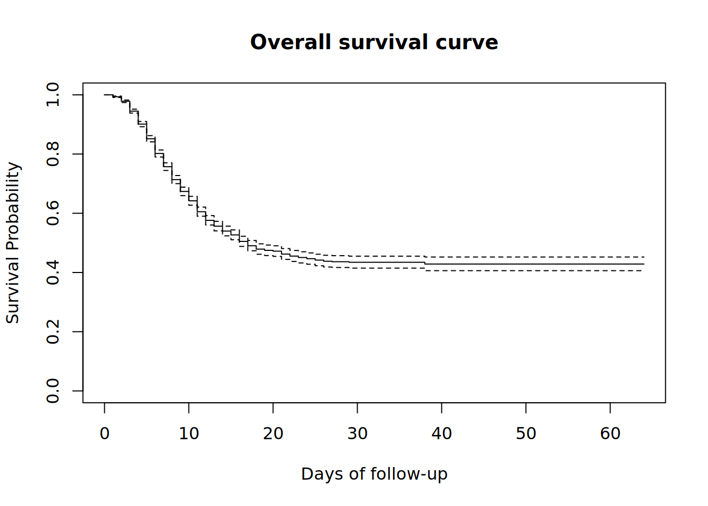
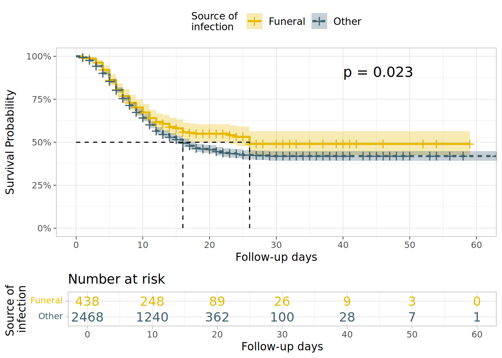

# 27  Phân tích sống còn

[](../../images/survival_analysis.png)

## 27.1 Tổng quan

*Phân tích sống còn* tập trung mô tả cho một cá thể hay một nhóm cá thể nhất định. Một điểm xác định của một sự kiện được gọi là ***failure*** (như là xuất hiện bệnh, chữa khỏi bệnh, tử vong, tái phát sau khi đáp ứng với điều trị…) mà xảy ra sau một khoảng thời gian được gọi là ***failure time (thời gian dẫn đến sự kiện)*** (hoặc ***follow-up time (thời gian theo dõi)*** trong nghiên cứu thuần tập/nghiên cứu dựa vào dân số) trong suốt thời gian các cá thể được quan sát. Để xác định thời gian dẫn đến sự kiện, chúng ta cần xác định thời điểm bắt đầu (có thể là ngày nhận vào, ngày chẩn đoán…).

Mục tiêu suy luận đối với phân tích sống còn là khoảng thời gian giữa thời điểm bắt đầu và thời điểm sự kiện xảy ra. Trong nghiên cứu y học hiện nay, phân tích sống còn được sử dụng rộng rãi trong các nghiên cứu lâm sàng để đánh giá hiệu quả của một phương pháp điều trị hoặc trong dịch tễ học ung thư để đánh giá rất nhiều chỉ số sống còn khác nhau của bệnh ung thư.

Nó thường được diễn đạt qua ***survival probability (xác suất sống sót)*** là xác suất mà sự hiện đang quan tâm không xảy ra trong khoảng thời gian t.

***Censoring***: Censoring xảy ra khi sự kiện đang quan tâm không xảy ra trong một số cá thể ở cuối quá trình theo dõi, và vì thế, thời gian thật dẫn đến sự kiện của những cá thể này là không biết. Trong chương này, chúng tôi tập trung chủ yếu vào sự kiện không xảy ra về phía bên phải. Để biết thêm chi tiết về các loại censoring và phân tích sống còn nói chung, xem thêm các tài liệu tham khảo.

## 27.2 Chuẩn bị

### Gọi packages

**Survival** là một trong những gói lệnh được sử dụng rộng rãi nhất để phân tích sống còn bằng R. Đầu tiên, chúng ta cài đặt và sau đó tải gói lệnh này cũng như các gói lệnh khác sẽ được sử dụng trong phần này:

Trong cuốn sổ tay này, chúng tôi nhấn mạnh đến hàm `p_load()` từ package **pacman**, giúp cài đặt package nếu cần thiết *và* gọi chúng ra để sử dụng. Bạn cũng có thể gọi các package đã được cài đặt bằng hàm `library()` trong **base** R. Xem chương [R cơ bản](basics.llms.md) để biết thêm thông tin về các package trong R.

Chương này sẽ tìm hiểu phân tích sống còn bằng cách dùng bộ số liệu linelist đã được sử dụng trong hầu hết các chương trước và thay đổi một vài điểm để tạo ra bộ số liệu phù hợp cho phân tích sống còn.

### Nhập bộ số liệu

Chúng ta nhập bộ số liệu của các ca bệnh được mô phỏng từ một vụ dịch Ebola. Tải trực tiếp bằng `appliedepidata::get_data(name = "linelist_cleaned_rds")` (xem trang [Tải sách và dữ liệu](download.llms.md) để biết chi tiết).

``` r
# import linelist
linelist_case_data <- appliedepidata::get_data(name = "linelist_cleaned_rds")
```

### Quản lý và chuyển đổi số liệu

Nói ngắn gọn, số liệu cho phân tích sống còn có ba đặc điểm sau:

1.  biến phụ thuộc hay đáp ứng là khoảng thời gian từ thời điểm bắt đầu đến thời điểm một sự kiện (được xác định rõ) xảy ra,
2.  quan sát censored là các quan sát mà sự kiện quan tâm không xảy ra tại thời điểm phân tích số liệu, và
3.  các biến dự đoán hay giải thích có ảnh hưởng đến thời gian dẫn đến sự kiện mà chúng ta muốn đánh giá hoặc kiểm soát.

Do đó, chúng ta sẽ tạo các biến số khác nhau tuân theo cấu trúc dữ liệu đó và tiến hành phân tích sống còn.

Chúng ta định nghĩa:

- một bộ số liệu mới `linelist_surv` cho phân tích này  
- sự kiện quan tâm là “tử vong” (vì thế xác suất sống sót sẽ là xác suất sống trong một khoảng thời gian nhất định sau thời đểm bắt đầu),
- thời gian theo dõi (`futime`) là *số ngày* giữa thời điểm khởi phát bệnh và thời điểm có kết cục,
- bệnh nhân censored là những người đã hồi phục hoặc những người không biết kết cục, ví dụ như sự kiện “tử vong” không được quan sát (`event=0`).

***THẬN TRỌNG:*** Trong một nghiên cứu thuần tập thực tế, thông tin về thời điểm bắt đầu và thời điểm kết thúc theo dõi của các cá thể là được biết, do đó chúng ta sẽ loại bỏ các quan sát không có ngày bắt đầu và ngày có kết cục. Ngoài ra, các trường hợp có ngày khởi phát bệnh trễ hơn ngày có kết cục cũng bị loại bỏ vì các trường hợp này được xem là sai.

***MẸO:*** Khi lọc đến các giá trị lớn hơn (\>) hoặc nhỏ hơn (\<) một ngày có thể loại bỏ các hàng có giá trị missing, nên khi áp dụng lọc sai ngày cũng sẽ loại bỏ các hàng có ngày bị thiếu.

Sau đó, chúng ta sử dụng hàm `case_when()` để tạo ra một cột `age_cat_small` mà chỉ có 3 giá trị của nhóm tuổi.

``` r
#create a new data called linelist_surv from the linelist_case_data

linelist_surv <-  linelist_case_data %>% 
     
  dplyr::filter(
       # remove observations with wrong or missing dates of onset or date of outcome
       date_outcome > date_onset) %>% 
  
  dplyr::mutate(
       # create the event var which is 1 if the patient died and 0 if he was right censored
       event = ifelse(is.na(outcome) | outcome == "Recover", 0, 1), 
    
       # create the var on the follow-up time in days
       futime = as.double(date_outcome - date_onset), 
    
       # create a new age category variable with only 3 strata levels
       age_cat_small = dplyr::case_when( 
            age_years < 5  ~ "0-4",
            age_years >= 5 & age_years < 20 ~ "5-19",
            age_years >= 20   ~ "20+"),
       
       # previous step created age_cat_small var as character.
       # now convert it to factor and specify the levels.
       # Note that the NA values remain NA's and are not put in a level "unknown" for example,
       # since in the next analyses they have to be removed.
       age_cat_small = fct_relevel(age_cat_small, "0-4", "5-19", "20+")
       )
```

***MẸO:*** Chúng ta có thể kiểm tra lại các cột mới đã được tạo ra bằng cách thực hiện tóm tắt đối với biến số `futime` avà bảng chéo giữa biến số `event` và biến kết cục `outcome`. Bên cạnh việc kiểm tra này, đây là một thói quen tốt để biết được thời gian theo dõi trung vị khi giải thích kết quả của phân tích sống còn.

``` r
summary(linelist_surv$futime)
```

       Min. 1st Qu.  Median    Mean 3rd Qu.    Max. 
       1.00    6.00   10.00   11.98   16.00   64.00 

``` r
# cross tabulate the new event var and the outcome var from which it was created
# to make sure the code did what it was intended to
linelist_surv %>% 
  tabyl(outcome, event)
```

     outcome    0    1
       Death    0 1952
     Recover 1547    0
        <NA> 1040    0

Bây giờ, chúng ta tạo bảng chéo giữa biến nhóm tuổi mới `age_cat_small` và biến nhóm tuổi cũ `age_cat` để đảm bảo tính chính xác của việc chuyển đổi số liệu

``` r
linelist_surv %>% 
  tabyl(age_cat_small, age_cat)
```

     age_cat_small 0-4 5-9 10-14 15-19 20-29 30-49 50-69 70+ NA_
               0-4 834   0     0     0     0     0     0   0   0
              5-19   0 852   717   575     0     0     0   0   0
               20+   0   0     0     0   862   554    69   5   0
              <NA>   0   0     0     0     0     0     0   0  71

Bây giờ, chúng ta xem lại 10 quan sát đầu tiên của bộ số liệu `linelist_surv` bằng cách xem xét các biến cụ thể (bao gồm cả các biến mới được tạo ra).

``` r
linelist_surv %>% 
  select(case_id, age_cat_small, date_onset, date_outcome, outcome, event, futime) %>% 
  head(10)
```

       case_id age_cat_small date_onset date_outcome outcome event futime
    1   8689b7           0-4 2014-05-13   2014-05-18 Recover     0      5
    2   11f8ea           20+ 2014-05-16   2014-05-30 Recover     0     14
    3   893f25           0-4 2014-05-21   2014-05-29 Recover     0      8
    4   be99c8          5-19 2014-05-22   2014-05-24 Recover     0      2
    5   07e3e8          5-19 2014-05-27   2014-06-01 Recover     0      5
    6   369449           0-4 2014-06-02   2014-06-07   Death     1      5
    7   f393b4           20+ 2014-06-05   2014-06-18 Recover     0     13
    8   1389ca           20+ 2014-06-05   2014-06-09   Death     1      4
    9   2978ac          5-19 2014-06-06   2014-06-15   Death     1      9
    10  fc15ef          5-19 2014-06-16   2014-07-09 Recover     0     23

Chúng ta cũng có thể tạo bảng chéo giữa cột biến `age_cat_small` và `gender` để biết thêm chi tiết về sự phân bố của biến số mới này theo giới tính. Chúng ta sử dụng hàm `tabyl()` và hàm *adorn* từ package **janitor** như được mô tả trong chương [Bảng mô tả](tables_descriptive.llms.md).

``` r
linelist_surv %>% 
  tabyl(gender, age_cat_small, show_na = F) %>% 
  adorn_totals(where = "both") %>% 
  adorn_percentages() %>% 
  adorn_pct_formatting() %>% 
  adorn_ns(position = "front")
```

     gender         0-4          5-19           20+          Total
          f 482 (22.4%) 1,184 (54.9%)   490 (22.7%) 2,156 (100.0%)
          m 325 (15.0%)   880 (40.6%)   960 (44.3%) 2,165 (100.0%)
      Total 807 (18.7%) 2,064 (47.8%) 1,450 (33.6%) 4,321 (100.0%)

## 27.3 Cơ bản về phân tích sống còn

### Tạo ra đối tượng kiểu surv

Đầu tiên, chúng ta dùng hàm `Surv()` từ package **survival** để tạo ra một ‘đối tượng surv’ từ cột follow-up time và event.

Kết quả của bước này tạo ra một đối tượng *Surv* bao gồm thông tin thời gian và có hay không sự kiện quan tâm (tử vong) được nhận thấy. Đối tượng này sẽ được sử dụng sau này ở phía bên phải trong công thức của những mô hình tiếp theo (xem [tài liệu](https://cran.r-project.org/web/packages/survival/vignettes/survival.pdf)).

``` r
# Use Suv() syntax for right-censored data
survobj <- Surv(time = linelist_surv$futime,
                event = linelist_surv$event)
```

Để xem lại số liệu, đây là 10 hàng đầu tiên của bộ số liệu `linelist_surv` data, chỉ hiển thị các cột quan trọng.

``` r
linelist_surv %>% 
  select(case_id, date_onset, date_outcome, futime, outcome, event) %>% 
  head(10)
```

       case_id date_onset date_outcome futime outcome event
    1   8689b7 2014-05-13   2014-05-18      5 Recover     0
    2   11f8ea 2014-05-16   2014-05-30     14 Recover     0
    3   893f25 2014-05-21   2014-05-29      8 Recover     0
    4   be99c8 2014-05-22   2014-05-24      2 Recover     0
    5   07e3e8 2014-05-27   2014-06-01      5 Recover     0
    6   369449 2014-06-02   2014-06-07      5   Death     1
    7   f393b4 2014-06-05   2014-06-18     13 Recover     0
    8   1389ca 2014-06-05   2014-06-09      4   Death     1
    9   2978ac 2014-06-06   2014-06-15      9   Death     1
    10  fc15ef 2014-06-16   2014-07-09     23 Recover     0

Và đây là 10 thành phần đầu tiên của đối tượng `survobj`. Về bản chất, nó xuất ra đưới dạng một véc tơ của biến số thời gian theo dõi, dấu “+” là đại điện cho một quan sát censored ở phía bên phải. Xem cách các con số sắp xếp bên trên và bên dưới.

``` r
#print the 50 first elements of the vector to see how it presents
head(survobj, 10)
```

     [1]  5+ 14+  8+  2+  5+  5  13+  4   9  23+

### Thực hiện các phân tích ban đầu

Sau đó, chúng ta bắt đầu phân tích bằng cách sử dụng hàm `survfit()` để tạo ra một *đối tượng survfit*, phù hợp với các tính toán mặc định cho các ước tính ***Kaplan Meier*** (KM) của đường cong sống sót chung (cận biên), mà thực tế là một hàm bước với các bước nhảy tại thời điểm sự kiện được quan sát. Đối tượng *survfit object* cuối cùng chứa đựng một hoặc nhiều đường cong sống sót và được tạo ra bằng cách sử dụng đối tượng *Surv* làm biến đáp ứng trong công thức của mô hình.

***LƯU Ý:*** Ước tính Kaplan-Meier là một ước tính khả dĩ tối đa phi tham số của hàm sống còn (xem mục Tài nguyên học liệu để biết thêm thông tin).

Tóm tắt của *đối tượng survfit* này sẽ cho một bảng được gọi là *life table (bảng sống còn)*. Đối với mỗi bước thời gian theo dõi (`time`) là nơi một sự kiện xảy ra (theo thứ tự tăng dần):

- số người có nguy cơ dẫn đến sự kiện (người chưa có sự kiện và cũng chưa bị censored: `n.risk`)  
- những người có sự kiện (`n.event`)  
- và từ những dữ kiện trên tính xác suất không đưa đến sự kiện (xác suất không tử vong, hoặc sống sót sau khoảng thời gian cụ thể đó)  
- cuối cùng, sai số chuẩn và khoảng tin cậy cho xác suất đó được tính toán và trình bày

Chúng ta thực hiện các ước tính KM bằng cách sử dụng công thức với đối tượng Surv trước đó “survobj” làm biến đáp ứng. “~ 1” diễn đạt rẳng chúng ta đang thực hiện mô hình sống còn tổng quát.

``` r
# fit the KM estimates using a formula where the Surv object "survobj" is the response variable.
# "~ 1" signifies that we run the model for the overall survival  
linelistsurv_fit <-  survival::survfit(survobj ~ 1)

#print its summary for more details
summary(linelistsurv_fit)
```

    Call: survfit(formula = survobj ~ 1)

     time n.risk n.event survival std.err lower 95% CI upper 95% CI
        1   4539      30    0.993 0.00120        0.991        0.996
        2   4500      69    0.978 0.00217        0.974        0.982
        3   4394     149    0.945 0.00340        0.938        0.952
        4   4176     194    0.901 0.00447        0.892        0.910
        5   3899     214    0.852 0.00535        0.841        0.862
        6   3592     210    0.802 0.00604        0.790        0.814
        7   3223     179    0.757 0.00656        0.745        0.770
        8   2899     167    0.714 0.00700        0.700        0.728
        9   2593     145    0.674 0.00735        0.660        0.688
       10   2311     109    0.642 0.00761        0.627        0.657
       11   2081     119    0.605 0.00788        0.590        0.621
       12   1843      89    0.576 0.00809        0.560        0.592
       13   1608      55    0.556 0.00823        0.540        0.573
       14   1448      43    0.540 0.00837        0.524        0.556
       15   1296      31    0.527 0.00848        0.511        0.544
       16   1152      48    0.505 0.00870        0.488        0.522
       17   1002      29    0.490 0.00886        0.473        0.508
       18    898      21    0.479 0.00900        0.462        0.497
       19    798       7    0.475 0.00906        0.457        0.493
       20    705       4    0.472 0.00911        0.454        0.490
       21    626      13    0.462 0.00932        0.444        0.481
       22    546       8    0.455 0.00948        0.437        0.474
       23    481       5    0.451 0.00962        0.432        0.470
       24    436       4    0.447 0.00975        0.428        0.466
       25    378       4    0.442 0.00993        0.423        0.462
       26    336       3    0.438 0.01010        0.419        0.458
       27    297       1    0.436 0.01017        0.417        0.457
       29    235       1    0.435 0.01030        0.415        0.455
       38     73       1    0.429 0.01175        0.406        0.452

Khi sử dụng hàm `summary()`, chúng ta có thể thêm tùy chọn `times` và cụ thể các thời điểm nhất định mà chúng ta muốn xem các thông tin sống còn

``` r
#print its summary at specific times
summary(linelistsurv_fit, times = c(5,10,20,30,60))
```

    Call: survfit(formula = survobj ~ 1)

     time n.risk n.event survival std.err lower 95% CI upper 95% CI
        5   3899     656    0.852 0.00535        0.841        0.862
       10   2311     810    0.642 0.00761        0.627        0.657
       20    705     446    0.472 0.00911        0.454        0.490
       30    210      39    0.435 0.01030        0.415        0.455
       60      2       1    0.429 0.01175        0.406        0.452

Chúng ta cũng có thể sử dụng hàm `print()`. Đối số `print.rmean = TRUE` được sử dụng để có được giá trị trung bình của thời gian sống sót và sai số chuẩn (se).

***LƯU Ý:*** Thời gian sống sót trung bình giới hạn là một đo lường sống còn cụ thể ngày càng được sử dụng trong phân tích sống còn của bệnh ung thư và thường được định nghĩa là khu vực dưới đường cong, khi chúng ta quan sát bệnh nhân cho đến thời gian giới hạn T (xem phần Tài nguyên học liệu để biết thêm chi tiết).

``` r
# print linelistsurv_fit object with mean survival time and its se. 
print(linelistsurv_fit, print.rmean = TRUE)
```

    Call: survfit(formula = survobj ~ 1)

            n events rmean* se(rmean) median 0.95LCL 0.95UCL
    [1,] 4539   1952   33.1     0.539     17      16      18
        * restricted mean with upper limit =  64 

***MẸO:*** Chúng ta có thể tạo ra *đối tượng surv* trực tiếp trong hàm `survfit()` và tiết kiệm một dòng lệnh. Thực hiện điều này như sau: `linelistsurv_quick <- survfit(Surv(futime, event) ~ 1, data=linelist_surv)`.

### Mối nguy tích lũy

Bên cạnh hàm `summary()`, chúng ta có thể sử dụng hàm `str()`, hàm này cho biết chi tiết hơn vể cấu trúc của các đối tượng trong hàm `survfit()`. Cấu trúc này là một danh sách của 16 thành phần.

Một thành phần quan trọng trong số những thành phần này là: `cumhaz`, một véc tơ kiểu số. Thành phần này có thể được vẽ để hiển thị ***mối nguy tích lũy***, với ***mối nguy*** là ***tỷ suất xảy ra sự kiện tức thời*** (xem tài liệu tham khảo).

``` r
str(linelistsurv_fit)
```

    List of 17
     $ n        : int 4539
     $ time     : num [1:59] 1 2 3 4 5 6 7 8 9 10 ...
     $ n.risk   : num [1:59] 4539 4500 4394 4176 3899 ...
     $ n.event  : num [1:59] 30 69 149 194 214 210 179 167 145 109 ...
     $ n.censor : num [1:59] 9 37 69 83 93 159 145 139 137 121 ...
     $ surv     : num [1:59] 0.993 0.978 0.945 0.901 0.852 ...
     $ std.err  : num [1:59] 0.00121 0.00222 0.00359 0.00496 0.00628 ...
     $ cumhaz   : num [1:59] 0.00661 0.02194 0.05585 0.10231 0.15719 ...
     $ std.chaz : num [1:59] 0.00121 0.00221 0.00355 0.00487 0.00615 ...
     $ type     : chr "right"
     $ logse    : logi TRUE
     $ conf.int : num 0.95
     $ conf.type: chr "log"
     $ lower    : num [1:59] 0.991 0.974 0.938 0.892 0.841 ...
     $ upper    : num [1:59] 0.996 0.982 0.952 0.91 0.862 ...
     $ t0       : num 0
     $ call     : language survfit(formula = survobj ~ 1)
     - attr(*, "class")= chr "survfit"

### Vẽ đường cong Kaplan-Meir

Sau khi ước tính KM đã được fit, chúng ta có thể hình dung xác suất sống sót qua một thời gian nhất định bằng cách dùng hàm `plot()` để vẽ “đường cong Kaplan-Meier”. Nói cách khác, đường cong bên dưới là một minh họa đường cong sống sót quy ước của toàn bộ nhóm bệnh nhân.

Chúng ta có thể nhanh chóng xác minh thời gian theo dõi tối thiểu và tối đa trên đường cong.

Một cách dễ dàng để giải thích là phát biểu rằng, tại thời điểm 0, tất cả người tham gia đều sống và xác suất sống sót khi đó là 100%.Xác suất ngày giảm dần theo thời gian khi có bệnh nhân tử vong. Tỷ lệ người tham gia sống sót sau 60 ngày là khoảng 40%.

``` r
plot(linelistsurv_fit, 
     xlab = "Days of follow-up",    # x-axis label
     ylab="Survival Probability",   # y-axis label
     main= "Overall survival curve" # figure title
     )
```

[](survival_analysis_files/figure-html/unnamed-chunk-13-1.png)

Khoảng tin cậy của các ước tính KM cũng được vẽ mặc định trên biểu đồ và có thể bị loại bỏ bằng cách thêm tùy chọn `conf.int = FALSE` vào trong lệnh `plot()`.

Vì sự kiện quan tâm là “tử vong”, việc vẽ một đường cong mô tả phần bù tỷ lệ sống sót sẽ đưa đến việc vẽ tỷ lệ tử vong tích lũy. Điều này có thể được thực hiện với hàm `lines()`, bổ sung thông tin trên biểu đồ hiện có.

``` r
# original plot
plot(
  linelistsurv_fit,
  xlab = "Days of follow-up",       
  ylab = "Survival Probability",       
  mark.time = TRUE,              # mark events on the curve: a "+" is printed at every event
  conf.int = FALSE,              # do not plot the confidence interval
  main = "Overall survival curve and cumulative mortality"
  )

# draw an additional curve to the previous plot
lines(
  linelistsurv_fit,
  lty = 3,             # use different line type for clarity
  fun = "event",       # draw the cumulative events instead of the survival 
  mark.time = FALSE,
  conf.int = FALSE
  )

# add a legend to the plot
legend(
  "topright",                               # position of legend
  legend = c("Survival", "Cum. Mortality"), # legend text 
  lty = c(1, 3),                            # line types to use in the legend
  cex = .85,                                # parametes that defines size of legend text
  bty = "n"                                 # no box type to be drawn for the legend
  )
```

[](survival_analysis_files/figure-html/unnamed-chunk-14-1.png)

## 27.4 So sánh các đường cong sống sót

Để so sánh các đường cong sống sót của những nhóm người tham gia hoặc bệnh nhân khác nhau, đầu tiên chúng ta có thể cần xem xét các đường cong tương ứng của các nhóm và sau đó thực hiện các kiểm định để lượng giá sự khác biệt giữa các nhóm độc lập. So sánh này có thể liên quan đến các nhóm dựa vào giới tính, tuổi tác, điều trị, bệnh đi kèm,…

### Kiểm định Log rank

Kiểm định log rank là một kiểm định phổ biến để so sánh toàn bộ quá trình sống sót giữa hai hay nhiều nhóm *độc lập* và có thể xem xét các đường cong sống sót có tương đồng (chồng chéo) hay không (giả thuyết vô hiệu là không có sự khác biệt về sự sống sót giữa các nhóm). Hàm `survdiff()` trong **survival package** cho phép thực hiện kiểm định log-rank khi chúng ta cụ thể `rho = 0` (mặc định). Kết quả kiểm định cho ra một thống kê chi bình phương cùng với giá trị p vì log-rank phân phối gần giống như thống kê của kiểm định chi bình phương.

Đầu tiên, chúng ta thử so sánh các đường cong sống sót theo giới tính. Đối với điều này, chúng ta thử hình dung nó (kiểm tra xem hai đường cong sống sót có chồng lên nhau không). Một *đối tượng survfit* mới sẽ được tạo ra với một công thức hơi khác một chút. Sau đó, *đối tượng survdiff* sẽ được tạo ra.

Bằng cách cung cấp `~ gender` ở phía bên phải của công thức, chúng ta không còn vẽ biểu đồ đường cong sống sót chung mà thay vào đó là theo giới tính.

``` r
# create the new survfit object based on gender
linelistsurv_fit_sex <-  survfit(Surv(futime, event) ~ gender, data = linelist_surv)
```

Bây giờ, chúng ta có thể vẽ các đường cong sống sót theo giới tính. Hãy xem *thứ tự* giá trị biến của giới tính trước khi xác định màu sắc và chú giải.

``` r
# set colors
col_sex <- c("lightgreen", "darkgreen")

# create plot
plot(
  linelistsurv_fit_sex,
  col = col_sex,
  xlab = "Days of follow-up",
  ylab = "Survival Probability")

# add legend
legend(
  "topright",
  legend = c("Female","Male"),
  col = col_sex,
  lty = 1,
  cex = .9,
  bty = "n")
```

[](survival_analysis_files/figure-html/unnamed-chunk-15-1.png)

Và bây giờ, chúng ta có thể tính toán kiểm định sự khác biệt giữa các đường cong bằng cách sử dụng hàm `survdiff()`

``` r
#compute the test of the difference between the survival curves
survival::survdiff(
  Surv(futime, event) ~ gender, 
  data = linelist_surv
  )
```

    Call:
    survival::survdiff(formula = Surv(futime, event) ~ gender, data = linelist_surv)

    n=4321, 218 observations deleted due to missingness.

                N Observed Expected (O-E)^2/E (O-E)^2/V
    gender=f 2156      924      909     0.255     0.524
    gender=m 2165      929      944     0.245     0.524

     Chisq= 0.5  on 1 degrees of freedom, p= 0.5 

Chúng ta thấy rằng đường cong sống sót cho nữ và đường cong cho nam chồng lên nhau và kiểm định log-rank không đưa ra bằng chứng về sự khác biệt sống sót giữa nam và nữ.

Một số package trong R cho phép minh họa các đường cong sống sót cho các nhóm và kiểm định sự khác biệt cùng một lúc. Sử dụng hàm `ggsurvplot()` từ package **survminer**, chúng ta cũng có thể bao gồm các bảng nguy cơ với các đường cong này cũng như giá trị p từ kiểm định log-rank.

***THẬN TRỌNG:*** Các hàm từ package **survminer** đòi hỏi chúng ta cụ thể đối tượng sống sót *và* cụ thể lại bộ số liệu đã dùng để fit đối tượng sống sót đó. Hãy nhớ làm điều này để tránh thông báo lỗi do không cụ thể.

``` r
survminer::ggsurvplot(
    linelistsurv_fit_sex, 
    data = linelist_surv,          # again specify the data used to fit linelistsurv_fit_sex 
    conf.int = FALSE,              # do not show confidence interval of KM estimates
    surv.scale = "percent",        # present probabilities in the y axis in %
    break.time.by = 10,            # present the time axis with an increment of 10 days
    xlab = "Follow-up days",
    ylab = "Survival Probability",
    pval = T,                      # print p-value of Log-rank test 
    pval.coord = c(40,.91),        # print p-value at these plot coordinates
    risk.table = T,                # print the risk table at bottom 
    tables.col = "strata",         # colour the risk table numbers by group
    legend.title = "Gender",       # legend characteristics
    legend.labs = c("Female","Male"),
    font.legend = 10, 
    palette = "Dark2",             # specify color palette 
    surv.median.line = "hv",       # draw horizontal and vertical lines to the median survivals
    ggtheme = theme_light()        # simplify plot background
)
```

[](survival_analysis_files/figure-html/unnamed-chunk-17-1.png)

Chúng ta có thể cũng muốn kiểm định sự khác biệt về sống còn theo nguồn lây (nguồn ô nhiễm).

Trong trường hợp này, kiểm định log-rank cho thấy có đủ bằng chứng về sự khác biệt trong xác suất sống sót với `alpha= 0.005`. Xác suất sống sót cho những bệnh nhân bị nhiễm tại các đám tang cao hơn xác suất sống sót ở những nơi khác mà gợi ý về lợi ích sống sót.

``` r
linelistsurv_fit_source <-  survfit(
  Surv(futime, event) ~ source,
  data = linelist_surv
  )

# plot
ggsurvplot( 
  linelistsurv_fit_source,
  data = linelist_surv,
  linetype = "strata",   # line types
  conf.int = T,
  surv.scale = "percent",  
  break.time.by = 10, 
  xlab = "Follow-up days",
  ylab= "Survival Probability",
  pval = T,
  pval.coord = c(40,.91),
  risk.table = T,
  tables.col = "strata",
  legend.title = "Source of \ninfection",
  legend.labs = c("Funeral", "Other"),
  font.legend = 10,
  palette = c("#E7B800","#3E606F"),
  surv.median.line = "hv", 
  ggtheme = theme_light()
)
```

[](survival_analysis_files/figure-html/unnamed-chunk-18-1.png)

## 27.5 Phân tích bằng hồi quy Cox

Hồi quy mối nguy theo tỷ lệ Cox (sau này sẽ gọi ngắn gọn là hồi quy Cox) là một trong những kỹ thuật hồi quy phổ biến nhất cho phân tích sống còn. Các mô hình khác cũng có thể được sử dụng, vì để sử dụng thích hợp mô hình Cox, *các giả định quan trọng* cần phải được xác minh: xem tài liệu tham khảo.

Trong một mô hình hồi quy Cox, đo lường ảnh hưởng là ***hazard rate (tỷ suất mối nguy)*** (HR), là nguy cơ xảy ra sự kiện (hay là nguy cơ tử vong trong ví dụ này), của người tham gia sống sót đến một thời điểm cụ thể. Thông thường, chúng ta quan tâm đến việc so sánh giữa các nhóm *độc lập* gvề nguy cơ của nó, và sử dụng tỷ số nguy cơ mà tương tự như tỷ số chênh khi thực hiện hồi quy logistic đa biến. Hàm `cox.ph()` từ package **survival** được sử dụng để fit mô hình. Hàm `cox.zph()` từ package **survival** có thể được sử dụng để kiểm tra tính phù hợp của giả định nguy cơ theo tỷ lệ với mô hình hồi quy Cox.

***LƯU Ý:*** Xác suất phải nằm trong khoảng từ 0 đến 1. Tuy nhiên, nguy cơ đại điện cho số sự kiện dự đoán trên một đơn vị thời gian.

- Nếu tỷ số nguy cơ cho một yếu tố dự đoán gần bằng 1, thì yếu tố dự đoán đó không ảnh hưởng đến sự sống sót,
- Nếu HR nhỏ hơn 1, thì yếu tố dự đoán là yếu tố bảo vệ (tức là yếu tố liên quan đến cải thiện khả năng sống sót),
- Và nếu HR lớn hơn 1, thì yếu tố dự đoán kết hợp với tăng nguy cơ (hay là giảm khả năng sống sót).

### Fitting một mô hình Cox

Đầu tiên, chúng ta có thể fit một mô hình để đánh giá ảnh hưởng của tuổi và giới lên sự sống sót. Chỉ cần xuất mô hình, chúng ta có những thông tin sau:

- các ước lượng hệ số hồi quy `coef` để xác định mối liên hệ giữa các biến dự đoán và biến kết cục,
- lũy thừa của các ước số (`exp(coef)`) để tính *tỷ số nguy cơ*,
- các sai số chuẩn `se(coef)`,
- chỉ số z-score: bao nhiêu sai số chuẩn là hệ số ước tính khác biệt từ giá trị 0,
- và p-value: xác suất mà ước số có thể là 0.

Áp dụng hàm `summary()` cho các đối tượng của mô hình Cox cho biết thêm thông tin như là khoảng tin cậy của HR và các chỉ số kiểm định khác.

Kết quả của hiệp biến đầu tiên `gender` được trình bày ở hàng đầu tiên. `genderm` (nam) được in ra có ngụ ý rằng vị trí tầng đầu tiên (“f”), tức là nhóm nữ, là nhóm tham chiếu cho biến số giới tính. Vì thế, giải thích các thông số kiểm định là của nam so với nữ. Giá trị p chỉ ra rằng không có đủ bằng chứng về ảnh hưởng của giới tính lên mối nguy hay là không có đủ bằng chứng về mối liên quan giữa giới và tử vong (do tất cả các nguyên nhân).

Cũng thiếu bằng chứng như vậy đối với biến số nhóm tuổi.

``` r
#fitting the cox model
linelistsurv_cox_sexage <-  survival::coxph(
              Surv(futime, event) ~ gender + age_cat_small, 
              data = linelist_surv
              )


#printing the model fitted
linelistsurv_cox_sexage
```

    Call:
    survival::coxph(formula = Surv(futime, event) ~ gender + age_cat_small, 
        data = linelist_surv)

                          coef exp(coef) se(coef)      z     p
    genderm           -0.03149   0.96900  0.04767 -0.661 0.509
    age_cat_small5-19  0.09400   1.09856  0.06454  1.456 0.145
    age_cat_small20+   0.05032   1.05161  0.06953  0.724 0.469

    Likelihood ratio test=2.8  on 3 df, p=0.4243
    n= 4321, number of events= 1853 
       (218 observations deleted due to missingness)

``` r
#summary of the model
summary(linelistsurv_cox_sexage)
```

    Call:
    survival::coxph(formula = Surv(futime, event) ~ gender + age_cat_small, 
        data = linelist_surv)

      n= 4321, number of events= 1853 
       (218 observations deleted due to missingness)

                          coef exp(coef) se(coef)      z Pr(>|z|)
    genderm           -0.03149   0.96900  0.04767 -0.661    0.509
    age_cat_small5-19  0.09400   1.09856  0.06454  1.456    0.145
    age_cat_small20+   0.05032   1.05161  0.06953  0.724    0.469

                      exp(coef) exp(-coef) lower .95 upper .95
    genderm               0.969     1.0320    0.8826     1.064
    age_cat_small5-19     1.099     0.9103    0.9680     1.247
    age_cat_small20+      1.052     0.9509    0.9176     1.205

    Concordance= 0.514  (se = 0.007 )
    Likelihood ratio test= 2.8  on 3 df,   p=0.4
    Wald test            = 2.78  on 3 df,   p=0.4
    Score (logrank) test = 2.78  on 3 df,   p=0.4

Thật rất thú vị để thực hiện mô hình và xem kết quả, nhưng quan sát đầu tiên để xác minh xem có thỏa các giả định về nguy cơ theo tỷ lệ hay không mà có thể giúp tiết kiệm thời gian.

``` r
test_ph_sexage <- survival::cox.zph(linelistsurv_cox_sexage)
test_ph_sexage
```

                  chisq df    p
    gender        0.454  1 0.50
    age_cat_small 0.838  2 0.66
    GLOBAL        1.399  3 0.71

***LƯU Ý:*** đối số thứ hai được gọi là *method* có thể được định rõ khi tính toán mô hình Cox để xác định cách xử lý các giá trị thời gian trùng nhau (ties). Phương pháp *mặc định* là “efron”, và các tùy chọn khác là “breslow” và “exact”.

Trong một mô hình khác, chúng tôi thêm nhiều yếu tố nguy cơ hơn như nguồn lây và số ngày giữa ngày khởi phát và ngày nhập viện. Điều trước tiên vào lúc này là xác minh các giả định nguy cơ theo tỷ lệ trước khi thực hiện các bước tiếp theo.

Trong mô hình này, chúng ta bao gồm một biến dự báo liên tục (`days_onset_hosp`). Trong trường hợp này, chúng ta giải thích các ước tính của thông số như là sự gia tăng theo lôgarít kỳ vọng của nguy cơ tương đối cho mỗi mức tăng của một đơn vị trong biến dự đoán, bằng cách giữ các yếu tố dự đoán khác cố định. Đầu tiên chúng ta xác minh giả định nguy cơ theo tỷ lệ.

``` r
#fit the model
linelistsurv_cox <-  coxph(
                        Surv(futime, event) ~ gender + age_years+ source + days_onset_hosp,
                        data = linelist_surv
                        )


#test the proportional hazard model
linelistsurv_ph_test <- cox.zph(linelistsurv_cox)
linelistsurv_ph_test
```

                       chisq df       p
    gender           0.45062  1    0.50
    age_years        0.00199  1    0.96
    source           1.79622  1    0.18
    days_onset_hosp 31.66167  1 1.8e-08
    GLOBAL          34.08502  4 7.2e-07

Việc xác minh bằng đồ thị của giả định này có thể được thực hiện bằng hàm `ggcoxzph()` của package **survminer**.

``` r
survminer::ggcoxzph(linelistsurv_ph_test)
```

[](survival_analysis_files/figure-html/unnamed-chunk-19-1.png)

Kết quả mô hình chỉ ra rằng có mối liên quan nghịch giữa khoảng thời gian từ khởi phát bệnh đến nhân viện và tử vong do tất cả các nguyên nhân. Nguy cơ dự đoán là bằng 0.9 lần ở một người nhập viện trễ hơn một ngày so với người khác, khi giữ biến giới tính cố định. Hay giải thích một cách dễ hiểu hơn, tăng một đơn vị thời gian từ lúc khởi phát đến nhập viện thì có liên quan đến giảm 10.7% (`coef *100`) nguy cơ tử vong.

Kết quả cũng cho thấy một mối liên quan thuận giữa nguồn lây và tử vong. Điều này có nghĩa là nguy cơ tử vong của bệnh nhân có nguồn lây bằng 1.21 lần so với bệnh nhân có nguồn lây là đám tang.

``` r
#print the summary of the model
summary(linelistsurv_cox)
```

    Call:
    coxph(formula = Surv(futime, event) ~ gender + age_years + source + 
        days_onset_hosp, data = linelist_surv)

      n= 2772, number of events= 1180 
       (1767 observations deleted due to missingness)

                         coef exp(coef)  se(coef)      z Pr(>|z|)    
    genderm          0.004710  1.004721  0.060827  0.077   0.9383    
    age_years       -0.002249  0.997753  0.002421 -0.929   0.3528    
    sourceother      0.178393  1.195295  0.084291  2.116   0.0343 *  
    days_onset_hosp -0.104063  0.901169  0.014245 -7.305 2.77e-13 ***
    ---
    Signif. codes:  0 '***' 0.001 '**' 0.01 '*' 0.05 '.' 0.1 ' ' 1

                    exp(coef) exp(-coef) lower .95 upper .95
    genderm            1.0047     0.9953    0.8918    1.1319
    age_years          0.9978     1.0023    0.9930    1.0025
    sourceother        1.1953     0.8366    1.0133    1.4100
    days_onset_hosp    0.9012     1.1097    0.8764    0.9267

    Concordance= 0.566  (se = 0.009 )
    Likelihood ratio test= 71.31  on 4 df,   p=1e-14
    Wald test            = 59.22  on 4 df,   p=4e-12
    Score (logrank) test = 59.54  on 4 df,   p=4e-12

Chúng ta có thể xác minh mối quan hệ này bằng một bảng:

``` r
linelist_case_data %>% 
  tabyl(days_onset_hosp, outcome) %>% 
  adorn_percentages() %>%  
  adorn_pct_formatting()
```

     days_onset_hosp Death Recover   NA_
                   0 44.3%   31.4% 24.3%
                   1 46.6%   32.2% 21.2%
                   2 43.0%   32.8% 24.2%
                   3 45.0%   32.3% 22.7%
                   4 41.5%   38.3% 20.2%
                   5 40.0%   36.2% 23.8%
                   6 32.2%   48.7% 19.1%
                   7 31.8%   38.6% 29.5%
                   8 29.8%   38.6% 31.6%
                   9 30.3%   51.5% 18.2%
                  10 16.7%   58.3% 25.0%
                  11 36.4%   45.5% 18.2%
                  12 18.8%   62.5% 18.8%
                  13 10.0%   60.0% 30.0%
                  14 10.0%   50.0% 40.0%
                  15 28.6%   42.9% 28.6%
                  16 20.0%   80.0%  0.0%
                  17  0.0%  100.0%  0.0%
                  18  0.0%  100.0%  0.0%
                  22  0.0%  100.0%  0.0%
                  NA 52.7%   31.2% 16.0%

Chúng ta cần phải xem xét và điều tra tại sao sự kết hợp này tồn tại trong số liệu. Một giải thích có thể chấp nhận được là những bệnh nhân sống đủ lâu để được nhập viện trễ hơn vốn đã có bệnh lúc đầu ít nghiêm trọng hơn. Một giải thích khác có lẽ dễ chấp nhận hơn là vì chúng ta sử dụng một bộ số liệu mô phỏng, mẫu này không phản ánh đúng thực tế!

### Biểu đồ Forest plot

Chúng ta có thể vẽ kết quả của mô hình Cox bằng cách sử dụng hàm `ggforest()` trong package **survminer** để vẽ biểu đồ Forest plot.

``` r
ggforest(linelistsurv_cox, data = linelist_surv)
```

[](survival_analysis_files/figure-html/forestp-1.png)

## 27.6 Các hiệp biến phụ thuộc vào thời gian trong mô hình sống còn

Một số nội dung dưới đây được adapt từ tài liệu [Giới thiệu về phân tích sống còn với R](https://www.emilyzabor.com/tutorials/survival_analysis_in_r_tutorial.html) với sự cho phép của [TS. Emily Zabor](https://www.emilyzabor.com/)

Trong phần trước, chúng ta đã đề cập đến việc sử dụng hồi quy Cox để kiểm tra mối liên quan giữa hiệp biến và biến kết cục sống còn. Nhưng những phân tích này dựa trên hiệp biến được đo lường ở thời điểm ban đầu, tức là trước thời gian theo dõi sự kiện bắt đầu.

Điều gì sẽ xảy ra nếu chúng ta quan tâm đến một hiệp biến được đo **sau khi** thời gian theo dõi bắt đầu? Hoặc điều gì sẽ xảy ra nếu chúng ta có một hiệp biến có thể thay đổi theo thời gian

Ví dụ: có thể chúng ta đang làm việc với các số liệu lâm sàng mà chúng lặp lại đo lường các giá trị xét nghiệm mà có thể thay đổi theo thời gian. Đây là một ví dụ về **hiệp biến phụ thuộc vào thời gian**. Để nhấn mạnh vào vấn đề này, chúng ta cần một thiết lập đặc biệt, nhưng may là mô hình Cox rất linh động và loại số liệu này cũng có thể được mô hình hóa bằng các công cụ từ package **survival**.

### Thiết lập hiệp biến phụ thuộc vào thời gian

Phân tích các hiệp biến phụ thuộc vào thời gian trong R đòi hỏi thiết lập một bộ dữ liệu đặc biệt. Nếu quan tâm, hãy xem chi tiết hơn về vấn đề này được viết bởi tác giả của package **survival** [Sử Dụng Hiệp Biến Phụ Thuộc Vào Thời Gian và Hệ Số Phụ Thuộc Vào Thời Gian trong Mô Hình Cox](https://cran.r-project.org/web/packages/survival/vignettes/timedep.pdf).

Đối với vấn đề này, chúng ta sử dụng một bộ số liệu mới từ package `SemiCompRisks` có tên là `BMT`, bộ số liệu này bao gồm 137 bệnh nhân cấy ghép tủy xương. Các biến chúng ta sẽ tập trung vào là:

- `T1` - thời gian (tính bằng ngày) đến khi tử vong hoặc đến lần theo dõi cuối cùng  
- `delta1` - chỉ số tử vong; 1-Tử vong, 0-Còn sống  
- `TA` - thời gian (tính theo ngày) đến khi phát bệnh GVHD cấp tính (bệnh tế bào ghép tấn công vật chủ)  
- `deltaA` - chỉ số của bệnh GVHD cấp tính;
  - 1 - Đã tiến triển bệnh GVHD cấp tính  
  - 0 - Không tiến triển bệnh GVHD cấp tính

Chúng ta sẽ gọi bộ số liệu này từ package **survival** bằng cách sử dụng lệnh `data()` từ **base** R, giúp tải số liệu được chứa ở trong một package đã được cài đặt. Một data frame có tên `BMT` sẽ hiện thị trong môi trường R.

``` r
data(BMT, package = "SemiCompRisks")
```

#### Thêm mã nhận dạng bệnh nhân

Không có cột ID trong bộ số liệu `BMT`, cột này cần thiết để tạo ra bộ số liệu mà chúng ta muốn. Vì vậy, chúng ta sử dụng hàm `rowid_to_column()` từ package **tibble** thuộc hệ sinh thái **tidyverse** để tạo một biến id mới gọi là `my_id` (thêm cột ở vị trí đầu tiên của bộ số liệu với việc đánh số hàng tuần tự theo số nhận dạng bắt đầu từ số 1). Chúng ta đặt tên bộ số liệu này là `bmt`.

``` r
bmt <- rowid_to_column(BMT, "my_id")
```

Bộ số liệu mới bây giờ trông sẽ như thế này:

#### Mở rộng hàng của các bệnh nhân

Tiếp theo, chúng ta sử dụng hàm `tmerge()` với các hàm hỗ trợ `event()` và `tdc()` để tái cấu trúc bộ số liệu. Mục tiêu của chúng ta là tái cấu trúc bộ số liệu để tạo một hàng riêng biệt cho từng bệnh nhân trong mỗi khoảng thời gian mà họ có giá trị `deltaA` khác nhau. Trong bộ số liệu này, mỗi bệnh nhân có thể có nhiều nhất là hai hàng tùy thuộc vào việc họ có phát bệnh GVHD hay không trong giai đoạn thu thập số liệu. Chúng ta sẽ gọi chỉ số mới cho việc phát bệnh GVHD là `agvhd`.

- `tmerge()` tạo một bộ số liệu dài với nhiều khoảng thời gian cho các giá trị hiệp biến khác nhau cho từng bệnh nhân
- `event()` tạo chỉ số cho sự kiện mới để đi cùng với khoảng thời gian mới được tạo ra
- `tdc()` tạo cột hiệp biến phụ thuộc vào thời gian `agvhd` để đi cùng với các khoảng thời gian mới được tạo ra

``` r
td_dat <- 
  tmerge(
    data1 = bmt %>% select(my_id, T1, delta1), 
    data2 = bmt %>% select(my_id, T1, delta1, TA, deltaA), 
    id = my_id, 
    death = event(T1, delta1),
    agvhd = tdc(TA)
    )
```

Để xem điều này thực hiện thế nào, hãy xem số liệu của 5 bệnh nhân đầu tiên.

Các biến quan tâm trong bộ số liệu gốc trông như sau:

``` r
bmt %>% 
  select(my_id, T1, delta1, TA, deltaA) %>% 
  filter(my_id %in% seq(1, 5))
```

      my_id   T1 delta1   TA deltaA
    1     1 2081      0   67      1
    2     2 1602      0 1602      0
    3     3 1496      0 1496      0
    4     4 1462      0   70      1
    5     5 1433      0 1433      0

Bộ số liệu mới cho cùng các bệnh nhân này trông như sau:

``` r
td_dat %>% 
  filter(my_id %in% seq(1, 5))
```

      my_id   T1 delta1 tstart tstop death agvhd
    1     1 2081      0      0    67     0     0
    2     1 2081      0     67  2081     0     1
    3     2 1602      0      0  1602     0     0
    4     3 1496      0      0  1496     0     0
    5     4 1462      0      0    70     0     0
    6     4 1462      0     70  1462     0     1
    7     5 1433      0      0  1433     0     0

Bây giờ, một số bệnh nhân có hai hàng trong bộ số liệu tương ứng với khoảng thời gian mà họ có giá trị khác của biến mới `agvhd`. Ví dụ như Bệnh nhân số 1 hiện có hai hàng có giá trị của biến `agvhd` bằng 0 từ thời điểm 0 đến 67 và giá trị bằng 1 từ thời điểm 67 đến 2081.

### Hồi quy Cox với hiệp biến phụ thuộc vào thời gian

Bây giờ, chúng ta đã định hình lại số liệu và thêm biến mới `aghvd` phụ thuộc vào thời gian, hãy fit mô hình cox đơn biến. Chúng ta có thể sử dụng cùng hàm `coxph()` như trước, chỉ cần thay đổi trong hàm `Surv()` để chỉ rõ thời gian bắt đầu và thời gian kết thúc cho mỗi khoảng thời gian bằng cách sử dụng các đối số cho `time1 =` và `time2 =`.

``` r
bmt_td_model = coxph(
  Surv(time = tstart, time2 = tstop, event = death) ~ agvhd, 
  data = td_dat
  )

summary(bmt_td_model)
```

    Call:
    coxph(formula = Surv(time = tstart, time2 = tstop, event = death) ~ 
        agvhd, data = td_dat)

      n= 163, number of events= 80 

            coef exp(coef) se(coef)    z Pr(>|z|)
    agvhd 0.3351    1.3980   0.2815 1.19    0.234

          exp(coef) exp(-coef) lower .95 upper .95
    agvhd     1.398     0.7153    0.8052     2.427

    Concordance= 0.535  (se = 0.024 )
    Likelihood ratio test= 1.33  on 1 df,   p=0.2
    Wald test            = 1.42  on 1 df,   p=0.2
    Score (logrank) test = 1.43  on 1 df,   p=0.2

Một lần nữa, chúng ta trực quan hóa kết quả mô hình Cox bằng cách sử dụng hàm `ggforest()` từ **survminer package**.:

``` r
ggforest(bmt_td_model, data = td_dat)
```

[](survival_analysis_files/figure-html/unnamed-chunk-28-1.png)

Như bạn thấy từ biểu đồ forest plot, khoảng tin cậy và giá trị p cho thấy rằng không có mối liên hệ chặt chẽ giữa tử vong và bệnh GVHD cấp tính trong mô hình hồi quy đơn giản này.

## 27.7 Tài nguyên học liệu

[Survival Analysis Part I: Basic concepts and first analyses](https://www.ncbi.nlm.nih.gov/pmc/articles/PMC2394262/)

[Survival Analysis in R](https://www.emilyzabor.com/tutorials/survival_analysis_in_r_tutorial.html)

[Survival analysis in infectious disease research: Describing events in time](https://www.ncbi.nlm.nih.gov/pmc/articles/PMC2954271/)

[Chapter on advanced survival models Princeton](https://data.princeton.edu/wws509/notes/c7.pdf)

[Using Time Dependent Covariates and Time Dependent Coefficients in the Cox Model](https://cran.r-project.org/web/packages/survival/vignettes/timedep.pdf)

[Survival analysis cheatsheet R](https://publicifsv.sund.ku.dk/~ts/survival/survival-cheat.pdf)

[Survminer cheatsheet](https://paulvanderlaken.files.wordpress.com/2017/08/survminer_cheatsheet.pdf)

[Paper on different survival measures for cancer registry data with Rcode provided as supplementary materials](https://www.ncbi.nlm.nih.gov/pmc/articles/PMC6322561/)
